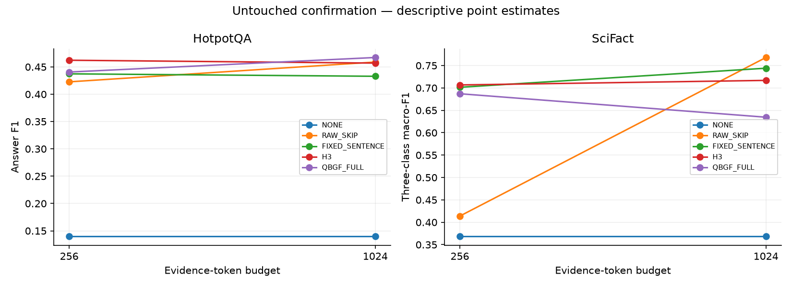
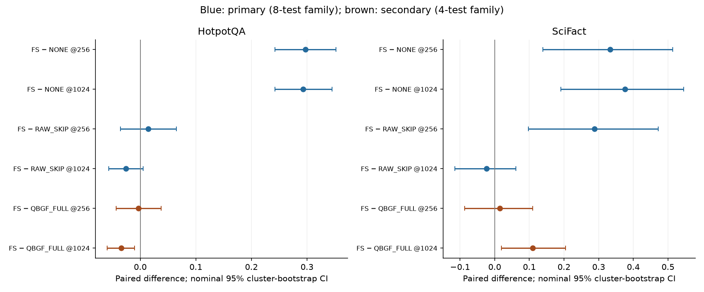

# Final project report: choosing useful evidence for retrieval-augmented language models

**CS787 RAG research project · Weeks 0–12 · Final confirmation included**  
**Report date:** 2 November 2026  
**Repository branch:** `gagan`  
**Evidence baseline:** audited weekly reconstruction committed at `a91b778c`; final tables below are read directly from saved result CSVs. No model experiment was run to write this report.

## Reader’s guide

This report explains the research problem, how the project developed, what was actually tested, and what the results justify. It is intended to be understandable without prior experience with language models. Technical terms are introduced before they are used.

Sections 1–4 explain the problem, vocabulary and data. Sections 5–9 describe the experimental journey. Sections 10–14 explain the final method, validation, evidence attribution and untouched confirmation. Sections 15–19 assess cost, limitations, conclusions and possible future work. The source guide at the end links every week’s detailed record.

**How to read the numbers:** quality scores use a 0–1 scale, where larger is better. A change from 0.40 to 0.43 is **+0.03**, or **3 score percentage points**. Answer F1 is not the same as the percentage of questions answered completely correctly. SciFact macro-F1 is a different metric and must not be averaged with answer F1.

## 1. Executive overview

The project asks a practical question:

> When a language model has limited space to read supporting documents, which parts should it see, in what form, and in what quantity?

The original focus was SARA: a system combining readable passages with compact learned vectors representing additional passages. Early experiments asked whether the system could save computation by adapting its context size to each question. The project then examined passage selection, draft-aware evidence promotion, extraction, sentence suppression, stronger retrieval, different readers, and finally budget-aware mixtures of sentences and passages.

The final proposed research method was **QBGF: query-conditioned budgeted granularity fusion**. It uses the question to score candidate passages and their sentences, then chooses a mixture that fits a fixed evidence-token budget. QBGF was evaluated against simpler controls. It did **not** establish a robust advantage across every dataset and budget required by the validation gate. The final frozen policy therefore remained the preregistered simple fallback, **FIXED_SENTENCE**, rather than promoting QBGF after seeing favorable individual cells.

A final reserved confirmation study evaluated 200 HotpotQA questions and 50 SciFact claims. The frozen sentence policy improved substantially over the no-evidence control in all four dataset/budget conditions. Sentence selection clearly exceeded the whole-passage control on SciFact at 256 tokens. At 1024 tokens, passage RAG had higher point estimates than sentence selection on both datasets, but those paired differences remained uncertain. QBGF significantly exceeded the sentence policy on HotpotQA at 1024 within the predefined secondary comparison family. This cell-specific success is reported without changing the frozen final policy.

**The central conclusion is conditional:** evidence representation matters, and useful granularity depends on the task and available budget. Simple sentence selection is a strong constrained-budget policy. Larger context can make whole passages competitive. The experiments do not establish one universally best representation, a generally successful learned context-size controller, or universal QBGF superiority.

Sources: [audited project-wide consistency record](weekly_reports/ProjectWideConsistencyAudit.csv), [Week12 summary](weekly_reports/week_12/WeeklySummaryAnalysis.md), [final confirmation summary](week12/final_confirmation/v1/summary.csv), [paired confirmation contrasts](week12/final_confirmation/v1/contrasts.csv).

## 2. The problem in everyday terms

Imagine asking an assistant a question about a long scientific article. Giving it the whole article may be expensive or exceed its reading space. Giving it only the first paragraph may omit the answer. Giving it several relevant-looking paragraphs can also introduce distracting information.

A retrieval-augmented generation system, usually called **RAG**, solves this in stages:

```text
Question → retrieve candidate text → select or compress evidence → language model → answer
```

The search component is the **retriever**. The answer-producing model is the **reader** or **generator**. The text included with the question is the **context**. This project studies the decisions between retrieving candidates and producing the answer, while also checking whether retrieval or reader differences explain apparent successes and failures.

There are several distinct problems:

1. **Retrieval:** did the candidate pool contain the necessary information?
2. **Selection:** did we choose the right candidates?
3. **Representation:** did we expose whole passages, sentences, generated summaries, or learned vectors?
4. **Budget:** how much evidence could be included?
5. **Utilization:** did the reader turn the supplied information into a better answer?

These are related but are not interchangeable. High retrieval recall does not guarantee a correct answer. An exact quotation can be irrelevant. A relevant passage can distract the model from a better answer. A more complicated selector can cost more without improving quality.

**Illustrative example, not a measured project case:** suppose the question is “Which dataset was used to evaluate the method?” A passage may contain background, training details and one evaluation sentence. Selecting that sentence saves space. However, a question asking why the method differs from earlier work may need several connected sentences. This is why the project did not assume that smaller evidence units must always be better.

## 3. Essential terminology and measurement

| Term | Plain-language meaning | Why it matters here |
| --- | --- | --- |
| Token | A unit of text used by a model; it may be a word, part of a word or punctuation | Budgets are token limits, not sentence or page limits |
| Passage / chunk | A contiguous block of source text | Preserves context but can consume much of a small budget |
| Sentence | A smaller exact source unit | Can suppress irrelevant surroundings but lose connections |
| Proposition | A small rule-derived evidence unit in the hierarchical experiments | Its presence does not imply a separately verified factual proposition |
| Embedding | A vector used to compare text semantically | Similarity is a relevance signal, not proof of factual support |
| BM25 | A lexical retrieval method based on word matching | Remains an important competitive baseline |
| MiniLM | The compact semantic encoder used in several earlier routing/selection experiments | Earlier MiniLM findings must not be presented as SFR results |
| SFR | `Salesforce/SFR-Embedding-Mistral`, a stronger embedding model used later | Final retrieval foundation; not a universal winner in every cell |
| SARA | The reproduced text-plus-latent evidence system | Changes to its adapter/projector/interface complicate comparisons with plain readers |
| Draft | An initial answer produced before an additional intervention | Can guide selection but also adds a generation call |
| LoRA | A compact trainable adaptation added to an existing model | Early SARA/RAG training and Week8 adaptation occurred; full final Week12 LoRA did not |
| Ablation | A controlled removal or restriction of one component | Helps test whether a proposed mechanism is necessary |
| Oracle | A retrospective chooser allowed to use observed answer quality | A ceiling for the tested actions, not a deployable policy |
| Smoke test | A small technical test that checks plumbing | Does not establish completed scientific performance |
| Frozen configuration | A saved specification fixed before the next evaluation | Prevents selecting a new method after inspecting holdout outcomes |

### 3.1 Quality metrics

**Answer F1**, used for QASPER and HotpotQA, measures overlap between predicted and accepted answer tokens. It rewards partially correct answers. **Exact match (EM)** is stricter: the normalized answer must match a reference exactly. Neither metric completely captures reasoning quality.

**SciFact three-class macro-F1** evaluates SUPPORT, REFUTE and NOT_ENOUGH_INFO. F1 is computed for each class and averaged, giving each class equal importance. SciFact **accuracy** is the fraction of correctly classified claims. An aggregate macro-F1 cannot be reconstructed by averaging per-claim F1 values; per-claim correctness is used for some diagnostics instead.

**HELP/HURT** records whether an intervention improves or worsens a matched reference under that experiment’s task convention and tolerance. The tolerance and reference vary across historical stages, so these rates are not one uniform cross-week metric.

**Retrieval recall** measures whether annotated evidence is found, not whether the generated answer is correct. Early lexical evidence matching and later source-span mappings differ; their recall values are not a directly comparable project-wide progression.

### 3.2 Why uncertainty is reported

A score difference on one finite sample can occur by chance. A paired comparison evaluates both methods on the same examples. A **95% confidence interval** describes uncertainty under the stated resampling procedure. If it includes zero, the result does not establish a direction at that nominal confidence level; it also does not prove equivalence.

Examples from the same paper or connected document group can be dependent. The project therefore uses **cluster bootstrap** procedures in its major paired analyses: it resamples groups together rather than pretending every related question is independent. Final confirmation uses 10,000 resamples, seed 42. Registered label-swap tests provide p-values; Holm correction accounts for the predefined comparison families. The bootstrap intervals are nominal, while adjusted p-values answer a multiple-comparison question, so their thresholds need not agree exactly.

## 4. Data, split boundaries and scope

Three tasks eventually formed the study:

| Dataset | Task | Candidate corpus used in this project | Main caution |
| --- | --- | --- | --- |
| QASPER | Answer questions about scientific papers | The matching full paper, partitioned into evidence units | Early local reformatted splits differ from later official-split reconstruction |
| HotpotQA | Answer questions that can require combining information | Provided ten-paragraph distractor contexts | This is not unrestricted retrieval across all of Wikipedia |
| SciFact | Classify scientific claims | The complete supplied abstract corpus, not only cited gold documents | Small confirmation sample and document-group dependence |

Early baseline work used a local QASPER split of **2,088 TRAIN questions across 772 papers** and **231 DEV questions across 86 papers**, with no TRAIN/DEV paper overlap recorded at that stage. Week8 separated 1,746 FIT and 342 INTERNAL-VAL questions. These cohorts must not be confused with the later Week12 split.

### 4.1 Final Week12 eligible cohorts

| Dataset | Eligible TRAIN examples | VAL examples / groups | Reserved confirmation examples / groups |
| --- | --- | --- | --- |
| QASPER | 2,178 | 1,005 / 281 | 0 / 0 |
| HotpotQA | 90,447 | 7,155 / 7,155 | 200 / 200 |
| SciFact | 531 | 177 / 157 | 50 / 43 |

These are the frozen eligible memberships, **not counts of examples actually consumed by final LoRA training**: full Week12 training was skipped. The split audit reports zero pairwise TRAIN/VAL/confirmation overlap under the registered grouping rules. QASPER training has its own historical-exposure restrictions; HotpotQA question groups do not imply that background corpus documents are globally disjoint.

Week11 was an exploratory **50-query-per-dataset pilot**. Week12 main validation covered all frozen VAL examples shown above. The 200 HotpotQA and 50 SciFact confirmation examples were reserved separately from development. QASPER had **no fresh confirmation cohort**, because its historical 1,309-query TEST set had already been used in Week9 and remained permanently closed.

Source: [Week1 split audit](weekly_reports/week_01/WeeklyPartWiseAnalysis.md), [Week11 audited summary](weekly_reports/week_11/WeeklySummaryAnalysis.md), [Week12 split summary](week12/qbgf/v3/protocol/split_summary.json), [Part-I final freeze](week12/W13_FINAL_METHOD_FREEZE.json).

## 5. The project’s progression

The table is a map of the research journey, not a claim that every notebook contained a completed full experiment.

| Stage | Main question | What the audited evidence establishes | Resulting direction |
| --- | --- | --- | --- |
| W0 | Does the reader respond to different evidence? | Real sensitivity studies show heterogeneous effects; generic mock exports are excluded | Study evidence use with provenance controls |
| W1 (`Baselines/`) | Can the baseline systems be reproduced and loaded? | RAG/SARA saved training and loading records exist; no standalone Week1 QA score established | Evaluate fixed context settings |
| W2 | How does fixed SARA text budget affect quality? | More explicit text helps aggregate scores; retrospective per-query ceilings are higher | Explore adaptive context allocation |
| W3 | How much adaptive headroom survives ties and cost tolerance? | Large oracle headroom remains, but signals are weak; claimed human ratings are unverified | Test learnable policies carefully |
| W4 | Can simple observable features predict the budget? | Several learned policies underperform static controls | Improve supervision and content features |
| W5 | Can content-aware learning close the gap? | Most models fall back to large budgets; gains are small or uncertain | Focus on which passages are explicit |
| W6 | Does passage identity matter at fixed budget? | Simple semantic routing improves several matched settings | Combine routing and allocation |
| W7 | Do learned budgets or medium-fidelity units improve semantic routing? | No consistent advantage over strong fixed semantic budgets | Investigate draft-aware interventions |
| W8 | Can a draft guide selective promotion and adaptation? | Some component gains; final integrated full-run evidence is incomplete | Simplify and control interventions |
| W9 | Can extra retrieval, extraction, sentence suppression or verification improve a draft? | Raw/generative interventions mostly fail; sentence suppression modest; TEST primary trails fixed baselines | Diagnose retriever/reader/interface |
| W10 | Which parts of the pipeline limit quality? | Stronger retrieval helps; reader adaptation/interface matters; no sole bottleneck proven | Broaden tasks and representations |
| W11 | How do granularity, budget and reader interact? | Task/budget dependence in a small multi-dataset pilot | Design and validate budgeted fusion |
| W12 C–I | Does QBGF deserve promotion? | Query-conditioned allocation helps versus its ablation, but universal fusion benefit is unproven | Freeze simple sentence fallback |
| W12 J–L | Which supplied units affect the answer? | Mostly zero deletion effects; weak/context-dependent relevance–utility alignment | Interpret, without changing the freeze |
| W12 M | Do frozen findings generalize to reserved data? | Evidence benefit repeats; granularity advantages remain conditional | Report confirmation without new selection |
| Historical W13 label | Is this another completed study? | A wrapper/name exists; actual final confirmation is W12 M | Count confirmation once |

Every week’s full tables and evidence inventory remain linked in Section 20.

## 6. Phase I: adaptive budgets in the SARA setting (Weeks 0–5)

### 6.1 Baseline foundations and early provenance

SARA combines explicit readable passages with learned latent representations of additional passages. In the original k/n notation, **n** is the total candidate count and **k** is the number retained explicitly; this differs from later sentence counts and evidence-token budgets.

Week1 reproduced saved RAG and SARA training checkpoints with 250 logged optimizer steps each, plus successful loading checks. The surviving RAG notebook reports 506 training examples and about 14,988 seconds of training. Current YAML epoch settings differ from saved run arguments, and the SARA notebook preserves an OOM-failed attempt alongside a separately saved completed checkpoint. Training losses and successful loading are not comparative question-answering scores. This is why the final report does not describe Week1 as a clean, matched quality victory for either system.

Week0 contains an important exclusion. Generic layer/attention/ablation tables reproduce deterministic simulation formulas and are **not empirical discoveries**. Separate real GPU studies exist. The larger real final40 study found greater average replacement sensitivity for strongly annotation-matching passages, while retaining negative and zero effects. These teacher-forced likelihood interventions are not generated-answer F1 or proof of internal reasoning.

### 6.2 Fixed budgets and retrospective headroom

On the 231-query early DEV cohort:

| Historical setting | Mean answer F1 | Interpretation |
| --- | --- | --- |
| SARA k=5 | 0.3629 | Parent fixed reference |
| SARA k=8 | 0.3950 | Stronger fixed SARA reference |
| Plain RAG k=10 | 0.4090 | Separately trained whole-system reference |
| W2 SARA per-query oracle | about 0.5008 | Outcome-selected ceiling under W2’s action set |
| W3 restricted oracle | 0.4895 | Different action set; not a contradictory estimate |

The central opportunity looked attractive: many questions could use less text without losing their best observed quality, while some benefited from more text. Week3’s epsilon=0.01 oracle retained approximately 0.4894 F1 at mean k=3.49 and recorded mean context around 841 tokens. It could do this only because it already knew each tested answer’s score.

An oracle is like choosing the best exam strategy after seeing the marked answers. It demonstrates headroom among the tested options, but does not establish that an unseen question reveals the best option in advance.

### 6.3 Why the learned controllers did not close the gap

Observable feature associations were weak. Week4’s six feature families reported no FDR-significant relationships at q=0.10. Direct budget classification often favored small, frequent labels and lost downstream quality. QCCA-LogReg reached about 0.3034 F1 with mean k=2.03, compared with fixed k8 at 0.3950. A tuned balanced policy reached about 0.3842 with lower recorded token use, but paired quality intervals versus major static references crossed zero and development reuse limited independent validation.

Week5 added TRAIN supervision, content embeddings, alternative targets and encoder adaptation. One content-aware configuration reached 0.3952 against fixed k8 at 0.3950, with only 1.72% recorded token reduction. Many alternatives returned k8 or performed worse. Some historical cost tables disagree, so exact cross-table savings should not be combined.

**Finding:** large retrospective context-allocation headroom did not translate into a robust learned global-k improvement. Target-label accuracy, feature correlation and oracle performance were inadequate substitutes for evaluating the final answers.

Sources: [W0](weekly_reports/week_00/WeeklySummaryAnalysis.md), [W1](weekly_reports/week_01/WeeklySummaryAnalysis.md), [W2](weekly_reports/week_02/WeeklySummaryAnalysis.md), [W3](weekly_reports/week_03/WeeklySummaryAnalysis.md), [W4](weekly_reports/week_04/WeeklySummaryAnalysis.md), [W5](weekly_reports/week_05/WeeklySummaryAnalysis.md).

## 7. Phase II: selecting passages and using drafts (Weeks 6–8)

### 7.1 Selecting the right passages can help at the same k

Week6 separated the amount of explicit text from its identity. Within the same candidate pool, semantic routing selected which passages remained explicit:

| k | BM25-prefix F1 | Semantic-routing F1 | Learned-routing F1 |
| --- | --- | --- | --- |
| 2 | 0.30384 | 0.31268 | 0.29828 |
| 4 | 0.35960 | 0.39133 | 0.35721 |
| 6 | 0.38570 | 0.39535 | 0.36937 |

At k4, the semantic point-estimate gain over the prefix reference was about 0.0317. This result concerns routing within a fixed pool, not unrestricted corpus retrieval or all dense encoders. Hybrid score fusion was not consistently best.

Week7 then combined semantic routing with adaptive budgets, sufficiency prediction, utility ranking, anchor-and-deviate policies, hierarchical routers and medium-fidelity extraction. These generally failed to improve strong fixed semantic references. For example, the utility-ranking policy reached 0.39223 compared with fixed semantic k8 at 0.40104. More complicated control did not consistently add value beyond simple routing.

### 7.2 Draft-aware promotion produced component signals, not a final proven system

Week8 generated an initial semantic-k4 answer, then examined whether promoting a further passage helped. The FIT surface contained 1,746 queries and 10,476 candidate rows. Base F1 was 0.38563, while the raw retrospective selective oracle was approximately 0.48521.

Some reported selector metrics used an **oracle decision about whether to accept the intervention**. For example, U4-A’s oracle-gated headroom recovery was 0.390104 versus DraftSemantic’s 0.389770. This tiny difference is not the same as an implementable gate’s answer-quality improvement.

The 342-query INTERNAL-VAL controller comparison was:

| Policy | Answer F1 |
| --- | --- |
| No promotion | 0.38906 |
| Always promote using the selected route | 0.41257 |
| Learned gated promotion | 0.40612 |

Week8 QCLA adaptation scored 0.38906 / 0.39380 / 0.39899 for the zero/one/two variants. The two-stage variant doubled recorded cumulative prompt tokens. These are component results on that cohort, not evidence of a fully evaluated final integrated system.

The audit found no completed full-run outcomes for named G/I paths, and only smoke-labelled final H/J artifacts. Historical draft diagnostics also contained degenerate uncertainty features. Missing measurements were not treated as observed zeros. The report therefore preserves the useful component evidence without upgrading an implemented or smoke-tested system into a completed final evaluation.

Sources: [W6 routing](weekly_reports/week_06/WeeklySummaryAnalysis.md), [W7 experiments](weekly_reports/week_07/WeeklySummaryAnalysis.md), [W8 completion and metric audit](weekly_reports/week_08/WeeklySummaryAnalysis.md).

## 8. Phase III: retrieval, extraction, sentence suppression and verification (Week9)

Week9 froze a post-draft retrieval pool, then changed downstream interventions. The eventual W9-A configuration was **FIXED-5 / SEMANTIC / width 20**; the initially discussed semantic chunk configuration was not the final frozen choice. Forced-intervention diagnostics used the same two selected coarse chunks, while the primary raw-evidence policy stayed K=0.

### 8.1 Main FIT comparisons

| Experiment / policy | What changed | Answer F1 on FIT |
| --- | --- | --- |
| D0 / K=0 | Keep the initial draft; no added evidence intervention | 0.38563 |
| K=1 raw | Add one selected coarse chunk | 0.38097 |
| D1 / K=2 raw | Add two selected coarse chunks | 0.38500 |
| K=4 raw | Add four selected coarse chunks | 0.38039 |
| SANE-adapted K=2 selector | Extra LM selection step | 0.38634 |
| D2 | Query-only generative extraction | 0.36866 |
| D3 | Draft-aware generative extraction | 0.37694 |
| E0 | Existing W9-E grounded-extraction policy E0 | 0.36611 |
| E1-Q | Existing W9-E query-only grounded policy | 0.38252 |
| E1-QD | Existing W9-E query-and-draft grounded policy | 0.38210 |
| E2 | Existing W9-E E2 policy | 0.38359 |
| E3-k3 | Query-ranked exact source sentences; FIT-selected sentence count | 0.39002 |
| F2-A | Frozen utilization/revision policy | 0.38962 |
| Nested OOF logistic verifier | Learned action verification | 0.38944 |

The E0/E1/E2 names belong to their original protocols; E0 here is **not** the no-intervention baseline and is unrelated to Week8’s E0 label. E3 was added separately, preserving their meanings.

Generative extraction encountered malformed outputs, low support or conservative rejection, cap pressure and additional LM cost. Grounding an extract in source text did not make the resulting answer correct. SANE’s small selection gain also required an additional LM call, so DraftSemantic remained the efficient controlled selector.

### 8.2 What sentence suppression changed

E3 used deterministic sentence segmentation and semantic query–sentence ranking over exactly the same source chunks. It tested sentence counts {1,2,3,4,6,8}, restored chosen sentences to source order, and used no extraction LM. Three sentences were selected by the FIT rule. Its +0.00439 gain over D0 had paired interval **[−0.00847, +0.01745]**: a promising point estimate, not established superiority.

The practical lesson was that suppressing distracting text could be simpler and cheaper than generating an intermediate extract. It did not establish that semantic similarity identifies causal evidence or that dynamic sentence count had been solved.

### 8.3 Historical TEST did not rescue the primary pipeline

The completed historical 1,309-query QASPER TEST evaluation gave:

| Historical TEST system | Answer F1 |
| --- | --- |
| D0 | 0.37666 |
| W9-PRIMARY | 0.37279 |
| W9-SAFE | 0.38447 |
| W9-VERIFY | 0.37978 |
| Semantic k6 | 0.40645 |
| Semantic k8 | 0.41554 |
| BM25 k8 | 0.42367 |

The frozen primary pipeline trailed strong fixed baselines. These results are an important negative finding, not a reason to select a new TEST winner retrospectively. That TEST set was consumed and was never represented later as untouched confirmation.

Source: [Week9 full reconstruction and primary sources](weekly_reports/week_09/WeeklyPartWiseAnalysis.md).

## 9. Phase IV: diagnosis and broader granularity study (Weeks 10–11)

### 9.1 Week10: stronger retrieval helped, but the interface mattered too

Week10 revisited retrieval, reader and evidence representation. At retrieval depth 10 in that diagnostic, any/all annotated-evidence recall was:

| Retriever | Any-evidence recall | All-evidence recall |
| --- | --- | --- |
| BM25 | 0.61818 | 0.43182 |
| MiniLM | 0.63636 | 0.44545 |
| SFR | 0.72727 | 0.52273 |

SFR/full-text k6 and SFR/SARA k6 were strong points at 0.41988 and 0.42129 answer F1. Their similarity does not isolate a latent-vector advantage. The adapted Mistral comparison, public-reader panel, prompts and checkpoints differed in important ways.

Within the fine-tuned C-Mistral diagnostic, full text scored 0.40710, SARA k4 0.38123, query-selected 256-token text 0.34408, and lead-256 text 0.32149. Full versus SARA uncertainty crossed zero, while full exceeded those compact-text modes. A separate complete public-reader panel had 231 queries per action; its Mistral/Qwen/Llama full-context scores were 0.23532 / 0.27376 / 0.28965. Those must not be compared with adapted C-Mistral as if only model architecture changed.

**Finding:** retriever quality and reader/interface choices both matter. The study did not establish a sole bottleneck or prove learned latent vectors intrinsically superior.

### 9.2 Week11: a systematic multi-dataset pilot

Week11 studied passage, sentence and proposition granularities; several budgets; BM25/MiniLM/SFR retrieval; Qwen/Mistral/Llama readers; compression controls; and hierarchical policies. Each dataset contributed 50 label-independent sampled DEV examples.

The surviving outputs include 111 executable Qwen granularity conditions, 333 reader/granularity conditions, 83 compressor conditions, 48 retriever robustness conditions and 63 hierarchical conditions. These surfaces overlap. The 506-row combined summary is a consolidation of outputs, not 506 independent replications.

The reliable lessons were:

- Granularity advantages varied with dataset and budget. The pilot did not establish that sentences or propositions generally beat passages.
- H3 could exceed coarse raw evidence at 256, but did not convincingly dominate a good sentence baseline universally.
- Matched reader-by-granularity interaction intervals crossed zero. Reader interactions were suggestive, not established generally.
- Earlier strict-prefix whole-passage allocation could leave the model with little or no evidence at 256. Some apparent compression gains were partly **fit/packing advantages** over this control.
- C2, the top-eight exact-sentence control, could stop using additional budget after eight sentences. It was not equivalent to an unrestricted budget-filling sentence policy.
- Mistral/Llama SciFact primary scores were strongly affected by output-format violations. Those scores could not cleanly rank reader reasoning ability.
- LLMLingua-2 had no completed quality benchmark in this week.

These findings motivated a fairer passage allocator, a stronger primary retriever and a controlled fusion proposal. They also motivated a larger validation stage rather than a claim of final success from the pilot.

Sources: [W10](weekly_reports/week_10/WeeklySummaryAnalysis.md), [W11](weekly_reports/week_11/WeeklySummaryAnalysis.md).

## 10. The final research proposal and its controls

### 10.1 QBGF explained

QBGF asks: for each retrieved passage, should the reader receive nothing, a few selected sentences, or the whole passage?

Its implemented procedure is:

1. Retrieve ten candidate passages with frozen SFR retrieval.
2. Score the question against passages and source sentences.
3. Convert passage and sentence scores into normalized relevance weights.
4. Build alternatives per passage: DROP; top 1, 2, 4 or 8 sentences when available; or FULL passage.
5. Compute each alternative’s exact additive serialized token cost and a relevance-mass utility surrogate.
6. Use a deterministic multiple-choice knapsack solver to choose at most one alternative per passage under the evidence budget.
7. Restore selected evidence to source order, validate source spans, and pass the fixed representation to the reader.

The optimization is exact for its defined relevance surrogate and token costs. It does **not** optimize true answer F1 exactly. That distinction explains why a mathematically correct allocator can still lose to a simpler policy.

### 10.2 What each main control means

| Method | Selection rule | Important interpretation |
| --- | --- | --- |
| NONE | Supply no external evidence | No-evidence reference; identical answers may be reused across budget labels |
| RAW_SKIP | Visit retrieved whole passages; skip any that do not fit and continue | Budget-matched passage RAG, not unrestricted/full-context RAG |
| FIXED_SENTENCE | Rank exact source sentences by query similarity; greedily include fitting units | Uses the fixed policy under a token budget; **not** a fixed sentence count |
| C2 | Restrict ranking to top eight exact sentences, with historical prefix behavior | Validation control at 256; not in final uniform confirmation |
| H3 | Sentences from the top three passages followed by rule-derived propositions from the remainder, with fixed prefix allocation | A specific hierarchical control; not a learned universal fusion policy |
| QBGF_FULL | Optimize sentence/passages alternatives under budget using query-conditioned utility | Proposed mixed-granularity allocator |
| QBGF_NO_QUERY | Remove question conditioning from allocation weights/sentence selection within the same retrieved pool | Retrieval remains question-dependent |
| QBGF_SENTENCE_ONLY | QBGF optimization without whole-passage choices | Tests whether fusion adds value beyond sentence options |
| QBGF_PASSAGE_ONLY | QBGF optimization restricted to whole-passage choices | Tests the passage alternative without sentence choices |

All final matched policies use the pinned **Qwen/Qwen3-8B BASE_FP16** reader, greedy deterministic decoding with thinking disabled, the same prompt/parser conventions, and evidence budgets **256 and 1024**. Evidence budget excludes question/instruction framing; prompt token cost includes those components. No final LoRA is retained.

Source definitions: [algorithm implementation](../src/week12/algorithm.py), [protocol](../configs/week12/protocol.yaml), [authoritative final freeze](week12/W13_FINAL_METHOD_FREEZE.json). The freeze and runtime qualification locks take precedence over historical/default fields in the protocol template, including obsolete QASPER confirmation and compressor defaults.

## 11. Main validation: did QBGF earn promotion? (Week12 C, C-EXT and D)

### 11.1 Matched baseline and proposal quality

| Dataset / metric | Evidence budget | NONE | RAW_SKIP | FIXED_SENTENCE | H3 | QBGF_FULL |
| --- | --- | --- | --- | --- | --- | --- |
| QASPER / answer F1 | 256 | 0.08216 | 0.16928 | 0.26343 | 0.25436 | 0.23552 |
| QASPER / answer F1 | 1024 | 0.08216 | 0.28796 | 0.29879 | 0.29949 | 0.29505 |
| HotpotQA / answer F1 | 256 | 0.16532 | 0.40697 | 0.40825 | 0.42531 | 0.41207 |
| HotpotQA / answer F1 | 1024 | 0.16532 | 0.45213 | 0.42331 | 0.43642 | 0.43234 |
| SciFact / macro-F1 | 256 | 0.42066 | 0.45638 | 0.70006 | 0.68563 | 0.67497 |
| SciFact / macro-F1 | 1024 | 0.42066 | 0.69898 | 0.67040 | 0.68590 | 0.66041 |

These are development estimates: 1,005 QASPER, 7,155 HotpotQA and 177 SciFact examples. The same Qwen reader and evidence budgets make these comparisons more controlled than cross-reader specialist comparisons.

At 256, FIXED_SENTENCE exceeded QBGF on QASPER and SciFact; QBGF slightly exceeded it on HotpotQA. At 1024, RAW_SKIP was stronger by point estimate on HotpotQA and SciFact, while QASPER sentence/hierarchical options remained competitive. More text was not guaranteed to improve every representation: SciFact FIXED_SENTENCE was lower at 1024 than at 256 on VAL.

QBGF minus FIXED_SENTENCE on QASPER @256 was **−0.02792**, with nominal paired CI **[−0.04100, −0.01491]**. HotpotQA @1024 favored QBGF by **+0.00903**, CI **[+0.00454, +0.01351]**. These opposite results illustrate why a universal promotion criterion mattered.

The promotion gate required quality noninferiority across all required dataset/budget comparisons, with the registered cost criterion. Only HotpotQA @1024 cleared the reported noninferiority interval condition; five cells did not establish it. Failing to establish noninferiority is not proof that QBGF is harmful in each of those cells. It is sufficient reason to retain the predefined fallback rather than declare universal progress.

### 11.2 The missing-baseline extension

C-EXT was added without modifying the already-running C experiment. Matched passage controls used the same frozen VAL IDs, Qwen reader and budgets:

| Dataset | Budget | BM25 + RAW_SKIP | SFR + RAW_SKIP |
| --- | --- | --- | --- |
| QASPER | 256 | 0.15339 | 0.16928 |
| QASPER | 1024 | 0.25593 | 0.28796 |
| HotpotQA | 256 | 0.37955 | 0.40697 |
| HotpotQA | 1024 | 0.43534 | 0.45213 |
| SciFact | 256 | 0.43751 | 0.45638 |
| SciFact | 1024 | 0.71072 | 0.69898 |

The SFR controls match C’s RAW_SKIP policy and reused exact compatible answers. BM25 was competitive and exceeded SFR on SciFact @1024; SFR was stronger on the listed HotpotQA cells. These are budget-matched RAW_SKIP systems, even though historical internal aliases say `*_PLAIN_RAG`.

C-EXT completed **33,348 matched logical rows**. It also completed the following **QASPER specialist references**, aggregated here directly from the saved per-query reference CSV:

| Specialist reference | QASPER VAL queries | Mean answer F1 | Exact match | Mean prompt tokens |
| --- | --- | --- | --- | --- |
| SARA_CANONICAL_BM25_K5_N10 | 1005 | 0.39505 | 0.20995 | 1296.58 |
| SARA_SFR_K5_N10 | 1005 | 0.43660 | 0.22388 | 1285.50 |

These SARA references use the adapted Mistral/SARA checkpoint and natural k5/n10 interface. They are **not reader- or evidence-budget-matched to the Qwen 256/1024 table**. Their strong QASPER results remain important: the project did not establish the frozen public-Qwen sentence system as superior to every specialist. Historical W10 SFR-SARA k6 remains a separate reference, not a fresh Week12 paired condition.

### 11.3 What the D ablations establish

| Dataset | Budget | QBGF_FULL | QBGF_NO_QUERY | QBGF_SENTENCE_ONLY | QBGF_PASSAGE_ONLY |
| --- | --- | --- | --- | --- | --- |
| QASPER | 256 | 0.23552 | 0.14730 | 0.23558 | 0.16928 |
| QASPER | 1024 | 0.29505 | 0.22837 | 0.29774 | 0.28958 |
| HotpotQA | 256 | 0.41207 | 0.30859 | 0.41219 | 0.39351 |
| HotpotQA | 1024 | 0.43234 | 0.41225 | 0.43229 | 0.45251 |
| SciFact | 256 | 0.67497 | 0.48797 | 0.67497 | 0.45778 |
| SciFact | 1024 | 0.66041 | 0.54263 | 0.68469 | 0.60311 |

Removing question conditioning from allocation lowered point-estimate quality in all six VAL cells. For example, HotpotQA @256 fell from 0.41207 to 0.30859. This supports the usefulness of **query-conditioned allocation/fidelity selection within this pipeline**. NO_QUERY still starts from a question-dependent SFR retrieval pool, so the result is not “a pipeline without query information.”

Fusion itself was not shown necessary. FULL and SENTENCE_ONLY were almost identical at 256 across tasks. At HotpotQA @1024, PASSAGE_ONLY scored 0.45251 versus FULL at 0.43234. The proposal’s relevance surrogate could benefit from query information while still failing to choose the best granularity tradeoff for downstream answers.

### 11.4 What was deliberately not run

The optional official **mBERT LLMLingua-2** checkpoint was qualified: `microsoft/llmlingua-2-bert-base-multilingual-cased-meetingbank`, revision `5f0c82792b7ea14c6484e015b6a072009496b7f2`. This was not a reproduction of the published XLM-R-large configuration.

Full Week12 **E compressor evaluation, F LoRA training and G LoRA evaluation were skipped by recorded user decision** because of runtime constraints. The training scheduler was patched to support deterministic full eligible TRAIN coverage with explicit dataset balancing, and tiny qualification tests existed. There are no full final training coverage, optimizer-contribution or LoRA quality results to report. Qualification is not a quality benchmark; missing outcomes are not zeros.

Sources: [C/D summary](week12/qbgf/v3/analysis/summary.csv), [fusion contrasts](week12/qbgf/v3/analysis/fusion_diagnostic_comparisons.csv), [merged extension](week12/qbgf/v3/c_extension/v1/analysis/merged_validation_summary.csv), [specialist rows](week12/qbgf/v3/c_extension/v1/analysis/specialist_references.csv), [baseline availability](week12/qbgf/v3/c_extension/v1/analysis/baseline_availability.csv), [skipped-phase decision](week12/qbgf/v3/protocol/optional_phase_decisions.json), [freeze rationale](week12/W12_I_FINAL_FREEZE_REPORT.md).

## 12. The final frozen policy (Week12 H/I)

The final method was frozen before confirmation as:

```text
Question
  → SFR top-10 retrieval
  → query-ranked exact source sentences fitted to 256 or 1024 evidence tokens
  → Qwen/Qwen3-8B BASE_FP16
  → existing frozen task parser and evaluator
```

This is a fixed **selection rule**, applied across datasets. It is not six independently selected dataset/budget winners and not a trained controller that chooses a budget for each query. No LoRA, learned-vector adaptation, generative extraction or SANE selector is part of this final policy.

| Frozen component | Identity |
| --- | --- |
| Final method | FIXED_SENTENCE |
| Retriever | Salesforce/SFR-Embedding-Mistral |
| Retriever revision | `33a60fe7b5e00b9414981280c571e8a4f9f42f1b` |
| Retrieval width | 10 |
| Reader | Qwen/Qwen3-8B |
| Reader revision | `b968826d9c46dd6066d109eabc6255188de91218` |
| Precision / adaptation | BASE_FP16 / none |
| Evidence budgets | 256 and 1024 |
| Confirmation systems | NONE, RAW_SKIP, FIXED_SENTENCE, H3, QBGF_FULL |
| Freeze SHA256 | `d0188a3582d6aead0a3a31f9f15bad9b51a88a6b475b05ac79ae38e58f05366b` |
| Split SHA256 | `78f5ace11f9080d05dda12716e634020711182f721ac562dc81d19bad6c1c117` |

The duplicated Part-I freeze files remain byte-identical. Historical `W13` filenames are naming artifacts; actual final confirmation is Week12 Part M.

Source: [freeze](week12/W13_FINAL_METHOD_FREEZE.json), [confirmation completion receipt](week12/final_confirmation/v1/complete.json).

## 13. Post-hoc evidence attribution: what affected the answers? (Week12 J/K/L)

The attribution study asked a different question from confirmation: **why did particular supplied evidence help or hurt in existing VAL examples?** It did not choose a new final method.

The completed diagnostic covered 150 frozen VAL examples—50 per dataset—at two budgets, comparing QBGF with a preselected comparator in each dataset/budget cell. This produced **600 cells**, **16,032 logical perturbations** and **13,410 recorded physical LM calls** after compatible answer reuse.

A leave-one-unit-out test removes one exposed evidence unit and regenerates the answer under the same reader settings. Its importance is:

```text
importance = original task score − score after deletion
```

Positive means deletion hurt, so the unit was helpful under this test. Negative means deletion helped. Zero means the task score did not change.

| Category | Units | Share of 9,607 tested units |
| --- | --- | --- |
| Helpful | 687 | 7.15% |
| Neutral under deletion | 8,311 | 86.51% |
| Harmful | 609 | 6.34% |

These are pooled **unit counts**, not an average task-quality score. Sentences and whole passages have different lengths and roles, so their raw helpful fractions are not an intrinsic ranking of representations.

Ten of twelve relevance–importance confidence intervals included zero. Semantic relevance was an imperfect and context-dependent proxy for downstream deletion utility. Some positively aligned cells existed; relevance was not shown useless. High tie-aware ranking agreement could also result from many zero-importance ties.

A zero deletion effect does **not** establish that the model ignored the text. Another sentence may contain the same information, multiple units may work together, the answer may change without changing F1, or the metric may be insensitive. Input ablation does not reveal internal reasoning or establish factual causality. Retrospective “causal top-k” labels in the diagnostic are outcome-based action names, not deployable evidence-selection mechanisms.

The audit also found undefined retention ratios in original summary outputs. The additive finite-only correction retained only 6–34 eligible queries per curve, preserving original files. Those curves are too restricted to support broad retention claims. QBGF did not show a consistent attribution advantage over its comparator.

Source: [completed K/L report](week12/W12_K_L_ATTRIBUTION_REPORT.md), [unit importance](week12/attribution/v1/analysis/unit_importance.csv), [relevance–utility analysis](week12/attribution/v1/analysis/relevance_utility.csv), [finite retention correction](week12/attribution/v1/analysis/finite_retention_summary.csv). The K/L report’s next-step language predates M; M’s completed status below supersedes that operational status only.

## 14. Final untouched confirmation (Week12 M)

### 14.1 What was evaluated and why this is the strongest final evidence

Confirmation fixed the method, five systems, reader, prompt/parser, budgets and membership before observing its outcomes. It evaluated **200 HotpotQA questions / 200 groups** and **50 SciFact claims / 43 groups**. No QASPER examples were fabricated to create a fresh holdout.

All **2,500 logical rows** completed: 250 queries × five systems × two budgets. There were **2,213 distinct cached generations** after scientifically identical reuse. No examples were dropped or replaced. Completion checks verified frozen memberships, evidence budgets and source identities, parser/model settings and checksums.

The workflow records no confirmation outcomes observed before authorized full execution. This describes the recorded workflow, not an unverifiable guarantee about external history. The confirmation cohort is **now consumed** and cannot serve as a fresh development or confirmation set again.

### 14.2 Complete primary quality table

| Dataset / metric | Evidence budget | NONE | RAW_SKIP | FIXED_SENTENCE | H3 | QBGF_FULL |
| --- | --- | --- | --- | --- | --- | --- |
| HotpotQA / answer F1 | 256 | 0.13992 | 0.42267 | 0.43733 | 0.46223 | 0.44063 |
| HotpotQA / answer F1 | 1024 | 0.13992 | 0.45892 | 0.43286 | 0.45700 | 0.46724 |
| SciFact / macro-F1 | 256 | 0.36861 | 0.41380 | 0.70142 | 0.70667 | 0.68704 |
| SciFact / macro-F1 | 1024 | 0.36861 | 0.76796 | 0.74405 | 0.71682 | 0.63462 |

HotpotQA answer F1 and SciFact macro-F1 remain separate. H3’s point estimates are descriptive contextual controls; a new H3 significance family was not invented after the scores were seen.



*Figure: saved final-confirmation quality plot. Read the two task metrics separately. A higher bar alone does not establish a significant paired difference.*

### 14.3 Primary paired contrasts

| Dataset | Budget | Contrast (left − right) | Difference | Nominal 95% paired CI | Holm-adjusted p |
| --- | --- | --- | --- | --- | --- |
| HotpotQA | 256 | FIXED_SENTENCE − NONE | +0.29742 | [+0.24242, +0.35242] | 0.00080 |
| HotpotQA | 1024 | FIXED_SENTENCE − NONE | +0.29294 | [+0.24214, +0.34523] | 0.00080 |
| HotpotQA | 256 | FIXED_SENTENCE − RAW_SKIP | +0.01467 | [-0.03567, +0.06500] | 1.00000 |
| HotpotQA | 1024 | FIXED_SENTENCE − RAW_SKIP | -0.02606 | [-0.05689, +0.00490] | 0.28437 |
| SciFact | 256 | FIXED_SENTENCE − NONE | +0.33281 | [+0.13864, +0.51421] | 0.01260 |
| SciFact | 1024 | FIXED_SENTENCE − NONE | +0.37544 | [+0.19077, +0.54549] | 0.01260 |
| SciFact | 256 | FIXED_SENTENCE − RAW_SKIP | +0.28762 | [+0.09709, +0.47206] | 0.03560 |
| SciFact | 1024 | FIXED_SENTENCE − RAW_SKIP | -0.02391 | [-0.11539, +0.06152] | 1.00000 |

The primary family contains eight registered comparisons. All FIXED_SENTENCE–NONE contrasts remain positive after Holm correction: approximately **+0.297 / +0.293 answer F1** on HotpotQA and **+0.333 / +0.375 macro-F1** on SciFact at 256/1024 respectively. This supports a substantial benefit from the frozen retrieval-and-selection pipeline over answering without supplied evidence in these cohorts. It does not separately identify how much benefit comes from retrieval versus sentence selection.

Against passage RAG, the clear primary result is **SciFact @256: +0.28762 macro-F1**, CI **[+0.09709, +0.47206]**, Holm p=0.03560. HotpotQA @256 slightly favors sentences by point estimate, but its interval crosses zero.

At 1024, RAW_SKIP has higher point estimates on both tasks. The sentence-minus-passage differences are −0.02606 on HotpotQA and −0.02391 on SciFact, with both intervals crossing zero. This supports the description “passages become competitive at a larger budget,” not proven passage superiority or statistical equivalence.

Three SciFact RAW_SKIP @256 examples had empty evidence because no whole candidate fit. They remained scored. RAW_SKIP improves on strict-prefix allocation, but it is still a particular whole-passage policy. The comparison does not establish sentences as superior to every conceivable passage allocator.

### 14.4 Secondary QBGF contrasts

| Dataset | Budget | Contrast (left − right) | Difference | Nominal 95% paired CI | Holm-adjusted p |
| --- | --- | --- | --- | --- | --- |
| HotpotQA | 256 | FIXED_SENTENCE − QBGF_FULL | -0.00329 | [-0.04369, +0.03733] | 1.00000 |
| HotpotQA | 1024 | FIXED_SENTENCE − QBGF_FULL | -0.03438 | [-0.05971, -0.01004] | 0.03160 |
| SciFact | 256 | FIXED_SENTENCE − QBGF_FULL | +0.01438 | [-0.08626, +0.10989] | 1.00000 |
| SciFact | 1024 | FIXED_SENTENCE − QBGF_FULL | +0.10943 | [+0.01951, +0.20442] | 0.12809 |

On HotpotQA @1024, QBGF exceeds the frozen sentence policy by **0.03438 F1**, with a nominal CI excluding zero and secondary-family Holm p=0.03160. This is a real predefined secondary finding, not something to conceal because QBGF was not promoted.

SciFact @1024 favors sentences by 0.10943 macro-F1. Its nominal CI is positive, but Holm p=0.12809 does not survive the secondary family. Other sentence–QBGF cells are unresolved. The pattern supports neither universal QBGF superiority nor universal sentence superiority. The validation-time decision remains historically valid; confirmation does not authorize choosing a new final method.



*Figure: saved paired contrast plot. Differences are defined by the named left/right systems; intervals crossing zero leave the direction uncertain.*

### 14.5 Did validation and confirmation agree?

All twelve predefined contrast **point-estimate directions** repeated the VAL direction. This is descriptive consistency, not twelve independent replications: comparisons share queries, systems and the repeated NONE answer. Absolute validation and confirmation scores come from different examples and must not be treated as paired observations.

The qualitative pattern was stable: strong evidence benefit, a marked tight-budget SciFact sentence advantage, competitive passages at the larger budget, and mixed QBGF performance. Some magnitudes changed. That is expected when evaluating a different finite sample, especially with only 50 SciFact claims.

### 14.6 Output quality beyond the primary metric

All SciFact confirmation systems had **zero invalid-format outputs**. Unlike the problematic public-reader SciFact pilot, these quality differences are not explained by format violations. The sentence policy’s SciFact accuracy was 0.72 at 256 and 0.76 at 1024. Its NOT_ENOUGH_INFO recall remained only 0.50 and 0.4375, despite SUPPORT recall of 0.95 at both budgets. High overall scores therefore leave meaningful class-specific weaknesses.

HotpotQA sentence exact match was 0.22 at 256 and 0.185 at 1024. A good overlap F1 does not imply every answer is fully correct. Unreported QA output-compliance fields are not silently interpreted as perfect compliance.

Sources: [summary](week12/final_confirmation/v1/summary.csv), [contrasts](week12/final_confirmation/v1/contrasts.csv), [complete report and class diagnostics](week12/final_confirmation/v1/week12_M_final_confirmation_report.md), [completion receipt](week12/final_confirmation/v1/complete.json).

## 15. Cost and efficiency: what is measured

The following complete confirmation table pairs quality context with token cost. Counts are means per logical query/system condition. EM and accuracy are secondary quality metrics, not interchangeable measures.

| Dataset | Budget | Method | Mean evidence tokens | Mean prompt tokens | Mean generated tokens | Secondary quality |
| --- | --- | --- | --- | --- | --- | --- |
| HotpotQA | 256 | NONE | 0.00 | 54.13 | 15.57 | EM 0.030 |
| HotpotQA | 256 | RAW_SKIP | 224.46 | 278.59 | 13.06 | EM 0.230 |
| HotpotQA | 256 | FIXED_SENTENCE | 254.75 | 308.88 | 13.66 | EM 0.220 |
| HotpotQA | 256 | H3 | 235.54 | 289.67 | 12.88 | EM 0.255 |
| HotpotQA | 256 | QBGF_FULL | 251.38 | 305.51 | 13.79 | EM 0.215 |
| HotpotQA | 1024 | NONE | 0.00 | 54.13 | 15.57 | EM 0.030 |
| HotpotQA | 1024 | RAW_SKIP | 960.67 | 1014.80 | 14.62 | EM 0.225 |
| HotpotQA | 1024 | FIXED_SENTENCE | 1010.62 | 1064.75 | 14.85 | EM 0.185 |
| HotpotQA | 1024 | H3 | 996.00 | 1050.13 | 14.02 | EM 0.225 |
| HotpotQA | 1024 | QBGF_FULL | 1001.92 | 1056.06 | 14.43 | EM 0.230 |
| SciFact | 256 | NONE | 0.00 | 65.96 | 4.20 | accuracy 0.400 |
| SciFact | 256 | RAW_SKIP | 203.42 | 269.38 | 4.32 | accuracy 0.440 |
| SciFact | 256 | FIXED_SENTENCE | 254.30 | 320.26 | 3.44 | accuracy 0.720 |
| SciFact | 256 | H3 | 233.64 | 299.60 | 3.56 | accuracy 0.720 |
| SciFact | 256 | QBGF_FULL | 251.56 | 317.52 | 3.80 | accuracy 0.680 |
| SciFact | 1024 | NONE | 0.00 | 65.96 | 4.20 | accuracy 0.400 |
| SciFact | 1024 | RAW_SKIP | 930.72 | 996.68 | 3.44 | accuracy 0.780 |
| SciFact | 1024 | FIXED_SENTENCE | 1020.96 | 1086.92 | 3.32 | accuracy 0.760 |
| SciFact | 1024 | H3 | 998.30 | 1064.26 | 3.32 | accuracy 0.740 |
| SciFact | 1024 | QBGF_FULL | 1018.70 | 1084.66 | 3.40 | accuracy 0.660 |

The frozen sentence policy nearly fills each evidence budget. Increasing its HotpotQA budget raises mean prompt tokens from about 309 to 1,065, but answer F1 falls slightly on confirmation. SciFact sentence macro-F1 rises by point estimate with more context. More tokens do not guarantee better answers, and these descriptive changes are not a newly registered interaction test.

The study distinguishes evidence tokens, full prompt tokens and generated tokens. Exact compatible cache reuse reduces actual repeated computation during experiments; it does not make the reused system conceptually free. Every confirmation row represents one conceptual answer call. Earlier draft-plus-revision systems can require multiple calls and cumulative prompts, so their final prompt alone understates query-time cost.

Measured answer-generation timings exist, but reused timings are not independent fresh measurements for every logical row. This report makes **no end-to-end latency, throughput, serving-cost or universal wall-clock efficiency claim**. Embedding/index preparation also has cost and is not counted as LM prompt text merely because candidate text is stored in memory.

Source: [confirmation cost fields](week12/final_confirmation/v1/summary.csv), [completed confirmation accounting](week12/final_confirmation/v1/complete.json).

## 16. What the project contributes

The project’s contribution is broader than introducing a method that wins every table.

**First, it separates retrieval, selection, representation and utilization.** Earlier adaptive-budget failures led to controlled routing and evidence-interface tests rather than attributing everything to context length. A relevant candidate pool and an apparently sensible allocation objective did not guarantee improved answers.

**Second, it tests adaptive-control headroom against implementability.** Several strong oracles did not translate into strong predictors. The work demonstrates why label accuracy, retrospective ceilings and downstream policy quality must be reported separately.

**Third, it implements and tests an explicit budgeted fusion proposal with mechanism controls.** Query conditioning helped its allocation mechanism on VAL, but sentence-only/passages-only ablations prevented attributing every gain to fusion. Rejecting universal promotion is a substantive result of those controls.

**Fourth, it retains strong simple and specialist baselines.** RAW_SKIP repairs an important packing weakness of strict-prefix passage allocation. C-EXT supplies matched lexical/dense controls and separate SARA specialists rather than silently mixing reader/checkpoint systems.

**Fifth, it completes a frozen reserved confirmation.** The final report acknowledges favorable and unfavorable results, including a genuine QBGF HotpotQA @1024 secondary win, while preserving the original method-selection decision.

**Finally, it provides an auditable record of negative and incomplete work.** Simulations, smoke tests, missing human ratings, skipped full training, historic TEST exposure and source conflicts are explicitly separated from completed scientific results.

These are project-specific empirical and engineering contributions. This report does not establish novelty against the entire research literature or claim state-of-the-art performance.

## 17. Limitations and audit findings that affect interpretation

| Issue | Consequence for the conclusions |
| --- | --- |
| Repeated use of early DEV / later VAL | Exploratory winners and mechanistic analyses are not independent confirmation |
| W0 mock layer/attention/ablation exports | Excluded from empirical claims; separate real studies are retained |
| W1 epoch/sample identity mismatch | Saved training existence is established; matched training coverage/quality is not |
| W3 human-rating conflict | Numerical human summary is not accepted as completed human validation |
| W4 malformed stored bootstrap row | Not used as a valid paired policy improvement |
| W5 token/oracle cost conflicts | No silent harmonization or pooled historical savings claim |
| W6/W7 semantic baseline drift | Per-part source identities retained; not treated as rounding alone |
| W8 incomplete integrated outcomes | Component experiments do not establish full final-system evaluation |
| W9 QASPER TEST consumption | No fresh QASPER confirmation, later TEST tuning or fabricated replacement cohort |
| Adapted SARA versus public reader interfaces | Whole-system score differences do not isolate latent representation or reader architecture |
| Evidence mapping changes | Cross-week recall is not a matched measure of retriever improvement |
| HotpotQA provided candidate context | No unrestricted Wikipedia retrieval generalization |
| W11 only 50 examples per dataset | Pilot effects and many exploratory comparisons need conservative interpretation |
| Whole-passage fit and top-eight saturation | Apparent compression gains can partly reflect allocation policy |
| W11 reader format failures | Low SciFact scores do not cleanly measure reasoning ability |
| Full LLMLingua/Week12 LoRA skipped | No final external-compressor or adaptation quality claim |
| Post-hoc input attribution | Does not reveal internal reasoning, factual causality or deployable oracle selection |
| Confirmation only 250 examples / two tasks | Limited generalization; SciFact intervals can be wide with 43 groups |
| Confirmation now observed | No more tuning or winner selection on this cohort |
| Historical Week13 naming | Final confirmation counted only once, as Week12 M |

The weekly reconstruction preserved source artifacts and independently reproduced all 51 aggregate C/D quality conditions from 141,729 unique rows after identifying 16,674 agreeing duplicate rows. That verification improves confidence in arithmetic and pairing; it does not remove design confounds or turn exploratory results into unbiased evidence.

The legacy Markdown audit marked many historical documents for manual review. This report uses the audited reconstruction and named result artifacts, rather than certifying every old narrative as correct. An earlier report saying “not yet run” describes its writing time; completed receipts and later audited outcomes govern the final status here.

Source: [consistency audit](weekly_reports/ProjectWideConsistencyAudit.csv), [legacy audit](weekly_reports/LegacyMarkdownAudit.csv), [C/D independent recomputation](weekly_reports/week_12/OfflineValidationRecomputation.json).

## 18. Final conclusions and claim boundaries

| Claim | Best available evidence | Final assessment |
| --- | --- | --- |
| Supplied evidence benefits the frozen final pipeline over NONE | Four positive corrected primary confirmation contrasts | Supported for the two reserved cohorts |
| Sentence selection is a strong simple constrained-budget policy | Strong VAL baseline, frozen fallback, substantial confirmation evidence benefit | Supported within tested conditions |
| Sentences universally outperform passages | HotpotQA @256 unresolved; 1024 passage point estimates higher; specialist differences | Not established |
| Larger budgets can make passages competitive | VAL and confirmation 1024 patterns; paired confirmation intervals cross zero | Qualitatively supported; superiority remains uncertain |
| QBGF is universally superior | VAL gate failed; confirmation mixed, with a HotpotQA @1024 win | Not supported as a universal claim |
| Query-conditioned allocation helps QBGF | D FULL versus NO_QUERY on VAL | Validation-supported mechanism; not separately tested on confirmation |
| Multi-granular fusion is necessary | FULL nearly identical to SENTENCE_ONLY at 256; task-dependent single-granularity results | Not established |
| Learned global context-size control reliably realizes oracle gains | Multiple early controllers fell short of strong fixed baselines | Not established |
| Retrieval relevance identifies downstream causal evidence | Weak/context-dependent deletion-utility alignment | Not established |
| SARA proves latent vectors intrinsically superior | Adaptation, checkpoint and prompt/interface differences remain | Not established; specialist quality can still be strong |
| Final LoRA or LLMLingua improves the system | Full final quality evaluations were skipped | Not tested |
| Findings generalize freshly to QASPER | No untouched QASPER cohort remains | Not tested in final confirmation |

The project therefore ends with a **credible simple frozen policy and a conditional scientific finding**, rather than a universal winner. Under a limited context budget, selecting source sentences is effective and easy to audit. When there is more room, whole passages may preserve useful context and become competitive. Query-aware optimization can help relative to a query-agnostic allocation ablation, but a relevance-based optimization objective does not ensure the best downstream answer.

The project’s negative results are part of that conclusion. More adaptive control, more generation stages, more elaborate extraction and more mixed-granularity flexibility did not consistently justify their complexity. The strongest practical lesson is to compare a proposed evidence mechanism against strong, fairly packed simple baselines under the same reader and budget, and to reserve untouched examples before final selection.

## 19. What future work would require

The completed confirmation must remain a final evaluation, not a new tuning set. The following are possible **new studies**, not uncompleted requirements of this report:

- Test the same frozen policies on a genuinely new external cohort, with larger document-group coverage and sufficient power for interactions.
- If training a controller, evaluate downstream decisions on new groups and separate retrospective oracle ceilings from learnable inference-time signals.
- Study evidence complementarities and redundancy explicitly; independent deletion scores alone cannot capture all useful combinations.
- Evaluate LLMLingua and evidence-utilization LoRA as separately controlled arms if compute permits. Use identical evidence to isolate adaptation effects and report actual training coverage/weights.
- Compare more passage packing policies to distinguish granularity effects from fit behavior, with hypotheses fixed before the new results.
- Collect a properly completed blinded human assessment; the historical blank-rating artifact cannot substitute for one.
- Measure complete indexing, embedding and serving costs if claiming practical deployment efficiency.

Any future method-selection changes require new development data and a new untouched evaluation boundary. They must not retroactively change the final policy or the historical interpretation of this study.

## 20. Detailed source guide

This document is a synthesis, not a replacement for the complete per-condition tables and source inventories. The weekly part-wise reports contain the finer experimental breakdowns; their summary counterparts provide shorter narratives.

| Stage | Detailed record | Short summary |
| --- | --- | --- |
| Week 0 | [Part-wise report](weekly_reports/week_00/WeeklyPartWiseAnalysis.md) | [Summary](weekly_reports/week_00/WeeklySummaryAnalysis.md) |
| Week 1 — Baselines/ | [Part-wise report](weekly_reports/week_01/WeeklyPartWiseAnalysis.md) | [Summary](weekly_reports/week_01/WeeklySummaryAnalysis.md) |
| Week 2 | [Part-wise report](weekly_reports/week_02/WeeklyPartWiseAnalysis.md) | [Summary](weekly_reports/week_02/WeeklySummaryAnalysis.md) |
| Week 3 | [Part-wise report](weekly_reports/week_03/WeeklyPartWiseAnalysis.md) | [Summary](weekly_reports/week_03/WeeklySummaryAnalysis.md) |
| Week 4 | [Part-wise report](weekly_reports/week_04/WeeklyPartWiseAnalysis.md) | [Summary](weekly_reports/week_04/WeeklySummaryAnalysis.md) |
| Week 5 | [Part-wise report](weekly_reports/week_05/WeeklyPartWiseAnalysis.md) | [Summary](weekly_reports/week_05/WeeklySummaryAnalysis.md) |
| Week 6 | [Part-wise report](weekly_reports/week_06/WeeklyPartWiseAnalysis.md) | [Summary](weekly_reports/week_06/WeeklySummaryAnalysis.md) |
| Week 7 | [Part-wise report](weekly_reports/week_07/WeeklyPartWiseAnalysis.md) | [Summary](weekly_reports/week_07/WeeklySummaryAnalysis.md) |
| Week 8 | [Part-wise report](weekly_reports/week_08/WeeklyPartWiseAnalysis.md) | [Summary](weekly_reports/week_08/WeeklySummaryAnalysis.md) |
| Week 9 | [Part-wise report](weekly_reports/week_09/WeeklyPartWiseAnalysis.md) | [Summary](weekly_reports/week_09/WeeklySummaryAnalysis.md) |
| Week 10 | [Part-wise report](weekly_reports/week_10/WeeklyPartWiseAnalysis.md) | [Summary](weekly_reports/week_10/WeeklySummaryAnalysis.md) |
| Week 11 | [Part-wise report](weekly_reports/week_11/WeeklyPartWiseAnalysis.md) | [Summary](weekly_reports/week_11/WeeklySummaryAnalysis.md) |
| Week 12 | [Part-wise report](weekly_reports/week_12/WeeklyPartWiseAnalysis.md) | [Summary](weekly_reports/week_12/WeeklySummaryAnalysis.md) |
| Week 13 — historical alias only | [Part-wise report](weekly_reports/week_13/WeeklyPartWiseAnalysis.md) | [Summary](weekly_reports/week_13/WeeklySummaryAnalysis.md) |

Additional central artifacts:

- [Experiment timeline](weekly_reports/ExperimentTimeline.csv)
- [Project-wide consistency audit](weekly_reports/ProjectWideConsistencyAudit.csv)
- [Primary source inventory](weekly_reports/PrimaryArtifactInventory.csv)
- [Reconstruction manifest](weekly_reports/ReconstructionManifest.json)
- [Complete Week12 validation table](week12/qbgf/v3/analysis/summary.csv)
- [C-EXT matched baseline table](week12/qbgf/v3/c_extension/v1/analysis/merged_validation_summary.csv)
- [C-EXT specialist results](week12/qbgf/v3/c_extension/v1/analysis/specialist_references.csv)
- [Final freeze](week12/W13_FINAL_METHOD_FREEZE.json)
- [Attribution closeout](week12/W12_K_L_ATTRIBUTION_REPORT.md)
- [Final confirmation report](week12/final_confirmation/v1/week12_M_final_confirmation_report.md)
- [Final confirmation result table](week12/final_confirmation/v1/summary.csv)
- [Final confirmation paired statistics](week12/final_confirmation/v1/contrasts.csv)

**Reporting boundary:** only this synthesis document was created for this request. Existing experimental code, splits, notebooks, model checkpoints, source result files and frozen decisions were not changed. No new inference, training or confirmation execution was performed.
