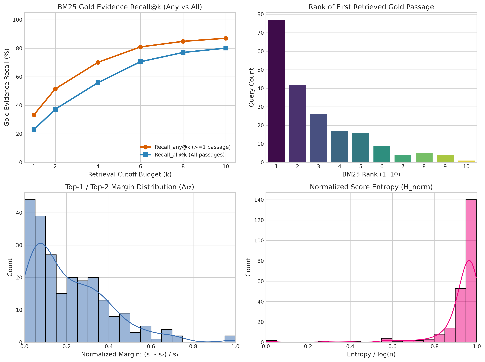

This file was reconstructed from primary experimental artifacts. Existing narrative was not used as evidence.

Generated legacy report corrected after the two authoritative Week0 reports were frozen. Primary artifacts were not changed.

# Part A — Dataset and retrieved-evidence characterization

**Status: COMPLETED**

## 1. Research question

How much annotated evidence is present in the local QASPER splits, and how often does the existing retrieved pool recover it?

## 2. Experimental design

| component   | value                                                                       |
|:------------|:----------------------------------------------------------------------------|
| dataset     | Local SARA reformatted QASPER train/dev (not official TEST)                 |
| retrieval   | Existing top-10 retrieval file; BM25 semantics established by Week0 scripts |
| seed        | 42                                                                          |
| metrics     | Query/paper counts; lexical overlap; any/all annotated-evidence recall      |

## 3. What was implemented / executed

Tables contain 2,088 train and 231 dev questions. Counts were recomputed from question rows and separately checked against reformatted JSONL line counts. Recall was recomputed from 231 query-level retrieval records; summary percentages agree after rounding.

## 4. Result artifacts used

- [results/week0/dataset_analysis/dataset_summary.csv](dataset_summary.csv)
- [results/week0/dataset_analysis/question_level_statistics.csv](question_level_statistics.csv)
- [results/week0/dataset_analysis/retrieval_statistics.csv](retrieval_statistics.csv)

## 5. Main numerical results

### Split counts

| split   |   questions |   unique_questions |   papers |
|:--------|------------:|-------------------:|---------:|
| dev     |         231 |                231 |       86 |
| train   |        2088 |               2088 |      772 |

Sources: [results/week0/dataset_analysis/dataset_summary.csv](dataset_summary.csv), [results/week0/dataset_analysis/question_level_statistics.csv](question_level_statistics.csv), [results/week0/dataset_analysis/retrieval_statistics.csv](retrieval_statistics.csv).

### Retrieved evidence recall (fractions, not percent)

|         k |   any_gold_recall |   all_gold_recall |    queries |
|----------:|------------------:|------------------:|-----------:|
|  2.000000 |          0.515152 |          0.372294 | 231.000000 |
|  4.000000 |          0.701299 |          0.558442 | 231.000000 |
|  6.000000 |          0.809524 |          0.705628 | 231.000000 |
| 10.000000 |          0.870130 |          0.800866 | 231.000000 |

Sources: [results/week0/dataset_analysis/dataset_summary.csv](dataset_summary.csv), [results/week0/dataset_analysis/question_level_statistics.csv](question_level_statistics.csv), [results/week0/dataset_analysis/retrieval_statistics.csv](retrieval_statistics.csv).

## 6. Figures

X-axes encode retrieval depth/diagnostic distributions; recall panels show greater annotated-evidence recovery with depth. Exact values come from the CSV, not pixels. Recall does not establish reader answer quality.

## 7. Statistical analysis

No formal inferential test was found for this comparison.

## 8. Interpretation

### Supported

The local dev pool has any-gold recall 0.870130 and all-gold recall 0.800866 at 10; additional context can recover evidence that shallower retrieval misses.

### Not established

Reader quality, universal optimal context length, and exact correspondence of every raw evidence annotation to source text are not established.

### Important caveats

These are local historical split sizes, not current Week12 sizes. Lexical matching is an annotation proxy; dataset_adapter.py has split-dependent Arrow lookup and fallback behavior that needs separate identity review.

## 9. Part conclusion

- Dataset and retrieval characterization is completed for the recorded local splits.
- Retrieval recall is a prerequisite, not proof of useful evidence consumption.

Authoritative reports: ../../weekly_reports/week_00/WeeklyPartWiseAnalysis.md and ../../weekly_reports/week_00/WeeklySummaryAnalysis.md.
