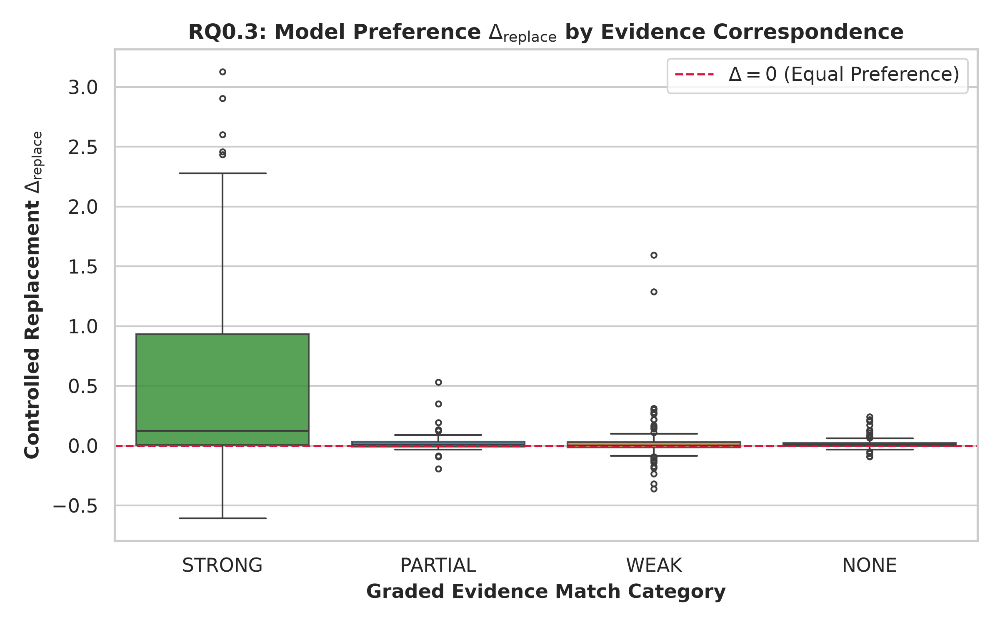
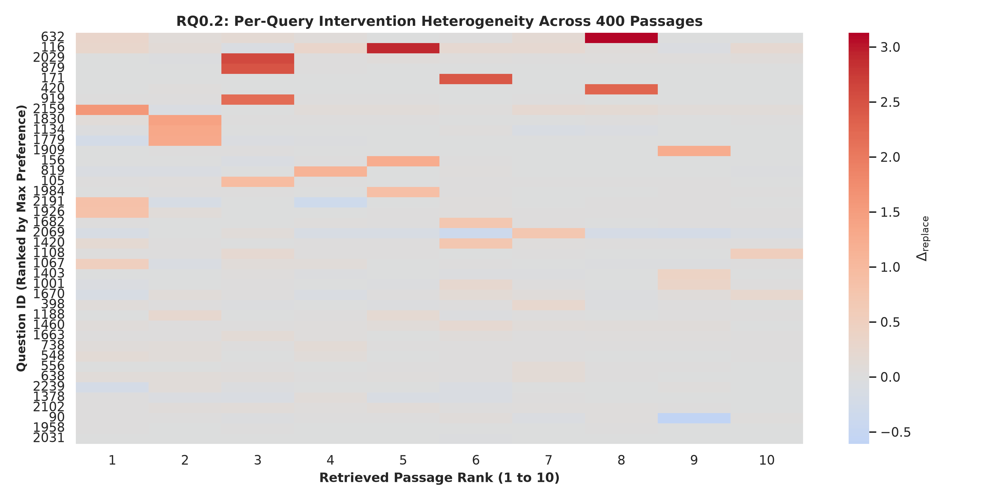

This file was reconstructed from primary experimental artifacts. Existing narrative was not used as evidence.

Generated legacy report corrected after the two authoritative Week0 reports were frozen. Primary artifacts were not changed.

# Part FINAL40 — Forty-paper input-sensitivity study

**Status: COMPLETED**

## 1. Research question

Do annotated-evidence categories differ in real replacement sensitivity across a broader, deliberately heterogeneous dev sample?

## 2. Experimental design

| component          | value                                                                                                               |
|:-------------------|:--------------------------------------------------------------------------------------------------------------------|
| base_model         | mistralai/Mistral-7B-Instruct-v0.2                                                                                  |
| checkpoint         | /home/gunavenkat/Downloads/CS787-RAG-Project/Baselines/SARA-main/checkpoints/finetune/sara_qasper_proj_lr5e4_seed42 |
| tokenizer          | mistralai/Mistral-7B-Instruct-v0.2                                                                                  |
| dtype              | bfloat16                                                                                                            |
| selected_layers    | [0, 4, 8, 16, 24, 31]                                                                                               |
| forward_passes     | 840                                                                                                                 |
| context_truncation | False                                                                                                               |
| dataset            | QASPER dev                                                                                                          |
| queries            | 40                                                                                                                  |
| papers             | 40                                                                                                                  |
| passages           | 400                                                                                                                 |
| selection          | 15 complete / 21 partial / 4 failed retrieval queries                                                               |
| metric             | Teacher-forced per-answer-token log-probability sensitivity, not answer F1                                          |

## 3. What was implemented / executed

Metadata records 840 real forward passes, 400 removals and 400 replacements. CSV row counts, 40 distinct papers and delta arithmetic were cross-checked within the saved log-probability rounding tolerance (maximum discrepancy 0.000010). Replacement-length differences are at most 6 tokens. Source scripts use a text-context prompt with the SARA-named fine-tuned checkpoint; these probes do not establish original latent-interface performance.

## 4. Result artifacts used

- [results/week0/final40/execution_metadata.json](execution_metadata.json)
- [results/week0/final40/sample_manifest.csv](sample_manifest.csv)
- [results/week0/final40/removal_results.csv](removal_results.csv)
- [results/week0/final40/replacement_results.csv](replacement_results.csv)
- [results/week0/final40/attention_results.csv](attention_results.csv)
- [results/week0/final40/evidence_match_results.csv](evidence_match_results.csv)
- [results/week0/final40/question_level_features.csv](question_level_features.csv)
- [results/weekly_reports/week_00/OfflineBootstrapReconstruction.json](../../weekly_reports/week_00/OfflineBootstrapReconstruction.json)

## 5. Main numerical results

### Overall final40 sensitivity

| study               |   rows |   queries |   mean_delta |   median_delta |   positive |   negative |   zero |
|:--------------------|-------:|----------:|-------------:|---------------:|-----------:|-----------:|-------:|
| final40 removal     |    400 |        40 |     0.089741 |       0.003906 |        217 |        170 |     13 |
| final40 replacement |    400 |        40 |     0.098325 |       0.007812 |        235 |        146 |     19 |

Sources: [results/week0/final40/execution_metadata.json](execution_metadata.json), [results/week0/final40/sample_manifest.csv](sample_manifest.csv), [results/week0/final40/removal_results.csv](removal_results.csv), [results/week0/final40/replacement_results.csv](replacement_results.csv), [results/week0/final40/attention_results.csv](attention_results.csv), [results/week0/final40/evidence_match_results.csv](evidence_match_results.csv), [results/week0/final40/question_level_features.csv](question_level_features.csv), [results/weekly_reports/week_00/OfflineBootstrapReconstruction.json](../../weekly_reports/week_00/OfflineBootstrapReconstruction.json).

### Replacement sensitivity by annotation-match category

| match_category   |   n |   mean_replacement_delta |   median_replacement_delta |   positive_fraction |
|:-----------------|----:|-------------------------:|---------------------------:|--------------------:|
| NONE             | 108 |                 0.018283 |                   0.007812 |            0.629630 |
| PARTIAL          |  47 |                 0.031660 |                   0.007812 |            0.617021 |
| STRONG           |  51 |                 0.618710 |                   0.125000 |            0.784314 |
| WEAK             | 194 |                 0.022233 |                   0.000977 |            0.505155 |

Sources: [results/week0/final40/execution_metadata.json](execution_metadata.json), [results/week0/final40/sample_manifest.csv](sample_manifest.csv), [results/week0/final40/removal_results.csv](removal_results.csv), [results/week0/final40/replacement_results.csv](replacement_results.csv), [results/week0/final40/attention_results.csv](attention_results.csv), [results/week0/final40/evidence_match_results.csv](evidence_match_results.csv), [results/week0/final40/question_level_features.csv](question_level_features.csv), [results/weekly_reports/week_00/OfflineBootstrapReconstruction.json](../../weekly_reports/week_00/OfflineBootstrapReconstruction.json).

### Offline reconstructed exploratory contrast

| contrast                                      |    point |   bootstrap_mean |   ci_low |   ci_high |   resamples |   seed |   clusters | role                                                                                              |
|:----------------------------------------------|---------:|-----------------:|---------:|----------:|------------:|-------:|-----------:|:--------------------------------------------------------------------------------------------------|
| STRONG minus WEAK/NONE mean replacement delta | 0.597889 |         0.602894 | 0.377483 |  0.856960 |        2000 |     42 |         40 | New offline reconstruction from original CSV; exploratory, nominal CI; no multiplicity correction |

Sources: [results/week0/final40/execution_metadata.json](execution_metadata.json), [results/week0/final40/sample_manifest.csv](sample_manifest.csv), [results/week0/final40/removal_results.csv](removal_results.csv), [results/week0/final40/replacement_results.csv](replacement_results.csv), [results/week0/final40/attention_results.csv](attention_results.csv), [results/week0/final40/evidence_match_results.csv](evidence_match_results.csv), [results/week0/final40/question_level_features.csv](question_level_features.csv), [results/weekly_reports/week_00/OfflineBootstrapReconstruction.json](../../weekly_reports/week_00/OfflineBootstrapReconstruction.json).

## 6. Figures

X-axis is the source/annotation matching category; y-axis is replacement delta. STRONG passages have a higher mean sensitivity. This observational category association is not a randomized comparison of evidence truth.

Axes index queries and passage ranks with color showing signed intervention delta. Heterogeneity is visible; row/rank order is not an importance-based deployable policy.

## 7. Statistical analysis

The existing plotting code defines a 2,000-resample paper-clustered bootstrap, seed 42. A new offline reconstruction from the untouched CSV gives observed STRONG minus WEAK/NONE mean delta 0.597889, nominal 95% interval [0.377483, 0.856960]. This new reconstruction is explicitly labelled, not asserted to be a surviving historical statistics artifact. Forty papers are the resampling units; no multiplicity adjustment is established.

## 8. Interpretation

### Supported

STRONG-match passages have mean replacement delta 0.618710 versus about 0.02 for WEAK/NONE. Overall replacement mean is +0.098325, but 146/400 deltas are negative and 19 are zero. Utility is heterogeneous.

### Not established

Attention proves internal reasoning; all positive deltas improve generated answer F1; a fixed small budget is sufficient for all queries; a universal causal gold-evidence effect are not established.

### Important caveats

Stratified dev sample; approximate annotation matching; teacher forcing on known gold answer; no held-out generation evaluation; aggregate pilot/final40 signs differ and cannot be pooled. Model/checkpoint/interface comparisons would be whole-system comparisons.

## 9. Part conclusion

- Real final40 sensitivity differs from the mock exports and from the small pilot.
- Strong annotation overlap associates with larger positive replacement sensitivity, with substantial query/passage heterogeneity.
- This supports further tests of context amount, not a deployed allocator.

Authoritative reports: ../../weekly_reports/week_00/WeeklyPartWiseAnalysis.md and ../../weekly_reports/week_00/WeeklySummaryAnalysis.md.
