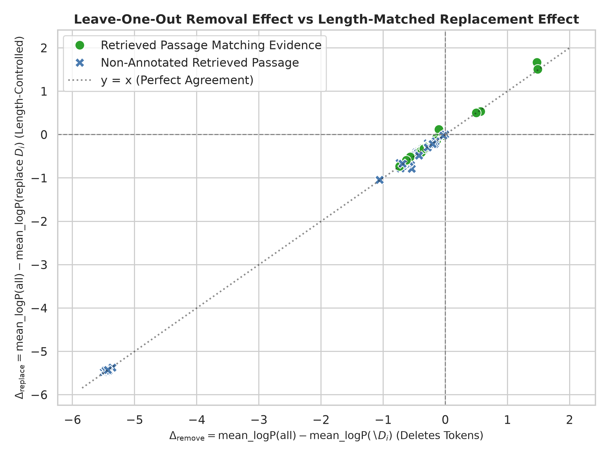

This file was reconstructed from primary experimental artifacts. Existing narrative was not used as evidence.

Generated legacy report corrected after the two authoritative Week0 reports were frozen. Primary artifacts were not changed.

# Part INTERVENTION-VALIDATION — Removal versus length-controlled replacement

**Status: COMPLETED**

## 1. Research question

Could removing a passage change prompt structure/length rather than isolate its information content?

## 2. Experimental design

| component     | value                                                                      |
|:--------------|:---------------------------------------------------------------------------|
| queries       | 10                                                                         |
| interventions | 100                                                                        |
| replacement   | Donor passage from another query/paper; approximately token-length matched |
| metric        | Full minus controlled-replacement mean log-probability                     |

## 3. What was implemented / executed

Replacement and removal comparison tables have 100 matching rows. The stored removal column agrees with the pilot ablation output. Mean absolute replacement-length difference is 1.28 tokens, maximum 5; signs agree for 98/100 rows.

## 4. Result artifacts used

- [results/week0/gpu_pilot/intervention_validation/replacement_results.csv](replacement_results.csv)
- [results/week0/gpu_pilot/intervention_validation/removal_vs_replacement.csv](removal_vs_replacement.csv)
- [results/week0/gpu_pilot/intervention_validation/evidence_match_audit.csv](evidence_match_audit.csv)

## 5. Main numerical results

### Pilot removal and replacement

| study             |   rows |   queries |   mean_delta |   median_delta |   positive |   negative |   zero |
|:------------------|-------:|----------:|-------------:|---------------:|-----------:|-----------:|-------:|
| pilot removal     |    100 |        10 |    -0.823364 |      -0.386718 |          4 |         96 |      0 |
| pilot replacement |    100 |        10 |    -0.820215 |      -0.375000 |          6 |         94 |      0 |

Sources: [results/week0/gpu_pilot/intervention_validation/replacement_results.csv](replacement_results.csv), [results/week0/gpu_pilot/intervention_validation/removal_vs_replacement.csv](removal_vs_replacement.csv), [results/week0/gpu_pilot/intervention_validation/evidence_match_audit.csv](evidence_match_audit.csv).

## 6. Figures

X/y compare removal and replacement log-probability deltas for the same passages. Agreement is within this pilot and does not demonstrate an internally faithful explanation.

## 7. Statistical analysis

No formal inferential test was found for this comparison.

## 8. Interpretation

### Supported

Both pilot interventions mostly have negative deltas; replacement is approximately, not perfectly, length matched.

### Not established

Generalized harmful-evidence prevalence or a validated reader improvement is not established.

### Important caveats

Donor text changes semantics and tokenization; replacement is not a pure single-factor causal information intervention. These are 100 nested passages from only 10 queries.

## 9. Part conclusion

- Length-controlled replacement did not remove the pilot negative-delta pattern.
- Keep pilot and final40 results separate.

Authoritative reports: ../../../weekly_reports/week_00/WeeklyPartWiseAnalysis.md and ../../../weekly_reports/week_00/WeeklySummaryAnalysis.md.
