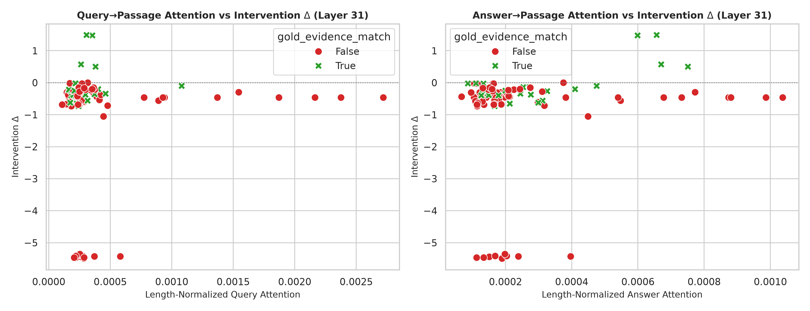

This file was reconstructed from primary experimental artifacts. Existing narrative was not used as evidence.

Generated legacy report corrected after the two authoritative Week0 reports were frozen. Primary artifacts were not changed.

# Part GPU-PILOT — Ten-query real GPU probe

**Status: COMPLETED**

## 1. Research question

Do real forward passes exhibit the same attention/ablation behavior as the generic simulated exports?

## 2. Experimental design

| component          | value                                                                                                               |
|:-------------------|:--------------------------------------------------------------------------------------------------------------------|
| queries            | 10                                                                                                                  |
| passages_per_query | 10                                                                                                                  |
| layers             | 0,4,8,16,24,31                                                                                                      |
| model              | /home/gunavenkat/Downloads/CS787-RAG-Project/Baselines/SARA-main/checkpoints/finetune/sara_qasper_proj_lr5e4_seed42 |
| dtype              | torch.bfloat16                                                                                                      |
| metric             | Teacher-forced mean gold-answer log-probability difference; full minus removed                                      |

## 3. What was implemented / executed

Execution metadata records 110 forward passes on TITAN RTX, 10 queries and no truncation. CSVs provide 100 ablations, 600 layer rows and 1,200 query/answer attention rows. These match the recorded design dimensions.

## 4. Result artifacts used

- [results/week0/gpu_pilot/execution_metadata.json](execution_metadata.json)
- [results/week0/gpu_pilot/pilot_questions.csv](pilot_questions.csv)
- [results/week0/gpu_pilot/ablation_results.csv](ablation_results.csv)
- [results/week0/gpu_pilot/layer_results.csv](layer_results.csv)
- [results/week0/gpu_pilot/attention_results.csv](attention_results.csv)

## 5. Main numerical results

### Pilot intervention results

| study         |   rows |   queries |   mean_delta |   median_delta |   positive |   negative |   zero |
|:--------------|-------:|----------:|-------------:|---------------:|-----------:|-----------:|-------:|
| pilot removal |    100 |        10 |    -0.823364 |      -0.386718 |          4 |         96 |      0 |

Sources: [results/week0/gpu_pilot/execution_metadata.json](execution_metadata.json), [results/week0/gpu_pilot/pilot_questions.csv](pilot_questions.csv), [results/week0/gpu_pilot/ablation_results.csv](ablation_results.csv), [results/week0/gpu_pilot/layer_results.csv](layer_results.csv), [results/week0/gpu_pilot/attention_results.csv](attention_results.csv).

## 6. Figures

X-axis is recorded attention; y-axis is the removal log-probability delta. Scatter is exploratory across nested passages and cannot establish causal internal evidence use.

## 7. Statistical analysis

No formal inferential test was found for this comparison.

## 8. Interpretation

### Supported

96/100 removal deltas are negative, with mean −0.823364. This differs fundamentally from the generic nonnegative mock ablation export.

### Not established

Negative teacher-forced deltas do not alone prove all annotated evidence is harmful. Generation F1 gains are not established.

### Important caveats

Small selected sample; nested passages; checkpoint/interface specificity; gold answer is supplied for teacher forcing. No clean SARA-latent versus text comparison exists here.

## 9. Part conclusion

- The pilot records real execution, unlike the generic mock files.
- Its strong negative sensitivity warrants checking intervention construction rather than copying synthetic conclusions.

Authoritative reports: ../../weekly_reports/week_00/WeeklyPartWiseAnalysis.md and ../../weekly_reports/week_00/WeeklySummaryAnalysis.md.
