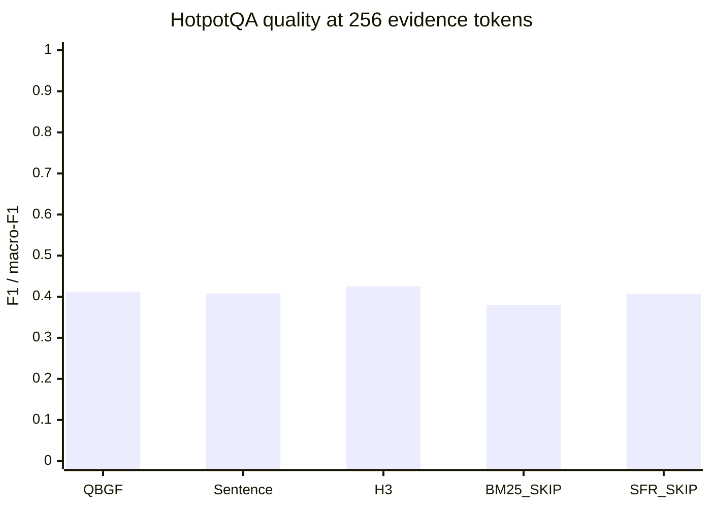
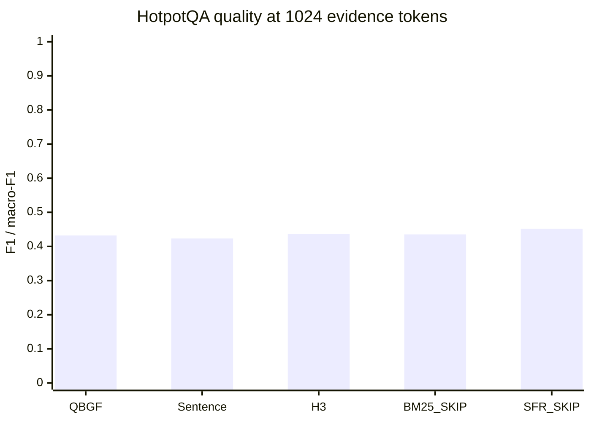
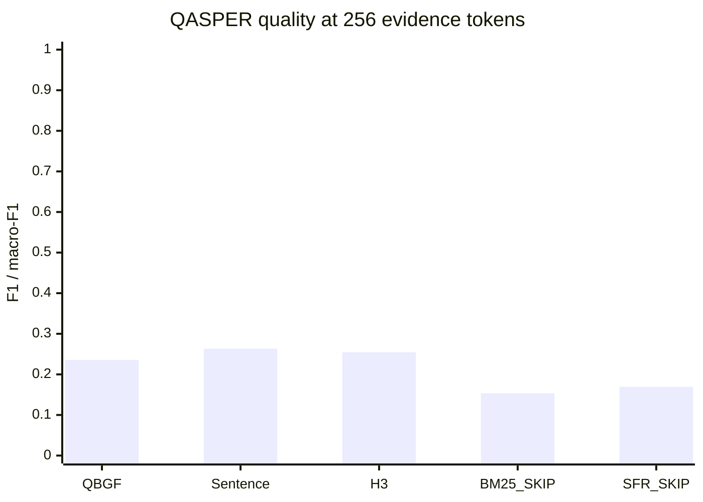
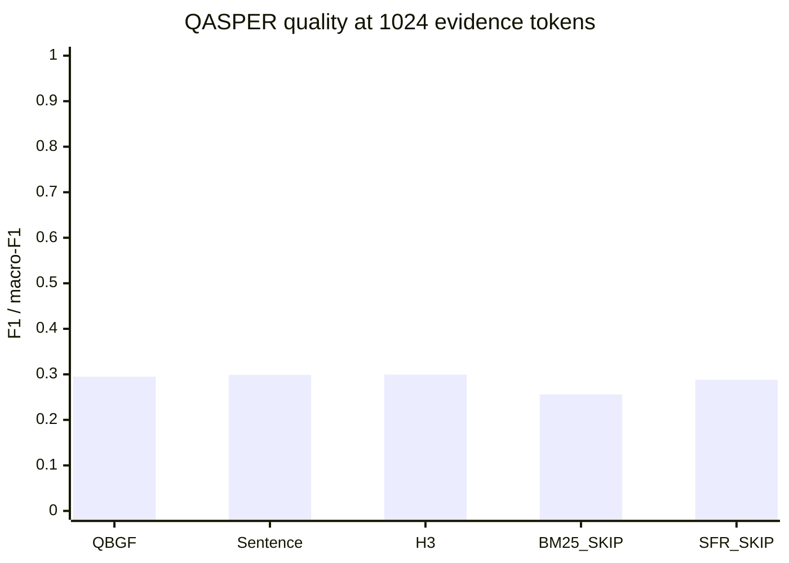
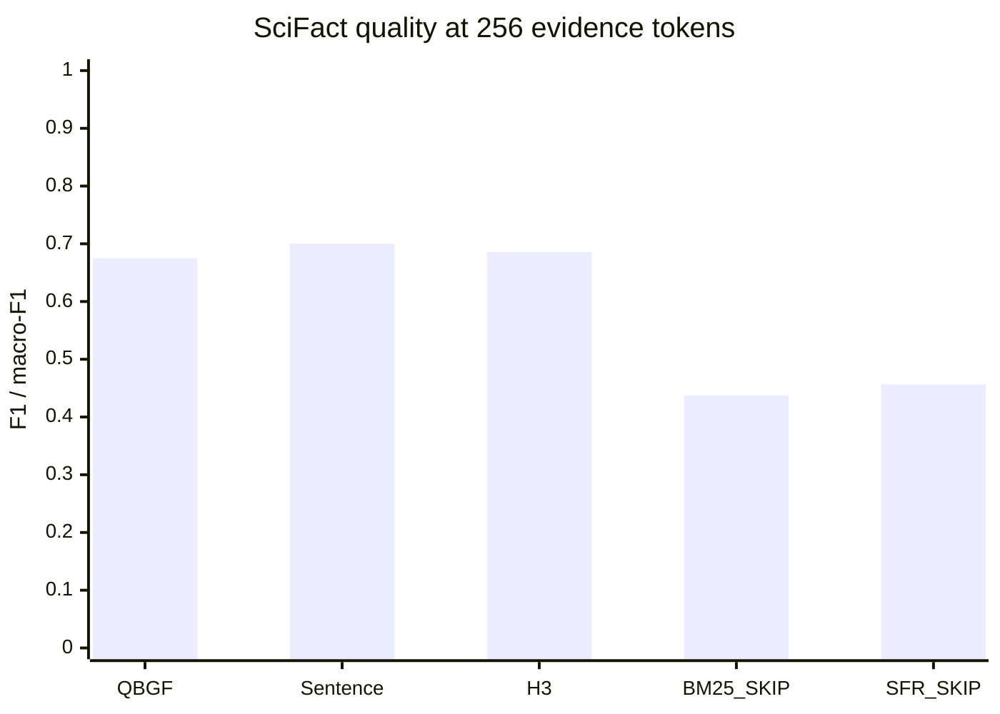
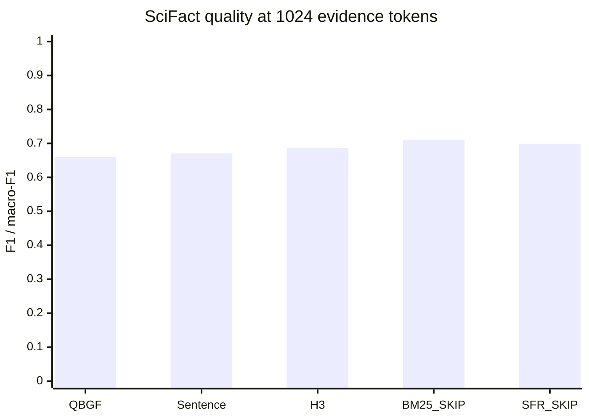

# Week 12 — Complete Part C and C-EXT validation results

Date: 1 November 2026 (Asia/Kolkata). Branch: `gagan`. Protocol: `W12-QBGF-v3`.

**Conclusion:** QBGF is not a universal winner. It improves over budget-limited passage RAG on QASPER/SciFact at 256, but good sentence/hierarchical controls are stronger there. At 1024, SFR RAW_SKIP is strongest on HotpotQA and significantly outperforms QBGF. These results support the planned D mechanism ablations; they do not establish fusion superiority or justify freezing QBGF as the winner.

## 1. Completion and frozen evaluation design

| phase   |   saved_rows | checksum_validation   | frozen_VAL_IDs   | budget/source_checks   |
|:--------|-------------:|:----------------------|:-----------------|:-----------------------|
| C       |        91707 | PASS                  | PASS             | PASS                   |
| C-EXT   |        33348 | PASS                  | PASS             | PASS                   |

Canonical BM25-SARA and SFR-SARA each completed 1,005 QASPER queries and passed their qualification receipts. No generation was performed to build this report.

| dataset   |   queries |   clusters | primary_metric   |
|:----------|----------:|-----------:|:-----------------|
| HotpotQA  |      7155 |       7155 | f1               |
| QASPER    |      1005 |        281 | f1               |
| SciFact   |       177 |        157 | macro_f1         |

All scores are **development/VAL results**, with prior development exposure as documented in the frozen split audit. They are not fresh confirmation or TEST estimates. HotpotQA uses provided distractor contexts, QASPER its matching full paper, and SciFact the corpus search setting. No pooled average across incompatible tasks is used.

Reader: pinned Qwen3-8B BASE_FP16; SFR: pinned Salesforce/SFR-Embedding-Mistral; candidate width 10. Evidence budgets 256/1024 exclude instruction/query framing, so final prompt tokens exceed evidence budgets. Greedy generation and original parser/evaluator remain unchanged.

## 2. What each condition tested

| condition                   | definition                                                                                                             |
|:----------------------------|:-----------------------------------------------------------------------------------------------------------------------|
| NONE                        | No retrieved evidence; identical cached answer repeated across budget labels.                                          |
| RAW_SKIP / SFR_RAG_RAW_SKIP | SFR top-10 whole passages; skip passages that cannot fit and retain source order. C-EXT SFR exactly reuses C RAW_SKIP. |
| BM25_RAG_RAW_SKIP           | BM25 pool, same reader/serializer/budgets/skip allocator. Budget-matched; not unrestricted RAG.                        |
| FIXED_SENTENCE              | Frozen fine-grained sentence policy at each budget.                                                                    |
| C2                          | Query-ranked top-eight exact sentences; primary evaluation at 256 only.                                                |
| H3                          | Frozen hierarchical/mixed-granularity control.                                                                         |
| QBGF_FULL                   | Query-conditioned budgeted fusion over the frozen hierarchy with exact allocation.                                     |
| BM25/SFR SARA k5/n10        | QASPER-only adapted Mistral/SARA specialist; different reader/checkpoint/interface, not Qwen-budget matched.           |
| Historical SFR-SARA k6      | Historical only; no fresh Week-12 score or paired claim.                                                               |

Display labels use RAW_SKIP; saved internal IDs `BM25_PLAIN_RAG`/`SFR_PLAIN_RAG` are retained solely for cache compatibility.

## 3.1. HotpotQA — full quality and cost table

| method                            |   budget |    n |   quality |       EM |   accuracy |    evidence |      prompt |   generated |
|:----------------------------------|---------:|-----:|----------:|---------:|-----------:|------------:|------------:|------------:|
| BM25_RAG_RAW_SKIP                 |      256 | 7155 |  0.379553 | 0.199860 |        — |  225.550804 |  279.466806 |   13.553040 |
| BM25_RAG_RAW_SKIP                 |     1024 | 7155 |  0.435345 | 0.219567 |        — |  959.903704 | 1013.819706 |   13.803075 |
| C2                                |      256 | 7155 |  0.411927 | 0.213836 |        — |  220.700489 |  274.616492 |   13.412998 |
| FIXED_SENTENCE                    |      256 | 7155 |  0.408247 | 0.205031 |        — |  254.690566 |  308.606569 |   13.708176 |
| FIXED_SENTENCE                    |     1024 | 7155 |  0.423310 | 0.200699 |        — | 1001.333054 | 1055.249057 |   14.664151 |
| H3                                |      256 | 7155 |  0.425311 | 0.222222 |        — |  237.482600 |  291.398602 |   13.396087 |
| H3                                |     1024 | 7155 |  0.436421 | 0.212299 |        — |  987.392872 | 1041.308875 |   14.161426 |
| NONE                              |      256 | 7155 |  0.165324 | 0.050175 |        — |    0.000000 |   53.916003 |   14.493781 |
| NONE                              |     1024 | 7155 |  0.165324 | 0.050175 |        — |    0.000000 |   53.916003 |   14.493781 |
| QBGF_FULL                         |      256 | 7155 |  0.412068 | 0.208526 |        — |  250.842208 |  304.758211 |   13.843746 |
| QBGF_FULL                         |     1024 | 7155 |  0.432344 | 0.206289 |        — |  993.162124 | 1047.078127 |   14.449755 |
| RAW_SKIP (SFR; same as C-EXT SFR) |      256 | 7155 |  0.406974 | 0.216632 |        — |  224.144934 |  278.060936 |   13.284556 |
| RAW_SKIP (SFR; same as C-EXT SFR) |     1024 | 7155 |  0.452133 | 0.230049 |        — |  951.751363 | 1005.667365 |   13.639553 |
| SFR_RAG_RAW_SKIP                  |      256 | 7155 |  0.406974 | 0.216632 |        — |  224.144934 |  278.060936 |   13.284556 |
| SFR_RAG_RAW_SKIP                  |     1024 | 7155 |  0.452133 | 0.230049 |        — |  951.751363 | 1005.667365 |   13.639553 |

Quality is mean answer F1 for QA; SciFact quality is three-class macro-F1 recomputed from pooled predictions. EM applies only to QA; accuracy only to SciFact. Rows labelled RAW_SKIP and SFR_RAG_RAW_SKIP are identical and must not count as replication.

## 3.2. QASPER — full quality and cost table

| method                            |   budget |    n |   quality |       EM |   accuracy |    evidence |      prompt |   generated |
|:----------------------------------|---------:|-----:|----------:|---------:|-----------:|------------:|------------:|------------:|
| BM25_RAG_RAW_SKIP                 |      256 | 1005 |  0.153388 | 0.006965 |        — |  237.789055 |  280.466667 |   17.713433 |
| BM25_RAG_RAW_SKIP                 |     1024 | 1005 |  0.255928 | 0.013930 |        — |  908.189055 |  950.866667 |   19.516418 |
| C2                                |      256 | 1005 |  0.258118 | 0.022886 |        — |  227.702488 |  270.380100 |   19.032836 |
| FIXED_SENTENCE                    |      256 | 1005 |  0.263430 | 0.021891 |        — |  255.215920 |  297.893532 |   19.082587 |
| FIXED_SENTENCE                    |     1024 | 1005 |  0.298788 | 0.015920 |        — | 1023.005970 | 1065.683582 |   20.313433 |
| H3                                |      256 | 1005 |  0.254363 | 0.023881 |        — |  235.041791 |  277.719403 |   18.696517 |
| H3                                |     1024 | 1005 |  0.299487 | 0.014925 |        — | 1003.603980 | 1046.281592 |   20.398010 |
| NONE                              |      256 | 1005 |  0.082157 | 0.000000 |        — |    0.000000 |   42.677612 |   16.355224 |
| NONE                              |     1024 | 1005 |  0.082157 | 0.000000 |        — |    0.000000 |   42.677612 |   16.355224 |
| QBGF_FULL                         |      256 | 1005 |  0.235515 | 0.023881 |        — |  252.675622 |  295.353234 |   18.225871 |
| QBGF_FULL                         |     1024 | 1005 |  0.295055 | 0.011940 |        — | 1020.468657 | 1063.146269 |   20.131343 |
| RAW_SKIP (SFR; same as C-EXT SFR) |      256 | 1005 |  0.169283 | 0.010945 |        — |  224.719403 |  267.397015 |   18.127363 |
| RAW_SKIP (SFR; same as C-EXT SFR) |     1024 | 1005 |  0.287957 | 0.015920 |        — |  912.558209 |  955.235821 |   20.400000 |
| SFR_RAG_RAW_SKIP                  |      256 | 1005 |  0.169283 | 0.010945 |        — |  224.719403 |  267.397015 |   18.127363 |
| SFR_RAG_RAW_SKIP                  |     1024 | 1005 |  0.287957 | 0.015920 |        — |  912.558209 |  955.235821 |   20.400000 |

Quality is mean answer F1 for QA; SciFact quality is three-class macro-F1 recomputed from pooled predictions. EM applies only to QA; accuracy only to SciFact. Rows labelled RAW_SKIP and SFR_RAG_RAW_SKIP are identical and must not count as replication.

## 3.3. SciFact — full quality and cost table

| method                            |   budget |   n |   quality |   EM |   accuracy |    evidence |      prompt |   generated |
|:----------------------------------|---------:|----:|----------:|-----:|-----------:|------------:|------------:|------------:|
| BM25_RAG_RAW_SKIP                 |      256 | 177 |  0.437511 |  — |   0.457627 |  184.033898 |  248.971751 |    4.367232 |
| BM25_RAG_RAW_SKIP                 |     1024 | 177 |  0.710716 |  — |   0.740113 |  938.841808 | 1003.779661 |    3.564972 |
| C2                                |      256 | 177 |  0.710248 |  — |   0.734463 |  229.853107 |  294.790960 |    3.463277 |
| FIXED_SENTENCE                    |      256 | 177 |  0.700062 |  — |   0.723164 |  253.310734 |  318.248588 |    3.451977 |
| FIXED_SENTENCE                    |     1024 | 177 |  0.670398 |  — |   0.711864 | 1021.045198 | 1085.983051 |    3.338983 |
| H3                                |      256 | 177 |  0.685627 |  — |   0.711864 |  230.694915 |  295.632768 |    3.485876 |
| H3                                |     1024 | 177 |  0.685904 |  — |   0.723164 | 1000.468927 | 1065.406780 |    3.338983 |
| NONE                              |      256 | 177 |  0.420662 |  — |   0.457627 |    0.000000 |   64.937853 |    4.389831 |
| NONE                              |     1024 | 177 |  0.420662 |  — |   0.457627 |    0.000000 |   64.937853 |    4.389831 |
| QBGF_FULL                         |      256 | 177 |  0.674969 |  — |   0.694915 |  250.604520 |  315.542373 |    3.655367 |
| QBGF_FULL                         |     1024 | 177 |  0.660413 |  — |   0.700565 | 1018.384181 | 1083.322034 |    3.429379 |
| RAW_SKIP (SFR; same as C-EXT SFR) |      256 | 177 |  0.456378 |  — |   0.468927 |  186.135593 |  251.073446 |    4.276836 |
| RAW_SKIP (SFR; same as C-EXT SFR) |     1024 | 177 |  0.698979 |  — |   0.728814 |  934.000000 |  998.937853 |    3.429379 |
| SFR_RAG_RAW_SKIP                  |      256 | 177 |  0.456378 |  — |   0.468927 |  186.135593 |  251.073446 |    4.276836 |
| SFR_RAG_RAW_SKIP                  |     1024 | 177 |  0.698979 |  — |   0.728814 |  934.000000 |  998.937853 |    3.429379 |

Quality is mean answer F1 for QA; SciFact quality is three-class macro-F1 recomputed from pooled predictions. EM applies only to QA; accuracy only to SciFact. Rows labelled RAW_SKIP and SFR_RAG_RAW_SKIP are identical and must not count as replication.

## 4. Quality figures

### HotpotQA at 256

### HotpotQA at 1024

### QASPER at 256

### QASPER at 1024

### SciFact at 256

### SciFact at 1024

Charts are embedded Mermaid figures so the report remains a single file. Exact values and uncertainty are in the tables; bars alone do not establish superiority. C2 appears in the full tables at 256.

## 5. Main findings by dataset

**QASPER:** At 256, fixed sentences 0.263430 and C2 0.258118 exceed QBGF 0.235515, despite QBGF beating SFR RAW_SKIP 0.169283. At 1024, H3 0.299487 and fixed sentences 0.298788 slightly exceed QBGF 0.295055. QBGF versus SFR RAW_SKIP at 1024 has a CI crossing zero. Compression/granularity helps relative to tight-budget passages, but QBGF fusion has not beaten the strong fine-grained baseline.

**HotpotQA:** At 256, H3 0.425311 exceeds QBGF 0.412068; C2 0.411927 is almost tied with QBGF. At 1024, SFR RAW_SKIP 0.452133 is above QBGF 0.432344 by 0.019789, with a negative paired interval for QBGF-minus-SFR. Larger-budget passage context remains a strong control.

**SciFact:** At 256, C2 0.710248 and fixed sentences 0.700062 exceed QBGF 0.674969. At 1024, BM25 RAW_SKIP 0.710716 and SFR RAW_SKIP 0.698979 exceed QBGF 0.660413 by point estimate; those extension CIs cross zero. With 177 queries/157 clusters, uncertainty remains substantial. Output compliance and per-class scores below are needed before attributing differences to reasoning.

## 6. Original primary comparisons — complete and pending

| dataset   |   budget | contrast                                     | status   |      point |     ci_low |    ci_high |      raw_p |   Holm39_p |   Joint51_p |
|:----------|---------:|:---------------------------------------------|:---------|-----------:|-----------:|-----------:|-----------:|-----------:|------------:|
| QASPER    |      256 | QBGF_FULL - RAW_SKIP                         | COMPLETE |   0.066233 |   0.048862 |   0.083949 |   0.000100 |   0.003900 |    0.005099 |
| QASPER    |      256 | QBGF_FULL - FIXED_SENTENCE                   | COMPLETE |  -0.027915 |  -0.040996 |  -0.014908 |   0.000100 |   0.003900 |    0.005099 |
| QASPER    |      256 | QBGF_FULL - H3                               | COMPLETE |  -0.018847 |  -0.032123 |  -0.005551 |   0.004800 |   0.153585 |    0.211179 |
| QASPER    |      256 | QBGF_FULL - QBGF_NO_QUERY                    | PENDING  | —        | —        | —        | —        | —        |  —        |
| QASPER    |      256 | QBGF_FULL - C2                               | COMPLETE |  -0.022603 |  -0.036009 |  -0.009270 |   0.000900 |   0.030597 |    0.041396 |
| QASPER    |      256 | QBGF_FULL - LLMLINGUA2                       | PENDING  | —        | —        | —        | —        | —        |  —        |
| QASPER    |      256 | QBGF_FULL - QBGF_FULL (LoRA-NF4 vs base-NF4) | PENDING  | —        | —        | —        | —        | —        |  —        |
| QASPER    |     1024 | QBGF_FULL - RAW_SKIP                         | COMPLETE |   0.007098 |  -0.003304 |   0.017170 |   0.182382 |   1.000000 |    1.000000 |
| QASPER    |     1024 | QBGF_FULL - FIXED_SENTENCE                   | COMPLETE |  -0.003734 |  -0.012490 |   0.005008 |   0.406159 |   1.000000 |    1.000000 |
| QASPER    |     1024 | QBGF_FULL - H3                               | COMPLETE |  -0.004432 |  -0.012973 |   0.003865 |   0.310969 |   1.000000 |    1.000000 |
| QASPER    |     1024 | QBGF_FULL - QBGF_NO_QUERY                    | PENDING  | —        | —        | —        | —        | —        |  —        |
| QASPER    |     1024 | QBGF_FULL - LLMLINGUA2                       | PENDING  | —        | —        | —        | —        | —        |  —        |
| QASPER    |     1024 | QBGF_FULL - QBGF_FULL (LoRA-NF4 vs base-NF4) | PENDING  | —        | —        | —        | —        | —        |  —        |
| HotpotQA  |      256 | QBGF_FULL - RAW_SKIP                         | COMPLETE |   0.005094 |  -0.002327 |   0.012384 |   0.177282 |   1.000000 |    1.000000 |
| HotpotQA  |      256 | QBGF_FULL - FIXED_SENTENCE                   | COMPLETE |   0.003821 |  -0.003511 |   0.011013 |   0.296770 |   1.000000 |    1.000000 |
| HotpotQA  |      256 | QBGF_FULL - H3                               | COMPLETE |  -0.013243 |  -0.020821 |  -0.005900 |   0.001000 |   0.032997 |    0.044996 |
| HotpotQA  |      256 | QBGF_FULL - QBGF_NO_QUERY                    | PENDING  | —        | —        | —        | —        | —        |  —        |
| HotpotQA  |      256 | QBGF_FULL - C2                               | COMPLETE |   0.000141 |  -0.007416 |   0.007736 |   0.971703 |   1.000000 |    1.000000 |
| HotpotQA  |      256 | QBGF_FULL - LLMLINGUA2                       | PENDING  | —        | —        | —        | —        | —        |  —        |
| HotpotQA  |      256 | QBGF_FULL - QBGF_FULL (LoRA-NF4 vs base-NF4) | PENDING  | —        | —        | —        | —        | —        |  —        |
| HotpotQA  |     1024 | QBGF_FULL - RAW_SKIP                         | COMPLETE |  -0.019789 |  -0.024994 |  -0.014683 |   0.000100 |   0.003900 |    0.005099 |
| HotpotQA  |     1024 | QBGF_FULL - FIXED_SENTENCE                   | COMPLETE |   0.009033 |   0.004544 |   0.013509 |   0.000600 |   0.020998 |    0.028197 |
| HotpotQA  |     1024 | QBGF_FULL - H3                               | COMPLETE |  -0.004077 |  -0.008862 |   0.000724 |   0.086891 |   1.000000 |    1.000000 |
| HotpotQA  |     1024 | QBGF_FULL - QBGF_NO_QUERY                    | PENDING  | —        | —        | —        | —        | —        |  —        |
| HotpotQA  |     1024 | QBGF_FULL - LLMLINGUA2                       | PENDING  | —        | —        | —        | —        | —        |  —        |
| HotpotQA  |     1024 | QBGF_FULL - QBGF_FULL (LoRA-NF4 vs base-NF4) | PENDING  | —        | —        | —        | —        | —        |  —        |
| SciFact   |      256 | QBGF_FULL - RAW_SKIP                         | COMPLETE |   0.218591 |   0.141282 |   0.300298 |   0.000100 |   0.003900 |    0.005099 |
| SciFact   |      256 | QBGF_FULL - FIXED_SENTENCE                   | COMPLETE |  -0.025094 |  -0.087757 |   0.036542 |   0.446055 |   1.000000 |    1.000000 |
| SciFact   |      256 | QBGF_FULL - H3                               | COMPLETE |  -0.010658 |  -0.075762 |   0.053887 |   0.749225 |   1.000000 |    1.000000 |
| SciFact   |      256 | QBGF_FULL - QBGF_NO_QUERY                    | PENDING  | —        | —        | —        | —        | —        |  —        |
| SciFact   |      256 | QBGF_FULL - C2                               | COMPLETE |  -0.035279 |  -0.096952 |   0.025428 |   0.272373 |   1.000000 |    1.000000 |
| SciFact   |      256 | QBGF_FULL - LLMLINGUA2                       | PENDING  | —        | —        | —        | —        | —        |  —        |
| SciFact   |      256 | QBGF_FULL - QBGF_FULL (LoRA-NF4 vs base-NF4) | PENDING  | —        | —        | —        | —        | —        |  —        |
| SciFact   |     1024 | QBGF_FULL - RAW_SKIP                         | COMPLETE |  -0.038566 |  -0.121233 |   0.043969 |   0.361264 |   1.000000 |    1.000000 |
| SciFact   |     1024 | QBGF_FULL - FIXED_SENTENCE                   | COMPLETE |  -0.009985 |  -0.071143 |   0.050456 |   0.744326 |   1.000000 |    1.000000 |
| SciFact   |     1024 | QBGF_FULL - H3                               | COMPLETE |  -0.025491 |  -0.095637 |   0.045687 |   0.487651 |   1.000000 |    1.000000 |
| SciFact   |     1024 | QBGF_FULL - QBGF_NO_QUERY                    | PENDING  | —        | —        | —        | —        | —        |  —        |
| SciFact   |     1024 | QBGF_FULL - LLMLINGUA2                       | PENDING  | —        | —        | —        | —        | —        |  —        |
| SciFact   |     1024 | QBGF_FULL - QBGF_FULL (LoRA-NF4 vs base-NF4) | PENDING  | —        | —        | —        | —        | —        |  —        |

Difference is left minus right. 95% CIs use 10,000 paired cluster resamples, seed 42. Raw p-values use the existing two-sided paired cluster label-swap test, not bootstrap tail counting. Original Holm family 39 is preserved; joint family 51 includes 12 still-pending fusion controls. Missing arms occupy p=1 internally for correction, never observed tests. Pending NO_QUERY/LLMLingua/LoRA contrasts are not failures. D sentence-only/passage-only controls are still pending and are not silently inferred from fixed-sentence RAG.

## 7. C-EXT paired RAG comparisons

| dataset   |   budget | left      | right             | status   |     point |    ci_low |   ci_high |    raw_p |   extension_holm_p |   n_queries |   n_clusters |
|:----------|---------:|:----------|:------------------|:---------|----------:|----------:|----------:|---------:|-------------------:|------------:|-------------:|
| QASPER    |      256 | QBGF_FULL | BM25_RAG_RAW_SKIP | COMPLETE |  0.082127 |  0.065689 |  0.099025 | 0.000100 |           0.001200 |        1005 |          281 |
| QASPER    |      256 | QBGF_FULL | SFR_RAG_RAW_SKIP  | COMPLETE |  0.066233 |  0.048862 |  0.083949 | 0.000100 |           0.001200 |        1005 |          281 |
| QASPER    |     1024 | QBGF_FULL | BM25_RAG_RAW_SKIP | COMPLETE |  0.039127 |  0.026233 |  0.052226 | 0.000100 |           0.001200 |        1005 |          281 |
| QASPER    |     1024 | QBGF_FULL | SFR_RAG_RAW_SKIP  | COMPLETE |  0.007098 | -0.003304 |  0.017170 | 0.182382 |           0.886411 |        1005 |          281 |
| HotpotQA  |      256 | QBGF_FULL | BM25_RAG_RAW_SKIP | COMPLETE |  0.032515 |  0.024094 |  0.041104 | 0.000100 |           0.001200 |        7155 |         7155 |
| HotpotQA  |      256 | QBGF_FULL | SFR_RAG_RAW_SKIP  | COMPLETE |  0.005094 | -0.002327 |  0.012384 | 0.177282 |           0.886411 |        7155 |         7155 |
| HotpotQA  |     1024 | QBGF_FULL | BM25_RAG_RAW_SKIP | COMPLETE | -0.003001 | -0.008673 |  0.002583 | 0.299970 |           0.886411 |        7155 |         7155 |
| HotpotQA  |     1024 | QBGF_FULL | SFR_RAG_RAW_SKIP  | COMPLETE | -0.019789 | -0.024994 | -0.014683 | 0.000100 |           0.001200 |        7155 |         7155 |
| SciFact   |      256 | QBGF_FULL | BM25_RAG_RAW_SKIP | COMPLETE |  0.237458 |  0.149720 |  0.328166 | 0.000100 |           0.001200 |         177 |          157 |
| SciFact   |      256 | QBGF_FULL | SFR_RAG_RAW_SKIP  | COMPLETE |  0.218591 |  0.141282 |  0.300298 | 0.000100 |           0.001200 |         177 |          157 |
| SciFact   |     1024 | QBGF_FULL | BM25_RAG_RAW_SKIP | COMPLETE | -0.050304 | -0.132752 |  0.031893 | 0.230177 |           0.886411 |         177 |          157 |
| SciFact   |     1024 | QBGF_FULL | SFR_RAG_RAW_SKIP  | COMPLETE | -0.038566 | -0.121233 |  0.043969 | 0.361264 |           0.886411 |         177 |          157 |

This is a **separate supplemental exploratory 12-test family**, added after C started, not retroactive preregistration. Intervals are nominal 95%; extension Holm-adjusted p-values address this family only. SFR extension contrasts duplicate the original RAW_SKIP comparison and do not add independent evidence.

## 8. SARA specialist references

| method                     |    n |       F1 |       EM |   prompt_tokens |   generated_tokens | reader               |   k |   n_units |
|:---------------------------|-----:|---------:|---------:|----------------:|-------------------:|:---------------------|----:|----------:|
| SARA_CANONICAL_BM25_K5_N10 | 1005 | 0.395049 | 0.209950 |     1296.583085 |          14.297512 | adapted Mistral/SARA |   5 |        10 |
| SARA_SFR_K5_N10            | 1005 | 0.436600 | 0.223881 |     1285.497512 |          13.985075 | adapted Mistral/SARA |   5 |        10 |

**Specialist finding:** SFR-SARA F1 is 0.436600 versus canonical BM25-SARA 0.395049 (point difference +0.041551). Both exceed the Qwen QBGF values descriptively, but this does not isolate latent representation quality or prove a cross-reader causal benefit. No specialist superiority significance test is claimed here.

These two references use the same frozen QASPER VAL IDs (1,005 queries / 281 papers), k5 explicit/n10 total units, adapted Mistral and its SARA checkpoint. BM25 versus SFR changes specialist retrieval. Their token costs reflect the specialist interface; five compressed latent units are not zero conceptual evidence cost and are not represented by Qwen evidence-token budgets. Comparing their F1 with Qwen rows describes whole-system performance, not an isolated retrieval/fusion effect. Do not substitute the historical W10 k6 score into these tables.

## 9. HELP/HURT and answer changes

| dataset   | method                            |   budget |     HELP |     HURT |   NEUTRAL |   answer_changed |
|:----------|:----------------------------------|---------:|---------:|---------:|----------:|-----------------:|
| HotpotQA  | BM25_RAG_RAW_SKIP                 |      256 | 0.469462 | 0.118239 |  0.412299 |         0.876590 |
| HotpotQA  | BM25_RAG_RAW_SKIP                 |     1024 | 0.567156 | 0.090147 |  0.342697 |         0.869602 |
| HotpotQA  | C2                                |      256 | 0.505521 | 0.094060 |  0.400419 |         0.870161 |
| HotpotQA  | FIXED_SENTENCE                    |      256 | 0.516841 | 0.094200 |  0.388959 |         0.869322 |
| HotpotQA  | FIXED_SENTENCE                    |     1024 | 0.590217 | 0.089727 |  0.320056 |         0.870860 |
| HotpotQA  | H3                                |      256 | 0.525227 | 0.092662 |  0.382110 |         0.866527 |
| HotpotQA  | H3                                |     1024 | 0.588959 | 0.089727 |  0.321314 |         0.871139 |
| HotpotQA  | NONE                              |      256 | 0.000000 | 0.000000 |  1.000000 |         0.000000 |
| HotpotQA  | NONE                              |     1024 | 0.000000 | 0.000000 |  1.000000 |         0.000000 |
| HotpotQA  | QBGF_FULL                         |      256 | 0.518658 | 0.096017 |  0.385325 |         0.869741 |
| HotpotQA  | QBGF_FULL                         |     1024 | 0.594549 | 0.087072 |  0.318379 |         0.866527 |
| HotpotQA  | RAW_SKIP (SFR; same as C-EXT SFR) |      256 | 0.496436 | 0.099511 |  0.404053 |         0.870580 |
| HotpotQA  | RAW_SKIP (SFR; same as C-EXT SFR) |     1024 | 0.592453 | 0.082600 |  0.324948 |         0.867226 |
| HotpotQA  | SFR_RAG_RAW_SKIP                  |      256 | 0.496436 | 0.099511 |  0.404053 |         0.870580 |
| HotpotQA  | SFR_RAG_RAW_SKIP                  |     1024 | 0.592453 | 0.082600 |  0.324948 |         0.867226 |
| QASPER    | BM25_RAG_RAW_SKIP                 |      256 | 0.369154 | 0.157214 |  0.473632 |         0.963184 |
| QASPER    | BM25_RAG_RAW_SKIP                 |     1024 | 0.543284 | 0.101493 |  0.355224 |         0.979104 |
| QASPER    | C2                                |      256 | 0.544279 | 0.103483 |  0.352239 |         0.983085 |
| QASPER    | FIXED_SENTENCE                    |      256 | 0.551244 | 0.100498 |  0.348259 |         0.983085 |
| QASPER    | FIXED_SENTENCE                    |     1024 | 0.627861 | 0.068657 |  0.303483 |         0.977114 |
| QASPER    | H3                                |      256 | 0.549254 | 0.098507 |  0.352239 |         0.981095 |
| QASPER    | H3                                |     1024 | 0.613930 | 0.081592 |  0.304478 |         0.983085 |
| QASPER    | NONE                              |      256 | 0.000000 | 0.000000 |  1.000000 |         0.000000 |
| QASPER    | NONE                              |     1024 | 0.000000 | 0.000000 |  1.000000 |         0.000000 |
| QASPER    | QBGF_FULL                         |      256 | 0.519403 | 0.107463 |  0.373134 |         0.986070 |
| QASPER    | QBGF_FULL                         |     1024 | 0.615920 | 0.070647 |  0.313433 |         0.981095 |
| QASPER    | RAW_SKIP (SFR; same as C-EXT SFR) |      256 | 0.404975 | 0.148259 |  0.446766 |         0.985075 |
| QASPER    | RAW_SKIP (SFR; same as C-EXT SFR) |     1024 | 0.594030 | 0.094527 |  0.311443 |         0.983085 |
| QASPER    | SFR_RAG_RAW_SKIP                  |      256 | 0.404975 | 0.148259 |  0.446766 |         0.985075 |
| QASPER    | SFR_RAG_RAW_SKIP                  |     1024 | 0.594030 | 0.094527 |  0.311443 |         0.983085 |
| SciFact   | BM25_RAG_RAW_SKIP                 |      256 | 0.169492 | 0.169492 |  0.661017 |         0.378531 |
| SciFact   | BM25_RAG_RAW_SKIP                 |     1024 | 0.406780 | 0.124294 |  0.468927 |         0.570621 |
| SciFact   | C2                                |      256 | 0.401130 | 0.124294 |  0.474576 |         0.548023 |
| SciFact   | FIXED_SENTENCE                    |      256 | 0.389831 | 0.124294 |  0.485876 |         0.542373 |
| SciFact   | FIXED_SENTENCE                    |     1024 | 0.395480 | 0.141243 |  0.463277 |         0.598870 |
| SciFact   | H3                                |      256 | 0.384181 | 0.129944 |  0.485876 |         0.536723 |
| SciFact   | H3                                |     1024 | 0.395480 | 0.129944 |  0.474576 |         0.576271 |
| SciFact   | NONE                              |      256 | 0.000000 | 0.000000 |  1.000000 |         0.000000 |
| SciFact   | NONE                              |     1024 | 0.000000 | 0.000000 |  1.000000 |         0.000000 |
| SciFact   | QBGF_FULL                         |      256 | 0.344633 | 0.107345 |  0.548023 |         0.497175 |
| SciFact   | QBGF_FULL                         |     1024 | 0.367232 | 0.124294 |  0.508475 |         0.559322 |
| SciFact   | RAW_SKIP (SFR; same as C-EXT SFR) |      256 | 0.175141 | 0.163842 |  0.661017 |         0.384181 |
| SciFact   | RAW_SKIP (SFR; same as C-EXT SFR) |     1024 | 0.406780 | 0.135593 |  0.457627 |         0.587571 |
| SciFact   | SFR_RAG_RAW_SKIP                  |      256 | 0.175141 | 0.163842 |  0.661017 |         0.384181 |
| SciFact   | SFR_RAG_RAW_SKIP                  |     1024 | 0.406780 | 0.135593 |  0.457627 |         0.587571 |

All rates are versus the same query's no-evidence answer under the matched Qwen reader and existing HELP threshold. For SciFact, correctness transitions drive HELP/HURT; they are not additive macro-F1 decompositions. A high answer-change rate alone is not evidence of benefit.

## 10. Budget, source and evidence diagnostics

| dataset   | method                            |   budget |   empty_evidence |   utilization |   any_gold_recall |   all_gold_recall |   gold_mapped_queries |   unmapped_gold |   invalid |   cap_hits |   answer_seconds |
|:----------|:----------------------------------|---------:|-----------------:|--------------:|------------------:|------------------:|----------------------:|----------------:|----------:|-----------:|-----------------:|
| HotpotQA  | BM25_RAG_RAW_SKIP                 |      256 |                0 |      0.881058 |          0.917820 |          0.348707 |                  7155 |               1 |         0 |          0 |         0.540756 |
| HotpotQA  | BM25_RAG_RAW_SKIP                 |     1024 |                0 |      0.937406 |          0.995947 |          0.857163 |                  7155 |               1 |         0 |          1 |         0.738042 |
| HotpotQA  | C2                                |      256 |                0 |      0.862111 |          0.970650 |          0.574843 |                  7155 |               1 |         0 |          1 |         0.533327 |
| HotpotQA  | FIXED_SENTENCE                    |      256 |                0 |      0.994885 |          0.976520 |          0.612858 |                  7155 |               1 |         0 |          0 |         0.550246 |
| HotpotQA  | FIXED_SENTENCE                    |     1024 |                0 |      0.977864 |          0.999161 |          0.960168 |                  7155 |               1 |         0 |          0 |         0.773743 |
| HotpotQA  | H3                                |      256 |                0 |      0.927666 |          0.973305 |          0.642907 |                  7155 |               1 |         0 |          1 |         0.537616 |
| HotpotQA  | H3                                |     1024 |                0 |      0.964251 |          0.999441 |          0.956534 |                  7155 |               1 |         0 |          0 |         0.754210 |
| HotpotQA  | NONE                              |      256 |             7155 |      0.000000 |          0.000000 |          0.000000 |                  7155 |               1 |         0 |          5 |         0.500736 |
| HotpotQA  | NONE                              |     1024 |             7155 |      0.000000 |          0.000000 |          0.000000 |                  7155 |               1 |         0 |          5 |         0.500736 |
| HotpotQA  | QBGF_FULL                         |      256 |                0 |      0.979852 |          0.973864 |          0.597345 |                  7155 |               1 |         0 |          1 |         0.554970 |
| HotpotQA  | QBGF_FULL                         |     1024 |                0 |      0.969885 |          0.999860 |          0.977638 |                  7155 |               1 |         0 |          0 |         0.765161 |
| HotpotQA  | RAW_SKIP (SFR; same as C-EXT SFR) |      256 |                0 |      0.875566 |          0.963802 |          0.504542 |                  7155 |               1 |         0 |          0 |         0.530082 |
| HotpotQA  | RAW_SKIP (SFR; same as C-EXT SFR) |     1024 |                0 |      0.929445 |          0.998323 |          0.952760 |                  7155 |               1 |         0 |          0 |         0.732350 |
| HotpotQA  | SFR_RAG_RAW_SKIP                  |      256 |                0 |      0.875566 |          0.963802 |          0.504542 |                  7155 |               1 |         0 |          0 |         0.530082 |
| HotpotQA  | SFR_RAG_RAW_SKIP                  |     1024 |                0 |      0.929445 |          0.998323 |          0.952760 |                  7155 |               1 |         0 |          0 |         0.732350 |
| QASPER    | BM25_RAG_RAW_SKIP                 |      256 |               15 |      0.928863 |          0.083064 |          0.033441 |                   927 |             205 |         0 |          0 |         0.685513 |
| QASPER    | BM25_RAG_RAW_SKIP                 |     1024 |                0 |      0.886903 |          0.359223 |          0.169364 |                   927 |             205 |         0 |          0 |         0.943779 |
| QASPER    | C2                                |      256 |                0 |      0.889463 |          0.092772 |          0.017260 |                   927 |             205 |         0 |          0 |         0.731198 |
| QASPER    | FIXED_SENTENCE                    |      256 |                0 |      0.996937 |          0.107875 |          0.022654 |                   927 |             205 |         0 |          0 |         0.739268 |
| QASPER    | FIXED_SENTENCE                    |     1024 |                0 |      0.999029 |          0.243797 |          0.071197 |                   927 |             205 |         0 |          0 |         0.985981 |
| QASPER    | H3                                |      256 |                0 |      0.918132 |          0.098166 |          0.019417 |                   927 |             205 |         0 |          0 |         0.721864 |
| QASPER    | H3                                |     1024 |                0 |      0.980082 |          0.448759 |          0.215750 |                   927 |             205 |         0 |          0 |         0.988481 |
| QASPER    | NONE                              |      256 |             1005 |      0.000000 |          0.000000 |          0.000000 |                   927 |             205 |         0 |          0 |         0.561092 |
| QASPER    | NONE                              |     1024 |             1005 |      0.000000 |          0.000000 |          0.000000 |                   927 |             205 |         0 |          0 |         0.561092 |
| QASPER    | QBGF_FULL                         |      256 |                0 |      0.987014 |          0.071197 |          0.015102 |                   927 |             205 |         0 |          0 |         0.708795 |
| QASPER    | QBGF_FULL                         |     1024 |                0 |      0.996551 |          0.381877 |          0.158576 |                   927 |             205 |         0 |          0 |         0.979307 |
| QASPER    | RAW_SKIP (SFR; same as C-EXT SFR) |      256 |                3 |      0.877810 |          0.106796 |          0.031284 |                   927 |             205 |         0 |          0 |         0.695259 |
| QASPER    | RAW_SKIP (SFR; same as C-EXT SFR) |     1024 |                0 |      0.891170 |          0.457389 |          0.225458 |                   927 |             205 |         0 |          0 |         0.980074 |
| QASPER    | SFR_RAG_RAW_SKIP                  |      256 |                3 |      0.877810 |          0.106796 |          0.031284 |                   927 |             205 |         0 |          0 |         0.695259 |
| QASPER    | SFR_RAG_RAW_SKIP                  |     1024 |                0 |      0.891170 |          0.457389 |          0.225458 |                   927 |             205 |         0 |          0 |         0.980074 |
| SciFact   | BM25_RAG_RAW_SKIP                 |      256 |               21 |      0.718882 |          0.200000 |          0.183333 |                   120 |               0 |         0 |          0 |         0.208158 |
| SciFact   | BM25_RAG_RAW_SKIP                 |     1024 |                0 |      0.916838 |          0.816667 |          0.791667 |                   120 |               0 |         0 |          0 |         0.356756 |
| SciFact   | C2                                |      256 |                0 |      0.897864 |          0.866667 |          0.575000 |                   120 |               0 |         0 |          0 |         0.187210 |
| SciFact   | FIXED_SENTENCE                    |      256 |                0 |      0.989495 |          0.875000 |          0.575000 |                   120 |               0 |         0 |          0 |         0.187716 |
| SciFact   | FIXED_SENTENCE                    |     1024 |                0 |      0.997114 |          0.958333 |          0.783333 |                   120 |               0 |         0 |          0 |         0.357377 |
| SciFact   | H3                                |      256 |                0 |      0.901152 |          0.841667 |          0.575000 |                   120 |               0 |         0 |          0 |         0.188036 |
| SciFact   | H3                                |     1024 |                0 |      0.977020 |          0.975000 |          0.875000 |                   120 |               0 |         0 |          0 |         0.362234 |
| SciFact   | NONE                              |      256 |              177 |      0.000000 |          0.000000 |          0.000000 |                   120 |               0 |         0 |          0 |         0.161336 |
| SciFact   | NONE                              |     1024 |              177 |      0.000000 |          0.000000 |          0.000000 |                   120 |               0 |         0 |          0 |         0.161336 |
| SciFact   | QBGF_FULL                         |      256 |                0 |      0.978924 |          0.675000 |          0.375000 |                   120 |               0 |         0 |          0 |         0.195524 |
| SciFact   | QBGF_FULL                         |     1024 |                0 |      0.994516 |          0.925000 |          0.725000 |                   120 |               0 |         0 |          0 |         0.360869 |
| SciFact   | RAW_SKIP (SFR; same as C-EXT SFR) |      256 |               12 |      0.727092 |          0.250000 |          0.200000 |                   120 |               0 |         0 |          0 |         0.205782 |
| SciFact   | RAW_SKIP (SFR; same as C-EXT SFR) |     1024 |                0 |      0.912109 |          0.925000 |          0.866667 |                   120 |               0 |         0 |          0 |         0.351539 |
| SciFact   | SFR_RAG_RAW_SKIP                  |      256 |               12 |      0.727092 |          0.250000 |          0.200000 |                   120 |               0 |         0 |          0 |         0.205782 |
| SciFact   | SFR_RAG_RAW_SKIP                  |     1024 |                0 |      0.912109 |          0.925000 |          0.866667 |                   120 |               0 |         0 |          0 |         0.351539 |

All per-row evidence costs were within their assigned budget and recorded source support was 1.0. Exact source support is mechanical substring provenance, not semantic faithfulness or answer correctness. Empty evidence counts expose budget-fitting effects; gold metrics are retrospective only and exclude unmapped queries as recorded. `unmapped_gold` sums row-level annotation gaps per condition, not unique corpus gaps. Timing is recorded answer-generation latency, not measured end-to-end runtime; cached reuse does not create a new zero-cost conceptual system.

## 11. SciFact per-class results

| method                            |   budget | label           |   support |   precision |   recall |       f1 |
|:----------------------------------|---------:|:----------------|----------:|------------:|---------:|---------:|
| BM25_RAG_RAW_SKIP                 |      256 | SUPPORT         |        83 |    0.717949 | 0.337349 | 0.459016 |
| BM25_RAG_RAW_SKIP                 |      256 | REFUTE          |        37 |    0.588235 | 0.270270 | 0.370370 |
| BM25_RAG_RAW_SKIP                 |      256 | NOT_ENOUGH_INFO |        57 |    0.355372 | 0.754386 | 0.483146 |
| BM25_RAG_RAW_SKIP                 |     1024 | SUPPORT         |        83 |    0.875000 | 0.843373 | 0.858896 |
| BM25_RAG_RAW_SKIP                 |     1024 | REFUTE          |        37 |    0.553191 | 0.702703 | 0.619048 |
| BM25_RAG_RAW_SKIP                 |     1024 | NOT_ENOUGH_INFO |        57 |    0.700000 | 0.614035 | 0.654206 |
| C2                                |      256 | SUPPORT         |        83 |    0.782609 | 0.867470 | 0.822857 |
| C2                                |      256 | REFUTE          |        37 |    0.659091 | 0.783784 | 0.716049 |
| C2                                |      256 | NOT_ENOUGH_INFO |        57 |    0.707317 | 0.508772 | 0.591837 |
| FIXED_SENTENCE                    |      256 | SUPPORT         |        83 |    0.763441 | 0.855422 | 0.806818 |
| FIXED_SENTENCE                    |      256 | REFUTE          |        37 |    0.659091 | 0.783784 | 0.716049 |
| FIXED_SENTENCE                    |      256 | NOT_ENOUGH_INFO |        57 |    0.700000 | 0.491228 | 0.577320 |
| FIXED_SENTENCE                    |     1024 | SUPPORT         |        83 |    0.757576 | 0.903614 | 0.824176 |
| FIXED_SENTENCE                    |     1024 | REFUTE          |        37 |    0.562500 | 0.729730 | 0.635294 |
| FIXED_SENTENCE                    |     1024 | NOT_ENOUGH_INFO |        57 |    0.800000 | 0.421053 | 0.551724 |
| H3                                |      256 | SUPPORT         |        83 |    0.786517 | 0.843373 | 0.813953 |
| H3                                |      256 | REFUTE          |        37 |    0.622222 | 0.756757 | 0.682927 |
| H3                                |      256 | NOT_ENOUGH_INFO |        57 |    0.651163 | 0.491228 | 0.560000 |
| H3                                |     1024 | SUPPORT         |        83 |    0.757576 | 0.903614 | 0.824176 |
| H3                                |     1024 | REFUTE          |        37 |    0.583333 | 0.756757 | 0.658824 |
| H3                                |     1024 | NOT_ENOUGH_INFO |        57 |    0.833333 | 0.438596 | 0.574713 |
| NONE                              |      256 | SUPPORT         |        83 |    0.666667 | 0.361446 | 0.468750 |
| NONE                              |      256 | REFUTE          |        37 |    0.777778 | 0.189189 | 0.304348 |
| NONE                              |      256 | NOT_ENOUGH_INFO |        57 |    0.357724 | 0.771930 | 0.488889 |
| NONE                              |     1024 | SUPPORT         |        83 |    0.666667 | 0.361446 | 0.468750 |
| NONE                              |     1024 | REFUTE          |        37 |    0.777778 | 0.189189 | 0.304348 |
| NONE                              |     1024 | NOT_ENOUGH_INFO |        57 |    0.357724 | 0.771930 | 0.488889 |
| QBGF_FULL                         |      256 | SUPPORT         |        83 |    0.776471 | 0.795181 | 0.785714 |
| QBGF_FULL                         |      256 | REFUTE          |        37 |    0.676471 | 0.621622 | 0.647887 |
| QBGF_FULL                         |      256 | NOT_ENOUGH_INFO |        57 |    0.586207 | 0.596491 | 0.591304 |
| QBGF_FULL                         |     1024 | SUPPORT         |        83 |    0.768421 | 0.879518 | 0.820225 |
| QBGF_FULL                         |     1024 | REFUTE          |        37 |    0.545455 | 0.648649 | 0.592593 |
| QBGF_FULL                         |     1024 | NOT_ENOUGH_INFO |        57 |    0.710526 | 0.473684 | 0.568421 |
| RAW_SKIP (SFR; same as C-EXT SFR) |      256 | SUPPORT         |        83 |    0.714286 | 0.361446 | 0.480000 |
| RAW_SKIP (SFR; same as C-EXT SFR) |      256 | REFUTE          |        37 |    0.545455 | 0.324324 | 0.406780 |
| RAW_SKIP (SFR; same as C-EXT SFR) |      256 | NOT_ENOUGH_INFO |        57 |    0.362832 | 0.719298 | 0.482353 |
| RAW_SKIP (SFR; same as C-EXT SFR) |     1024 | SUPPORT         |        83 |    0.791209 | 0.867470 | 0.827586 |
| RAW_SKIP (SFR; same as C-EXT SFR) |     1024 | REFUTE          |        37 |    0.583333 | 0.756757 | 0.658824 |
| RAW_SKIP (SFR; same as C-EXT SFR) |     1024 | NOT_ENOUGH_INFO |        57 |    0.763158 | 0.508772 | 0.610526 |
| SFR_RAG_RAW_SKIP                  |      256 | SUPPORT         |        83 |    0.714286 | 0.361446 | 0.480000 |
| SFR_RAG_RAW_SKIP                  |      256 | REFUTE          |        37 |    0.545455 | 0.324324 | 0.406780 |
| SFR_RAG_RAW_SKIP                  |      256 | NOT_ENOUGH_INFO |        57 |    0.362832 | 0.719298 | 0.482353 |
| SFR_RAG_RAW_SKIP                  |     1024 | SUPPORT         |        83 |    0.791209 | 0.867470 | 0.827586 |
| SFR_RAG_RAW_SKIP                  |     1024 | REFUTE          |        37 |    0.583333 | 0.756757 | 0.658824 |
| SFR_RAG_RAW_SKIP                  |     1024 | NOT_ENOUGH_INFO |        57 |    0.763158 | 0.508772 | 0.610526 |

Invalid outputs count as incorrect predictions; the class table and invalid counts should be considered together. Do not claim reader reasoning superiority from format effects.

## 12. QBGF allocation choices

| dataset   |   budget | option   |   count |   fraction |
|:----------|---------:|:---------|--------:|-----------:|
| HotpotQA  |      256 | DROP     |   37568 |   0.527640 |
| HotpotQA  |      256 | FULL     |       8 |   0.000112 |
| HotpotQA  |      256 | SENT_1   |    9793 |   0.137542 |
| HotpotQA  |      256 | SENT_2   |   10751 |   0.150997 |
| HotpotQA  |      256 | SENT_4   |   11570 |   0.162500 |
| HotpotQA  |      256 | SENT_8   |    1510 |   0.021208 |
| HotpotQA  |     1024 | DROP     |    4370 |   0.061376 |
| HotpotQA  |     1024 | FULL     |     863 |   0.012121 |
| HotpotQA  |     1024 | SENT_1   |    3307 |   0.046447 |
| HotpotQA  |     1024 | SENT_2   |    8480 |   0.119101 |
| HotpotQA  |     1024 | SENT_4   |   31497 |   0.442374 |
| HotpotQA  |     1024 | SENT_8   |   22683 |   0.318581 |
| QASPER    |      256 | DROP     |    4511 |   0.454234 |
| QASPER    |      256 | FULL     |      28 |   0.002819 |
| QASPER    |      256 | SENT_1   |    2860 |   0.287987 |
| QASPER    |      256 | SENT_2   |    1728 |   0.174001 |
| QASPER    |      256 | SENT_4   |     675 |   0.067969 |
| QASPER    |      256 | SENT_8   |     129 |   0.012990 |
| QASPER    |     1024 | DROP     |    1470 |   0.148021 |
| QASPER    |     1024 | FULL     |    1480 |   0.149028 |
| QASPER    |     1024 | SENT_1   |    1787 |   0.179942 |
| QASPER    |     1024 | SENT_2   |    1999 |   0.201289 |
| QASPER    |     1024 | SENT_4   |    1925 |   0.193837 |
| QASPER    |     1024 | SENT_8   |    1270 |   0.127882 |
| SciFact   |      256 | DROP     |    1163 |   0.657062 |
| SciFact   |      256 | SENT_1   |     251 |   0.141808 |
| SciFact   |      256 | SENT_2   |     158 |   0.089266 |
| SciFact   |      256 | SENT_4   |     135 |   0.076271 |
| SciFact   |      256 | SENT_8   |      63 |   0.035593 |
| SciFact   |     1024 | DROP     |     566 |   0.319774 |
| SciFact   |     1024 | FULL     |      76 |   0.042938 |
| SciFact   |     1024 | SENT_1   |     210 |   0.118644 |
| SciFact   |     1024 | SENT_2   |     185 |   0.104520 |
| SciFact   |     1024 | SENT_4   |     257 |   0.145198 |
| SciFact   |     1024 | SENT_8   |     476 |   0.268927 |

Counts are passage-option selections, including DROP, aggregated across queries. They describe the optimizer's behavior, not causal evidence quality. D will test query conditioning and whether allowing multiple granularity options helps beyond sentence-only/passage-only allocation.

## 13. Flags, interpretation limits and next step

- QBGF is not consistently better than fixed sentence selection or H3. Do not claim fusion superiority from C.
- At 256, skipped whole passages and differing actual token utilization are material confounds. Budget matching imposes an upper bound; it does not equalize realized evidence tokens.
- SFR is not universally best: BM25 is competitive, especially on SciFact at 1024 by point estimate.
- The SFR extension is identical to C RAW_SKIP; avoid double counting it in narrative or statistical support.
- SARA references change reader/checkpoint/prompt/interface and remain specialist comparisons. Historical k6 is not matched to current VAL.
- SciFact is relatively small; cluster CIs can be wide. Historical development exposure remains documented. No final TEST/confirmation generalization claim is supported.
- LLMLingua and LoRA have no outcomes in this C report. No missing score is replaced by a placeholder number.

**D is scientifically GO as the preregistered diagnostic, but operationally HOLD until disk space is restored.** The current filesystem has only about 1.8 GiB free (100% rounded usage). D adds tens of thousands of prepared/result shards, so starting now risks a disk-full failure. Aim for at least 10–15 GiB free as a working buffer, then recheck; this is a storage allowance, not a measured bound. No files were deleted for this report. A code/cohort preflight passed. This does not claim QBGF has won. Run CORE D with QBGF_FULL, NO_QUERY, SENTENCE_ONLY and PASSAGE_ONLY at 256/1024. Keep query-dependent SFR retrieval fixed even for NO_QUERY. Use `CORE_FINAL=True`, `RUN_FULL=True`, `RESUME=True`, `OVERWRITE=False`, then Run All. QBGF_FULL evidence/answers reuse compatible C caches. Do not change splits, tune on confirmation, or start Week13 from these point estimates. D has up to 50,022 additional calls after C reuse; no calibrated D runtime estimate is available. This report did not launch D.

## 14. Reproducibility and source inventory

All 125,055 budget-matched result shards were checksum validated and checked against frozen VAL membership, source/paper/cluster identity, evidence budgets and exact source support. Each condition contains the full expected query set. SFR extension and original RAW_SKIP predictions/evidence hashes match for every query. Both specialist exports contain the exact QASPER frozen ID set.

Sources:

- `results/week12/qbgf/v3/validation/C/{rows,status.json}`
- `results/week12/qbgf/v3/c_extension/v1/{rows,status.json}`
- `results/week12/qbgf/v3/c_extension/v1/analysis/{merged_validation_summary,paired_extension_comparisons,specialist_references}.csv`
- Frozen `protocol/W12_SPLIT_FREEZE.json`, original statistics registry and pinned protocol config.

Frozen C code hash: `0002987a3e2fe48f3d6511fc9fb409bba23a9a3594c3370e2de0e672c22afa95`. Split checksum: `78f5ace11f9080d05dda12716e634020711182f721ac562dc81d19bad6c1c117`.

Validation: 128 Week-12 tests passed. Notebook-default tests check safe staged templates rather than changing the user’s live full-run flags.

Only this Markdown report was created for this reporting task; all derived tables and charts are embedded here, and no model generation or full experiment was run.
