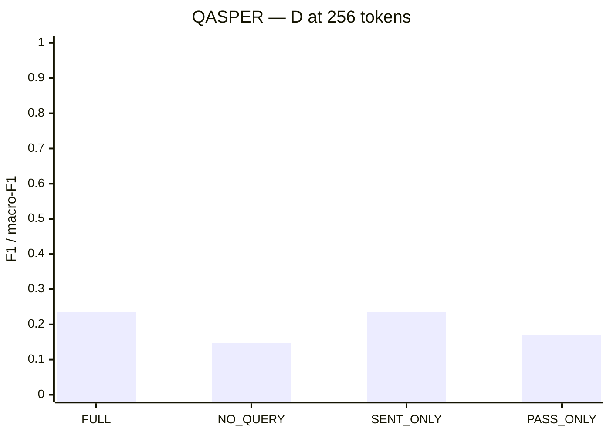
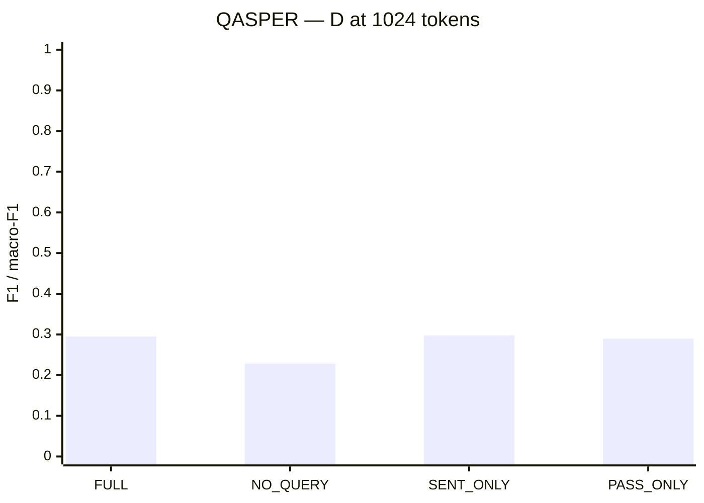
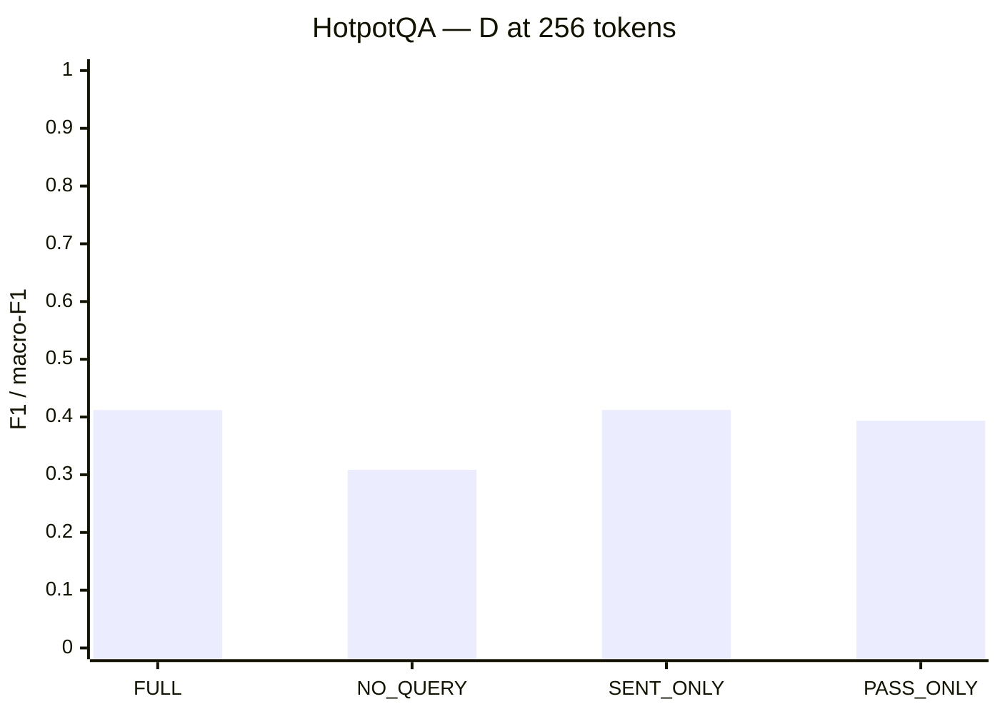
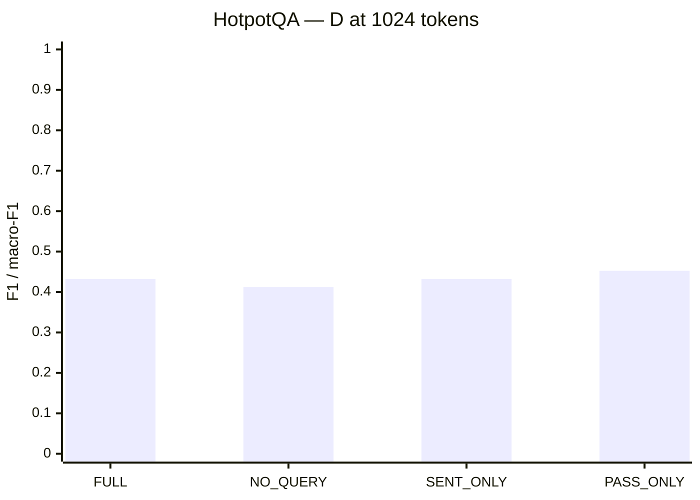
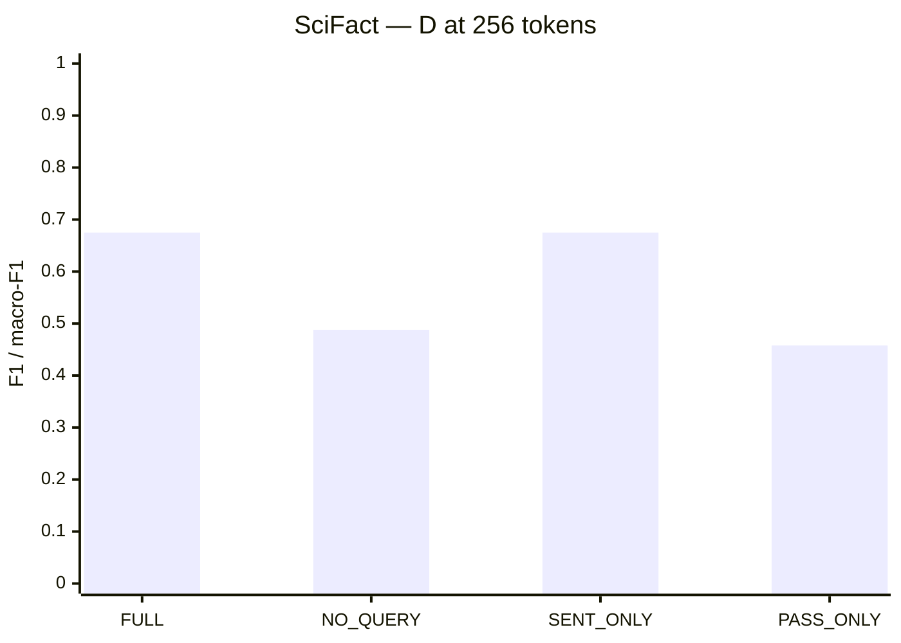
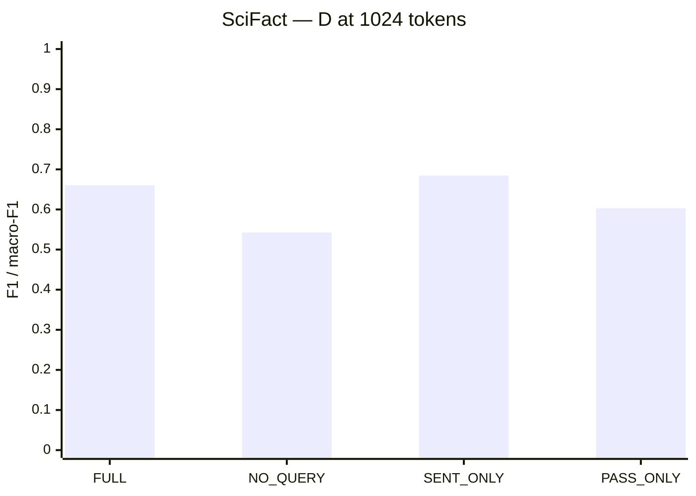
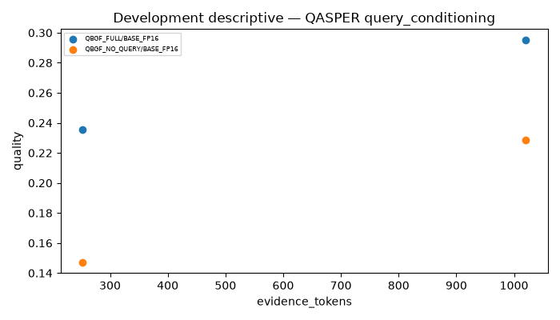
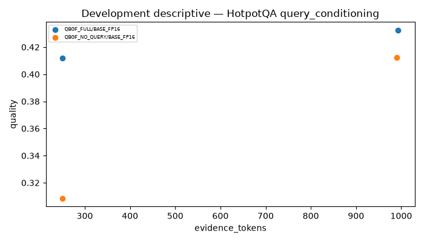
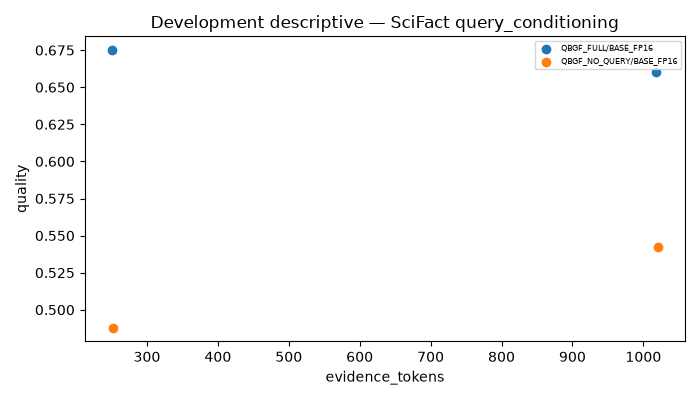

# Week 12 Part D — completed ablation results

Date: 1 November 2026. Branch: `gagan`. Frozen W12-QBGF-v3 VAL only.

**Main conclusion:** Query-conditioned allocation substantially outperforms query-free allocation under the same query-dependent SFR retrieved pool. However, allowing both sentence and full-passage options does not establish a consistent benefit over sentence-only allocation. This distinguishes useful query conditioning from an unproven multi-granular fusion advantage.

## Completion and conditions

D completed **66,696/66,696** logical rows (8,337 queries × 4 conditions × 2 budgets). QBGF_FULL matches C by construction and reuses compatible cached answers; it is not an independent replication. QASPER: 1,005 queries / 281 papers. HotpotQA: 7,155 queries / 7,155 query groups. SciFact: 177 queries / 157 groups. No confirmation or TEST outcomes were used.

| Condition | What changes |
|---|---|
| QBGF_FULL | Query-conditioned sentence/full-passage choice and exact budget allocation |
| QBGF_NO_QUERY | Uniform passage weights and no query-conditioned sentence scores for allocation; the upstream SFR pool is still query-dependent |
| QBGF_SENTENCE_ONLY | Removes FULL choices; same sentence relevance/optimizer |
| QBGF_PASSAGE_ONLY | Removes sentence choices; same passage weighting/optimizer |

Budgets 256/1024 refer to selected evidence, not total prompt length. Reader, source pool, prompt, tokenizer, decoder, metrics, seed and frozen VAL IDs remain fixed. NO_MASS/GREEDY remain secondary and were not run.

## QASPER — all scores and costs

| method             |   budget |   n_queries |   quality |   delta_vs_FULL |     HELP |     HURT |   answer_changed |   evidence_tokens |   prompt_tokens |   generated_tokens | format_compliance   |
|:-------------------|---------:|------------:|----------:|----------------:|---------:|---------:|-----------------:|------------------:|----------------:|-------------------:|:--------------------|
| QBGF_FULL          |     1024 |        1005 |  0.295055 |        0.000000 | 0.615920 | 0.070647 |         0.981095 |       1020.468657 |     1063.146269 |          20.131343 | —                   |
| QBGF_FULL          |      256 |        1005 |  0.235515 |        0.000000 | 0.519403 | 0.107463 |         0.986070 |        252.675622 |      295.353234 |          18.225871 | —                   |
| QBGF_NO_QUERY      |     1024 |        1005 |  0.228373 |       -0.066681 | 0.525373 | 0.113433 |         0.982090 |       1019.801990 |     1062.479602 |          19.338308 | —                   |
| QBGF_NO_QUERY      |      256 |        1005 |  0.147303 |       -0.088213 | 0.364179 | 0.164179 |         0.984080 |        252.561194 |      295.238806 |          17.349254 | —                   |
| QBGF_PASSAGE_ONLY  |     1024 |        1005 |  0.289581 |       -0.005474 | 0.598010 | 0.093532 |         0.982090 |        936.052736 |      978.730348 |          20.351244 | —                   |
| QBGF_PASSAGE_ONLY  |      256 |        1005 |  0.169283 |       -0.066233 | 0.404975 | 0.148259 |         0.985075 |        224.719403 |      267.397015 |          18.127363 | —                   |
| QBGF_SENTENCE_ONLY |     1024 |        1005 |  0.297740 |        0.002685 | 0.619900 | 0.075622 |         0.982090 |       1019.838806 |     1062.516418 |          19.947264 | —                   |
| QBGF_SENTENCE_ONLY |      256 |        1005 |  0.235584 |        0.000069 | 0.518408 | 0.107463 |         0.987065 |        252.600000 |      295.277612 |          18.222886 | —                   |

Quality is answer F1 for QASPER/HotpotQA and aggregate macro-F1 for SciFact. Delta is this condition minus QBGF_FULL. HELP/HURT is versus the no-evidence control; SciFact uses correctness transitions. Recorded format compliance must accompany reasoning claims.

## HotpotQA — all scores and costs

| method             |   budget |   n_queries |   quality |   delta_vs_FULL |     HELP |     HURT |   answer_changed |   evidence_tokens |   prompt_tokens |   generated_tokens | format_compliance   |
|:-------------------|---------:|------------:|----------:|----------------:|---------:|---------:|-----------------:|------------------:|----------------:|-------------------:|:--------------------|
| QBGF_FULL          |     1024 |        7155 |  0.432344 |        0.000000 | 0.594549 | 0.087072 |         0.866527 |        993.162124 |     1047.078127 |          14.449755 | —                   |
| QBGF_FULL          |      256 |        7155 |  0.412068 |        0.000000 | 0.518658 | 0.096017 |         0.869741 |        250.842208 |      304.758211 |          13.843746 | —                   |
| QBGF_NO_QUERY      |     1024 |        7155 |  0.412252 |       -0.020092 | 0.574563 | 0.096995 |         0.870999 |        990.339623 |     1044.255625 |          14.801118 | —                   |
| QBGF_NO_QUERY      |      256 |        7155 |  0.308593 |       -0.103475 | 0.394969 | 0.137386 |         0.862334 |        250.986164 |      304.902166 |          15.324249 | —                   |
| QBGF_PASSAGE_ONLY  |     1024 |        7155 |  0.452507 |        0.020163 | 0.594829 | 0.083019 |         0.865968 |        956.906639 |     1010.822642 |          13.678267 | —                   |
| QBGF_PASSAGE_ONLY  |      256 |        7155 |  0.393509 |       -0.018559 | 0.483578 | 0.106499 |         0.869322 |        228.751223 |      282.667226 |          13.609923 | —                   |
| QBGF_SENTENCE_ONLY |     1024 |        7155 |  0.432295 |       -0.000049 | 0.594270 | 0.087072 |         0.868064 |        992.543117 |     1046.459119 |          14.432704 | —                   |
| QBGF_SENTENCE_ONLY |      256 |        7155 |  0.412189 |        0.000121 | 0.518658 | 0.096017 |         0.869741 |        250.840671 |      304.756674 |          13.841090 | —                   |

Quality is answer F1 for QASPER/HotpotQA and aggregate macro-F1 for SciFact. Delta is this condition minus QBGF_FULL. HELP/HURT is versus the no-evidence control; SciFact uses correctness transitions. Recorded format compliance must accompany reasoning claims.

## SciFact — all scores and costs

| method             |   budget |   n_queries |   quality |   delta_vs_FULL |     HELP |     HURT |   answer_changed |   evidence_tokens |   prompt_tokens |   generated_tokens |   format_compliance |
|:-------------------|---------:|------------:|----------:|----------------:|---------:|---------:|-----------------:|------------------:|----------------:|-------------------:|--------------------:|
| QBGF_FULL          |     1024 |         177 |  0.660413 |        0.000000 | 0.367232 | 0.124294 |         0.559322 |       1018.384181 |     1083.322034 |           3.429379 |            1.000000 |
| QBGF_FULL          |      256 |         177 |  0.674969 |        0.000000 | 0.344633 | 0.107345 |         0.497175 |        250.604520 |      315.542373 |           3.655367 |            1.000000 |
| QBGF_NO_QUERY      |     1024 |         177 |  0.542628 |       -0.117784 | 0.248588 | 0.152542 |         0.457627 |       1020.231638 |     1085.169492 |           3.824859 |            1.000000 |
| QBGF_NO_QUERY      |      256 |         177 |  0.487967 |       -0.187002 | 0.141243 | 0.101695 |         0.271186 |        252.819209 |      317.757062 |           4.254237 |            1.000000 |
| QBGF_PASSAGE_ONLY  |     1024 |         177 |  0.603107 |       -0.057305 | 0.316384 | 0.141243 |         0.514124 |        966.451977 |     1031.389831 |           3.689266 |            1.000000 |
| QBGF_PASSAGE_ONLY  |      256 |         177 |  0.457775 |       -0.217194 | 0.175141 | 0.163842 |         0.378531 |        186.932203 |      251.870056 |           4.288136 |            1.000000 |
| QBGF_SENTENCE_ONLY |     1024 |         177 |  0.684693 |        0.024280 | 0.384181 | 0.118644 |         0.564972 |       1017.728814 |     1082.666667 |           3.418079 |            1.000000 |
| QBGF_SENTENCE_ONLY |      256 |         177 |  0.674969 |        0.000000 | 0.344633 | 0.107345 |         0.497175 |        250.604520 |      315.542373 |           3.655367 |            1.000000 |

Quality is answer F1 for QASPER/HotpotQA and aggregate macro-F1 for SciFact. Delta is this condition minus QBGF_FULL. HELP/HURT is versus the no-evidence control; SciFact uses correctness transitions. Recorded format compliance must accompany reasoning claims.

## Query conditioning — paired intervals

| dataset   |   budget |    point |   ci_low |   ci_high |    raw_p |   holm_adjusted_p |   joint_holm_adjusted_p |   n_queries |   n_clusters |
|:----------|---------:|---------:|---------:|----------:|---------:|------------------:|------------------------:|------------:|-------------:|
| QASPER    |      256 | 0.088213 | 0.071636 |  0.105356 | 0.000100 |          0.003900 |                0.005099 | 1005.000000 |   281.000000 |
| QASPER    |     1024 | 0.066681 | 0.051495 |  0.081844 | 0.000100 |          0.003900 |                0.005099 | 1005.000000 |   281.000000 |
| HotpotQA  |      256 | 0.103475 | 0.095397 |  0.111746 | 0.000100 |          0.003900 |                0.005099 | 7155.000000 |  7155.000000 |
| HotpotQA  |     1024 | 0.020092 | 0.015356 |  0.024760 | 0.000100 |          0.003900 |                0.005099 | 7155.000000 |  7155.000000 |
| SciFact   |      256 | 0.187002 | 0.103136 |  0.270973 | 0.000200 |          0.006199 |                0.007799 |  177.000000 |   157.000000 |
| SciFact   |     1024 | 0.117784 | 0.055711 |  0.182024 | 0.000300 |          0.008999 |                0.011399 |  177.000000 |   157.000000 |

Contrast is FULL minus NO_QUERY. Positive effects concern allocation/fidelity selection **within the same query-dependent retrieved pool**, not a claim that retrieval should ignore queries. Original 39-test Holm correction is retained, with an additional joint 51-contrast correction including the fusion controls. CIs are nominal 95% paired cluster-bootstrap intervals; p-values are existing paired cluster label-swap randomization tests (10,000 draws, seed42).

## Was mixed granularity itself useful?

| dataset   |   budget | right              | status   |     point |    ci_low |   ci_high |    raw_p |   joint_holm_adjusted_p |
|:----------|---------:|:-------------------|:---------|----------:|----------:|----------:|---------:|------------------------:|
| QASPER    |      256 | QBGF_SENTENCE_ONLY | COMPLETE | -0.000069 | -0.000581 |  0.000367 | 0.753625 |                1.000000 |
| QASPER    |      256 | QBGF_PASSAGE_ONLY  | COMPLETE |  0.066233 |  0.048862 |  0.083949 | 0.000100 |                0.005099 |
| QASPER    |     1024 | QBGF_SENTENCE_ONLY | COMPLETE | -0.002685 | -0.010267 |  0.004915 | 0.490551 |                1.000000 |
| QASPER    |     1024 | QBGF_PASSAGE_ONLY  | COMPLETE |  0.005474 | -0.005031 |  0.015607 | 0.309369 |                1.000000 |
| HotpotQA  |      256 | QBGF_SENTENCE_ONLY | COMPLETE | -0.000121 | -0.000363 |  0.000000 | 1.000000 |                1.000000 |
| HotpotQA  |      256 | QBGF_PASSAGE_ONLY  | COMPLETE |  0.018559 |  0.011475 |  0.025506 | 0.000100 |                0.005099 |
| HotpotQA  |     1024 | QBGF_SENTENCE_ONLY | COMPLETE |  0.000049 | -0.001157 |  0.001270 | 0.939606 |                1.000000 |
| HotpotQA  |     1024 | QBGF_PASSAGE_ONLY  | COMPLETE | -0.020163 | -0.025042 | -0.015425 | 0.000100 |                0.005099 |
| SciFact   |      256 | QBGF_SENTENCE_ONLY | COMPLETE |  0.000000 |  0.000000 |  0.000000 | 1.000000 |                1.000000 |
| SciFact   |      256 | QBGF_PASSAGE_ONLY  | COMPLETE |  0.217194 |  0.139681 |  0.298944 | 0.000100 |                0.005099 |
| SciFact   |     1024 | QBGF_SENTENCE_ONLY | COMPLETE | -0.024280 | -0.051337 | -0.004812 | 0.059894 |                1.000000 |
| SciFact   |     1024 | QBGF_PASSAGE_ONLY  | COMPLETE |  0.057305 | -0.009679 |  0.127139 | 0.097890 |                1.000000 |

Contrast is FULL minus the specified single-granularity ablation. FULL minus SENTENCE_ONLY is approximately zero at 256 on all three datasets; at 1024 it is −0.002685 on QASPER, +0.000050 on HotpotQA and −0.024281 on SciFact. Point estimates therefore do not support a general fusion advantage. FULL can beat passage-only allocation under tight budgets without beating sentence-only allocation. Do not confuse those claims.

## Relation to C and C-EXT

Strong simple controls remain important. QASPER fixed-sentence F1 0.263430 at256 and H3 0.299487 at1024 exceed FULL's point estimates. HotpotQA H3 0.425311 at256 and D passage-only 0.452507 at1024 exceed FULL. SciFact C2 0.710248 at256 and BM25 RAW_SKIP 0.710716 at1024 exceed FULL by point estimate. Comparator choices for the new diagnostic will be frozen using full-VAL metrics before observing any attribution outcomes; they are diagnostic selections, not fresh unbiased confirmation results.

## Evidence coverage diagnostics

| dataset   | method             |   budget | reader    |   mean_any_gold_recall |   valid_gold_queries |   unmapped_gold |
|:----------|:-------------------|---------:|:----------|-----------------------:|---------------------:|----------------:|
| QASPER    | QBGF_PASSAGE_ONLY  |     1024 | BASE_FP16 |               0.458468 |                  927 |             205 |
| HotpotQA  | QBGF_NO_QUERY      |      256 | BASE_FP16 |               0.718658 |                 7155 |               1 |
| HotpotQA  | QBGF_PASSAGE_ONLY  |      256 | BASE_FP16 |               0.933892 |                 7155 |               1 |
| QASPER    | QBGF_PASSAGE_ONLY  |      256 | BASE_FP16 |               0.106796 |                  927 |             205 |
| HotpotQA  | QBGF_SENTENCE_ONLY |     1024 | BASE_FP16 |               0.999720 |                 7155 |               1 |
| HotpotQA  | QBGF_NO_QUERY      |     1024 | BASE_FP16 |               0.996366 |                 7155 |               1 |
| HotpotQA  | QBGF_FULL          |     1024 | BASE_FP16 |               0.999860 |                 7155 |               1 |
| HotpotQA  | QBGF_SENTENCE_ONLY |      256 | BASE_FP16 |               0.973864 |                 7155 |               1 |
| HotpotQA  | QBGF_FULL          |      256 | BASE_FP16 |               0.973864 |                 7155 |               1 |
| HotpotQA  | QBGF_PASSAGE_ONLY  |     1024 | BASE_FP16 |               0.998882 |                 7155 |               1 |
| QASPER    | QBGF_SENTENCE_ONLY |      256 | BASE_FP16 |               0.069040 |                  927 |             205 |
| QASPER    | QBGF_NO_QUERY      |     1024 | BASE_FP16 |               0.255663 |                  927 |             205 |
| QASPER    | QBGF_FULL          |      256 | BASE_FP16 |               0.071197 |                  927 |             205 |
| QASPER    | QBGF_SENTENCE_ONLY |     1024 | BASE_FP16 |               0.312837 |                  927 |             205 |
| SciFact   | QBGF_NO_QUERY      |      256 | BASE_FP16 |               0.025000 |                  120 |               0 |
| QASPER    | QBGF_FULL          |     1024 | BASE_FP16 |               0.381877 |                  927 |             205 |
| SciFact   | QBGF_FULL          |      256 | BASE_FP16 |               0.675000 |                  120 |               0 |
| SciFact   | QBGF_PASSAGE_ONLY  |     1024 | BASE_FP16 |               0.691667 |                  120 |               0 |
| SciFact   | QBGF_NO_QUERY      |     1024 | BASE_FP16 |               0.333333 |                  120 |               0 |
| SciFact   | QBGF_FULL          |     1024 | BASE_FP16 |               0.925000 |                  120 |               0 |
| SciFact   | QBGF_PASSAGE_ONLY  |      256 | BASE_FP16 |               0.250000 |                  120 |               0 |
| SciFact   | QBGF_SENTENCE_ONLY |      256 | BASE_FP16 |               0.675000 |                  120 |               0 |
| QASPER    | QBGF_NO_QUERY      |      256 | BASE_FP16 |               0.020496 |                  927 |             205 |
| SciFact   | QBGF_SENTENCE_ONLY |     1024 | BASE_FP16 |               0.925000 |                  120 |               0 |

## SciFact class-level checks

| dataset   | method             |   budget | reader    | label           |   precision |   recall |       f1 |   support |
|:----------|:-------------------|---------:|:----------|:----------------|------------:|---------:|---------:|----------:|
| SciFact   | QBGF_NO_QUERY      |      256 | BASE_FP16 | SUPPORT         |    0.733333 | 0.397590 | 0.515625 |        83 |
| SciFact   | QBGF_NO_QUERY      |      256 | BASE_FP16 | REFUTE          |    0.619048 | 0.351351 | 0.448276 |        37 |
| SciFact   | QBGF_NO_QUERY      |      256 | BASE_FP16 | NOT_ENOUGH_INFO |    0.378378 | 0.736842 | 0.500000 |        57 |
| SciFact   | QBGF_FULL          |      256 | BASE_FP16 | SUPPORT         |    0.776471 | 0.795181 | 0.785714 |        83 |
| SciFact   | QBGF_FULL          |      256 | BASE_FP16 | REFUTE          |    0.676471 | 0.621622 | 0.647887 |        37 |
| SciFact   | QBGF_FULL          |      256 | BASE_FP16 | NOT_ENOUGH_INFO |    0.586207 | 0.596491 | 0.591304 |        57 |
| SciFact   | QBGF_PASSAGE_ONLY  |     1024 | BASE_FP16 | SUPPORT         |    0.779221 | 0.722892 | 0.750000 |        83 |
| SciFact   | QBGF_PASSAGE_ONLY  |     1024 | BASE_FP16 | REFUTE          |    0.487179 | 0.513514 | 0.500000 |        37 |
| SciFact   | QBGF_PASSAGE_ONLY  |     1024 | BASE_FP16 | NOT_ENOUGH_INFO |    0.540984 | 0.578947 | 0.559322 |        57 |
| SciFact   | QBGF_NO_QUERY      |     1024 | BASE_FP16 | SUPPORT         |    0.727273 | 0.578313 | 0.644295 |        83 |
| SciFact   | QBGF_NO_QUERY      |     1024 | BASE_FP16 | REFUTE          |    0.500000 | 0.513514 | 0.506667 |        37 |
| SciFact   | QBGF_NO_QUERY      |     1024 | BASE_FP16 | NOT_ENOUGH_INFO |    0.424658 | 0.543860 | 0.476923 |        57 |
| SciFact   | QBGF_FULL          |     1024 | BASE_FP16 | SUPPORT         |    0.768421 | 0.879518 | 0.820225 |        83 |
| SciFact   | QBGF_FULL          |     1024 | BASE_FP16 | REFUTE          |    0.545455 | 0.648649 | 0.592593 |        37 |
| SciFact   | QBGF_FULL          |     1024 | BASE_FP16 | NOT_ENOUGH_INFO |    0.710526 | 0.473684 | 0.568421 |        57 |
| SciFact   | QBGF_PASSAGE_ONLY  |      256 | BASE_FP16 | SUPPORT         |    0.714286 | 0.361446 | 0.480000 |        83 |
| SciFact   | QBGF_PASSAGE_ONLY  |      256 | BASE_FP16 | REFUTE          |    0.571429 | 0.324324 | 0.413793 |        37 |
| SciFact   | QBGF_PASSAGE_ONLY  |      256 | BASE_FP16 | NOT_ENOUGH_INFO |    0.359649 | 0.719298 | 0.479532 |        57 |
| SciFact   | QBGF_SENTENCE_ONLY |      256 | BASE_FP16 | SUPPORT         |    0.776471 | 0.795181 | 0.785714 |        83 |
| SciFact   | QBGF_SENTENCE_ONLY |      256 | BASE_FP16 | REFUTE          |    0.676471 | 0.621622 | 0.647887 |        37 |
| SciFact   | QBGF_SENTENCE_ONLY |      256 | BASE_FP16 | NOT_ENOUGH_INFO |    0.586207 | 0.596491 | 0.591304 |        57 |
| SciFact   | QBGF_SENTENCE_ONLY |     1024 | BASE_FP16 | SUPPORT         |    0.773196 | 0.903614 | 0.833333 |        83 |
| SciFact   | QBGF_SENTENCE_ONLY |     1024 | BASE_FP16 | REFUTE          |    0.581395 | 0.675676 | 0.625000 |        37 |
| SciFact   | QBGF_SENTENCE_ONLY |     1024 | BASE_FP16 | NOT_ENOUGH_INFO |    0.756757 | 0.491228 | 0.595745 |        57 |

## Allocation choices

| dataset   |   budget | method             | name   |   count |
|:----------|---------:|:-------------------|:-------|--------:|
| HotpotQA  |      256 | QBGF_FULL          | DROP   |   37568 |
| HotpotQA  |      256 | QBGF_FULL          | FULL   |       8 |
| HotpotQA  |      256 | QBGF_FULL          | SENT_1 |    9793 |
| HotpotQA  |      256 | QBGF_FULL          | SENT_2 |   10751 |
| HotpotQA  |      256 | QBGF_FULL          | SENT_4 |   11570 |
| HotpotQA  |      256 | QBGF_FULL          | SENT_8 |    1510 |
| HotpotQA  |      256 | QBGF_NO_QUERY      | DROP   |    1660 |
| HotpotQA  |      256 | QBGF_NO_QUERY      | FULL   |       4 |
| HotpotQA  |      256 | QBGF_NO_QUERY      | SENT_1 |   39569 |
| HotpotQA  |      256 | QBGF_NO_QUERY      | SENT_2 |   15411 |
| HotpotQA  |      256 | QBGF_NO_QUERY      | SENT_4 |   12840 |
| HotpotQA  |      256 | QBGF_NO_QUERY      | SENT_8 |    1716 |
| HotpotQA  |      256 | QBGF_PASSAGE_ONLY  | DROP   |   51379 |
| HotpotQA  |      256 | QBGF_PASSAGE_ONLY  | FULL   |   19821 |
| HotpotQA  |      256 | QBGF_SENTENCE_ONLY | DROP   |   37563 |
| HotpotQA  |      256 | QBGF_SENTENCE_ONLY | SENT_1 |    9796 |
| HotpotQA  |      256 | QBGF_SENTENCE_ONLY | SENT_2 |   10753 |
| HotpotQA  |      256 | QBGF_SENTENCE_ONLY | SENT_4 |   11571 |
| HotpotQA  |      256 | QBGF_SENTENCE_ONLY | SENT_8 |    1517 |
| HotpotQA  |     1024 | QBGF_FULL          | DROP   |    4370 |
| HotpotQA  |     1024 | QBGF_FULL          | FULL   |     863 |
| HotpotQA  |     1024 | QBGF_FULL          | SENT_1 |    3307 |
| HotpotQA  |     1024 | QBGF_FULL          | SENT_2 |    8480 |
| HotpotQA  |     1024 | QBGF_FULL          | SENT_4 |   31497 |
| HotpotQA  |     1024 | QBGF_FULL          | SENT_8 |   22683 |
| HotpotQA  |     1024 | QBGF_NO_QUERY      | DROP   |     253 |
| HotpotQA  |     1024 | QBGF_NO_QUERY      | FULL   |     873 |
| HotpotQA  |     1024 | QBGF_NO_QUERY      | SENT_1 |    4457 |
| HotpotQA  |     1024 | QBGF_NO_QUERY      | SENT_2 |    8902 |
| HotpotQA  |     1024 | QBGF_NO_QUERY      | SENT_4 |   32666 |
| HotpotQA  |     1024 | QBGF_NO_QUERY      | SENT_8 |   24049 |
| HotpotQA  |     1024 | QBGF_PASSAGE_ONLY  | DROP   |   13352 |
| HotpotQA  |     1024 | QBGF_PASSAGE_ONLY  | FULL   |   57848 |
| HotpotQA  |     1024 | QBGF_SENTENCE_ONLY | DROP   |    4244 |
| HotpotQA  |     1024 | QBGF_SENTENCE_ONLY | SENT_1 |    3323 |
| HotpotQA  |     1024 | QBGF_SENTENCE_ONLY | SENT_2 |    8484 |
| HotpotQA  |     1024 | QBGF_SENTENCE_ONLY | SENT_4 |   31570 |
| HotpotQA  |     1024 | QBGF_SENTENCE_ONLY | SENT_8 |   23579 |
| QASPER    |      256 | QBGF_FULL          | DROP   |    4511 |
| QASPER    |      256 | QBGF_FULL          | FULL   |      28 |
| QASPER    |      256 | QBGF_FULL          | SENT_1 |    2860 |
| QASPER    |      256 | QBGF_FULL          | SENT_2 |    1728 |
| QASPER    |      256 | QBGF_FULL          | SENT_4 |     675 |
| QASPER    |      256 | QBGF_FULL          | SENT_8 |     129 |
| QASPER    |      256 | QBGF_NO_QUERY      | DROP   |    2739 |
| QASPER    |      256 | QBGF_NO_QUERY      | FULL   |      32 |
| QASPER    |      256 | QBGF_NO_QUERY      | SENT_1 |    3490 |
| QASPER    |      256 | QBGF_NO_QUERY      | SENT_2 |    2253 |
| QASPER    |      256 | QBGF_NO_QUERY      | SENT_4 |    1198 |
| QASPER    |      256 | QBGF_NO_QUERY      | SENT_8 |     219 |
| QASPER    |      256 | QBGF_PASSAGE_ONLY  | DROP   |    8929 |
| QASPER    |      256 | QBGF_PASSAGE_ONLY  | FULL   |    1002 |
| QASPER    |      256 | QBGF_SENTENCE_ONLY | DROP   |    4494 |
| QASPER    |      256 | QBGF_SENTENCE_ONLY | SENT_1 |    2867 |
| QASPER    |      256 | QBGF_SENTENCE_ONLY | SENT_2 |    1738 |
| QASPER    |      256 | QBGF_SENTENCE_ONLY | SENT_4 |     691 |
| QASPER    |      256 | QBGF_SENTENCE_ONLY | SENT_8 |     141 |
| QASPER    |     1024 | QBGF_FULL          | DROP   |    1470 |
| QASPER    |     1024 | QBGF_FULL          | FULL   |    1480 |
| QASPER    |     1024 | QBGF_FULL          | SENT_1 |    1787 |
| QASPER    |     1024 | QBGF_FULL          | SENT_2 |    1999 |
| QASPER    |     1024 | QBGF_FULL          | SENT_4 |    1925 |
| QASPER    |     1024 | QBGF_FULL          | SENT_8 |    1270 |
| QASPER    |     1024 | QBGF_NO_QUERY      | DROP   |     249 |
| QASPER    |     1024 | QBGF_NO_QUERY      | FULL   |    1479 |
| QASPER    |     1024 | QBGF_NO_QUERY      | SENT_1 |    2033 |
| QASPER    |     1024 | QBGF_NO_QUERY      | SENT_2 |    2097 |
| QASPER    |     1024 | QBGF_NO_QUERY      | SENT_4 |    2344 |
| QASPER    |     1024 | QBGF_NO_QUERY      | SENT_8 |    1729 |
| QASPER    |     1024 | QBGF_PASSAGE_ONLY  | DROP   |    6024 |
| QASPER    |     1024 | QBGF_PASSAGE_ONLY  | FULL   |    3907 |
| QASPER    |     1024 | QBGF_SENTENCE_ONLY | DROP   |    1232 |
| QASPER    |     1024 | QBGF_SENTENCE_ONLY | SENT_1 |    1643 |
| QASPER    |     1024 | QBGF_SENTENCE_ONLY | SENT_2 |    2043 |
| QASPER    |     1024 | QBGF_SENTENCE_ONLY | SENT_4 |    2254 |
| QASPER    |     1024 | QBGF_SENTENCE_ONLY | SENT_8 |    2759 |
| SciFact   |      256 | QBGF_FULL          | DROP   |    1163 |
| SciFact   |      256 | QBGF_FULL          | SENT_1 |     251 |
| SciFact   |      256 | QBGF_FULL          | SENT_2 |     158 |
| SciFact   |      256 | QBGF_FULL          | SENT_4 |     135 |
| SciFact   |      256 | QBGF_FULL          | SENT_8 |      63 |
| SciFact   |      256 | QBGF_NO_QUERY      | DROP   |     708 |
| SciFact   |      256 | QBGF_NO_QUERY      | FULL   |       1 |
| SciFact   |      256 | QBGF_NO_QUERY      | SENT_1 |     562 |
| SciFact   |      256 | QBGF_NO_QUERY      | SENT_2 |     297 |
| SciFact   |      256 | QBGF_NO_QUERY      | SENT_4 |     151 |
| SciFact   |      256 | QBGF_NO_QUERY      | SENT_8 |      51 |
| SciFact   |      256 | QBGF_PASSAGE_ONLY  | DROP   |    1596 |
| SciFact   |      256 | QBGF_PASSAGE_ONLY  | FULL   |     174 |
| SciFact   |      256 | QBGF_SENTENCE_ONLY | DROP   |    1163 |
| SciFact   |      256 | QBGF_SENTENCE_ONLY | SENT_1 |     251 |
| SciFact   |      256 | QBGF_SENTENCE_ONLY | SENT_2 |     158 |
| SciFact   |      256 | QBGF_SENTENCE_ONLY | SENT_4 |     135 |
| SciFact   |      256 | QBGF_SENTENCE_ONLY | SENT_8 |      63 |
| SciFact   |     1024 | QBGF_FULL          | DROP   |     566 |
| SciFact   |     1024 | QBGF_FULL          | FULL   |      76 |
| SciFact   |     1024 | QBGF_FULL          | SENT_1 |     210 |
| SciFact   |     1024 | QBGF_FULL          | SENT_2 |     185 |
| SciFact   |     1024 | QBGF_FULL          | SENT_4 |     257 |
| SciFact   |     1024 | QBGF_FULL          | SENT_8 |     476 |
| SciFact   |     1024 | QBGF_NO_QUERY      | DROP   |     221 |
| SciFact   |     1024 | QBGF_NO_QUERY      | FULL   |     101 |
| SciFact   |     1024 | QBGF_NO_QUERY      | SENT_1 |     357 |
| SciFact   |     1024 | QBGF_NO_QUERY      | SENT_2 |     292 |
| SciFact   |     1024 | QBGF_NO_QUERY      | SENT_4 |     343 |
| SciFact   |     1024 | QBGF_NO_QUERY      | SENT_8 |     456 |
| SciFact   |     1024 | QBGF_PASSAGE_ONLY  | DROP   |    1077 |
| SciFact   |     1024 | QBGF_PASSAGE_ONLY  | FULL   |     693 |
| SciFact   |     1024 | QBGF_SENTENCE_ONLY | DROP   |     554 |
| SciFact   |     1024 | QBGF_SENTENCE_ONLY | SENT_1 |     207 |
| SciFact   |     1024 | QBGF_SENTENCE_ONLY | SENT_2 |     181 |
| SciFact   |     1024 | QBGF_SENTENCE_ONLY | SENT_4 |     268 |
| SciFact   |     1024 | QBGF_SENTENCE_ONLY | SENT_8 |     560 |

Counts include DROP. They describe the surrogate optimizer, not causal evidence credit. Exact source span support is not semantic faithfulness or answer correctness.

## Saved figures

The complete offline H analysis produced the following plots. Paths are relative to this report; the six bar charts above are embedded and self-contained.

## E/F/G decision and H next

**E (LLMLingua-2), F (LoRA training) and G (LoRA validation) are not run by user decision because of runtime cost.** Qualification of a compressor is not a quality result. Missing outcomes remain unobserved; no score is set to zero and the preregistered multiplicity family is not silently reduced. This is recorded in `qbgf/v3/protocol/optional_phase_decisions.json`.

H is ready to read completed C/C-EXT/D outcomes. No more original C/D generations are needed. Do not retain LoRA or claim a compressor comparison. The attribution J/K/L extension is a separately labelled post-hoc VAL-only diagnostic; it cannot tune confirmation or overturn the original comparison definitions.

## Provenance and limitations

Sources: complete `validation/D/status.json`, C/D result shards and offline H analysis tables in `qbgf/v3/analysis/`. Frozen original code hash: `0002987a3e2fe48f3d6511fc9fb409bba23a9a3594c3370e2de0e672c22afa95`.

All task comparisons stay dataset-specific. SciFact is small, exploratory comparisons are numerous, and prior development exposure remains documented. A near-zero ablation effect is not proof of no model use; sentence/full units also have different lengths. Neither C nor D establishes causal internal explanations. No full attribution, new training or TEST/confirmation run was executed while reporting.
