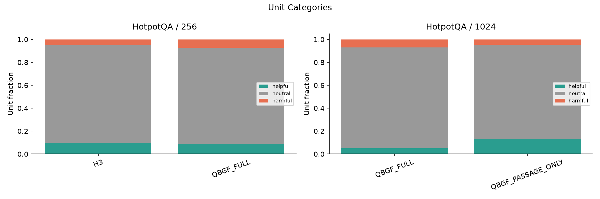
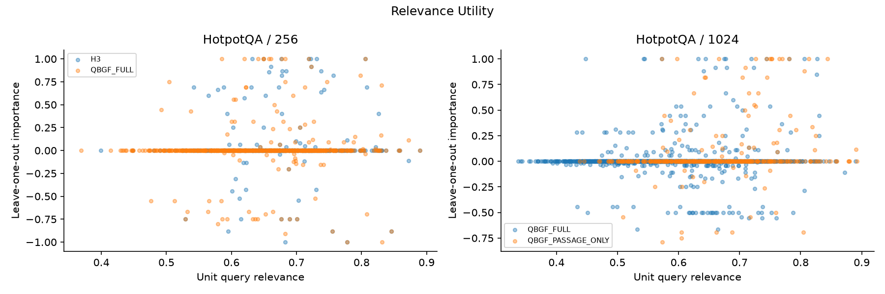
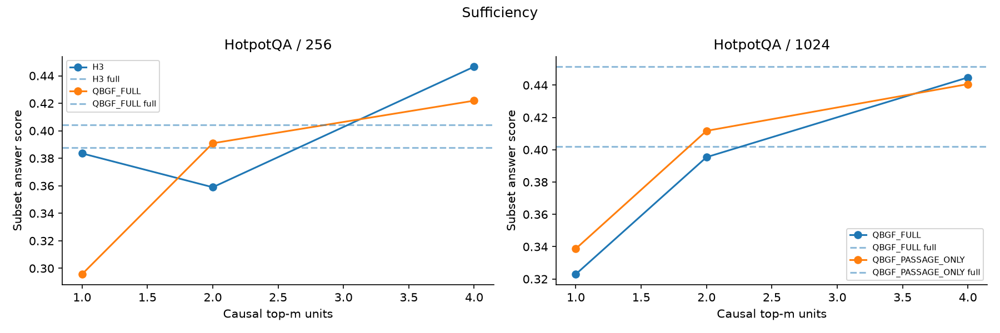
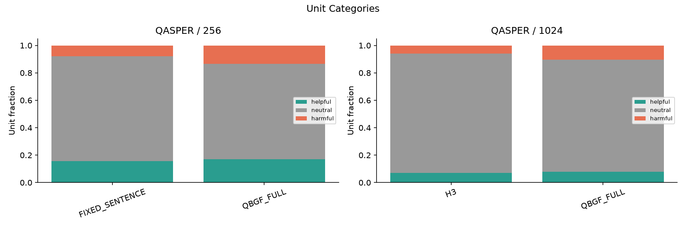
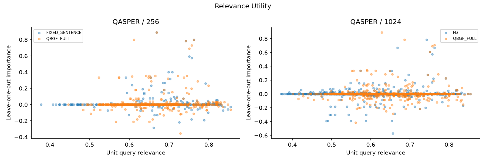
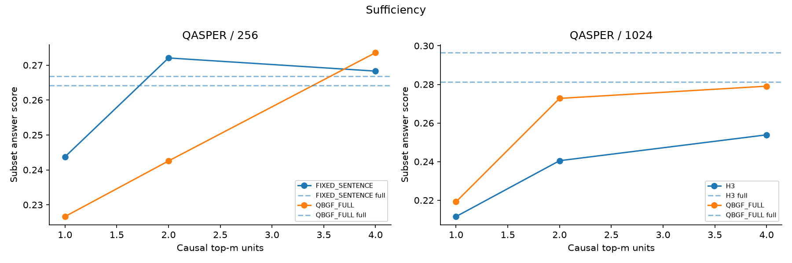
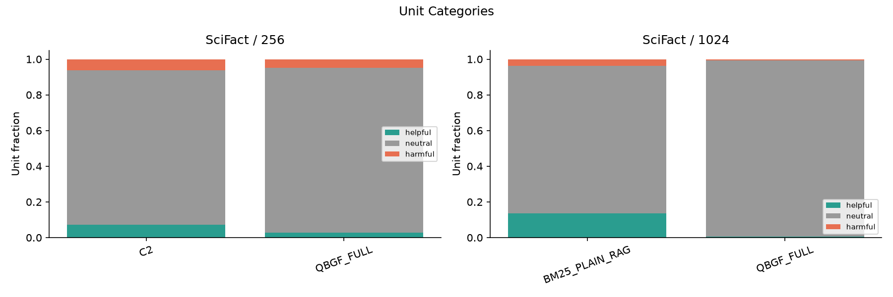
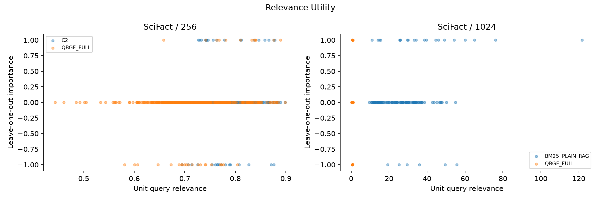
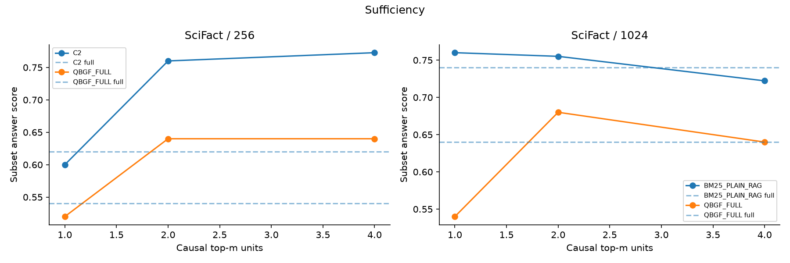

# Week12 K/L — completed evidence-attribution diagnostic

## Main finding

Semantic relevance is an imperfect proxy for downstream input-ablation utility. Most individual deletions leave the task score unchanged, yet both helpful and harmful units occur. This does **not** establish that the reader ignored those units. QBGF does not show a consistent diagnostic advantage over the preselected VAL comparator; nothing here changes the Part-I frozen method.

K is complete. The initially saved L notebook output was **synthetic smoke**, not the real analysis. The real L analysis was subsequently run against completed K shards, without any new model generation. All tables and figures below use real **VAL-only** results. No confirmation outcome was inspected.

## K: what was executed

- 150 frozen validation queries: 50 each from HotpotQA, QASPER and SciFact.
- Two budgets (256/1024), QBGF_FULL plus one comparator selected by full-VAL task quality for each dataset/budget: **600 cells**.
- Frozen Qwen BASE_FP16 reader/parser; source-exact selected sentence/proposition units or whole selected passages. Only exposed evidence changed.
- Leave-one-unit-out (LOO), individual-unit sufficiency, and retrospective causal top-1/2/4 ONLY and REMOVE actions.
- Causal ties use source order/stable ID, not semantic relevance. Full and NONE references reuse prior compatible answers.

Completed **16,032 logical perturbations**, including **9,607 LOO units**, with **13,410 recorded physical LM calls** after reuse. Conceptual prompt tokens: **9,313,113**; generated tokens: **222,111**. These logical totals include reuse; they are not new physical token-use totals.

Generation-shard modification times span roughly **2.47 hours**. This describes this run, not a controlled throughput or end-to-end benchmark. All 600 completion cells and original quantitative-table checksums were verified.

## Original quality on the diagnostic subset

| dataset   |   budget | comparator        |    QBGF |   comparator_quality |    delta |
|:----------|---------:|:------------------|--------:|---------------------:|---------:|
| HotpotQA  |      256 | H3                | 0.40423 |              0.38770 |  0.01653 |
| HotpotQA  |     1024 | QBGF_PASSAGE_ONLY | 0.40205 |              0.45142 | -0.04937 |
| QASPER    |      256 | FIXED_SENTENCE    | 0.26412 |              0.26679 | -0.00267 |
| QASPER    |     1024 | H3                | 0.29642 |              0.28120 |  0.01522 |
| SciFact   |      256 | C2                | 0.53099 |              0.60119 | -0.07020 |
| SciFact   |     1024 | BM25_PLAIN_RAG    | 0.58810 |              0.71212 | -0.12402 |

HotpotQA/QASPER use answer F1; SciFact uses aggregate three-class macro-F1. These 50-query VAL subsets are neither fresh confirmation nor the full C/D population. QBGF has higher point estimates in two of six cells. No paired quality-superiority test is inferred from this table. `BM25_PLAIN_RAG` is the historical internal alias for **budget-matched BM25 RAW_SKIP passage RAG**, not unrestricted RAG.

Per-query QBGF wins/losses/ties:

| dataset   |   budget |   LOSS |   TIE |   WIN |
|:----------|---------:|-------:|------:|------:|
| HotpotQA  |      256 |      7 |    34 |     9 |
| HotpotQA  |     1024 |      7 |    41 |     2 |
| QASPER    |      256 |     11 |    29 |    10 |
| QASPER    |     1024 |      4 |    34 |    12 |
| SciFact   |      256 |      8 |    38 |     4 |
| SciFact   |     1024 |      8 |    39 |     3 |

SciFact win/loss profiles and LOO importance use per-claim correctness; they are not per-query macro-F1 contributions.

## LOO utility and unit granularity

Importance = original task score − score after deleting the unit. Positive means deletion hurt; negative means deletion helped; zero means no observed task-score change. Epsilon is zero in this diagnostic.

| dataset   |   budget | method            |   n_queries |   n_units |   mean_importance |   helpful |   neutral |   harmful |   mean_query_harmful |   exact_answer_flip |
|:----------|---------:|:------------------|------------:|----------:|------------------:|----------:|----------:|----------:|---------------------:|--------------------:|
| HotpotQA  |      256 | H3                |          50 |       451 |           0.02666 |   0.09756 |   0.85366 |   0.04878 |              0.05084 |             0.26829 |
| HotpotQA  |      256 | QBGF_FULL         |          50 |       587 |           0.00779 |   0.08859 |   0.83986 |   0.07155 |              0.07017 |             0.28279 |
| HotpotQA  |     1024 | QBGF_FULL         |          50 |      1914 |           0.00492 |   0.05016 |   0.88088 |   0.06897 |              0.06834 |             0.19227 |
| HotpotQA  |     1024 | QBGF_PASSAGE_ONLY |          50 |       395 |           0.05055 |   0.13165 |   0.82025 |   0.04810 |              0.04714 |             0.30127 |
| QASPER    |      256 | FIXED_SENTENCE    |          50 |       467 |           0.01462 |   0.15632 |   0.76445 |   0.07923 |              0.08134 |             0.40471 |
| QASPER    |      256 | QBGF_FULL         |          50 |       511 |           0.01741 |   0.17025 |   0.69472 |   0.13503 |              0.12498 |             0.48141 |
| QASPER    |     1024 | H3                |          50 |      1824 |           0.00057 |   0.06963 |   0.87007 |   0.06031 |              0.06085 |             0.24068 |
| QASPER    |     1024 | QBGF_FULL         |          50 |      1225 |           0.00208 |   0.07918 |   0.81796 |   0.10286 |              0.09095 |             0.33143 |
| SciFact   |      256 | C2                |          50 |       267 |           0.00749 |   0.07116 |   0.86517 |   0.06367 |              0.06233 |             0.13858 |
| SciFact   |      256 | QBGF_FULL         |          50 |       425 |          -0.02118 |   0.02824 |   0.92235 |   0.04941 |              0.04497 |             0.08235 |
| SciFact   |     1024 | BM25_PLAIN_RAG    |          50 |       156 |           0.09615 |   0.13462 |   0.82692 |   0.03846 |              0.03833 |             0.19231 |
| SciFact   |     1024 | QBGF_FULL         |          50 |      1385 |          -0.00072 |   0.00505 |   0.98917 |   0.00578 |              0.00531 |             0.02166 |

Across the 9,607 units: **687 helpful (7.15%), 8,311 neutral (86.51%), 609 harmful (6.34%)**. These are pooled unit *counts*, not a pooled task-quality metric; unit sizes/types and cell weights differ. Median importance is zero in every cell.

| dataset   |   budget | method            |   mean_units |   mean_evidence_tokens |
|:----------|---------:|:------------------|-------------:|-----------------------:|
| HotpotQA  |      256 | H3                |      9.02000 |              238.80000 |
| HotpotQA  |      256 | QBGF_FULL         |     11.74000 |              251.62000 |
| HotpotQA  |     1024 | QBGF_FULL         |     38.28000 |              995.26000 |
| HotpotQA  |     1024 | QBGF_PASSAGE_ONLY |      7.90000 |              955.20000 |
| QASPER    |      256 | FIXED_SENTENCE    |      9.34000 |              255.06000 |
| QASPER    |      256 | QBGF_FULL         |     10.22000 |              252.52000 |
| QASPER    |     1024 | H3                |     36.48000 |             1003.34000 |
| QASPER    |     1024 | QBGF_FULL         |     24.50000 |             1020.44000 |
| SciFact   |      256 | C2                |      5.34000 |              229.90000 |
| SciFact   |      256 | QBGF_FULL         |      8.50000 |              250.56000 |
| SciFact   |     1024 | BM25_PLAIN_RAG    |      3.12000 |              951.84000 |
| SciFact   |     1024 | QBGF_FULL         |     27.70000 |             1018.72000 |

A sentence and a whole passage are different interventions. For example, SciFact @1024 QBGF averages 27.70 units/query versus 3.12 for BM25 passage RAG. Raw helpful/harmful unit fractions cannot establish which representation is intrinsically superior.

## Relevance versus utility

Spearman correlations below use 10,000 frozen paper/query/document-cluster bootstrap resamples, seed 42. They are exploratory nominal 95% intervals, not a newly multiplicity-corrected confirmation family.

| dataset   |   budget | method            |      rho |   ci_low |   ci_high |   n_units |   n_clusters |
|:----------|---------:|:------------------|---------:|---------:|----------:|----------:|-------------:|
| HotpotQA  |      256 | H3                |  0.02302 | -0.06493 |   0.10927 |       451 |           50 |
| HotpotQA  |      256 | QBGF_FULL         |  0.06811 | -0.01566 |   0.14824 |       587 |           50 |
| HotpotQA  |     1024 | QBGF_FULL         |  0.01000 | -0.08918 |   0.11990 |      1914 |           50 |
| HotpotQA  |     1024 | QBGF_PASSAGE_ONLY |  0.22122 |  0.13822 |   0.30338 |       395 |           50 |
| QASPER    |      256 | FIXED_SENTENCE    |  0.12616 | -0.02161 |   0.26676 |       467 |           50 |
| QASPER    |      256 | QBGF_FULL         |  0.10415 | -0.05445 |   0.24630 |       511 |           50 |
| QASPER    |     1024 | H3                | -0.02777 | -0.13338 |   0.08127 |      1824 |           50 |
| QASPER    |     1024 | QBGF_FULL         | -0.03442 | -0.12562 |   0.05719 |      1225 |           50 |
| SciFact   |      256 | C2                |  0.03822 | -0.12937 |   0.20455 |       267 |           50 |
| SciFact   |      256 | QBGF_FULL         |  0.13437 |  0.00940 |   0.24433 |       425 |           50 |
| SciFact   |     1024 | BM25_PLAIN_RAG    |  0.16843 | -0.01340 |   0.33806 |       156 |           50 |
| SciFact   |     1024 | QBGF_FULL         |  0.04411 | -0.02846 |   0.11270 |      1385 |           50 |

Ten of twelve intervals include zero. The two positive nominal intervals are HotpotQA passage-only @1024 (rho 0.2212) and SciFact QBGF @256 (rho 0.1344). This supports weak/context-dependent alignment, not the claim that retrieval relevance is useless or that cosine identifies causal evidence. Cross-unit correlations also mix query and granularity effects; within-query correlations are undefined for many constant-importance queries.

| dataset   |   budget | method            |    top1 |   top1_tie_aware |    top3 |   top_relevance_negative |   top_relevance_zero |   within_query_rho |   within_query_valid |
|:----------|---------:|:------------------|--------:|-----------------:|--------:|-------------------------:|---------------------:|-------------------:|---------------------:|
| HotpotQA  |      256 | H3                | 0.12000 |          0.60000 | 0.37333 |                  0.08000 |              0.82000 |           -0.01578 |                   32 |
| HotpotQA  |      256 | QBGF_FULL         | 0.16000 |          0.64000 | 0.28000 |                  0.10000 |              0.66000 |            0.09101 |                   31 |
| HotpotQA  |     1024 | QBGF_FULL         | 0.06000 |          0.56000 | 0.12000 |                  0.12000 |              0.72000 |            0.10592 |                   37 |
| HotpotQA  |     1024 | QBGF_PASSAGE_ONLY | 0.24000 |          0.70000 | 0.45333 |                  0.06000 |              0.56000 |            0.26540 |                   35 |
| QASPER    |      256 | FIXED_SENTENCE    | 0.22000 |          0.60000 | 0.34667 |                  0.14000 |              0.66000 |            0.15481 |                   30 |
| QASPER    |      256 | QBGF_FULL         | 0.30000 |          0.60000 | 0.44667 |                  0.28000 |              0.48000 |            0.14418 |                   32 |
| QASPER    |     1024 | H3                | 0.16000 |          0.56000 | 0.23333 |                  0.10000 |              0.72000 |            0.06954 |                   32 |
| QASPER    |     1024 | QBGF_FULL         | 0.16000 |          0.56000 | 0.25333 |                  0.14000 |              0.66000 |            0.07971 |                   32 |
| SciFact   |      256 | C2                | 0.18000 |          0.78000 | 0.59333 |                  0.08000 |              0.80000 |            0.02403 |                   22 |
| SciFact   |      256 | QBGF_FULL         | 0.20000 |          0.88000 | 0.39333 |                  0.04000 |              0.86000 |            0.13181 |                   16 |
| SciFact   |     1024 | BM25_PLAIN_RAG    | 0.44000 |          0.84000 | 0.90000 |                  0.08000 |              0.62000 |            0.28132 |                   23 |
| SciFact   |     1024 | QBGF_FULL         | 0.16000 |          0.92000 | 0.16000 |                  0.04000 |              0.88000 |            0.09096 |                   11 |

Tie-aware top-1 agreement is much higher than strict agreement because many units tie at zero. It must not be presented as strong causal-ranking accuracy.

## Does QBGF expose more harmful evidence?

Paired query-weighted difference: QBGF harmful-unit fraction minus its comparator.

| dataset   |   budget |     mean |   ci_low |   ci_high |   n |
|:----------|---------:|---------:|---------:|----------:|----:|
| HotpotQA  |      256 |  0.01933 | -0.01729 |   0.05955 |  50 |
| HotpotQA  |     1024 |  0.02120 | -0.02501 |   0.07618 |  50 |
| QASPER    |      256 |  0.04364 | -0.01804 |   0.11395 |  50 |
| QASPER    |     1024 |  0.03009 | -0.03211 |   0.09311 |  50 |
| SciFact   |      256 | -0.01737 | -0.07631 |   0.04050 |  50 |
| SciFact   |     1024 | -0.03303 | -0.06987 |  -0.00340 |  50 |

Five of six intervals cross zero. SciFact @1024 is nominally negative (−0.0330 [−0.0699, −0.0034]), yet QBGF quality is lower (0.5881 versus 0.7121 macro-F1). Lower per-unit harm therefore does not imply better aggregate answers; redundancy, smaller units and weak beneficial evidence remain plausible explanations. This is not a causal mediation result.

## Retrospective sufficiency / comprehensiveness

Top-m units are chosen using observed LOO outcomes from these same queries. These curves are retrospective diagnostics, not deployable selection or independent evidence of a trained policy. Negative sufficiency loss means the chosen subset scored higher than the original context.

| dataset   |   budget | method            |   top_m |     mean |   ci_low |   ci_high |   n |
|:----------|---------:|:------------------|--------:|---------:|---------:|----------:|----:|
| HotpotQA  |      256 | H3                |       1 |  0.00415 | -0.09263 |   0.10670 |  50 |
| HotpotQA  |      256 | H3                |       2 |  0.02875 | -0.05256 |   0.11707 |  50 |
| HotpotQA  |      256 | H3                |       4 | -0.05889 | -0.13608 |   0.01106 |  50 |
| HotpotQA  |      256 | QBGF_FULL         |       1 |  0.10850 | -0.00961 |   0.22670 |  50 |
| HotpotQA  |      256 | QBGF_FULL         |       2 |  0.01329 | -0.08515 |   0.11470 |  50 |
| HotpotQA  |      256 | QBGF_FULL         |       4 | -0.01767 | -0.11134 |   0.07551 |  50 |
| HotpotQA  |     1024 | QBGF_FULL         |       1 |  0.07910 | -0.03651 |   0.19956 |  50 |
| HotpotQA  |     1024 | QBGF_FULL         |       2 |  0.00664 | -0.10675 |   0.12419 |  50 |
| HotpotQA  |     1024 | QBGF_FULL         |       4 | -0.04271 | -0.15860 |   0.07733 |  50 |
| HotpotQA  |     1024 | QBGF_PASSAGE_ONLY |       1 |  0.11268 |  0.00785 |   0.22198 |  50 |
| HotpotQA  |     1024 | QBGF_PASSAGE_ONLY |       2 |  0.03971 | -0.04903 |   0.13141 |  50 |
| HotpotQA  |     1024 | QBGF_PASSAGE_ONLY |       4 |  0.01078 | -0.06082 |   0.08073 |  50 |
| QASPER    |      256 | FIXED_SENTENCE    |       1 |  0.02305 | -0.00972 |   0.06196 |  50 |
| QASPER    |      256 | FIXED_SENTENCE    |       2 | -0.00526 | -0.03138 |   0.02859 |  50 |
| QASPER    |      256 | FIXED_SENTENCE    |       4 | -0.00150 | -0.02096 |   0.02147 |  50 |
| QASPER    |      256 | QBGF_FULL         |       1 |  0.03750 |  0.00522 |   0.07576 |  50 |
| QASPER    |      256 | QBGF_FULL         |       2 |  0.02157 | -0.00895 |   0.05870 |  50 |
| QASPER    |      256 | QBGF_FULL         |       4 | -0.00945 | -0.03559 |   0.01585 |  50 |
| QASPER    |     1024 | H3                |       1 |  0.06964 |  0.02046 |   0.12507 |  50 |
| QASPER    |     1024 | H3                |       2 |  0.04071 | -0.00597 |   0.09310 |  50 |
| QASPER    |     1024 | H3                |       4 |  0.02732 | -0.01156 |   0.07330 |  50 |
| QASPER    |     1024 | QBGF_FULL         |       1 |  0.07721 |  0.02719 |   0.13387 |  50 |
| QASPER    |     1024 | QBGF_FULL         |       2 |  0.02367 | -0.03379 |   0.08428 |  50 |
| QASPER    |     1024 | QBGF_FULL         |       4 |  0.01735 | -0.04031 |   0.07875 |  50 |
| SciFact   |      256 | C2                |       1 |  0.02000 | -0.12000 |   0.16050 |  50 |
| SciFact   |      256 | C2                |       2 | -0.14000 | -0.26000 |  -0.02000 |  50 |
| SciFact   |      256 | C2                |       4 | -0.13636 | -0.27273 |   0.00000 |  44 |
| SciFact   |      256 | QBGF_FULL         |       1 |  0.02000 | -0.10000 |   0.14000 |  50 |
| SciFact   |      256 | QBGF_FULL         |       2 | -0.10000 | -0.22000 |   0.02000 |  50 |
| SciFact   |      256 | QBGF_FULL         |       4 | -0.10000 | -0.20000 |   0.00000 |  50 |
| SciFact   |     1024 | BM25_PLAIN_RAG    |       1 | -0.02000 | -0.16000 |   0.12000 |  50 |
| SciFact   |     1024 | BM25_PLAIN_RAG    |       2 | -0.02041 | -0.12245 |   0.08163 |  49 |
| SciFact   |     1024 | BM25_PLAIN_RAG    |       4 |  0.00000 |  0.00000 |   0.00000 |  18 |
| SciFact   |     1024 | QBGF_FULL         |       1 |  0.10000 | -0.08000 |   0.28000 |  50 |
| SciFact   |     1024 | QBGF_FULL         |       2 | -0.04000 | -0.20000 |   0.12000 |  50 |
| SciFact   |     1024 | QBGF_FULL         |       4 |  0.00000 | -0.14000 |   0.14000 |  50 |

Top-2/top-4 subsets often recover or exceed full-context point estimates, but many intervals are broad and this selection uses oracle information. SciFact C2 top-2 improves correctness by 0.14 on this subset (nominal interval for full-minus-subset: −0.26 to −0.02); do not report this as a macro-F1 gain or deployable improvement.

Curve eligibility differs: SciFact BM25 @1024 top-4 is available for only **18/50** queries; C2 @256 top-4 for **44/50**. Compare matched eligibility rather than treating every curve as the same cohort. Full comprehensiveness and original curve values are retained in `attribution/v1/analysis/curve_summary.csv`.

### Retention reporting correction

The original L table propagates undefined retention ratios (pandas NaN) into its means and counts them as eligible. Undefined ratios occur when original score − NONE score is nonpositive. Original tables and their freeze remain unchanged. `finite_retention_summary.csv` supplies an additive correction using only finite, defined ratios, with 10,000 cluster resamples and explicit eligible counts. This changes reporting only; no answers, source selections or attribution actions were recomputed. Retention can exceed one or be negative and is unstable near a small positive denominator.

| dataset   |   budget | method            |   top_m |   eligible_queries |   available_queries |    mean |   ci_low |   ci_high |   n |
|:----------|---------:|:------------------|--------:|-------------------:|--------------------:|--------:|---------:|----------:|----:|
| HotpotQA  |      256 | H3                |       1 |                 24 |                  50 | 1.08627 |  0.57292 |   1.66587 |  24 |
| HotpotQA  |      256 | H3                |       2 |                 24 |                  50 | 1.00605 |  0.65971 |   1.43252 |  24 |
| HotpotQA  |      256 | H3                |       4 |                 24 |                  50 | 1.34220 |  1.02434 |   1.77276 |  24 |
| HotpotQA  |      256 | QBGF_FULL         |       1 |                 24 |                  50 | 1.04495 |  0.46380 |   1.73509 |  24 |
| HotpotQA  |      256 | QBGF_FULL         |       2 |                 24 |                  50 | 1.00486 |  0.61875 |   1.45486 |  24 |
| HotpotQA  |      256 | QBGF_FULL         |       4 |                 24 |                  50 | 1.11661 |  0.67911 |   1.69458 |  24 |
| HotpotQA  |     1024 | QBGF_FULL         |       1 |                 28 |                  50 | 0.82557 |  0.37024 |   1.38564 |  28 |
| HotpotQA  |     1024 | QBGF_FULL         |       2 |                 28 |                  50 | 1.16729 |  0.56122 |   1.92757 |  28 |
| HotpotQA  |     1024 | QBGF_FULL         |       4 |                 28 |                  50 | 1.54764 |  0.85663 |   2.34363 |  28 |
| HotpotQA  |     1024 | QBGF_PASSAGE_ONLY |       1 |                 28 |                  50 | 0.83879 |  0.45069 |   1.28345 |  28 |
| HotpotQA  |     1024 | QBGF_PASSAGE_ONLY |       2 |                 28 |                  50 | 1.04964 |  0.68537 |   1.46689 |  28 |
| HotpotQA  |     1024 | QBGF_PASSAGE_ONLY |       4 |                 28 |                  50 | 1.17277 |  0.85085 |   1.56245 |  28 |
| QASPER    |      256 | FIXED_SENTENCE    |       1 |                 27 |                  50 | 0.90074 |  0.68712 |   1.14967 |  27 |
| QASPER    |      256 | FIXED_SENTENCE    |       2 |                 27 |                  50 | 1.09058 |  0.91128 |   1.27917 |  27 |
| QASPER    |      256 | FIXED_SENTENCE    |       4 |                 27 |                  50 | 1.08703 |  0.98289 |   1.19336 |  27 |
| QASPER    |      256 | QBGF_FULL         |       1 |                 28 |                  50 | 0.78030 |  0.62579 |   0.92107 |  28 |
| QASPER    |      256 | QBGF_FULL         |       2 |                 28 |                  50 | 0.34767 | -1.00336 |   1.13297 |  28 |
| QASPER    |      256 | QBGF_FULL         |       4 |                 28 |                  50 | 1.03853 |  0.88820 |   1.19134 |  28 |
| QASPER    |     1024 | H3                |       1 |                 29 |                  50 | 0.71104 |  0.45028 |   0.97256 |  29 |
| QASPER    |     1024 | H3                |       2 |                 29 |                  50 | 0.86007 |  0.61515 |   1.10456 |  29 |
| QASPER    |     1024 | H3                |       4 |                 29 |                  50 | 0.90823 |  0.70408 |   1.11411 |  29 |
| QASPER    |     1024 | QBGF_FULL         |       1 |                 34 |                  50 | 0.79090 |  0.46393 |   1.22685 |  34 |
| QASPER    |     1024 | QBGF_FULL         |       2 |                 34 |                  50 | 1.00439 |  0.69051 |   1.35248 |  34 |
| QASPER    |     1024 | QBGF_FULL         |       4 |                 34 |                  50 | 1.10436 |  0.76349 |   1.49294 |  34 |
| SciFact   |      256 | C2                |       1 |                 19 |                  50 | 0.63158 |  0.42105 |   0.84211 |  19 |
| SciFact   |      256 | C2                |       2 |                 19 |                  50 | 0.89474 |  0.73684 |   1.00000 |  19 |
| SciFact   |      256 | C2                |       4 |                 16 |                  44 | 0.93750 |  0.81250 |   1.00000 |  16 |
| SciFact   |      256 | QBGF_FULL         |       1 |                 12 |                  50 | 0.75000 |  0.50000 |   1.00000 |  12 |
| SciFact   |      256 | QBGF_FULL         |       2 |                 12 |                  50 | 0.83333 |  0.58333 |   1.00000 |  12 |
| SciFact   |      256 | QBGF_FULL         |       4 |                 12 |                  50 | 1.00000 |  1.00000 |   1.00000 |  12 |
| SciFact   |     1024 | BM25_PLAIN_RAG    |       1 |                 21 |                  50 | 0.90476 |  0.76190 |   1.00000 |  21 |
| SciFact   |     1024 | BM25_PLAIN_RAG    |       2 |                 20 |                  49 | 1.00000 |  1.00000 |   1.00000 |  20 |
| SciFact   |     1024 | BM25_PLAIN_RAG    |       4 |                  6 |                  18 | 1.00000 |  1.00000 |   1.00000 |   6 |
| SciFact   |     1024 | QBGF_FULL         |       1 |                 18 |                  50 | 0.38889 |  0.16667 |   0.61111 |  18 |
| SciFact   |     1024 | QBGF_FULL         |       2 |                 18 |                  50 | 0.66667 |  0.44444 |   0.88889 |  18 |
| SciFact   |     1024 | QBGF_FULL         |       4 |                 18 |                  50 | 0.66667 |  0.44444 |   0.88889 |  18 |

## Gold evidence overlap

Overlap is retrospective evaluation only, never an inference feature or selection criterion.

| dataset   |   budget | method            | gold_overlapping   |   n_units |   mean_importance |   median_importance |   helpful |   harmful |
|:----------|---------:|:------------------|:-------------------|----------:|------------------:|--------------------:|----------:|----------:|
| HotpotQA  |      256 | H3                | False              |       355 |           0.00880 |             0.00000 |   0.05915 |   0.04225 |
| HotpotQA  |      256 | H3                | True               |        96 |           0.09271 |             0.00000 |   0.23958 |   0.07292 |
| HotpotQA  |      256 | QBGF_FULL         | False              |       489 |          -0.01159 |             0.00000 |   0.05112 |   0.07157 |
| HotpotQA  |      256 | QBGF_FULL         | True               |        98 |           0.10449 |             0.00000 |   0.27551 |   0.07143 |
| HotpotQA  |     1024 | QBGF_FULL         | False              |      1795 |          -0.00272 |             0.00000 |   0.03454 |   0.06685 |
| HotpotQA  |     1024 | QBGF_FULL         | True               |       119 |           0.12019 |             0.00000 |   0.28571 |   0.10084 |
| HotpotQA  |     1024 | QBGF_PASSAGE_ONLY | False              |       297 |           0.01125 |             0.00000 |   0.05387 |   0.04377 |
| HotpotQA  |     1024 | QBGF_PASSAGE_ONLY | True               |        98 |           0.16965 |             0.00000 |   0.36735 |   0.06122 |
| QASPER    |      256 | FIXED_SENTENCE    | False              |       298 |           0.00237 |             0.00000 |   0.10067 |   0.09060 |
| QASPER    |      256 | FIXED_SENTENCE    | True               |        91 |           0.06255 |             0.00000 |   0.39560 |   0.08791 |
| QASPER    |      256 | QBGF_FULL         | False              |       355 |           0.00471 |             0.00000 |   0.12958 |   0.16056 |
| QASPER    |      256 | QBGF_FULL         | True               |        72 |           0.09652 |             0.00000 |   0.48611 |   0.11111 |
| QASPER    |     1024 | H3                | False              |      1235 |          -0.00306 |             0.00000 |   0.06883 |   0.06478 |
| QASPER    |     1024 | H3                | True               |       268 |           0.01563 |             0.00000 |   0.12687 |   0.10448 |
| QASPER    |     1024 | QBGF_FULL         | False              |       887 |          -0.00156 |             0.00000 |   0.06764 |   0.09019 |
| QASPER    |     1024 | QBGF_FULL         | True               |       128 |           0.03803 |             0.00000 |   0.17969 |   0.18750 |
| SciFact   |      256 | C2                | False              |       142 |           0.00000 |             0.00000 |   0.02113 |   0.02113 |
| SciFact   |      256 | C2                | True               |        36 |           0.19444 |             0.00000 |   0.25000 |   0.05556 |
| SciFact   |      256 | QBGF_FULL         | False              |       258 |          -0.02326 |             0.00000 |   0.01938 |   0.04264 |
| SciFact   |      256 | QBGF_FULL         | True               |        26 |           0.23077 |             0.00000 |   0.23077 |   0.00000 |
| SciFact   |     1024 | BM25_PLAIN_RAG    | False              |        77 |           0.03896 |             0.00000 |   0.06494 |   0.02597 |
| SciFact   |     1024 | BM25_PLAIN_RAG    | True               |        26 |           0.57692 |             1.00000 |   0.57692 |   0.00000 |
| SciFact   |     1024 | QBGF_FULL         | False              |       870 |           0.00000 |             0.00000 |   0.00230 |   0.00230 |
| SciFact   |     1024 | QBGF_FULL         | True               |        46 |           0.10870 |             0.00000 |   0.10870 |   0.00000 |

Gold-overlapping units generally show higher average deletion impact, but annotations are incomplete. Missing overlap labels were excluded, not treated as negative. In QASPER @256, only 389/467 FIXED_SENTENCE units and 427/511 QBGF units have defined overlap; SciFact also has many undefined units. Non-overlap does not establish false or irrelevant evidence.

## Figures

These figures are the original real L outputs. Plot labels retain internal aliases; BM25_PLAIN_RAG means budget-matched RAW_SKIP. SciFact sufficiency plots use mean per-query correctness rather than aggregate macro-F1.

## Limitations and next step

- This is post-hoc analysis on already-used VAL, with 50 queries per dataset and full-VAL comparator selection. It is not an unbiased new quality comparison.
- A zero deletion effect can reflect redundancy, interactions or insensitivity of the answer metric. It does not establish evidence non-use.
- Importance is context-dependent and non-additive; input ablation does not explain internal reasoning or establish factual causality.
- Unit length/granularity differences and numerous exploratory intervals limit universal comparisons.
- Qualitative candidates are automatically selected for inspection and remain labelled MANUAL_REVIEW_REQUIRED; no unsupported case narrative is added.
- No dynamic controller, new method, retriever change, training, confirmation or QASPER TEST was run.

**Next:** retain the Part-I FIXED_SENTENCE policy exactly as frozen. Part M is implemented and remains explicitly locked pending manual execution. K/L can explain validation behavior; they cannot change confirmation systems, IDs, budgets or hypotheses.
