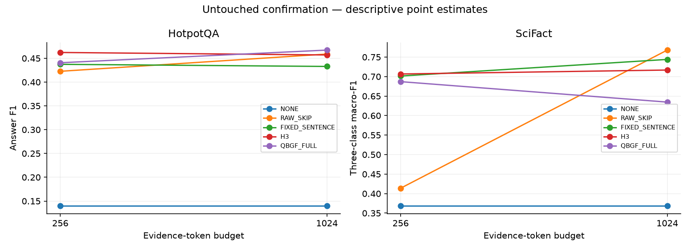
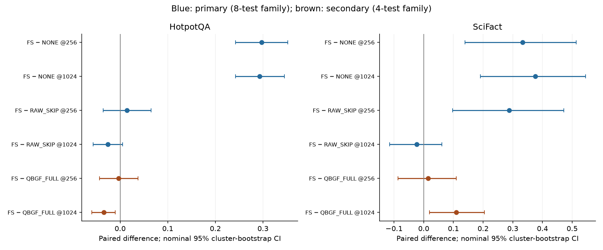

# Week12 M — final untouched confirmation

## Interpreted closeout

**Part M is complete: 2,500/2,500 logical rows, all five systems, both budgets, all 250 frozen queries, and 2,213 distinct cached generations.** Exact membership/groups, result checksums, evidence budgets/hashes, reader/prompt/parser/decoding identities and both Part-I freeze copies were verified. No rows were dropped or replaced. This reporting step made no new model calls and changed no scientific setting.

### What confirmation establishes

The high-level validation pattern generalizes, with important limits. FIXED_SENTENCE has substantial evidence benefit over NONE in all four dataset/budget cells, survives the preregistered eight-contrast Holm correction, and remains a credible frozen simple policy. It is **not** the best point-estimate system in every cell and is not universally superior to passages or QBGF.

### Primary quality summary

| dataset   |   budget |     NONE |   RAW_SKIP |   FIXED_SENTENCE |       H3 |   QBGF_FULL |
|:----------|---------:|---------:|-----------:|-----------------:|---------:|------------:|
| HotpotQA  |      256 | 0.139915 |   0.422667 |         0.437333 | 0.462229 |    0.440625 |
| HotpotQA  |     1024 | 0.139915 |   0.458917 |         0.432860 | 0.456997 |    0.467244 |
| SciFact   |      256 | 0.368612 |   0.413803 |         0.701420 | 0.706667 |    0.687037 |
| SciFact   |     1024 | 0.368612 |   0.767959 |         0.744048 | 0.716822 |    0.634615 |

HotpotQA uses answer F1; SciFact uses three-class macro-F1. Do not average these task scores across datasets. H3 point estimates are contextual/descriptive; no new H3 significance family was introduced.

### Question 1: Does the frozen evidence-assisted policy generalize?

Yes, on these two reserved cohorts. FIXED_SENTENCE − NONE is **+0.29742** [0.24242, 0.35242] and **+0.29294** [0.24214, 0.34523] on HotpotQA at 256/1024. SciFact gains are **+0.33281** [0.13864, 0.51421] and **+0.37544** [0.19077, 0.54549]. Holm-adjusted p-values are 0.00080 for each HotpotQA contrast and 0.01260 for each SciFact contrast. This supports evidence benefit in the sampled setting; it does not isolate retrieval from selection as independent mechanisms.

### Question 2: Sentence evidence versus passage RAG

At 256, SciFact strongly favors FIXED_SENTENCE: **+0.28762** macro-F1 [0.09709, 0.47206], primary-family Holm p=0.03560. HotpotQA favors sentences only by point estimate: **+0.01467** [−0.03567, 0.06500], inconclusive. At 1024, RAW_SKIP has higher point estimates in both datasets: sentence-minus-passage is **−0.02606** [−0.05689, 0.00490] on HotpotQA and **−0.02391** [−0.11539, 0.06152] on SciFact. Both intervals include zero: describe passage recovery/competitiveness, not proven superiority or equivalence.

RAW_SKIP is budget-matched passage RAG, not unrestricted/full-context RAG. Three SciFact @256 RAW_SKIP examples have empty evidence because no whole candidate fits; all three remain scored. This is a property of this whole-passage allocation control, not an outcome-based exclusion. The study does not prove sentences universally beat all possible passage allocators.

### Secondary question: Did rejecting universal QBGF promotion remain reasonable?

Confirmation is mixed. QBGF is better on HotpotQA @1024: FIXED_SENTENCE − QBGF = **−0.03438** [−0.05971, −0.01004], secondary-family Holm p=0.03160. This is a real predefined secondary result and must be acknowledged. HotpotQA @256 is effectively unresolved (−0.00329, interval spans zero). SciFact favors FIXED_SENTENCE: +0.01438 at 256 (inconclusive) and **+0.10943** at 1024 [0.01951, 0.20442]. The latter nominal interval is positive but its Holm-adjusted p=0.12809 does not survive the four-test secondary family. Bootstrap intervals are nominal; adjusted p-values come from the registered cluster label-swap test, so they need not yield identical thresholds.

Thus the evidence does not establish a robust **universal** QBGF advantage, while also contradicting any claim that the frozen sentence policy is universally best. QBGF is not retroactively promoted; FIXED_SENTENCE remains the historically frozen final policy.

### Validation pattern versus confirmation

All **12 predefined contrast point-estimate directions** match validation. This is descriptive consistency, not 12 independent replications: NONE is shared across budget labels and contrasts share queries/systems. Cohorts differ, so absolute VAL-to-confirmation changes are not paired tests.

| dataset   |   budget | contrast                   |   VAL_delta |   confirmation_delta | direction_repeated   |
|:----------|---------:|:---------------------------|------------:|---------------------:|:---------------------|
| HotpotQA  |      256 | FIXED_SENTENCE − NONE      |    0.242923 |             0.297417 | True                 |
| HotpotQA  |     1024 | FIXED_SENTENCE − NONE      |    0.257986 |             0.292945 | True                 |
| HotpotQA  |      256 | FIXED_SENTENCE − RAW_SKIP  |    0.001273 |             0.014665 | True                 |
| HotpotQA  |     1024 | FIXED_SENTENCE − RAW_SKIP  |   -0.028822 |            -0.026057 | True                 |
| HotpotQA  |      256 | FIXED_SENTENCE − QBGF_FULL |   -0.003821 |            -0.003293 | True                 |
| HotpotQA  |     1024 | FIXED_SENTENCE − QBGF_FULL |   -0.009033 |            -0.034384 | True                 |
| SciFact   |      256 | FIXED_SENTENCE − NONE      |    0.279400 |             0.332808 | True                 |
| SciFact   |     1024 | FIXED_SENTENCE − NONE      |    0.249736 |             0.375436 | True                 |
| SciFact   |      256 | FIXED_SENTENCE − RAW_SKIP  |    0.243685 |             0.287617 | True                 |
| SciFact   |     1024 | FIXED_SENTENCE − RAW_SKIP  |   -0.028581 |            -0.023911 | True                 |
| SciFact   |      256 | FIXED_SENTENCE − QBGF_FULL |    0.025094 |             0.014383 | True                 |
| SciFact   |     1024 | FIXED_SENTENCE − QBGF_FULL |    0.009985 |             0.109432 | True                 |

The direction pattern repeats more clearly than any claim of identical effect magnitude. For example, SciFact FIXED_SENTENCE @256 is 0.70006 on VAL and 0.70142 on confirmation, while HotpotQA QBGF @1024 rises from 0.43234 to 0.46724. Neither shift licenses new tuning or dataset-specific winner selection.

### Class errors, tokens and practical limits

SciFact has **zero invalid-format outputs** for every system/budget; quality differences here are not driven by format violations. For FIXED_SENTENCE, NOT_ENOUGH_INFO recall remains limited (0.50 at 256; 0.4375 at 1024), despite high SUPPORT recall (0.95 at both). The class table below reports all precision/recall/F1 values; only 20 SUPPORT, 14 REFUTE and 16 NEI claims are available.

FIXED_SENTENCE nearly fills each budget: mean evidence tokens are 254.76/1010.62 on HotpotQA and 254.30/1020.96 on SciFact. Moving from 256 to 1024 increases mean prompt tokens from 308.89 to 1064.75 and from 320.26 to 1086.92 respectively. HotpotQA sentence F1 does not increase with this larger context; SciFact does improve by point estimate. This is descriptive budget sensitivity, not a newly registered interaction test.

The 2,213 generation-cache entries are below the conservative 2,250 bound because NONE shares answers across budgets and some methods expose exactly identical evidence. Every logical system still has one conceptual LM call and its full prompt/generated-token cost. Cached answer-generation timings below are not independent per-row measurements; no end-to-end/serving-throughput claim is made.

### Final claim assessment

| Claim | Validation evidence | Confirmation evidence | Final status |
|---|---|---|---|
| Evidence granularity depends on task/budget | Different VAL rankings and allocation effects | Sentence/passage contrast directions repeat; tight SciFact effect is strongest | Qualitatively supported; interaction magnitude not formally established |
| Sentence selection is a strong simple constrained-budget policy | Frozen fallback selected using VAL | Strong gains over NONE in all four cells; clear SciFact @256 passage advantage | Supported within these cohorts; not universal superiority |
| Large-budget passages can recover | RAW_SKIP competitive/stronger at 1024 | Higher RAW_SKIP point estimates in both datasets; paired intervals include zero | Partially supported / competitive, superiority inconclusive |
| QBGF is universally superior | Universal promotion not established on VAL | HotpotQA @1024 win, mixed other cells | Universal claim not supported; cell-specific QBGF benefit acknowledged |
| Query conditioning matters | D VAL ablation evidence | NO_QUERY deliberately excluded | Validation-supported only |

No fresh QASPER confirmation exists. These conclusions cover 200 HotpotQA queries/200 groups and 50 SciFact claims/43 groups only. J/K/L is post-hoc explanation on VAL; it did not alter M. LLMLingua/LoRA were not tested. Confirmation is now consumed: do not tune, change methods or reuse it as fresh holdout.

---

## Integrity and untouched boundary

Freeze SHA256: `d0188a3582d6aead0a3a31f9f15bad9b51a88a6b475b05ac79ae38e58f05366b`. Split SHA256: `78f5ace11f9080d05dda12716e634020711182f721ac562dc81d19bad6c1c117`.

Frozen final method remains FIXED_SENTENCE; SFR top-10 → Qwen/Qwen3-8B BASE_FP16; no adaptation. Five systems at 256/1024. No selection changes are permitted after this evaluation.

Real cohort: HotpotQA 200 queries / 200 groups; SciFact 50 claims / 43 groups; QASPER zero fresh confirmation. Historical QASPER TEST remains closed.

This implementation and its synthetic tests observed no confirmation outcomes before explicit full execution. The full-execution receipt records the first authorized access by this workflow. This statement does not certify unavailable external execution history.

## Results

### HotpotQA

| dataset   |   budget | method         |   n_queries |   n_groups | primary_metric   |   quality | secondary_metric   |   secondary |   evidence_tokens |   prompt_tokens |   generated_tokens |   budget_utilization |   empty_evidence_count |   output_compliance |   invalid_format_count |   invalid_format_rate |   answer_generation_seconds |   conceptual_lm_calls |
|:----------|---------:|:---------------|------------:|-----------:|:-----------------|----------:|:-------------------|------------:|------------------:|----------------:|-------------------:|---------------------:|-----------------------:|--------------------:|-----------------------:|----------------------:|----------------------------:|----------------------:|
| HotpotQA  |      256 | NONE           |         200 |        200 | answer_F1        |   0.13992 | EM                 |     0.03000 |           0.00000 |        54.13000 |           15.57500 |              0.00000 |                    200 |                 nan |                    nan |                   nan |                     0.54487 |                     1 |
| HotpotQA  |      256 | RAW_SKIP       |         200 |        200 | answer_F1        |   0.42267 | EM                 |     0.23000 |         224.46000 |       278.59000 |           13.06500 |              0.87680 |                      0 |                 nan |                    nan |                   nan |                     0.51947 |                     1 |
| HotpotQA  |      256 | FIXED_SENTENCE |         200 |        200 | answer_F1        |   0.43733 | EM                 |     0.22000 |         254.75500 |       308.88500 |           13.66000 |              0.99514 |                      0 |                 nan |                    nan |                   nan |                     0.54694 |                     1 |
| HotpotQA  |      256 | H3             |         200 |        200 | answer_F1        |   0.46223 | EM                 |     0.25500 |         235.54000 |       289.67000 |           12.88500 |              0.92008 |                      0 |                 nan |                    nan |                   nan |                     0.51718 |                     1 |
| HotpotQA  |      256 | QBGF_FULL      |         200 |        200 | answer_F1        |   0.44063 | EM                 |     0.21500 |         251.38000 |       305.51000 |           13.79000 |              0.98195 |                      0 |                 nan |                    nan |                   nan |                     0.55119 |                     1 |
| HotpotQA  |     1024 | NONE           |         200 |        200 | answer_F1        |   0.13992 | EM                 |     0.03000 |           0.00000 |        54.13000 |           15.57500 |              0.00000 |                    200 |                 nan |                    nan |                   nan |                     0.54487 |                     1 |
| HotpotQA  |     1024 | RAW_SKIP       |         200 |        200 | answer_F1        |   0.45892 | EM                 |     0.22500 |         960.67000 |      1014.80000 |           14.61500 |              0.93815 |                      0 |                 nan |                    nan |                   nan |                     0.76989 |                     1 |
| HotpotQA  |     1024 | FIXED_SENTENCE |         200 |        200 | answer_F1        |   0.43286 | EM                 |     0.18500 |        1010.62000 |      1064.75000 |           14.84500 |              0.98693 |                      0 |                 nan |                    nan |                   nan |                     0.78082 |                     1 |
| HotpotQA  |     1024 | H3             |         200 |        200 | answer_F1        |   0.45700 | EM                 |     0.22500 |         996.00500 |      1050.13500 |           14.02000 |              0.97266 |                      0 |                 nan |                    nan |                   nan |                     0.74991 |                     1 |
| HotpotQA  |     1024 | QBGF_FULL      |         200 |        200 | answer_F1        |   0.46724 | EM                 |     0.23000 |        1001.92500 |      1056.05500 |           14.43000 |              0.97844 |                      0 |                 nan |                    nan |                   nan |                     0.76538 |                     1 |

### SciFact

| dataset   |   budget | method         |   n_queries |   n_groups | primary_metric   |   quality | secondary_metric   |   secondary |   evidence_tokens |   prompt_tokens |   generated_tokens |   budget_utilization |   empty_evidence_count |   output_compliance |   invalid_format_count |   invalid_format_rate |   answer_generation_seconds |   conceptual_lm_calls |
|:----------|---------:|:---------------|------------:|-----------:|:-----------------|----------:|:-------------------|------------:|------------------:|----------------:|-------------------:|---------------------:|-----------------------:|--------------------:|-----------------------:|----------------------:|----------------------------:|----------------------:|
| SciFact   |      256 | NONE           |          50 |         43 | macro_F1         |   0.36861 | accuracy           |     0.40000 |           0.00000 |        65.96000 |            4.20000 |              0.00000 |                     50 |             1.00000 |                0.00000 |               0.00000 |                     0.15438 |                     1 |
| SciFact   |      256 | RAW_SKIP       |          50 |         43 | macro_F1         |   0.41380 | accuracy           |     0.44000 |         203.42000 |       269.38000 |            4.32000 |              0.79461 |                      3 |             1.00000 |                0.00000 |               0.00000 |                     0.21083 |                     1 |
| SciFact   |      256 | FIXED_SENTENCE |          50 |         43 | macro_F1         |   0.70142 | accuracy           |     0.72000 |         254.30000 |       320.26000 |            3.44000 |              0.99336 |                      0 |             1.00000 |                0.00000 |               0.00000 |                     0.18525 |                     1 |
| SciFact   |      256 | H3             |          50 |         43 | macro_F1         |   0.70667 | accuracy           |     0.72000 |         233.64000 |       299.60000 |            3.56000 |              0.91266 |                      0 |             1.00000 |                0.00000 |               0.00000 |                     0.18847 |                     1 |
| SciFact   |      256 | QBGF_FULL      |          50 |         43 | macro_F1         |   0.68704 | accuracy           |     0.68000 |         251.56000 |       317.52000 |            3.80000 |              0.98266 |                      0 |             1.00000 |                0.00000 |               0.00000 |                     0.19870 |                     1 |
| SciFact   |     1024 | NONE           |          50 |         43 | macro_F1         |   0.36861 | accuracy           |     0.40000 |           0.00000 |        65.96000 |            4.20000 |              0.00000 |                     50 |             1.00000 |                0.00000 |               0.00000 |                     0.15438 |                     1 |
| SciFact   |     1024 | RAW_SKIP       |          50 |         43 | macro_F1         |   0.76796 | accuracy           |     0.78000 |         930.72000 |       996.68000 |            3.44000 |              0.90891 |                      0 |             1.00000 |                0.00000 |               0.00000 |                     0.35082 |                     1 |
| SciFact   |     1024 | FIXED_SENTENCE |          50 |         43 | macro_F1         |   0.74405 | accuracy           |     0.76000 |        1020.96000 |      1086.92000 |            3.32000 |              0.99703 |                      0 |             1.00000 |                0.00000 |               0.00000 |                     0.35606 |                     1 |
| SciFact   |     1024 | H3             |          50 |         43 | macro_F1         |   0.71682 | accuracy           |     0.74000 |         998.30000 |      1064.26000 |            3.32000 |              0.97490 |                      0 |             1.00000 |                0.00000 |               0.00000 |                     0.35391 |                     1 |
| SciFact   |     1024 | QBGF_FULL      |          50 |         43 | macro_F1         |   0.63462 | accuracy           |     0.66000 |        1018.70000 |      1084.66000 |            3.40000 |              0.99482 |                      0 |             1.00000 |                0.00000 |               0.00000 |                     0.35884 |                     1 |

### SciFact class diagnostics

| dataset   |   budget | method         | label           |   precision |   recall |      f1 |   support |
|:----------|---------:|:---------------|:----------------|------------:|---------:|--------:|----------:|
| SciFact   |      256 | NONE           | SUPPORT         |     0.44444 |  0.40000 | 0.42105 |        20 |
| SciFact   |      256 | NONE           | REFUTE          |     1.00000 |  0.14286 | 0.25000 |        14 |
| SciFact   |      256 | NONE           | NOT_ENOUGH_INFO |     0.33333 |  0.62500 | 0.43478 |        16 |
| SciFact   |      256 | RAW_SKIP       | SUPPORT         |     0.63636 |  0.35000 | 0.45161 |        20 |
| SciFact   |      256 | RAW_SKIP       | REFUTE          |     0.50000 |  0.21429 | 0.30000 |        14 |
| SciFact   |      256 | RAW_SKIP       | NOT_ENOUGH_INFO |     0.36364 |  0.75000 | 0.48980 |        16 |
| SciFact   |      256 | FIXED_SENTENCE | SUPPORT         |     0.67857 |  0.95000 | 0.79167 |        20 |
| SciFact   |      256 | FIXED_SENTENCE | REFUTE          |     0.81818 |  0.64286 | 0.72000 |        14 |
| SciFact   |      256 | FIXED_SENTENCE | NOT_ENOUGH_INFO |     0.72727 |  0.50000 | 0.59259 |        16 |
| SciFact   |      256 | H3             | SUPPORT         |     0.72000 |  0.90000 | 0.80000 |        20 |
| SciFact   |      256 | H3             | REFUTE          |     0.81818 |  0.64286 | 0.72000 |        14 |
| SciFact   |      256 | H3             | NOT_ENOUGH_INFO |     0.64286 |  0.56250 | 0.60000 |        16 |
| SciFact   |      256 | QBGF_FULL      | SUPPORT         |     0.70000 |  0.70000 | 0.70000 |        20 |
| SciFact   |      256 | QBGF_FULL      | REFUTE          |     0.90000 |  0.64286 | 0.75000 |        14 |
| SciFact   |      256 | QBGF_FULL      | NOT_ENOUGH_INFO |     0.55000 |  0.68750 | 0.61111 |        16 |
| SciFact   |     1024 | NONE           | SUPPORT         |     0.44444 |  0.40000 | 0.42105 |        20 |
| SciFact   |     1024 | NONE           | REFUTE          |     1.00000 |  0.14286 | 0.25000 |        14 |
| SciFact   |     1024 | NONE           | NOT_ENOUGH_INFO |     0.33333 |  0.62500 | 0.43478 |        16 |
| SciFact   |     1024 | RAW_SKIP       | SUPPORT         |     0.78261 |  0.90000 | 0.83721 |        20 |
| SciFact   |     1024 | RAW_SKIP       | REFUTE          |     0.75000 |  0.85714 | 0.80000 |        14 |
| SciFact   |     1024 | RAW_SKIP       | NOT_ENOUGH_INFO |     0.81818 |  0.56250 | 0.66667 |        16 |
| SciFact   |     1024 | FIXED_SENTENCE | SUPPORT         |     0.67857 |  0.95000 | 0.79167 |        20 |
| SciFact   |     1024 | FIXED_SENTENCE | REFUTE          |     0.85714 |  0.85714 | 0.85714 |        14 |
| SciFact   |     1024 | FIXED_SENTENCE | NOT_ENOUGH_INFO |     0.87500 |  0.43750 | 0.58333 |        16 |
| SciFact   |     1024 | H3             | SUPPORT         |     0.70370 |  0.95000 | 0.80851 |        20 |
| SciFact   |     1024 | H3             | REFUTE          |     0.73333 |  0.78571 | 0.75862 |        14 |
| SciFact   |     1024 | H3             | NOT_ENOUGH_INFO |     0.87500 |  0.43750 | 0.58333 |        16 |
| SciFact   |     1024 | QBGF_FULL      | SUPPORT         |     0.64286 |  0.90000 | 0.75000 |        20 |
| SciFact   |     1024 | QBGF_FULL      | REFUTE          |     0.75000 |  0.64286 | 0.69231 |        14 |
| SciFact   |     1024 | QBGF_FULL      | NOT_ENOUGH_INFO |     0.60000 |  0.37500 | 0.46154 |        16 |

## Paired predefined confirmation contrasts

Nominal 95% paired frozen-group bootstrap intervals; 10,000 resamples, seed 42. Primary family: 8 contrasts; secondary family: 4 contrasts; separate Holm-adjusted paired group label-swap p-values. H3 is descriptive. Synthetic tests use only 100 resamples. Interpret direction, magnitude, uncertainty and consistency; no project-level PASS/FAIL.

| id                                     | dataset   |   budget | left           | right     | metric   | family    |    point |   ci_low |   ci_high |   raw_p |   resamples |   seed |   n_queries |   n_clusters | test                                                                          |   holm_p |   family_size |
|:---------------------------------------|:----------|---------:|:---------------|:----------|:---------|:----------|---------:|---------:|----------:|--------:|------------:|-------:|------------:|-------------:|:------------------------------------------------------------------------------|---------:|--------------:|
| HotpotQA:256:FIXED_SENTENCE-NONE       | HotpotQA  |      256 | FIXED_SENTENCE | NONE      | f1       | primary   |  0.29742 |  0.24242 |   0.35242 | 0.00010 |       10000 |     42 |         200 |          200 | two-sided paired cluster label-swap randomization; exchangeability under null |  0.00080 |             8 |
| HotpotQA:1024:FIXED_SENTENCE-NONE      | HotpotQA  |     1024 | FIXED_SENTENCE | NONE      | f1       | primary   |  0.29294 |  0.24214 |   0.34523 | 0.00010 |       10000 |     42 |         200 |          200 | two-sided paired cluster label-swap randomization; exchangeability under null |  0.00080 |             8 |
| HotpotQA:256:FIXED_SENTENCE-RAW_SKIP   | HotpotQA  |      256 | FIXED_SENTENCE | RAW_SKIP  | f1       | primary   |  0.01467 | -0.03567 |   0.06500 | 0.56364 |       10000 |     42 |         200 |          200 | two-sided paired cluster label-swap randomization; exchangeability under null |  1.00000 |             8 |
| HotpotQA:1024:FIXED_SENTENCE-RAW_SKIP  | HotpotQA  |     1024 | FIXED_SENTENCE | RAW_SKIP  | f1       | primary   | -0.02606 | -0.05689 |   0.00490 | 0.09479 |       10000 |     42 |         200 |          200 | two-sided paired cluster label-swap randomization; exchangeability under null |  0.28437 |             8 |
| HotpotQA:256:FIXED_SENTENCE-QBGF_FULL  | HotpotQA  |      256 | FIXED_SENTENCE | QBGF_FULL | f1       | secondary | -0.00329 | -0.04369 |   0.03733 | 0.87161 |       10000 |     42 |         200 |          200 | two-sided paired cluster label-swap randomization; exchangeability under null |  1.00000 |             4 |
| HotpotQA:1024:FIXED_SENTENCE-QBGF_FULL | HotpotQA  |     1024 | FIXED_SENTENCE | QBGF_FULL | f1       | secondary | -0.03438 | -0.05971 |  -0.01004 | 0.00790 |       10000 |     42 |         200 |          200 | two-sided paired cluster label-swap randomization; exchangeability under null |  0.03160 |             4 |
| SciFact:256:FIXED_SENTENCE-NONE        | SciFact   |      256 | FIXED_SENTENCE | NONE      | macro_f1 | primary   |  0.33281 |  0.13864 |   0.51421 | 0.00220 |       10000 |     42 |          50 |           43 | two-sided paired cluster label-swap randomization; exchangeability under null |  0.01260 |             8 |
| SciFact:1024:FIXED_SENTENCE-NONE       | SciFact   |     1024 | FIXED_SENTENCE | NONE      | macro_f1 | primary   |  0.37544 |  0.19077 |   0.54549 | 0.00210 |       10000 |     42 |          50 |           43 | two-sided paired cluster label-swap randomization; exchangeability under null |  0.01260 |             8 |
| SciFact:256:FIXED_SENTENCE-RAW_SKIP    | SciFact   |      256 | FIXED_SENTENCE | RAW_SKIP  | macro_f1 | primary   |  0.28762 |  0.09709 |   0.47206 | 0.00890 |       10000 |     42 |          50 |           43 | two-sided paired cluster label-swap randomization; exchangeability under null |  0.03560 |             8 |
| SciFact:1024:FIXED_SENTENCE-RAW_SKIP   | SciFact   |     1024 | FIXED_SENTENCE | RAW_SKIP  | macro_f1 | primary   | -0.02391 | -0.11539 |   0.06152 | 0.62764 |       10000 |     42 |          50 |           43 | two-sided paired cluster label-swap randomization; exchangeability under null |  1.00000 |             8 |
| SciFact:256:FIXED_SENTENCE-QBGF_FULL   | SciFact   |      256 | FIXED_SENTENCE | QBGF_FULL | macro_f1 | secondary |  0.01438 | -0.08626 |   0.10989 | 0.75152 |       10000 |     42 |          50 |           43 | two-sided paired cluster label-swap randomization; exchangeability under null |  1.00000 |             4 |
| SciFact:1024:FIXED_SENTENCE-QBGF_FULL  | SciFact   |     1024 | FIXED_SENTENCE | QBGF_FULL | macro_f1 | secondary |  0.10943 |  0.01951 |   0.20442 | 0.04270 |       10000 |     42 |          50 |           43 | two-sided paired cluster label-swap randomization; exchangeability under null |  0.12809 |             4 |

## Validation versus confirmation

| dataset   | method         |   budget |     VAL |   confirmation |   change | inference                                            |   VAL_NONE_contrast |   CONF_NONE_contrast |   VAL_RAW_SKIP_contrast |   CONF_RAW_SKIP_contrast |   VAL_QBGF_FULL_contrast |   CONF_QBGF_FULL_contrast |
|:----------|:---------------|---------:|--------:|---------------:|---------:|:-----------------------------------------------------|--------------------:|---------------------:|------------------------:|-------------------------:|-------------------------:|--------------------------:|
| HotpotQA  | NONE           |      256 | 0.16532 |        0.13992 | -0.02541 | Unpaired descriptive sample shift; not a paired test |           nan       |            nan       |               nan       |                nan       |                nan       |                 nan       |
| HotpotQA  | RAW_SKIP       |      256 | 0.40697 |        0.42267 |  0.01569 | Unpaired descriptive sample shift; not a paired test |           nan       |            nan       |               nan       |                nan       |                nan       |                 nan       |
| HotpotQA  | FIXED_SENTENCE |      256 | 0.40825 |        0.43733 |  0.02909 | Unpaired descriptive sample shift; not a paired test |             0.24292 |              0.29742 |                 0.00127 |                  0.01467 |                 -0.00382 |                  -0.00329 |
| HotpotQA  | H3             |      256 | 0.42531 |        0.46223 |  0.03692 | Unpaired descriptive sample shift; not a paired test |           nan       |            nan       |               nan       |                nan       |                nan       |                 nan       |
| HotpotQA  | QBGF_FULL      |      256 | 0.41207 |        0.44063 |  0.02856 | Unpaired descriptive sample shift; not a paired test |           nan       |            nan       |               nan       |                nan       |                nan       |                 nan       |
| HotpotQA  | NONE           |     1024 | 0.16532 |        0.13992 | -0.02541 | Unpaired descriptive sample shift; not a paired test |           nan       |            nan       |               nan       |                nan       |                nan       |                 nan       |
| HotpotQA  | RAW_SKIP       |     1024 | 0.45213 |        0.45892 |  0.00678 | Unpaired descriptive sample shift; not a paired test |           nan       |            nan       |               nan       |                nan       |                nan       |                 nan       |
| HotpotQA  | FIXED_SENTENCE |     1024 | 0.42331 |        0.43286 |  0.00955 | Unpaired descriptive sample shift; not a paired test |             0.25799 |              0.29294 |                -0.02882 |                 -0.02606 |                 -0.00903 |                  -0.03438 |
| HotpotQA  | H3             |     1024 | 0.43642 |        0.45700 |  0.02058 | Unpaired descriptive sample shift; not a paired test |           nan       |            nan       |               nan       |                nan       |                nan       |                 nan       |
| HotpotQA  | QBGF_FULL      |     1024 | 0.43234 |        0.46724 |  0.03490 | Unpaired descriptive sample shift; not a paired test |           nan       |            nan       |               nan       |                nan       |                nan       |                 nan       |
| SciFact   | NONE           |      256 | 0.42066 |        0.36861 | -0.05205 | Unpaired descriptive sample shift; not a paired test |           nan       |            nan       |               nan       |                nan       |                nan       |                 nan       |
| SciFact   | RAW_SKIP       |      256 | 0.45638 |        0.41380 | -0.04257 | Unpaired descriptive sample shift; not a paired test |           nan       |            nan       |               nan       |                nan       |                nan       |                 nan       |
| SciFact   | FIXED_SENTENCE |      256 | 0.70006 |        0.70142 |  0.00136 | Unpaired descriptive sample shift; not a paired test |             0.27940 |              0.33281 |                 0.24368 |                  0.28762 |                  0.02509 |                   0.01438 |
| SciFact   | H3             |      256 | 0.68563 |        0.70667 |  0.02104 | Unpaired descriptive sample shift; not a paired test |           nan       |            nan       |               nan       |                nan       |                nan       |                 nan       |
| SciFact   | QBGF_FULL      |      256 | 0.67497 |        0.68704 |  0.01207 | Unpaired descriptive sample shift; not a paired test |           nan       |            nan       |               nan       |                nan       |                nan       |                 nan       |
| SciFact   | NONE           |     1024 | 0.42066 |        0.36861 | -0.05205 | Unpaired descriptive sample shift; not a paired test |           nan       |            nan       |               nan       |                nan       |                nan       |                 nan       |
| SciFact   | RAW_SKIP       |     1024 | 0.69898 |        0.76796 |  0.06898 | Unpaired descriptive sample shift; not a paired test |           nan       |            nan       |               nan       |                nan       |                nan       |                 nan       |
| SciFact   | FIXED_SENTENCE |     1024 | 0.67040 |        0.74405 |  0.07365 | Unpaired descriptive sample shift; not a paired test |             0.24974 |              0.37544 |                -0.02858 |                 -0.02391 |                  0.00999 |                   0.10943 |
| SciFact   | H3             |     1024 | 0.68590 |        0.71682 |  0.03092 | Unpaired descriptive sample shift; not a paired test |           nan       |            nan       |               nan       |                nan       |                nan       |                 nan       |
| SciFact   | QBGF_FULL      |     1024 | 0.66041 |        0.63462 | -0.02580 | Unpaired descriptive sample shift; not a paired test |           nan       |            nan       |               nan       |                nan       |                nan       |                 nan       |

Changes between VAL and confirmation are descriptive and unpaired: samples differ. No pooled cross-dataset quality score.

## Scientific conclusions

| Claim | Validation evidence | Confirmation evidence / final status |
|---|---|---|
| Tight-budget sentence evidence helps | Strong simple constrained-context VAL policy | Supported by confirmation |
| Granularity depends on dataset and budget | VAL directions differ across budget/task | Descriptive pattern; interpret cell magnitudes and intervals below; not a newly tested interaction |
| Large-budget passages can recover | RAW_SKIP competitive/stronger at 1024 | Partially supported |
| QBGF universally superior | Not established on VAL | Mixed/tied or opposing cell evidence; no robust universal promotion established. Read each secondary interval below |
| Query conditioning matters | D VAL mechanism evidence | Validation-supported only; not tested in confirmation |
- HotpotQA @256: FIXED_SENTENCE − NONE = 0.29742 [0.24242, 0.35242], positive. Direction supported by nominal interval; see multiplicity-adjusted evidence.
- HotpotQA @1024: FIXED_SENTENCE − NONE = 0.29294 [0.24214, 0.34523], positive. Direction supported by nominal interval; see multiplicity-adjusted evidence.
- HotpotQA @256: FIXED_SENTENCE − RAW_SKIP = 0.01467 [-0.03567, 0.06500], positive. Interval includes zero; inconclusive direction.
- HotpotQA @1024: FIXED_SENTENCE − RAW_SKIP = -0.02606 [-0.05689, 0.00490], negative. Interval includes zero; inconclusive direction.
- HotpotQA @256: FIXED_SENTENCE − QBGF_FULL = -0.00329 [-0.04369, 0.03733], negative. Interval includes zero; inconclusive direction.
- HotpotQA @1024: FIXED_SENTENCE − QBGF_FULL = -0.03438 [-0.05971, -0.01004], negative. Direction supported by nominal interval; see multiplicity-adjusted evidence.
- SciFact @256: FIXED_SENTENCE − NONE = 0.33281 [0.13864, 0.51421], positive. Direction supported by nominal interval; see multiplicity-adjusted evidence.
- SciFact @1024: FIXED_SENTENCE − NONE = 0.37544 [0.19077, 0.54549], positive. Direction supported by nominal interval; see multiplicity-adjusted evidence.
- SciFact @256: FIXED_SENTENCE − RAW_SKIP = 0.28762 [0.09709, 0.47206], positive. Direction supported by nominal interval; see multiplicity-adjusted evidence.
- SciFact @1024: FIXED_SENTENCE − RAW_SKIP = -0.02391 [-0.11539, 0.06152], negative. Interval includes zero; inconclusive direction.
- SciFact @256: FIXED_SENTENCE − QBGF_FULL = 0.01438 [-0.08626, 0.10989], positive. Interval includes zero; inconclusive direction.
- SciFact @1024: FIXED_SENTENCE − QBGF_FULL = 0.10943 [0.01951, 0.20442], positive. Direction supported by nominal interval; see multiplicity-adjusted evidence.

Costs are conceptual query-time tokens/calls; exact-answer reuse does not turn a system into zero-cost inference. Generation timing is recorded for the cached answer and is not a new timing measurement per reused row. No end-to-end latency, serving throughput or wall-clock efficiency claim is made.

## Limitations

- Only 250 confirmation queries, from HotpotQA and SciFact.
- SciFact has only 50 claims / 43 frozen groups; intervals may be wide.
- No fresh QASPER confirmation; consumed historical TEST remains closed.
- D query-conditioning mechanism remains validation-only.
- J/K/L attribution is a separate post-hoc VAL diagnostic and did not change M.
- LLMLingua and LoRA were not evaluated in confirmation.
- Statistical intervals and corrected tests complement effect size and direction; absence of significance is not equivalence.
