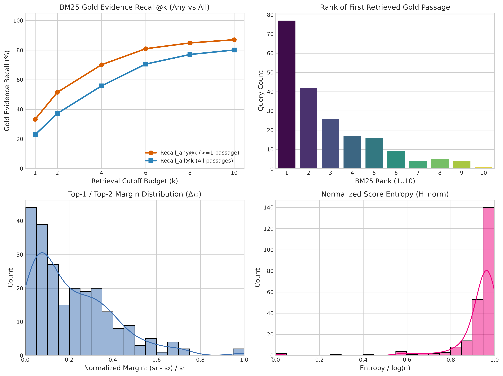
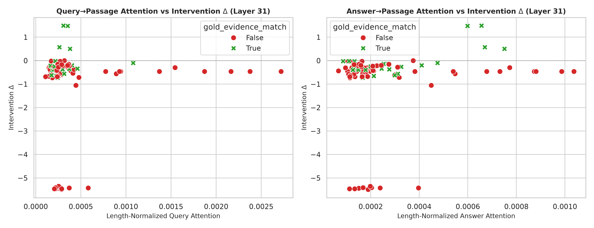
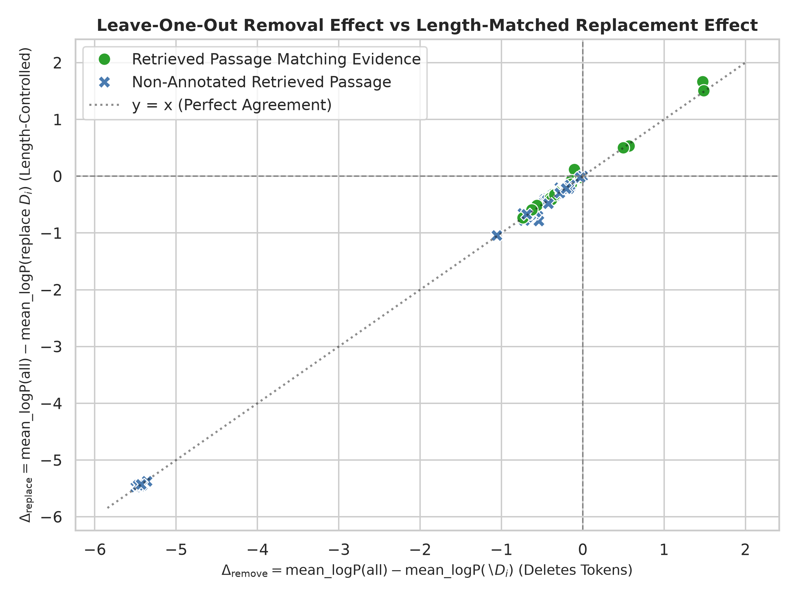
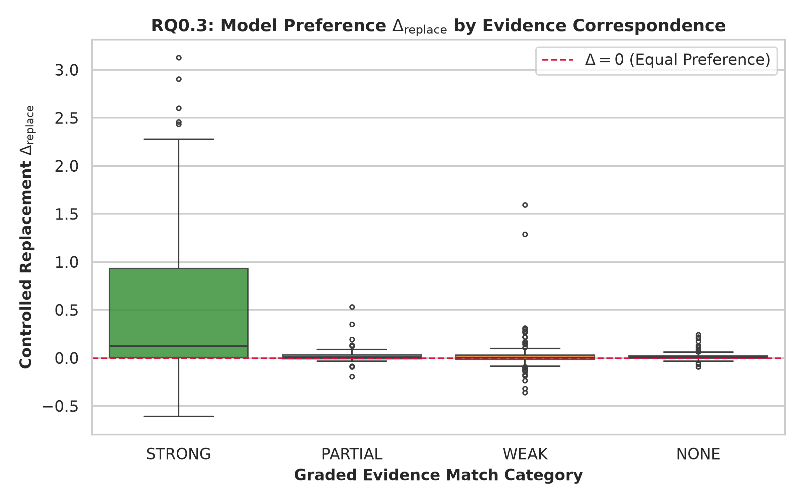
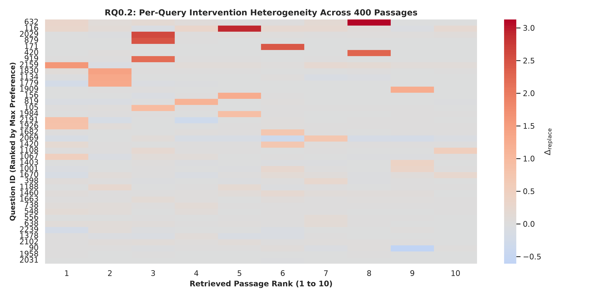
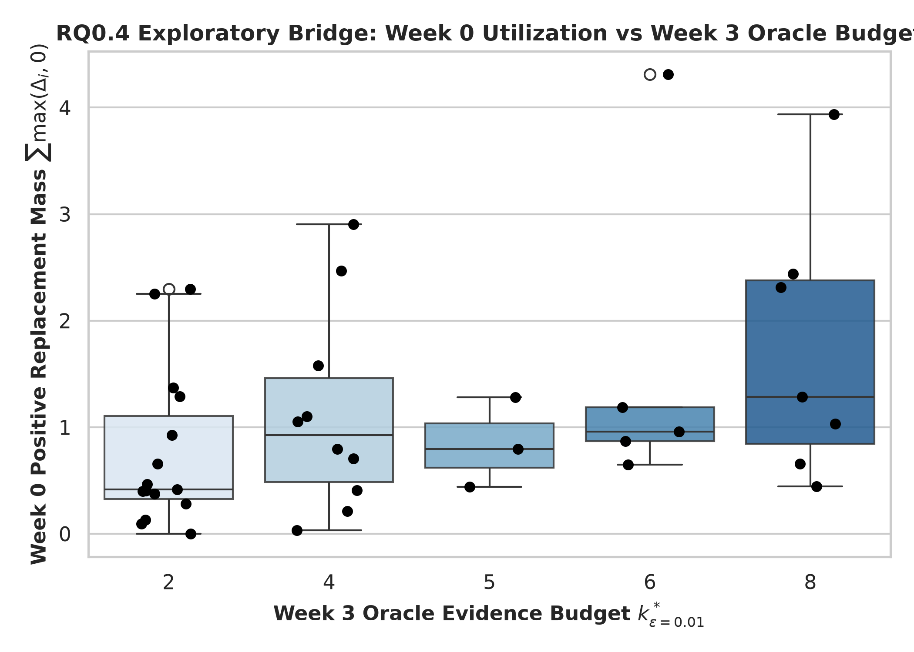

# Week 0 — Part-Wise Analysis

## Week objective

The week probes dataset/evidence characteristics and retrieval-to-reader sensitivity before learning a context allocator. Source code defines dataset analysis, layer analysis and utilization analysis; separately named GPU studies and a later Week3 bridge coexist. The generic layer/utilization tables are deterministic mock outputs and are excluded from empirical model conclusions. The notebook has no executed code outputs; it supplies no Tier-2 outcome evidence.

**EVIDENCE GAP — manual review required. SOURCE CONFLICT:** generic layer/utilization exports exactly reproduce mock formulas while real GPU pilot/final40 artifacts occupy separate paths. This report labels each source instead of merging them. Later weeks are not reconstructed until this stop-condition review is resolved.

# Part A — Dataset and retrieved-evidence characterization

**Status: COMPLETED**

## 1. Research question

How much annotated evidence is present in the local QASPER splits, and how often does the existing retrieved pool recover it?

## 2. Experimental design

| component   | value                                                                       |
|:------------|:----------------------------------------------------------------------------|
| dataset     | Local SARA reformatted QASPER train/dev (not official TEST)                 |
| retrieval   | Existing top-10 retrieval file; BM25 semantics established by Week0 scripts |
| seed        | 42                                                                          |
| metrics     | Query/paper counts; lexical overlap; any/all annotated-evidence recall      |

## 3. What was implemented / executed

Tables contain 2,088 train and 231 dev questions. Counts were recomputed from question rows and separately checked against reformatted JSONL line counts. Recall was recomputed from 231 query-level retrieval records; summary percentages agree after rounding.

## 4. Result artifacts used

- [results/week0/dataset_analysis/dataset_summary.csv](../../week0/dataset_analysis/dataset_summary.csv)
- [results/week0/dataset_analysis/question_level_statistics.csv](../../week0/dataset_analysis/question_level_statistics.csv)
- [results/week0/dataset_analysis/retrieval_statistics.csv](../../week0/dataset_analysis/retrieval_statistics.csv)

## 5. Main numerical results

### Split counts

| split   |   questions |   unique_questions |   papers |
|:--------|------------:|-------------------:|---------:|
| dev     |         231 |                231 |       86 |
| train   |        2088 |               2088 |      772 |

Sources: [results/week0/dataset_analysis/dataset_summary.csv](../../week0/dataset_analysis/dataset_summary.csv), [results/week0/dataset_analysis/question_level_statistics.csv](../../week0/dataset_analysis/question_level_statistics.csv), [results/week0/dataset_analysis/retrieval_statistics.csv](../../week0/dataset_analysis/retrieval_statistics.csv).

### Retrieved evidence recall (fractions, not percent)

|         k |   any_gold_recall |   all_gold_recall |    queries |
|----------:|------------------:|------------------:|-----------:|
|  2.000000 |          0.515152 |          0.372294 | 231.000000 |
|  4.000000 |          0.701299 |          0.558442 | 231.000000 |
|  6.000000 |          0.809524 |          0.705628 | 231.000000 |
| 10.000000 |          0.870130 |          0.800866 | 231.000000 |

Sources: [results/week0/dataset_analysis/dataset_summary.csv](../../week0/dataset_analysis/dataset_summary.csv), [results/week0/dataset_analysis/question_level_statistics.csv](../../week0/dataset_analysis/question_level_statistics.csv), [results/week0/dataset_analysis/retrieval_statistics.csv](../../week0/dataset_analysis/retrieval_statistics.csv).

## 6. Figures

X-axes encode retrieval depth/diagnostic distributions; recall panels show greater annotated-evidence recovery with depth. Exact values come from the CSV, not pixels. Recall does not establish reader answer quality.

## 7. Statistical analysis

No formal inferential test was found for this comparison.

## 8. Interpretation

### Supported

The local dev pool has any-gold recall 0.870130 and all-gold recall 0.800866 at 10; additional context can recover evidence that shallower retrieval misses.

### Not established

Reader quality, universal optimal context length, and exact correspondence of every raw evidence annotation to source text are not established.

### Important caveats

These are local historical split sizes, not current Week12 sizes. Lexical matching is an annotation proxy; dataset_adapter.py has split-dependent Arrow lookup and fallback behavior that needs separate identity review.

## 9. Part conclusion

- Dataset and retrieval characterization is completed for the recorded local splits.
- Retrieval recall is a prerequisite, not proof of useful evidence consumption.

# Part B — Generic layer-analysis export (quarantined mock)

**Status: HISTORICAL / SUPERSEDED**

## 1. Research question

Do query/passage representations evolve across layers?

## 2. Experimental design

| component        | value                                 |
|:-----------------|:--------------------------------------|
| files            | layer_analysis/ and duplicate tables/ |
| layers           | 0,4,8,16,24,31                        |
| recorded_rows    | 2400                                  |
| recorded_queries | 40                                    |

## 3. What was implemented / executed

Every stored cosine value was regenerated exactly by the seeded formula in run_mock_layer_analysis, using recorded row order and gold flags. No model was executed during this check. gpu_status.json marks this generic path PENDING_REAL_GPU_EXECUTION.

## 4. Result artifacts used

- [results/week0/layer_analysis/layer_similarity_long.csv](../../week0/layer_analysis/layer_similarity_long.csv)
- [src/week0/layer_analyzer.py](../../../src/week0/layer_analyzer.py)
- [results/week0/gpu_status.json](../../week0/gpu_status.json)
- [results/weekly_reports/week_00/PrimaryRecomputationChecks.json](PrimaryRecomputationChecks.json)

## 5. Main numerical results

### Provenance check

|   rows | all_cosines_match_mock_formula   | empirical_model_execution_established   |
|-------:|:---------------------------------|:----------------------------------------|
|   2400 | True                             | False                                   |

Sources: [results/week0/layer_analysis/layer_similarity_long.csv](../../week0/layer_analysis/layer_similarity_long.csv), [src/week0/layer_analyzer.py](../../../src/week0/layer_analyzer.py), [results/week0/gpu_status.json](../../week0/gpu_status.json), [results/weekly_reports/week_00/PrimaryRecomputationChecks.json](PrimaryRecomputationChecks.json).

## 6. Figures

No empirical figure is accepted for this part; available mock-derived plots are excluded.

## 7. Statistical analysis

No valid empirical inferential comparison is established by these synthetic values.

## 8. Interpretation

### Supported

The legacy export exists, but it is deterministic simulation output, not evidence about real model representations.

### Not established

Real layer evolution, gold/non-gold representation separation or a learned mechanism are not established from this export.

### Important caveats

**SOURCE CONFLICT:** generic CSVs look empirical by path but exactly match mock code; generic status says pending. Separate GPU pilot/final40 files must not be merged into this export.

## 9. Part conclusion

- Exclude these generic layer CSVs and their plots from empirical claims.
- Use separately identified real-study artifacts for layer diagnostics.

# Part C — Generic attention/utilization export (quarantined mock)

**Status: HISTORICAL / SUPERSEDED**

## 1. Research question

Does retrieval relevance agree with attention or passage-removal utility?

## 2. Experimental design

| component        | value                                          |
|:-----------------|:-----------------------------------------------|
| recorded_queries | 40                                             |
| passages         | 400                                            |
| attention_rows   | 2400                                           |
| source           | run_mock_utilization_analysis; RandomState(42) |

## 3. What was implemented / executed

All 2,400 attention mass/share rows and all 400 ablation scores exactly reproduce the mock formulas. The mock ablation explicitly adds 0.45 when a passage is marked gold, mechanically creating label correlation.

## 4. Result artifacts used

- [results/week0/evidence_analysis/attention_passage_scores.csv](../../week0/evidence_analysis/attention_passage_scores.csv)
- [results/week0/evidence_analysis/ablation_passage_scores.csv](../../week0/evidence_analysis/ablation_passage_scores.csv)
- [results/week0/evidence_analysis/signal_correlations.csv](../../week0/evidence_analysis/signal_correlations.csv)
- [src/week0/evidence_utilization.py](../../../src/week0/evidence_utilization.py)
- [results/weekly_reports/week_00/PrimaryRecomputationChecks.json](PrimaryRecomputationChecks.json)

## 5. Main numerical results

### Stored synthetic correlations — excluded from empirical findings

| signal_1            | signal_2            |   n_samples |   pearson_r |   spearman_rho |
|:--------------------|:--------------------|------------:|------------:|---------------:|
| bm25_score          | attention_share     |         400 |    0.592300 |       0.548800 |
| bm25_score          | ablation_importance |         400 |    0.164900 |       0.295900 |
| bm25_score          | is_gold_evidence    |         400 |    0.116900 |       0.100300 |
| attention_share     | ablation_importance |         400 |    0.507000 |       0.653800 |
| attention_share     | is_gold_evidence    |         400 |    0.446600 |       0.442100 |
| ablation_importance | is_gold_evidence    |         400 |    0.992800 |       0.701700 |

Sources: [results/week0/evidence_analysis/attention_passage_scores.csv](../../week0/evidence_analysis/attention_passage_scores.csv), [results/week0/evidence_analysis/ablation_passage_scores.csv](../../week0/evidence_analysis/ablation_passage_scores.csv), [results/week0/evidence_analysis/signal_correlations.csv](../../week0/evidence_analysis/signal_correlations.csv), [src/week0/evidence_utilization.py](../../../src/week0/evidence_utilization.py), [results/weekly_reports/week_00/PrimaryRecomputationChecks.json](PrimaryRecomputationChecks.json).

## 6. Figures

No empirical figure is accepted for this part; available mock-derived plots are excluded.

## 7. Statistical analysis

Stored Pearson/Spearman p-values concern simulated values and use passage-level observations; they are not valid empirical model evidence. A displayed zero p-value is rounded, not literally zero.

## 8. Interpretation

### Supported

The deterministic simulation is reproducible. Its 0.9928 ablation/gold Pearson correlation is an artifact of the construction.

### Not established

Attention proving evidence use; causal importance of gold passages; any deployable routing benefit are not established by these files.

### Important caveats

**SOURCE CONFLICT — manual review required.** Do not present the synthetic correlation as a scientific discovery. Generic concentration/effective-passage summaries derived from these values are likewise excluded.

## 9. Part conclusion

- This is historical simulation evidence only.
- No empirical attention–utility conclusion may be drawn from these generic tables.

# Part GPU-PILOT — Ten-query real GPU probe

**Status: COMPLETED**

## 1. Research question

Do real forward passes exhibit the same attention/ablation behavior as the generic simulated exports?

## 2. Experimental design

| component          | value                                                                                                               |
|:-------------------|:--------------------------------------------------------------------------------------------------------------------|
| queries            | 10                                                                                                                  |
| passages_per_query | 10                                                                                                                  |
| layers             | 0,4,8,16,24,31                                                                                                      |
| model              | /home/gunavenkat/Downloads/CS787-RAG-Project/Baselines/SARA-main/checkpoints/finetune/sara_qasper_proj_lr5e4_seed42 |
| dtype              | torch.bfloat16                                                                                                      |
| metric             | Teacher-forced mean gold-answer log-probability difference; full minus removed                                      |

## 3. What was implemented / executed

Execution metadata records 110 forward passes on TITAN RTX, 10 queries and no truncation. CSVs provide 100 ablations, 600 layer rows and 1,200 query/answer attention rows. These match the recorded design dimensions.

## 4. Result artifacts used

- [results/week0/gpu_pilot/execution_metadata.json](../../week0/gpu_pilot/execution_metadata.json)
- [results/week0/gpu_pilot/pilot_questions.csv](../../week0/gpu_pilot/pilot_questions.csv)
- [results/week0/gpu_pilot/ablation_results.csv](../../week0/gpu_pilot/ablation_results.csv)
- [results/week0/gpu_pilot/layer_results.csv](../../week0/gpu_pilot/layer_results.csv)
- [results/week0/gpu_pilot/attention_results.csv](../../week0/gpu_pilot/attention_results.csv)

## 5. Main numerical results

### Pilot intervention results

| study         |   rows |   queries |   mean_delta |   median_delta |   positive |   negative |   zero |
|:--------------|-------:|----------:|-------------:|---------------:|-----------:|-----------:|-------:|
| pilot removal |    100 |        10 |    -0.823364 |      -0.386718 |          4 |         96 |      0 |

Sources: [results/week0/gpu_pilot/execution_metadata.json](../../week0/gpu_pilot/execution_metadata.json), [results/week0/gpu_pilot/pilot_questions.csv](../../week0/gpu_pilot/pilot_questions.csv), [results/week0/gpu_pilot/ablation_results.csv](../../week0/gpu_pilot/ablation_results.csv), [results/week0/gpu_pilot/layer_results.csv](../../week0/gpu_pilot/layer_results.csv), [results/week0/gpu_pilot/attention_results.csv](../../week0/gpu_pilot/attention_results.csv).

## 6. Figures

X-axis is recorded attention; y-axis is the removal log-probability delta. Scatter is exploratory across nested passages and cannot establish causal internal evidence use.

## 7. Statistical analysis

No formal inferential test was found for this comparison.

## 8. Interpretation

### Supported

96/100 removal deltas are negative, with mean −0.823364. This differs fundamentally from the generic nonnegative mock ablation export.

### Not established

Negative teacher-forced deltas do not alone prove all annotated evidence is harmful. Generation F1 gains are not established.

### Important caveats

Small selected sample; nested passages; checkpoint/interface specificity; gold answer is supplied for teacher forcing. No clean SARA-latent versus text comparison exists here.

## 9. Part conclusion

- The pilot records real execution, unlike the generic mock files.
- Its strong negative sensitivity warrants checking intervention construction rather than copying synthetic conclusions.

# Part INTERVENTION-VALIDATION — Removal versus length-controlled replacement

**Status: COMPLETED**

## 1. Research question

Could removing a passage change prompt structure/length rather than isolate its information content?

## 2. Experimental design

| component     | value                                                                      |
|:--------------|:---------------------------------------------------------------------------|
| queries       | 10                                                                         |
| interventions | 100                                                                        |
| replacement   | Donor passage from another query/paper; approximately token-length matched |
| metric        | Full minus controlled-replacement mean log-probability                     |

## 3. What was implemented / executed

Replacement and removal comparison tables have 100 matching rows. The stored removal column agrees with the pilot ablation output. Mean absolute replacement-length difference is 1.28 tokens, maximum 5; signs agree for 98/100 rows.

## 4. Result artifacts used

- [results/week0/gpu_pilot/intervention_validation/replacement_results.csv](../../week0/gpu_pilot/intervention_validation/replacement_results.csv)
- [results/week0/gpu_pilot/intervention_validation/removal_vs_replacement.csv](../../week0/gpu_pilot/intervention_validation/removal_vs_replacement.csv)
- [results/week0/gpu_pilot/intervention_validation/evidence_match_audit.csv](../../week0/gpu_pilot/intervention_validation/evidence_match_audit.csv)

## 5. Main numerical results

### Pilot removal and replacement

| study             |   rows |   queries |   mean_delta |   median_delta |   positive |   negative |   zero |
|:------------------|-------:|----------:|-------------:|---------------:|-----------:|-----------:|-------:|
| pilot removal     |    100 |        10 |    -0.823364 |      -0.386718 |          4 |         96 |      0 |
| pilot replacement |    100 |        10 |    -0.820215 |      -0.375000 |          6 |         94 |      0 |

Sources: [results/week0/gpu_pilot/intervention_validation/replacement_results.csv](../../week0/gpu_pilot/intervention_validation/replacement_results.csv), [results/week0/gpu_pilot/intervention_validation/removal_vs_replacement.csv](../../week0/gpu_pilot/intervention_validation/removal_vs_replacement.csv), [results/week0/gpu_pilot/intervention_validation/evidence_match_audit.csv](../../week0/gpu_pilot/intervention_validation/evidence_match_audit.csv).

## 6. Figures

X/y compare removal and replacement log-probability deltas for the same passages. Agreement is within this pilot and does not demonstrate an internally faithful explanation.

## 7. Statistical analysis

No formal inferential test was found for this comparison.

## 8. Interpretation

### Supported

Both pilot interventions mostly have negative deltas; replacement is approximately, not perfectly, length matched.

### Not established

Generalized harmful-evidence prevalence or a validated reader improvement is not established.

### Important caveats

Donor text changes semantics and tokenization; replacement is not a pure single-factor causal information intervention. These are 100 nested passages from only 10 queries.

## 9. Part conclusion

- Length-controlled replacement did not remove the pilot negative-delta pattern.
- Keep pilot and final40 results separate.

# Part FINAL40 — Forty-paper input-sensitivity study

**Status: COMPLETED**

## 1. Research question

Do annotated-evidence categories differ in real replacement sensitivity across a broader, deliberately heterogeneous dev sample?

## 2. Experimental design

| component          | value                                                                                                               |
|:-------------------|:--------------------------------------------------------------------------------------------------------------------|
| base_model         | mistralai/Mistral-7B-Instruct-v0.2                                                                                  |
| checkpoint         | /home/gunavenkat/Downloads/CS787-RAG-Project/Baselines/SARA-main/checkpoints/finetune/sara_qasper_proj_lr5e4_seed42 |
| tokenizer          | mistralai/Mistral-7B-Instruct-v0.2                                                                                  |
| dtype              | bfloat16                                                                                                            |
| selected_layers    | [0, 4, 8, 16, 24, 31]                                                                                               |
| forward_passes     | 840                                                                                                                 |
| context_truncation | False                                                                                                               |
| dataset            | QASPER dev                                                                                                          |
| queries            | 40                                                                                                                  |
| papers             | 40                                                                                                                  |
| passages           | 400                                                                                                                 |
| selection          | 15 complete / 21 partial / 4 failed retrieval queries                                                               |
| metric             | Teacher-forced per-answer-token log-probability sensitivity, not answer F1                                          |

## 3. What was implemented / executed

Metadata records 840 real forward passes, 400 removals and 400 replacements. CSV row counts, 40 distinct papers and delta arithmetic were cross-checked within the saved log-probability rounding tolerance (maximum discrepancy 0.000010). Replacement-length differences are at most 6 tokens. Source scripts use a text-context prompt with the SARA-named fine-tuned checkpoint; these probes do not establish original latent-interface performance.

## 4. Result artifacts used

- [results/week0/final40/execution_metadata.json](../../week0/final40/execution_metadata.json)
- [results/week0/final40/sample_manifest.csv](../../week0/final40/sample_manifest.csv)
- [results/week0/final40/removal_results.csv](../../week0/final40/removal_results.csv)
- [results/week0/final40/replacement_results.csv](../../week0/final40/replacement_results.csv)
- [results/week0/final40/attention_results.csv](../../week0/final40/attention_results.csv)
- [results/week0/final40/evidence_match_results.csv](../../week0/final40/evidence_match_results.csv)
- [results/week0/final40/question_level_features.csv](../../week0/final40/question_level_features.csv)
- [results/weekly_reports/week_00/OfflineBootstrapReconstruction.json](OfflineBootstrapReconstruction.json)

## 5. Main numerical results

### Overall final40 sensitivity

| study               |   rows |   queries |   mean_delta |   median_delta |   positive |   negative |   zero |
|:--------------------|-------:|----------:|-------------:|---------------:|-----------:|-----------:|-------:|
| final40 removal     |    400 |        40 |     0.089741 |       0.003906 |        217 |        170 |     13 |
| final40 replacement |    400 |        40 |     0.098325 |       0.007812 |        235 |        146 |     19 |

Sources: [results/week0/final40/execution_metadata.json](../../week0/final40/execution_metadata.json), [results/week0/final40/sample_manifest.csv](../../week0/final40/sample_manifest.csv), [results/week0/final40/removal_results.csv](../../week0/final40/removal_results.csv), [results/week0/final40/replacement_results.csv](../../week0/final40/replacement_results.csv), [results/week0/final40/attention_results.csv](../../week0/final40/attention_results.csv), [results/week0/final40/evidence_match_results.csv](../../week0/final40/evidence_match_results.csv), [results/week0/final40/question_level_features.csv](../../week0/final40/question_level_features.csv), [results/weekly_reports/week_00/OfflineBootstrapReconstruction.json](OfflineBootstrapReconstruction.json).

### Replacement sensitivity by annotation-match category

| match_category   |   n |   mean_replacement_delta |   median_replacement_delta |   positive_fraction |
|:-----------------|----:|-------------------------:|---------------------------:|--------------------:|
| NONE             | 108 |                 0.018283 |                   0.007812 |            0.629630 |
| PARTIAL          |  47 |                 0.031660 |                   0.007812 |            0.617021 |
| STRONG           |  51 |                 0.618710 |                   0.125000 |            0.784314 |
| WEAK             | 194 |                 0.022233 |                   0.000977 |            0.505155 |

Sources: [results/week0/final40/execution_metadata.json](../../week0/final40/execution_metadata.json), [results/week0/final40/sample_manifest.csv](../../week0/final40/sample_manifest.csv), [results/week0/final40/removal_results.csv](../../week0/final40/removal_results.csv), [results/week0/final40/replacement_results.csv](../../week0/final40/replacement_results.csv), [results/week0/final40/attention_results.csv](../../week0/final40/attention_results.csv), [results/week0/final40/evidence_match_results.csv](../../week0/final40/evidence_match_results.csv), [results/week0/final40/question_level_features.csv](../../week0/final40/question_level_features.csv), [results/weekly_reports/week_00/OfflineBootstrapReconstruction.json](OfflineBootstrapReconstruction.json).

### Offline reconstructed exploratory contrast

| contrast                                      |    point |   bootstrap_mean |   ci_low |   ci_high |   resamples |   seed |   clusters | role                                                                                              |
|:----------------------------------------------|---------:|-----------------:|---------:|----------:|------------:|-------:|-----------:|:--------------------------------------------------------------------------------------------------|
| STRONG minus WEAK/NONE mean replacement delta | 0.597889 |         0.602894 | 0.377483 |  0.856960 |        2000 |     42 |         40 | New offline reconstruction from original CSV; exploratory, nominal CI; no multiplicity correction |

Sources: [results/week0/final40/execution_metadata.json](../../week0/final40/execution_metadata.json), [results/week0/final40/sample_manifest.csv](../../week0/final40/sample_manifest.csv), [results/week0/final40/removal_results.csv](../../week0/final40/removal_results.csv), [results/week0/final40/replacement_results.csv](../../week0/final40/replacement_results.csv), [results/week0/final40/attention_results.csv](../../week0/final40/attention_results.csv), [results/week0/final40/evidence_match_results.csv](../../week0/final40/evidence_match_results.csv), [results/week0/final40/question_level_features.csv](../../week0/final40/question_level_features.csv), [results/weekly_reports/week_00/OfflineBootstrapReconstruction.json](OfflineBootstrapReconstruction.json).

## 6. Figures

X-axis is the source/annotation matching category; y-axis is replacement delta. STRONG passages have a higher mean sensitivity. This observational category association is not a randomized comparison of evidence truth.

Axes index queries and passage ranks with color showing signed intervention delta. Heterogeneity is visible; row/rank order is not an importance-based deployable policy.

## 7. Statistical analysis

The existing plotting code defines a 2,000-resample paper-clustered bootstrap, seed 42. A new offline reconstruction from the untouched CSV gives observed STRONG minus WEAK/NONE mean delta 0.597889, nominal 95% interval [0.377483, 0.856960]. This new reconstruction is explicitly labelled, not asserted to be a surviving historical statistics artifact. Forty papers are the resampling units; no multiplicity adjustment is established.

## 8. Interpretation

### Supported

STRONG-match passages have mean replacement delta 0.618710 versus about 0.02 for WEAK/NONE. Overall replacement mean is +0.098325, but 146/400 deltas are negative and 19 are zero. Utility is heterogeneous.

### Not established

Attention proves internal reasoning; all positive deltas improve generated answer F1; a fixed small budget is sufficient for all queries; a universal causal gold-evidence effect are not established.

### Important caveats

Stratified dev sample; approximate annotation matching; teacher forcing on known gold answer; no held-out generation evaluation; aggregate pilot/final40 signs differ and cannot be pooled. Model/checkpoint/interface comparisons would be whole-system comparisons.

## 9. Part conclusion

- Real final40 sensitivity differs from the mock exports and from the small pilot.
- Strong annotation overlap associates with larger positive replacement sensitivity, with substantial query/passage heterogeneity.
- This supports further tests of context amount, not a deployed allocator.

# Part RETROSPECTIVE-BRIDGE — Join to later Week3 oracle tables

**Status: COMPLETED**

## 1. Research question

Does the final40 sensitivity profile relate retrospectively to best-tested context budgets?

## 2. Experimental design

| component      | value                                                                    |
|:---------------|:-------------------------------------------------------------------------|
| queries        | 40                                                                       |
| oracle_actions | k in {2,4,5,6,8}                                                         |
| epsilon        | 0.01                                                                     |
| role           | Retrospective cross-week analysis; not what was known initially in Week0 |

## 3. What was implemented / executed

All 40 joined selected-k/selected-F1/best-F1 values were checked by query ID against the surviving Week3 CSVs. No oracle inference or model generation was rerun.

## 4. Result artifacts used

- [results/week0/final40/week3_bridge.csv](../../week0/final40/week3_bridge.csv)
- [results/week3/processed/epsilon_oracle_all.csv](../../week3/processed/epsilon_oracle_all.csv)
- [results/week3/processed/dev_quality_oracle.csv](../../week3/processed/dev_quality_oracle.csv)

## 5. Main numerical results

### Retrospective joined groups

|   selected_k_epsilon |   queries |   mean_selected_F1 |   mean_positive_replacement_mass |
|---------------------:|----------:|-------------------:|---------------------------------:|
|             2.000000 | 15.000000 |           0.485933 |                         0.756803 |
|             4.000000 | 10.000000 |           0.604290 |                         1.126551 |
|             5.000000 |  3.000000 |           0.400133 |                         0.839197 |
|             6.000000 |  5.000000 |           0.640640 |                         1.594922 |
|             8.000000 |  7.000000 |           0.595500 |                         1.729491 |

Sources: [results/week0/final40/week3_bridge.csv](../../week0/final40/week3_bridge.csv), [results/week3/processed/epsilon_oracle_all.csv](../../week3/processed/epsilon_oracle_all.csv), [results/week3/processed/dev_quality_oracle.csv](../../week3/processed/dev_quality_oracle.csv).

## 6. Figures

Oracle k groups on the horizontal axis are defined using later observed answer scores; the vertical sensitivity distribution is retrospective. These cannot be interpreted as an inference-time predictor or initial Week0 knowledge.

## 7. Statistical analysis

No formal inferential test was found for this comparison in surviving non-Markdown result artifacts; code can compute correlations but code alone does not establish execution.

## 8. Interpretation

### Supported

A 40-row retrospective join exists and matches its Week3 sources; mean selected oracle F1 is 0.547600 on this subset.

### Not established

A deployable budget predictor, causality from sensitivity to oracle k, and a hypothesis known before Week3 are not established.

### Important caveats

Development exposure and hindsight; oracle labels depend on observed quality. Keep chronological provenance explicit and do not treat the join as a Week0 prospective result.

## 9. Part conclusion

- This is a later retrospective oracle bridge only.
- It cannot validate a production allocation method.

# Week 0 — Integrated Analysis

## What changed during this week?

Dataset recall characterization → attempted generic model diagnostics (mock exports, not empirical) → real ten-query sensitivity probe → approximately length-controlled replacement → 40-paper sensitivity study. The later Week3 oracle join is retrospective and does not establish what was known initially. This sequence is supported by scripts and execution artifacts; exact intent or causal motivation beyond the recorded tests is not inferred.

## Main supported findings

| finding                                                   | evidence                              | strength                         |
|:----------------------------------------------------------|:--------------------------------------|:---------------------------------|
| Top-10 any/all recall = 0.870130 / 0.800866               | A: query-level retrieval CSV          | descriptive                      |
| Generic model diagnostics exactly reproduce mock formulas | B/C: CSV + seeded source formulas     | strong provenance contradiction  |
| Pilot and final40 intervention signs differ               | GPU-PILOT / FINAL40 raw CSVs          | descriptive; different samples   |
| STRONG match has higher final40 replacement delta         | FINAL40 raw CSV + new paper bootstrap | moderate exploratory association |

## Negative / null findings

The pilot has negative removal/replacement means; 146 final40 replacements are negative. Mock correlations cannot establish model behavior. No valid attention-as-causal-explanation result is established. The bridge establishes no deployable policy.

## What remained unresolved?

Identity/provenance cleanup of generic mock artifacts; intervention prompt sensitivity; imperfect gold mapping; generalization beyond the deliberately selected dev sample; generated answer-quality gains; prospective prediction of needed context. The stale generic pending status must not overwrite the separate final40 execution metadata.

## What logically motivated the next week?

The available later Week2 fixed-k notebook and Week3 oracle CSVs operationalize tests of answer quality versus context budget. Week1 primary experiment evidence was not located in the initial discovery. An explicit Week0-to-Week1 experimental decision is not established from available primary artifacts.

# Primary Sources Used

- [configs/week0/week0.yaml](../../../configs/week0/week0.yaml)
- [notebooks/week0/week0_analysis.ipynb](../../../notebooks/week0/week0_analysis.ipynb)
- [results/week0/dataset_analysis/dataset_summary.csv](../../week0/dataset_analysis/dataset_summary.csv)
- [results/week0/dataset_analysis/evidence_statistics.csv](../../week0/dataset_analysis/evidence_statistics.csv)
- [results/week0/dataset_analysis/paper_level_statistics.csv](../../week0/dataset_analysis/paper_level_statistics.csv)
- [results/week0/dataset_analysis/question_level_statistics.csv](../../week0/dataset_analysis/question_level_statistics.csv)
- [results/week0/dataset_analysis/retrieval_statistics.csv](../../week0/dataset_analysis/retrieval_statistics.csv)
- [results/week0/evidence_analysis/ablation_passage_scores.csv](../../week0/evidence_analysis/ablation_passage_scores.csv)
- [results/week0/evidence_analysis/attention_passage_scores.csv](../../week0/evidence_analysis/attention_passage_scores.csv)
- [results/week0/evidence_analysis/signal_correlations.csv](../../week0/evidence_analysis/signal_correlations.csv)
- [results/week0/figures/retrieval_diagnostics.png](../../week0/figures/retrieval_diagnostics.png)
- [results/week0/final40/attention_results.csv](../../week0/final40/attention_results.csv)
- [results/week0/final40/evidence_match_results.csv](../../week0/final40/evidence_match_results.csv)
- [results/week0/final40/execution_metadata.json](../../week0/final40/execution_metadata.json)
- [results/week0/final40/figures/delta_replace_by_evidence_category.png](../../week0/final40/figures/delta_replace_by_evidence_category.png)
- [results/week0/final40/figures/per_query_intervention_heterogeneity.png](../../week0/final40/figures/per_query_intervention_heterogeneity.png)
- [results/week0/final40/figures/week0_vs_week3_oracle.png](../../week0/final40/figures/week0_vs_week3_oracle.png)
- [results/week0/final40/layer_results.csv](../../week0/final40/layer_results.csv)
- [results/week0/final40/question_level_features.csv](../../week0/final40/question_level_features.csv)
- [results/week0/final40/removal_results.csv](../../week0/final40/removal_results.csv)
- [results/week0/final40/replacement_results.csv](../../week0/final40/replacement_results.csv)
- [results/week0/final40/sample_manifest.csv](../../week0/final40/sample_manifest.csv)
- [results/week0/final40/week3_bridge.csv](../../week0/final40/week3_bridge.csv)
- [results/week0/gpu_pilot/ablation_results.csv](../../week0/gpu_pilot/ablation_results.csv)
- [results/week0/gpu_pilot/attention_results.csv](../../week0/gpu_pilot/attention_results.csv)
- [results/week0/gpu_pilot/execution_metadata.json](../../week0/gpu_pilot/execution_metadata.json)
- [results/week0/gpu_pilot/figures/attention_vs_intervention.png](../../week0/gpu_pilot/figures/attention_vs_intervention.png)
- [results/week0/gpu_pilot/intervention_validation/evidence_match_audit.csv](../../week0/gpu_pilot/intervention_validation/evidence_match_audit.csv)
- [results/week0/gpu_pilot/intervention_validation/figures/removal_vs_replacement_scatter.png](../../week0/gpu_pilot/intervention_validation/figures/removal_vs_replacement_scatter.png)
- [results/week0/gpu_pilot/intervention_validation/removal_vs_replacement.csv](../../week0/gpu_pilot/intervention_validation/removal_vs_replacement.csv)
- [results/week0/gpu_pilot/intervention_validation/replacement_results.csv](../../week0/gpu_pilot/intervention_validation/replacement_results.csv)
- [results/week0/gpu_pilot/layer_results.csv](../../week0/gpu_pilot/layer_results.csv)
- [results/week0/gpu_pilot/pilot_questions.csv](../../week0/gpu_pilot/pilot_questions.csv)
- [results/week0/gpu_status.json](../../week0/gpu_status.json)
- [results/week0/layer_analysis/layer_similarity_long.csv](../../week0/layer_analysis/layer_similarity_long.csv)
- [results/week3/processed/dev_quality_oracle.csv](../../week3/processed/dev_quality_oracle.csv)
- [results/week3/processed/epsilon_oracle_all.csv](../../week3/processed/epsilon_oracle_all.csv)
- [results/weekly_reports/week_00/OfflineBootstrapReconstruction.json](OfflineBootstrapReconstruction.json)
- [results/weekly_reports/week_00/PrimaryRecomputationChecks.json](PrimaryRecomputationChecks.json)
- [scripts/week0/generate_final40_figures_and_report.py](../../../scripts/week0/generate_final40_figures_and_report.py)
- [scripts/week0/run_final40_study.py](../../../scripts/week0/run_final40_study.py)
- [scripts/week0/run_gpu_pilot.py](../../../scripts/week0/run_gpu_pilot.py)
- [scripts/week0/run_intervention_validation.py](../../../scripts/week0/run_intervention_validation.py)
- [scripts/week0/run_week0_analysis.py](../../../scripts/week0/run_week0_analysis.py)
- [scripts/week0/select_final40_sample.py](../../../scripts/week0/select_final40_sample.py)
- [scripts/weekly_reports/check_week0_primary.py](../../../scripts/weekly_reports/check_week0_primary.py)
- [src/week0/dataset_adapter.py](../../../src/week0/dataset_adapter.py)
- [src/week0/evidence_utilization.py](../../../src/week0/evidence_utilization.py)
- [src/week0/layer_analyzer.py](../../../src/week0/layer_analyzer.py)

# Existing Markdown Used as Evidence

NONE
