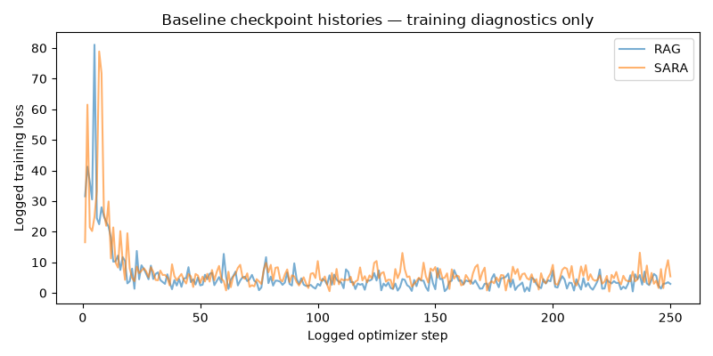

# Week 1 — Part-Wise Analysis

## Week objective

Reconstruct the baseline implementation, local split, actual SARA/RAG training and checkpoint qualification under Baselines/. User-provided scope resolves the previous missing Week1 mapping; code availability is separated from trained checkpoints and answer-quality evaluation.

# Part A — Dataset construction and paper-disjoint split

**Status: COMPLETED**

## 1. Research question

Which local examples underpin the reproduced SARA/RAG baselines?

## 2. Experimental design

| component            | value                                                                      |
|:---------------------|:---------------------------------------------------------------------------|
| week_scope           | Baselines/ as explicitly mapped by the user                                |
| dataset              | Local SARA QASPER TRAIN2088 / DEV231; checkpoint training coverage differs |
| base_model           | mistralai/Mistral-7B-Instruct-v0.2                                         |
| tokenizer            | Mistral tokenizer plus saved special tokens                                |
| seed                 | 42                                                                         |
| optimizer_updates    | 250                                                                        |
| trainable_components | RAG LM-LoRA; SARA LM-LoRA + retrieval projector                            |
| Role                 | Protocol/context only; outcomes are accepted only from the artifacts below |

## 3. What was implemented / executed

Completed machine-readable output is present for the named conditions; coverage is limited to the recorded rows and checks below.

## 4. Result artifacts used

- [Baselines/SARA-main/data/manifests/qasper_split.json](../../../Baselines/SARA-main/data/manifests/qasper_split.json)
- [Baselines/SARA-main/data/reformatted/QASPER_train_split.jsonl](../../../Baselines/SARA-main/data/reformatted/QASPER_train_split.jsonl)
- [Baselines/SARA-main/data/reformatted/QASPER_dev.jsonl](../../../Baselines/SARA-main/data/reformatted/QASPER_dev.jsonl)

## 5. Main numerical results

### Manifest counts independently checked against TRAIN/DEV JSONL

| split                                |   queries | papers         | source                                                        |
|:-------------------------------------|----------:|:---------------|:--------------------------------------------------------------|
| TRAIN                                |      2088 | 772            | Baselines/SARA-main/data/reformatted/QASPER_train_split.jsonl |
| DEV                                  |       231 | 86             | Baselines/SARA-main/data/reformatted/QASPER_dev.jsonl         |
| TEST metadata only; no outcomes read |      1309 | Not recomputed | Baselines/SARA-main/data/manifests/qasper_split.json          |

Source: [Baselines/SARA-main/data/manifests/qasper_split.json](../../../Baselines/SARA-main/data/manifests/qasper_split.json).

## 6. Figures

No saved figure is used for this part; no visualization is fabricated.

## 7. Statistical analysis

No formal inferential test was found for this comparison.

## 8. Interpretation

### Supported

The manifest and raw files agree:2088 TRAIN queries/772 papers,231 DEV queries/86 papers, and zero TRAIN/DEV paper overlap. TEST has1309 rows according to metadata only; its questions/outcomes were not loaded for this reconstruction.

### Not established

Point-estimate rankings do not establish statistical superiority. Implementation, qualification and retrospective oracle ceilings are not deployed or held-out quality results. Missing model/split/seed details are not established from available primary artifacts.

### Important caveats

These are local SARA splits, not a claim about official dataset split sizes or a current untouched TEST. Training eligibility/actual coverage is a separate issue.

## 9. Part conclusion

- The manifest and raw files agree:2088 TRAIN queries/772 papers,231 DEV queries/86 papers, and zero TRAIN/DEV paper overlap. TEST has1309 rows according to metadata only; its questions/outcomes were not loaded for this reconstruction.
- No additional method-selection decision is inferred beyond the recorded protocol/freeze artifacts.

# Part B — Standard RAG checkpoint training

**Status: COMPLETED**

## 1. Research question

Was a projector-free RAG adapter actually trained rather than merely configured?

## 2. Experimental design

| component            | value                                                                      |
|:---------------------|:---------------------------------------------------------------------------|
| week_scope           | Baselines/ as explicitly mapped by the user                                |
| dataset              | Local SARA QASPER TRAIN2088 / DEV231; checkpoint training coverage differs |
| base_model           | mistralai/Mistral-7B-Instruct-v0.2                                         |
| tokenizer            | Mistral tokenizer plus saved special tokens                                |
| seed                 | 42                                                                         |
| optimizer_updates    | 250                                                                        |
| trainable_components | RAG LM-LoRA; SARA LM-LoRA + retrieval projector                            |
| text_evidence        | 10                                                                         |
| compressed_evidence  | 0                                                                          |
| Role                 | Protocol/context only; outcomes are accepted only from the artifacts below |

## 3. What was implemented / executed

Completed machine-readable output is present for the named conditions; coverage is limited to the recorded rows and checks below.

## 4. Result artifacts used

- [Baselines/SARA-main/checkpoints/finetune/rag_qasper_lora_r16_seed42/args.json](../../../Baselines/SARA-main/checkpoints/finetune/rag_qasper_lora_r16_seed42/args.json)
- [Baselines/SARA-main/checkpoints/finetune/rag_qasper_lora_r16_seed42/checkpoint-250/trainer_state.json](../../../Baselines/SARA-main/checkpoints/finetune/rag_qasper_lora_r16_seed42/checkpoint-250/trainer_state.json)
- [Baselines/SARA-main/config/language_modeling/Finetune_RAG_qasper_pubbase.yaml](../../../Baselines/SARA-main/config/language_modeling/Finetune_RAG_qasper_pubbase.yaml)
- [Baselines/SARA-main/notebooks/sara_baseline_checkpoints.ipynb](../../../Baselines/SARA-main/notebooks/sara_baseline_checkpoints.ipynb)

## 5. Main numerical results

### Saved RAG training record

| method   |   global_step |   logged_steps |   recorded_epoch |   saved_num_train_epochs |   saved_num_evidence |   saved_num_additional_evidence |   model_learning_rate |   projector_learning_rate |   batch_size |   gradient_accumulation |   max_train_samples_argument |   mean_logged_training_loss |   last_logged_training_loss |   max_logged_grad_norm | best_metric   |   adapter_weight_bytes |
|:---------|--------------:|---------------:|-----------------:|-------------------------:|---------------------:|--------------------------------:|----------------------:|--------------------------:|-------------:|------------------------:|-----------------------------:|----------------------------:|----------------------------:|-----------------------:|:--------------|-----------------------:|
| RAG      |           250 |            250 |         1.972332 |                        2 |                   10 |                               0 |              0.000020 |                  0.000000 |            1 |                       4 |                         2000 |                    5.325842 |                    2.950200 |            1975.659912 |               |               27280152 |

Source: [Baselines/SARA-main/checkpoints/finetune/rag_qasper_lora_r16_seed42/checkpoint-250/trainer_state.json](../../../Baselines/SARA-main/checkpoints/finetune/rag_qasper_lora_r16_seed42/checkpoint-250/trainer_state.json).

### Executed RAG notebook training log

|   notebook_cell |   num_examples_logged |   reported_training_runtime_seconds |   reported_training_loss |
|----------------:|----------------------:|------------------------------------:|-------------------------:|
|       10.000000 |            506.000000 |                        14988.353000 |                 5.325839 |

Source: [Baselines/SARA-main/notebooks/sara_baseline_checkpoints.ipynb](../../../Baselines/SARA-main/notebooks/sara_baseline_checkpoints.ipynb).

## 6. Figures

No saved figure is used for this part; no visualization is fabricated.

## 7. Statistical analysis

No formal inferential test was found for this comparison.

## 8. Interpretation

### Supported

RAG has250 logged optimizer steps and a saved adapter. Executed notebook cell10 reports506 training examples, runtime14988.353 seconds and train_loss5.325839; the final logged step loss2.9502 is a different quantity.

### Not established

Point-estimate rankings do not establish statistical superiority. Implementation, qualification and retrospective oracle ceilings are not deployed or held-out quality results. Missing model/split/seed details are not established from available primary artifacts.

### Important caveats

SOURCE CONFLICT: current YAML says3 epochs, saved run args say2. The local split has2088 rows and max_train_samples argument2000, but the executed log records506 training examples. Do not claim full-split exposure or infer unique examples actually consumed without a sampler trace. Training loss is not answer F1.

## 9. Part conclusion

- RAG has250 logged optimizer steps and a saved adapter. Executed notebook cell10 reports506 training examples, runtime14988.353 seconds and train_loss5.325839; the final logged step loss2.9502 is a different quantity.
- No additional method-selection decision is inferred beyond the recorded protocol/freeze artifacts.

# Part C — SARA checkpoint training

**Status: COMPLETED**

## 1. Research question

Was the text-plus-latent baseline trained, and how does its execution provenance differ from RAG?

## 2. Experimental design

| component            | value                                                                      |
|:---------------------|:---------------------------------------------------------------------------|
| week_scope           | Baselines/ as explicitly mapped by the user                                |
| dataset              | Local SARA QASPER TRAIN2088 / DEV231; checkpoint training coverage differs |
| base_model           | mistralai/Mistral-7B-Instruct-v0.2                                         |
| tokenizer            | Mistral tokenizer plus saved special tokens                                |
| seed                 | 42                                                                         |
| optimizer_updates    | 250                                                                        |
| trainable_components | RAG LM-LoRA; SARA LM-LoRA + retrieval projector                            |
| text_evidence        | 5                                                                          |
| compressed_evidence  | 5                                                                          |
| compressor           | Salesforce/SFR-Embedding-Mistral; saved retriever_hidden_size4096          |
| Role                 | Protocol/context only; outcomes are accepted only from the artifacts below |

## 3. What was implemented / executed

Completed machine-readable output is present for the named conditions; coverage is limited to the recorded rows and checks below.

## 4. Result artifacts used

- [Baselines/SARA-main/checkpoints/finetune/sara_qasper_proj_lr5e4_seed42/args.json](../../../Baselines/SARA-main/checkpoints/finetune/sara_qasper_proj_lr5e4_seed42/args.json)
- [Baselines/SARA-main/checkpoints/finetune/sara_qasper_proj_lr5e4_seed42/checkpoint-250/trainer_state.json](../../../Baselines/SARA-main/checkpoints/finetune/sara_qasper_proj_lr5e4_seed42/checkpoint-250/trainer_state.json)
- [Baselines/SARA-main/checkpoints/finetune/sara_qasper_proj_lr5e4_seed42/sara_config.json](../../../Baselines/SARA-main/checkpoints/finetune/sara_qasper_proj_lr5e4_seed42/sara_config.json)
- [Baselines/SARA-main/config/language_modeling/Finetune_SARA_qasper_pubbase.yaml](../../../Baselines/SARA-main/config/language_modeling/Finetune_SARA_qasper_pubbase.yaml)
- [Baselines/SARA-main/notebooks/sara_baseline_checkpoints.ipynb](../../../Baselines/SARA-main/notebooks/sara_baseline_checkpoints.ipynb)

## 5. Main numerical results

### Saved SARA training record

| method   |   global_step |   logged_steps |   recorded_epoch |   saved_num_train_epochs |   saved_num_evidence |   saved_num_additional_evidence |   model_learning_rate |   projector_learning_rate |   batch_size |   gradient_accumulation |   max_train_samples_argument |   mean_logged_training_loss |   last_logged_training_loss |   max_logged_grad_norm | best_metric   |   adapter_weight_bytes |
|:---------|--------------:|---------------:|-----------------:|-------------------------:|---------------------:|--------------------------------:|----------------------:|--------------------------:|-------------:|------------------------:|-----------------------------:|----------------------------:|----------------------------:|-----------------------:|:--------------|-----------------------:|
| SARA     |           250 |            250 |         0.501002 |                        1 |                    5 |                               5 |              0.000020 |                  0.000500 |            1 |                       4 |                         2000 |                    6.936258 |                    5.403400 |            3262.517822 |               |               27280152 |

Source: [Baselines/SARA-main/checkpoints/finetune/sara_qasper_proj_lr5e4_seed42/checkpoint-250/trainer_state.json](../../../Baselines/SARA-main/checkpoints/finetune/sara_qasper_proj_lr5e4_seed42/checkpoint-250/trainer_state.json).

### Current configuration versus saved-run epoch identity

| method   |   current_yaml_epochs |   saved_run_epochs | source                                                                         |
|:---------|----------------------:|-------------------:|:-------------------------------------------------------------------------------|
| RAG      |                     3 |                  2 | Baselines/SARA-main/config/language_modeling/Finetune_RAG_qasper_pubbase.yaml  |
| SARA     |                     3 |                  1 | Baselines/SARA-main/config/language_modeling/Finetune_SARA_qasper_pubbase.yaml |

Source: [Baselines/SARA-main/config/language_modeling/Finetune_SARA_qasper_pubbase.yaml](../../../Baselines/SARA-main/config/language_modeling/Finetune_SARA_qasper_pubbase.yaml).

## 6. Figures

No saved figure is used for this part; no visualization is fabricated.

## 7. Statistical analysis

No formal inferential test was found for this comparison.

## 8. Interpretation

### Supported

The SARA checkpoint trainer state records250 optimizer steps and epoch0.501002, with last logged loss5.4034. Saved args use one epoch, unlike current YAML3. Notebook cell11 preserves an OOM-failed training attempt; that specific failure and the separately saved completed checkpoint must both be retained.

### Not established

Point-estimate rankings do not establish statistical superiority. Implementation, qualification and retrospective oracle ceilings are not deployed or held-out quality results. Missing model/split/seed details are not established from available primary artifacts.

### Important caveats

The exact chronology/resume path linking the failed notebook attempt to the saved checkpoint is not established. Equal optimizer-step counts do not establish equal training-example coverage, training tasks or model quality. Projector/adaptation changes make later RAG/SARA comparisons whole-system comparisons.

## 9. Part conclusion

- The SARA checkpoint trainer state records250 optimizer steps and epoch0.501002, with last logged loss5.4034. Saved args use one epoch, unlike current YAML3. Notebook cell11 preserves an OOM-failed training attempt; that specific failure and the separately saved completed checkpoint must both be retained.
- No additional method-selection decision is inferred beyond the recorded protocol/freeze artifacts.

# Part D — Checkpoint loading / interface qualification

**Status: SMOKE-TESTED**

## 1. Research question

Can both saved checkpoints load with their intended projector/tokenizer interfaces?

## 2. Experimental design

| component            | value                                                                      |
|:---------------------|:---------------------------------------------------------------------------|
| week_scope           | Baselines/ as explicitly mapped by the user                                |
| dataset              | Local SARA QASPER TRAIN2088 / DEV231; checkpoint training coverage differs |
| base_model           | mistralai/Mistral-7B-Instruct-v0.2                                         |
| tokenizer            | Mistral tokenizer plus saved special tokens                                |
| seed                 | 42                                                                         |
| optimizer_updates    | 250                                                                        |
| trainable_components | RAG LM-LoRA; SARA LM-LoRA + retrieval projector                            |
| Role                 | Protocol/context only; outcomes are accepted only from the artifacts below |

## 3. What was implemented / executed

The status is based on the available artifacts, not notebook existence alone. Available outputs must be interpreted under the status shown.

## 4. Result artifacts used

- [Baselines/SARA-main/notebooks/sara_baseline_checkpoints.ipynb](../../../Baselines/SARA-main/notebooks/sara_baseline_checkpoints.ipynb)
- [Baselines/SARA-main/checkpoints/finetune/rag_qasper_lora_r16_seed42/adapter_config.json](../../../Baselines/SARA-main/checkpoints/finetune/rag_qasper_lora_r16_seed42/adapter_config.json)
- [Baselines/SARA-main/checkpoints/finetune/sara_qasper_proj_lr5e4_seed42/adapter_config.json](../../../Baselines/SARA-main/checkpoints/finetune/sara_qasper_proj_lr5e4_seed42/adapter_config.json)
- [Baselines/SARA-main/checkpoints/finetune/sara_qasper_proj_lr5e4_seed42/sara_config.json](../../../Baselines/SARA-main/checkpoints/finetune/sara_qasper_proj_lr5e4_seed42/sara_config.json)

## 5. Main numerical results

### Executed notebook cell13 checkpoint profiles

| checkpoint                    |   load_seconds |   peak_GPU_GiB |   compress_token_id |   tokenizer_vocab |
|:------------------------------|---------------:|---------------:|--------------------:|------------------:|
| rag_qasper_lora_r16_seed42    |      10.230000 |      13.510000 |               32001 |             32002 |
| sara_qasper_proj_lr5e4_seed42 |       9.670000 |      13.580000 |               32001 |             32002 |

Source: [Baselines/SARA-main/notebooks/sara_baseline_checkpoints.ipynb](../../../Baselines/SARA-main/notebooks/sara_baseline_checkpoints.ipynb).

## 6. Figures

No saved figure is used for this part; no visualization is fabricated.

## 7. Statistical analysis

No formal inferential test was found for this comparison.

## 8. Interpretation

### Supported

Executed cell13 records RAG/SARA loading in10.23/9.67 seconds, peak GPU13.51/13.58 GiB, compress token32001 and vocabulary32002. RAG is projector-free; SARA prints nonzero projector norm164.

### Not established

Point-estimate rankings do not establish statistical superiority. Implementation, qualification and retrospective oracle ceilings are not deployed or held-out quality results. Missing model/split/seed details are not established from available primary artifacts.

### Important caveats

A nonzero projector norm establishes neither semantic quality nor successful training by itself. These are loading diagnostics on the recorded machine, not end-to-end inference throughput. Cell15 has generation text but no execution_count; its generation claim is not accepted as a reliably executed outcome.

## 9. Part conclusion

- Executed cell13 records RAG/SARA loading in10.23/9.67 seconds, peak GPU13.51/13.58 GiB, compress token32001 and vocabulary32002. RAG is projector-free; SARA prints nonzero projector norm164.
- No additional method-selection decision is inferred beyond the recorded protocol/freeze artifacts.

# Part E — Training-curve diagnostics

**Status: COMPLETED**

## 1. Research question

What do the saved loss trajectories establish about baseline training?

## 2. Experimental design

| component            | value                                                                      |
|:---------------------|:---------------------------------------------------------------------------|
| week_scope           | Baselines/ as explicitly mapped by the user                                |
| dataset              | Local SARA QASPER TRAIN2088 / DEV231; checkpoint training coverage differs |
| base_model           | mistralai/Mistral-7B-Instruct-v0.2                                         |
| tokenizer            | Mistral tokenizer plus saved special tokens                                |
| seed                 | 42                                                                         |
| optimizer_updates    | 250                                                                        |
| trainable_components | RAG LM-LoRA; SARA LM-LoRA + retrieval projector                            |
| Role                 | Protocol/context only; outcomes are accepted only from the artifacts below |

## 3. What was implemented / executed

Completed machine-readable output is present for the named conditions; coverage is limited to the recorded rows and checks below.

## 4. Result artifacts used

- [Baselines/SARA-main/checkpoints/finetune/rag_qasper_lora_r16_seed42/checkpoint-250/trainer_state.json](../../../Baselines/SARA-main/checkpoints/finetune/rag_qasper_lora_r16_seed42/checkpoint-250/trainer_state.json)
- [Baselines/SARA-main/checkpoints/finetune/sara_qasper_proj_lr5e4_seed42/checkpoint-250/trainer_state.json](../../../Baselines/SARA-main/checkpoints/finetune/sara_qasper_proj_lr5e4_seed42/checkpoint-250/trainer_state.json)
- [results/weekly_reports/week_01/TrainingRecomputation.csv](TrainingRecomputation.csv)
- [results/weekly_reports/week_01/figures/logged_training_loss.png](figures/logged_training_loss.png)

## 5. Main numerical results

### Offline recomputed log summaries

| method   |   logged_steps |   recorded_epoch |   mean_logged_training_loss |   last_logged_training_loss |   max_logged_grad_norm |
|:---------|---------------:|-----------------:|----------------------------:|----------------------------:|-----------------------:|
| RAG      |            250 |         1.972332 |                    5.325842 |                    2.950200 |            1975.659912 |
| SARA     |            250 |         0.501002 |                    6.936258 |                    5.403400 |            3262.517822 |

Source: [results/weekly_reports/week_01/TrainingRecomputation.csv](TrainingRecomputation.csv).

## 6. Figures

X-axis is optimizer step; y-axis is saved logged training loss. This new offline figure is derived only from original trainer states. It shows training dynamics, not answer-quality superiority or matched-example convergence.

## 7. Statistical analysis

No formal inferential test was found for this comparison.

## 8. Interpretation

### Supported

Both trainer histories contain250 finite logged losses. Their means/final losses are recomputed in the table; differences cannot be interpreted as comparative QA accuracy.

### Not established

Point-estimate rankings do not establish statistical superiority. Implementation, qualification and retrospective oracle ceilings are not deployed or held-out quality results. Missing model/split/seed details are not established from available primary artifacts.

### Important caveats

Losses reflect different representation/training interfaces and potentially different eligible samples. Logged grad_norm may be measured before clipping; large norms alone do not prove clipping failed.

## 9. Part conclusion

- Both trainer histories contain250 finite logged losses. Their means/final losses are recomputed in the table; differences cannot be interpreted as comparative QA accuracy.
- No additional method-selection decision is inferred beyond the recorded protocol/freeze artifacts.

# Part F — QA evaluation scaffold

**Status: IMPLEMENTED**

## 1. Research question

Is there a standalone completed Week1 answer-quality comparison in Baselines?

## 2. Experimental design

| component            | value                                                                      |
|:---------------------|:---------------------------------------------------------------------------|
| week_scope           | Baselines/ as explicitly mapped by the user                                |
| dataset              | Local SARA QASPER TRAIN2088 / DEV231; checkpoint training coverage differs |
| base_model           | mistralai/Mistral-7B-Instruct-v0.2                                         |
| tokenizer            | Mistral tokenizer plus saved special tokens                                |
| seed                 | 42                                                                         |
| optimizer_updates    | 250                                                                        |
| trainable_components | RAG LM-LoRA; SARA LM-LoRA + retrieval projector                            |
| Role                 | Protocol/context only; outcomes are accepted only from the artifacts below |

## 3. What was implemented / executed

The status is based on the available artifacts, not notebook existence alone. No completed result artifact was found.

## 4. Result artifacts used

- [Baselines/SARA-main/src/eval/eval_sara.py](../../../Baselines/SARA-main/src/eval/eval_sara.py)
- [Baselines/SARA-main/src/eval/calculate_qa_performance.py](../../../Baselines/SARA-main/src/eval/calculate_qa_performance.py)
- [Baselines/SARA-main/src/run_sara.py](../../../Baselines/SARA-main/src/run_sara.py)

## 5. Main numerical results

No completed result artifact was found.

## 6. Figures

No saved figure is used for this part; no visualization is fabricated.

## 7. Statistical analysis

No formal inferential test was found for this comparison.

## 8. Interpretation

### Supported

Evaluation code exists, but no standalone completed local Week1 QA score table or raw evaluation result was located inside Baselines. Week2 outcomes are not copied backward into Week1.

### Not established

Point-estimate rankings do not establish statistical superiority. Implementation, qualification and retrospective oracle ceilings are not deployed or held-out quality results. Missing model/split/seed details are not established from available primary artifacts.

### Important caveats

A loadable/trained checkpoint and commented evaluation commands are not completed quality evaluation.

## 9. Part conclusion

- Evaluation code exists, but no standalone completed local Week1 QA score table or raw evaluation result was located inside Baselines. Week2 outcomes are not copied backward into Week1.
- The later Week2 fixed-k matrix supplies explicit downstream performance for the saved baseline families.

# Part G — SANE baseline source

**Status: IMPLEMENTED**

## 1. Research question

Which additional evidence-selection/extraction baseline is implemented?

## 2. Experimental design

| component   | value                                                                         |
|:------------|:------------------------------------------------------------------------------|
| scope       | Vendored/current SANE implementation; no Week1 execution snapshot established |
| Role        | Protocol/context only; outcomes are accepted only from the artifacts below    |

## 3. What was implemented / executed

The status is based on the available artifacts, not notebook existence alone. No completed result artifact was found.

## 4. Result artifacts used

- [Baselines/SANE-main/config/default.yaml](../../../Baselines/SANE-main/config/default.yaml)
- [Baselines/SANE-main/benchmarks/metrics.py](../../../Baselines/SANE-main/benchmarks/metrics.py)
- [Baselines/SANE-main/sane/agents/sane_agent.py](../../../Baselines/SANE-main/sane/agents/sane_agent.py)

## 5. Main numerical results

No completed result artifact was found.

## 6. Figures

No saved figure is used for this part; no visualization is fabricated.

## 7. Statistical analysis

No formal inferential test was found for this comparison.

## 8. Interpretation

### Supported

SANE code/configuration and benchmark interfaces are present. No completed local Week1 SANE quality run was found; current default model/config must not be assumed to be its historical Week1 frozen identity.

### Not established

Point-estimate rankings do not establish statistical superiority. Implementation, qualification and retrospective oracle ceilings are not deployed or held-out quality results. Missing model/split/seed details are not established from available primary artifacts.

### Important caveats

Do not confuse Week9 SANE-adapted diagnostic outcomes with a faithful independently reproduced original SANE benchmark.

## 9. Part conclusion

- SANE code/configuration and benchmark interfaces are present. No completed local Week1 SANE quality run was found; current default model/config must not be assumed to be its historical Week1 frozen identity.
- No additional method-selection decision is inferred beyond the recorded protocol/freeze artifacts.

# Part H — RECOMP baseline source and bundled completions

**Status: IMPLEMENTED**

## 1. Research question

Does the RECOMP checkout establish a locally executed baseline comparison?

## 2. Experimental design

| component   | value                                                                      |
|:------------|:---------------------------------------------------------------------------|
| scope       | RECOMP source and shipped FLAN-UL2 Natural Questions completion file       |
| Role        | Protocol/context only; outcomes are accepted only from the artifacts below |

## 3. What was implemented / executed

The status is based on the available artifacts, not notebook existence alone. Available outputs must be interpreted under the status shown.

## 4. Result artifacts used

- [Baselines/recomp-main/run_extractive_compressor.py](../../../Baselines/recomp-main/run_extractive_compressor.py)
- [Baselines/recomp-main/train_extractive_compressor.py](../../../Baselines/recomp-main/train_extractive_compressor.py)
- [Baselines/recomp-main/eval_qa.py](../../../Baselines/recomp-main/eval_qa.py)
- [Baselines/recomp-main/data/completions/flan_ul2_nq_5shot_no_passage.csv](../../../Baselines/recomp-main/data/completions/flan_ul2_nq_5shot_no_passage.csv)

## 5. Main numerical results

### Bundled completion-file inventory; not a locally verified run

|   rows |   question_rows |   prediction_rows | columns                                                        |
|-------:|----------------:|------------------:|:---------------------------------------------------------------|
|   3610 |            3610 |              3610 | Unnamed: 0,few_shot_examples,question,pred_answer,gold_answers |

Source: [Baselines/recomp-main/data/completions/flan_ul2_nq_5shot_no_passage.csv](../../../Baselines/recomp-main/data/completions/flan_ul2_nq_5shot_no_passage.csv).

## 6. Figures

No saved figure is used for this part; no visualization is fabricated.

## 7. Statistical analysis

No formal inferential test was found for this comparison.

## 8. Interpretation

### Supported

RECOMP implementation is present with a3610-row bundled NQ completion CSV. Its local generation provenance is not established, so it is not counted as a completed Week1 experiment or a QASPER result.

### Not established

Point-estimate rankings do not establish statistical superiority. Implementation, qualification and retrospective oracle ceilings are not deployed or held-out quality results. Missing model/split/seed details are not established from available primary artifacts.

### Important caveats

Different dataset/model, no local execution receipt. Published/paper figures in Baselines/papers or media are reference material, not primary local experimental evidence.

## 9. Part conclusion

- RECOMP implementation is present with a3610-row bundled NQ completion CSV. Its local generation provenance is not established, so it is not counted as a completed Week1 experiment or a QASPER result.
- No additional method-selection decision is inferred beyond the recorded protocol/freeze artifacts.

# Week 1 — Integrated Analysis

## What changed during this week?

Reconstruct the baseline implementation, local split, actual SARA/RAG training and checkpoint qualification under Baselines/. User-provided scope resolves the previous missing Week1 mapping; code availability is separated from trained checkpoints and answer-quality evaluation. The parts above retain the distinction between executed outputs, implementation-only work, exploratory diagnostics and retrospective choices.

## Main supported findings

| Finding                                                                                                                                                                                                                                                                                                           | Evidence                                                                                                                                                                                                                | Strength                                     |
|:------------------------------------------------------------------------------------------------------------------------------------------------------------------------------------------------------------------------------------------------------------------------------------------------------------------|:------------------------------------------------------------------------------------------------------------------------------------------------------------------------------------------------------------------------|:---------------------------------------------|
| The manifest and raw files agree:2088 TRAIN queries/772 papers,231 DEV queries/86 papers, and zero TRAIN/DEV paper overlap. TEST has1309 rows according to metadata only; its questions/outcomes were not loaded for this reconstruction.                                                                         | Part A; Baselines/SARA-main/data/manifests/qasper_split.json; Baselines/SARA-main/data/reformatted/QASPER_train_split.jsonl                                                                                             | descriptive; see stated inferential evidence |
| RAG has250 logged optimizer steps and a saved adapter. Executed notebook cell10 reports506 training examples, runtime14988.353 seconds and train_loss5.325839; the final logged step loss2.9502 is a different quantity.                                                                                          | Part B; Baselines/SARA-main/checkpoints/finetune/rag_qasper_lora_r16_seed42/args.json; Baselines/SARA-main/checkpoints/finetune/rag_qasper_lora_r16_seed42/checkpoint-250/trainer_state.json                            | descriptive; see stated inferential evidence |
| The SARA checkpoint trainer state records250 optimizer steps and epoch0.501002, with last logged loss5.4034. Saved args use one epoch, unlike current YAML3. Notebook cell11 preserves an OOM-failed training attempt; that specific failure and the separately saved completed checkpoint must both be retained. | Part C; Baselines/SARA-main/checkpoints/finetune/sara_qasper_proj_lr5e4_seed42/args.json; Baselines/SARA-main/checkpoints/finetune/sara_qasper_proj_lr5e4_seed42/checkpoint-250/trainer_state.json                      | descriptive; see stated inferential evidence |
| Executed cell13 records RAG/SARA loading in10.23/9.67 seconds, peak GPU13.51/13.58 GiB, compress token32001 and vocabulary32002. RAG is projector-free; SARA prints nonzero projector norm164.                                                                                                                    | Part D; Baselines/SARA-main/notebooks/sara_baseline_checkpoints.ipynb; Baselines/SARA-main/checkpoints/finetune/rag_qasper_lora_r16_seed42/adapter_config.json                                                          | SMOKE-TESTED                                 |
| Both trainer histories contain250 finite logged losses. Their means/final losses are recomputed in the table; differences cannot be interpreted as comparative QA accuracy.                                                                                                                                       | Part E; Baselines/SARA-main/checkpoints/finetune/rag_qasper_lora_r16_seed42/checkpoint-250/trainer_state.json; Baselines/SARA-main/checkpoints/finetune/sara_qasper_proj_lr5e4_seed42/checkpoint-250/trainer_state.json | descriptive; see stated inferential evidence |
| Evaluation code exists, but no standalone completed local Week1 QA score table or raw evaluation result was located inside Baselines. Week2 outcomes are not copied backward into Week1.                                                                                                                          | Part F; Baselines/SARA-main/src/eval/eval_sara.py; Baselines/SARA-main/src/eval/calculate_qa_performance.py                                                                                                             | IMPLEMENTED                                  |
| SANE code/configuration and benchmark interfaces are present. No completed local Week1 SANE quality run was found; current default model/config must not be assumed to be its historical Week1 frozen identity.                                                                                                   | Part G; Baselines/SANE-main/config/default.yaml; Baselines/SANE-main/benchmarks/metrics.py                                                                                                                              | IMPLEMENTED                                  |
| RECOMP implementation is present with a3610-row bundled NQ completion CSV. Its local generation provenance is not established, so it is not counted as a completed Week1 experiment or a QASPER result.                                                                                                           | Part H; Baselines/recomp-main/run_extractive_compressor.py; Baselines/recomp-main/train_extractive_compressor.py                                                                                                        | IMPLEMENTED                                  |

## Negative / null findings

SARA notebook training attempt OOMs; no completed standalone Week1 QA quality comparison or local SANE/RECOMP benchmark is established.

## What remained unresolved?

Baseline training sample/epoch identities are not fully matched; quality is not established by training losses, load timing, projector norm or bundled external completions.

## What logically motivated the next week?

Week2 provides a frozen231-query fixed-k quality response surface using these baseline checkpoint families; Week1 does not borrow its numerical results.

## Offline reproducibility / source conflicts

- User explicitly identifies Baselines/ as Week1; previous no-tagged-directory gap is superseded, not hidden.
- TRAIN/DEV counts and paper disjointness verified from raw files and split manifest.
- Both trainer states have global_step250 and exactly250 consecutive loss records.
- Notebook cell10 logs506 RAG examples; current/saved epoch settings differ; SARA failed attempt and completed checkpoint are distinct records.
- No TEST questions/outcomes, unsafe pickle weights or model runs were needed.

Executed notebook coverage (zero-based cell indices):

| artifact                                                      |   executed_output_cells | cell_indices       |
|:--------------------------------------------------------------|------------------------:|:-------------------|
| Baselines/SARA-main/notebooks/sara_baseline_checkpoints.ipynb |                       8 | 1,3,5,7,9,10,11,13 |

# Primary Sources Used

- [Baselines/SANE-main/benchmarks/metrics.py](../../../Baselines/SANE-main/benchmarks/metrics.py)
- [Baselines/SANE-main/config/default.yaml](../../../Baselines/SANE-main/config/default.yaml)
- [Baselines/SANE-main/sane/agents/sane_agent.py](../../../Baselines/SANE-main/sane/agents/sane_agent.py)
- [Baselines/SARA-main/checkpoints/finetune/rag_qasper_lora_r16_seed42/adapter_config.json](../../../Baselines/SARA-main/checkpoints/finetune/rag_qasper_lora_r16_seed42/adapter_config.json)
- [Baselines/SARA-main/checkpoints/finetune/rag_qasper_lora_r16_seed42/args.json](../../../Baselines/SARA-main/checkpoints/finetune/rag_qasper_lora_r16_seed42/args.json)
- [Baselines/SARA-main/checkpoints/finetune/rag_qasper_lora_r16_seed42/checkpoint-250/trainer_state.json](../../../Baselines/SARA-main/checkpoints/finetune/rag_qasper_lora_r16_seed42/checkpoint-250/trainer_state.json)
- [Baselines/SARA-main/checkpoints/finetune/sara_qasper_proj_lr5e4_seed42/adapter_config.json](../../../Baselines/SARA-main/checkpoints/finetune/sara_qasper_proj_lr5e4_seed42/adapter_config.json)
- [Baselines/SARA-main/checkpoints/finetune/sara_qasper_proj_lr5e4_seed42/args.json](../../../Baselines/SARA-main/checkpoints/finetune/sara_qasper_proj_lr5e4_seed42/args.json)
- [Baselines/SARA-main/checkpoints/finetune/sara_qasper_proj_lr5e4_seed42/checkpoint-250/trainer_state.json](../../../Baselines/SARA-main/checkpoints/finetune/sara_qasper_proj_lr5e4_seed42/checkpoint-250/trainer_state.json)
- [Baselines/SARA-main/checkpoints/finetune/sara_qasper_proj_lr5e4_seed42/sara_config.json](../../../Baselines/SARA-main/checkpoints/finetune/sara_qasper_proj_lr5e4_seed42/sara_config.json)
- [Baselines/SARA-main/config/language_modeling/Finetune_RAG_qasper_pubbase.yaml](../../../Baselines/SARA-main/config/language_modeling/Finetune_RAG_qasper_pubbase.yaml)
- [Baselines/SARA-main/config/language_modeling/Finetune_SARA_qasper_pubbase.yaml](../../../Baselines/SARA-main/config/language_modeling/Finetune_SARA_qasper_pubbase.yaml)
- [Baselines/SARA-main/data/manifests/qasper_split.json](../../../Baselines/SARA-main/data/manifests/qasper_split.json)
- [Baselines/SARA-main/data/reformatted/QASPER_dev.jsonl](../../../Baselines/SARA-main/data/reformatted/QASPER_dev.jsonl)
- [Baselines/SARA-main/data/reformatted/QASPER_train_split.jsonl](../../../Baselines/SARA-main/data/reformatted/QASPER_train_split.jsonl)
- [Baselines/SARA-main/notebooks/sara_baseline_checkpoints.ipynb](../../../Baselines/SARA-main/notebooks/sara_baseline_checkpoints.ipynb)
- [Baselines/SARA-main/scripts/build_qasper_dataset.py](../../../Baselines/SARA-main/scripts/build_qasper_dataset.py)
- [Baselines/SARA-main/src/data/make_qasper_splits.py](../../../Baselines/SARA-main/src/data/make_qasper_splits.py)
- [Baselines/SARA-main/src/eval/calculate_qa_performance.py](../../../Baselines/SARA-main/src/eval/calculate_qa_performance.py)
- [Baselines/SARA-main/src/eval/eval_sara.py](../../../Baselines/SARA-main/src/eval/eval_sara.py)
- [Baselines/SARA-main/src/run_sara.py](../../../Baselines/SARA-main/src/run_sara.py)
- [Baselines/SARA-main/src/train/train_generator.py](../../../Baselines/SARA-main/src/train/train_generator.py)
- [Baselines/recomp-main/data/completions/flan_ul2_nq_5shot_no_passage.csv](../../../Baselines/recomp-main/data/completions/flan_ul2_nq_5shot_no_passage.csv)
- [Baselines/recomp-main/eval_qa.py](../../../Baselines/recomp-main/eval_qa.py)
- [Baselines/recomp-main/run_extractive_compressor.py](../../../Baselines/recomp-main/run_extractive_compressor.py)
- [Baselines/recomp-main/train_extractive_compressor.py](../../../Baselines/recomp-main/train_extractive_compressor.py)
- [results/weekly_reports/week_01/CheckpointProfilingExtract.csv](CheckpointProfilingExtract.csv)
- [results/weekly_reports/week_01/NotebookExecutionChecks.json](NotebookExecutionChecks.json)
- [results/weekly_reports/week_01/SplitRecomputation.json](SplitRecomputation.json)
- [results/weekly_reports/week_01/TrainingLogExtract.csv](TrainingLogExtract.csv)
- [results/weekly_reports/week_01/TrainingRecomputation.csv](TrainingRecomputation.csv)
- [results/weekly_reports/week_01/figures/logged_training_loss.png](figures/logged_training_loss.png)

# Existing Markdown Used as Evidence

NONE
