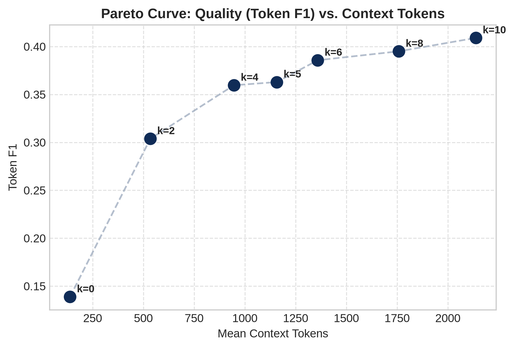

# Week 2 — Part-Wise Analysis

## Week objective

Measure the static SARA text/latent representation-budget frontier and retrospective adaptive headroom.

# Part FIXED-K — Fixed-k response surface

**Status: COMPLETED**

## 1. Research question

How do answer quality and context cost change as verbatim-passage budget k increases?

## 2. Experimental design

| component   | value                                                                      |
|:------------|:---------------------------------------------------------------------------|
| dataset     | QASPER local DEV: 231 queries / 86 papers                                  |
| retrieval   | BM25 top10; SFR passage embeddings for SARA latent interface               |
| reader      | Mistral-7B-Instruct-v0.2; separately fine-tuned SARA/RAG checkpoints       |
| seed        | 42                                                                         |
| decoding    | greedy; max_new_tokens=64; bfloat16                                        |
| actions     | [0, 2, 4, 5, 6, 8, 10]                                                     |
| Role        | Protocol/context only; outcomes are accepted only from the artifacts below |

## 3. What was implemented / executed

Completed machine-readable output is present for the named conditions; coverage is limited to the recorded rows and checks below.

## 4. Result artifacts used

- [results/week2/raw/dev_fixed_k_matrix.jsonl](../../week2/raw/dev_fixed_k_matrix.jsonl)
- [results/week2/processed/dev_fixed_k_summary.csv](../../week2/processed/dev_fixed_k_summary.csv)

## 5. Main numerical results

### Raw-result recomputed fixed-k metrics

|   k | method   |   queries |       F1 |       EM |      tokens |
|----:|:---------|----------:|---------:|---------:|------------:|
|   0 | sara     |       231 | 0.138829 | 0.086580 |  130.822511 |
|   2 | sara     |       231 | 0.303835 | 0.168831 |  526.523810 |
|   4 | sara     |       231 | 0.359601 | 0.199134 |  938.121212 |
|   5 | sara     |       231 | 0.362858 | 0.186147 | 1148.982684 |
|   6 | sara     |       231 | 0.385699 | 0.186147 | 1351.116883 |
|   8 | sara     |       231 | 0.394995 | 0.186147 | 1750.463203 |
|  10 | rag      |       231 | 0.409043 | 0.203463 | 2129.883117 |

Source: [results/week2/raw/dev_fixed_k_matrix.jsonl](../../week2/raw/dev_fixed_k_matrix.jsonl).

## 6. Figures

No saved figure is used for this part; no visualization is fabricated.

## 7. Statistical analysis

No formal inferential test was found for this comparison.

## 8. Interpretation

### Supported

SARA k8 has mean F1 0.3950 versus parent k5 0.3629; separate plain-RAG k10 has F1 0.4090. Increasing text budget improves these aggregate point estimates.

### Not established

Point-estimate rankings do not establish statistical superiority. Implementation, qualification and retrospective oracle ceilings are not deployed or held-out quality results. Missing model/split/seed details are not established from available primary artifacts.

### Important caveats

k10 uses the separately trained RAG checkpoint: this is a whole-system comparison, not isolated causal evidence that latent compression hurts. Synthesized total latency includes estimated components and is not measured end-to-end.

## 9. Part conclusion

- SARA k8 has mean F1 0.3950 versus parent k5 0.3629; separate plain-RAG k10 has F1 0.4090. Increasing text budget improves these aggregate point estimates.
- best_static_baseline.json freezes SARA k8 within the SARA action set.

# Part ORACLE — Retrospective action headroom

**Status: COMPLETED**

## 1. Research question

Would per-query best-tested k have headroom over the best static SARA budget?

## 2. Experimental design

| component   | value                                                                      |
|:------------|:---------------------------------------------------------------------------|
| dataset     | QASPER local DEV: 231 queries / 86 papers                                  |
| retrieval   | BM25 top10; SFR passage embeddings for SARA latent interface               |
| reader      | Mistral-7B-Instruct-v0.2; separately fine-tuned SARA/RAG checkpoints       |
| seed        | 42                                                                         |
| decoding    | greedy; max_new_tokens=64; bfloat16                                        |
| Role        | Protocol/context only; outcomes are accepted only from the artifacts below |

## 3. What was implemented / executed

Completed machine-readable output is present for the named conditions; coverage is limited to the recorded rows and checks below.

## 4. Result artifacts used

- [results/week2/processed/per_query_best_k.csv](../../week2/processed/per_query_best_k.csv)
- [results/week2/processed/oracle_vs_static_summary.json](../../week2/processed/oracle_vs_static_summary.json)
- [results/week2/raw/dev_fixed_k_matrix.jsonl](../../week2/raw/dev_fixed_k_matrix.jsonl)
- [results/week2/processed/best_k_distribution.csv](../../week2/processed/best_k_distribution.csv)

## 5. Main numerical results

### Retrospective ceilings; not deployable policies

| actions                      |   retrospective_oracle_F1 |
|:-----------------------------|--------------------------:|
| SARA {0,2,4,5,6,8}           |                  0.500781 |
| Full sweep including RAG k10 |                  0.526415 |

Source: [results/week2/raw/dev_fixed_k_matrix.jsonl](../../week2/raw/dev_fixed_k_matrix.jsonl).

### Smallest-k tie-broken distribution

|         k |   best_sara_k_count |   best_sara_k_pct |   best_overall_k_count |   best_overall_k_pct |
|----------:|--------------------:|------------------:|-----------------------:|---------------------:|
|  0.000000 |           81.000000 |         35.060000 |              73.000000 |            31.600000 |
|  2.000000 |           55.000000 |         23.810000 |              52.000000 |            22.510000 |
|  4.000000 |           37.000000 |         16.020000 |              33.000000 |            14.290000 |
|  5.000000 |           15.000000 |          6.490000 |              14.000000 |             6.060000 |
|  6.000000 |           21.000000 |          9.090000 |              21.000000 |             9.090000 |
|  8.000000 |           22.000000 |          9.520000 |              19.000000 |             8.230000 |
| 10.000000 |            0.000000 |          0.000000 |              19.000000 |             8.230000 |

Source: [results/week2/processed/best_k_distribution.csv](../../week2/processed/best_k_distribution.csv).

## 6. Figures

No saved figure is used for this part; no visualization is fabricated.

## 7. Statistical analysis

No formal inferential test was found for this comparison.

## 8. Interpretation

### Supported

The retrospective SARA oracle is about 0.5008 F1 versus static k8 0.3950; the full sweep oracle is about 0.5264. These are outcome-selected ceilings.

### Not established

Point-estimate rankings do not establish statistical superiority. Implementation, qualification and retrospective oracle ceilings are not deployed or held-out quality results. Missing model/split/seed details are not established from available primary artifacts.

### Important caveats

Smallest-k ties inflate apparent budget disagreement. Oracle choices use gold-scored outcomes and cannot be fair deployment baselines.

## 9. Part conclusion

- The retrospective SARA oracle is about 0.5008 F1 versus static k8 0.3950; the full sweep oracle is about 0.5264. These are outcome-selected ceilings.
- No additional method-selection decision is inferred beyond the recorded protocol/freeze artifacts.

# Part FREEZE — Development integrity and retained baseline

**Status: COMPLETED**

## 1. Research question

Is the query/action grid complete and which reference was frozen for later modeling?

## 2. Experimental design

| component   | value                                                                      |
|:------------|:---------------------------------------------------------------------------|
| dataset     | QASPER local DEV: 231 queries / 86 papers                                  |
| retrieval   | BM25 top10; SFR passage embeddings for SARA latent interface               |
| reader      | Mistral-7B-Instruct-v0.2; separately fine-tuned SARA/RAG checkpoints       |
| seed        | 42                                                                         |
| decoding    | greedy; max_new_tokens=64; bfloat16                                        |
| Role        | Protocol/context only; outcomes are accepted only from the artifacts below |

## 3. What was implemented / executed

Completed machine-readable output is present for the named conditions; coverage is limited to the recorded rows and checks below.

## 4. Result artifacts used

- [results/week2/processed/best_static_baseline.json](../../week2/processed/best_static_baseline.json)
- [results/week2/processed/week2_validation_checkpoint.json](../../week2/processed/week2_validation_checkpoint.json)

## 5. Main numerical results

### Frozen numerical baseline fields

| field                         |       value |
|:------------------------------|------------:|
| best_static_sara_k            |    8.000000 |
| sara_k8_mean_f1               |    0.395000 |
| sara_k8_mean_em               |    0.186100 |
| sara_k8_mean_rouge_l          |    0.337700 |
| sara_k8_mean_context_tokens   | 1758.500000 |
| sara_k8_context_reduction_pct |   17.750000 |
| best_overall_fixed_k          |   10.000000 |
| vanilla_rag_k10_f1            |    0.409000 |
| vanilla_rag_k10_em            |    0.203500 |
| vanilla_rag_k10_rouge_l       |    0.352300 |
| evaluated_question_count      |  231.000000 |
| seed                          |   42.000000 |

Source: [results/week2/processed/best_static_baseline.json](../../week2/processed/best_static_baseline.json).

## 6. Figures

No saved figure is used for this part; no visualization is fabricated.

## 7. Statistical analysis

No formal inferential test was found for this comparison.

## 8. Interpretation

### Supported

The 1,617-row matrix is exactly 231 queries × seven actions with no duplicate query/k pairs; static SARA k8 is retained. The checkpoint records zero train/dev paper overlap at that historical stage.

### Not established

Point-estimate rankings do not establish statistical superiority. Implementation, qualification and retrospective oracle ceilings are not deployed or held-out quality results. Missing model/split/seed details are not established from available primary artifacts.

### Important caveats

A historical TEST-untouched assertion is a time-specific receipt, not a claim that TEST remains untouched in later weeks.

## 9. Part conclusion

- The 1,617-row matrix is exactly 231 queries × seven actions with no duplicate query/k pairs; static SARA k8 is retained. The checkpoint records zero train/dev paper overlap at that historical stage.
- No additional method-selection decision is inferred beyond the recorded protocol/freeze artifacts.

# Week 2 — Integrated Analysis

## What changed during this week?

Measure the static SARA text/latent representation-budget frontier and retrospective adaptive headroom. The parts above retain the distinction between executed outputs, implementation-only work, exploratory diagnostics and retrospective choices.

## Main supported findings

| Finding                                                                                                                                                                                                | Evidence                                                                                                                 | Strength                                     |
|:-------------------------------------------------------------------------------------------------------------------------------------------------------------------------------------------------------|:-------------------------------------------------------------------------------------------------------------------------|:---------------------------------------------|
| SARA k8 has mean F1 0.3950 versus parent k5 0.3629; separate plain-RAG k10 has F1 0.4090. Increasing text budget improves these aggregate point estimates.                                             | Part FIXED-K; results/week2/raw/dev_fixed_k_matrix.jsonl; results/week2/processed/dev_fixed_k_summary.csv                | descriptive; see stated inferential evidence |
| The retrospective SARA oracle is about 0.5008 F1 versus static k8 0.3950; the full sweep oracle is about 0.5264. These are outcome-selected ceilings.                                                  | Part ORACLE; results/week2/processed/per_query_best_k.csv; results/week2/processed/oracle_vs_static_summary.json         | descriptive; see stated inferential evidence |
| The 1,617-row matrix is exactly 231 queries × seven actions with no duplicate query/k pairs; static SARA k8 is retained. The checkpoint records zero train/dev paper overlap at that historical stage. | Part FREEZE; results/week2/processed/best_static_baseline.json; results/week2/processed/week2_validation_checkpoint.json | descriptive; see stated inferential evidence |

## Negative / null findings

No learned allocator or prospective generalization is evaluated.

## What remained unresolved?

Small local DEV cohort, outcome-selected ceilings, shared-query dependence and different SARA/RAG checkpoints.

## What logically motivated the next week?

Week3 code/config restricts deployable-oracle actions to {2,4,5,6,8}, adds epsilon targets and tie-aware analysis.

## Offline reproducibility / source conflicts

- Recomputed F1/EM/token means from all 1,617 raw JSONL rows; F1 agrees with summary to 4-decimal rounding.
- Verified 231 unique queries, 86 papers, seven actions and zero duplicate pairs.

Executed notebook coverage (zero-based cell indices):

| artifact                                      |   executed_output_cells | cell_indices           |
|:----------------------------------------------|------------------------:|:-----------------------|
| notebooks/week2/week2_dev_fixed_k_sweep.ipynb |                       9 | 2,4,6,8,10,12,14,16,18 |

## Additional primary visualizations

X-axis is mean context tokens; y-axis token F1. The fixed-k frontier shows the quality/cost tradeoff; k10 is a separately trained RAG system, not an isolated compression ablation.

Source: [results/week2/plots/05_token_f1_vs_context_tokens.png](../../week2/plots/05_token_f1_vs_context_tokens.png).

# Primary Sources Used

- [configs/week2/sweep_config.yaml](../../../configs/week2/sweep_config.yaml)
- [notebooks/week2/week2_dev_fixed_k_sweep.ipynb](../../../notebooks/week2/week2_dev_fixed_k_sweep.ipynb)
- [results/week2/processed/best_k_distribution.csv](../../week2/processed/best_k_distribution.csv)
- [results/week2/processed/best_static_baseline.json](../../week2/processed/best_static_baseline.json)
- [results/week2/processed/dev_fixed_k_summary.csv](../../week2/processed/dev_fixed_k_summary.csv)
- [results/week2/processed/oracle_vs_static_summary.json](../../week2/processed/oracle_vs_static_summary.json)
- [results/week2/processed/per_query_best_k.csv](../../week2/processed/per_query_best_k.csv)
- [results/week2/processed/week2_validation_checkpoint.json](../../week2/processed/week2_validation_checkpoint.json)
- [results/week2/raw/dev_fixed_k_matrix.jsonl](../../week2/raw/dev_fixed_k_matrix.jsonl)

- [results/week2/plots/05_token_f1_vs_context_tokens.png](../../week2/plots/05_token_f1_vs_context_tokens.png)

# Existing Markdown Used as Evidence

NONE
