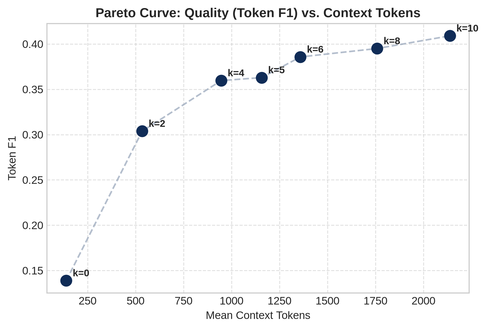

# Week 2 — Summary Analysis

## Objective

Measure the static SARA text/latent representation-budget frontier and retrospective adaptive headroom.

## Experiments performed

| Part    | Question                                                                              | Status    | Main_result                                                                                                                                                                                            |
|:--------|:--------------------------------------------------------------------------------------|:----------|:-------------------------------------------------------------------------------------------------------------------------------------------------------------------------------------------------------|
| FIXED-K | How do answer quality and context cost change as verbatim-passage budget k increases? | COMPLETED | SARA k8 has mean F1 0.3950 versus parent k5 0.3629; separate plain-RAG k10 has F1 0.4090. Increasing text budget improves these aggregate point estimates.                                             |
| ORACLE  | Would per-query best-tested k have headroom over the best static SARA budget?         | COMPLETED | The retrospective SARA oracle is about 0.5008 F1 versus static k8 0.3950; the full sweep oracle is about 0.5264. These are outcome-selected ceilings.                                                  |
| FREEZE  | Is the query/action grid complete and which reference was frozen for later modeling?  | COMPLETED | The 1,617-row matrix is exactly 231 queries × seven actions with no duplicate query/k pairs; static SARA k8 is retained. The checkpoint records zero train/dev paper overlap at that historical stage. |

## Key results

### Raw-result recomputed fixed-k metrics

|   k | method   |   queries |       F1 |       EM |      tokens |
|----:|:---------|----------:|---------:|---------:|------------:|
|   0 | sara     |       231 | 0.138829 | 0.086580 |  130.822511 |
|   2 | sara     |       231 | 0.303835 | 0.168831 |  526.523810 |
|   4 | sara     |       231 | 0.359601 | 0.199134 |  938.121212 |
|   5 | sara     |       231 | 0.362858 | 0.186147 | 1148.982684 |
|   6 | sara     |       231 | 0.385699 | 0.186147 | 1351.116883 |
|   8 | sara     |       231 | 0.394995 | 0.186147 | 1750.463203 |
|  10 | rag      |       231 | 0.409043 | 0.203463 | 2129.883117 |

Source: [results/week2/raw/dev_fixed_k_matrix.jsonl](../../week2/raw/dev_fixed_k_matrix.jsonl).

### Retrospective ceilings; not deployable policies

| actions                      |   retrospective_oracle_F1 |
|:-----------------------------|--------------------------:|
| SARA {0,2,4,5,6,8}           |                  0.500781 |
| Full sweep including RAG k10 |                  0.526415 |

Source: [results/week2/raw/dev_fixed_k_matrix.jsonl](../../week2/raw/dev_fixed_k_matrix.jsonl).

### Smallest-k tie-broken distribution

|         k |   best_sara_k_count |   best_sara_k_pct |   best_overall_k_count |   best_overall_k_pct |
|----------:|--------------------:|------------------:|-----------------------:|---------------------:|
|  0.000000 |           81.000000 |         35.060000 |              73.000000 |            31.600000 |
|  2.000000 |           55.000000 |         23.810000 |              52.000000 |            22.510000 |
|  4.000000 |           37.000000 |         16.020000 |              33.000000 |            14.290000 |
|  5.000000 |           15.000000 |          6.490000 |              14.000000 |             6.060000 |
|  6.000000 |           21.000000 |          9.090000 |              21.000000 |             9.090000 |
|  8.000000 |           22.000000 |          9.520000 |              19.000000 |             8.230000 |
| 10.000000 |            0.000000 |          0.000000 |              19.000000 |             8.230000 |

Source: [results/week2/processed/best_k_distribution.csv](../../week2/processed/best_k_distribution.csv).

## Main scientific conclusions

- SARA k8 has mean F1 0.3950 versus parent k5 0.3629; separate plain-RAG k10 has F1 0.4090. Increasing text budget improves these aggregate point estimates. Source: [results/week2/raw/dev_fixed_k_matrix.jsonl](../../week2/raw/dev_fixed_k_matrix.jsonl), [results/week2/processed/dev_fixed_k_summary.csv](../../week2/processed/dev_fixed_k_summary.csv)
- The retrospective SARA oracle is about 0.5008 F1 versus static k8 0.3950; the full sweep oracle is about 0.5264. These are outcome-selected ceilings. Source: [results/week2/processed/per_query_best_k.csv](../../week2/processed/per_query_best_k.csv), [results/week2/processed/oracle_vs_static_summary.json](../../week2/processed/oracle_vs_static_summary.json)
- The 1,617-row matrix is exactly 231 queries × seven actions with no duplicate query/k pairs; static SARA k8 is retained. The checkpoint records zero train/dev paper overlap at that historical stage. Source: [results/week2/processed/best_static_baseline.json](../../week2/processed/best_static_baseline.json), [results/week2/processed/week2_validation_checkpoint.json](../../week2/processed/week2_validation_checkpoint.json)

## What did NOT work?

No learned allocator or prospective generalization is evaluated.

## Limitations

Small local DEV cohort, outcome-selected ceilings, shared-query dependence and different SARA/RAG checkpoints.

## Decision after this week

SARA k8 retained; RAG k10 tracked separately.

## One-paragraph week takeaway

SARA k8 has mean F1 0.3950 versus parent k5 0.3629; separate plain-RAG k10 has F1 0.4090. Increasing text budget improves these aggregate point estimates. The retrospective SARA oracle is about 0.5008 F1 versus static k8 0.3950; the full sweep oracle is about 0.5264. These are outcome-selected ceilings. The 1,617-row matrix is exactly 231 queries × seven actions with no duplicate query/k pairs; static SARA k8 is retained. The checkpoint records zero train/dev paper overlap at that historical stage.

## Additional primary visualizations

X-axis is mean context tokens; y-axis token F1. The fixed-k frontier shows the quality/cost tradeoff; k10 is a separately trained RAG system, not an isolated compression ablation.

Source: [results/week2/plots/05_token_f1_vs_context_tokens.png](../../week2/plots/05_token_f1_vs_context_tokens.png).

# Primary Sources Used

- [configs/week2/sweep_config.yaml](../../../configs/week2/sweep_config.yaml)
- [notebooks/week2/week2_dev_fixed_k_sweep.ipynb](../../../notebooks/week2/week2_dev_fixed_k_sweep.ipynb)
- [results/week2/processed/best_k_distribution.csv](../../week2/processed/best_k_distribution.csv)
- [results/week2/processed/best_static_baseline.json](../../week2/processed/best_static_baseline.json)
- [results/week2/processed/dev_fixed_k_summary.csv](../../week2/processed/dev_fixed_k_summary.csv)
- [results/week2/processed/oracle_vs_static_summary.json](../../week2/processed/oracle_vs_static_summary.json)
- [results/week2/processed/per_query_best_k.csv](../../week2/processed/per_query_best_k.csv)
- [results/week2/processed/week2_validation_checkpoint.json](../../week2/processed/week2_validation_checkpoint.json)
- [results/week2/raw/dev_fixed_k_matrix.jsonl](../../week2/raw/dev_fixed_k_matrix.jsonl)

- [results/week2/plots/05_token_f1_vs_context_tokens.png](../../week2/plots/05_token_f1_vs_context_tokens.png)

# Existing Markdown Used as Evidence

NONE
