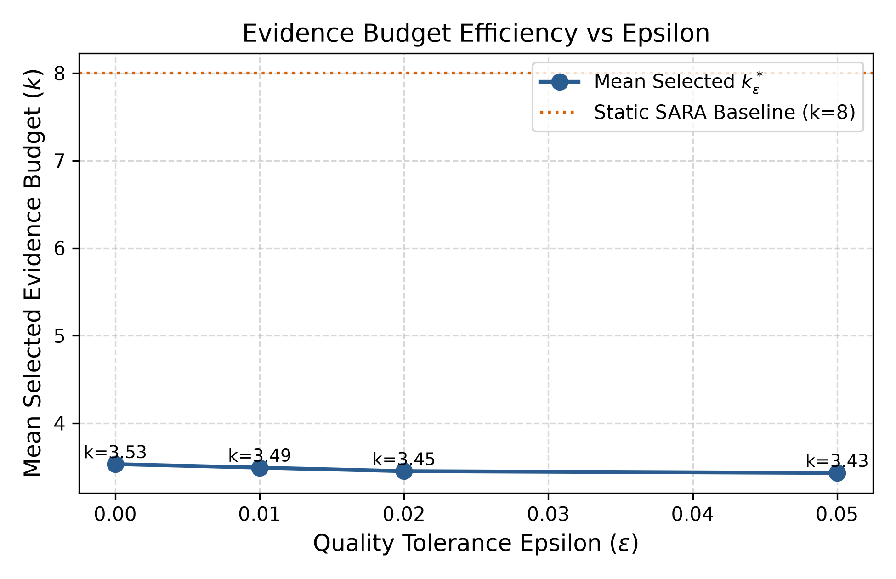

# Week 3 — Part-Wise Analysis

## Week objective

Quantify tie-aware adaptive headroom, freeze epsilon targets, inspect observable signals and prepare blinded human validation.

# Part QUALITY-ORACLE — Deployable-action-space oracle and tie audit

**Status: COMPLETED**

## 1. Research question

How much adaptive headroom remains after excluding pure compression and the separate RAG checkpoint?

## 2. Experimental design

| component   | value                                                                      |
|:------------|:---------------------------------------------------------------------------|
| dataset     | Same 231-query / 86-paper local QASPER DEV cohort                          |
| actions     | Primary {2,4,5,6,8}; k0/k10 diagnostic only                                |
| seed        | 42                                                                         |
| Role        | Protocol/context only; outcomes are accepted only from the artifacts below |

## 3. What was implemented / executed

Completed machine-readable output is present for the named conditions; coverage is limited to the recorded rows and checks below.

## 4. Result artifacts used

- [results/week3/processed/dev_quality_oracle.csv](../../week3/processed/dev_quality_oracle.csv)
- [results/week3/processed/heterogeneity_summary.json](../../week3/processed/heterogeneity_summary.json)
- [results/week3/processed/quality_oracle_distribution.csv](../../week3/processed/quality_oracle_distribution.csv)

## 5. Main numerical results

### Smallest-budget quality oracle distribution

|        k |      count |       pct |   cumulative_count |   cumulative_pct |
|---------:|-----------:|----------:|-------------------:|-----------------:|
| 2.000000 | 130.000000 | 56.280000 |         130.000000 |        56.280000 |
| 4.000000 |  40.000000 | 17.320000 |         170.000000 |        73.590000 |
| 5.000000 |  17.000000 |  7.360000 |         187.000000 |        80.950000 |
| 6.000000 |  21.000000 |  9.090000 |         208.000000 |        90.040000 |
| 8.000000 |  23.000000 |  9.960000 |         231.000000 |       100.000000 |

Source: [results/week3/processed/quality_oracle_distribution.csv](../../week3/processed/quality_oracle_distribution.csv).

### Tie-aware counts and stored uncertainty

| field                                           |       value |
|:------------------------------------------------|------------:|
| tie_aware.k8_in_exact_best_set_count            |  163.000000 |
| tie_aware.k8_in_exact_best_set_pct              |   70.560000 |
| tie_aware.k8_unique_strict_winner_count         |   23.000000 |
| tie_aware.k8_unique_strict_winner_pct           |    9.960000 |
| tie_aware.k8_strictly_suboptimal_count          |   68.000000 |
| tie_aware.k8_strictly_suboptimal_pct            |   29.440000 |
| tie_aware.k8_tied_with_smaller_budget_count     |  140.000000 |
| tie_aware.k8_tied_with_smaller_budget_pct       |   60.610000 |
| bootstrap.mean_oracle_f1.mean                   |    0.490400 |
| bootstrap.mean_oracle_f1.ci_lower               |    0.439900 |
| bootstrap.mean_oracle_f1.ci_upper               |    0.545400 |
| bootstrap.mean_oracle_f1.ci_level               |    0.950000 |
| bootstrap.mean_oracle_f1.n_clusters             |   86.000000 |
| bootstrap.mean_oracle_f1.n_bootstraps           | 1000.000000 |
| bootstrap.mean_static_f1.mean                   |    0.395800 |
| bootstrap.mean_static_f1.ci_lower               |    0.346900 |
| bootstrap.mean_static_f1.ci_upper               |    0.452800 |
| bootstrap.mean_static_f1.ci_level               |    0.950000 |
| bootstrap.mean_static_f1.n_clusters             |   86.000000 |
| bootstrap.mean_static_f1.n_bootstraps           | 1000.000000 |
| bootstrap.oracle_headroom.mean                  |    0.094500 |
| bootstrap.oracle_headroom.ci_lower              |    0.069300 |
| bootstrap.oracle_headroom.ci_upper              |    0.122600 |
| bootstrap.oracle_headroom.ci_level              |    0.950000 |
| bootstrap.oracle_headroom.n_clusters            |   86.000000 |
| bootstrap.oracle_headroom.n_bootstraps          | 1000.000000 |
| bootstrap.mean_f1_range.mean                    |    0.247300 |
| bootstrap.mean_f1_range.ci_lower                |    0.207300 |
| bootstrap.mean_f1_range.ci_upper                |    0.289500 |
| bootstrap.mean_f1_range.ci_level                |    0.950000 |
| bootstrap.mean_f1_range.n_clusters              |   86.000000 |
| bootstrap.mean_f1_range.n_bootstraps            | 1000.000000 |
| bootstrap.pct_questions_gain_gt_00.mean         |   29.500400 |
| bootstrap.pct_questions_gain_gt_00.ci_lower     |   23.873400 |
| bootstrap.pct_questions_gain_gt_00.ci_upper     |   35.296700 |
| bootstrap.pct_questions_gain_gt_00.ci_level     |    0.950000 |
| bootstrap.pct_questions_gain_gt_00.n_clusters   |   86.000000 |
| bootstrap.pct_questions_gain_gt_00.n_bootstraps | 1000.000000 |
| bootstrap.pct_questions_gain_gt_01.mean         |   29.081500 |
| bootstrap.pct_questions_gain_gt_01.ci_lower     |   23.635000 |
| bootstrap.pct_questions_gain_gt_01.ci_upper     |   34.818400 |
| bootstrap.pct_questions_gain_gt_01.ci_level     |    0.950000 |
| bootstrap.pct_questions_gain_gt_01.n_clusters   |   86.000000 |
| bootstrap.pct_questions_gain_gt_01.n_bootstraps | 1000.000000 |
| bootstrap.pct_questions_gain_gt_02.mean         |   29.081500 |
| bootstrap.pct_questions_gain_gt_02.ci_lower     |   23.635000 |
| bootstrap.pct_questions_gain_gt_02.ci_upper     |   34.818400 |
| bootstrap.pct_questions_gain_gt_02.ci_level     |    0.950000 |
| bootstrap.pct_questions_gain_gt_02.n_clusters   |   86.000000 |
| bootstrap.pct_questions_gain_gt_02.n_bootstraps | 1000.000000 |
| bootstrap.pct_questions_gain_gt_05.mean         |   26.909600 |
| bootstrap.pct_questions_gain_gt_05.ci_lower     |   21.619200 |
| bootstrap.pct_questions_gain_gt_05.ci_upper     |   32.370200 |
| bootstrap.pct_questions_gain_gt_05.ci_level     |    0.950000 |
| bootstrap.pct_questions_gain_gt_05.n_clusters   |   86.000000 |
| bootstrap.pct_questions_gain_gt_05.n_bootstraps | 1000.000000 |

Source: [results/week3/processed/heterogeneity_summary.json](../../week3/processed/heterogeneity_summary.json).

## 6. Figures

No saved figure is used for this part; no visualization is fabricated.

## 7. Statistical analysis

Stored bootstrap uses 1,000 paper-cluster resamples (86 papers), seed42, nominal95% intervals. Stored headroom CI is [0.0693,0.1226]. Bootstrap-mean point fields are not substituted for raw-sample means.

## 8. Interpretation

### Supported

The restricted retrospective oracle mean is 0.489507, with mean gain 0.094512 over k8. Only 29.44% of queries strictly improve over k8; 60.61% tie k8 with a smaller action.

### Not established

Point-estimate rankings do not establish statistical superiority. Implementation, qualification and retrospective oracle ceilings are not deployed or held-out quality results. Missing model/split/seed details are not established from available primary artifacts.

### Important caveats

Retrospective oracle only. Its difference from Week2 oracle is mechanically explained by removing k0 from the primary action set, not a failed reproduction.

## 9. Part conclusion

- The restricted retrospective oracle mean is 0.489507, with mean gain 0.094512 over k8. Only 29.44% of queries strictly improve over k8; 60.61% tie k8 with a smaller action.
- No additional method-selection decision is inferred beyond the recorded protocol/freeze artifacts.

# Part EPSILON — Epsilon-tolerant cost-aware target

**Status: COMPLETED**

## 1. Research question

Can smaller retrospective actions preserve quality within a declared tolerance?

## 2. Experimental design

| component          | value                                                                      |
|:-------------------|:---------------------------------------------------------------------------|
| dataset            | Same 231-query / 86-paper local QASPER DEV cohort                          |
| actions            | Primary {2,4,5,6,8}; k0/k10 diagnostic only                                |
| seed               | 42                                                                         |
| epsilon_candidates | [0, 0.01, 0.02, 0.05]                                                      |
| Role               | Protocol/context only; outcomes are accepted only from the artifacts below |

## 3. What was implemented / executed

Completed machine-readable output is present for the named conditions; coverage is limited to the recorded rows and checks below.

## 4. Result artifacts used

- [results/week3/processed/epsilon_summary.csv](../../week3/processed/epsilon_summary.csv)
- [results/week3/processed/epsilon_oracle_all.csv](../../week3/processed/epsilon_oracle_all.csv)
- [results/week3/processed/selected_epsilon.json](../../week3/processed/selected_epsilon.json)

## 5. Main numerical results

### All epsilon candidates

|   epsilon |   mean_k |   median_k |   mean_f1 |   mean_regret |   max_regret |   p95_regret |   mean_context_tokens |   context_reduction_pct_vs_k8 |   context_reduction_pct_vs_k10 |   feasibility_pct_sara |    pct_k2 |    pct_k4 |   pct_k5 |   pct_k6 |   pct_k8 |   diag_sweep_feasibility_pct |
|----------:|---------:|-----------:|----------:|--------------:|-------------:|-------------:|----------------------:|------------------------------:|-------------------------------:|-----------------------:|----------:|----------:|---------:|---------:|---------:|-----------------------------:|
|  0.000000 | 3.530000 |   2.000000 |  0.489500 |      0.000000 |     0.000000 |     0.000000 |            848.400000 |                     51.750000 |                      60.320000 |             100.000000 | 56.280000 | 17.320000 | 7.360000 | 9.090000 | 9.960000 |                    86.580000 |
|  0.010000 | 3.490000 |   2.000000 |  0.489400 |      0.000100 |     0.009500 |     0.000000 |            841.300000 |                     52.160000 |                      60.650000 |             100.000000 | 57.140000 | 17.320000 | 7.360000 | 8.230000 | 9.960000 |                    86.580000 |
|  0.020000 | 3.450000 |   2.000000 |  0.489200 |      0.000300 |     0.020000 |     0.000000 |            831.600000 |                     52.710000 |                      61.100000 |             100.000000 | 58.010000 | 17.320000 | 6.930000 | 8.660000 | 9.090000 |                    87.010000 |
|  0.050000 | 3.430000 |   2.000000 |  0.488800 |      0.000700 |     0.050000 |     0.000000 |            828.000000 |                     52.910000 |                      61.270000 |             100.000000 | 58.440000 | 16.880000 | 6.930000 | 9.090000 | 8.660000 |                    88.310000 |

Source: [results/week3/processed/epsilon_summary.csv](../../week3/processed/epsilon_summary.csv).

### Offline recomputed means

|   epsilon |          n |   mean_k |       F1 |   regret |     tokens |
|----------:|-----------:|---------:|---------:|---------:|-----------:|
|  0.000000 | 231.000000 | 3.528139 | 0.489507 | 0.000000 | 848.418182 |
|  0.010000 | 231.000000 | 3.493506 | 0.489391 | 0.000116 | 841.278788 |
|  0.020000 | 231.000000 | 3.445887 | 0.489203 | 0.000304 | 831.556277 |
|  0.050000 | 231.000000 | 3.428571 | 0.488839 | 0.000668 | 828.045455 |

Source: [results/week3/processed/epsilon_oracle_all.csv](../../week3/processed/epsilon_oracle_all.csv).

## 6. Figures

No saved figure is used for this part; no visualization is fabricated.

## 7. Statistical analysis

No formal inferential test was found for this comparison.

## 8. Interpretation

### Supported

The development-selected epsilon is 0.01: stored mean F1 0.4894, mean k3.49 and mean context 841.3 tokens, about 52.16% below k8. Primary action-set feasibility is 100%.

### Not established

Point-estimate rankings do not establish statistical superiority. Implementation, qualification and retrospective oracle ceilings are not deployed or held-out quality results. Missing model/split/seed details are not established from available primary artifacts.

### Important caveats

Cost-aware choices are retrospective oracle labels, not achievable inference results; epsilon was chosen on this same development cohort.

## 9. Part conclusion

- The development-selected epsilon is 0.01: stored mean F1 0.4894, mean k3.49 and mean context 841.3 tokens, about 52.16% below k8. Primary action-set feasibility is 100%.
- selected_epsilon.json retains epsilon0.01 for later modeling.

# Part FEATURES — Pregeneration feature signal

**Status: COMPLETED**

## 1. Research question

Do simple retrieval/query observables correlate with oracle action labels?

## 2. Experimental design

| component   | value                                                                      |
|:------------|:---------------------------------------------------------------------------|
| dataset     | Same 231-query / 86-paper local QASPER DEV cohort                          |
| actions     | Primary {2,4,5,6,8}; k0/k10 diagnostic only                                |
| seed        | 42                                                                         |
| Role        | Protocol/context only; outcomes are accepted only from the artifacts below |

## 3. What was implemented / executed

Completed machine-readable output is present for the named conditions; coverage is limited to the recorded rows and checks below.

## 4. Result artifacts used

- [results/week3/processed/feature_signal_analysis.csv](../../week3/processed/feature_signal_analysis.csv)

## 5. Main numerical results

### Exploratory feature/target associations

| feature            | target             | target_type        |   spearman_rho |   spearman_p |   pearson_r |   pearson_p |   kruskal_wallis_h |   kruskal_wallis_p | effect_size   |
|:-------------------|:-------------------|:-------------------|---------------:|-------------:|------------:|------------:|-------------------:|-------------------:|:--------------|
| rho_1              | best_k_qual        | ordinal_budget     |       0.051800 |     0.433600 |  nan        |  nan        |           2.977600 |           0.561600 | Negligible    |
| rho_1              | selected_k_epsilon | ordinal_budget     |       0.049000 |     0.458200 |  nan        |  nan        |           2.870900 |           0.579700 | Negligible    |
| rho_1              | oracle_gain        | continuous_quality |      -0.043500 |     0.511000 |   -0.058400 |    0.376700 |         nan        |         nan        | Negligible    |
| rho_1              | f1_range           | continuous_quality |       0.020900 |     0.752600 |   -0.006500 |    0.921600 |         nan        |         nan        | Negligible    |
| delta_12           | best_k_qual        | ordinal_budget     |       0.132000 |     0.045000 |  nan        |  nan        |           4.372700 |           0.357900 | Weak          |
| delta_12           | selected_k_epsilon | ordinal_budget     |       0.126000 |     0.055900 |  nan        |  nan        |           4.535000 |           0.338400 | Weak          |
| delta_12           | oracle_gain        | continuous_quality |       0.029500 |     0.655400 |   -0.055900 |    0.397700 |         nan        |         nan        | Negligible    |
| delta_12           | f1_range           | continuous_quality |       0.044300 |     0.502500 |   -0.026600 |    0.688000 |         nan        |         nan        | Negligible    |
| entropy            | best_k_qual        | ordinal_budget     |       0.053200 |     0.421000 |  nan        |  nan        |           3.245300 |           0.517600 | Negligible    |
| entropy            | selected_k_epsilon | ordinal_budget     |       0.047900 |     0.468600 |  nan        |  nan        |           2.982800 |           0.560700 | Negligible    |
| entropy            | oracle_gain        | continuous_quality |       0.084200 |     0.202100 |    0.020300 |    0.759000 |         nan        |         nan        | Negligible    |
| entropy            | f1_range           | continuous_quality |       0.045300 |     0.493500 |   -0.037000 |    0.576100 |         nan        |         nan        | Negligible    |
| entropy_normalized | best_k_qual        | ordinal_budget     |       0.053200 |     0.421400 |  nan        |  nan        |           3.244700 |           0.517700 | Negligible    |
| entropy_normalized | selected_k_epsilon | ordinal_budget     |       0.047900 |     0.469100 |  nan        |  nan        |           2.982000 |           0.560800 | Negligible    |
| entropy_normalized | oracle_gain        | continuous_quality |       0.084300 |     0.202000 |    0.020300 |    0.759000 |         nan        |         nan        | Negligible    |
| entropy_normalized | f1_range           | continuous_quality |       0.045300 |     0.493400 |   -0.037000 |    0.576100 |         nan        |         nan        | Negligible    |
| n_high             | best_k_qual        | ordinal_budget     |      -0.142100 |     0.030800 |  nan        |  nan        |           5.389700 |           0.249600 | Weak          |
| n_high             | selected_k_epsilon | ordinal_budget     |      -0.135200 |     0.040100 |  nan        |  nan        |           6.063600 |           0.194400 | Weak          |
| n_high             | oracle_gain        | continuous_quality |      -0.019300 |     0.770700 |    0.036500 |    0.581000 |         nan        |         nan        | Negligible    |
| n_high             | f1_range           | continuous_quality |      -0.061900 |     0.349000 |    0.037700 |    0.568900 |         nan        |         nan        | Negligible    |
| query_token_length | best_k_qual        | ordinal_budget     |      -0.012500 |     0.850300 |  nan        |  nan        |           1.494600 |           0.827600 | Negligible    |
| query_token_length | selected_k_epsilon | ordinal_budget     |      -0.023200 |     0.725300 |  nan        |  nan        |           1.083700 |           0.896800 | Negligible    |
| query_token_length | oracle_gain        | continuous_quality |      -0.063200 |     0.338900 |   -0.118000 |    0.073400 |         nan        |         nan        | Negligible    |
| query_token_length | f1_range           | continuous_quality |      -0.062000 |     0.348100 |   -0.097500 |    0.139800 |         nan        |         nan        | Negligible    |

Source: [results/week3/processed/feature_signal_analysis.csv](../../week3/processed/feature_signal_analysis.csv).

## 6. Figures

No saved figure is used for this part; no visualization is fabricated.

## 7. Statistical analysis

Recorded Spearman/Pearson/Kruskal–Wallis p-values are exploratory; no multiplicity-corrected confirmatory family is established.

## 8. Interpretation

### Supported

Recorded feature associations are weak; for example n_high versus budget has Spearman rho −0.1421 (nominal p0.0308). This motivates testing predictors but does not establish out-of-sample predictive utility.

### Not established

Point-estimate rankings do not establish statistical superiority. Implementation, qualification and retrospective oracle ceilings are not deployed or held-out quality results. Missing model/split/seed details are not established from available primary artifacts.

### Important caveats

Many feature/target comparisons and reused development labels; significance alone does not imply meaningful predictive quality.

## 9. Part conclusion

- Recorded feature associations are weak; for example n_high versus budget has Spearman rho −0.1421 (nominal p0.0308). This motivates testing predictors but does not establish out-of-sample predictive utility.
- No additional method-selection decision is inferred beyond the recorded protocol/freeze artifacts.

# Part HUMAN-AUDIT — Blinded human-scoring package

**Status: IMPLEMENTED**

## 1. Research question

Do human ratings independently confirm automatic-score differences?

## 2. Experimental design

| component         | value                                                                      |
|:------------------|:---------------------------------------------------------------------------|
| dataset           | Same 231-query / 86-paper local QASPER DEV cohort                          |
| actions           | Primary {2,4,5,6,8}; k0/k10 diagnostic only                                |
| seed              | 42                                                                         |
| planned_questions | 50                                                                         |
| planned_actions   | [2, 5, 10]                                                                 |
| Role              | Protocol/context only; outcomes are accepted only from the artifacts below |

## 3. What was implemented / executed

The status is based on the available artifacts, not notebook existence alone. Available outputs must be interpreted under the status shown.

## 4. Result artifacts used

- [results/week3/human_audit/human_scoring_template.csv](../../week3/human_audit/human_scoring_template.csv)
- [results/week3/human_audit/human_audit_summary.csv](../../week3/human_audit/human_audit_summary.csv)
- [results/week3/processed/week3_gate.json](../../week3/processed/week3_gate.json)

## 5. Main numerical results

### Saved audit status/coverage

|         k |   n_judgments |   mean_human_score |   median_human_score |   pct_incorrect_0 |   pct_partial_1 |   pct_correct_2 |   mean_token_f1 |
|----------:|--------------:|-------------------:|---------------------:|------------------:|----------------:|----------------:|----------------:|
|  2.000000 |     50.000000 |           0.640000 |             1.000000 |         46.000000 |       44.000000 |       10.000000 |        0.200900 |
|  5.000000 |     50.000000 |           1.000000 |             1.000000 |         22.000000 |       56.000000 |       22.000000 |        0.342800 |
| 10.000000 |     50.000000 |           1.060000 |             1.000000 |         24.000000 |       46.000000 |       30.000000 |        0.380800 |

Source: [results/week3/human_audit/human_audit_summary.csv](../../week3/human_audit/human_audit_summary.csv).

## 6. Figures

No saved figure is used for this part; no visualization is fabricated.

## 7. Statistical analysis

No formal inferential test was found for this comparison.

## 8. Interpretation

### Supported

SOURCE CONFLICT: human_audit_summary.csv reports 50 judgments per k, but all 150 score_0_1_2 entries in human_scoring_template.csv are blank and week3_gate.json says PENDING_MANUAL_EVALUATION. The summary cannot be certified as observed human evaluation; completed human judgment evidence is not established.

### Not established

Point-estimate rankings do not establish statistical superiority. Implementation, qualification and retrospective oracle ceilings are not deployed or held-out quality results. Missing model/split/seed details are not established from available primary artifacts.

### Important caveats

Do not treat prepared blinded items or machine predictions as completed human evaluation.

## 9. Part conclusion

- SOURCE CONFLICT: human_audit_summary.csv reports 50 judgments per k, but all 150 score_0_1_2 entries in human_scoring_template.csv are blank and week3_gate.json says PENDING_MANUAL_EVALUATION. The summary cannot be certified as observed human evaluation; completed human judgment evidence is not established.
- No additional method-selection decision is inferred beyond the recorded protocol/freeze artifacts.

# Week 3 — Integrated Analysis

## What changed during this week?

Quantify tie-aware adaptive headroom, freeze epsilon targets, inspect observable signals and prepare blinded human validation. The parts above retain the distinction between executed outputs, implementation-only work, exploratory diagnostics and retrospective choices.

## Main supported findings

| Finding                                                                                                                                                                                                         | Evidence                                                                                                                  | Strength                                     |
|:----------------------------------------------------------------------------------------------------------------------------------------------------------------------------------------------------------------|:--------------------------------------------------------------------------------------------------------------------------|:---------------------------------------------|
| The restricted retrospective oracle mean is 0.489507, with mean gain 0.094512 over k8. Only 29.44% of queries strictly improve over k8; 60.61% tie k8 with a smaller action.                                    | Part QUALITY-ORACLE; results/week3/processed/dev_quality_oracle.csv; results/week3/processed/heterogeneity_summary.json   | descriptive; see stated inferential evidence |
| The development-selected epsilon is 0.01: stored mean F1 0.4894, mean k3.49 and mean context 841.3 tokens, about 52.16% below k8. Primary action-set feasibility is 100%.                                       | Part EPSILON; results/week3/processed/epsilon_summary.csv; results/week3/processed/epsilon_oracle_all.csv                 | descriptive; see stated inferential evidence |
| Recorded feature associations are weak; for example n_high versus budget has Spearman rho −0.1421 (nominal p0.0308). This motivates testing predictors but does not establish out-of-sample predictive utility. | Part FEATURES; results/week3/processed/feature_signal_analysis.csv                                                        | descriptive; see stated inferential evidence |
| SOURCE CONFLICT: human_audit_summary.csv reports 50 judgments per k, but all 150 score_0_1_2 entries in human_scoring_template.csv are blank and week3_gate.json says PENDING_MANUAL_EVALUATION. The summary cannot be certified as observed human evaluation; completed human judgment evidence is not established.                                                                 | Part HUMAN-AUDIT; results/week3/human_audit/human_scoring_template.csv; results/week3/human_audit/human_audit_summary.csv | IMPLEMENTED                                  |

## Negative / null findings

Human evaluation remains pending; no deployable adaptive controller is established.

## What remained unresolved?

Development exposure, weak associations, oracle label ties and small paper count.

## What logically motivated the next week?

Week4 notebook names/configs instantiate feature validation and learned QCCA model benchmarking.

## Offline reproducibility / source conflicts

- 231 oracle rows and 924 epsilon rows verified; raw maxima and epsilon F1 means match stored analyses within rounding.
- Week2/Week3 oracle values refer to different action sets; no silent source conflation.

Executed notebook coverage (zero-based cell indices):

| artifact                                               |   executed_output_cells | cell_indices                 |
|:-------------------------------------------------------|------------------------:|:-----------------------------|
| notebooks/week3/week3_oracle_epsilon_human_audit.ipynb |                      11 | 2,4,6,8,10,12,14,16,18,20,22 |
| notebooks/week3/week3_oracle_target_analysis.ipynb     |                      11 | 2,4,6,8,10,12,14,16,18,20,22 |

## Additional primary visualizations

X-axis is retrospective oracle tolerance epsilon; y-axis mean selected k. Lower cost follows outcome-aware selection, not a trained inference-time policy. Human-score figures are deliberately excluded because raw ratings are blank.

Source: [results/week3/plots/plot5_epsilon_vs_mean_k.png](../../week3/plots/plot5_epsilon_vs_mean_k.png).

# Primary Sources Used

- [configs/week3/week3_config.yaml](../../../configs/week3/week3_config.yaml)
- [notebooks/week3/week3_oracle_epsilon_human_audit.ipynb](../../../notebooks/week3/week3_oracle_epsilon_human_audit.ipynb)
- [notebooks/week3/week3_oracle_target_analysis.ipynb](../../../notebooks/week3/week3_oracle_target_analysis.ipynb)
- [results/week3/human_audit/human_audit_summary.csv](../../week3/human_audit/human_audit_summary.csv)
- [results/week3/human_audit/human_scoring_template.csv](../../week3/human_audit/human_scoring_template.csv)
- [results/week3/processed/dev_quality_oracle.csv](../../week3/processed/dev_quality_oracle.csv)
- [results/week3/processed/epsilon_oracle_all.csv](../../week3/processed/epsilon_oracle_all.csv)
- [results/week3/processed/epsilon_summary.csv](../../week3/processed/epsilon_summary.csv)
- [results/week3/processed/feature_signal_analysis.csv](../../week3/processed/feature_signal_analysis.csv)
- [results/week3/processed/heterogeneity_summary.json](../../week3/processed/heterogeneity_summary.json)
- [results/week3/processed/quality_oracle_distribution.csv](../../week3/processed/quality_oracle_distribution.csv)
- [results/week3/processed/selected_epsilon.json](../../week3/processed/selected_epsilon.json)
- [results/week3/processed/week3_gate.json](../../week3/processed/week3_gate.json)

- [results/week3/plots/plot5_epsilon_vs_mean_k.png](../../week3/plots/plot5_epsilon_vs_mean_k.png)

# Existing Markdown Used as Evidence

NONE
