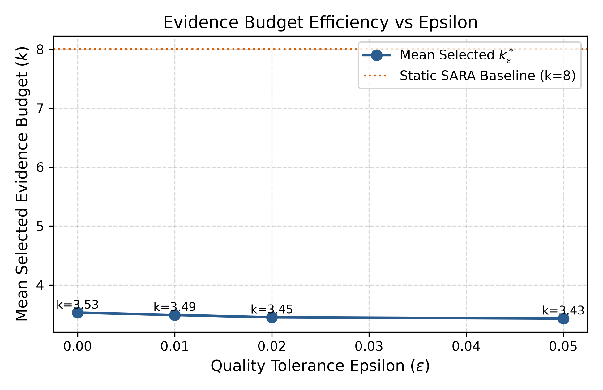

# Week 3 — Summary Analysis

## Objective

Quantify tie-aware adaptive headroom, freeze epsilon targets, inspect observable signals and prepare blinded human validation.

## Experiments performed

| Part           | Question                                                                                             | Status      | Main_result                                                                                                                                                                                                     |
|:---------------|:-----------------------------------------------------------------------------------------------------|:------------|:----------------------------------------------------------------------------------------------------------------------------------------------------------------------------------------------------------------|
| QUALITY-ORACLE | How much adaptive headroom remains after excluding pure compression and the separate RAG checkpoint? | COMPLETED   | The restricted retrospective oracle mean is 0.489507, with mean gain 0.094512 over k8. Only 29.44% of queries strictly improve over k8; 60.61% tie k8 with a smaller action.                                    |
| EPSILON        | Can smaller retrospective actions preserve quality within a declared tolerance?                      | COMPLETED   | The development-selected epsilon is 0.01: stored mean F1 0.4894, mean k3.49 and mean context 841.3 tokens, about 52.16% below k8. Primary action-set feasibility is 100%.                                       |
| FEATURES       | Do simple retrieval/query observables correlate with oracle action labels?                           | COMPLETED   | Recorded feature associations are weak; for example n_high versus budget has Spearman rho −0.1421 (nominal p0.0308). This motivates testing predictors but does not establish out-of-sample predictive utility. |
| HUMAN-AUDIT    | Do human ratings independently confirm automatic-score differences?                                  | IMPLEMENTED | SOURCE CONFLICT: human_audit_summary.csv reports 50 judgments per k, but all 150 score_0_1_2 entries in human_scoring_template.csv are blank and week3_gate.json says PENDING_MANUAL_EVALUATION. The summary cannot be certified as observed human evaluation; completed human judgment evidence is not established.                                                                 |

## Key results

### Smallest-budget quality oracle distribution

|        k |      count |       pct |   cumulative_count |   cumulative_pct |
|---------:|-----------:|----------:|-------------------:|-----------------:|
| 2.000000 | 130.000000 | 56.280000 |         130.000000 |        56.280000 |
| 4.000000 |  40.000000 | 17.320000 |         170.000000 |        73.590000 |
| 5.000000 |  17.000000 |  7.360000 |         187.000000 |        80.950000 |
| 6.000000 |  21.000000 |  9.090000 |         208.000000 |        90.040000 |
| 8.000000 |  23.000000 |  9.960000 |         231.000000 |       100.000000 |

Source: [results/week3/processed/quality_oracle_distribution.csv](../../week3/processed/quality_oracle_distribution.csv).

### Tie-aware counts and stored uncertainty

| field                                       |      value |
|:--------------------------------------------|-----------:|
| tie_aware.k8_in_exact_best_set_count        | 163.000000 |
| tie_aware.k8_in_exact_best_set_pct          |  70.560000 |
| tie_aware.k8_unique_strict_winner_count     |  23.000000 |
| tie_aware.k8_unique_strict_winner_pct       |   9.960000 |
| tie_aware.k8_strictly_suboptimal_count      |  68.000000 |
| tie_aware.k8_strictly_suboptimal_pct        |  29.440000 |
| tie_aware.k8_tied_with_smaller_budget_count | 140.000000 |
| tie_aware.k8_tied_with_smaller_budget_pct   |  60.610000 |
| bootstrap.mean_oracle_f1.mean               |   0.490400 |
| bootstrap.mean_oracle_f1.ci_lower           |   0.439900 |
| bootstrap.mean_oracle_f1.ci_upper           |   0.545400 |
| bootstrap.mean_oracle_f1.ci_level           |   0.950000 |

Source: [results/week3/processed/heterogeneity_summary.json](../../week3/processed/heterogeneity_summary.json). First 12 of 56 rows shown; detailed report and source preserve the full comparison.

### All epsilon candidates

|   epsilon |   mean_k |   median_k |   mean_f1 |   mean_regret |   max_regret |   p95_regret |   mean_context_tokens |   context_reduction_pct_vs_k8 |   context_reduction_pct_vs_k10 |   feasibility_pct_sara |    pct_k2 |    pct_k4 |   pct_k5 |   pct_k6 |   pct_k8 |   diag_sweep_feasibility_pct |
|----------:|---------:|-----------:|----------:|--------------:|-------------:|-------------:|----------------------:|------------------------------:|-------------------------------:|-----------------------:|----------:|----------:|---------:|---------:|---------:|-----------------------------:|
|  0.000000 | 3.530000 |   2.000000 |  0.489500 |      0.000000 |     0.000000 |     0.000000 |            848.400000 |                     51.750000 |                      60.320000 |             100.000000 | 56.280000 | 17.320000 | 7.360000 | 9.090000 | 9.960000 |                    86.580000 |
|  0.010000 | 3.490000 |   2.000000 |  0.489400 |      0.000100 |     0.009500 |     0.000000 |            841.300000 |                     52.160000 |                      60.650000 |             100.000000 | 57.140000 | 17.320000 | 7.360000 | 8.230000 | 9.960000 |                    86.580000 |
|  0.020000 | 3.450000 |   2.000000 |  0.489200 |      0.000300 |     0.020000 |     0.000000 |            831.600000 |                     52.710000 |                      61.100000 |             100.000000 | 58.010000 | 17.320000 | 6.930000 | 8.660000 | 9.090000 |                    87.010000 |
|  0.050000 | 3.430000 |   2.000000 |  0.488800 |      0.000700 |     0.050000 |     0.000000 |            828.000000 |                     52.910000 |                      61.270000 |             100.000000 | 58.440000 | 16.880000 | 6.930000 | 9.090000 | 8.660000 |                    88.310000 |

Source: [results/week3/processed/epsilon_summary.csv](../../week3/processed/epsilon_summary.csv).

### Offline recomputed means

|   epsilon |          n |   mean_k |       F1 |   regret |     tokens |
|----------:|-----------:|---------:|---------:|---------:|-----------:|
|  0.000000 | 231.000000 | 3.528139 | 0.489507 | 0.000000 | 848.418182 |
|  0.010000 | 231.000000 | 3.493506 | 0.489391 | 0.000116 | 841.278788 |
|  0.020000 | 231.000000 | 3.445887 | 0.489203 | 0.000304 | 831.556277 |
|  0.050000 | 231.000000 | 3.428571 | 0.488839 | 0.000668 | 828.045455 |

Source: [results/week3/processed/epsilon_oracle_all.csv](../../week3/processed/epsilon_oracle_all.csv).

## Main scientific conclusions

- The restricted retrospective oracle mean is 0.489507, with mean gain 0.094512 over k8. Only 29.44% of queries strictly improve over k8; 60.61% tie k8 with a smaller action. Source: [results/week3/processed/dev_quality_oracle.csv](../../week3/processed/dev_quality_oracle.csv), [results/week3/processed/heterogeneity_summary.json](../../week3/processed/heterogeneity_summary.json)
- The development-selected epsilon is 0.01: stored mean F1 0.4894, mean k3.49 and mean context 841.3 tokens, about 52.16% below k8. Primary action-set feasibility is 100%. Source: [results/week3/processed/epsilon_summary.csv](../../week3/processed/epsilon_summary.csv), [results/week3/processed/epsilon_oracle_all.csv](../../week3/processed/epsilon_oracle_all.csv)
- Recorded feature associations are weak; for example n_high versus budget has Spearman rho −0.1421 (nominal p0.0308). This motivates testing predictors but does not establish out-of-sample predictive utility. Source: [results/week3/processed/feature_signal_analysis.csv](../../week3/processed/feature_signal_analysis.csv)
- SOURCE CONFLICT: human_audit_summary.csv reports 50 judgments per k, but all 150 score_0_1_2 entries in human_scoring_template.csv are blank and week3_gate.json says PENDING_MANUAL_EVALUATION. The summary cannot be certified as observed human evaluation; completed human judgment evidence is not established. Source: [results/week3/human_audit/human_scoring_template.csv](../../week3/human_audit/human_scoring_template.csv), [results/week3/human_audit/human_audit_summary.csv](../../week3/human_audit/human_audit_summary.csv)

## What did NOT work?

Human evaluation remains pending; no deployable adaptive controller is established.

## Limitations

Development exposure, weak associations, oracle label ties and small paper count.

## Decision after this week

epsilon0.01 retained; proceed gate concerns modeling readiness, not successful human validation.

## One-paragraph week takeaway

The restricted retrospective oracle mean is 0.489507, with mean gain 0.094512 over k8. Only 29.44% of queries strictly improve over k8; 60.61% tie k8 with a smaller action. The development-selected epsilon is 0.01: stored mean F1 0.4894, mean k3.49 and mean context 841.3 tokens, about 52.16% below k8. Primary action-set feasibility is 100%. Recorded feature associations are weak; for example n_high versus budget has Spearman rho −0.1421 (nominal p0.0308). This motivates testing predictors but does not establish out-of-sample predictive utility. SOURCE CONFLICT: human_audit_summary.csv reports 50 judgments per k, but all 150 score_0_1_2 entries in human_scoring_template.csv are blank and week3_gate.json says PENDING_MANUAL_EVALUATION. The summary cannot be certified as observed human evaluation; completed human judgment evidence is not established.

## Additional primary visualizations

X-axis is retrospective oracle tolerance epsilon; y-axis mean selected k. Lower cost follows outcome-aware selection, not a trained inference-time policy. Human-score figures are deliberately excluded because raw ratings are blank.

Source: [results/week3/plots/plot5_epsilon_vs_mean_k.png](../../week3/plots/plot5_epsilon_vs_mean_k.png).

# Primary Sources Used

- [configs/week3/week3_config.yaml](../../../configs/week3/week3_config.yaml)
- [notebooks/week3/week3_oracle_epsilon_human_audit.ipynb](../../../notebooks/week3/week3_oracle_epsilon_human_audit.ipynb)
- [notebooks/week3/week3_oracle_target_analysis.ipynb](../../../notebooks/week3/week3_oracle_target_analysis.ipynb)
- [results/week3/human_audit/human_audit_summary.csv](../../week3/human_audit/human_audit_summary.csv)
- [results/week3/human_audit/human_scoring_template.csv](../../week3/human_audit/human_scoring_template.csv)
- [results/week3/processed/dev_quality_oracle.csv](../../week3/processed/dev_quality_oracle.csv)
- [results/week3/processed/epsilon_oracle_all.csv](../../week3/processed/epsilon_oracle_all.csv)
- [results/week3/processed/epsilon_summary.csv](../../week3/processed/epsilon_summary.csv)
- [results/week3/processed/feature_signal_analysis.csv](../../week3/processed/feature_signal_analysis.csv)
- [results/week3/processed/heterogeneity_summary.json](../../week3/processed/heterogeneity_summary.json)
- [results/week3/processed/quality_oracle_distribution.csv](../../week3/processed/quality_oracle_distribution.csv)
- [results/week3/processed/selected_epsilon.json](../../week3/processed/selected_epsilon.json)
- [results/week3/processed/week3_gate.json](../../week3/processed/week3_gate.json)

- [results/week3/plots/plot5_epsilon_vs_mean_k.png](../../week3/plots/plot5_epsilon_vs_mean_k.png)

# Existing Markdown Used as Evidence

NONE
