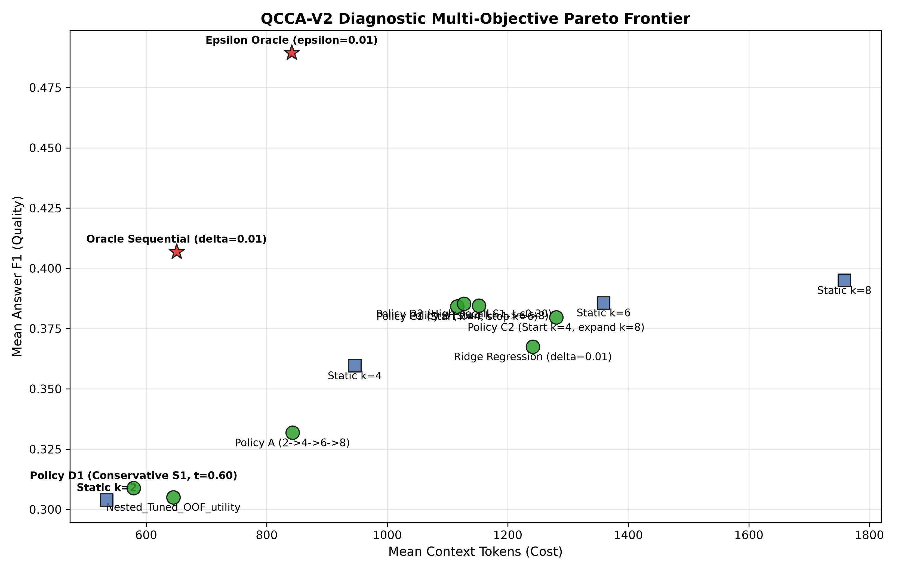

# Week 4 — Part-Wise Analysis

## Week objective

Test whether observable query/retrieval/content features can choose SARA representation budgets, then diagnose direct and sequential allocation failures.

# Part FEATURE-DISCOVERY — Feature discovery

**Status: COMPLETED**

## 1. Research question

Which pregeneration feature families associate with budget/transition targets?

## 2. Experimental design

| component   | value                                                                              |
|:------------|:-----------------------------------------------------------------------------------|
| dataset     | Local QASPER DEV 231 queries / 86 papers; train/internal validation where recorded |
| reader      | Historical fine-tuned SARA / Mistral-7B                                            |
| retriever   | BM25 candidate pool; MiniLM semantic features/routing where specified              |
| metric      | Answer token F1; context-token accounting is artifact-specific                     |
| Role        | Protocol/context only; outcomes are accepted only from the artifacts below         |

## 3. What was implemented / executed

Completed machine-readable output is present for the named conditions; coverage is limited to the recorded rows and checks below.

## 4. Result artifacts used

- [results/week4/feature_discovery/feature_family_summary.csv](../../week4/feature_discovery/feature_family_summary.csv)

## 5. Main numerical results

### feature family summary

| feature_family                  |   n_features |   max_abs_spearman_rho |   median_abs_spearman_rho |   mean_abs_spearman_rho |   n_features_fold_stable | strongest_feature           | strongest_target   |   strongest_rho |
|:--------------------------------|-------------:|-----------------------:|--------------------------:|------------------------:|-------------------------:|:----------------------------|:-------------------|----------------:|
| B: Query Complexity             |           12 |               0.188800 |                  0.054300 |                0.062000 |                        9 | query_conjunction_count     | oracle_k           |        0.188800 |
| A: BM25/Retrieval               |           17 |               0.174300 |                  0.049700 |                0.056500 |                       17 | bm25_mean_score             | G_4_to_6           |        0.174300 |
| E: Lexical Coverage             |            8 |               0.173500 |                  0.074800 |                0.075700 |                        8 | lex_coverage_top1           | oracle_k           |        0.173500 |
| C: Semantic Structure           |           11 |               0.172100 |                  0.066100 |                0.072100 |                       11 | sem_sim_mean_top6           | G_4_to_6           |        0.172100 |
| D: Passage Redundancy/Diversity |           10 |               0.156900 |                  0.036300 |                0.043400 |                       10 | passage_sim_std             | G_6_to_8           |        0.156900 |
| F: Evidence Structure           |            6 |               0.152200 |                  0.046500 |                0.052600 |                        6 | evidence_query_cluster_span | G_4_to_6           |        0.152200 |

Source: [results/week4/feature_discovery/feature_family_summary.csv](../../week4/feature_discovery/feature_family_summary.csv).

## 6. Figures

No saved figure is used for this part; no visualization is fabricated.

## 7. Statistical analysis

Bootstrap/FDR results are reported only where a named CSV is included; nominal feature correlations are exploratory. See protocol source for grouping/resample definitions.

## 8. Interpretation

### Supported

All feature-family maximum absolute Spearman correlations are below 0.19; observed individual associations are weak.

### Not established

Point-estimate rankings do not establish statistical superiority. Implementation, qualification and retrospective oracle ceilings are not deployed or held-out quality results. Missing model/split/seed details are not established from available primary artifacts.

### Important caveats

The same small DEV cohort supports feature discovery, policy selection and reported evaluation. No fresh confirmation exists in this week.

## 9. Part conclusion

- All feature-family maximum absolute Spearman correlations are below 0.19; observed individual associations are weak.
- No additional method-selection decision is inferred beyond the recorded protocol/freeze artifacts.

# Part FEATURE-VALIDATION — Feature validation

**Status: COMPLETED**

## 1. Research question

Do associations survive redundancy and multiple-comparison checks?

## 2. Experimental design

| component   | value                                                                              |
|:------------|:-----------------------------------------------------------------------------------|
| dataset     | Local QASPER DEV 231 queries / 86 papers; train/internal validation where recorded |
| reader      | Historical fine-tuned SARA / Mistral-7B                                            |
| retriever   | BM25 candidate pool; MiniLM semantic features/routing where specified              |
| metric      | Answer token F1; context-token accounting is artifact-specific                     |
| Role        | Protocol/context only; outcomes are accepted only from the artifacts below         |

## 3. What was implemented / executed

Completed machine-readable output is present for the named conditions; coverage is limited to the recorded rows and checks below.

## 4. Result artifacts used

- [results/week4/feature_validation/feature_family_validation_summary.csv](../../week4/feature_validation/feature_family_validation_summary.csv)
- [results/week4/feature_validation/provisional_feature_set.csv](../../week4/feature_validation/provisional_feature_set.csv)

## 5. Main numerical results

### feature family validation summary

| feature_family                  |   original_features |   fdr_sig_relationships_q10 |   bootstrap_ci_excludes_zero |   median_abs_rho |   max_abs_rho |   median_fold_stability | representative_features                                                                |
|:--------------------------------|--------------------:|----------------------------:|-----------------------------:|-----------------:|--------------:|------------------------:|:---------------------------------------------------------------------------------------|
| A: BM25/Retrieval               |                  17 |                           0 |                            6 |         0.049700 |      0.174300 |                0.800000 | bm25_mean_score, bm25_top1_score, bm25_first_gap_ratio                                 |
| B: Query Complexity             |                  12 |                           0 |                            6 |         0.054300 |      0.188800 |                0.600000 | query_conjunction_count, query_is_what_which, query_is_factoid                         |
| C: Semantic Structure           |                  11 |                           0 |                           10 |         0.066100 |      0.172100 |                0.600000 | sem_sim_mean_top6, sem_sim_top2, sem_sim_gap_12                                        |
| D: Passage Redundancy/Diversity |                  10 |                           0 |                            1 |         0.036300 |      0.156900 |                0.600000 | passage_sim_std, passage_sim_min, passage_sim_mean                                     |
| E: Lexical Coverage             |                   8 |                           0 |                            9 |         0.074800 |      0.173500 |                0.800000 | lex_coverage_top1, lex_coverage_top2, lex_coverage_gain_1_to_4                         |
| F: Evidence Structure           |                   6 |                           0 |                            1 |         0.046500 |      0.152200 |                0.600000 | evidence_query_cluster_span, evidence_lexical_overlap_mean, evidence_unique_word_count |

Source: [results/week4/feature_validation/feature_family_validation_summary.csv](../../week4/feature_validation/feature_family_validation_summary.csv).

### Retained exploratory features

| feature                       | family                          |   spearman_rho |   q_value_fdr |   bootstrap_ci_low |   bootstrap_ci_high |
|:------------------------------|:--------------------------------|---------------:|--------------:|-------------------:|--------------------:|
| query_conjunction_count       | B: Query Complexity             |       0.188800 |      0.410400 |           0.049400 |            0.329100 |
| query_is_what_which           | B: Query Complexity             |       0.175200 |      0.410400 |           0.041400 |            0.301300 |
| query_is_numerical            | B: Query Complexity             |      -0.123000 |      0.496400 |          -0.174300 |           -0.053500 |
| lex_coverage_top1             | E: Lexical Coverage             |       0.173500 |      0.410400 |           0.044400 |            0.316400 |
| lex_coverage_top2             | E: Lexical Coverage             |      -0.170100 |      0.410400 |          -0.300200 |           -0.040500 |
| lex_coverage_gain_1_to_4      | E: Lexical Coverage             |      -0.147900 |      0.455200 |          -0.256600 |           -0.018700 |
| sem_sim_mean_top6             | C: Semantic Structure           |       0.172100 |      0.410400 |           0.026300 |            0.319600 |
| sem_sim_top1                  | C: Semantic Structure           |       0.135400 |      0.496400 |           0.001900 |            0.264900 |
| bm25_mean_score               | A: BM25/Retrieval               |       0.174300 |      0.410400 |           0.046000 |            0.295800 |
| bm25_first_gap_ratio          | A: BM25/Retrieval               |       0.147800 |      0.455200 |           0.011700 |            0.275700 |
| passage_sim_std               | D: Passage Redundancy/Diversity |       0.156900 |      0.455200 |           0.015400 |            0.283100 |
| passage_cluster_count         | D: Passage Redundancy/Diversity |       0.076600 |      0.710400 |          -0.053400 |            0.202500 |
| evidence_query_cluster_span   | F: Evidence Structure           |       0.152200 |      0.455200 |           0.012900 |            0.276600 |
| evidence_lexical_overlap_mean | F: Evidence Structure           |       0.121600 |      0.496400 |          -0.018600 |            0.266400 |

Source: [results/week4/feature_validation/provisional_feature_set.csv](../../week4/feature_validation/provisional_feature_set.csv).

## 6. Figures

No saved figure is used for this part; no visualization is fabricated.

## 7. Statistical analysis

Bootstrap/FDR results are reported only where a named CSV is included; nominal feature correlations are exploratory. See protocol source for grouping/resample definitions.

## 8. Interpretation

### Supported

The six-family validation summary reports zero FDR-significant relationships at q0.10 in every family. Provisional feature retention is exploratory, not confirmed discovery.

### Not established

Point-estimate rankings do not establish statistical superiority. Implementation, qualification and retrospective oracle ceilings are not deployed or held-out quality results. Missing model/split/seed details are not established from available primary artifacts.

### Important caveats

The same small DEV cohort supports feature discovery, policy selection and reported evaluation. No fresh confirmation exists in this week.

## 9. Part conclusion

- The six-family validation summary reports zero FDR-significant relationships at q0.10 in every family. Provisional feature retention is exploratory, not confirmed discovery.
- No additional method-selection decision is inferred beyond the recorded protocol/freeze artifacts.

# Part QCCA-V1 — Direct QCCA development

**Status: COMPLETED**

## 1. Research question

Can direct budget prediction recover retrospective headroom?

## 2. Experimental design

| component   | value                                                                              |
|:------------|:-----------------------------------------------------------------------------------|
| dataset     | Local QASPER DEV 231 queries / 86 papers; train/internal validation where recorded |
| reader      | Historical fine-tuned SARA / Mistral-7B                                            |
| retriever   | BM25 candidate pool; MiniLM semantic features/routing where specified              |
| metric      | Answer token F1; context-token accounting is artifact-specific                     |
| Role        | Protocol/context only; outcomes are accepted only from the artifacts below         |

## 3. What was implemented / executed

Completed machine-readable output is present for the named conditions; coverage is limited to the recorded rows and checks below.

## 4. Result artifacts used

- [results/week4/processed/model_comparison.csv](../../week4/processed/model_comparison.csv)

## 5. Main numerical results

### model comparison

| system                  |   mean_f1 |   mean_k |   mean_context_tokens |   context_reduction_pct_vs_k8 |   mean_epsilon_regret |   mean_oracle_regret |   target_accuracy |   oracle_headroom_recovered_pct |
|:------------------------|----------:|---------:|----------------------:|------------------------------:|----------------------:|---------------------:|------------------:|--------------------------------:|
| Static k=5              |  0.362900 | 5.000000 |           1157.000000 |                     34.210000 |              0.126600 |             0.126600 |          0.073600 |                      -34.000000 |
| Static k=8              |  0.395000 | 8.000000 |           1758.500000 |                      0.000000 |              0.094500 |             0.094500 |          0.099600 |                        0.000000 |
| Best Static SARA (k=8)  |  0.395000 | 8.000000 |           1758.500000 |                      0.000000 |              0.094500 |             0.094500 |          0.099600 |                        0.000000 |
| Random Allocation       |  0.370900 | 4.900000 |           1131.000000 |                     35.680000 |              0.118500 |             0.118600 |          0.203500 |                      -25.450000 |
| QCCA-Rule               |  0.328600 | 3.560000 |            854.400000 |                     51.410000 |              0.160800 |             0.160900 |          0.324700 |                      -70.260000 |
| QCCA-LogReg             |  0.303400 | 2.030000 |            539.800000 |                     69.300000 |              0.186000 |             0.186200 |          0.567100 |                      -96.960000 |
| QCCA-Tree               |  0.328200 | 2.660000 |            671.000000 |                     61.840000 |              0.161200 |             0.161300 |          0.489200 |                      -70.700000 |
| Epsilon Oracle (ε=0.01) |  0.489400 | 3.490000 |            841.300000 |                     52.160000 |              0.000000 |             0.000100 |          1.000000 |                       99.880000 |
| Quality Oracle          |  0.489500 | 3.530000 |            848.400000 |                     51.750000 |              0.000000 |             0.000000 |          0.982700 |                      100.000000 |

Source: [results/week4/processed/model_comparison.csv](../../week4/processed/model_comparison.csv).

## 6. Figures

No saved figure is used for this part; no visualization is fabricated.

## 7. Statistical analysis

Bootstrap/FDR results are reported only where a named CSV is included; nominal feature correlations are exploratory. See protocol source for grouping/resample definitions.

## 8. Interpretation

### Supported

QCCA-LogReg has F1 0.3034 and mean k2.03, below static k8 0.3950; high target-label agreement does not imply downstream quality.

### Not established

Point-estimate rankings do not establish statistical superiority. Implementation, qualification and retrospective oracle ceilings are not deployed or held-out quality results. Missing model/split/seed details are not established from available primary artifacts.

### Important caveats

The same small DEV cohort supports feature discovery, policy selection and reported evaluation. No fresh confirmation exists in this week.

## 9. Part conclusion

- QCCA-LogReg has F1 0.3034 and mean k2.03, below static k8 0.3950; high target-label agreement does not imply downstream quality.
- No additional method-selection decision is inferred beyond the recorded protocol/freeze artifacts.

# Part MODEL-BENCHMARK — Transition model benchmark

**Status: COMPLETED**

## 1. Research question

Do transition classifiers improve the quality/cost decision?

## 2. Experimental design

| component   | value                                                                              |
|:------------|:-----------------------------------------------------------------------------------|
| dataset     | Local QASPER DEV 231 queries / 86 papers; train/internal validation where recorded |
| reader      | Historical fine-tuned SARA / Mistral-7B                                            |
| retriever   | BM25 candidate pool; MiniLM semantic features/routing where specified              |
| metric      | Answer token F1; context-token accounting is artifact-specific                     |
| Role        | Protocol/context only; outcomes are accepted only from the artifacts below         |

## 3. What was implemented / executed

Completed machine-readable output is present for the named conditions; coverage is limited to the recorded rows and checks below.

## 4. Result artifacts used

- [results/week4/model_benchmark/policy_comparison.csv](../../week4/model_benchmark/policy_comparison.csv)
- [results/week4/model_benchmark/bootstrap_comparison.csv](../../week4/model_benchmark/bootstrap_comparison.csv)

## 5. Main numerical results

### policy comparison

| system                                                                |   mean_f1 |   mean_k |   mean_context_tokens |   context_reduction_pct_vs_k8 |   mean_regret | system_type             |
|:----------------------------------------------------------------------|----------:|---------:|----------------------:|------------------------------:|--------------:|:------------------------|
| Static SARA k=2                                                       |  0.303835 | 2.000000 |            534.500000 |                     69.600000 |      0.185672 | Static Baseline         |
| Static SARA k=4                                                       |  0.359601 | 4.000000 |            946.100000 |                     46.200000 |      0.129906 | Static Baseline         |
| Static SARA k=5                                                       |  0.362858 | 5.000000 |           1157.000000 |                     34.210000 |      0.126649 | Static Baseline         |
| Static SARA k=6                                                       |  0.385699 | 6.000000 |           1359.100000 |                     22.710000 |      0.103808 | Static Baseline         |
| Static SARA k=8                                                       |  0.394995 | 8.000000 |           1758.500000 |                      0.000000 |      0.094512 | Static Baseline         |
| Random Allocation                                                     |  0.370900 | 4.900000 |           1131.000000 |                     35.680000 |      0.118500 | Unlearned Baseline      |
| Oracle Sequential Ceiling                                             |  0.406900 | 2.560000 |            650.300000 |                     63.020000 |      0.082500 | Theoretical Bound       |
| Policy C1 [Balanced Logistic Regression (5 feats, Baseline)] (t=0.50) |  0.384200 | 4.820000 |           1115.900000 |                     36.540000 |      0.105300 | Learned Policy (t=0.50) |
| Policy C1 [Balanced Logistic Regression (2 feats: BM25+Lex)] (t=0.50) |  0.380000 | 4.830000 |           1117.700000 |                     36.440000 |      0.109500 | Learned Policy (t=0.50) |
| Policy C1 [Shallow Decision Tree (5 feats)] (t=0.50)                  |  0.367100 | 4.640000 |           1078.400000 |                     38.670000 |      0.122400 | Learned Policy (t=0.50) |
| Policy C1 [Random Forest (5 feats)] (t=0.50)                          |  0.371700 | 4.730000 |           1096.300000 |                     37.660000 |      0.117800 | Learned Policy (t=0.50) |
| Policy C1 [XGBoost (5 feats)] (t=0.50)                                |  0.372500 | 4.560000 |           1062.300000 |                     39.590000 |      0.117000 | Learned Policy (t=0.50) |
| Policy C1 [XGBoost (2 feats: BM25+Lex)] (t=0.50)                      |  0.378000 | 4.690000 |           1089.100000 |                     38.060000 |      0.111500 | Learned Policy (t=0.50) |
| Policy C1 [LightGBM (5 feats)] (t=0.50)                               |  0.363200 | 4.780000 |           1107.000000 |                     37.050000 |      0.126300 | Learned Policy (t=0.50) |
| Policy C1 [HistGradientBoosting (5 feats)] (t=0.50)                   |  0.371600 | 4.710000 |           1092.700000 |                     37.860000 |      0.117900 | Learned Policy (t=0.50) |
| Policy C1 [Small MLP (5->8->1, 5 feats)] (t=0.50)                     |  0.363800 | 4.650000 |           1080.200000 |                     38.570000 |      0.125700 | Learned Policy (t=0.50) |
| Policy C1 [Calibrated Logistic Regression (Platt, 5 feats)] (t=0.50)  |  0.359600 | 4.000000 |            946.100000 |                     46.200000 |      0.129900 | Learned Policy (t=0.50) |
| Policy C1 [Calibrated Random Forest (Platt, 5 feats)] (t=0.50)        |  0.359600 | 4.000000 |            946.100000 |                     46.200000 |      0.129900 | Learned Policy (t=0.50) |
| Policy C1 [Calibrated XGBoost (Platt, 5 feats)] (t=0.50)              |  0.359600 | 4.000000 |            946.100000 |                     46.200000 |      0.129900 | Learned Policy (t=0.50) |

Source: [results/week4/model_benchmark/policy_comparison.csv](../../week4/model_benchmark/policy_comparison.csv).

### Stored bootstrap contrasts; interpret named metric/difference exactly

| candidate                                        | baseline                                         |   mean_delta_f1 |   ci_95_f1_low |   ci_95_f1_high | statistically_detectable_f1   |   mean_delta_tokens |   ci_95_tokens_low |   ci_95_tokens_high | statistically_detectable_tokens   |   mean_delta_regret |   ci_95_regret_low |   ci_95_regret_high |
|:-------------------------------------------------|:-------------------------------------------------|----------------:|---------------:|----------------:|:------------------------------|--------------------:|-------------------:|--------------------:|:----------------------------------|--------------------:|-------------------:|--------------------:|
| Balanced Logistic Regression (5 feats, Baseline) | Static SARA k=8                                  |       -0.011200 |      -0.044200 |        0.021200 | False                         |         -642.400000 |        -676.100000 |         -609.400000 | True                              |            0.011200 |          -0.021200 |            0.044200 |
| Balanced Logistic Regression (5 feats, Baseline) | Static SARA k=6                                  |       -0.001600 |      -0.022300 |        0.018200 | False                         |         -243.000000 |        -276.700000 |         -210.000000 | True                              |            0.001600 |          -0.018200 |            0.022300 |
| Balanced Logistic Regression (2 feats: BM25+Lex) | Balanced Logistic Regression (5 feats, Baseline) |       -0.004200 |      -0.017700 |        0.009100 | False                         |            1.900000 |         -16.300000 |           20.800000 | False                             |            0.004200 |          -0.009100 |            0.017700 |
| Balanced Logistic Regression (2 feats: BM25+Lex) | Static SARA k=8                                  |       -0.015400 |      -0.047000 |        0.015500 | False                         |         -640.600000 |        -672.100000 |         -608.500000 | True                              |            0.015400 |          -0.015500 |            0.047000 |
| Balanced Logistic Regression (2 feats: BM25+Lex) | Static SARA k=6                                  |       -0.005800 |      -0.027700 |        0.016400 | False                         |         -241.200000 |        -272.700000 |         -209.100000 | True                              |            0.005800 |          -0.016400 |            0.027700 |
| Shallow Decision Tree (5 feats)                  | Balanced Logistic Regression (5 feats, Baseline) |       -0.016800 |      -0.034800 |        0.000100 | False                         |          -37.600000 |         -66.500000 |           -9.300000 | True                              |            0.016800 |          -0.000100 |            0.034800 |
| Shallow Decision Tree (5 feats)                  | Static SARA k=8                                  |       -0.028000 |      -0.060200 |        0.003900 | False                         |         -680.000000 |        -706.800000 |         -653.800000 | True                              |            0.028000 |          -0.003900 |            0.060200 |
| Shallow Decision Tree (5 feats)                  | Static SARA k=6                                  |       -0.018400 |      -0.043700 |        0.007200 | False                         |         -280.600000 |        -307.400000 |         -254.400000 | True                              |            0.018400 |          -0.007200 |            0.043700 |
| Random Forest (5 feats)                          | Balanced Logistic Regression (5 feats, Baseline) |       -0.012400 |      -0.030000 |        0.003800 | False                         |          -19.300000 |         -42.600000 |            5.600000 | False                             |            0.012400 |          -0.003800 |            0.030000 |
| Random Forest (5 feats)                          | Static SARA k=8                                  |       -0.023600 |      -0.054600 |        0.007000 | False                         |         -661.800000 |        -691.900000 |         -630.900000 | True                              |            0.023600 |          -0.007000 |            0.054600 |
| Random Forest (5 feats)                          | Static SARA k=6                                  |       -0.014000 |      -0.041100 |        0.011600 | False                         |         -262.400000 |        -292.500000 |         -231.500000 | True                              |            0.014000 |          -0.011600 |            0.041100 |
| XGBoost (5 feats)                                | Balanced Logistic Regression (5 feats, Baseline) |       -0.011500 |      -0.031300 |        0.007700 | False                         |          -53.400000 |         -77.800000 |          -29.800000 | True                              |            0.011500 |          -0.007700 |            0.031300 |
| XGBoost (5 feats)                                | Static SARA k=8                                  |       -0.022700 |      -0.056400 |        0.012000 | False                         |         -695.800000 |        -722.500000 |         -667.900000 | True                              |            0.022700 |          -0.012000 |            0.056400 |
| XGBoost (5 feats)                                | Static SARA k=6                                  |       -0.013100 |      -0.042800 |        0.017400 | False                         |         -296.400000 |        -323.100000 |         -268.500000 | True                              |            0.013100 |          -0.017400 |            0.042800 |
| XGBoost (2 feats: BM25+Lex)                      | Balanced Logistic Regression (5 feats, Baseline) |       -0.005700 |      -0.027700 |        0.016700 | False                         |          -26.500000 |         -58.800000 |            4.400000 | False                             |            0.005700 |          -0.016700 |            0.027700 |
| XGBoost (2 feats: BM25+Lex)                      | Static SARA k=8                                  |       -0.016900 |      -0.050500 |        0.015800 | False                         |         -669.000000 |        -698.000000 |         -639.700000 | True                              |            0.016900 |          -0.015800 |            0.050500 |
| XGBoost (2 feats: BM25+Lex)                      | Static SARA k=6                                  |       -0.007300 |      -0.033200 |        0.020800 | False                         |         -269.600000 |        -298.600000 |         -240.300000 | True                              |            0.007300 |          -0.020800 |            0.033200 |
| LightGBM (5 feats)                               | Balanced Logistic Regression (5 feats, Baseline) |       -0.021000 |      -0.038100 |       -0.007400 | True                          |           -8.500000 |         -34.400000 |           20.000000 | False                             |            0.021000 |           0.007400 |            0.038100 |
| LightGBM (5 feats)                               | Static SARA k=8                                  |       -0.032200 |      -0.066500 |        0.001700 | False                         |         -651.000000 |        -684.000000 |         -617.700000 | True                              |            0.032200 |          -0.001700 |            0.066500 |
| LightGBM (5 feats)                               | Static SARA k=6                                  |       -0.022600 |      -0.047800 |        0.000600 | False                         |         -251.600000 |        -284.600000 |         -218.300000 | True                              |            0.022600 |          -0.000600 |            0.047800 |
| HistGradientBoosting (5 feats)                   | Balanced Logistic Regression (5 feats, Baseline) |       -0.012400 |      -0.032300 |        0.007100 | False                         |          -23.100000 |         -49.500000 |            5.300000 | False                             |            0.012400 |          -0.007100 |            0.032300 |
| HistGradientBoosting (5 feats)                   | Static SARA k=8                                  |       -0.023600 |      -0.056800 |        0.010400 | False                         |         -665.500000 |        -694.700000 |         -634.700000 | True                              |            0.023600 |          -0.010400 |            0.056800 |
| HistGradientBoosting (5 feats)                   | Static SARA k=6                                  |       -0.014000 |      -0.042700 |        0.015900 | False                         |         -266.100000 |        -295.300000 |         -235.300000 | True                              |            0.014000 |          -0.015900 |            0.042700 |
| Small MLP (5->8->1, 5 feats)                     | Balanced Logistic Regression (5 feats, Baseline) |       -0.020300 |      -0.039100 |       -0.004200 | True                          |          -35.500000 |         -61.500000 |          -10.600000 | True                              |            0.020300 |           0.004200 |            0.039100 |
| Small MLP (5->8->1, 5 feats)                     | Static SARA k=8                                  |       -0.031500 |      -0.065200 |       -0.000100 | True                          |         -678.000000 |        -706.100000 |         -648.700000 | True                              |            0.031500 |           0.000100 |            0.065200 |
| Small MLP (5->8->1, 5 feats)                     | Static SARA k=6                                  |       -0.021900 |      -0.048600 |        0.002100 | False                         |         -278.600000 |        -306.700000 |         -249.300000 | True                              |            0.021900 |          -0.002100 |            0.048600 |
| Calibrated Logistic Regression (Platt, 5 feats)  | Balanced Logistic Regression (5 feats, Baseline) |       -0.024200 |      -0.051600 |        0.001700 | False                         |         -170.000000 |        -203.000000 |         -136.300000 | True                              |            0.024200 |          -0.001700 |            0.051600 |
| Calibrated Logistic Regression (Platt, 5 feats)  | Static SARA k=8                                  |       -0.035400 |      -0.068600 |       -0.001700 | True                          |         -812.400000 |        -812.400000 |         -812.400000 | True                              |            0.035400 |           0.001700 |            0.068600 |
| Calibrated Logistic Regression (Platt, 5 feats)  | Static SARA k=6                                  |       -0.025800 |      -0.061600 |        0.008300 | False                         |         -413.000000 |        -413.000000 |         -413.000000 | True                              |            0.025800 |          -0.008300 |            0.061600 |
| Calibrated Random Forest (Platt, 5 feats)        | Balanced Logistic Regression (5 feats, Baseline) |       -0.024200 |      -0.051600 |        0.001700 | False                         |         -170.000000 |        -203.000000 |         -136.300000 | True                              |            0.024200 |          -0.001700 |            0.051600 |
| Calibrated Random Forest (Platt, 5 feats)        | Static SARA k=8                                  |       -0.035400 |      -0.068600 |       -0.001700 | True                          |         -812.400000 |        -812.400000 |         -812.400000 | True                              |            0.035400 |           0.001700 |            0.068600 |
| Calibrated Random Forest (Platt, 5 feats)        | Static SARA k=6                                  |       -0.025800 |      -0.061600 |        0.008300 | False                         |         -413.000000 |        -413.000000 |         -413.000000 | True                              |            0.025800 |          -0.008300 |            0.061600 |
| Calibrated XGBoost (Platt, 5 feats)              | Balanced Logistic Regression (5 feats, Baseline) |       -0.024200 |      -0.051600 |        0.001700 | False                         |         -170.000000 |        -203.000000 |         -136.300000 | True                              |            0.024200 |          -0.001700 |            0.051600 |
| Calibrated XGBoost (Platt, 5 feats)              | Static SARA k=8                                  |       -0.035400 |      -0.068600 |       -0.001700 | True                          |         -812.400000 |        -812.400000 |         -812.400000 | True                              |            0.035400 |           0.001700 |            0.068600 |
| Calibrated XGBoost (Platt, 5 feats)              | Static SARA k=6                                  |       -0.025800 |      -0.061600 |        0.008300 | False                         |         -413.000000 |        -413.000000 |         -413.000000 | True                              |            0.025800 |          -0.008300 |            0.061600 |

Source: [results/week4/model_benchmark/bootstrap_comparison.csv](../../week4/model_benchmark/bootstrap_comparison.csv).

## 6. Figures

No saved figure is used for this part; no visualization is fabricated.

## 7. Statistical analysis

Bootstrap/FDR results are reported only where a named CSV is included; nominal feature correlations are exploratory. See protocol source for grouping/resample definitions.

## 8. Interpretation

### Supported

Balanced logistic transition classification at threshold0.5 reaches recorded policy F1 0.3842; model-family/threshold tuning reuses DEV and is exploratory.

### Not established

Point-estimate rankings do not establish statistical superiority. Implementation, qualification and retrospective oracle ceilings are not deployed or held-out quality results. Missing model/split/seed details are not established from available primary artifacts.

### Important caveats

The same small DEV cohort supports feature discovery, policy selection and reported evaluation. No fresh confirmation exists in this week.

## 9. Part conclusion

- Balanced logistic transition classification at threshold0.5 reaches recorded policy F1 0.3842; model-family/threshold tuning reuses DEV and is exploratory.
- No additional method-selection decision is inferred beyond the recorded protocol/freeze artifacts.

# Part V2-MODELING — Sequential QCCA-V2 modeling

**Status: COMPLETED**

## 1. Research question

Does sequential expansion avoid direct-classification collapse?

## 2. Experimental design

| component   | value                                                                              |
|:------------|:-----------------------------------------------------------------------------------|
| dataset     | Local QASPER DEV 231 queries / 86 papers; train/internal validation where recorded |
| reader      | Historical fine-tuned SARA / Mistral-7B                                            |
| retriever   | BM25 candidate pool; MiniLM semantic features/routing where specified              |
| metric      | Answer token F1; context-token accounting is artifact-specific                     |
| Role        | Protocol/context only; outcomes are accepted only from the artifacts below         |

## 3. What was implemented / executed

Completed machine-readable output is present for the named conditions; coverage is limited to the recorded rows and checks below.

## 4. Result artifacts used

- [results/week4/qcca_v2/qcca_v2_policy_summary.csv](../../week4/qcca_v2/qcca_v2_policy_summary.csv)
- [results/week4/qcca_v2/bootstrap_policy_comparison.csv](../../week4/qcca_v2/bootstrap_policy_comparison.csv)

## 5. Main numerical results

### qcca v2 policy summary

| policy                        |   mean_f1 |   mean_k |   mean_context_tokens |   context_reduction_pct_vs_k8 |   f1_per_1k_tokens |   mean_regret |   median_regret |     pct_k2 |    pct_k4 |    pct_k6 |    pct_k8 |   stage1_expansion_prec |   stage1_expansion_rec |   stage2_expansion_prec |   stage2_expansion_rec |   stage3_expansion_prec |   stage3_expansion_rec |
|:------------------------------|----------:|---------:|----------------------:|------------------------------:|-------------------:|--------------:|----------------:|-----------:|----------:|----------:|----------:|------------------------:|-----------------------:|------------------------:|-----------------------:|------------------------:|-----------------------:|
| QCCA-V2 (Logistic Regression) |  0.303800 | 2.000000 |            534.500000 |                     69.600000 |           0.568400 |      0.185600 |        0.000000 | 100.000000 |  0.000000 |  0.000000 |  0.000000 |                0.000000 |               0.000000 |                0.000000 |               0.000000 |                0.000000 |               0.000000 |
| QCCA-V2 (Balanced LogReg)     |  0.331800 | 3.500000 |            842.600000 |                     52.080000 |           0.393700 |      0.157700 |        0.000000 |  55.000000 | 19.000000 | 22.100000 |  3.900000 |                0.201900 |               0.381800 |                0.316700 |               0.791700 |                0.222200 |               0.200000 |
| QCCA-V2 (Decision Tree d=2)   |  0.306700 | 2.080000 |            550.500000 |                     68.690000 |           0.557100 |      0.182700 |        0.000000 |  96.500000 |  3.000000 |  0.400000 |  0.000000 |                0.125000 |               0.018200 |                0.000000 |               0.000000 |                0.000000 |               0.000000 |
| QCCA-V2 (Ridge Regression)    |  0.367500 | 5.450000 |           1241.600000 |                     29.390000 |           0.296000 |      0.122000 |        0.000000 |  12.600000 | 26.400000 | 37.200000 | 23.800000 |                0.232700 |               0.854500 |                0.205700 |               0.725000 |                0.109100 |               0.333300 |

Source: [results/week4/qcca_v2/qcca_v2_policy_summary.csv](../../week4/qcca_v2/qcca_v2_policy_summary.csv).

### Stored bootstrap contrasts; interpret named metric/difference exactly

| metric                      |   point_estimate |   bootstrap_mean |   bootstrap_std |   ci_95_low |   ci_95_high |   ci_width | excludes_zero   |
|:----------------------------|-----------------:|-----------------:|----------------:|------------:|-------------:|-----------:|:----------------|
| Policy Answer F1            |         0.303800 |         0.303800 |        0.014900 |    0.274800 |     0.333400 |   0.058600 | False           |
| Policy Context Tokens       |       534.500000 |       534.500000 |        0.000000 |  534.500000 |   534.500000 |   0.000000 | False           |
| Policy Mean Regret          |         0.185800 |         0.185800 |        0.011200 |    0.164300 |     0.208100 |   0.043800 | True            |
| F1 Difference vs Static k=8 |        -0.091200 |        -0.091200 |        0.011500 |   -0.113900 |    -0.068800 |   0.045100 | True            |
| F1 Difference vs Static k=6 |        -0.081800 |        -0.081800 |        0.012300 |   -0.106600 |    -0.058200 |   0.048400 | True            |
| F1 Difference vs Static k=5 |         0.303800 |         0.303800 |        0.014900 |    0.274800 |     0.333400 |   0.058600 | True            |
| F1 Difference vs Static k=4 |        -0.055600 |        -0.055600 |        0.010400 |   -0.076400 |    -0.035400 |   0.041000 | True            |

Source: [results/week4/qcca_v2/bootstrap_policy_comparison.csv](../../week4/qcca_v2/bootstrap_policy_comparison.csv).

## 6. Figures

No saved figure is used for this part; no visualization is fabricated.

## 7. Statistical analysis

Bootstrap/FDR results are reported only where a named CSV is included; nominal feature correlations are exploratory. See protocol source for grouping/resample definitions.

## 8. Interpretation

### Supported

Unbalanced sequential logistic policy collapses to k2 (F1 0.3038). Balanced logistic reaches 0.3318; ridge reaches 0.3675, still below static k8.

### Not established

Point-estimate rankings do not establish statistical superiority. Implementation, qualification and retrospective oracle ceilings are not deployed or held-out quality results. Missing model/split/seed details are not established from available primary artifacts.

### Important caveats

DEV reuse, many candidate comparisons and tied oracle labels limit generalization. Oracle points on a Pareto plot are retrospective ceilings, not deployable competitors. SOURCE CONFLICT: qcca_v2/bootstrap_policy_comparison.csv labels one 0.3038 quantity as difference versus k5; the true point difference from stored k5=0.3629 is about −0.0591. That row is not accepted as a valid contrast.

## 9. Part conclusion

- Unbalanced sequential logistic policy collapses to k2 (F1 0.3038). Balanced logistic reaches 0.3318; ridge reaches 0.3675, still below static k8.
- No additional method-selection decision is inferred beyond the recorded protocol/freeze artifacts.

# Part V2-DIAGNOSTIC — QCCA-V2 diagnostic

**Status: COMPLETED**

## 1. Research question

What do calibration and transition errors reveal about failures?

## 2. Experimental design

| component   | value                                                                              |
|:------------|:-----------------------------------------------------------------------------------|
| dataset     | Local QASPER DEV 231 queries / 86 papers; train/internal validation where recorded |
| reader      | Historical fine-tuned SARA / Mistral-7B                                            |
| retriever   | BM25 candidate pool; MiniLM semantic features/routing where specified              |
| metric      | Answer token F1; context-token accounting is artifact-specific                     |
| Role        | Protocol/context only; outcomes are accepted only from the artifacts below         |

## 3. What was implemented / executed

Completed machine-readable output is present for the named conditions; coverage is limited to the recorded rows and checks below.

## 4. Result artifacts used

- [results/week4/qcca_v2_diagnostic/transition_model_comparison.csv](../../week4/qcca_v2_diagnostic/transition_model_comparison.csv)
- [results/week4/qcca_v2_diagnostic/figures/policy_pareto_frontier.png](../../week4/qcca_v2_diagnostic/figures/policy_pareto_frontier.png)

## 5. Main numerical results

### transition model comparison

| model_type                         |   s1_metric |   s2_metric |   s3_metric |   policy_f1 |   policy_tokens |   policy_regret |
|:-----------------------------------|------------:|------------:|------------:|------------:|----------------:|----------------:|
| Logistic Regression (Balanced)     |    0.455100 |    0.644800 |    0.522900 |    0.331800 |      842.600000 |        0.157700 |
| Ridge Regression (Continuous Gain) |   -0.097300 |    0.131600 |    0.126800 |    0.367500 |     1241.600000 |        0.122000 |

Source: [results/week4/qcca_v2_diagnostic/transition_model_comparison.csv](../../week4/qcca_v2_diagnostic/transition_model_comparison.csv).

## 6. Figures

X-axis is context tokens; y-axis answer F1. This is a DEV quality/cost plot; oracle curves must not be treated as achievable policy dominance.

## 7. Statistical analysis

Bootstrap/FDR results are reported only where a named CSV is included; nominal feature correlations are exploratory. See protocol source for grouping/resample definitions.

## 8. Interpretation

### Supported

Stored balanced/ridge policy F1 values are 0.3318/0.3675; transition quality and policy quality are distinct quantities.

### Not established

Point-estimate rankings do not establish statistical superiority. Implementation, qualification and retrospective oracle ceilings are not deployed or held-out quality results. Missing model/split/seed details are not established from available primary artifacts.

### Important caveats

The same small DEV cohort supports feature discovery, policy selection and reported evaluation. No fresh confirmation exists in this week.

## 9. Part conclusion

- Stored balanced/ridge policy F1 values are 0.3318/0.3675; transition quality and policy quality are distinct quantities.
- No additional method-selection decision is inferred beyond the recorded protocol/freeze artifacts.

# Part V2-FINAL — QCCA-V2 final DEV validation

**Status: COMPLETED**

## 1. Research question

Does the selected C1 transition policy retain quality while reducing context?

## 2. Experimental design

| component   | value                                                                              |
|:------------|:-----------------------------------------------------------------------------------|
| dataset     | Local QASPER DEV 231 queries / 86 papers; train/internal validation where recorded |
| reader      | Historical fine-tuned SARA / Mistral-7B                                            |
| retriever   | BM25 candidate pool; MiniLM semantic features/routing where specified              |
| metric      | Answer token F1; context-token accounting is artifact-specific                     |
| Role        | Protocol/context only; outcomes are accepted only from the artifacts below         |

## 3. What was implemented / executed

Completed machine-readable output is present for the named conditions; coverage is limited to the recorded rows and checks below.

## 4. Result artifacts used

- [results/week4/qcca_v2_final_validation/policy_pareto_points.csv](../../week4/qcca_v2_final_validation/policy_pareto_points.csv)
- [results/week4/qcca_v2_final_validation/statistical_comparisons.csv](../../week4/qcca_v2_final_validation/statistical_comparisons.csv)

## 5. Main numerical results

### policy pareto points

| system                        |   mean_f1 |   mean_context_tokens |   context_reduction_pct_vs_k8 | is_pareto_dominated   | is_pareto_optimal   |
|:------------------------------|----------:|----------------------:|------------------------------:|:----------------------|:--------------------|
| Static k=2                    |  0.303835 |            534.500000 |                     69.600000 | False                 | True                |
| Oracle Sequential Ceiling     |  0.406900 |            650.300000 |                     63.020000 | False                 | True                |
| QCCA-V1 (Decision Tree)       |  0.328200 |            671.000000 |                     61.840000 | True                  | False               |
| Epsilon Oracle (epsilon=0.01) |  0.489391 |            841.300000 |                     52.160000 | False                 | True                |
| QCCA-V1 (Rule)                |  0.328600 |            854.400000 |                     51.410000 | True                  | False               |
| Static k=4                    |  0.359601 |            946.100000 |                     46.200000 | True                  | False               |
| QCCA-V2 Policy C1 (Final)     |  0.384200 |           1115.900000 |                     36.540000 | True                  | False               |
| Random Allocation             |  0.370900 |           1131.000000 |                     35.680000 | True                  | False               |
| Static k=5                    |  0.362900 |           1157.000000 |                     34.210000 | True                  | False               |
| Static k=6                    |  0.385699 |           1359.100000 |                     22.710000 | True                  | False               |
| Static k=8                    |  0.394995 |           1758.500000 |                      0.000000 | True                  | False               |

Source: [results/week4/qcca_v2_final_validation/policy_pareto_points.csv](../../week4/qcca_v2_final_validation/policy_pareto_points.csv).

### Stored bootstrap contrasts; interpret named metric/difference exactly

| comparison              |   mean_delta_f1 |   ci_95_f1_low |   ci_95_f1_high | statistically_detectable_f1_diff   |   mean_delta_tokens |   ci_95_tokens_low |   ci_95_tokens_high |   mean_delta_regret |   ci_95_regret_low |   ci_95_regret_high |
|:------------------------|----------------:|---------------:|----------------:|:-----------------------------------|--------------------:|-------------------:|--------------------:|--------------------:|-------------------:|--------------------:|
| Policy C1 vs Static k=4 |        0.024600 |      -0.001700 |        0.051600 | False                              |          169.800000 |         136.300000 |          203.000000 |           -0.024500 |          -0.051600 |            0.001700 |
| Policy C1 vs Static k=6 |       -0.001500 |      -0.024100 |        0.019500 | False                              |         -243.200000 |        -276.600000 |         -211.000000 |            0.001600 |          -0.019400 |            0.024100 |
| Policy C1 vs Static k=8 |       -0.010800 |      -0.045100 |        0.022500 | False                              |         -642.600000 |        -676.600000 |         -610.800000 |            0.010900 |          -0.022500 |            0.045100 |

Source: [results/week4/qcca_v2_final_validation/statistical_comparisons.csv](../../week4/qcca_v2_final_validation/statistical_comparisons.csv).

## 6. Figures

No saved figure is used for this part; no visualization is fabricated.

## 7. Statistical analysis

Bootstrap/FDR results are reported only where a named CSV is included; nominal feature correlations are exploratory. See protocol source for grouping/resample definitions.

## 8. Interpretation

### Supported

Final C1 F1 is 0.3842 at 1115.9 tokens, versus k6 0.385699 at1359.1 and k8 0.394995 at1758.5; paired F1 intervals versus all three static references cross zero.

### Not established

Point-estimate rankings do not establish statistical superiority. Implementation, qualification and retrospective oracle ceilings are not deployed or held-out quality results. Missing model/split/seed details are not established from available primary artifacts.

### Important caveats

The same small DEV cohort supports feature discovery, policy selection and reported evaluation. No fresh confirmation exists in this week.

## 9. Part conclusion

- Final C1 F1 is 0.3842 at 1115.9 tokens, versus k6 0.385699 at1359.1 and k8 0.394995 at1758.5; paired F1 intervals versus all three static references cross zero.
- No additional method-selection decision is inferred beyond the recorded protocol/freeze artifacts.

# Week 4 — Integrated Analysis

## What changed during this week?

Test whether observable query/retrieval/content features can choose SARA representation budgets, then diagnose direct and sequential allocation failures. The parts above retain the distinction between executed outputs, implementation-only work, exploratory diagnostics and retrospective choices.

## Main supported findings

| Finding                                                                                                                                                                       | Evidence                                                                                        | Strength                                     |
|:------------------------------------------------------------------------------------------------------------------------------------------------------------------------------|:------------------------------------------------------------------------------------------------|:---------------------------------------------|
| All feature-family maximum absolute Spearman correlations are below 0.19; observed individual associations are weak.                                                          | Part FEATURE-DISCOVERY; results/week4/feature_discovery/feature_family_summary.csv              | descriptive; see stated inferential evidence |
| The six-family validation summary reports zero FDR-significant relationships at q0.10 in every family. Provisional feature retention is exploratory, not confirmed discovery. | Part FEATURE-VALIDATION; results/week4/feature_validation/feature_family_validation_summary.csv | descriptive; see stated inferential evidence |
| QCCA-LogReg has F1 0.3034 and mean k2.03, below static k8 0.3950; high target-label agreement does not imply downstream quality.                                              | Part QCCA-V1; results/week4/processed/model_comparison.csv                                      | descriptive; see stated inferential evidence |
| Balanced logistic transition classification at threshold0.5 reaches recorded policy F1 0.3842; model-family/threshold tuning reuses DEV and is exploratory.                   | Part MODEL-BENCHMARK; results/week4/model_benchmark/policy_comparison.csv                       | descriptive; see stated inferential evidence |
| Unbalanced sequential logistic policy collapses to k2 (F1 0.3038). Balanced logistic reaches 0.3318; ridge reaches 0.3675, still below static k8.                             | Part V2-MODELING; results/week4/qcca_v2/qcca_v2_policy_summary.csv                              | descriptive; see stated inferential evidence |
| Stored balanced/ridge policy F1 values are 0.3318/0.3675; transition quality and policy quality are distinct quantities.                                                      | Part V2-DIAGNOSTIC; results/week4/qcca_v2_diagnostic/transition_model_comparison.csv            | descriptive; see stated inferential evidence |
| Final C1 F1 is 0.3842 at 1115.9 tokens, versus k6 0.385699 at1359.1 and k8 0.394995 at1758.5; paired F1 intervals versus all three static references cross zero.              | Part V2-FINAL; results/week4/qcca_v2_final_validation/policy_pareto_points.csv                  | descriptive; see stated inferential evidence |

## Negative / null findings

Several learned policies underperform static k8; no feature relationships survive family-reported q0.10 FDR; final F1 intervals cross zero.

## What remained unresolved?

OOF predictions do not erase exploratory feature/model/threshold selection on the same DEV cohort.

## What logically motivated the next week?

Week5 content_allocator config introduces information ablations and frozen/adapted MiniLM encoders.

## Offline reproducibility / source conflicts

- OOF file has 231 rows; recomputed means: {'f1_pred_rule': 0.3285909090909091, 'f1_pred_logreg': 0.30335411255411254, 'f1_pred_tree': 0.32817878787878785}
- SOURCE CONFLICT: V2 bootstrap k5 contrast is mislabeled/numerically inconsistent; raw policy/static points retained.
- Pareto flags mixing retrospective oracles and deployable policies are not interpreted as production dominance.

Executed notebook coverage (zero-based cell indices):

| artifact                                             |   executed_output_cells | cell_indices                                               |
|:-----------------------------------------------------|------------------------:|:-----------------------------------------------------------|
| notebooks/week4/week4_feature_validation.ipynb       |                      14 | 2,4,6,8,10,12,14,16,18,20,22,24,26,28                      |
| notebooks/week4/week4_qcca_v2_diagnostic.ipynb       |                      16 | 1,3,5,7,9,11,13,15,17,19,21,23,25,27,29,31                 |
| notebooks/week4/week4_qcca_v2_modeling.ipynb         |                      19 | 3,5,7,9,11,13,15,17,19,21,23,25,27,29,31,33,35,37,39       |
| notebooks/week4/week4_qcca_v2_final_validation.ipynb |                      14 | 1,3,5,7,9,11,13,15,17,19,21,23,25,27                       |
| notebooks/week4/week4_qcca_development.ipynb         |                      15 | 1,3,5,7,9,11,13,15,17,19,21,24,26,28,30                    |
| notebooks/week4/week4_feature_discovery.ipynb        |                      21 | 2,4,6,8,10,12,14,16,18,20,22,24,26,28,30,32,33,34,35,38,40 |
| notebooks/week4/week4_model_benchmark.ipynb          |                       0 |                                                            |

# Primary Sources Used

- [configs/week4/week4_config.yaml](../../../configs/week4/week4_config.yaml)
- [notebooks/week4/week4_feature_discovery.ipynb](../../../notebooks/week4/week4_feature_discovery.ipynb)
- [notebooks/week4/week4_feature_validation.ipynb](../../../notebooks/week4/week4_feature_validation.ipynb)
- [notebooks/week4/week4_model_benchmark.ipynb](../../../notebooks/week4/week4_model_benchmark.ipynb)
- [notebooks/week4/week4_qcca_development.ipynb](../../../notebooks/week4/week4_qcca_development.ipynb)
- [notebooks/week4/week4_qcca_v2_diagnostic.ipynb](../../../notebooks/week4/week4_qcca_v2_diagnostic.ipynb)
- [notebooks/week4/week4_qcca_v2_final_validation.ipynb](../../../notebooks/week4/week4_qcca_v2_final_validation.ipynb)
- [notebooks/week4/week4_qcca_v2_modeling.ipynb](../../../notebooks/week4/week4_qcca_v2_modeling.ipynb)
- [results/week4/feature_discovery/feature_family_summary.csv](../../week4/feature_discovery/feature_family_summary.csv)
- [results/week4/feature_validation/feature_family_validation_summary.csv](../../week4/feature_validation/feature_family_validation_summary.csv)
- [results/week4/feature_validation/provisional_feature_set.csv](../../week4/feature_validation/provisional_feature_set.csv)
- [results/week4/model_benchmark/bootstrap_comparison.csv](../../week4/model_benchmark/bootstrap_comparison.csv)
- [results/week4/model_benchmark/policy_comparison.csv](../../week4/model_benchmark/policy_comparison.csv)
- [results/week4/processed/model_comparison.csv](../../week4/processed/model_comparison.csv)
- [results/week4/qcca_v2/bootstrap_policy_comparison.csv](../../week4/qcca_v2/bootstrap_policy_comparison.csv)
- [results/week4/qcca_v2/qcca_v2_policy_summary.csv](../../week4/qcca_v2/qcca_v2_policy_summary.csv)
- [results/week4/qcca_v2_diagnostic/figures/policy_pareto_frontier.png](../../week4/qcca_v2_diagnostic/figures/policy_pareto_frontier.png)
- [results/week4/qcca_v2_diagnostic/transition_model_comparison.csv](../../week4/qcca_v2_diagnostic/transition_model_comparison.csv)
- [results/week4/qcca_v2_final_validation/policy_pareto_points.csv](../../week4/qcca_v2_final_validation/policy_pareto_points.csv)
- [results/week4/qcca_v2_final_validation/statistical_comparisons.csv](../../week4/qcca_v2_final_validation/statistical_comparisons.csv)

# Existing Markdown Used as Evidence

NONE
