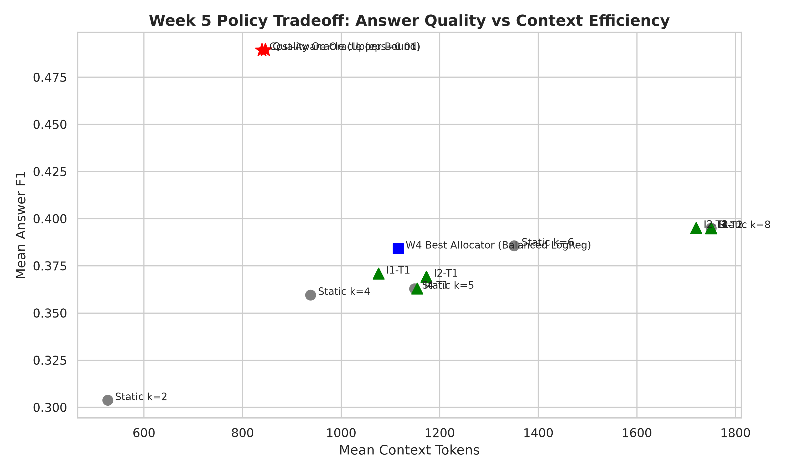

# Week 5 — Part-Wise Analysis

## Week objective

Use TRAIN response supervision and content-aware encoders to learn cost-aware SARA budget allocation.

# Part TRAIN-SURFACE — Train response surface and supervision

**Status: COMPLETED**

## 1. Research question

Can allocation labels be generated from TRAIN responses rather than fitting only DEV?

## 2. Experimental design

| component   | value                                                                              |
|:------------|:-----------------------------------------------------------------------------------|
| dataset     | Local QASPER DEV 231 queries / 86 papers; train/internal validation where recorded |
| reader      | Historical fine-tuned SARA / Mistral-7B                                            |
| retriever   | BM25 candidate pool; MiniLM semantic features/routing where specified              |
| metric      | Answer token F1; context-token accounting is artifact-specific                     |
| Role        | Protocol/context only; outcomes are accepted only from the artifacts below         |

## 3. What was implemented / executed

Completed machine-readable output is present for the named conditions; coverage is limited to the recorded rows and checks below.

## 4. Result artifacts used

- [results/week5/tables/train_static_performance.csv](../../week5/tables/train_static_performance.csv)
- [results/week5/preflight/split_audit.json](../../week5/preflight/split_audit.json)
- [results/week5/tables/dev_vs_train_target_distribution.csv](../../week5/tables/dev_vs_train_target_distribution.csv)

## 5. Main numerical results

### train static performance

|        k |   mean_token_f1 |   std_token_f1 |   mean_context_tokens |   std_context_tokens |
|---------:|----------------:|---------------:|----------------------:|---------------------:|
| 2.000000 |        0.326400 |       0.395800 |            535.200000 |            95.500000 |
| 4.000000 |        0.378400 |       0.406600 |            956.400000 |           138.400000 |
| 5.000000 |        0.396500 |       0.407800 |           1166.200000 |           159.700000 |
| 6.000000 |        0.406000 |       0.410500 |           1373.700000 |           179.800000 |
| 8.000000 |        0.425400 |       0.413400 |           1787.400000 |           224.600000 |

Source: [results/week5/tables/train_static_performance.csv](../../week5/tables/train_static_performance.csv).

### dev vs train target distribution

|        k |   train_count |   train_pct |   dev_count |   dev_pct |   shift_delta_pct |
|---------:|--------------:|------------:|------------:|----------:|------------------:|
| 2.000000 |   1234.000000 |   59.100000 |  132.000000 | 57.140000 |          1.960000 |
| 4.000000 |    354.000000 |   16.950000 |   40.000000 | 17.320000 |         -0.360000 |
| 5.000000 |    163.000000 |    7.810000 |   17.000000 |  7.360000 |          0.450000 |
| 6.000000 |    134.000000 |    6.420000 |   19.000000 |  8.230000 |         -1.810000 |
| 8.000000 |    203.000000 |    9.720000 |   23.000000 |  9.960000 |         -0.230000 |

Source: [results/week5/tables/dev_vs_train_target_distribution.csv](../../week5/tables/dev_vs_train_target_distribution.csv).

## 6. Figures

No saved figure is used for this part; no visualization is fabricated.

## 7. Statistical analysis

No formal inferential test was found for this comparison.

## 8. Interpretation

### Supported

TRAIN fixed-k and supervision artifacts exist separately from DEV; the exact cohort/target distributions are retained in the tables.

### Not established

Point-estimate rankings do not establish statistical superiority. Implementation, qualification and retrospective oracle ceilings are not deployed or held-out quality results. Missing model/split/seed details are not established from available primary artifacts.

### Important caveats

Stored split audit is a historical metadata record, not proof of fresh holdout status after later exposure.

## 9. Part conclusion

- TRAIN fixed-k and supervision artifacts exist separately from DEV; the exact cohort/target distributions are retained in the tables.
- No additional method-selection decision is inferred beyond the recorded protocol/freeze artifacts.

# Part A — Content-aware information / target ablation

**Status: COMPLETED**

## 1. Research question

Do passage semantics improve allocation over query-only/handcrafted inputs?

## 2. Experimental design

| component   | value                                                                              |
|:------------|:-----------------------------------------------------------------------------------|
| dataset     | Local QASPER DEV 231 queries / 86 papers; train/internal validation where recorded |
| reader      | Historical fine-tuned SARA / Mistral-7B                                            |
| retriever   | BM25 candidate pool; MiniLM semantic features/routing where specified              |
| metric      | Answer token F1; context-token accounting is artifact-specific                     |
| encoder     | Frozen all-MiniLM-L6-v2; 2-layer Transformer allocator; seeds42/123/2026           |
| targets     | T1 direct action classification / T2 regret regression                             |
| Role        | Protocol/context only; outcomes are accepted only from the artifacts below         |

## 3. What was implemented / executed

Completed machine-readable output is present for the named conditions; coverage is limited to the recorded rows and checks below.

## 4. Result artifacts used

- [results/week5/content_allocator/tables/main_results.csv](../../week5/content_allocator/tables/main_results.csv)
- [results/week5/content_allocator/bootstrap/paper_clustered_bootstrap_results.csv](../../week5/content_allocator/bootstrap/paper_clustered_bootstrap_results.csv)

## 5. Main numerical results

### main results

| model_name                          | condition                     | target          |   mean_answer_f1 |   mean_selected_k |   mean_context_tokens |   token_reduction_pct_vs_k8 |   mean_oracle_regret |   recovered_oracle_headroom |   zero_regret_pct |
|:------------------------------------|:------------------------------|:----------------|-----------------:|------------------:|----------------------:|----------------------------:|---------------------:|----------------------------:|------------------:|
| Static k=2                          | Static Baseline               | nan             |         0.303800 |          2.000000 |            526.500000 |                   69.920000 |             0.185700 |                   -0.964700 |         57.140000 |
| Static k=4                          | Static Baseline               | nan             |         0.359600 |          4.000000 |            938.100000 |                   46.410000 |             0.129900 |                   -0.374600 |         64.940000 |
| Static k=5                          | Static Baseline               | nan             |         0.362900 |          5.000000 |           1149.000000 |                   34.360000 |             0.126600 |                   -0.340100 |         65.370000 |
| Static k=6                          | Static Baseline               | nan             |         0.385700 |          6.000000 |           1351.100000 |                   22.820000 |             0.103800 |                   -0.098400 |         67.100000 |
| Static k=8                          | Static Baseline               | nan             |         0.395000 |          8.000000 |           1750.500000 |                    0.000000 |             0.094500 |                   -0.000100 |         71.000000 |
| W4 Best Allocator (Balanced LogReg) | Handcrafted Features Only     | Classification  |         0.384200 |          4.820000 |           1115.900000 |                   36.250000 |             0.105300 |                   -0.114300 |         52.380000 |
| Quality Oracle (Upper Bound)        | Theoretical Upper Bound       | Oracle max F1   |         0.489500 |          3.530000 |            846.100000 |                   51.670000 |             0.000000 |                    1.000000 |        100.000000 |
| Cost-Aware Oracle (eps=0.01)        | Theoretical Cost-Aware Target | Oracle eps=0.01 |         0.489400 |          3.490000 |            839.400000 |                   52.050000 |             0.000100 |                    0.998800 |        100.000000 |
| I1-T1                               | I1                            | T1              |         0.370900 |          4.690000 |           1076.100000 |                   38.530000 |             0.118600 |                   -0.255000 |        nan        |
| I1-T2                               | I1                            | T2              |         0.395000 |          8.000000 |           1750.500000 |                    0.000000 |             0.094500 |                   -0.000100 |        nan        |
| I2-T1                               | I2                            | T1              |         0.369300 |          5.130000 |           1173.000000 |                   32.990000 |             0.120200 |                   -0.272400 |        nan        |
| I2-T2                               | I2                            | T2              |         0.395200 |          7.850000 |           1720.400000 |                    1.720000 |             0.094300 |                    0.002400 |        nan        |
| I3-T1                               | I3                            | T1              |         0.395000 |          8.000000 |           1750.500000 |                    0.000000 |             0.094500 |                   -0.000100 |        nan        |
| I3-T2                               | I3                            | T2              |         0.395000 |          8.000000 |           1750.500000 |                    0.000000 |             0.094500 |                   -0.000100 |        nan        |
| I4-T1                               | I4                            | T1              |         0.363000 |          5.050000 |           1154.100000 |                   34.070000 |             0.126500 |                   -0.338400 |        nan        |
| I4-T2                               | I4                            | T2              |         0.395000 |          8.000000 |           1750.500000 |                    0.000000 |             0.094500 |                   -0.000100 |        nan        |

Source: [results/week5/content_allocator/tables/main_results.csv](../../week5/content_allocator/tables/main_results.csv).

### Stored bootstrap contrasts; interpret named metric/difference exactly

| Model   | Comparison    |   observed_delta_f1 |   ci_lower_95 |   ci_upper_95 |   p_value |   n_bootstrap |
|:--------|:--------------|--------------------:|--------------:|--------------:|----------:|--------------:|
| I1-T1   | vs Static k=8 |           -0.017500 |     -0.049100 |      0.013500 |  0.131000 |          2000 |
| I1-T2   | vs Static k=8 |            0.000000 |      0.000000 |      0.000000 |  1.000000 |          2000 |
| I2-T1   | vs Static k=8 |           -0.021900 |     -0.055000 |      0.010700 |  0.085000 |          2000 |
| I2-T2   | vs Static k=8 |            0.000700 |     -0.018700 |      0.019000 |  0.477000 |          2000 |
| I3-T1   | vs Static k=8 |            0.000000 |      0.000000 |      0.000000 |  1.000000 |          2000 |
| I3-T2   | vs Static k=8 |            0.000000 |      0.000000 |      0.000000 |  1.000000 |          2000 |
| I4-T1   | vs Static k=8 |           -0.032500 |     -0.063800 |     -0.002500 |  0.021000 |          2000 |
| I4-T2   | vs Static k=8 |            0.000000 |      0.000000 |      0.000000 |  1.000000 |          2000 |

Source: [results/week5/content_allocator/bootstrap/paper_clustered_bootstrap_results.csv](../../week5/content_allocator/bootstrap/paper_clustered_bootstrap_results.csv).

## 6. Figures

No saved figure is used for this part; no visualization is fabricated.

## 7. Statistical analysis

No formal inferential test was found for this comparison.

## 8. Interpretation

### Supported

Most regret-model configurations return k8. I2-T2 reaches F1 0.3952 versus static0.3950 with only1.72% stored token reduction; this is not a strong adaptive breakthrough.

### Not established

Point-estimate rankings do not establish statistical superiority. Implementation, qualification and retrospective oracle ceilings are not deployed or held-out quality results. Missing model/split/seed details are not established from available primary artifacts.

### Important caveats

SOURCE CONFLICT: Week5 uses hard-coded k8 cost1750.5 versus Week2 raw1758.5; fixed-k costs differ by8 tokens. src/week5/evaluation.py and supervision.py encode inconsistent reference constants. Preserve both definitions, never pool the reduction percentages.

## 9. Part conclusion

- Most regret-model configurations return k8. I2-T2 reaches F1 0.3952 versus static0.3950 with only1.72% stored token reduction; this is not a strong adaptive breakthrough.
- No additional method-selection decision is inferred beyond the recorded protocol/freeze artifacts.

# Part B — Multilabel admissibility formulation

**Status: COMPLETED**

## 1. Research question

Can predicting an admissible action set avoid direct-label ambiguity and fallback collapse?

## 2. Experimental design

| component   | value                                                                              |
|:------------|:-----------------------------------------------------------------------------------|
| dataset     | Local QASPER DEV 231 queries / 86 papers; train/internal validation where recorded |
| reader      | Historical fine-tuned SARA / Mistral-7B                                            |
| retriever   | BM25 candidate pool; MiniLM semantic features/routing where specified              |
| metric      | Answer token F1; context-token accounting is artifact-specific                     |
| target      | T3 multilabel action admissibility; selected tau                                   |
| Role        | Protocol/context only; outcomes are accepted only from the artifacts below         |

## 3. What was implemented / executed

Completed machine-readable output is present for the named conditions; coverage is limited to the recorded rows and checks below.

## 4. Result artifacts used

- [results/week5/content_allocator/w5b/tables/w5b_main_results.csv](../../week5/content_allocator/w5b/tables/w5b_main_results.csv)
- [results/week5/content_allocator/w5b/tables/w5b_seed_results.csv](../../week5/content_allocator/w5b/tables/w5b_seed_results.csv)
- [results/week5/content_allocator/w5b/bootstrap/w5b_bootstrap_comparisons.csv](../../week5/content_allocator/w5b/bootstrap/w5b_bootstrap_comparisons.csv)

## 5. Main numerical results

### w5b main results

| model_family          | condition                             |   mean_answer_f1 |   std_answer_f1 |   mean_selected_k |   std_selected_k |   mean_context_tokens |   std_context_tokens |   token_reduction_pct |   mean_oracle_regret |   recovered_oracle_headroom |   fallback_rate_pct |
|:----------------------|:--------------------------------------|-----------------:|----------------:|------------------:|-----------------:|----------------------:|---------------------:|----------------------:|---------------------:|----------------------------:|--------------------:|
| Baseline              | Static k=2                            |         0.303800 |        0.000000 |          2.000000 |         0.000000 |            526.500000 |             0.000000 |             69.920000 |             0.185700 |                   -0.965100 |            0.000000 |
| Baseline              | Static k=4                            |         0.359600 |        0.000000 |          4.000000 |         0.000000 |            938.100000 |             0.000000 |             46.410000 |             0.129900 |                   -0.374600 |            0.000000 |
| Baseline              | Static k=5                            |         0.362900 |        0.000000 |          5.000000 |         0.000000 |           1149.000000 |             0.000000 |             34.360000 |             0.126600 |                   -0.339700 |            0.000000 |
| Baseline              | Static k=6                            |         0.385700 |        0.000000 |          6.000000 |         0.000000 |           1351.100000 |             0.000000 |             22.820000 |             0.103800 |                   -0.098400 |            0.000000 |
| Baseline              | Best Static SARA Baseline (k=8)       |         0.395000 |        0.000000 |          8.000000 |         0.000000 |           1750.500000 |             0.000000 |              0.000000 |             0.094500 |                    0.000000 |            0.000000 |
| Baseline              | W4 Balanced Logistic Regression       |         0.384200 |        0.000000 |          4.820000 |         0.000000 |           1115.900000 |             0.000000 |             36.250000 |             0.105300 |                   -0.114300 |            0.000000 |
| Baseline              | Cost-Aware Epsilon Oracle (eps=0.01)  |         0.489400 |        0.000000 |          3.490000 |         0.000000 |            839.400000 |             0.000000 |             52.050000 |             0.000100 |                    0.998900 |            0.000000 |
| Baseline              | Quality Oracle                        |         0.489500 |        0.000000 |          3.530000 |         0.000000 |           1021.500000 |             0.000000 |             41.650000 |             0.000000 |                    1.000000 |            0.000000 |
| W5-A (Historical)     | W5-A I1-T1 (Query Direct)             |         0.370900 |        0.000000 |          4.690000 |         0.000000 |           1076.100000 |             0.000000 |             38.500000 |             0.118600 |                   -0.255000 |            0.000000 |
| W5-A (Historical)     | W5-A I1-T2 (Query Regret)             |         0.395000 |        0.000000 |          8.000000 |         0.000000 |           1750.500000 |             0.000000 |              0.000000 |             0.094500 |                    0.000000 |          100.000000 |
| W5-A (Historical)     | W5-A I2-T1 (Query+W4 Direct)          |         0.369300 |        0.000000 |          5.130000 |         0.000000 |           1173.000000 |             0.000000 |             33.000000 |             0.120200 |                   -0.272000 |            0.000000 |
| W5-A (Historical)     | W5-A I2-T2 (Query+W4 Regret)          |         0.395200 |        0.000000 |          7.850000 |         0.000000 |           1720.400000 |             0.000000 |              1.700000 |             0.094300 |                    0.002100 |            0.000000 |
| W5-A (Historical)     | W5-A I3-T1 (Query+Passages Direct)    |         0.395000 |        0.000000 |          8.000000 |         0.000000 |           1750.500000 |             0.000000 |              0.000000 |             0.094500 |                    0.000000 |            0.000000 |
| W5-A (Historical)     | W5-A I3-T2 (Query+Passages Regret)    |         0.395000 |        0.000000 |          8.000000 |         0.000000 |           1750.500000 |             0.000000 |              0.000000 |             0.094500 |                    0.000000 |          100.000000 |
| W5-A (Historical)     | W5-A I4-T1 (Query+Passages+W4 Direct) |         0.363000 |        0.000000 |          5.050000 |         0.000000 |           1154.100000 |             0.000000 |             34.100000 |             0.126500 |                   -0.338600 |            0.000000 |
| W5-A (Historical)     | W5-A I4-T2 (Query+Passages+W4 Regret) |         0.395000 |        0.000000 |          8.000000 |         0.000000 |           1750.500000 |             0.000000 |              0.000000 |             0.094500 |                    0.000000 |          100.000000 |
| W5-B (T3 Multi-Label) | I1-T3                                 |         0.372300 |        0.013300 |          4.650000 |         0.610000 |           1072.700000 |           122.400000 |             38.720000 |             0.117200 |                   -0.240400 |           14.570000 |
| W5-B (T3 Multi-Label) | I2-T3                                 |         0.350600 |        0.010800 |          4.820000 |         0.550000 |           1097.700000 |           116.900000 |             37.290000 |             0.138900 |                   -0.470000 |           20.490000 |
| W5-B (T3 Multi-Label) | I3-T3                                 |         0.381000 |        0.009000 |          5.570000 |         0.850000 |           1258.200000 |           174.900000 |             28.120000 |             0.108500 |                   -0.147500 |           19.340000 |
| W5-B (T3 Multi-Label) | I4-T3                                 |         0.348900 |        0.014900 |          3.970000 |         0.530000 |            924.500000 |           106.000000 |             47.180000 |             0.140700 |                   -0.488500 |            0.580000 |

Source: [results/week5/content_allocator/w5b/tables/w5b_main_results.csv](../../week5/content_allocator/w5b/tables/w5b_main_results.csv).

### w5b seed results

| condition   |   seed |   selected_tau |   best_epoch |   val_macro_auprc |   dev_answer_f1 |   dev_mean_k |   dev_context_tokens |   token_reduction_pct |   mean_oracle_regret |   zero_regret_pct |   fallback_rate |   recovered_oracle_headroom |   oracle_accuracy |   dev_macro_auprc |   dev_macro_auroc |   dev_brier |   dev_logit_variance |    pct_k2 |    pct_k4 |    pct_k5 |    pct_k6 |    pct_k8 |
|:------------|-------:|---------------:|-------------:|------------------:|----------------:|-------------:|---------------------:|----------------------:|---------------------:|------------------:|----------------:|----------------------------:|------------------:|------------------:|------------------:|------------:|---------------------:|----------:|----------:|----------:|----------:|----------:|
| I1          |     42 |       0.700000 |            4 |          0.805300 |        0.377100 |     4.460000 |          1033.000000 |             40.990000 |             0.112400 |         70.130000 |       17.750000 |                   -0.189700 |          0.424200 |          0.782100 |          0.640000 |    0.220100 |             0.663441 | 42.420000 | 15.580000 |  6.060000 |  9.520000 | 26.410000 |
| I1          |    123 |       0.700000 |            3 |          0.807900 |        0.357300 |     4.160000 |           975.000000 |             44.300000 |             0.132200 |         65.370000 |        7.790000 |                   -0.399100 |          0.381000 |          0.774400 |          0.640900 |    0.224200 |             0.500134 | 37.660000 | 19.480000 | 21.650000 |  7.360000 | 13.850000 |
| I1          |   2026 |       0.700000 |            2 |          0.807500 |        0.382500 |     5.340000 |          1210.000000 |             30.880000 |             0.107000 |         69.700000 |       18.180000 |                   -0.132500 |          0.285700 |          0.763300 |          0.632000 |    0.217800 |             0.412453 | 20.350000 | 23.380000 |  9.520000 | 10.820000 | 35.930000 |
| I2          |     42 |       0.700000 |            4 |          0.807900 |        0.356800 |     5.150000 |          1166.000000 |             33.390000 |             0.132700 |         63.640000 |       20.350000 |                   -0.403900 |          0.311700 |          0.771600 |          0.625800 |    0.223200 |             0.683971 | 34.200000 |  7.360000 | 12.120000 |  6.930000 | 39.390000 |
| I2          |    123 |       0.700000 |            5 |          0.809300 |        0.356800 |     5.130000 |          1164.400000 |             33.480000 |             0.132700 |         64.070000 |       27.270000 |                   -0.404200 |          0.337700 |          0.767800 |          0.631900 |    0.221400 |             0.679041 | 32.470000 | 13.850000 |  5.190000 | 10.390000 | 38.100000 |
| I2          |   2026 |       0.700000 |            6 |          0.812500 |        0.338100 |     4.180000 |           962.700000 |             45.000000 |             0.151400 |         59.310000 |       13.850000 |                   -0.602000 |          0.368000 |          0.753700 |          0.610800 |    0.236300 |             0.954402 | 48.050000 | 19.050000 |  3.460000 |  3.460000 | 25.970000 |
| I3          |     42 |       0.700000 |            5 |          0.750300 |        0.381500 |     5.770000 |          1301.000000 |             25.680000 |             0.108000 |         67.970000 |       32.030000 |                   -0.142300 |          0.099600 |          0.680900 |          0.561500 |    0.223900 |             0.050632 |  0.000000 | 39.390000 |  8.230000 | 20.350000 | 32.030000 |
| I3          |    123 |       0.700000 |            7 |          0.748200 |        0.371800 |     4.630000 |          1065.900000 |             39.110000 |             0.117700 |         67.100000 |       11.260000 |                   -0.245100 |          0.138500 |          0.708700 |          0.579100 |    0.224800 |             0.090528 |  0.000000 | 80.520000 |  3.460000 |  2.160000 | 13.850000 |
| I3          |   2026 |       0.700000 |            4 |          0.720700 |        0.389800 |     6.300000 |          1407.800000 |             19.580000 |             0.099700 |         69.700000 |       14.720000 |                   -0.055100 |          0.134200 |          0.713100 |          0.584600 |    0.223200 |             0.037887 |  0.000000 | 42.420000 |  0.000000 |  0.000000 | 57.580000 |
| I4          |     42 |       0.700000 |            3 |          0.734600 |        0.342000 |     3.790000 |           884.700000 |             49.460000 |             0.147600 |         63.200000 |        0.000000 |                   -0.561400 |          0.264100 |          0.690600 |          0.533500 |    0.231400 |             0.012180 | 20.350000 | 72.730000 |  0.430000 |  3.460000 |  3.030000 |
| I4          |    123 |       0.700000 |            6 |          0.724000 |        0.366000 |     4.570000 |          1044.600000 |             40.320000 |             0.123500 |         65.800000 |        1.730000 |                   -0.306800 |          0.181800 |          0.688600 |          0.532700 |    0.229700 |             0.027014 |  4.330000 | 55.840000 | 29.440000 |  2.600000 |  7.790000 |
| I4          |   2026 |       0.700000 |            2 |          0.736200 |        0.338600 |     3.560000 |           844.200000 |             51.770000 |             0.151000 |         63.200000 |        0.000000 |                   -0.597300 |          0.259700 |          0.689400 |          0.533000 |    0.231500 |             0.005630 | 23.380000 | 74.030000 |  2.600000 |  0.000000 |  0.000000 |

Source: [results/week5/content_allocator/w5b/tables/w5b_seed_results.csv](../../week5/content_allocator/w5b/tables/w5b_seed_results.csv).

### Stored bootstrap contrasts; interpret named metric/difference exactly

| aggregation_level                 | comparison                                           |   observed_delta_f1 |   ci_lower_95_f1 |   ci_upper_95_f1 |   p_value_f1 |   observed_delta_tokens |   ci_lower_95_tokens |   ci_upper_95_tokens | significant_f1   |
|:----------------------------------|:-----------------------------------------------------|--------------------:|-----------------:|-----------------:|-------------:|------------------------:|---------------------:|---------------------:|:-----------------|
| Single Seed (Seed 42)             | I3-T3 (Seed 42) vs W4                                |           -0.002600 |        -0.034600 |         0.028200 |     0.433500 |              191.800000 |           115.500000 |           264.500000 | False            |
| Single Seed (Seed 42)             | I3-T3 (Seed 42) vs Static k=8                        |           -0.013400 |        -0.037500 |         0.008900 |     0.121000 |             -450.800000 |          -522.500000 |          -380.900000 | False            |
| Single Seed (Seed 42)             | I4-T3 (Seed 42) vs I3-T3 (Seed 42)                   |           -0.039600 |        -0.073600 |        -0.008900 |     0.006000 |             -405.500000 |          -482.200000 |          -327.900000 | True             |
| Single Seed (Seed 123)            | I3-T3 (Seed 123) vs W4                               |           -0.012300 |        -0.043300 |         0.017300 |     0.212500 |              -41.100000 |           -93.300000 |            18.400000 | False            |
| Single Seed (Seed 123)            | I3-T3 (Seed 123) vs Static k=8                       |           -0.023200 |        -0.051300 |         0.004600 |     0.040500 |             -683.600000 |          -726.300000 |          -633.800000 | False            |
| Single Seed (Seed 123)            | I4-T3 (Seed 123) vs I3-T3 (Seed 123)                 |           -0.005800 |        -0.030700 |         0.017500 |     0.307500 |              -10.500000 |           -64.900000 |            42.400000 | False            |
| Single Seed (Seed 2026)           | I3-T3 (Seed 2026) vs W4                              |            0.005600 |        -0.028600 |         0.037200 |     0.383000 |              297.900000 |           217.000000 |           377.000000 | False            |
| Single Seed (Seed 2026)           | I3-T3 (Seed 2026) vs Static k=8                      |           -0.005200 |        -0.027400 |         0.013900 |     0.290500 |             -344.700000 |          -420.000000 |          -270.800000 | False            |
| Single Seed (Seed 2026)           | I4-T3 (Seed 2026) vs I3-T3 (Seed 2026)               |           -0.051200 |        -0.082500 |        -0.024400 |     0.000000 |             -558.500000 |          -633.600000 |          -482.500000 | True             |
| Across-Seed Mean Policy (3 Seeds) | I3-T3 (Across-Seed Mean) vs W4                       |           -0.003100 |        -0.033600 |         0.025900 |     0.417000 |              149.500000 |            93.600000 |           207.400000 | False            |
| Across-Seed Mean Policy (3 Seeds) | I3-T3 (Across-Seed Mean) vs Static k=8               |           -0.013900 |        -0.035400 |         0.006700 |     0.081500 |             -493.000000 |          -541.100000 |          -445.200000 | False            |
| Across-Seed Mean Policy (3 Seeds) | I4-T3 (Across-Seed Mean) vs I3-T3 (Across-Seed Mean) |           -0.032200 |        -0.057700 |        -0.010700 |     0.002000 |             -324.800000 |          -378.300000 |          -273.100000 | True             |

Source: [results/week5/content_allocator/w5b/bootstrap/w5b_bootstrap_comparisons.csv](../../week5/content_allocator/w5b/bootstrap/w5b_bootstrap_comparisons.csv).

## 6. Figures

No saved figure is used for this part; no visualization is fabricated.

## 7. Statistical analysis

No formal inferential test was found for this comparison.

## 8. Interpretation

### Supported

Completed seed-level and aggregate T3 outputs exist. The table reports fallback rates alongside F1; oracle quality/cost entries are retrospective references.

### Not established

Point-estimate rankings do not establish statistical superiority. Implementation, qualification and retrospective oracle ceilings are not deployed or held-out quality results. Missing model/split/seed details are not established from available primary artifacts.

### Important caveats

SOURCE CONFLICT: Quality Oracle token cost is846.1 in A versus1021.5 in B/C despite the same printed oracle F1/k. Cost identity is not established as equivalent; do not infer compression improvements from the mismatch.

## 9. Part conclusion

- Completed seed-level and aggregate T3 outputs exist. The table reports fallback rates alongside F1; oracle quality/cost entries are retrospective references.
- No additional method-selection decision is inferred beyond the recorded protocol/freeze artifacts.

# Part C — Encoder adaptation

**Status: COMPLETED**

## 1. Research question

Does unfreezing MiniLM layers improve content-aware allocation?

## 2. Experimental design

| component   | value                                                                              |
|:------------|:-----------------------------------------------------------------------------------|
| dataset     | Local QASPER DEV 231 queries / 86 papers; train/internal validation where recorded |
| reader      | Historical fine-tuned SARA / Mistral-7B                                            |
| retriever   | BM25 candidate pool; MiniLM semantic features/routing where specified              |
| metric      | Answer token F1; context-token accounting is artifact-specific                     |
| encoders    | C0 frozen; C1 last layer trainable; C2 last2 layers trainable                      |
| Role        | Protocol/context only; outcomes are accepted only from the artifacts below         |

## 3. What was implemented / executed

Completed machine-readable output is present for the named conditions; coverage is limited to the recorded rows and checks below.

## 4. Result artifacts used

- [results/week5/content_allocator/w5c_encoder_adaptation/tables/w5c_main_results.csv](../../week5/content_allocator/w5c_encoder_adaptation/tables/w5c_main_results.csv)
- [results/week5/content_allocator/w5c_encoder_adaptation/bootstrap/w5c_bootstrap_comparisons.csv](../../week5/content_allocator/w5c_encoder_adaptation/bootstrap/w5c_bootstrap_comparisons.csv)

## 5. Main numerical results

### w5c main results

| model_name                      |   mean_answer_f1 |   std_answer_f1 |   mean_selected_k |   mean_context_tokens |   token_reduction_pct |   mean_oracle_regret |   fallback_rate_pct |   recovered_oracle_headroom |
|:--------------------------------|-----------------:|----------------:|------------------:|----------------------:|----------------------:|---------------------:|--------------------:|----------------------------:|
| Quality Oracle                  |         0.489500 |        0.000000 |          3.530000 |           1021.500000 |             41.650000 |             0.000000 |            0.000000 |                    1.000000 |
| Cost-Aware Epsilon Oracle       |         0.489400 |        0.000000 |          3.490000 |            839.400000 |             52.050000 |             0.000100 |            0.000000 |                    0.998900 |
| Best Static SARA (k=8)          |         0.395000 |        0.000000 |          8.000000 |           1750.500000 |              0.000000 |             0.094500 |            0.000000 |                    0.000000 |
| Static k=6                      |         0.385700 |        0.000000 |          6.000000 |           1351.100000 |             22.820000 |             0.103800 |            0.000000 |                   -0.098400 |
| W4 Balanced Logistic Regression |         0.384200 |        0.000000 |          4.820000 |           1107.900000 |             36.710000 |             0.105300 |            0.000000 |                   -0.114600 |
| C0 Frozen MiniLM                |         0.381033 |        0.009009 |          5.566667 |           1258.233333 |             28.123333 |             0.108500 |           19.336667 |                   -0.147500 |
| C1 Last-1 Layer Trainable       |         0.362000 |        0.011900 |          5.090000 |           1158.900000 |             33.800000 |             0.127500 |           19.190000 |                   -0.349100 |
| C2 Last-2 Layers Trainable      |         0.374300 |        0.012700 |          5.970000 |           1337.600000 |             23.590000 |             0.115200 |           45.020000 |                   -0.219200 |

Source: [results/week5/content_allocator/w5c_encoder_adaptation/tables/w5c_main_results.csv](../../week5/content_allocator/w5c_encoder_adaptation/tables/w5c_main_results.csv).

### Stored bootstrap contrasts; interpret named metric/difference exactly

| comparison                                            |   observed_delta_f1 |   ci_lower_95_f1 |   ci_upper_95_f1 |   p_value_f1 | significant_f1   |   observed_delta_tokens |   ci_lower_95_tokens |   ci_upper_95_tokens | aggregation                |
|:------------------------------------------------------|--------------------:|-----------------:|-----------------:|-------------:|:-----------------|------------------------:|---------------------:|---------------------:|:---------------------------|
| C1 Last-1 Layer vs C0 Frozen                          |           -0.019100 |        -0.037700 |        -0.003100 |     0.008500 | True             |              -98.600000 |          -147.900000 |           -47.900000 | Across-Seed Mean per Query |
| C2 Last-2 Layers vs C0 Frozen                         |           -0.006800 |        -0.031200 |         0.017500 |     0.289500 | False            |               80.100000 |            20.200000 |           137.700000 | Across-Seed Mean per Query |
| C2 Last-2 Layers vs C1 Last-1 Layer                   |            0.012300 |        -0.005500 |         0.030600 |     0.090500 | False            |              178.700000 |           130.600000 |           228.800000 | Across-Seed Mean per Query |
| Best Adapted (C2 Last-2 Layers) vs W4 Balanced LogReg |           -0.009900 |        -0.045400 |         0.026300 |     0.287000 | False            |              229.600000 |           152.600000 |           300.200000 | Across-Seed Mean per Query |
| Best Adapted (C2 Last-2 Layers) vs Static k=8         |           -0.020700 |        -0.043900 |         0.000500 |     0.029500 | False            |             -412.900000 |          -487.100000 |          -342.600000 | Across-Seed Mean per Query |

Source: [results/week5/content_allocator/w5c_encoder_adaptation/bootstrap/w5c_bootstrap_comparisons.csv](../../week5/content_allocator/w5c_encoder_adaptation/bootstrap/w5c_bootstrap_comparisons.csv).

## 6. Figures

No saved figure is used for this part; no visualization is fabricated.

## 7. Statistical analysis

No formal inferential test was found for this comparison.

## 8. Interpretation

### Supported

C0 mean F1 0.381033 exceeds last1-layer0.3620 and last2-layer0.3743 point estimates. Encoder adaptation does not show a robust improvement over frozen features or static k8.

### Not established

Point-estimate rankings do not establish statistical superiority. Implementation, qualification and retrospective oracle ceilings are not deployed or held-out quality results. Missing model/split/seed details are not established from available primary artifacts.

### Important caveats

Seed SD is not a paper-cluster CI. Internal-VAL threshold selection and DEV evaluation must remain distinct.

## 9. Part conclusion

- C0 mean F1 0.381033 exceeds last1-layer0.3620 and last2-layer0.3743 point estimates. Encoder adaptation does not show a robust improvement over frozen features or static k8.
- No additional method-selection decision is inferred beyond the recorded protocol/freeze artifacts.

# Week 5 — Integrated Analysis

## What changed during this week?

Use TRAIN response supervision and content-aware encoders to learn cost-aware SARA budget allocation. The parts above retain the distinction between executed outputs, implementation-only work, exploratory diagnostics and retrospective choices.

## Main supported findings

| Finding                                                                                                                                                                       | Evidence                                                                                                        | Strength                                     |
|:------------------------------------------------------------------------------------------------------------------------------------------------------------------------------|:----------------------------------------------------------------------------------------------------------------|:---------------------------------------------|
| TRAIN fixed-k and supervision artifacts exist separately from DEV; the exact cohort/target distributions are retained in the tables.                                          | Part TRAIN-SURFACE; results/week5/tables/train_static_performance.csv; results/week5/preflight/split_audit.json | descriptive; see stated inferential evidence |
| Most regret-model configurations return k8. I2-T2 reaches F1 0.3952 versus static0.3950 with only1.72% stored token reduction; this is not a strong adaptive breakthrough.    | Part A; results/week5/content_allocator/tables/main_results.csv                                                 | descriptive; see stated inferential evidence |
| Completed seed-level and aggregate T3 outputs exist. The table reports fallback rates alongside F1; oracle quality/cost entries are retrospective references.                 | Part B; results/week5/content_allocator/w5b/tables/w5b_main_results.csv                                         | descriptive; see stated inferential evidence |
| C0 mean F1 0.381033 exceeds last1-layer0.3620 and last2-layer0.3743 point estimates. Encoder adaptation does not show a robust improvement over frozen features or static k8. | Part C; results/week5/content_allocator/w5c_encoder_adaptation/tables/w5c_main_results.csv                      | descriptive; see stated inferential evidence |

## Negative / null findings

Fallback-to-k8, weak content gains and worse adapted-encoder point estimates remain visible.

## What remained unresolved?

Historical DEV reuse, seed variability, target definitions and inconsistent token-accounting constants.

## What logically motivated the next week?

Week6 asks WHICH passages should be kept at a fixed k, rather than predicting k alone.

## Offline reproducibility / source conflicts

- Source-level token reference conflict documented: 1750.5 vs1758.5.
- Oracle cost conflict across A/B/C retained instead of silently choosing a number.

Executed notebook coverage (zero-based cell indices):

| artifact                                            |   executed_output_cells | cell_indices                                               |
|:----------------------------------------------------|------------------------:|:-----------------------------------------------------------|
| notebooks/week5/week5_content_aware_allocator.ipynb |                      17 | 2,4,6,8,10,12,14,16,18,20,22,24,26,28,30,32,34             |
| notebooks/week5/week5c_encoder_adaptation.ipynb     |                      21 | 2,4,6,8,10,12,14,16,18,20,22,24,26,28,30,32,34,36,38,40,42 |

## Additional primary visualizations

X-axis is recorded context-token cost; y-axis answer F1. Learned-policy, static and oracle references share the plot; oracle points are retrospective and token-reference conflicts prevent cross-week cost claims.

Source: [results/week5/content_allocator/figures/pareto_quality_vs_tokens.png](../../week5/content_allocator/figures/pareto_quality_vs_tokens.png).

# Primary Sources Used

- [configs/week5/content_allocator.yaml](../../../configs/week5/content_allocator.yaml)
- [configs/week5/train_response_surface.yaml](../../../configs/week5/train_response_surface.yaml)
- [configs/week5/w5c_encoder_adaptation.yaml](../../../configs/week5/w5c_encoder_adaptation.yaml)
- [notebooks/week5/week5_content_aware_allocator.ipynb](../../../notebooks/week5/week5_content_aware_allocator.ipynb)
- [notebooks/week5/week5c_encoder_adaptation.ipynb](../../../notebooks/week5/week5c_encoder_adaptation.ipynb)
- [results/week5/content_allocator/bootstrap/paper_clustered_bootstrap_results.csv](../../week5/content_allocator/bootstrap/paper_clustered_bootstrap_results.csv)
- [results/week5/content_allocator/tables/main_results.csv](../../week5/content_allocator/tables/main_results.csv)
- [results/week5/content_allocator/w5b/bootstrap/w5b_bootstrap_comparisons.csv](../../week5/content_allocator/w5b/bootstrap/w5b_bootstrap_comparisons.csv)
- [results/week5/content_allocator/w5b/tables/w5b_main_results.csv](../../week5/content_allocator/w5b/tables/w5b_main_results.csv)
- [results/week5/content_allocator/w5b/tables/w5b_seed_results.csv](../../week5/content_allocator/w5b/tables/w5b_seed_results.csv)
- [results/week5/content_allocator/w5c_encoder_adaptation/bootstrap/w5c_bootstrap_comparisons.csv](../../week5/content_allocator/w5c_encoder_adaptation/bootstrap/w5c_bootstrap_comparisons.csv)
- [results/week5/content_allocator/w5c_encoder_adaptation/tables/w5c_main_results.csv](../../week5/content_allocator/w5c_encoder_adaptation/tables/w5c_main_results.csv)
- [results/week5/preflight/split_audit.json](../../week5/preflight/split_audit.json)
- [results/week5/tables/dev_vs_train_target_distribution.csv](../../week5/tables/dev_vs_train_target_distribution.csv)
- [results/week5/tables/train_static_performance.csv](../../week5/tables/train_static_performance.csv)
- [src/week5/evaluation.py](../../../src/week5/evaluation.py)
- [src/week5/supervision.py](../../../src/week5/supervision.py)

- [results/week5/content_allocator/figures/pareto_quality_vs_tokens.png](../../week5/content_allocator/figures/pareto_quality_vs_tokens.png)

# Existing Markdown Used as Evidence

NONE
