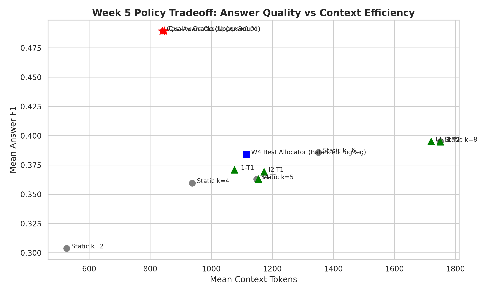

# Week 5 — Summary Analysis

## Objective

Use TRAIN response supervision and content-aware encoders to learn cost-aware SARA budget allocation.

## Experiments performed

| Part          | Question                                                                                    | Status    | Main_result                                                                                                                                                                   |
|:--------------|:--------------------------------------------------------------------------------------------|:----------|:------------------------------------------------------------------------------------------------------------------------------------------------------------------------------|
| TRAIN-SURFACE | Can allocation labels be generated from TRAIN responses rather than fitting only DEV?       | COMPLETED | TRAIN fixed-k and supervision artifacts exist separately from DEV; the exact cohort/target distributions are retained in the tables.                                          |
| A             | Do passage semantics improve allocation over query-only/handcrafted inputs?                 | COMPLETED | Most regret-model configurations return k8. I2-T2 reaches F1 0.3952 versus static0.3950 with only1.72% stored token reduction; this is not a strong adaptive breakthrough.    |
| B             | Can predicting an admissible action set avoid direct-label ambiguity and fallback collapse? | COMPLETED | Completed seed-level and aggregate T3 outputs exist. The table reports fallback rates alongside F1; oracle quality/cost entries are retrospective references.                 |
| C             | Does unfreezing MiniLM layers improve content-aware allocation?                             | COMPLETED | C0 mean F1 0.381033 exceeds last1-layer0.3620 and last2-layer0.3743 point estimates. Encoder adaptation does not show a robust improvement over frozen features or static k8. |

## Key results

### train static performance

|        k |   mean_token_f1 |   std_token_f1 |   mean_context_tokens |   std_context_tokens |
|---------:|----------------:|---------------:|----------------------:|---------------------:|
| 2.000000 |        0.326400 |       0.395800 |            535.200000 |            95.500000 |
| 4.000000 |        0.378400 |       0.406600 |            956.400000 |           138.400000 |
| 5.000000 |        0.396500 |       0.407800 |           1166.200000 |           159.700000 |
| 6.000000 |        0.406000 |       0.410500 |           1373.700000 |           179.800000 |
| 8.000000 |        0.425400 |       0.413400 |           1787.400000 |           224.600000 |

Source: [results/week5/tables/train_static_performance.csv](../../week5/tables/train_static_performance.csv).

### dev vs train target distribution

|        k |   train_count |   train_pct |   dev_count |   dev_pct |   shift_delta_pct |
|---------:|--------------:|------------:|------------:|----------:|------------------:|
| 2.000000 |   1234.000000 |   59.100000 |  132.000000 | 57.140000 |          1.960000 |
| 4.000000 |    354.000000 |   16.950000 |   40.000000 | 17.320000 |         -0.360000 |
| 5.000000 |    163.000000 |    7.810000 |   17.000000 |  7.360000 |          0.450000 |
| 6.000000 |    134.000000 |    6.420000 |   19.000000 |  8.230000 |         -1.810000 |
| 8.000000 |    203.000000 |    9.720000 |   23.000000 |  9.960000 |         -0.230000 |

Source: [results/week5/tables/dev_vs_train_target_distribution.csv](../../week5/tables/dev_vs_train_target_distribution.csv).

### main results

| model_name                          | condition                     | target          |   mean_answer_f1 |   mean_selected_k |   mean_context_tokens |   token_reduction_pct_vs_k8 |   mean_oracle_regret |   recovered_oracle_headroom |   zero_regret_pct |
|:------------------------------------|:------------------------------|:----------------|-----------------:|------------------:|----------------------:|----------------------------:|---------------------:|----------------------------:|------------------:|
| Static k=2                          | Static Baseline               | nan             |         0.303800 |          2.000000 |            526.500000 |                   69.920000 |             0.185700 |                   -0.964700 |         57.140000 |
| Static k=4                          | Static Baseline               | nan             |         0.359600 |          4.000000 |            938.100000 |                   46.410000 |             0.129900 |                   -0.374600 |         64.940000 |
| Static k=5                          | Static Baseline               | nan             |         0.362900 |          5.000000 |           1149.000000 |                   34.360000 |             0.126600 |                   -0.340100 |         65.370000 |
| Static k=6                          | Static Baseline               | nan             |         0.385700 |          6.000000 |           1351.100000 |                   22.820000 |             0.103800 |                   -0.098400 |         67.100000 |
| Static k=8                          | Static Baseline               | nan             |         0.395000 |          8.000000 |           1750.500000 |                    0.000000 |             0.094500 |                   -0.000100 |         71.000000 |
| W4 Best Allocator (Balanced LogReg) | Handcrafted Features Only     | Classification  |         0.384200 |          4.820000 |           1115.900000 |                   36.250000 |             0.105300 |                   -0.114300 |         52.380000 |
| Quality Oracle (Upper Bound)        | Theoretical Upper Bound       | Oracle max F1   |         0.489500 |          3.530000 |            846.100000 |                   51.670000 |             0.000000 |                    1.000000 |        100.000000 |
| Cost-Aware Oracle (eps=0.01)        | Theoretical Cost-Aware Target | Oracle eps=0.01 |         0.489400 |          3.490000 |            839.400000 |                   52.050000 |             0.000100 |                    0.998800 |        100.000000 |
| I1-T1                               | I1                            | T1              |         0.370900 |          4.690000 |           1076.100000 |                   38.530000 |             0.118600 |                   -0.255000 |        nan        |
| I1-T2                               | I1                            | T2              |         0.395000 |          8.000000 |           1750.500000 |                    0.000000 |             0.094500 |                   -0.000100 |        nan        |
| I2-T1                               | I2                            | T1              |         0.369300 |          5.130000 |           1173.000000 |                   32.990000 |             0.120200 |                   -0.272400 |        nan        |
| I2-T2                               | I2                            | T2              |         0.395200 |          7.850000 |           1720.400000 |                    1.720000 |             0.094300 |                    0.002400 |        nan        |

Source: [results/week5/content_allocator/tables/main_results.csv](../../week5/content_allocator/tables/main_results.csv). First 12 of 16 rows shown; detailed report and source preserve the full comparison.

### Stored bootstrap contrasts; interpret named metric/difference exactly

| Model   | Comparison    |   observed_delta_f1 |   ci_lower_95 |   ci_upper_95 |   p_value |   n_bootstrap |
|:--------|:--------------|--------------------:|--------------:|--------------:|----------:|--------------:|
| I1-T1   | vs Static k=8 |           -0.017500 |     -0.049100 |      0.013500 |  0.131000 |          2000 |
| I1-T2   | vs Static k=8 |            0.000000 |      0.000000 |      0.000000 |  1.000000 |          2000 |
| I2-T1   | vs Static k=8 |           -0.021900 |     -0.055000 |      0.010700 |  0.085000 |          2000 |
| I2-T2   | vs Static k=8 |            0.000700 |     -0.018700 |      0.019000 |  0.477000 |          2000 |
| I3-T1   | vs Static k=8 |            0.000000 |      0.000000 |      0.000000 |  1.000000 |          2000 |
| I3-T2   | vs Static k=8 |            0.000000 |      0.000000 |      0.000000 |  1.000000 |          2000 |
| I4-T1   | vs Static k=8 |           -0.032500 |     -0.063800 |     -0.002500 |  0.021000 |          2000 |
| I4-T2   | vs Static k=8 |            0.000000 |      0.000000 |      0.000000 |  1.000000 |          2000 |

Source: [results/week5/content_allocator/bootstrap/paper_clustered_bootstrap_results.csv](../../week5/content_allocator/bootstrap/paper_clustered_bootstrap_results.csv).

## Main scientific conclusions

- TRAIN fixed-k and supervision artifacts exist separately from DEV; the exact cohort/target distributions are retained in the tables. Source: [results/week5/tables/train_static_performance.csv](../../week5/tables/train_static_performance.csv), [results/week5/preflight/split_audit.json](../../week5/preflight/split_audit.json)
- Most regret-model configurations return k8. I2-T2 reaches F1 0.3952 versus static0.3950 with only1.72% stored token reduction; this is not a strong adaptive breakthrough. Source: [results/week5/content_allocator/tables/main_results.csv](../../week5/content_allocator/tables/main_results.csv)
- Completed seed-level and aggregate T3 outputs exist. The table reports fallback rates alongside F1; oracle quality/cost entries are retrospective references. Source: [results/week5/content_allocator/w5b/tables/w5b_main_results.csv](../../week5/content_allocator/w5b/tables/w5b_main_results.csv)
- C0 mean F1 0.381033 exceeds last1-layer0.3620 and last2-layer0.3743 point estimates. Encoder adaptation does not show a robust improvement over frozen features or static k8. Source: [results/week5/content_allocator/w5c_encoder_adaptation/tables/w5c_main_results.csv](../../week5/content_allocator/w5c_encoder_adaptation/tables/w5c_main_results.csv)

## What did NOT work?

Fallback-to-k8, weak content gains and worse adapted-encoder point estimates remain visible.

## Limitations

Historical DEV reuse, seed variability, target definitions and inconsistent token-accounting constants.

## Decision after this week

No universal content-aware allocator superiority established; frozen semantic information motivates passage-routing tests.

## One-paragraph week takeaway

TRAIN fixed-k and supervision artifacts exist separately from DEV; the exact cohort/target distributions are retained in the tables. Most regret-model configurations return k8. I2-T2 reaches F1 0.3952 versus static0.3950 with only1.72% stored token reduction; this is not a strong adaptive breakthrough. Completed seed-level and aggregate T3 outputs exist. The table reports fallback rates alongside F1; oracle quality/cost entries are retrospective references. C0 mean F1 0.381033 exceeds last1-layer0.3620 and last2-layer0.3743 point estimates. Encoder adaptation does not show a robust improvement over frozen features or static k8.

## Additional primary visualizations

X-axis is recorded context-token cost; y-axis answer F1. Learned-policy, static and oracle references share the plot; oracle points are retrospective and token-reference conflicts prevent cross-week cost claims.

Source: [results/week5/content_allocator/figures/pareto_quality_vs_tokens.png](../../week5/content_allocator/figures/pareto_quality_vs_tokens.png).

# Primary Sources Used

- [configs/week5/content_allocator.yaml](../../../configs/week5/content_allocator.yaml)
- [configs/week5/train_response_surface.yaml](../../../configs/week5/train_response_surface.yaml)
- [configs/week5/w5c_encoder_adaptation.yaml](../../../configs/week5/w5c_encoder_adaptation.yaml)
- [notebooks/week5/week5_content_aware_allocator.ipynb](../../../notebooks/week5/week5_content_aware_allocator.ipynb)
- [notebooks/week5/week5c_encoder_adaptation.ipynb](../../../notebooks/week5/week5c_encoder_adaptation.ipynb)
- [results/week5/content_allocator/bootstrap/paper_clustered_bootstrap_results.csv](../../week5/content_allocator/bootstrap/paper_clustered_bootstrap_results.csv)
- [results/week5/content_allocator/tables/main_results.csv](../../week5/content_allocator/tables/main_results.csv)
- [results/week5/content_allocator/w5b/bootstrap/w5b_bootstrap_comparisons.csv](../../week5/content_allocator/w5b/bootstrap/w5b_bootstrap_comparisons.csv)
- [results/week5/content_allocator/w5b/tables/w5b_main_results.csv](../../week5/content_allocator/w5b/tables/w5b_main_results.csv)
- [results/week5/content_allocator/w5b/tables/w5b_seed_results.csv](../../week5/content_allocator/w5b/tables/w5b_seed_results.csv)
- [results/week5/content_allocator/w5c_encoder_adaptation/bootstrap/w5c_bootstrap_comparisons.csv](../../week5/content_allocator/w5c_encoder_adaptation/bootstrap/w5c_bootstrap_comparisons.csv)
- [results/week5/content_allocator/w5c_encoder_adaptation/tables/w5c_main_results.csv](../../week5/content_allocator/w5c_encoder_adaptation/tables/w5c_main_results.csv)
- [results/week5/preflight/split_audit.json](../../week5/preflight/split_audit.json)
- [results/week5/tables/dev_vs_train_target_distribution.csv](../../week5/tables/dev_vs_train_target_distribution.csv)
- [results/week5/tables/train_static_performance.csv](../../week5/tables/train_static_performance.csv)
- [src/week5/evaluation.py](../../../src/week5/evaluation.py)
- [src/week5/supervision.py](../../../src/week5/supervision.py)

- [results/week5/content_allocator/figures/pareto_quality_vs_tokens.png](../../week5/content_allocator/figures/pareto_quality_vs_tokens.png)

# Existing Markdown Used as Evidence

NONE
