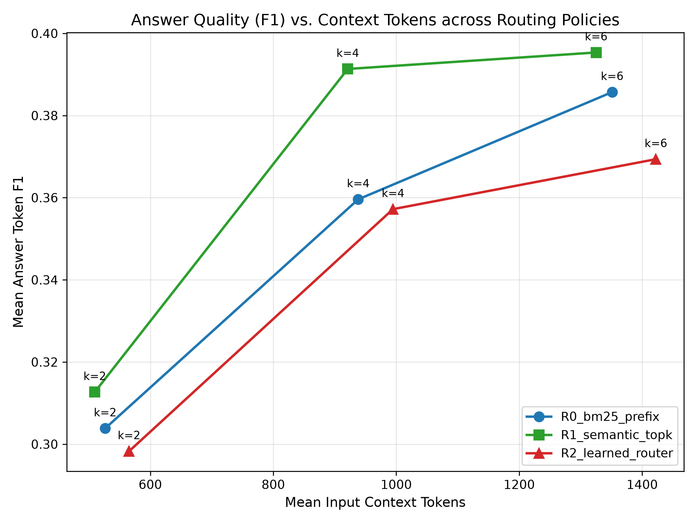

# Week 6 — Part-Wise Analysis

## Week objective

Separate passage identity from representation budget: fix k and compare routing strategies within the same candidate pool.

# Part A — Fixed-budget passage-fidelity routing

**Status: COMPLETED**

## 1. Research question

Does choosing WHICH retrieved passages remain verbatim improve SARA at the same k?

## 2. Experimental design

| component   | value                                                                              |
|:------------|:-----------------------------------------------------------------------------------|
| dataset     | Local QASPER DEV 231 queries / 86 papers; train/internal validation where recorded |
| reader      | Historical fine-tuned SARA / Mistral-7B                                            |
| retriever   | BM25 candidate pool; MiniLM semantic features/routing where specified              |
| metric      | Answer token F1; context-token accounting is artifact-specific                     |
| k           | [2, 4, 6]                                                                          |
| methods     | BM25 prefix; MiniLM semantic top-k; learned router                                 |
| Role        | Protocol/context only; outcomes are accepted only from the artifacts below         |

## 3. What was implemented / executed

Completed machine-readable output is present for the named conditions; coverage is limited to the recorded rows and checks below.

## 4. Result artifacts used

- [results/week6/passage_routing/tables/w6_main_results.csv](../../week6/passage_routing/tables/w6_main_results.csv)
- [results/week6/passage_routing/tables/w6_routing_quality.csv](../../week6/passage_routing/tables/w6_routing_quality.csv)
- [results/week6/passage_routing/bootstrap/w6_bootstrap_comparisons.csv](../../week6/passage_routing/bootstrap/w6_bootstrap_comparisons.csv)

## 5. Main numerical results

### w6 main results

| router            |   k |   answer_f1_mean |   answer_f1_std |   context_tokens_mean |   latency_mean_sec |
|:------------------|----:|-----------------:|----------------:|----------------------:|-------------------:|
| R0_bm25_prefix    |   2 |         0.303835 |        0.379664 |            526.523810 |           0.000000 |
| R0_bm25_prefix    |   4 |         0.359601 |        0.393989 |            938.121212 |           0.000000 |
| R0_bm25_prefix    |   6 |         0.385699 |        0.390981 |           1351.116883 |           0.000000 |
| R1_semantic_topk  |   2 |         0.312678 |        0.381688 |            509.636364 |           1.836474 |
| R1_semantic_topk  |   4 |         0.391333 |        0.400429 |            921.073593 |           2.684737 |
| R1_semantic_topk  |   6 |         0.395345 |        0.393080 |           1325.090909 |           3.629630 |
| R2_learned_router |   2 |         0.298276 |        0.374743 |            565.398268 |           1.812983 |
| R2_learned_router |   4 |         0.357210 |        0.390746 |            994.714286 |           2.834549 |
| R2_learned_router |   6 |         0.369367 |        0.392932 |           1422.225108 |           3.909536 |

Source: [results/week6/passage_routing/tables/w6_main_results.csv](../../week6/passage_routing/tables/w6_main_results.csv).

### w6 routing quality

| router            |   k |   evidence_recall |   evidence_precision |   total_queries |
|:------------------|----:|------------------:|---------------------:|----------------:|
| R0_bm25_prefix    |   2 |          0.392558 |             0.331169 |             231 |
| R0_bm25_prefix    |   4 |          0.615892 |             0.316017 |             231 |
| R0_bm25_prefix    |   6 |          0.791517 |             0.293651 |             231 |
| R1_semantic_topk  |   2 |          0.420913 |             0.333333 |             231 |
| R1_semantic_topk  |   4 |          0.613387 |             0.312771 |             231 |
| R1_semantic_topk  |   6 |          0.771193 |             0.289322 |             231 |
| R2_learned_router |   2 |          0.406514 |             0.352814 |             231 |
| R2_learned_router |   4 |          0.648626 |             0.331169 |             231 |
| R2_learned_router |   6 |          0.800984 |             0.302309 |             231 |

Source: [results/week6/passage_routing/tables/w6_routing_quality.csv](../../week6/passage_routing/tables/w6_routing_quality.csv).

### Stored bootstrap contrasts; interpret named metric/difference exactly

| comparison                | policy_A    | policy_B    |   delta_f1 |   ci_lower |   ci_upper |   p_value | significant   |   k |
|:--------------------------|:------------|:------------|-----------:|-----------:|-----------:|----------:|:--------------|----:|
| R1_semantic_vs_R0_bm25    | R1_semantic | R0_bm25     |   0.008843 |  -0.065329 |   0.087271 |  0.799000 | False         |   2 |
| R2_learned_vs_R0_bm25     | R2_learned  | R0_bm25     |  -0.005560 |  -0.080620 |   0.068667 |  0.889000 | False         |   2 |
| R2_learned_vs_R1_semantic | R2_learned  | R1_semantic |  -0.014402 |  -0.057212 |   0.030520 |  0.492000 | False         |   2 |
| R1_semantic_vs_R0_bm25    | R1_semantic | R0_bm25     |   0.031732 |  -0.046700 |   0.113303 |  0.426000 | False         |   4 |
| R2_learned_vs_R0_bm25     | R2_learned  | R0_bm25     |  -0.002391 |  -0.090815 |   0.084142 |  0.951000 | False         |   4 |
| R2_learned_vs_R1_semantic | R2_learned  | R1_semantic |  -0.034123 |  -0.076011 |   0.007922 |  0.101000 | False         |   4 |
| R1_semantic_vs_R0_bm25    | R1_semantic | R0_bm25     |   0.009646 |  -0.063900 |   0.087611 |  0.785000 | False         |   6 |
| R2_learned_vs_R0_bm25     | R2_learned  | R0_bm25     |  -0.016332 |  -0.095507 |   0.064981 |  0.702000 | False         |   6 |
| R2_learned_vs_R1_semantic | R2_learned  | R1_semantic |  -0.025978 |  -0.061581 |   0.008319 |  0.124000 | False         |   6 |

Source: [results/week6/passage_routing/bootstrap/w6_bootstrap_comparisons.csv](../../week6/passage_routing/bootstrap/w6_bootstrap_comparisons.csv).

## 6. Figures

No saved figure is used for this part; no visualization is fabricated.

## 7. Statistical analysis

No formal inferential test was found for this comparison.

## 8. Interpretation

### Supported

At k4, semantic routing reaches0.391333 versus BM25-prefix0.359601 and learned routing0.357210. At k6, semantic0.395345 versus BM250.385699. This tests routing inside a fixed retrieved pool.

### Not established

Point-estimate rankings do not establish statistical superiority. Implementation, qualification and retrospective oracle ceilings are not deployed or held-out quality results. Missing model/split/seed details are not established from available primary artifacts.

### Important caveats

MiniLM is the semantic routing encoder here, not SFR. Baseline latency entries are0 for cached references; they are not physical zero-latency systems.

## 9. Part conclusion

- At k4, semantic routing reaches0.391333 versus BM25-prefix0.359601 and learned routing0.357210. At k6, semantic0.395345 versus BM250.385699. This tests routing inside a fixed retrieved pool.
- No additional method-selection decision is inferred beyond the recorded protocol/freeze artifacts.

# Part B — Hybrid semantic / lexical routing

**Status: COMPLETED**

## 1. Research question

Does score fusion improve on pure semantic routing?

## 2. Experimental design

| component   | value                                                                              |
|:------------|:-----------------------------------------------------------------------------------|
| dataset     | Local QASPER DEV 231 queries / 86 papers; train/internal validation where recorded |
| reader      | Historical fine-tuned SARA / Mistral-7B                                            |
| retriever   | BM25 candidate pool; MiniLM semantic features/routing where specified              |
| metric      | Answer token F1; context-token accounting is artifact-specific                     |
| methods     | R3 fixed fusion and R4 reciprocal-rank fusion                                      |
| Role        | Protocol/context only; outcomes are accepted only from the artifacts below         |

## 3. What was implemented / executed

Completed machine-readable output is present for the named conditions; coverage is limited to the recorded rows and checks below.

## 4. Result artifacts used

- [results/week6/hybrid_routing/tables/w6b_main_results.csv](../../week6/hybrid_routing/tables/w6b_main_results.csv)
- [results/week6/hybrid_routing/bootstrap/w6b_bootstrap_comparisons.csv](../../week6/hybrid_routing/bootstrap/w6b_bootstrap_comparisons.csv)

## 5. Main numerical results

### w6b main results

| router            |   k |   answer_f1_mean |   answer_f1_std |   context_tokens_mean |   latency_mean_sec |
|:------------------|----:|-----------------:|----------------:|----------------------:|-------------------:|
| R0_bm25_prefix    |   2 |         0.303835 |        0.379664 |            526.523810 |           0.000000 |
| R0_bm25_prefix    |   4 |         0.359601 |        0.393989 |            938.121212 |           0.000000 |
| R0_bm25_prefix    |   6 |         0.385699 |        0.390981 |           1351.116883 |           0.000000 |
| R1_semantic_topk  |   2 |         0.312678 |        0.381688 |            509.636364 |           1.836474 |
| R1_semantic_topk  |   4 |         0.391333 |        0.400429 |            921.073593 |           2.684737 |
| R1_semantic_topk  |   6 |         0.395345 |        0.393080 |           1325.090909 |           3.629630 |
| R2_learned_router |   2 |         0.298276 |        0.374743 |            565.398268 |           1.812983 |
| R2_learned_router |   4 |         0.357210 |        0.390746 |            994.714286 |           2.834549 |
| R2_learned_router |   6 |         0.369367 |        0.392932 |           1422.225108 |           3.909536 |
| R3_fixed_fusion   |   2 |         0.301502 |        0.376308 |            514.155844 |           1.703997 |
| R3_fixed_fusion   |   4 |         0.378169 |        0.389016 |            935.917749 |           2.650169 |
| R3_fixed_fusion   |   6 |         0.377512 |        0.387329 |           1344.034632 |           3.651155 |
| R4_rrf            |   2 |         0.325764 |        0.392232 |            513.649351 |           1.769319 |
| R4_rrf            |   4 |         0.375162 |        0.387637 |            923.783550 |           2.631270 |
| R4_rrf            |   6 |         0.379124 |        0.387249 |           1338.367965 |           3.657875 |

Source: [results/week6/hybrid_routing/tables/w6b_main_results.csv](../../week6/hybrid_routing/tables/w6b_main_results.csv).

### Stored bootstrap contrasts; interpret named metric/difference exactly

| comparison              | policy_A   | policy_B   |   delta_f1 |   ci_lower |   ci_upper |   p_value | significant   |
|:------------------------|:-----------|:-----------|-----------:|-----------:|-----------:|----------:|:--------------|
| best_R3_k4_vs_R1_k4     | best_R3_k4 | R1_k4      |  -0.013164 |  -0.054521 |   0.031797 |  0.533000 | False         |
| best_R3_k4_vs_R0_k4     | best_R3_k4 | R0_k4      |   0.018568 |  -0.060268 |   0.097675 |  0.617000 | False         |
| best_R3_k4_vs_R0_k6     | best_R3_k4 | R0_k6      |  -0.007530 |  -0.079509 |   0.065552 |  0.850000 | False         |
| best_R3_k4_vs_static_k8 | best_R3_k4 | static_k8  |  -0.016826 |  -0.089003 |   0.059788 |  0.676000 | False         |
| R4_k4_vs_R1_k4          | R4_k4      | R1_k4      |  -0.016171 |  -0.054611 |   0.022567 |  0.415000 | False         |
| R4_k4_vs_R0_k4          | R4_k4      | R0_k4      |   0.015562 |  -0.059288 |   0.090732 |  0.664000 | False         |
| best_R3_k6_vs_R1_k6     | best_R3_k6 | R1_k6      |  -0.017833 |  -0.051552 |   0.015150 |  0.315000 | False         |
| best_R3_k6_vs_R0_k6     | best_R3_k6 | R0_k6      |  -0.008187 |  -0.082617 |   0.063488 |  0.848000 | False         |
| R4_k6_vs_R1_k6          | R4_k6      | R1_k6      |  -0.016221 |  -0.039435 |   0.007364 |  0.180000 | False         |

Source: [results/week6/hybrid_routing/bootstrap/w6b_bootstrap_comparisons.csv](../../week6/hybrid_routing/bootstrap/w6b_bootstrap_comparisons.csv).

## 6. Figures

No saved figure is used for this part; no visualization is fabricated.

## 7. Statistical analysis

No formal inferential test was found for this comparison.

## 8. Interpretation

### Supported

RRF is best at k2 by point estimate0.325764, but semantic routing remains stronger at k4/k6 than fixed fusion or RRF. No universal hybrid routing gain is established.

### Not established

Point-estimate rankings do not establish statistical superiority. Implementation, qualification and retrospective oracle ceilings are not deployed or held-out quality results. Missing model/split/seed details are not established from available primary artifacts.

### Important caveats

Method selection/alpha tuning use internal validation. Output generation timing omits cached baseline work and must not be read as end-to-end throughput.

## 9. Part conclusion

- RRF is best at k2 by point estimate0.325764, but semantic routing remains stronger at k4/k6 than fixed fusion or RRF. No universal hybrid routing gain is established.
- No additional method-selection decision is inferred beyond the recorded protocol/freeze artifacts.

# Week 6 — Integrated Analysis

## What changed during this week?

Separate passage identity from representation budget: fix k and compare routing strategies within the same candidate pool. The parts above retain the distinction between executed outputs, implementation-only work, exploratory diagnostics and retrospective choices.

## Main supported findings

| Finding                                                                                                                                                                                        | Evidence                                                         | Strength                                     |
|:-----------------------------------------------------------------------------------------------------------------------------------------------------------------------------------------------|:-----------------------------------------------------------------|:---------------------------------------------|
| At k4, semantic routing reaches0.391333 versus BM25-prefix0.359601 and learned routing0.357210. At k6, semantic0.395345 versus BM250.385699. This tests routing inside a fixed retrieved pool. | Part A; results/week6/passage_routing/tables/w6_main_results.csv | descriptive; see stated inferential evidence |
| RRF is best at k2 by point estimate0.325764, but semantic routing remains stronger at k4/k6 than fixed fusion or RRF. No universal hybrid routing gain is established.                         | Part B; results/week6/hybrid_routing/tables/w6b_main_results.csv | descriptive; see stated inferential evidence |

## Negative / null findings

Learned routing underperforms simple semantic routing; fusion is not consistently best.

## What remained unresolved?

Same local DEV, semantic encoder limitations and cached/uncached latency asymmetry.

## What logically motivated the next week?

Week7 composes prior budget prediction with semantic routing and explores retraining/anchors/multiple fidelities.

## Offline reproducibility / source conflicts

- Saved DEV generation JSONL coverage: 1386 records; columns: router,k,question_id,prediction,token_f1,context_tokens,latency,selected_ranks

Executed notebook coverage (zero-based cell indices):

| artifact                                             |   executed_output_cells | cell_indices                                               |
|:-----------------------------------------------------|------------------------:|:-----------------------------------------------------------|
| notebooks/week6/week6_passage_fidelity_routing.ipynb |                      16 | 2,4,6,8,10,12,14,16,18,20,22,24,26,28,30,32                |
| notebooks/week6/week6b_hybrid_routing.ipynb          |                      21 | 2,4,6,8,10,12,14,16,18,20,22,24,26,28,30,32,34,36,38,40,43 |

## Additional primary visualizations

X-axis is high-fidelity passage budget k; y-axis answer F1 by routing method. Semantic routing is strong at k4/k6; this does not prove a universal retriever winner.

Source: [results/week6/passage_routing/figures/w6_quality_vs_budget.png](../../week6/passage_routing/figures/w6_quality_vs_budget.png).

# Primary Sources Used

- [configs/week6/hybrid_routing.yaml](../../../configs/week6/hybrid_routing.yaml)
- [configs/week6/passage_routing.yaml](../../../configs/week6/passage_routing.yaml)
- [notebooks/week6/week6_passage_fidelity_routing.ipynb](../../../notebooks/week6/week6_passage_fidelity_routing.ipynb)
- [notebooks/week6/week6b_hybrid_routing.ipynb](../../../notebooks/week6/week6b_hybrid_routing.ipynb)
- [results/week6/hybrid_routing/bootstrap/w6b_bootstrap_comparisons.csv](../../week6/hybrid_routing/bootstrap/w6b_bootstrap_comparisons.csv)
- [results/week6/hybrid_routing/tables/w6b_main_results.csv](../../week6/hybrid_routing/tables/w6b_main_results.csv)
- [results/week6/passage_routing/bootstrap/w6_bootstrap_comparisons.csv](../../week6/passage_routing/bootstrap/w6_bootstrap_comparisons.csv)
- [results/week6/passage_routing/sara_generations/dev_sara_generations.jsonl](../../week6/passage_routing/sara_generations/dev_sara_generations.jsonl)
- [results/week6/passage_routing/tables/w6_main_results.csv](../../week6/passage_routing/tables/w6_main_results.csv)
- [results/week6/passage_routing/tables/w6_routing_quality.csv](../../week6/passage_routing/tables/w6_routing_quality.csv)

- [results/week6/passage_routing/figures/w6_quality_vs_budget.png](../../week6/passage_routing/figures/w6_quality_vs_budget.png)

# Existing Markdown Used as Evidence

NONE
