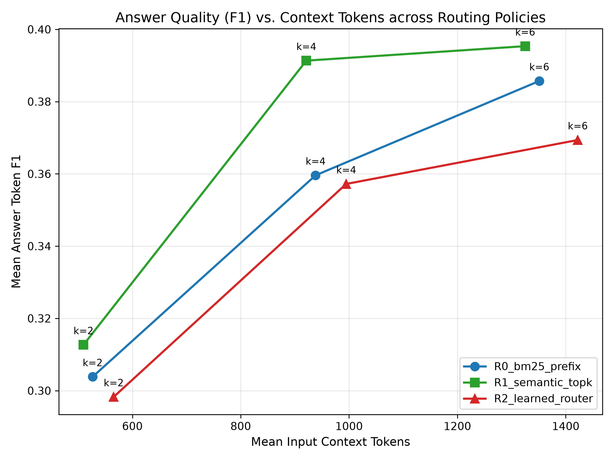

# Week 6 — Summary Analysis

## Objective

Separate passage identity from representation budget: fix k and compare routing strategies within the same candidate pool.

## Experiments performed

| Part   | Question                                                                           | Status    | Main_result                                                                                                                                                                                    |
|:-------|:-----------------------------------------------------------------------------------|:----------|:-----------------------------------------------------------------------------------------------------------------------------------------------------------------------------------------------|
| A      | Does choosing WHICH retrieved passages remain verbatim improve SARA at the same k? | COMPLETED | At k4, semantic routing reaches0.391333 versus BM25-prefix0.359601 and learned routing0.357210. At k6, semantic0.395345 versus BM250.385699. This tests routing inside a fixed retrieved pool. |
| B      | Does score fusion improve on pure semantic routing?                                | COMPLETED | RRF is best at k2 by point estimate0.325764, but semantic routing remains stronger at k4/k6 than fixed fusion or RRF. No universal hybrid routing gain is established.                         |

## Key results

### w6 main results

| router            |   k |   answer_f1_mean |   answer_f1_std |   context_tokens_mean |   latency_mean_sec |
|:------------------|----:|-----------------:|----------------:|----------------------:|-------------------:|
| R0_bm25_prefix    |   2 |         0.303835 |        0.379664 |            526.523810 |           0.000000 |
| R0_bm25_prefix    |   4 |         0.359601 |        0.393989 |            938.121212 |           0.000000 |
| R0_bm25_prefix    |   6 |         0.385699 |        0.390981 |           1351.116883 |           0.000000 |
| R1_semantic_topk  |   2 |         0.312678 |        0.381688 |            509.636364 |           1.836474 |
| R1_semantic_topk  |   4 |         0.391333 |        0.400429 |            921.073593 |           2.684737 |
| R1_semantic_topk  |   6 |         0.395345 |        0.393080 |           1325.090909 |           3.629630 |
| R2_learned_router |   2 |         0.298276 |        0.374743 |            565.398268 |           1.812983 |
| R2_learned_router |   4 |         0.357210 |        0.390746 |            994.714286 |           2.834549 |
| R2_learned_router |   6 |         0.369367 |        0.392932 |           1422.225108 |           3.909536 |

Source: [results/week6/passage_routing/tables/w6_main_results.csv](../../week6/passage_routing/tables/w6_main_results.csv).

### w6 routing quality

| router            |   k |   evidence_recall |   evidence_precision |   total_queries |
|:------------------|----:|------------------:|---------------------:|----------------:|
| R0_bm25_prefix    |   2 |          0.392558 |             0.331169 |             231 |
| R0_bm25_prefix    |   4 |          0.615892 |             0.316017 |             231 |
| R0_bm25_prefix    |   6 |          0.791517 |             0.293651 |             231 |
| R1_semantic_topk  |   2 |          0.420913 |             0.333333 |             231 |
| R1_semantic_topk  |   4 |          0.613387 |             0.312771 |             231 |
| R1_semantic_topk  |   6 |          0.771193 |             0.289322 |             231 |
| R2_learned_router |   2 |          0.406514 |             0.352814 |             231 |
| R2_learned_router |   4 |          0.648626 |             0.331169 |             231 |
| R2_learned_router |   6 |          0.800984 |             0.302309 |             231 |

Source: [results/week6/passage_routing/tables/w6_routing_quality.csv](../../week6/passage_routing/tables/w6_routing_quality.csv).

## Main scientific conclusions

- At k4, semantic routing reaches0.391333 versus BM25-prefix0.359601 and learned routing0.357210. At k6, semantic0.395345 versus BM250.385699. This tests routing inside a fixed retrieved pool. Source: [results/week6/passage_routing/tables/w6_main_results.csv](../../week6/passage_routing/tables/w6_main_results.csv)
- RRF is best at k2 by point estimate0.325764, but semantic routing remains stronger at k4/k6 than fixed fusion or RRF. No universal hybrid routing gain is established. Source: [results/week6/hybrid_routing/tables/w6b_main_results.csv](../../week6/hybrid_routing/tables/w6b_main_results.csv)

## What did NOT work?

Learned routing underperforms simple semantic routing; fusion is not consistently best.

## Limitations

Same local DEV, semantic encoder limitations and cached/uncached latency asymmetry.

## Decision after this week

Carry simple semantic routing into budget/routing composition experiments.

## One-paragraph week takeaway

At k4, semantic routing reaches0.391333 versus BM25-prefix0.359601 and learned routing0.357210. At k6, semantic0.395345 versus BM250.385699. This tests routing inside a fixed retrieved pool. RRF is best at k2 by point estimate0.325764, but semantic routing remains stronger at k4/k6 than fixed fusion or RRF. No universal hybrid routing gain is established.

## Additional primary visualizations

X-axis is high-fidelity passage budget k; y-axis answer F1 by routing method. Semantic routing is strong at k4/k6; this does not prove a universal retriever winner.

Source: [results/week6/passage_routing/figures/w6_quality_vs_budget.png](../../week6/passage_routing/figures/w6_quality_vs_budget.png).

# Primary Sources Used

- [configs/week6/hybrid_routing.yaml](../../../configs/week6/hybrid_routing.yaml)
- [configs/week6/passage_routing.yaml](../../../configs/week6/passage_routing.yaml)
- [notebooks/week6/week6_passage_fidelity_routing.ipynb](../../../notebooks/week6/week6_passage_fidelity_routing.ipynb)
- [notebooks/week6/week6b_hybrid_routing.ipynb](../../../notebooks/week6/week6b_hybrid_routing.ipynb)
- [results/week6/hybrid_routing/bootstrap/w6b_bootstrap_comparisons.csv](../../week6/hybrid_routing/bootstrap/w6b_bootstrap_comparisons.csv)
- [results/week6/hybrid_routing/tables/w6b_main_results.csv](../../week6/hybrid_routing/tables/w6b_main_results.csv)
- [results/week6/passage_routing/bootstrap/w6_bootstrap_comparisons.csv](../../week6/passage_routing/bootstrap/w6_bootstrap_comparisons.csv)
- [results/week6/passage_routing/sara_generations/dev_sara_generations.jsonl](../../week6/passage_routing/sara_generations/dev_sara_generations.jsonl)
- [results/week6/passage_routing/tables/w6_main_results.csv](../../week6/passage_routing/tables/w6_main_results.csv)
- [results/week6/passage_routing/tables/w6_routing_quality.csv](../../week6/passage_routing/tables/w6_routing_quality.csv)

- [results/week6/passage_routing/figures/w6_quality_vs_budget.png](../../week6/passage_routing/figures/w6_quality_vs_budget.png)

# Existing Markdown Used as Evidence

NONE
