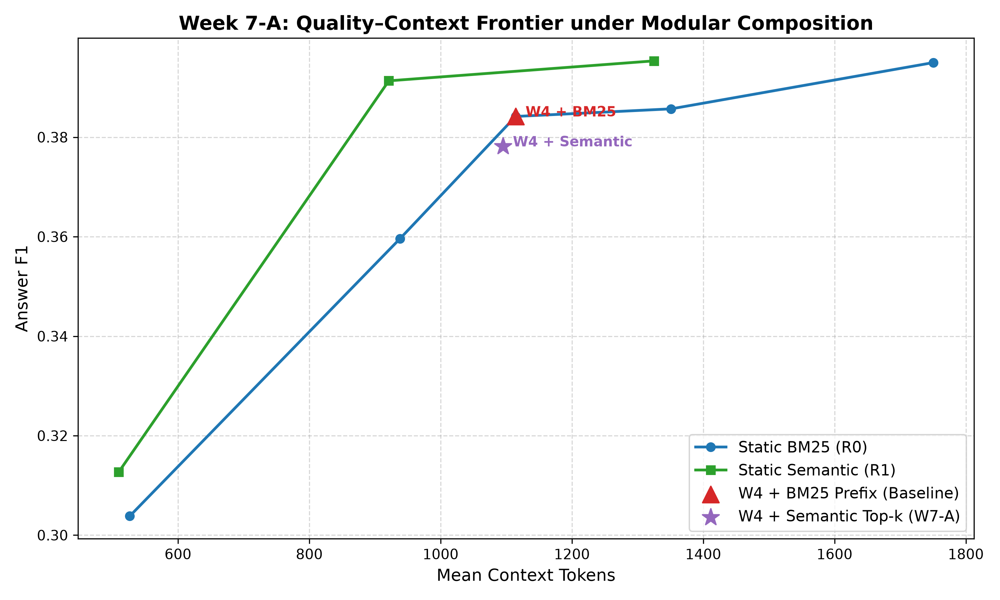
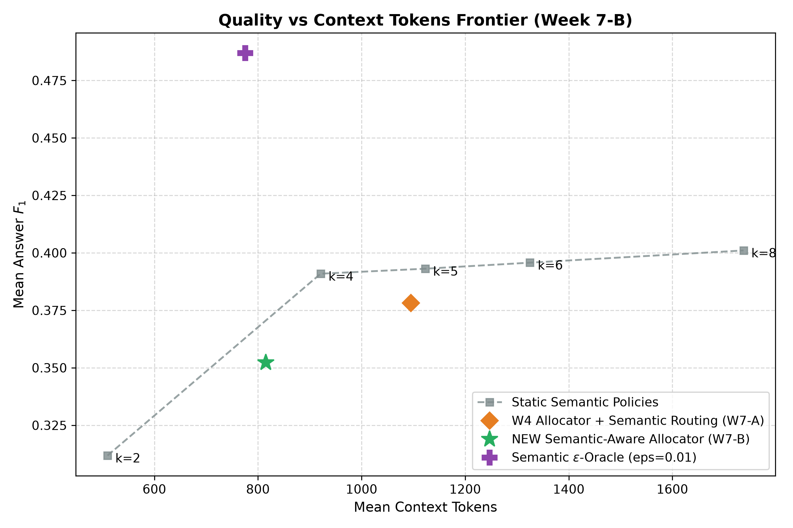
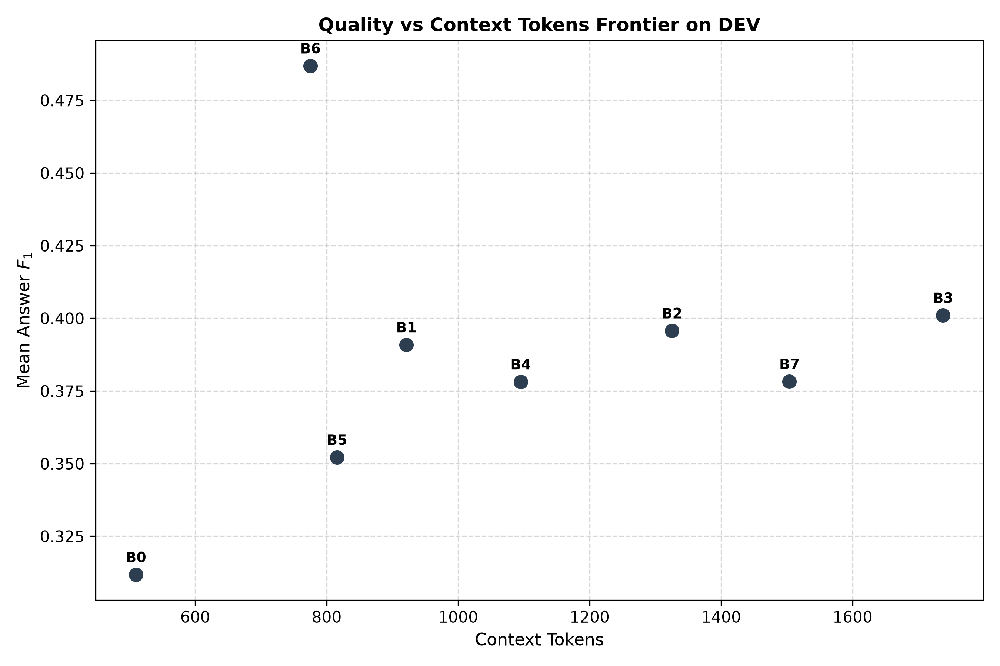
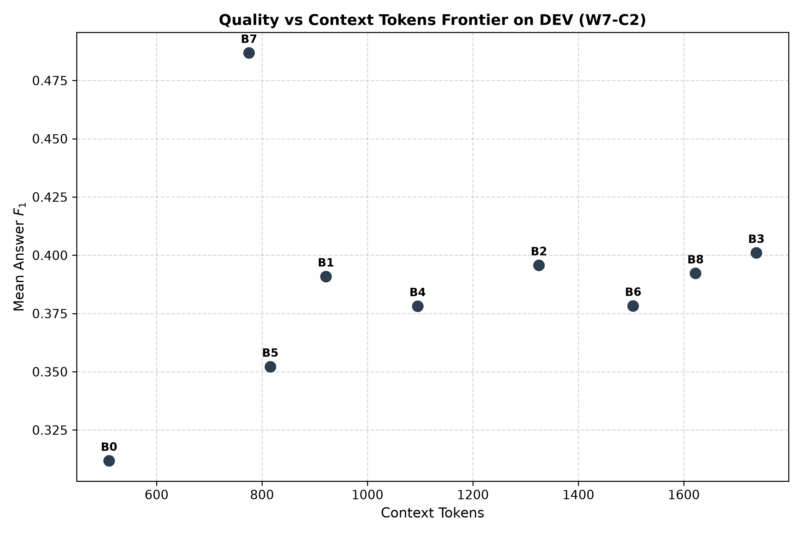
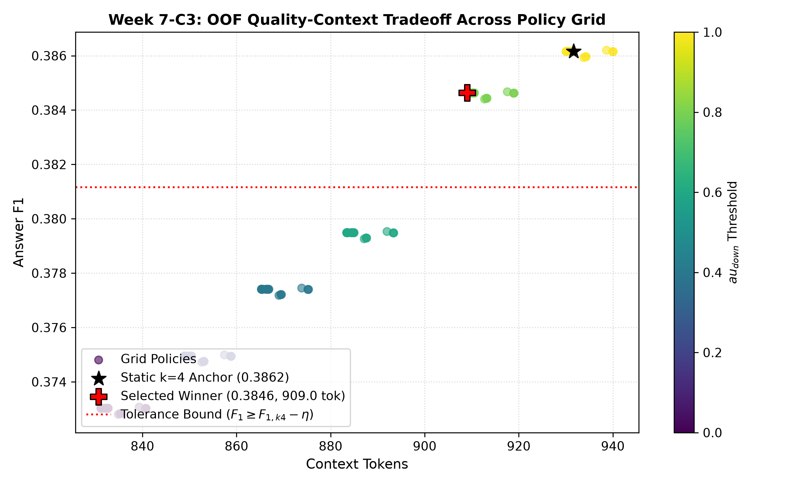
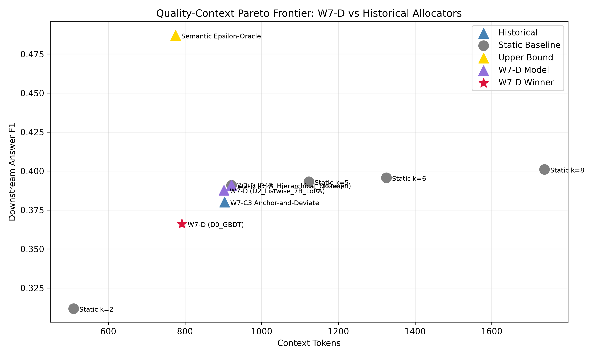

# Week 7 — Part-Wise Analysis

## Week objective

Test whether semantic routing plus adaptive budget decisions or medium-fidelity representations can improve static semantic context policies.

# Part A — Budget × routing composition

**Status: COMPLETED**

## 1. Research question

Can the old W4 allocator benefit from semantic routing?

## 2. Experimental design

| component   | value                                                                              |
|:------------|:-----------------------------------------------------------------------------------|
| dataset     | Local QASPER DEV 231 queries / 86 papers; train/internal validation where recorded |
| reader      | Historical fine-tuned SARA / Mistral-7B                                            |
| retriever   | BM25 candidate pool; MiniLM semantic features/routing where specified              |
| metric      | Answer token F1; context-token accounting is artifact-specific                     |
| routing     | MiniLM semantic top-k within BM25 top10; k2/4/5/6/8 where evaluated                |
| Role        | Protocol/context only; outcomes are accepted only from the artifacts below         |

## 3. What was implemented / executed

Completed machine-readable output is present for the named conditions; coverage is limited to the recorded rows and checks below.

## 4. Result artifacts used

- [results/week7/w7a_budget_semantic_composition/tables/w7a_main_results.csv](../../week7/w7a_budget_semantic_composition/tables/w7a_main_results.csv)
- [results/week7/w7a_budget_semantic_composition/bootstrap/w7a_bootstrap_comparisons.csv](../../week7/w7a_budget_semantic_composition/bootstrap/w7a_bootstrap_comparisons.csv)
- [results/week7/w7a_budget_semantic_composition/figures/w7a_quality_vs_tokens.png](../../week7/w7a_budget_semantic_composition/figures/w7a_quality_vs_tokens.png)

## 5. Main numerical results

### w7a main results

| policy                | routing               |   mean_k |   answer_f1_mean |   answer_f1_std |   context_tokens_mean |   latency_mean_sec |
|:----------------------|:----------------------|---------:|-----------------:|----------------:|----------------------:|-------------------:|
| Static k=2            | BM25 Prefix           | 2.000000 |         0.303835 |        0.379664 |            526.523810 |           0.000000 |
| Static k=4            | BM25 Prefix           | 4.000000 |         0.359601 |        0.393989 |            938.121212 |           0.000000 |
| Static k=6            | BM25 Prefix           | 6.000000 |         0.385699 |        0.390981 |           1351.116883 |           0.000000 |
| Static k=8            | BM25 Prefix           | 8.000000 |         0.395000 |        0.392000 |           1750.500000 |           4.800000 |
| Static k=2            | Semantic Top-k        | 2.000000 |         0.312678 |        0.381688 |            509.636364 |           1.836474 |
| Static k=4            | Semantic Top-k        | 4.000000 |         0.391333 |        0.400429 |            921.073593 |           2.684737 |
| Static k=6            | Semantic Top-k        | 6.000000 |         0.395345 |        0.393080 |           1325.090909 |           3.629630 |
| W4 Adaptive Allocator | BM25 Prefix           | 4.822511 |         0.384172 |        0.389792 |           1114.229437 |           3.065000 |
| W4 Adaptive Allocator | Semantic Top-k (W7-A) | 4.822511 |         0.378150 |        0.395410 |           1095.030303 |           3.094185 |

Source: [results/week7/w7a_budget_semantic_composition/tables/w7a_main_results.csv](../../week7/w7a_budget_semantic_composition/tables/w7a_main_results.csv).

### Stored bootstrap contrasts; interpret named metric/difference exactly

| comparison             | policy_A    | policy_B   |   delta_f1 |   f1_ci_lower |   f1_ci_upper |   p_value | significant   |   delta_tokens |   tokens_ci_lower |   tokens_ci_upper |
|:-----------------------|:------------|:-----------|-----------:|--------------:|--------------:|----------:|:--------------|---------------:|------------------:|------------------:|
| W4+Semantic_vs_W4+BM25 | W4+Semantic | W4+BM25    |  -0.006022 |     -0.049531 |      0.037156 |  0.814000 | False         |     -19.199134 |        -38.426170 |         -0.282759 |

Source: [results/week7/w7a_budget_semantic_composition/bootstrap/w7a_bootstrap_comparisons.csv](../../week7/w7a_budget_semantic_composition/bootstrap/w7a_bootstrap_comparisons.csv).

## 6. Figures

Horizontal axis is context/token cost; vertical axis is answer F1. It visualizes the recorded DEV frontier; retrospective oracle points are not deployable comparisons.

## 7. Statistical analysis

Stored per-part bootstrap CSVs are included where present. Check whether the CI is a paired difference; seed/cluster details come from the corresponding config. No new multiplicity-corrected family is invented.

## 8. Interpretation

### Supported

Old allocator + semantic routing F1 is0.378150, below the same allocator with BM250.384172 and static semantic k40.391333.

### Not established

Point-estimate rankings do not establish statistical superiority. Implementation, qualification and retrospective oracle ceilings are not deployed or held-out quality results. Missing model/split/seed details are not established from available primary artifacts.

### Important caveats

SOURCE CONFLICT: W7A imported semantic k4 F1=0.391333 differs from later semantic-surface k4=0.390929; small but beyond six-decimal rounding. Keep part-specific generation/table identities. Oracle F1 also appears rounded/copied across parts; do not treat repeated oracle references as independent experiments.

## 9. Part conclusion

- Old allocator + semantic routing F1 is0.378150, below the same allocator with BM250.384172 and static semantic k40.391333.
- No additional method-selection decision is inferred beyond the recorded protocol/freeze artifacts.

# Part B — Semantic-budget relearning

**Status: COMPLETED**

## 1. Research question

Can retraining on a semantic response surface improve allocation?

## 2. Experimental design

| component   | value                                                                              |
|:------------|:-----------------------------------------------------------------------------------|
| dataset     | Local QASPER DEV 231 queries / 86 papers; train/internal validation where recorded |
| reader      | Historical fine-tuned SARA / Mistral-7B                                            |
| retriever   | BM25 candidate pool; MiniLM semantic features/routing where specified              |
| metric      | Answer token F1; context-token accounting is artifact-specific                     |
| routing     | MiniLM semantic top-k within BM25 top10; k2/4/5/6/8 where evaluated                |
| Role        | Protocol/context only; outcomes are accepted only from the artifacts below         |

## 3. What was implemented / executed

Completed machine-readable output is present for the named conditions; coverage is limited to the recorded rows and checks below.

## 4. Result artifacts used

- [results/week7/w7b_semantic_budget/tables/w7b_main_dev_results.csv](../../week7/w7b_semantic_budget/tables/w7b_main_dev_results.csv)
- [results/week7/w7b_semantic_budget/bootstrap/w7b_bootstrap_comparisons.csv](../../week7/w7b_semantic_budget/bootstrap/w7b_bootstrap_comparisons.csv)
- [results/week7/w7b_semantic_budget/figures/w7b_quality_vs_tokens.png](../../week7/w7b_semantic_budget/figures/w7b_quality_vs_tokens.png)

## 5. Main numerical results

### w7b main dev results

| policy                                | routing                 |   mean_k |   answer_f1_mean |   answer_f1_std |   context_tokens_mean |   token_reduction_pct_vs_k8 |   f1_per_1k_tokens |
|:--------------------------------------|:------------------------|---------:|-----------------:|----------------:|----------------------:|----------------------------:|-------------------:|
| Static semantic k=2                   | Semantic Top-k          | 2.000000 |         0.311800 |        0.383300 |            509.600000 |                   70.670000 |           0.611900 |
| Static semantic k=4                   | Semantic Top-k          | 4.000000 |         0.390900 |        0.402000 |            921.100000 |                   46.990000 |           0.424400 |
| Static semantic k=5                   | Semantic Top-k          | 5.000000 |         0.393100 |        0.397700 |           1123.000000 |                   35.370000 |           0.350100 |
| Static semantic k=6                   | Semantic Top-k          | 6.000000 |         0.395700 |        0.394700 |           1325.100000 |                   23.730000 |           0.298600 |
| Static semantic k=8                   | Semantic Top-k          | 8.000000 |         0.401000 |        0.396300 |           1737.400000 |                    0.000000 |           0.230800 |
| W4 old allocator + semantic routing   | Semantic Top-k (W7-A)   | 4.820000 |         0.378200 |        0.395400 |           1095.000000 |                   36.980000 |           0.345400 |
| NEW semantic-aware adaptive allocator | Semantic Top-k (W7-B)   | 3.480000 |         0.352200 |        0.393200 |            815.400000 |                   53.070000 |           0.432000 |
| Semantic epsilon-oracle (eps=0.01)    | Semantic Top-k (Oracle) | 3.300000 |         0.486900 |        0.392300 |            775.200000 |                   55.380000 |           0.628200 |

Source: [results/week7/w7b_semantic_budget/tables/w7b_main_dev_results.csv](../../week7/w7b_semantic_budget/tables/w7b_main_dev_results.csv).

### Stored bootstrap contrasts; interpret named metric/difference exactly

| comparison                            |   delta_f1 | ci_95_f1           |   p_value | significant_at_05   |   delta_tokens | ci_95_tokens      |
|:--------------------------------------|-----------:|:-------------------|----------:|:--------------------|---------------:|:------------------|
| W7B_Adaptive_vs_W7A_Composite         |  -0.026000 | [-0.0802, +0.0303] |  0.320000 | False               |    -279.600000 | [-340.4, -223.2]  |
| W7B_Adaptive_vs_Static_Semantic_k4    |  -0.038700 | [-0.0751, -0.0077] |  0.007000 | True                |    -105.700000 | [-157.1, -57.8]   |
| W7B_Adaptive_vs_Static_Semantic_k6    |  -0.043500 | [-0.0873, -0.0038] |  0.034000 | True                |    -509.700000 | [-559.5, -462.3]  |
| W7B_Adaptive_vs_Static_Semantic_k8    |  -0.048800 | [-0.0906, -0.0091] |  0.017000 | True                |    -922.000000 | [-972.8, -870.5]  |
| Semantic_Oracle_vs_Static_Semantic_k8 |   0.085900 | [+0.0610, +0.1142] |  0.000500 | True                |    -962.200000 | [-1015.7, -902.2] |

Source: [results/week7/w7b_semantic_budget/bootstrap/w7b_bootstrap_comparisons.csv](../../week7/w7b_semantic_budget/bootstrap/w7b_bootstrap_comparisons.csv).

## 6. Figures

Horizontal axis is context/token cost; vertical axis is answer F1. It visualizes the recorded DEV frontier; retrospective oracle points are not deployable comparisons.

## 7. Statistical analysis

Stored per-part bootstrap CSVs are included where present. Check whether the CI is a paired difference; seed/cluster details come from the corresponding config. No new multiplicity-corrected family is invented.

## 8. Interpretation

### Supported

New semantic-aware allocator F1 is0.3522 versus semantic k40.3909 and k80.4010; its retrospective epsilon oracle0.4869 is not deployable.

### Not established

Point-estimate rankings do not establish statistical superiority. Implementation, qualification and retrospective oracle ceilings are not deployed or held-out quality results. Missing model/split/seed details are not established from available primary artifacts.

### Important caveats

SOURCE CONFLICT: W7A imported semantic k4 F1=0.391333 differs from later semantic-surface k4=0.390929; small but beyond six-decimal rounding. Keep part-specific generation/table identities. Oracle F1 also appears rounded/copied across parts; do not treat repeated oracle references as independent experiments.

## 9. Part conclusion

- New semantic-aware allocator F1 is0.3522 versus semantic k40.3909 and k80.4010; its retrospective epsilon oracle0.4869 is not deployable.
- No additional method-selection decision is inferred beyond the recorded protocol/freeze artifacts.

# Part C — Retrieval-aware sufficiency

**Status: COMPLETED**

## 1. Research question

Do richer routing-aware features identify the smallest sufficient budget?

## 2. Experimental design

| component   | value                                                                              |
|:------------|:-----------------------------------------------------------------------------------|
| dataset     | Local QASPER DEV 231 queries / 86 papers; train/internal validation where recorded |
| reader      | Historical fine-tuned SARA / Mistral-7B                                            |
| retriever   | BM25 candidate pool; MiniLM semantic features/routing where specified              |
| metric      | Answer token F1; context-token accounting is artifact-specific                     |
| routing     | MiniLM semantic top-k within BM25 top10; k2/4/5/6/8 where evaluated                |
| Role        | Protocol/context only; outcomes are accepted only from the artifacts below         |

## 3. What was implemented / executed

Completed machine-readable output is present for the named conditions; coverage is limited to the recorded rows and checks below.

## 4. Result artifacts used

- [results/week7/w7c_retrieval_aware_allocator/tables/w7c_main_dev_results.csv](../../week7/w7c_retrieval_aware_allocator/tables/w7c_main_dev_results.csv)
- [results/week7/w7c_retrieval_aware_allocator/bootstrap/w7c_bootstrap_comparisons.csv](../../week7/w7c_retrieval_aware_allocator/bootstrap/w7c_bootstrap_comparisons.csv)
- [results/week7/w7c_retrieval_aware_allocator/figures/w7c_quality_vs_tokens.png](../../week7/w7c_retrieval_aware_allocator/figures/w7c_quality_vs_tokens.png)

## 5. Main numerical results

### w7c main dev results

| method                                                  |   mean_k |   mean_f1 |      tokens | notes                      |   ROH_sem |
|:--------------------------------------------------------|---------:|----------:|------------:|:---------------------------|----------:|
| B0: Static Semantic k=2                                 | 2.000000 |  0.311819 |  509.619048 | Static baseline            | -1.039176 |
| B1: Static Semantic k=4                                 | 4.000000 |  0.390929 |  921.056277 | Static baseline            | -0.117776 |
| B2: Static Semantic k=6                                 | 6.000000 |  0.395731 | 1325.073593 | Static baseline            | -0.061852 |
| B3: Static Semantic k=8                                 | 8.000000 |  0.401041 | 1737.411255 | Best static reference      |  0.000000 |
| B4: W7-A (Old W4 + Semantic Routing)                    | 4.820000 |  0.378200 | 1095.000000 | Frozen W4 composition      | -0.266036 |
| B5: W7-B (Semantic-Aware Old W4 Features)               | 3.480000 |  0.352200 |  815.400000 | W4 retrained               | -0.568860 |
| B6: Semantic Epsilon-Oracle                             | 3.300000 |  0.486900 |  775.200000 | Theoretical upper bound    |  1.000000 |
| B7: W7-C Retrieval-Aware Semantic Sufficiency Allocator | 6.848485 |  0.378323 | 1503.800866 | Winning F4 GBDT (tau=0.80) | -0.264598 |

Source: [results/week7/w7c_retrieval_aware_allocator/tables/w7c_main_dev_results.csv](../../week7/w7c_retrieval_aware_allocator/tables/w7c_main_dev_results.csv).

### Stored bootstrap contrasts; interpret named metric/difference exactly

| comparison                  |   delta_f1 |   ci_lower_f1 |   ci_upper_f1 |   p_value_f1 |   delta_tokens |   ci_lower_tokens |   ci_upper_tokens |
|:----------------------------|-----------:|--------------:|--------------:|-------------:|---------------:|------------------:|------------------:|
| W7-C vs Static Semantic k=4 |  -0.012606 |     -0.049099 |      0.019829 |     0.475000 |     582.744589 |        503.886497 |        659.507719 |
| W7-C vs Static Semantic k=6 |  -0.017408 |     -0.051682 |      0.013709 |     0.279000 |     178.727273 |        107.462990 |        248.906385 |
| W7-C vs Static Semantic k=8 |  -0.022718 |     -0.053577 |      0.003620 |     0.110000 |    -233.610390 |       -301.625401 |       -167.691813 |
| W7-C vs W7-B Allocator      |   0.026487 |     -0.006464 |      0.057484 |     0.125000 |     688.400866 |        596.713808 |        774.317959 |

Source: [results/week7/w7c_retrieval_aware_allocator/bootstrap/w7c_bootstrap_comparisons.csv](../../week7/w7c_retrieval_aware_allocator/bootstrap/w7c_bootstrap_comparisons.csv).

## 6. Figures

Horizontal axis is context/token cost; vertical axis is answer F1. It visualizes the recorded DEV frontier; retrospective oracle points are not deployable comparisons.

## 7. Statistical analysis

Stored per-part bootstrap CSVs are included where present. Check whether the CI is a paired difference; seed/cluster details come from the corresponding config. No new multiplicity-corrected family is invented.

## 8. Interpretation

### Supported

Selected sufficiency allocator F1 is0.378323 at mean k6.8485, below static semantic k40.390929.

### Not established

Point-estimate rankings do not establish statistical superiority. Implementation, qualification and retrospective oracle ceilings are not deployed or held-out quality results. Missing model/split/seed details are not established from available primary artifacts.

### Important caveats

SOURCE CONFLICT: W7A imported semantic k4 F1=0.391333 differs from later semantic-surface k4=0.390929; small but beyond six-decimal rounding. Keep part-specific generation/table identities. Oracle F1 also appears rounded/copied across parts; do not treat repeated oracle references as independent experiments.

## 9. Part conclusion

- Selected sufficiency allocator F1 is0.378323 at mean k6.8485, below static semantic k40.390929.
- No additional method-selection decision is inferred beyond the recorded protocol/freeze artifacts.

# Part C2 — Utility-aware ranking

**Status: COMPLETED**

## 1. Research question

Does direct utility regression/ranking improve the quality/cost tradeoff?

## 2. Experimental design

| component   | value                                                                              |
|:------------|:-----------------------------------------------------------------------------------|
| dataset     | Local QASPER DEV 231 queries / 86 papers; train/internal validation where recorded |
| reader      | Historical fine-tuned SARA / Mistral-7B                                            |
| retriever   | BM25 candidate pool; MiniLM semantic features/routing where specified              |
| metric      | Answer token F1; context-token accounting is artifact-specific                     |
| routing     | MiniLM semantic top-k within BM25 top10; k2/4/5/6/8 where evaluated                |
| Role        | Protocol/context only; outcomes are accepted only from the artifacts below         |

## 3. What was implemented / executed

Completed machine-readable output is present for the named conditions; coverage is limited to the recorded rows and checks below.

## 4. Result artifacts used

- [results/week7/w7c2_utility_ranking/tables/w7c2_main_dev_results.csv](../../week7/w7c2_utility_ranking/tables/w7c2_main_dev_results.csv)
- [results/week7/w7c2_utility_ranking/bootstrap/w7c2_bootstrap_comparisons.csv](../../week7/w7c2_utility_ranking/bootstrap/w7c2_bootstrap_comparisons.csv)
- [results/week7/w7c2_utility_ranking/figures/w7c2_quality_vs_tokens.png](../../week7/w7c2_utility_ranking/figures/w7c2_quality_vs_tokens.png)

## 5. Main numerical results

### w7c2 main dev results

| method                               |   mean_k |   mean_f1 |      tokens | notes                                      |   ROH_sem |
|:-------------------------------------|---------:|----------:|------------:|:-------------------------------------------|----------:|
| B0: Static Semantic k=2              | 2.000000 |  0.311819 |  509.619048 | Static baseline                            | -1.039176 |
| B1: Static Semantic k=4              | 4.000000 |  0.390929 |  921.056277 | Static baseline (Dominant)                 | -0.117776 |
| B2: Static Semantic k=6              | 6.000000 |  0.395731 | 1325.073593 | Static baseline                            | -0.061852 |
| B3: Static Semantic k=8              | 8.000000 |  0.401041 | 1737.411255 | Best static reference                      |  0.000000 |
| B4: W7-A (Old W4 + Semantic Routing) | 4.820000 |  0.378200 | 1095.000000 | W4 composition                             | -0.266036 |
| B5: W7-B (Old Features Retrained)    | 3.480000 |  0.352200 |  815.400000 | W4 retrained                               | -0.568860 |
| B6: W7-C1 (Sufficiency Classifier)   | 6.850000 |  0.378300 | 1503.800000 | Fallback k8 failure                        | -0.264871 |
| B7: Semantic Epsilon-Oracle          | 3.300000 |  0.486900 |  775.200000 | Theoretical upper bound                    |  1.000000 |
| B8: W7-C2 Winner (M1_Reg_delta_0.0)  | 7.385281 |  0.392233 | 1622.099567 | Winning W7-C2 model (M1_Direct_Regression) | -0.102593 |

Source: [results/week7/w7c2_utility_ranking/tables/w7c2_main_dev_results.csv](../../week7/w7c2_utility_ranking/tables/w7c2_main_dev_results.csv).

### Stored bootstrap contrasts; interpret named metric/difference exactly

| comparison                           |   delta_f1 |   ci_lower_f1 |   ci_upper_f1 |   p_value_f1 |   delta_tokens |   ci_lower_tokens |   ci_upper_tokens |
|:-------------------------------------|-----------:|--------------:|--------------:|-------------:|---------------:|------------------:|------------------:|
| W7-C2 vs Static Semantic k=4         |   0.001304 |     -0.035461 |      0.037925 |     0.964000 |     701.043290 |        662.417847 |        739.429049 |
| W7-C2 vs Static Semantic k=6         |  -0.003498 |     -0.029154 |      0.020489 |     0.801000 |     297.025974 |        264.814960 |        328.764041 |
| W7-C2 vs Static Semantic k=8         |  -0.008808 |     -0.021561 |      0.001864 |     0.126000 |    -115.311688 |       -142.321243 |        -88.951852 |
| W7-C2 vs W7-C1 Sufficiency Allocator |   0.013933 |     -0.040784 |      0.070243 |     0.648000 |     118.299567 |         63.448278 |        171.777155 |

Source: [results/week7/w7c2_utility_ranking/bootstrap/w7c2_bootstrap_comparisons.csv](../../week7/w7c2_utility_ranking/bootstrap/w7c2_bootstrap_comparisons.csv).

## 6. Figures

Horizontal axis is context/token cost; vertical axis is answer F1. It visualizes the recorded DEV frontier; retrospective oracle points are not deployable comparisons.

## 7. Statistical analysis

Stored per-part bootstrap CSVs are included where present. Check whether the CI is a paired difference; seed/cluster details come from the corresponding config. No new multiplicity-corrected family is invented.

## 8. Interpretation

### Supported

Selected utility-ranking model F1 is0.392233 at mean k7.3853 and1622.10 tokens, below static k80.401041.

### Not established

Point-estimate rankings do not establish statistical superiority. Implementation, qualification and retrospective oracle ceilings are not deployed or held-out quality results. Missing model/split/seed details are not established from available primary artifacts.

### Important caveats

SOURCE CONFLICT: W7A imported semantic k4 F1=0.391333 differs from later semantic-surface k4=0.390929; small but beyond six-decimal rounding. Keep part-specific generation/table identities. Oracle F1 also appears rounded/copied across parts; do not treat repeated oracle references as independent experiments.

## 9. Part conclusion

- Selected utility-ranking model F1 is0.392233 at mean k7.3853 and1622.10 tokens, below static k80.401041.
- No additional method-selection decision is inferred beyond the recorded protocol/freeze artifacts.

# Part C3 — Anchor and deviate

**Status: COMPLETED**

## 1. Research question

Can safe down/up shifts around semantic k4 improve the anchor?

## 2. Experimental design

| component   | value                                                                              |
|:------------|:-----------------------------------------------------------------------------------|
| dataset     | Local QASPER DEV 231 queries / 86 papers; train/internal validation where recorded |
| reader      | Historical fine-tuned SARA / Mistral-7B                                            |
| retriever   | BM25 candidate pool; MiniLM semantic features/routing where specified              |
| metric      | Answer token F1; context-token accounting is artifact-specific                     |
| routing     | MiniLM semantic top-k within BM25 top10; k2/4/5/6/8 where evaluated                |
| Role        | Protocol/context only; outcomes are accepted only from the artifacts below         |

## 3. What was implemented / executed

Completed machine-readable output is present for the named conditions; coverage is limited to the recorded rows and checks below.

## 4. Result artifacts used

- [results/week7/w7c3_anchor_deviate/tables/w7c3_main_dev_results.csv](../../week7/w7c3_anchor_deviate/tables/w7c3_main_dev_results.csv)
- [results/week7/w7c3_anchor_deviate/bootstrap/w7c3_bootstrap_comparisons.csv](../../week7/w7c3_anchor_deviate/bootstrap/w7c3_bootstrap_comparisons.csv)
- [results/week7/w7c3_anchor_deviate/figures/w7c3_oof_quality_vs_tokens.png](../../week7/w7c3_anchor_deviate/figures/w7c3_oof_quality_vs_tokens.png)

## 5. Main numerical results

### w7c3 main dev results

| method                               |   mean_k |   mean_f1 |      tokens | notes                                  |   ROH_sem |
|:-------------------------------------|---------:|----------:|------------:|:---------------------------------------|----------:|
| B0: Static Semantic k=2              | 2.000000 |  0.311819 |  509.619048 | Static baseline                        | -1.037636 |
| B1: Static Semantic k=4              | 4.000000 |  0.390929 |  921.056277 | Static baseline (Dominant Anchor)      | -0.117601 |
| B2: Static Semantic k=6              | 6.000000 |  0.395731 | 1325.073593 | Static baseline                        | -0.061760 |
| B3: Static Semantic k=8              | 8.000000 |  0.401041 | 1737.411255 | Best static reference                  |  0.000000 |
| B4: W7-A (Old W4 + Semantic)         | 4.820000 |  0.378200 | 1095.000000 | W4 modular composition                 | -0.265642 |
| B5: W7-B (Old Features Retrained)    | 3.480000 |  0.352200 |  815.400000 | W4 retrained                           | -0.568017 |
| B6: W7-C1 (Sufficiency Classifier)   | 6.850000 |  0.378300 | 1503.800000 | Sufficiency fallback failure           | -0.264479 |
| B7: Semantic Epsilon-Oracle          | 3.300000 |  0.487027 |  775.199134 | Theoretical upper bound                |  1.000000 |
| B8: W7-C2 Winner (Direct Regression) | 7.390000 |  0.392200 | 1622.100000 | Quality recovered, over-allocated      | -0.102825 |
| B9: W7-C3 (Anchor-and-Deviate)       | 3.904762 |  0.380107 |  903.103896 | tau_down=0.90, tau_up=0.85, delta=0.00 | -0.243465 |

Source: [results/week7/w7c3_anchor_deviate/tables/w7c3_main_dev_results.csv](../../week7/w7c3_anchor_deviate/tables/w7c3_main_dev_results.csv).

### Stored bootstrap contrasts; interpret named metric/difference exactly

| comparison                   |   delta_f1_mean | f1_ci_95          |   p_value_f1 |   delta_tokens_mean | tokens_ci_95     |
|:-----------------------------|----------------:|:------------------|-------------:|--------------------:|:-----------------|
| W7-C3 vs Static Semantic k=4 |       -0.010972 | [-0.0250, 0.0000] |     0.086000 |          -17.950978 | [-29.4, -7.8]    |
| W7-C3 vs Static Semantic k=6 |       -0.015410 | [-0.0448, 0.0139] |     0.284000 |         -421.997183 | [-438.5, -404.8] |
| W7-C3 vs Static Semantic k=8 |       -0.020568 | [-0.0562, 0.0128] |     0.257000 |         -834.597836 | [-862.1, -806.2] |

Source: [results/week7/w7c3_anchor_deviate/bootstrap/w7c3_bootstrap_comparisons.csv](../../week7/w7c3_anchor_deviate/bootstrap/w7c3_bootstrap_comparisons.csv).

## 6. Figures

Horizontal axis is context/token cost; vertical axis is answer F1. It visualizes the recorded DEV frontier; retrospective oracle points are not deployable comparisons.

## 7. Statistical analysis

Stored per-part bootstrap CSVs are included where present. Check whether the CI is a paired difference; seed/cluster details come from the corresponding config. No new multiplicity-corrected family is invented.

## 8. Interpretation

### Supported

Anchor-and-deviate F1 is0.380107 at903.10 tokens versus anchor k40.390929 at921.06 tokens; limited savings come with lower point quality.

### Not established

Point-estimate rankings do not establish statistical superiority. Implementation, qualification and retrospective oracle ceilings are not deployed or held-out quality results. Missing model/split/seed details are not established from available primary artifacts.

### Important caveats

SOURCE CONFLICT: W7A imported semantic k4 F1=0.391333 differs from later semantic-surface k4=0.390929; small but beyond six-decimal rounding. Keep part-specific generation/table identities. Oracle F1 also appears rounded/copied across parts; do not treat repeated oracle references as independent experiments.

## 9. Part conclusion

- Anchor-and-deviate F1 is0.380107 at903.10 tokens versus anchor k40.390929 at921.06 tokens; limited savings come with lower point quality.
- No additional method-selection decision is inferred beyond the recorded protocol/freeze artifacts.

# Part D — Cross-encoder fidelity router

**Status: COMPLETED**

## 1. Research question

Do stronger learned representations make safer allocation changes?

## 2. Experimental design

| component   | value                                                                              |
|:------------|:-----------------------------------------------------------------------------------|
| dataset     | Local QASPER DEV 231 queries / 86 papers; train/internal validation where recorded |
| reader      | Historical fine-tuned SARA / Mistral-7B                                            |
| retriever   | BM25 candidate pool; MiniLM semantic features/routing where specified              |
| metric      | Answer token F1; context-token accounting is artifact-specific                     |
| routing     | MiniLM semantic top-k within BM25 top10; k2/4/5/6/8 where evaluated                |
| Role        | Protocol/context only; outcomes are accepted only from the artifacts below         |

## 3. What was implemented / executed

Completed machine-readable output is present for the named conditions; coverage is limited to the recorded rows and checks below.

## 4. Result artifacts used

- [results/week7/w7d_cross_encoder_router/tables/w7d_main_dev_results.csv](../../week7/w7d_cross_encoder_router/tables/w7d_main_dev_results.csv)
- [results/week7/w7d_cross_encoder_router/bootstrap/w7d_bootstrap_comparisons.csv](../../week7/w7d_cross_encoder_router/bootstrap/w7d_bootstrap_comparisons.csv)
- [results/week7/w7d_cross_encoder_router/figures/w7d_quality_vs_tokens.png](../../week7/w7d_cross_encoder_router/figures/w7d_quality_vs_tokens.png)

## 5. Main numerical results

### w7d main dev results

|   mean_f1 |   mean_tokens |   mean_k |   mean_regret |   admissible_rate |   exact_oracle_rate |   under_allocation_rate |   over_budget_rate |   higher_budget_inadmissible_rate |   anchor_rate |   downshift_rate |   upshift_rate |   ROH_sem |   n_queries | model                     |
|----------:|--------------:|---------:|--------------:|------------------:|--------------------:|------------------------:|-------------------:|----------------------------------:|--------------:|-----------------:|---------------:|----------:|------------:|:--------------------------|
|  0.366126 |    791.974026 | 3.376623 |      0.120901 |          0.653680 |            0.316017 |                0.272727 |           0.337662 |                          0.073593 |      0.688312 |         0.311688 |       0.000000 | -0.406060 |         231 | D0_GBDT                   |
|  0.390929 |    921.056277 | 4.000000 |      0.096098 |          0.696970 |            0.186147 |                0.212121 |           0.510823 |                          0.090909 |      1.000000 |         0.000000 |       0.000000 | -0.117601 |         231 | D1A_Hierarchical_Frozen   |
|  0.390929 |    921.056277 | 4.000000 |      0.096098 |          0.696970 |            0.186147 |                0.212121 |           0.510823 |                          0.090909 |      1.000000 |         0.000000 |       0.000000 | -0.117601 |         231 | D1B_Hierarchical_Unfrozen |
|  0.387714 |    901.619048 | 3.904762 |      0.099313 |          0.692641 |            0.216450 |                0.216450 |           0.476190 |                          0.090909 |      0.952381 |         0.047619 |       0.000000 | -0.154991 |         231 | D2_Listwise_7B_LoRA       |

Source: [results/week7/w7d_cross_encoder_router/tables/w7d_main_dev_results.csv](../../week7/w7d_cross_encoder_router/tables/w7d_main_dev_results.csv).

### Stored bootstrap contrasts; interpret named metric/difference exactly

|   mean_delta_f1 |   f1_ci_lower |   f1_ci_upper |   p_value_f1 |   mean_delta_tokens |   token_ci_lower |   token_ci_upper | Comparison                          |
|----------------:|--------------:|--------------:|-------------:|--------------------:|-----------------:|-----------------:|:------------------------------------|
|       -0.024675 |     -0.045385 |     -0.007427 |     0.001000 |         -128.751186 |      -153.208594 |      -104.444977 | W7-D Winner (D0_GBDT) vs Static k=4 |
|       -0.029113 |     -0.063267 |      0.002756 |     0.084000 |         -532.797390 |      -565.250426 |      -498.847392 | W7-D Winner (D0_GBDT) vs Static k=6 |
|       -0.034271 |     -0.071661 |      0.001237 |     0.059000 |         -945.398044 |      -988.432094 |      -902.183211 | W7-D Winner (D0_GBDT) vs Static k=8 |

Source: [results/week7/w7d_cross_encoder_router/bootstrap/w7d_bootstrap_comparisons.csv](../../week7/w7d_cross_encoder_router/bootstrap/w7d_bootstrap_comparisons.csv).

## 6. Figures

Horizontal axis is context/token cost; vertical axis is answer F1. It visualizes the recorded DEV frontier; retrospective oracle points are not deployable comparisons.

## 7. Statistical analysis

Stored per-part bootstrap CSVs are included where present. Check whether the CI is a paired difference; seed/cluster details come from the corresponding config. No new multiplicity-corrected family is invented.

## 8. Interpretation

### Supported

Hierarchical frozen/unfrozen DEV policies collapse to static k4 (F10.390929); listwise7B LoRA reaches0.387714. Internal-VAL table values are different cohorts, not competing DEV scores.

### Not established

Point-estimate rankings do not establish statistical superiority. Implementation, qualification and retrospective oracle ceilings are not deployed or held-out quality results. Missing model/split/seed details are not established from available primary artifacts.

### Important caveats

SOURCE CONFLICT: W7A imported semantic k4 F1=0.391333 differs from later semantic-surface k4=0.390929; small but beyond six-decimal rounding. Keep part-specific generation/table identities. Oracle F1 also appears rounded/copied across parts; do not treat repeated oracle references as independent experiments.

## 9. Part conclusion

- Hierarchical frozen/unfrozen DEV policies collapse to static k4 (F10.390929); listwise7B LoRA reaches0.387714. Internal-VAL table values are different cohorts, not competing DEV scores.
- No additional method-selection decision is inferred beyond the recorded protocol/freeze artifacts.

# Part E — Multifidelity evidence representation

**Status: COMPLETED**

## 1. Research question

Does adding medium extractive evidence recover k6 quality cheaply?

## 2. Experimental design

| component   | value                                                                              |
|:------------|:-----------------------------------------------------------------------------------|
| dataset     | Local QASPER DEV 231 queries / 86 papers; train/internal validation where recorded |
| reader      | Historical fine-tuned SARA / Mistral-7B                                            |
| retriever   | BM25 candidate pool; MiniLM semantic features/routing where specified              |
| metric      | Answer token F1; context-token accounting is artifact-specific                     |
| routing     | MiniLM semantic top-k within BM25 top10; k2/4/5/6/8 where evaluated                |
| Role        | Protocol/context only; outcomes are accepted only from the artifacts below         |

## 3. What was implemented / executed

Completed machine-readable output is present for the named conditions; coverage is limited to the recorded rows and checks below.

## 4. Result artifacts used

- [results/week7/w7e_multifidelity/tables/w7e_main_dev_results.csv](../../week7/w7e_multifidelity/tables/w7e_main_dev_results.csv)

## 5. Main numerical results

### w7e main dev results

| Method                                         |       F1 |      Tokens |   ΔF1 vs k4 |   Δtokens vs k4 | Type                       |
|:-----------------------------------------------|---------:|------------:|------------:|----------------:|:---------------------------|
| Semantic k=4 (E0)                              | 0.390900 |  921.100000 |    0.000000 |        0.000000 | Static Baseline            |
| Semantic k=6 (E2)                              | 0.395700 | 1325.100000 |    0.004800 |      404.000000 | Static Baseline            |
| W7-E Repaired Hybrid E1-H (4F+2(M64+H)+4H)     | 0.386100 | 1168.200000 |   -0.004800 |      247.100000 | Multi-Fidelity M1          |
| W7-E Corrected Extract-Only E1-M0 (4F+2M64+4H) | 0.375500 | 1158.200000 |   -0.015500 |      237.100000 | Controlled Baseline M0     |
| W7-E Phase-1 Extract-Only (4F+2M96+4H)         | 0.367200 | 1107.000000 |   -0.023800 |      186.000000 | Diagnostic (Unrepaired)    |
| W7-C3 Anchor-and-Deviate                       | 0.380100 |  903.100000 |   -0.010800 |      -18.000000 | Discrete Adaptive Baseline |

Source: [results/week7/w7e_multifidelity/tables/w7e_main_dev_results.csv](../../week7/w7e_multifidelity/tables/w7e_main_dev_results.csv).

## 6. Figures

No saved figure is used for this part; no visualization is fabricated.

## 7. Statistical analysis

Stored per-part bootstrap CSVs are included where present. Check whether the CI is a paired difference; seed/cluster details come from the corresponding config. No new multiplicity-corrected family is invented.

## 8. Interpretation

### Supported

Repaired hybrid E1-H F10.3861 exceeds corrected extract-only0.3755, but trails static k40.3909 while using more tokens. Medium representation does not establish net quality/cost benefit.

### Not established

Point-estimate rankings do not establish statistical superiority. Implementation, qualification and retrospective oracle ceilings are not deployed or held-out quality results. Missing model/split/seed details are not established from available primary artifacts.

### Important caveats

SOURCE CONFLICT: W7A imported semantic k4 F1=0.391333 differs from later semantic-surface k4=0.390929; small but beyond six-decimal rounding. Keep part-specific generation/table identities. Oracle F1 also appears rounded/copied across parts; do not treat repeated oracle references as independent experiments.

## 9. Part conclusion

- Repaired hybrid E1-H F10.3861 exceeds corrected extract-only0.3755, but trails static k40.3909 while using more tokens. Medium representation does not establish net quality/cost benefit.
- No additional method-selection decision is inferred beyond the recorded protocol/freeze artifacts.

# Week 7 — Integrated Analysis

## What changed during this week?

Test whether semantic routing plus adaptive budget decisions or medium-fidelity representations can improve static semantic context policies. The parts above retain the distinction between executed outputs, implementation-only work, exploratory diagnostics and retrospective choices.

## Main supported findings

| Finding                                                                                                                                                                                    | Evidence                                                                            | Strength                                     |
|:-------------------------------------------------------------------------------------------------------------------------------------------------------------------------------------------|:------------------------------------------------------------------------------------|:---------------------------------------------|
| Old allocator + semantic routing F1 is0.378150, below the same allocator with BM250.384172 and static semantic k40.391333.                                                                 | Part A; results/week7/w7a_budget_semantic_composition/tables/w7a_main_results.csv   | descriptive; see stated inferential evidence |
| New semantic-aware allocator F1 is0.3522 versus semantic k40.3909 and k80.4010; its retrospective epsilon oracle0.4869 is not deployable.                                                  | Part B; results/week7/w7b_semantic_budget/tables/w7b_main_dev_results.csv           | descriptive; see stated inferential evidence |
| Selected sufficiency allocator F1 is0.378323 at mean k6.8485, below static semantic k40.390929.                                                                                            | Part C; results/week7/w7c_retrieval_aware_allocator/tables/w7c_main_dev_results.csv | descriptive; see stated inferential evidence |
| Selected utility-ranking model F1 is0.392233 at mean k7.3853 and1622.10 tokens, below static k80.401041.                                                                                   | Part C2; results/week7/w7c2_utility_ranking/tables/w7c2_main_dev_results.csv        | descriptive; see stated inferential evidence |
| Anchor-and-deviate F1 is0.380107 at903.10 tokens versus anchor k40.390929 at921.06 tokens; limited savings come with lower point quality.                                                  | Part C3; results/week7/w7c3_anchor_deviate/tables/w7c3_main_dev_results.csv         | descriptive; see stated inferential evidence |
| Hierarchical frozen/unfrozen DEV policies collapse to static k4 (F10.390929); listwise7B LoRA reaches0.387714. Internal-VAL table values are different cohorts, not competing DEV scores.  | Part D; results/week7/w7d_cross_encoder_router/tables/w7d_main_dev_results.csv      | descriptive; see stated inferential evidence |
| Repaired hybrid E1-H F10.3861 exceeds corrected extract-only0.3755, but trails static k40.3909 while using more tokens. Medium representation does not establish net quality/cost benefit. | Part E; results/week7/w7e_multifidelity/tables/w7e_main_dev_results.csv             | descriptive; see stated inferential evidence |

## Negative / null findings

Retrained, sufficiency, utility and anchor policies generally fail to improve static quality; multifidelity medium extraction adds cost without clear net gain.

## What remained unresolved?

Repeated exploratory DEV exposure, outcome-derived oracle targets, semantic-encoder limitations, baseline drift and separate train/VAL/DEV scopes.

## What logically motivated the next week?

Week8 notebooks add draft-conditioned diagnostics, promotion outcomes, utility models and full-system controls.

## Offline reproducibility / source conflicts

- Part-specific static/reference drift is documented, not silently normalized.
- Internal-VAL and DEV result tables retain their cohort labels.

Executed notebook coverage (zero-based cell indices):

| artifact                                                        |   executed_output_cells | cell_indices                                                              |
|:----------------------------------------------------------------|------------------------:|:--------------------------------------------------------------------------|
| notebooks/week7/week7c_retrieval_aware_semantic_allocator.ipynb |                      22 | 2,4,6,8,10,12,15,17,19,21,23,25,27,29,31,33,35,37,39,41,43,45             |
| notebooks/week7/week7b_semantic_budget_relearning.ipynb         |                      18 | 2,4,6,8,10,12,14,16,18,20,22,24,26,28,30,32,34,36                         |
| notebooks/week7/week7e_multifidelity_representation.ipynb       |                      18 | 3,5,7,9,11,13,15,17,19,21,23,25,29,31,33,35,41,43                         |
| notebooks/week7/week7d_cross_encoder_fidelity_router.ipynb      |                      26 | 3,4,6,8,10,12,14,16,18,20,22,24,26,28,30,32,34,36,38,40,42,44,46,48,50,52 |
| notebooks/week7/week7a_budget_semantic_composition.ipynb        |                      15 | 2,4,6,8,10,12,14,16,18,20,22,24,26,28,30                                  |
| notebooks/week7/week7c3_anchor_and_deviate_policy.ipynb         |                      16 | 1,3,5,7,9,11,13,15,16,18,20,22,24,25,27,29                                |
| notebooks/week7/week7c2_utility_aware_budget_ranking.ipynb      |                      17 | 2,4,6,8,10,12,15,17,19,21,23,25,27,29,31,33,35                            |

# Primary Sources Used

- [configs/week7/w7a_budget_semantic_composition.yaml](../../../configs/week7/w7a_budget_semantic_composition.yaml)
- [configs/week7/w7b_semantic_budget_relearning.yaml](../../../configs/week7/w7b_semantic_budget_relearning.yaml)
- [configs/week7/w7c2_utility_aware_budget_ranking.yaml](../../../configs/week7/w7c2_utility_aware_budget_ranking.yaml)
- [configs/week7/w7c3_anchor_deviate.yaml](../../../configs/week7/w7c3_anchor_deviate.yaml)
- [configs/week7/w7c_retrieval_aware_allocator.yaml](../../../configs/week7/w7c_retrieval_aware_allocator.yaml)
- [configs/week7/w7d_cross_encoder_fidelity_router.yaml](../../../configs/week7/w7d_cross_encoder_fidelity_router.yaml)
- [configs/week7/w7e_multifidelity.yaml](../../../configs/week7/w7e_multifidelity.yaml)
- [notebooks/week7/week7a_budget_semantic_composition.ipynb](../../../notebooks/week7/week7a_budget_semantic_composition.ipynb)
- [notebooks/week7/week7b_semantic_budget_relearning.ipynb](../../../notebooks/week7/week7b_semantic_budget_relearning.ipynb)
- [notebooks/week7/week7c2_utility_aware_budget_ranking.ipynb](../../../notebooks/week7/week7c2_utility_aware_budget_ranking.ipynb)
- [notebooks/week7/week7c3_anchor_and_deviate_policy.ipynb](../../../notebooks/week7/week7c3_anchor_and_deviate_policy.ipynb)
- [notebooks/week7/week7c_retrieval_aware_semantic_allocator.ipynb](../../../notebooks/week7/week7c_retrieval_aware_semantic_allocator.ipynb)
- [notebooks/week7/week7d_cross_encoder_fidelity_router.ipynb](../../../notebooks/week7/week7d_cross_encoder_fidelity_router.ipynb)
- [notebooks/week7/week7e_multifidelity_representation.ipynb](../../../notebooks/week7/week7e_multifidelity_representation.ipynb)
- [results/week7/w7a_budget_semantic_composition/bootstrap/w7a_bootstrap_comparisons.csv](../../week7/w7a_budget_semantic_composition/bootstrap/w7a_bootstrap_comparisons.csv)
- [results/week7/w7a_budget_semantic_composition/figures/w7a_quality_vs_tokens.png](../../week7/w7a_budget_semantic_composition/figures/w7a_quality_vs_tokens.png)
- [results/week7/w7a_budget_semantic_composition/tables/w7a_main_results.csv](../../week7/w7a_budget_semantic_composition/tables/w7a_main_results.csv)
- [results/week7/w7b_semantic_budget/bootstrap/w7b_bootstrap_comparisons.csv](../../week7/w7b_semantic_budget/bootstrap/w7b_bootstrap_comparisons.csv)
- [results/week7/w7b_semantic_budget/figures/w7b_quality_vs_tokens.png](../../week7/w7b_semantic_budget/figures/w7b_quality_vs_tokens.png)
- [results/week7/w7b_semantic_budget/tables/w7b_main_dev_results.csv](../../week7/w7b_semantic_budget/tables/w7b_main_dev_results.csv)
- [results/week7/w7c2_utility_ranking/bootstrap/w7c2_bootstrap_comparisons.csv](../../week7/w7c2_utility_ranking/bootstrap/w7c2_bootstrap_comparisons.csv)
- [results/week7/w7c2_utility_ranking/figures/w7c2_quality_vs_tokens.png](../../week7/w7c2_utility_ranking/figures/w7c2_quality_vs_tokens.png)
- [results/week7/w7c2_utility_ranking/tables/w7c2_main_dev_results.csv](../../week7/w7c2_utility_ranking/tables/w7c2_main_dev_results.csv)
- [results/week7/w7c3_anchor_deviate/bootstrap/w7c3_bootstrap_comparisons.csv](../../week7/w7c3_anchor_deviate/bootstrap/w7c3_bootstrap_comparisons.csv)
- [results/week7/w7c3_anchor_deviate/figures/w7c3_oof_quality_vs_tokens.png](../../week7/w7c3_anchor_deviate/figures/w7c3_oof_quality_vs_tokens.png)
- [results/week7/w7c3_anchor_deviate/tables/w7c3_main_dev_results.csv](../../week7/w7c3_anchor_deviate/tables/w7c3_main_dev_results.csv)
- [results/week7/w7c_retrieval_aware_allocator/bootstrap/w7c_bootstrap_comparisons.csv](../../week7/w7c_retrieval_aware_allocator/bootstrap/w7c_bootstrap_comparisons.csv)
- [results/week7/w7c_retrieval_aware_allocator/figures/w7c_quality_vs_tokens.png](../../week7/w7c_retrieval_aware_allocator/figures/w7c_quality_vs_tokens.png)
- [results/week7/w7c_retrieval_aware_allocator/tables/w7c_main_dev_results.csv](../../week7/w7c_retrieval_aware_allocator/tables/w7c_main_dev_results.csv)
- [results/week7/w7d_cross_encoder_router/bootstrap/w7d_bootstrap_comparisons.csv](../../week7/w7d_cross_encoder_router/bootstrap/w7d_bootstrap_comparisons.csv)
- [results/week7/w7d_cross_encoder_router/figures/w7d_quality_vs_tokens.png](../../week7/w7d_cross_encoder_router/figures/w7d_quality_vs_tokens.png)
- [results/week7/w7d_cross_encoder_router/tables/w7d_main_dev_results.csv](../../week7/w7d_cross_encoder_router/tables/w7d_main_dev_results.csv)
- [results/week7/w7e_multifidelity/tables/w7e_main_dev_results.csv](../../week7/w7e_multifidelity/tables/w7e_main_dev_results.csv)

# Existing Markdown Used as Evidence

NONE
