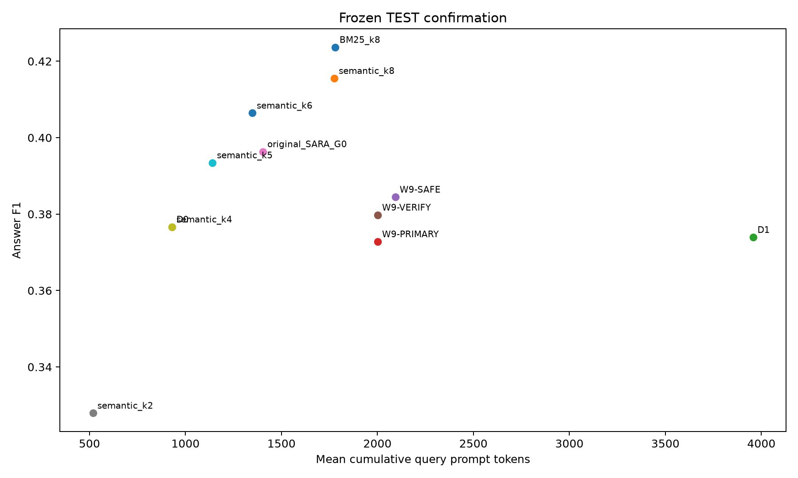

# Week 9 — Part-Wise Analysis

## Week objective

Isolate retrieval, evidence count, selector, representation and revision effects, then evaluate frozen systems on historical QASPER TEST.

# Part PRE — Model/interface preflight

**Status: SMOKE-TESTED**

## 1. Research question

Can candidate generator interfaces execute reliably before expensive evidence studies?

## 2. Experimental design

| component         | value                                                                      |
|:------------------|:---------------------------------------------------------------------------|
| dataset           | QASPER FIT1746; INTERNAL-VAL342 where named; H historical TEST1309         |
| retrieval         | Frozen FIXED-5 / SEMANTIC / width20                                        |
| selector          | DraftSemantic for controlled representation diagnostics                    |
| coarse_evidence_k | Primary K0; forced intervention diagnostic K2                              |
| seed              | 42                                                                         |
| Role              | Protocol/context only; outcomes are accepted only from the artifacts below |

## 3. What was implemented / executed

The status is based on the available artifacts, not notebook existence alone. Available outputs must be interpreted under the status shown.

## 4. Result artifacts used

- [results/week9/preflight/smoke_summary.json](../../week9/preflight/smoke_summary.json)

## 5. Main numerical results

### Numerical preflight fields

| field                         |              value |
|:------------------------------|-------------------:|
| [0].queries                   |           2.000000 |
| [0].f1                        |           0.029412 |
| [0].exact_match               |           0.000000 |
| [0].help_rate                 |           0.000000 |
| [0].hurt_rate                 |           1.000000 |
| [0].evidence_utilization_rate |           1.000000 |
| [0].faithfulness              |         nan        |
| [0].empty_rate                |           0.000000 |
| [0].malformed_rate            |           0.000000 |
| [0].mean_input_tokens         |         208.500000 |
| [0].mean_generated_tokens     |          50.000000 |
| [0].mean_total_query_tokens   |         258.500000 |
| [0].mean_latency              |           2.435536 |
| [0].p50_latency               |           2.435536 |
| [0].p95_latency               |           4.015239 |
| [0].peak_memory_allocated     | 14555941376.000000 |
| [0].peak_memory_reserved      | 14852030464.000000 |
| [0].mean_input_characters     |         950.000000 |
| [1].queries                   |           2.000000 |
| [1].f1                        |         nan        |
| [1].exact_match               |         nan        |
| [1].help_rate                 |         nan        |
| [1].hurt_rate                 |         nan        |
| [1].evidence_utilization_rate |         nan        |
| [1].faithfulness              |         nan        |
| [1].empty_rate                |           0.000000 |
| [1].malformed_rate            |           1.000000 |
| [1].mean_input_tokens         |         236.500000 |
| [1].mean_generated_tokens     |         256.000000 |
| [1].mean_total_query_tokens   |         492.500000 |
| [1].mean_latency              |           8.907656 |
| [1].p50_latency               |           8.907656 |
| [1].p95_latency               |           8.926112 |
| [1].peak_memory_allocated     | 14631406592.000000 |
| [1].peak_memory_reserved      | 14860419072.000000 |
| [1].mean_input_characters     |        1055.000000 |
| [2].queries                   |           2.000000 |
| [2].f1                        |         nan        |
| [2].exact_match               |         nan        |
| [2].help_rate                 |         nan        |
| [2].hurt_rate                 |         nan        |
| [2].evidence_utilization_rate |         nan        |
| [2].faithfulness              |         nan        |
| [2].empty_rate                |           0.000000 |
| [2].malformed_rate            |           1.000000 |
| [2].mean_input_tokens         |         244.500000 |
| [2].mean_generated_tokens     |         256.000000 |
| [2].mean_total_query_tokens   |        1414.000000 |
| [2].mean_latency              |           8.877046 |
| [2].p50_latency               |           8.877046 |
| [2].p95_latency               |           8.894091 |
| [2].peak_memory_allocated     | 14630382592.000000 |
| [2].peak_memory_reserved      | 14860419072.000000 |
| [2].mean_input_characters     |        1095.000000 |
| [3].queries                   |           2.000000 |
| [3].f1                        |           0.041667 |
| [3].exact_match               |           0.000000 |
| [3].help_rate                 |           0.000000 |
| [3].hurt_rate                 |           1.000000 |
| [3].evidence_utilization_rate |           1.000000 |
| [3].faithfulness              |         nan        |
| [3].empty_rate                |           0.000000 |
| [3].malformed_rate            |           0.000000 |
| [3].mean_input_tokens         |         111.000000 |
| [3].mean_generated_tokens     |          32.000000 |
| [3].mean_total_query_tokens   |        1056.500000 |
| [3].mean_latency              |           1.137431 |
| [3].p50_latency               |           1.137431 |
| [3].p95_latency               |           1.643650 |
| [3].peak_memory_allocated     | 14522857984.000000 |
| [3].peak_memory_reserved      | 14860419072.000000 |
| [3].mean_input_characters     |         508.000000 |
| [4].queries                   |           2.000000 |
| [4].f1                        |           0.100000 |
| [4].exact_match               |           0.000000 |
| [4].help_rate                 |           0.000000 |
| [4].hurt_rate                 |           1.000000 |
| [4].evidence_utilization_rate |           1.000000 |
| [4].faithfulness              |         nan        |
| [4].empty_rate                |           0.000000 |
| [4].malformed_rate            |           0.000000 |
| [4].mean_input_tokens         |         191.000000 |
| [4].mean_generated_tokens     |          29.500000 |
| [4].mean_total_query_tokens   |        1134.000000 |
| [4].mean_latency              |           1.063446 |
| [4].p50_latency               |           1.063446 |
| [4].p95_latency               |           1.424379 |
| [4].peak_memory_allocated     | 14543546368.000000 |
| [4].peak_memory_reserved      | 14860419072.000000 |
| [4].mean_input_characters     |         916.000000 |
| [5].queries                   |           2.000000 |
| [5].f1                        |           0.100000 |
| [5].exact_match               |           0.000000 |
| [5].help_rate                 |           0.000000 |
| [5].hurt_rate                 |           1.000000 |
| [5].evidence_utilization_rate |           1.000000 |
| [5].faithfulness              |         nan        |
| [5].empty_rate                |           0.000000 |
| [5].malformed_rate            |           0.000000 |
| [5].mean_input_tokens         |         215.500000 |
| [5].mean_generated_tokens     |          14.500000 |
| [5].mean_total_query_tokens   |         230.000000 |
| [5].mean_latency              |           1.414332 |
| [5].p50_latency               |           1.414332 |
| [5].p95_latency               |           1.541930 |
| [5].peak_memory_allocated     |  8962191360.000000 |
| [5].peak_memory_reserved      | 14300479488.000000 |
| [5].mean_input_characters     |        1079.000000 |
| [6].queries                   |           2.000000 |
| [6].f1                        |         nan        |
| [6].exact_match               |         nan        |
| [6].help_rate                 |         nan        |
| [6].hurt_rate                 |         nan        |
| [6].evidence_utilization_rate |         nan        |
| [6].faithfulness              |           0.666667 |
| [6].empty_rate                |           0.000000 |
| [6].malformed_rate            |           0.000000 |
| [6].mean_input_tokens         |         233.500000 |
| [6].mean_generated_tokens     |          69.000000 |
| [6].mean_total_query_tokens   |         302.500000 |
| [6].mean_latency              |           6.499554 |
| [6].p50_latency               |           6.499554 |
| [6].p95_latency               |           6.856166 |
| [6].peak_memory_allocated     |  8962191360.000000 |
| [6].peak_memory_reserved      | 14306770944.000000 |
| [6].mean_input_characters     |        1184.000000 |
| [7].queries                   |           2.000000 |
| [7].f1                        |         nan        |
| [7].exact_match               |         nan        |
| [7].help_rate                 |         nan        |
| [7].hurt_rate                 |         nan        |
| [7].evidence_utilization_rate |         nan        |
| [7].faithfulness              |           0.416667 |
| [7].empty_rate                |           0.000000 |
| [7].malformed_rate            |           0.000000 |
| [7].mean_input_tokens         |         240.000000 |
| [7].mean_generated_tokens     |          72.000000 |
| [7].mean_total_query_tokens   |        1225.500000 |
| [7].mean_latency              |           6.771613 |
| [7].p50_latency               |           6.771613 |
| [7].p95_latency               |           6.851533 |
| [7].peak_memory_allocated     |  8962191360.000000 |
| [7].peak_memory_reserved      | 14313062400.000000 |
| [7].mean_input_characters     |        1224.000000 |
| [8].queries                   |           2.000000 |
| [8].f1                        |           0.055556 |
| [8].exact_match               |           0.000000 |
| [8].help_rate                 |           0.000000 |
| [8].hurt_rate                 |           1.000000 |
| [8].evidence_utilization_rate |           1.000000 |
| [8].faithfulness              |         nan        |
| [8].empty_rate                |           0.000000 |
| [8].malformed_rate            |           0.000000 |
| [8].mean_input_tokens         |         118.500000 |
| [8].mean_generated_tokens     |          22.000000 |
| [8].mean_total_query_tokens   |        1054.000000 |
| [8].mean_latency              |           2.102235 |
| [8].p50_latency               |           2.102235 |
| [8].p95_latency               |           2.870708 |
| [8].peak_memory_allocated     |  8962191360.000000 |
| [8].peak_memory_reserved      | 14313062400.000000 |
| [8].mean_input_characters     |         637.000000 |
| [9].queries                   |           2.000000 |
| [9].f1                        |           0.360714 |
| [9].exact_match               |           0.000000 |
| [9].help_rate                 |           0.000000 |
| [9].hurt_rate                 |           1.000000 |
| [9].evidence_utilization_rate |           1.000000 |
| [9].faithfulness              |         nan        |
| [9].empty_rate                |           0.000000 |
| [9].malformed_rate            |           0.000000 |
| [9].mean_input_tokens         |         193.000000 |
| [9].mean_generated_tokens     |          30.500000 |
| [9].mean_total_query_tokens   |        1137.000000 |
| [9].mean_latency              |           2.907334 |
| [9].p50_latency               |           2.907334 |
| [9].p95_latency               |           4.476919 |
| [9].peak_memory_allocated     |  8962191360.000000 |
| [9].peak_memory_reserved      | 14313062400.000000 |
| [9].mean_input_characters     |        1045.000000 |

Source: [results/week9/preflight/smoke_summary.json](../../week9/preflight/smoke_summary.json).

## 6. Figures

No saved figure is used for this part; no visualization is fabricated.

## 7. Statistical analysis

No formal inferential test was found for this comparison.

## 8. Interpretation

### Supported

Preflight/smoke artifacts exist; model qualification is not downstream quality evaluation.

### Not established

Point-estimate rankings do not establish statistical superiority. Implementation, qualification and retrospective oracle ceilings are not deployed or held-out quality results. Missing model/split/seed details are not established from available primary artifacts.

### Important caveats

Archived preflight failures must not be merged with final frozen outcomes.

## 9. Part conclusion

- Preflight/smoke artifacts exist; model qualification is not downstream quality evaluation.
- No additional method-selection decision is inferred beyond the recorded protocol/freeze artifacts.

# Part A — Chunking / retrieval freeze

**Status: COMPLETED**

## 1. Research question

Which chunking/retrieval configuration supplies a high-recall pool?

## 2. Experimental design

| component         | value                                                                      |
|:------------------|:---------------------------------------------------------------------------|
| dataset           | QASPER FIT1746; INTERNAL-VAL342 where named; H historical TEST1309         |
| retrieval         | Frozen FIXED-5 / SEMANTIC / width20                                        |
| selector          | DraftSemantic for controlled representation diagnostics                    |
| coarse_evidence_k | Primary K0; forced intervention diagnostic K2                              |
| seed              | 42                                                                         |
| Role              | Protocol/context only; outcomes are accepted only from the artifacts below |

## 3. What was implemented / executed

Completed machine-readable output is present for the named conditions; coverage is limited to the recorded rows and checks below.

## 4. Result artifacts used

- [results/week9/retrieval/fit/w9a_summary.csv](../../week9/retrieval/fit/w9a_summary.csv)
- [results/week9/frozen/w9a_frozen_config.json](../../week9/frozen/w9a_frozen_config.json)

## 5. Main numerical results

### Chunking / retrieval freeze primary outcome table

| representation   | retriever   |   retrieval_width |   any_gold_evidence_recall |   all_gold_evidence_recall |   retrieved_context_tokens |   evidence_overlap_density |
|:-----------------|:------------|------------------:|---------------------------:|---------------------------:|---------------------------:|---------------------------:|
| FIXED-5          | SEMANTIC    |                10 |                   0.945898 |                   0.873960 |                5364.430126 |                   0.050515 |
| FIXED-5          | SEMANTIC    |                20 |                   0.948870 |                   0.878716 |                5600.471936 |                   0.050366 |
| FIXED-5          | SEMANTIC    |                40 |                   0.948870 |                   0.878716 |                5613.739404 |                   0.050360 |

Source: [results/week9/retrieval/fit/w9a_summary.csv](../../week9/retrieval/fit/w9a_summary.csv).

## 6. Figures

No saved figure is used for this part; no visualization is fabricated.

## 7. Statistical analysis

Where bootstrap CSVs exist they specify10000 paired paper-cluster resamples and seed42; intervals are nominal unless a frozen correction is explicitly recorded. F2-frozen comparisons are post-selection. No significance is inferred from means alone.

## 8. Interpretation

### Supported

The frozen configuration is FIXED-5 / SEMANTIC / width20; recall/cost identity is compared before downstream generation.

### Not established

Point-estimate rankings do not establish statistical superiority. Implementation, qualification and retrospective oracle ceilings are not deployed or held-out quality results. Missing model/split/seed details are not established from available primary artifacts.

### Important caveats

Do not conflate no-intervention primary policy with forced-K2 diagnostics. Retrospective oracles and action-space screens are not deployable results.

## 9. Part conclusion

- The frozen configuration is FIXED-5 / SEMANTIC / width20; recall/cost identity is compared before downstream generation.
- No additional method-selection decision is inferred beyond the recorded protocol/freeze artifacts.

# Part B — Evidence-count surface

**Status: COMPLETED**

## 1. Research question

Do fixed evidence counts improve the original draft?

## 2. Experimental design

| component         | value                                                                      |
|:------------------|:---------------------------------------------------------------------------|
| dataset           | QASPER FIT1746; INTERNAL-VAL342 where named; H historical TEST1309         |
| retrieval         | Frozen FIXED-5 / SEMANTIC / width20                                        |
| selector          | DraftSemantic for controlled representation diagnostics                    |
| coarse_evidence_k | Primary K0; forced intervention diagnostic K2                              |
| seed              | 42                                                                         |
| Role              | Protocol/context only; outcomes are accepted only from the artifacts below |

## 3. What was implemented / executed

Completed machine-readable output is present for the named conditions; coverage is limited to the recorded rows and checks below.

## 4. Result artifacts used

- [results/week9/ke_surface/fit/w9b_summary.csv](../../week9/ke_surface/fit/w9b_summary.csv)
- [results/week9/frozen/w9b_frozen_config.json](../../week9/frozen/w9b_frozen_config.json)

## 5. Main numerical results

### Evidence-count surface primary outcome table

| policy   |   n_queries |       f1 |   exact_match |   total_query_prompt_tokens |   num_lm_calls |
|:---------|------------:|---------:|--------------:|----------------------------:|---------------:|
| K_E=0    |        1746 | 0.385631 |      0.227950 |                  940.544101 |       1.000000 |
| K_E=1    |        1746 | 0.380967 |      0.201031 |                 2966.892325 |       2.000000 |
| K_E=2    |        1746 | 0.385004 |      0.193013 |                 3981.902062 |       2.000000 |
| K_E=4    |        1746 | 0.380388 |      0.176976 |                 5807.210195 |       2.000000 |

Source: [results/week9/ke_surface/fit/w9b_summary.csv](../../week9/ke_surface/fit/w9b_summary.csv).

## 6. Figures

No saved figure is used for this part; no visualization is fabricated.

## 7. Statistical analysis

Where bootstrap CSVs exist they specify10000 paired paper-cluster resamples and seed42; intervals are nominal unless a frozen correction is explicitly recorded. F2-frozen comparisons are post-selection. No significance is inferred from means alone.

## 8. Interpretation

### Supported

K0 F10.385631 exceeds fixed K1/K2/K4 point estimates; primary policy remains no intervention.

### Not established

Point-estimate rankings do not establish statistical superiority. Implementation, qualification and retrospective oracle ceilings are not deployed or held-out quality results. Missing model/split/seed details are not established from available primary artifacts.

### Important caveats

Do not conflate no-intervention primary policy with forced-K2 diagnostics. Retrospective oracles and action-space screens are not deployable results.

## 9. Part conclusion

- K0 F10.385631 exceeds fixed K1/K2/K4 point estimates; primary policy remains no intervention.
- No additional method-selection decision is inferred beyond the recorded protocol/freeze artifacts.

# Part C — Forced-K2 selector diagnostic

**Status: COMPLETED**

## 1. Research question

Does better selection rescue raw coarse evidence?

## 2. Experimental design

| component         | value                                                                      |
|:------------------|:---------------------------------------------------------------------------|
| dataset           | QASPER FIT1746; INTERNAL-VAL342 where named; H historical TEST1309         |
| retrieval         | Frozen FIXED-5 / SEMANTIC / width20                                        |
| selector          | DraftSemantic for controlled representation diagnostics                    |
| coarse_evidence_k | Primary K0; forced intervention diagnostic K2                              |
| seed              | 42                                                                         |
| Role              | Protocol/context only; outcomes are accepted only from the artifacts below |

## 3. What was implemented / executed

Completed machine-readable output is present for the named conditions; coverage is limited to the recorded rows and checks below.

## 4. Result artifacts used

- [results/week9/diagnostics/w9c_k2/selection/fit/w9c_summary.csv](../../week9/diagnostics/w9c_k2/selection/fit/w9c_summary.csv)

## 5. Main numerical results

### Forced-K2 selector diagnostic primary outcome table

| policy        |   n_queries |       f1 |   exact_match |   total_query_prompt_tokens |   num_lm_calls |
|:--------------|------------:|---------:|--------------:|----------------------------:|---------------:|
| BM25          |        1746 | 0.382157 |      0.190722 |                 4027.894044 |       2.000000 |
| QuerySemantic |        1746 | 0.383490 |      0.192440 |                 3985.801260 |       2.000000 |
| DraftSemantic |        1746 | 0.385004 |      0.193013 |                 3981.902062 |       2.000000 |
| QueryDraft    |        1746 | 0.384095 |      0.193585 |                 4001.830470 |       2.000000 |
| SANE-adapted  |        1746 | 0.386336 |      0.190722 |                 4794.498855 |       3.000000 |

Source: [results/week9/diagnostics/w9c_k2/selection/fit/w9c_summary.csv](../../week9/diagnostics/w9c_k2/selection/fit/w9c_summary.csv).

## 6. Figures

No saved figure is used for this part; no visualization is fabricated.

## 7. Statistical analysis

Where bootstrap CSVs exist they specify10000 paired paper-cluster resamples and seed42; intervals are nominal unless a frozen correction is explicitly recorded. F2-frozen comparisons are post-selection. No significance is inferred from means alone.

## 8. Interpretation

### Supported

SANE-adapted0.386336 vs DraftSemantic0.385004 is a small gain with one extra LM call; cost-efficient DraftSemantic remains the controlled selector.

### Not established

Point-estimate rankings do not establish statistical superiority. Implementation, qualification and retrospective oracle ceilings are not deployed or held-out quality results. Missing model/split/seed details are not established from available primary artifacts.

### Important caveats

Do not conflate no-intervention primary policy with forced-K2 diagnostics. Retrospective oracles and action-space screens are not deployable results.

## 9. Part conclusion

- SANE-adapted0.386336 vs DraftSemantic0.385004 is a small gain with one extra LM call; cost-efficient DraftSemantic remains the controlled selector.
- No additional method-selection decision is inferred beyond the recorded protocol/freeze artifacts.

# Part D — Generative representation transformation

**Status: COMPLETED**

## 1. Research question

Does extracting evidence help beyond the same raw chunks?

## 2. Experimental design

| component         | value                                                                      |
|:------------------|:---------------------------------------------------------------------------|
| dataset           | QASPER FIT1746; INTERNAL-VAL342 where named; H historical TEST1309         |
| retrieval         | Frozen FIXED-5 / SEMANTIC / width20                                        |
| selector          | DraftSemantic for controlled representation diagnostics                    |
| coarse_evidence_k | Primary K0; forced intervention diagnostic K2                              |
| seed              | 42                                                                         |
| Role              | Protocol/context only; outcomes are accepted only from the artifacts below |

## 3. What was implemented / executed

Completed machine-readable output is present for the named conditions; coverage is limited to the recorded rows and checks below.

## 4. Result artifacts used

- [results/week9/diagnostics/w9c_k2/extraction/fit/w9d_summary.csv](../../week9/diagnostics/w9c_k2/extraction/fit/w9d_summary.csv)

## 5. Main numerical results

### Generative representation transformation primary outcome table

| policy   |   n_queries |       f1 |   exact_match |   total_query_prompt_tokens |   num_lm_calls |
|:---------|------------:|---------:|--------------:|----------------------------:|---------------:|
| D0       |        1746 | 0.385631 |      0.227950 |                  940.544101 |       1.000000 |
| D1       |        1746 | 0.385004 |      0.193013 |                 3981.902062 |       2.000000 |
| D2       |        1746 | 0.368659 |      0.205040 |                 5618.391180 |       3.000000 |
| D3       |        1746 | 0.376936 |      0.211340 |                 5690.195876 |       3.000000 |

Source: [results/week9/diagnostics/w9c_k2/extraction/fit/w9d_summary.csv](../../week9/diagnostics/w9c_k2/extraction/fit/w9d_summary.csv).

## 6. Figures

No saved figure is used for this part; no visualization is fabricated.

## 7. Statistical analysis

Where bootstrap CSVs exist they specify10000 paired paper-cluster resamples and seed42; intervals are nominal unless a frozen correction is explicitly recorded. F2-frozen comparisons are post-selection. No significance is inferred from means alone.

## 8. Interpretation

### Supported

Query-only D2 F10.368659 and draft-aware D3 0.376936 trail D00.385631; generative extraction does not establish a quality improvement.

### Not established

Point-estimate rankings do not establish statistical superiority. Implementation, qualification and retrospective oracle ceilings are not deployed or held-out quality results. Missing model/split/seed details are not established from available primary artifacts.

### Important caveats

Do not conflate no-intervention primary policy with forced-K2 diagnostics. Retrospective oracles and action-space screens are not deployable results.

## 9. Part conclusion

- Query-only D2 F10.368659 and draft-aware D3 0.376936 trail D00.385631; generative extraction does not establish a quality improvement.
- No additional method-selection decision is inferred beyond the recorded protocol/freeze artifacts.

# Part E — Grounded extraction / faithfulness

**Status: COMPLETED**

## 1. Research question

Do source support checks and fail-closed extraction make intervention useful?

## 2. Experimental design

| component         | value                                                                      |
|:------------------|:---------------------------------------------------------------------------|
| dataset           | QASPER FIT1746; INTERNAL-VAL342 where named; H historical TEST1309         |
| retrieval         | Frozen FIXED-5 / SEMANTIC / width20                                        |
| selector          | DraftSemantic for controlled representation diagnostics                    |
| coarse_evidence_k | Primary K0; forced intervention diagnostic K2                              |
| seed              | 42                                                                         |
| Role              | Protocol/context only; outcomes are accepted only from the artifacts below |

## 3. What was implemented / executed

Completed machine-readable output is present for the named conditions; coverage is limited to the recorded rows and checks below.

## 4. Result artifacts used

- [results/week9/diagnostics/w9c_k2/grounded_faithfulness/v1/budget_128/fit/answer_and_cost_summary.csv](../../week9/diagnostics/w9c_k2/grounded_faithfulness/v1/budget_128/fit/answer_and_cost_summary.csv)

## 5. Main numerical results

### Grounded extraction / faithfulness primary outcome table

| policy   |   queries |       f1 |   exact_match |   delta_f1 |   total_query_prompt_tokens |   num_lm_calls |
|:---------|----------:|---------:|--------------:|-----------:|----------------------------:|---------------:|
| D0       |      1746 | 0.385631 |      0.227950 |   0.000000 |                  940.544101 |       1.000000 |
| D1       |      1746 | 0.385004 |      0.193013 |  -0.000627 |                 3981.902062 |       2.000000 |
| D2       |      1746 | 0.368659 |      0.205040 |  -0.016972 |                 5618.391180 |       3.000000 |
| D3       |      1746 | 0.376936 |      0.211340 |  -0.008695 |                 5690.195876 |       3.000000 |
| E0       |      1746 | 0.366109 |      0.209049 |  -0.019522 |                 2033.599656 |       2.000000 |
| E1-Q     |      1746 | 0.382523 |      0.223940 |  -0.003108 |                 3365.097938 |       2.066438 |
| E1-QD    |      1746 | 0.382099 |      0.226231 |  -0.003532 |                 3455.739977 |       2.076174 |
| E2       |      1746 | 0.383591 |      0.225659 |  -0.002040 |                 3590.909507 |       2.127721 |

Source: [results/week9/diagnostics/w9c_k2/grounded_faithfulness/v1/budget_128/fit/answer_and_cost_summary.csv](../../week9/diagnostics/w9c_k2/grounded_faithfulness/v1/budget_128/fit/answer_and_cost_summary.csv).

## 6. Figures

No saved figure is used for this part; no visualization is fabricated.

## 7. Statistical analysis

Where bootstrap CSVs exist they specify10000 paired paper-cluster resamples and seed42; intervals are nominal unless a frozen correction is explicitly recorded. F2-frozen comparisons are post-selection. No significance is inferred from means alone.

## 8. Interpretation

### Supported

E0/E1-Q/E1-QD/E2 F1 is0.366109/0.382523/0.382099/0.383591, all below D0. Source grounding is not answer correctness.

### Not established

Point-estimate rankings do not establish statistical superiority. Implementation, qualification and retrospective oracle ceilings are not deployed or held-out quality results. Missing model/split/seed details are not established from available primary artifacts.

### Important caveats

Do not conflate no-intervention primary policy with forced-K2 diagnostics. Retrospective oracles and action-space screens are not deployable results.

## 9. Part conclusion

- E0/E1-Q/E1-QD/E2 F1 is0.366109/0.382523/0.382099/0.383591, all below D0. Source grounding is not answer correctness.
- No additional method-selection decision is inferred beyond the recorded protocol/freeze artifacts.

# Part E3 — Semantic sentence suppression

**Status: COMPLETED**

## 1. Research question

Can non-generative exact-source sentence filtering improve evidence utilization?

## 2. Experimental design

| component         | value                                                                      |
|:------------------|:---------------------------------------------------------------------------|
| dataset           | QASPER FIT1746; INTERNAL-VAL342 where named; H historical TEST1309         |
| retrieval         | Frozen FIXED-5 / SEMANTIC / width20                                        |
| selector          | DraftSemantic for controlled representation diagnostics                    |
| coarse_evidence_k | Primary K0; forced intervention diagnostic K2                              |
| seed              | 42                                                                         |
| Role              | Protocol/context only; outcomes are accepted only from the artifacts below |

## 3. What was implemented / executed

Completed machine-readable output is present for the named conditions; coverage is limited to the recorded rows and checks below.

## 4. Result artifacts used

- [results/week9/w9e3_senttopk/v1/fit/summary.csv](../../week9/w9e3_senttopk/v1/fit/summary.csv)
- [results/week9/w9e3_senttopk/v1/frozen_e3_senttopk.json](../../week9/w9e3_senttopk/v1/frozen_e3_senttopk.json)
- [results/week9/w9e3_senttopk/v1/fit/bootstrap.csv](../../week9/w9e3_senttopk/v1/fit/bootstrap.csv)

## 5. Main numerical results

### Semantic sentence suppression primary outcome table

| policy   |   n_queries |       f1 |   exact_match |   delta_f1 |   total_query_prompt_tokens |   num_lm_calls |
|:---------|------------:|---------:|--------------:|-----------:|----------------------------:|---------------:|
| E0       |        1746 | 0.366109 |      0.209049 |  -0.019522 |                 2033.599656 |       2.000000 |
| E1-Q     |        1746 | 0.382523 |      0.223940 |  -0.003108 |                 3365.097938 |       2.066438 |
| E1-QD    |        1746 | 0.382099 |      0.226231 |  -0.003532 |                 3455.739977 |       2.076174 |
| E2       |        1746 | 0.383591 |      0.225659 |  -0.002040 |                 3590.909507 |       2.127721 |
| D0       |        1746 | 0.385631 |      0.227950 |   0.000000 |                  940.544101 |       1.000000 |
| D1       |        1746 | 0.385004 |      0.193013 |  -0.000627 |                 3981.902062 |       2.000000 |
| D2       |        1746 | 0.368659 |      0.205040 |  -0.016972 |                 5618.391180 |       3.000000 |
| D3       |        1746 | 0.376936 |      0.211340 |  -0.008695 |                 5690.195876 |       3.000000 |
| E3-k1    |        1746 | 0.376361 |      0.218786 |  -0.009271 |                 1957.501718 |       2.000000 |
| E3-k2    |        1746 | 0.381658 |      0.221077 |  -0.003974 |                 1992.202749 |       2.000000 |
| E3-k3    |        1746 | 0.390024 |      0.226231 |   0.004393 |                 2026.312715 |       2.000000 |
| E3-k4    |        1746 | 0.380518 |      0.215349 |  -0.005113 |                 2062.064147 |       2.000000 |
| E3-k6    |        1746 | 0.385909 |      0.217640 |   0.000278 |                 2131.767468 |       2.000000 |
| E3-k8    |        1746 | 0.379924 |      0.215349 |  -0.005707 |                 2202.679267 |       2.000000 |

Source: [results/week9/w9e3_senttopk/v1/fit/summary.csv](../../week9/w9e3_senttopk/v1/fit/summary.csv).

### Stored bootstrap contrasts; interpret named metric/difference exactly

| comparison      |   point_estimate |   ci95_low |   ci95_high |   resamples | cluster   |   seed |
|:----------------|-----------------:|-----------:|------------:|------------:|:----------|-------:|
| E3-k1 - D0      |        -0.009271 |  -0.022229 |    0.003307 |       10000 | paper_id  |     42 |
| E3-k1 - D1      |        -0.008644 |  -0.025509 |    0.008277 |       10000 | paper_id  |     42 |
| E3-k2 - D0      |        -0.003974 |  -0.017109 |    0.008815 |       10000 | paper_id  |     42 |
| E3-k2 - D1      |        -0.003347 |  -0.018465 |    0.012269 |       10000 | paper_id  |     42 |
| E3-k3 - D0      |         0.004393 |  -0.008467 |    0.017454 |       10000 | paper_id  |     42 |
| E3-k3 - D1      |         0.005020 |  -0.010208 |    0.020848 |       10000 | paper_id  |     42 |
| E3-k4 - D0      |        -0.005113 |  -0.018656 |    0.008573 |       10000 | paper_id  |     42 |
| E3-k4 - D1      |        -0.004486 |  -0.018943 |    0.010112 |       10000 | paper_id  |     42 |
| E3-k6 - D0      |         0.000278 |  -0.013954 |    0.014583 |       10000 | paper_id  |     42 |
| E3-k6 - D1      |         0.000905 |  -0.013409 |    0.015910 |       10000 | paper_id  |     42 |
| E3-k8 - D0      |        -0.005707 |  -0.020568 |    0.008933 |       10000 | paper_id  |     42 |
| E3-k8 - D1      |        -0.005080 |  -0.018700 |    0.008935 |       10000 | paper_id  |     42 |
| best-fixed - D0 |         0.004393 |  -0.008467 |    0.017454 |       10000 | paper_id  |     42 |
| best-fixed - D1 |         0.005020 |  -0.010208 |    0.020848 |       10000 | paper_id  |     42 |
| best-fixed - E2 |         0.006433 |  -0.006623 |    0.019558 |       10000 | paper_id  |     42 |

Source: [results/week9/w9e3_senttopk/v1/fit/bootstrap.csv](../../week9/w9e3_senttopk/v1/fit/bootstrap.csv).

## 6. Figures

No saved figure is used for this part; no visualization is fabricated.

## 7. Statistical analysis

Where bootstrap CSVs exist they specify10000 paired paper-cluster resamples and seed42; intervals are nominal unless a frozen correction is explicitly recorded. F2-frozen comparisons are post-selection. No significance is inferred from means alone.

## 8. Interpretation

### Supported

E3-k3 is the FIT-selected fixed policy at F10.390024; its +0.004393 versus D0 has CI[−0.008467,0.017454], so superiority is not established.

### Not established

Point-estimate rankings do not establish statistical superiority. Implementation, qualification and retrospective oracle ceilings are not deployed or held-out quality results. Missing model/split/seed details are not established from available primary artifacts.

### Important caveats

Do not conflate no-intervention primary policy with forced-K2 diagnostics. Retrospective oracles and action-space screens are not deployable results.

## 9. Part conclusion

- E3-k3 is the FIT-selected fixed policy at F10.390024; its +0.004393 versus D0 has CI[−0.008467,0.017454], so superiority is not established.
- No additional method-selection decision is inferred beyond the recorded protocol/freeze artifacts.

# Part F — Revision / preservation modes

**Status: COMPLETED**

## 1. Research question

Can revision prompts retain useful evidence while avoiding harmful edits?

## 2. Experimental design

| component         | value                                                                      |
|:------------------|:---------------------------------------------------------------------------|
| dataset           | QASPER FIT1746; INTERNAL-VAL342 where named; H historical TEST1309         |
| retrieval         | Frozen FIXED-5 / SEMANTIC / width20                                        |
| selector          | DraftSemantic for controlled representation diagnostics                    |
| coarse_evidence_k | Primary K0; forced intervention diagnostic K2                              |
| seed              | 42                                                                         |
| Role              | Protocol/context only; outcomes are accepted only from the artifacts below |

## 3. What was implemented / executed

Completed machine-readable output is present for the named conditions; coverage is limited to the recorded rows and checks below.

## 4. Result artifacts used

- [results/week9/w9f_utilization/v1/fit/summary.csv](../../week9/w9f_utilization/v1/fit/summary.csv)
- [results/week9/w9f_utilization/v1/frozen_w9f_f2.json](../../week9/w9f_utilization/v1/frozen_w9f_f2.json)
- [results/week9/w9f_utilization/v1/fit/bootstrap.csv](../../week9/w9f_utilization/v1/fit/bootstrap.csv)

## 5. Main numerical results

### Revision / preservation modes primary outcome table

| policy    |   n_queries |       f1 |   exact_match |   delta_f1 |   total_query_prompt_tokens |   num_lm_calls |
|:----------|------------:|---------:|--------------:|-----------:|----------------------------:|---------------:|
| D0        |        1746 | 0.385631 |      0.227950 |   0.000000 |                  940.544101 |       1.000000 |
| F0        |        1746 | 0.390024 |      0.226231 |   0.004393 |                 2026.312715 |       2.000000 |
| F1        |        1746 | 0.387094 |      0.229095 |   0.001463 |                 2097.990263 |       2.000000 |
| F2-A      |        1746 | 0.389616 |      0.231386 |   0.003985 |                 2119.990263 |       2.000000 |
| F2-B      |        1746 | 0.386866 |      0.226231 |   0.001235 |                 2130.990263 |       2.000000 |
| F2-frozen |        1746 | 0.389616 |      0.231386 |   0.003985 |                 2119.990263 |       2.000000 |

Source: [results/week9/w9f_utilization/v1/fit/summary.csv](../../week9/w9f_utilization/v1/fit/summary.csv).

### Stored bootstrap contrasts; interpret named metric/difference exactly

| comparison     | actual_left   |   point_estimate |   ci95_low |   ci95_high |   resamples | cluster   |   seed | post_selection   | multiplicity_adjusted   |
|:---------------|:--------------|-----------------:|-----------:|------------:|------------:|:----------|-------:|:-----------------|:------------------------|
| F0 - D0        | F0            |         0.004393 |  -0.008467 |    0.017454 |       10000 | paper_id  |     42 | False            | False                   |
| F1 - D0        | F1            |         0.001463 |  -0.002879 |    0.005921 |       10000 | paper_id  |     42 | False            | False                   |
| F1 - F0        | F1            |        -0.002930 |  -0.015381 |    0.009555 |       10000 | paper_id  |     42 | False            | False                   |
| F2-A - D0      | F2-A          |         0.003985 |  -0.000003 |    0.008224 |       10000 | paper_id  |     42 | False            | False                   |
| F2-A - F0      | F2-A          |        -0.000408 |  -0.012923 |    0.011982 |       10000 | paper_id  |     42 | False            | False                   |
| F2-A - F1      | F2-A          |         0.002522 |  -0.000838 |    0.006018 |       10000 | paper_id  |     42 | False            | False                   |
| F2-B - D0      | F2-B          |         0.001235 |  -0.004746 |    0.007241 |       10000 | paper_id  |     42 | False            | False                   |
| F2-B - F0      | F2-B          |        -0.003158 |  -0.015524 |    0.008825 |       10000 | paper_id  |     42 | False            | False                   |
| F2-B - F1      | F2-B          |        -0.000227 |  -0.005026 |    0.004358 |       10000 | paper_id  |     42 | False            | False                   |
| F2-frozen - D0 | F2-A          |         0.003985 |  -0.000003 |    0.008224 |       10000 | paper_id  |     42 | True             | False                   |
| F2-frozen - F0 | F2-A          |        -0.000408 |  -0.012923 |    0.011982 |       10000 | paper_id  |     42 | True             | False                   |
| F2-frozen - F1 | F2-A          |         0.002522 |  -0.000838 |    0.006018 |       10000 | paper_id  |     42 | True             | False                   |

Source: [results/week9/w9f_utilization/v1/fit/bootstrap.csv](../../week9/w9f_utilization/v1/fit/bootstrap.csv).

## 6. Figures

No saved figure is used for this part; no visualization is fabricated.

## 7. Statistical analysis

Where bootstrap CSVs exist they specify10000 paired paper-cluster resamples and seed42; intervals are nominal unless a frozen correction is explicitly recorded. F2-frozen comparisons are post-selection. No significance is inferred from means alone.

## 8. Interpretation

### Supported

F0 is an alias of E3-k3 (0.390024); frozen F2-A is0.389616. Paired intervals versus D0/F0 span or nearly span zero; no robust revision breakthrough.

### Not established

Point-estimate rankings do not establish statistical superiority. Implementation, qualification and retrospective oracle ceilings are not deployed or held-out quality results. Missing model/split/seed details are not established from available primary artifacts.

### Important caveats

Do not conflate no-intervention primary policy with forced-K2 diagnostics. Retrospective oracles and action-space screens are not deployable results.

## 9. Part conclusion

- F0 is an alias of E3-k3 (0.390024); frozen F2-A is0.389616. Paired intervals versus D0/F0 span or nearly span zero; no robust revision breakthrough.
- No additional method-selection decision is inferred beyond the recorded protocol/freeze artifacts.

# Part G — Action verification

**Status: COMPLETED**

## 1. Research question

Can a lightweight post-draft verifier learn to accept helpful revisions?

## 2. Experimental design

| component         | value                                                                      |
|:------------------|:---------------------------------------------------------------------------|
| dataset           | QASPER FIT1746; INTERNAL-VAL342 where named; H historical TEST1309         |
| retrieval         | Frozen FIXED-5 / SEMANTIC / width20                                        |
| selector          | DraftSemantic for controlled representation diagnostics                    |
| coarse_evidence_k | Primary K0; forced intervention diagnostic K2                              |
| seed              | 42                                                                         |
| Role              | Protocol/context only; outcomes are accepted only from the artifacts below |

## 3. What was implemented / executed

Completed machine-readable output is present for the named conditions; coverage is limited to the recorded rows and checks below.

## 4. Result artifacts used

- [results/week9/w9g_action_verification/v1/controller_fit_oof/summary.csv](../../week9/w9g_action_verification/v1/controller_fit_oof/summary.csv)
- [results/week9/w9g_action_verification/v1/controller_fit_oof/frozen_verifier.json](../../week9/w9g_action_verification/v1/controller_fit_oof/frozen_verifier.json)
- [results/week9/w9g_action_verification/v1/preflight/go_no_go.json](../../week9/w9g_action_verification/v1/preflight/go_no_go.json)
- [results/week9/w9g_action_verification/v1/audit_pre_final/independent_bootstrap.csv](../../week9/w9g_action_verification/v1/audit_pre_final/independent_bootstrap.csv)

## 5. Main numerical results

### Action verification primary outcome table

| model                  | evaluation       |   n_queries |       f1 |   exact_match |   total_query_prompt_tokens |   num_lm_calls |
|:-----------------------|:-----------------|------------:|---------:|--------------:|----------------------------:|---------------:|
| logistic               | nested-paper-OOF |        1746 | 0.389443 |      0.228522 |                 2026.312715 |       2.000000 |
| hist_gradient_boosting | nested-paper-OOF |        1746 | 0.389266 |      0.228522 |                 2026.312715 |       2.000000 |

Source: [results/week9/w9g_action_verification/v1/controller_fit_oof/summary.csv](../../week9/w9g_action_verification/v1/controller_fit_oof/summary.csv).

### Stored bootstrap contrasts; interpret named metric/difference exactly

| comparison      | post_selection   | descriptive   | preregistered_comparison   |   point_estimate |   ci95_low |   ci95_high | cluster   |   papers |   resamples |   seed |
|:----------------|:-----------------|:--------------|:---------------------------|-----------------:|-----------:|------------:|:----------|---------:|------------:|-------:|
| Logistic - D0   | True             | True          | True                       |         0.003812 |  -0.005019 |    0.012492 | paper_id  |      656 |       10000 |     42 |
| Logistic - F0   | True             | True          | True                       |        -0.000581 |  -0.010087 |    0.008749 | paper_id  |      656 |       10000 |     42 |
| Logistic - F2-A | True             | True          | False                      |        -0.000173 |  -0.008565 |    0.008058 | paper_id  |      656 |       10000 |     42 |

Source: [results/week9/w9g_action_verification/v1/audit_pre_final/independent_bootstrap.csv](../../week9/w9g_action_verification/v1/audit_pre_final/independent_bootstrap.csv).

## 6. Figures

No saved figure is used for this part; no visualization is fabricated.

## 7. Statistical analysis

Where bootstrap CSVs exist they specify10000 paired paper-cluster resamples and seed42; intervals are nominal unless a frozen correction is explicitly recorded. F2-frozen comparisons are post-selection. No significance is inferred from means alone.

## 8. Interpretation

### Supported

Nested paper-OOF logistic/HGB F1 is0.389443/0.389266. Retrospective action-oracle headroom is not evidence that a verifier can learn it.

### Not established

Point-estimate rankings do not establish statistical superiority. Implementation, qualification and retrospective oracle ceilings are not deployed or held-out quality results. Missing model/split/seed details are not established from available primary artifacts.

### Important caveats

Do not conflate no-intervention primary policy with forced-K2 diagnostics. Retrospective oracles and action-space screens are not deployable results.

## 9. Part conclusion

- Nested paper-OOF logistic/HGB F1 is0.389443/0.389266. Retrospective action-oracle headroom is not evidence that a verifier can learn it.
- No additional method-selection decision is inferred beyond the recorded protocol/freeze artifacts.

# Part H — Frozen final TEST evaluation

**Status: COMPLETED**

## 1. Research question

Do frozen Week9 systems improve on untouched historical TEST?

## 2. Experimental design

| component         | value                                                                      |
|:------------------|:---------------------------------------------------------------------------|
| dataset           | QASPER FIT1746; INTERNAL-VAL342 where named; H historical TEST1309         |
| retrieval         | Frozen FIXED-5 / SEMANTIC / width20                                        |
| selector          | DraftSemantic for controlled representation diagnostics                    |
| coarse_evidence_k | Primary K0; forced intervention diagnostic K2                              |
| seed              | 42                                                                         |
| Role              | Protocol/context only; outcomes are accepted only from the artifacts below |

## 3. What was implemented / executed

Completed machine-readable output is present for the named conditions; coverage is limited to the recorded rows and checks below.

## 4. Result artifacts used

- [results/week9/w9h_final/v2/report/summary_quality.csv](../../week9/w9h_final/v2/report/summary_quality.csv)
- [results/week9/w9h_final/v2/w9h_pretest_freeze_manifest.json](../../week9/w9h_final/v2/w9h_pretest_freeze_manifest.json)
- [results/week9/w9h_final/v2/report/summary_cost.csv](../../week9/w9h_final/v2/report/summary_cost.csv)
- [results/week9/w9h_final/v2/report/paired_bootstrap.csv](../../week9/w9h_final/v2/report/paired_bootstrap.csv)

## 5. Main numerical results

### Frozen final TEST evaluation primary outcome table

| system           | split   |   n_queries |       f1 |   exact_match |
|:-----------------|:--------|------------:|---------:|--------------:|
| BM25_k8          | test    |        1309 | 0.423667 |      0.233766 |
| D0               | test    |        1309 | 0.376655 |      0.212376 |
| D1               | test    |        1309 | 0.373928 |      0.175707 |
| W9-PRIMARY       | test    |        1309 | 0.372788 |      0.207028 |
| W9-SAFE          | test    |        1309 | 0.384465 |      0.220779 |
| W9-VERIFY        | test    |        1309 | 0.379775 |      0.212376 |
| original_SARA_G0 | test    |        1309 | 0.396357 |      0.222307 |
| semantic_k2      | test    |        1309 | 0.327922 |      0.183346 |
| semantic_k4      | test    |        1309 | 0.376655 |      0.212376 |
| semantic_k5      | test    |        1309 | 0.393448 |      0.220779 |
| semantic_k6      | test    |        1309 | 0.406446 |      0.229947 |
| semantic_k8      | test    |        1309 | 0.415539 |      0.227655 |

Source: [results/week9/w9h_final/v2/report/summary_quality.csv](../../week9/w9h_final/v2/report/summary_quality.csv).

### Stored bootstrap contrasts; interpret named metric/difference exactly

| left       | right            | family      | status     |   delta_f1 |    ci_low |   ci_high | cluster   |   resamples |   seed |
|:-----------|:-----------------|:------------|:-----------|-----------:|----------:|----------:|:----------|------------:|-------:|
| W9-PRIMARY | D0               | primary     | COMPATIBLE |  -0.003867 | -0.020074 |  0.012250 | paper_id  |       10000 |     42 |
| W9-PRIMARY | semantic_k4      | primary     | COMPATIBLE |  -0.003867 | -0.020074 |  0.012250 | paper_id  |       10000 |     42 |
| W9-PRIMARY | semantic_k6      | primary     | COMPATIBLE |  -0.033659 | -0.051087 | -0.016226 | paper_id  |       10000 |     42 |
| W9-PRIMARY | semantic_k8      | primary     | COMPATIBLE |  -0.042752 | -0.060375 | -0.024722 | paper_id  |       10000 |     42 |
| W9-PRIMARY | original_SARA_G0 | primary     | COMPATIBLE |  -0.023569 | -0.040269 | -0.006831 | paper_id  |       10000 |     42 |
| W9-PRIMARY | D1               | mechanistic | COMPATIBLE |  -0.001140 | -0.017496 |  0.015618 | paper_id  |       10000 |     42 |
| W9-SAFE    | W9-PRIMARY       | secondary   | COMPATIBLE |   0.011677 | -0.004018 |  0.027131 | paper_id  |       10000 |     42 |
| W9-VERIFY  | W9-PRIMARY       | secondary   | COMPATIBLE |   0.006987 | -0.003362 |  0.017646 | paper_id  |       10000 |     42 |
| W9-VERIFY  | D0               | secondary   | COMPATIBLE |   0.003120 | -0.009208 |  0.015583 | paper_id  |       10000 |     42 |
| W9-VERIFY  | W9-SAFE          | secondary   | COMPATIBLE |  -0.004690 | -0.016852 |  0.007623 | paper_id  |       10000 |     42 |

Source: [results/week9/w9h_final/v2/report/paired_bootstrap.csv](../../week9/w9h_final/v2/report/paired_bootstrap.csv).

## 6. Figures

No saved figure is used for this part; no visualization is fabricated.

## 7. Statistical analysis

Where bootstrap CSVs exist they specify10000 paired paper-cluster resamples and seed42; intervals are nominal unless a frozen correction is explicitly recorded. F2-frozen comparisons are post-selection. No significance is inferred from means alone.

## 8. Interpretation

### Supported

On1309 TEST queries, W9-PRIMARY F10.372788 trails D00.376655, semantic k60.406446, semantic k80.415539 and BM25_k80.423667. W9-SAFE0.384465 and W9-VERIFY0.379775 are not clear paired improvements.

### Not established

Point-estimate rankings do not establish statistical superiority. Implementation, qualification and retrospective oracle ceilings are not deployed or held-out quality results. Missing model/split/seed details are not established from available primary artifacts.

### Important caveats

FIT selection, diagnostic forced K2 and historical TEST are separate roles. Original SARA/BM25 and dense/semantic systems retain distinct interfaces/checkpoints; whole-system differences are not isolated latent-vs-text causal effects. This cohort is no longer a fresh holdout and must not be used for further tuning.

## 9. Part conclusion

- On1309 TEST queries, W9-PRIMARY F10.372788 trails D00.376655, semantic k60.406446, semantic k80.415539 and BM25_k80.423667. W9-SAFE0.384465 and W9-VERIFY0.379775 are not clear paired improvements.
- No additional method-selection decision is inferred beyond the recorded protocol/freeze artifacts.

# Week 9 — Integrated Analysis

## What changed during this week?

Isolate retrieval, evidence count, selector, representation and revision effects, then evaluate frozen systems on historical QASPER TEST. The parts above retain the distinction between executed outputs, implementation-only work, exploratory diagnostics and retrospective choices.

## Main supported findings

| Finding                                                                                                                                                                                              | Evidence                                                                                                                                                          | Strength                                     |
|:-----------------------------------------------------------------------------------------------------------------------------------------------------------------------------------------------------|:------------------------------------------------------------------------------------------------------------------------------------------------------------------|:---------------------------------------------|
| Preflight/smoke artifacts exist; model qualification is not downstream quality evaluation.                                                                                                           | Part PRE; results/week9/preflight/smoke_summary.json                                                                                                              | SMOKE-TESTED                                 |
| The frozen configuration is FIXED-5 / SEMANTIC / width20; recall/cost identity is compared before downstream generation.                                                                             | Part A; results/week9/retrieval/fit/w9a_summary.csv; results/week9/frozen/w9a_frozen_config.json                                                                  | descriptive; see stated inferential evidence |
| K0 F10.385631 exceeds fixed K1/K2/K4 point estimates; primary policy remains no intervention.                                                                                                        | Part B; results/week9/ke_surface/fit/w9b_summary.csv; results/week9/frozen/w9b_frozen_config.json                                                                 | descriptive; see stated inferential evidence |
| SANE-adapted0.386336 vs DraftSemantic0.385004 is a small gain with one extra LM call; cost-efficient DraftSemantic remains the controlled selector.                                                  | Part C; results/week9/diagnostics/w9c_k2/selection/fit/w9c_summary.csv                                                                                            | descriptive; see stated inferential evidence |
| Query-only D2 F10.368659 and draft-aware D3 0.376936 trail D00.385631; generative extraction does not establish a quality improvement.                                                               | Part D; results/week9/diagnostics/w9c_k2/extraction/fit/w9d_summary.csv                                                                                           | descriptive; see stated inferential evidence |
| E0/E1-Q/E1-QD/E2 F1 is0.366109/0.382523/0.382099/0.383591, all below D0. Source grounding is not answer correctness.                                                                                 | Part E; results/week9/diagnostics/w9c_k2/grounded_faithfulness/v1/budget_128/fit/answer_and_cost_summary.csv                                                      | descriptive; see stated inferential evidence |
| E3-k3 is the FIT-selected fixed policy at F10.390024; its +0.004393 versus D0 has CI[−0.008467,0.017454], so superiority is not established.                                                         | Part E3; results/week9/w9e3_senttopk/v1/fit/summary.csv; results/week9/w9e3_senttopk/v1/frozen_e3_senttopk.json                                                   | descriptive; see stated inferential evidence |
| F0 is an alias of E3-k3 (0.390024); frozen F2-A is0.389616. Paired intervals versus D0/F0 span or nearly span zero; no robust revision breakthrough.                                                 | Part F; results/week9/w9f_utilization/v1/fit/summary.csv; results/week9/w9f_utilization/v1/frozen_w9f_f2.json                                                     | descriptive; see stated inferential evidence |
| Nested paper-OOF logistic/HGB F1 is0.389443/0.389266. Retrospective action-oracle headroom is not evidence that a verifier can learn it.                                                             | Part G; results/week9/w9g_action_verification/v1/controller_fit_oof/summary.csv; results/week9/w9g_action_verification/v1/controller_fit_oof/frozen_verifier.json | descriptive; see stated inferential evidence |
| On1309 TEST queries, W9-PRIMARY F10.372788 trails D00.376655, semantic k60.406446, semantic k80.415539 and BM25_k80.423667. W9-SAFE0.384465 and W9-VERIFY0.379775 are not clear paired improvements. | Part H; results/week9/w9h_final/v2/report/summary_quality.csv; results/week9/w9h_final/v2/w9h_pretest_freeze_manifest.json                                        | descriptive; see stated inferential evidence |

## Negative / null findings

Raw/generative evidence intervention fails to establish a robust gain; selector/revision changes are small; frozen primary TEST system trails strong fixed baselines.

## What remained unresolved?

Extensive FIT exploration; historical TEST now consumed; whole-system comparisons; cost components not measured end-to-end.

## What logically motivated the next week?

Week10 source/protocol introduces root-cause reader/retriever/interface diagnostics rather than another outcome-tuned TEST rerun.

## Offline reproducibility / source conflicts

- All main FIT tables record1746 queries; H records1309 TEST queries.
- E3/F alias equality and repeated D0 references preserve one source outcome rather than independent replications.
- TEST consumption is explicitly recorded; later QASPER TEST must remain closed.

Executed notebook coverage (zero-based cell indices):

| artifact                                                 |   executed_output_cells | cell_indices                                                           |
|:---------------------------------------------------------|------------------------:|:-----------------------------------------------------------------------|
| notebooks/week9/week9a_semantic_chunking_retrieval.ipynb |                       3 | 2,3,4                                                                  |
| notebooks/week9/week9f_revision.ipynb                    |                      15 | 1,3,5,7,9,11,13,15,16,18,20,22,24,26,28                                |
| notebooks/week9/week9e_extraction_faithfulness.ipynb     |                      25 | 3,5,7,9,11,13,15,17,19,21,23,25,27,29,31,33,35,37,39,41,43,45,47,49,51 |
| notebooks/week9/week9pre_model_preflight.ipynb           |                       2 | 2,3                                                                    |
| notebooks/week9/week9g_action_verification.ipynb         |                       9 | 3,5,7,9,11,13,15,17,19                                                 |
| notebooks/week9/week9c_selector.ipynb                    |                       4 | 2,3,4,5                                                                |
| notebooks/week9/week9b_evidence_k_surface.ipynb          |                       4 | 2,3,4,6                                                                |
| notebooks/week9/week9g_adaptive_ke.ipynb                 |                       2 | 3,4                                                                    |
| notebooks/week9/week9h_final_evaluation.ipynb            |                       3 | 3,7,9                                                                  |
| notebooks/week9/week9d_representation.ipynb              |                       5 | 2,3,4,5,7                                                              |
| notebooks/week9/week9h_final.ipynb                       |                       2 | 3,4                                                                    |

## Additional primary visualizations

X-axis is recorded prompt/token cost; y-axis historical TEST answer F1. Distinct reader/checkpoint/interface systems remain whole-system comparisons; this consumed TEST cannot guide further tuning.

Source: [results/week9/w9h_final/v2/report/quality_cost.png](../../week9/w9h_final/v2/report/quality_cost.png).

# Primary Sources Used

- [configs/week9/w9a.yaml](../../../configs/week9/w9a.yaml)
- [configs/week9/w9b.yaml](../../../configs/week9/w9b.yaml)
- [configs/week9/w9c.yaml](../../../configs/week9/w9c.yaml)
- [configs/week9/w9c_k2_diagnostic.yaml](../../../configs/week9/w9c_k2_diagnostic.yaml)
- [configs/week9/w9d.yaml](../../../configs/week9/w9d.yaml)
- [configs/week9/w9d_k2_diagnostic.yaml](../../../configs/week9/w9d_k2_diagnostic.yaml)
- [configs/week9/w9e.yaml](../../../configs/week9/w9e.yaml)
- [configs/week9/w9e3_senttopk.yaml](../../../configs/week9/w9e3_senttopk.yaml)
- [configs/week9/w9e_grounded.yaml](../../../configs/week9/w9e_grounded.yaml)
- [configs/week9/w9e_grounded_64.yaml](../../../configs/week9/w9e_grounded_64.yaml)
- [configs/week9/w9f.yaml](../../../configs/week9/w9f.yaml)
- [configs/week9/w9f_utilization.yaml](../../../configs/week9/w9f_utilization.yaml)
- [configs/week9/w9g.yaml](../../../configs/week9/w9g.yaml)
- [configs/week9/w9g_action_verification.yaml](../../../configs/week9/w9g_action_verification.yaml)
- [configs/week9/w9h.yaml](../../../configs/week9/w9h.yaml)
- [configs/week9/w9pre_deepseek_nf4_fp32.yaml](../../../configs/week9/w9pre_deepseek_nf4_fp32.yaml)
- [configs/week9/w9pre_models.yaml](../../../configs/week9/w9pre_models.yaml)
- [notebooks/week9/week9a_semantic_chunking_retrieval.ipynb](../../../notebooks/week9/week9a_semantic_chunking_retrieval.ipynb)
- [notebooks/week9/week9b_evidence_k_surface.ipynb](../../../notebooks/week9/week9b_evidence_k_surface.ipynb)
- [notebooks/week9/week9c_selector.ipynb](../../../notebooks/week9/week9c_selector.ipynb)
- [notebooks/week9/week9d_representation.ipynb](../../../notebooks/week9/week9d_representation.ipynb)
- [notebooks/week9/week9e_extraction_faithfulness.ipynb](../../../notebooks/week9/week9e_extraction_faithfulness.ipynb)
- [notebooks/week9/week9f_revision.ipynb](../../../notebooks/week9/week9f_revision.ipynb)
- [notebooks/week9/week9g_action_verification.ipynb](../../../notebooks/week9/week9g_action_verification.ipynb)
- [notebooks/week9/week9g_adaptive_ke.ipynb](../../../notebooks/week9/week9g_adaptive_ke.ipynb)
- [notebooks/week9/week9h_final.ipynb](../../../notebooks/week9/week9h_final.ipynb)
- [notebooks/week9/week9h_final_evaluation.ipynb](../../../notebooks/week9/week9h_final_evaluation.ipynb)
- [notebooks/week9/week9pre_model_preflight.ipynb](../../../notebooks/week9/week9pre_model_preflight.ipynb)
- [results/week9/diagnostics/w9c_k2/extraction/fit/w9d_summary.csv](../../week9/diagnostics/w9c_k2/extraction/fit/w9d_summary.csv)
- [results/week9/diagnostics/w9c_k2/grounded_faithfulness/v1/budget_128/fit/answer_and_cost_summary.csv](../../week9/diagnostics/w9c_k2/grounded_faithfulness/v1/budget_128/fit/answer_and_cost_summary.csv)
- [results/week9/diagnostics/w9c_k2/selection/fit/w9c_summary.csv](../../week9/diagnostics/w9c_k2/selection/fit/w9c_summary.csv)
- [results/week9/frozen/w9a_frozen_config.json](../../week9/frozen/w9a_frozen_config.json)
- [results/week9/frozen/w9b_frozen_config.json](../../week9/frozen/w9b_frozen_config.json)
- [results/week9/ke_surface/fit/w9b_summary.csv](../../week9/ke_surface/fit/w9b_summary.csv)
- [results/week9/preflight/smoke_summary.json](../../week9/preflight/smoke_summary.json)
- [results/week9/retrieval/fit/w9a_summary.csv](../../week9/retrieval/fit/w9a_summary.csv)
- [results/week9/w9e3_senttopk/v1/fit/bootstrap.csv](../../week9/w9e3_senttopk/v1/fit/bootstrap.csv)
- [results/week9/w9e3_senttopk/v1/fit/summary.csv](../../week9/w9e3_senttopk/v1/fit/summary.csv)
- [results/week9/w9e3_senttopk/v1/frozen_e3_senttopk.json](../../week9/w9e3_senttopk/v1/frozen_e3_senttopk.json)
- [results/week9/w9f_utilization/v1/fit/bootstrap.csv](../../week9/w9f_utilization/v1/fit/bootstrap.csv)
- [results/week9/w9f_utilization/v1/fit/summary.csv](../../week9/w9f_utilization/v1/fit/summary.csv)
- [results/week9/w9f_utilization/v1/frozen_w9f_f2.json](../../week9/w9f_utilization/v1/frozen_w9f_f2.json)
- [results/week9/w9g_action_verification/v1/audit_pre_final/independent_bootstrap.csv](../../week9/w9g_action_verification/v1/audit_pre_final/independent_bootstrap.csv)
- [results/week9/w9g_action_verification/v1/controller_fit_oof/frozen_verifier.json](../../week9/w9g_action_verification/v1/controller_fit_oof/frozen_verifier.json)
- [results/week9/w9g_action_verification/v1/controller_fit_oof/summary.csv](../../week9/w9g_action_verification/v1/controller_fit_oof/summary.csv)
- [results/week9/w9g_action_verification/v1/preflight/go_no_go.json](../../week9/w9g_action_verification/v1/preflight/go_no_go.json)
- [results/week9/w9h_final/v2/report/paired_bootstrap.csv](../../week9/w9h_final/v2/report/paired_bootstrap.csv)
- [results/week9/w9h_final/v2/report/summary_cost.csv](../../week9/w9h_final/v2/report/summary_cost.csv)
- [results/week9/w9h_final/v2/report/summary_quality.csv](../../week9/w9h_final/v2/report/summary_quality.csv)
- [results/week9/w9h_final/v2/w9h_pretest_freeze_manifest.json](../../week9/w9h_final/v2/w9h_pretest_freeze_manifest.json)

- [results/week9/w9h_final/v2/report/quality_cost.png](../../week9/w9h_final/v2/report/quality_cost.png)

# Existing Markdown Used as Evidence

NONE
