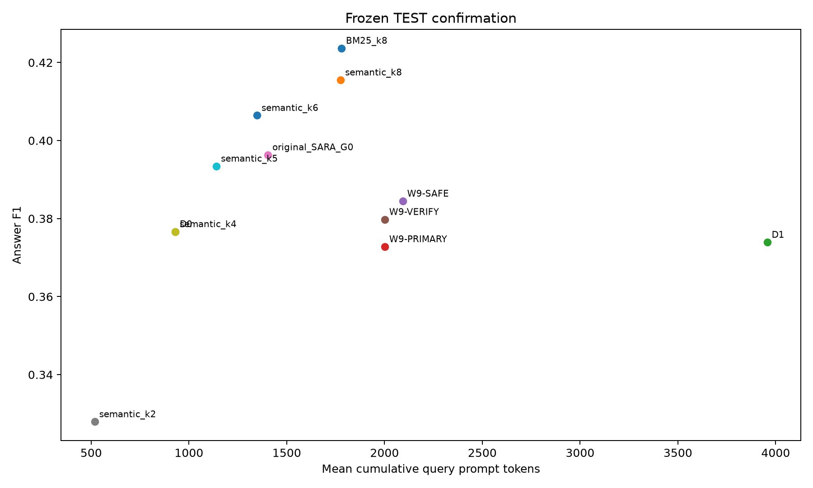

# Week 9 — Summary Analysis

## Objective

Isolate retrieval, evidence count, selector, representation and revision effects, then evaluate frozen systems on historical QASPER TEST.

## Experiments performed

| Part   | Question                                                                               | Status       | Main_result                                                                                                                                                                                          |
|:-------|:---------------------------------------------------------------------------------------|:-------------|:-----------------------------------------------------------------------------------------------------------------------------------------------------------------------------------------------------|
| PRE    | Can candidate generator interfaces execute reliably before expensive evidence studies? | SMOKE-TESTED | Preflight/smoke artifacts exist; model qualification is not downstream quality evaluation.                                                                                                           |
| A      | Which chunking/retrieval configuration supplies a high-recall pool?                    | COMPLETED    | The frozen configuration is FIXED-5 / SEMANTIC / width20; recall/cost identity is compared before downstream generation.                                                                             |
| B      | Do fixed evidence counts improve the original draft?                                   | COMPLETED    | K0 F10.385631 exceeds fixed K1/K2/K4 point estimates; primary policy remains no intervention.                                                                                                        |
| C      | Does better selection rescue raw coarse evidence?                                      | COMPLETED    | SANE-adapted0.386336 vs DraftSemantic0.385004 is a small gain with one extra LM call; cost-efficient DraftSemantic remains the controlled selector.                                                  |
| D      | Does extracting evidence help beyond the same raw chunks?                              | COMPLETED    | Query-only D2 F10.368659 and draft-aware D3 0.376936 trail D00.385631; generative extraction does not establish a quality improvement.                                                               |
| E      | Do source support checks and fail-closed extraction make intervention useful?          | COMPLETED    | E0/E1-Q/E1-QD/E2 F1 is0.366109/0.382523/0.382099/0.383591, all below D0. Source grounding is not answer correctness.                                                                                 |
| E3     | Can non-generative exact-source sentence filtering improve evidence utilization?       | COMPLETED    | E3-k3 is the FIT-selected fixed policy at F10.390024; its +0.004393 versus D0 has CI[−0.008467,0.017454], so superiority is not established.                                                         |
| F      | Can revision prompts retain useful evidence while avoiding harmful edits?              | COMPLETED    | F0 is an alias of E3-k3 (0.390024); frozen F2-A is0.389616. Paired intervals versus D0/F0 span or nearly span zero; no robust revision breakthrough.                                                 |
| G      | Can a lightweight post-draft verifier learn to accept helpful revisions?               | COMPLETED    | Nested paper-OOF logistic/HGB F1 is0.389443/0.389266. Retrospective action-oracle headroom is not evidence that a verifier can learn it.                                                             |
| H      | Do frozen Week9 systems improve on untouched historical TEST?                          | COMPLETED    | On1309 TEST queries, W9-PRIMARY F10.372788 trails D00.376655, semantic k60.406446, semantic k80.415539 and BM25_k80.423667. W9-SAFE0.384465 and W9-VERIFY0.379775 are not clear paired improvements. |

## Key results

### Numerical preflight fields

| field                         |      value |
|:------------------------------|-----------:|
| [0].queries                   |   2.000000 |
| [0].f1                        |   0.029412 |
| [0].exact_match               |   0.000000 |
| [0].help_rate                 |   0.000000 |
| [0].hurt_rate                 |   1.000000 |
| [0].evidence_utilization_rate |   1.000000 |
| [0].faithfulness              | nan        |
| [0].empty_rate                |   0.000000 |
| [0].malformed_rate            |   0.000000 |
| [0].mean_input_tokens         | 208.500000 |
| [0].mean_generated_tokens     |  50.000000 |
| [0].mean_total_query_tokens   | 258.500000 |

Source: [results/week9/preflight/smoke_summary.json](../../week9/preflight/smoke_summary.json). First 12 of 180 rows shown; detailed report and source preserve the full comparison.

### Chunking / retrieval freeze primary outcome table

| representation   | retriever   |   retrieval_width |   any_gold_evidence_recall |   all_gold_evidence_recall |   retrieved_context_tokens |   evidence_overlap_density |
|:-----------------|:------------|------------------:|---------------------------:|---------------------------:|---------------------------:|---------------------------:|
| FIXED-5          | SEMANTIC    |                10 |                   0.945898 |                   0.873960 |                5364.430126 |                   0.050515 |
| FIXED-5          | SEMANTIC    |                20 |                   0.948870 |                   0.878716 |                5600.471936 |                   0.050366 |
| FIXED-5          | SEMANTIC    |                40 |                   0.948870 |                   0.878716 |                5613.739404 |                   0.050360 |

Source: [results/week9/retrieval/fit/w9a_summary.csv](../../week9/retrieval/fit/w9a_summary.csv).

### Evidence-count surface primary outcome table

| policy   |   n_queries |       f1 |   exact_match |   total_query_prompt_tokens |   num_lm_calls |
|:---------|------------:|---------:|--------------:|----------------------------:|---------------:|
| K_E=0    |        1746 | 0.385631 |      0.227950 |                  940.544101 |       1.000000 |
| K_E=1    |        1746 | 0.380967 |      0.201031 |                 2966.892325 |       2.000000 |
| K_E=2    |        1746 | 0.385004 |      0.193013 |                 3981.902062 |       2.000000 |
| K_E=4    |        1746 | 0.380388 |      0.176976 |                 5807.210195 |       2.000000 |

Source: [results/week9/ke_surface/fit/w9b_summary.csv](../../week9/ke_surface/fit/w9b_summary.csv).

### Forced-K2 selector diagnostic primary outcome table

| policy        |   n_queries |       f1 |   exact_match |   total_query_prompt_tokens |   num_lm_calls |
|:--------------|------------:|---------:|--------------:|----------------------------:|---------------:|
| BM25          |        1746 | 0.382157 |      0.190722 |                 4027.894044 |       2.000000 |
| QuerySemantic |        1746 | 0.383490 |      0.192440 |                 3985.801260 |       2.000000 |
| DraftSemantic |        1746 | 0.385004 |      0.193013 |                 3981.902062 |       2.000000 |
| QueryDraft    |        1746 | 0.384095 |      0.193585 |                 4001.830470 |       2.000000 |
| SANE-adapted  |        1746 | 0.386336 |      0.190722 |                 4794.498855 |       3.000000 |

Source: [results/week9/diagnostics/w9c_k2/selection/fit/w9c_summary.csv](../../week9/diagnostics/w9c_k2/selection/fit/w9c_summary.csv).

### Generative representation transformation primary outcome table

| policy   |   n_queries |       f1 |   exact_match |   total_query_prompt_tokens |   num_lm_calls |
|:---------|------------:|---------:|--------------:|----------------------------:|---------------:|
| D0       |        1746 | 0.385631 |      0.227950 |                  940.544101 |       1.000000 |
| D1       |        1746 | 0.385004 |      0.193013 |                 3981.902062 |       2.000000 |
| D2       |        1746 | 0.368659 |      0.205040 |                 5618.391180 |       3.000000 |
| D3       |        1746 | 0.376936 |      0.211340 |                 5690.195876 |       3.000000 |

Source: [results/week9/diagnostics/w9c_k2/extraction/fit/w9d_summary.csv](../../week9/diagnostics/w9c_k2/extraction/fit/w9d_summary.csv).

### Grounded extraction / faithfulness primary outcome table

| policy   |   queries |       f1 |   exact_match |   delta_f1 |   total_query_prompt_tokens |   num_lm_calls |
|:---------|----------:|---------:|--------------:|-----------:|----------------------------:|---------------:|
| D0       |      1746 | 0.385631 |      0.227950 |   0.000000 |                  940.544101 |       1.000000 |
| D1       |      1746 | 0.385004 |      0.193013 |  -0.000627 |                 3981.902062 |       2.000000 |
| D2       |      1746 | 0.368659 |      0.205040 |  -0.016972 |                 5618.391180 |       3.000000 |
| D3       |      1746 | 0.376936 |      0.211340 |  -0.008695 |                 5690.195876 |       3.000000 |
| E0       |      1746 | 0.366109 |      0.209049 |  -0.019522 |                 2033.599656 |       2.000000 |
| E1-Q     |      1746 | 0.382523 |      0.223940 |  -0.003108 |                 3365.097938 |       2.066438 |
| E1-QD    |      1746 | 0.382099 |      0.226231 |  -0.003532 |                 3455.739977 |       2.076174 |
| E2       |      1746 | 0.383591 |      0.225659 |  -0.002040 |                 3590.909507 |       2.127721 |

Source: [results/week9/diagnostics/w9c_k2/grounded_faithfulness/v1/budget_128/fit/answer_and_cost_summary.csv](../../week9/diagnostics/w9c_k2/grounded_faithfulness/v1/budget_128/fit/answer_and_cost_summary.csv).

### Semantic sentence suppression primary outcome table

| policy   |   n_queries |       f1 |   exact_match |   delta_f1 |   total_query_prompt_tokens |   num_lm_calls |
|:---------|------------:|---------:|--------------:|-----------:|----------------------------:|---------------:|
| E0       |        1746 | 0.366109 |      0.209049 |  -0.019522 |                 2033.599656 |       2.000000 |
| E1-Q     |        1746 | 0.382523 |      0.223940 |  -0.003108 |                 3365.097938 |       2.066438 |
| E1-QD    |        1746 | 0.382099 |      0.226231 |  -0.003532 |                 3455.739977 |       2.076174 |
| E2       |        1746 | 0.383591 |      0.225659 |  -0.002040 |                 3590.909507 |       2.127721 |
| D0       |        1746 | 0.385631 |      0.227950 |   0.000000 |                  940.544101 |       1.000000 |
| D1       |        1746 | 0.385004 |      0.193013 |  -0.000627 |                 3981.902062 |       2.000000 |
| D2       |        1746 | 0.368659 |      0.205040 |  -0.016972 |                 5618.391180 |       3.000000 |
| D3       |        1746 | 0.376936 |      0.211340 |  -0.008695 |                 5690.195876 |       3.000000 |
| E3-k1    |        1746 | 0.376361 |      0.218786 |  -0.009271 |                 1957.501718 |       2.000000 |
| E3-k2    |        1746 | 0.381658 |      0.221077 |  -0.003974 |                 1992.202749 |       2.000000 |
| E3-k3    |        1746 | 0.390024 |      0.226231 |   0.004393 |                 2026.312715 |       2.000000 |
| E3-k4    |        1746 | 0.380518 |      0.215349 |  -0.005113 |                 2062.064147 |       2.000000 |

Source: [results/week9/w9e3_senttopk/v1/fit/summary.csv](../../week9/w9e3_senttopk/v1/fit/summary.csv). First 12 of 14 rows shown; detailed report and source preserve the full comparison.

### Stored bootstrap contrasts; interpret named metric/difference exactly

| comparison   |   point_estimate |   ci95_low |   ci95_high |   resamples | cluster   |   seed |
|:-------------|-----------------:|-----------:|------------:|------------:|:----------|-------:|
| E3-k1 - D0   |        -0.009271 |  -0.022229 |    0.003307 |       10000 | paper_id  |     42 |
| E3-k1 - D1   |        -0.008644 |  -0.025509 |    0.008277 |       10000 | paper_id  |     42 |
| E3-k2 - D0   |        -0.003974 |  -0.017109 |    0.008815 |       10000 | paper_id  |     42 |
| E3-k2 - D1   |        -0.003347 |  -0.018465 |    0.012269 |       10000 | paper_id  |     42 |
| E3-k3 - D0   |         0.004393 |  -0.008467 |    0.017454 |       10000 | paper_id  |     42 |
| E3-k3 - D1   |         0.005020 |  -0.010208 |    0.020848 |       10000 | paper_id  |     42 |
| E3-k4 - D0   |        -0.005113 |  -0.018656 |    0.008573 |       10000 | paper_id  |     42 |
| E3-k4 - D1   |        -0.004486 |  -0.018943 |    0.010112 |       10000 | paper_id  |     42 |
| E3-k6 - D0   |         0.000278 |  -0.013954 |    0.014583 |       10000 | paper_id  |     42 |
| E3-k6 - D1   |         0.000905 |  -0.013409 |    0.015910 |       10000 | paper_id  |     42 |
| E3-k8 - D0   |        -0.005707 |  -0.020568 |    0.008933 |       10000 | paper_id  |     42 |
| E3-k8 - D1   |        -0.005080 |  -0.018700 |    0.008935 |       10000 | paper_id  |     42 |

Source: [results/week9/w9e3_senttopk/v1/fit/bootstrap.csv](../../week9/w9e3_senttopk/v1/fit/bootstrap.csv). First 12 of 15 rows shown; detailed report and source preserve the full comparison.

### Revision / preservation modes primary outcome table

| policy    |   n_queries |       f1 |   exact_match |   delta_f1 |   total_query_prompt_tokens |   num_lm_calls |
|:----------|------------:|---------:|--------------:|-----------:|----------------------------:|---------------:|
| D0        |        1746 | 0.385631 |      0.227950 |   0.000000 |                  940.544101 |       1.000000 |
| F0        |        1746 | 0.390024 |      0.226231 |   0.004393 |                 2026.312715 |       2.000000 |
| F1        |        1746 | 0.387094 |      0.229095 |   0.001463 |                 2097.990263 |       2.000000 |
| F2-A      |        1746 | 0.389616 |      0.231386 |   0.003985 |                 2119.990263 |       2.000000 |
| F2-B      |        1746 | 0.386866 |      0.226231 |   0.001235 |                 2130.990263 |       2.000000 |
| F2-frozen |        1746 | 0.389616 |      0.231386 |   0.003985 |                 2119.990263 |       2.000000 |

Source: [results/week9/w9f_utilization/v1/fit/summary.csv](../../week9/w9f_utilization/v1/fit/summary.csv).

### Stored bootstrap contrasts; interpret named metric/difference exactly

| comparison     | actual_left   |   point_estimate |   ci95_low |   ci95_high |   resamples | cluster   |   seed | post_selection   | multiplicity_adjusted   |
|:---------------|:--------------|-----------------:|-----------:|------------:|------------:|:----------|-------:|:-----------------|:------------------------|
| F0 - D0        | F0            |         0.004393 |  -0.008467 |    0.017454 |       10000 | paper_id  |     42 | False            | False                   |
| F1 - D0        | F1            |         0.001463 |  -0.002879 |    0.005921 |       10000 | paper_id  |     42 | False            | False                   |
| F1 - F0        | F1            |        -0.002930 |  -0.015381 |    0.009555 |       10000 | paper_id  |     42 | False            | False                   |
| F2-A - D0      | F2-A          |         0.003985 |  -0.000003 |    0.008224 |       10000 | paper_id  |     42 | False            | False                   |
| F2-A - F0      | F2-A          |        -0.000408 |  -0.012923 |    0.011982 |       10000 | paper_id  |     42 | False            | False                   |
| F2-A - F1      | F2-A          |         0.002522 |  -0.000838 |    0.006018 |       10000 | paper_id  |     42 | False            | False                   |
| F2-B - D0      | F2-B          |         0.001235 |  -0.004746 |    0.007241 |       10000 | paper_id  |     42 | False            | False                   |
| F2-B - F0      | F2-B          |        -0.003158 |  -0.015524 |    0.008825 |       10000 | paper_id  |     42 | False            | False                   |
| F2-B - F1      | F2-B          |        -0.000227 |  -0.005026 |    0.004358 |       10000 | paper_id  |     42 | False            | False                   |
| F2-frozen - D0 | F2-A          |         0.003985 |  -0.000003 |    0.008224 |       10000 | paper_id  |     42 | True             | False                   |
| F2-frozen - F0 | F2-A          |        -0.000408 |  -0.012923 |    0.011982 |       10000 | paper_id  |     42 | True             | False                   |
| F2-frozen - F1 | F2-A          |         0.002522 |  -0.000838 |    0.006018 |       10000 | paper_id  |     42 | True             | False                   |

Source: [results/week9/w9f_utilization/v1/fit/bootstrap.csv](../../week9/w9f_utilization/v1/fit/bootstrap.csv).

## Main scientific conclusions

- Preflight/smoke artifacts exist; model qualification is not downstream quality evaluation. Source: [results/week9/preflight/smoke_summary.json](../../week9/preflight/smoke_summary.json)
- The frozen configuration is FIXED-5 / SEMANTIC / width20; recall/cost identity is compared before downstream generation. Source: [results/week9/retrieval/fit/w9a_summary.csv](../../week9/retrieval/fit/w9a_summary.csv), [results/week9/frozen/w9a_frozen_config.json](../../week9/frozen/w9a_frozen_config.json)
- K0 F10.385631 exceeds fixed K1/K2/K4 point estimates; primary policy remains no intervention. Source: [results/week9/ke_surface/fit/w9b_summary.csv](../../week9/ke_surface/fit/w9b_summary.csv), [results/week9/frozen/w9b_frozen_config.json](../../week9/frozen/w9b_frozen_config.json)
- SANE-adapted0.386336 vs DraftSemantic0.385004 is a small gain with one extra LM call; cost-efficient DraftSemantic remains the controlled selector. Source: [results/week9/diagnostics/w9c_k2/selection/fit/w9c_summary.csv](../../week9/diagnostics/w9c_k2/selection/fit/w9c_summary.csv)
- Query-only D2 F10.368659 and draft-aware D3 0.376936 trail D00.385631; generative extraction does not establish a quality improvement. Source: [results/week9/diagnostics/w9c_k2/extraction/fit/w9d_summary.csv](../../week9/diagnostics/w9c_k2/extraction/fit/w9d_summary.csv)
- E0/E1-Q/E1-QD/E2 F1 is0.366109/0.382523/0.382099/0.383591, all below D0. Source grounding is not answer correctness. Source: [results/week9/diagnostics/w9c_k2/grounded_faithfulness/v1/budget_128/fit/answer_and_cost_summary.csv](../../week9/diagnostics/w9c_k2/grounded_faithfulness/v1/budget_128/fit/answer_and_cost_summary.csv)
- E3-k3 is the FIT-selected fixed policy at F10.390024; its +0.004393 versus D0 has CI[−0.008467,0.017454], so superiority is not established. Source: [results/week9/w9e3_senttopk/v1/fit/summary.csv](../../week9/w9e3_senttopk/v1/fit/summary.csv), [results/week9/w9e3_senttopk/v1/frozen_e3_senttopk.json](../../week9/w9e3_senttopk/v1/frozen_e3_senttopk.json)
- F0 is an alias of E3-k3 (0.390024); frozen F2-A is0.389616. Paired intervals versus D0/F0 span or nearly span zero; no robust revision breakthrough. Source: [results/week9/w9f_utilization/v1/fit/summary.csv](../../week9/w9f_utilization/v1/fit/summary.csv), [results/week9/w9f_utilization/v1/frozen_w9f_f2.json](../../week9/w9f_utilization/v1/frozen_w9f_f2.json)
- Nested paper-OOF logistic/HGB F1 is0.389443/0.389266. Retrospective action-oracle headroom is not evidence that a verifier can learn it. Source: [results/week9/w9g_action_verification/v1/controller_fit_oof/summary.csv](../../week9/w9g_action_verification/v1/controller_fit_oof/summary.csv), [results/week9/w9g_action_verification/v1/controller_fit_oof/frozen_verifier.json](../../week9/w9g_action_verification/v1/controller_fit_oof/frozen_verifier.json)
- On1309 TEST queries, W9-PRIMARY F10.372788 trails D00.376655, semantic k60.406446, semantic k80.415539 and BM25_k80.423667. W9-SAFE0.384465 and W9-VERIFY0.379775 are not clear paired improvements. Source: [results/week9/w9h_final/v2/report/summary_quality.csv](../../week9/w9h_final/v2/report/summary_quality.csv), [results/week9/w9h_final/v2/w9h_pretest_freeze_manifest.json](../../week9/w9h_final/v2/w9h_pretest_freeze_manifest.json)

## What did NOT work?

Raw/generative evidence intervention fails to establish a robust gain; selector/revision changes are small; frozen primary TEST system trails strong fixed baselines.

## Limitations

Extensive FIT exploration; historical TEST now consumed; whole-system comparisons; cost components not measured end-to-end.

## Decision after this week

Historical final freeze is preserved, without retrospective winner promotion after TEST.

## One-paragraph week takeaway

Preflight/smoke artifacts exist; model qualification is not downstream quality evaluation. The frozen configuration is FIXED-5 / SEMANTIC / width20; recall/cost identity is compared before downstream generation. K0 F10.385631 exceeds fixed K1/K2/K4 point estimates; primary policy remains no intervention. SANE-adapted0.386336 vs DraftSemantic0.385004 is a small gain with one extra LM call; cost-efficient DraftSemantic remains the controlled selector. Query-only D2 F10.368659 and draft-aware D3 0.376936 trail D00.385631; generative extraction does not establish a quality improvement. E0/E1-Q/E1-QD/E2 F1 is0.366109/0.382523/0.382099/0.383591, all below D0. Source grounding is not answer correctness. E3-k3 is the FIT-selected fixed policy at F10.390024; its +0.004393 versus D0 has CI[−0.008467,0.017454], so superiority is not established. F0 is an alias of E3-k3 (0.390024); frozen F2-A is0.389616. Paired intervals versus D0/F0 span or nearly span zero; no robust revision breakthrough. Nested paper-OOF logistic/HGB F1 is0.389443/0.389266. Retrospective action-oracle headroom is not evidence that a verifier can learn it. On1309 TEST queries, W9-PRIMARY F10.372788 trails D00.376655, semantic k60.406446, semantic k80.415539 and BM25_k80.423667. W9-SAFE0.384465 and W9-VERIFY0.379775 are not clear paired improvements.

## Additional primary visualizations

X-axis is recorded prompt/token cost; y-axis historical TEST answer F1. Distinct reader/checkpoint/interface systems remain whole-system comparisons; this consumed TEST cannot guide further tuning.

Source: [results/week9/w9h_final/v2/report/quality_cost.png](../../week9/w9h_final/v2/report/quality_cost.png).

# Primary Sources Used

- [configs/week9/w9a.yaml](../../../configs/week9/w9a.yaml)
- [configs/week9/w9b.yaml](../../../configs/week9/w9b.yaml)
- [configs/week9/w9c.yaml](../../../configs/week9/w9c.yaml)
- [configs/week9/w9c_k2_diagnostic.yaml](../../../configs/week9/w9c_k2_diagnostic.yaml)
- [configs/week9/w9d.yaml](../../../configs/week9/w9d.yaml)
- [configs/week9/w9d_k2_diagnostic.yaml](../../../configs/week9/w9d_k2_diagnostic.yaml)
- [configs/week9/w9e.yaml](../../../configs/week9/w9e.yaml)
- [configs/week9/w9e3_senttopk.yaml](../../../configs/week9/w9e3_senttopk.yaml)
- [configs/week9/w9e_grounded.yaml](../../../configs/week9/w9e_grounded.yaml)
- [configs/week9/w9e_grounded_64.yaml](../../../configs/week9/w9e_grounded_64.yaml)
- [configs/week9/w9f.yaml](../../../configs/week9/w9f.yaml)
- [configs/week9/w9f_utilization.yaml](../../../configs/week9/w9f_utilization.yaml)
- [configs/week9/w9g.yaml](../../../configs/week9/w9g.yaml)
- [configs/week9/w9g_action_verification.yaml](../../../configs/week9/w9g_action_verification.yaml)
- [configs/week9/w9h.yaml](../../../configs/week9/w9h.yaml)
- [configs/week9/w9pre_deepseek_nf4_fp32.yaml](../../../configs/week9/w9pre_deepseek_nf4_fp32.yaml)
- [configs/week9/w9pre_models.yaml](../../../configs/week9/w9pre_models.yaml)
- [notebooks/week9/week9a_semantic_chunking_retrieval.ipynb](../../../notebooks/week9/week9a_semantic_chunking_retrieval.ipynb)
- [notebooks/week9/week9b_evidence_k_surface.ipynb](../../../notebooks/week9/week9b_evidence_k_surface.ipynb)
- [notebooks/week9/week9c_selector.ipynb](../../../notebooks/week9/week9c_selector.ipynb)
- [notebooks/week9/week9d_representation.ipynb](../../../notebooks/week9/week9d_representation.ipynb)
- [notebooks/week9/week9e_extraction_faithfulness.ipynb](../../../notebooks/week9/week9e_extraction_faithfulness.ipynb)
- [notebooks/week9/week9f_revision.ipynb](../../../notebooks/week9/week9f_revision.ipynb)
- [notebooks/week9/week9g_action_verification.ipynb](../../../notebooks/week9/week9g_action_verification.ipynb)
- [notebooks/week9/week9g_adaptive_ke.ipynb](../../../notebooks/week9/week9g_adaptive_ke.ipynb)
- [notebooks/week9/week9h_final.ipynb](../../../notebooks/week9/week9h_final.ipynb)
- [notebooks/week9/week9h_final_evaluation.ipynb](../../../notebooks/week9/week9h_final_evaluation.ipynb)
- [notebooks/week9/week9pre_model_preflight.ipynb](../../../notebooks/week9/week9pre_model_preflight.ipynb)
- [results/week9/diagnostics/w9c_k2/extraction/fit/w9d_summary.csv](../../week9/diagnostics/w9c_k2/extraction/fit/w9d_summary.csv)
- [results/week9/diagnostics/w9c_k2/grounded_faithfulness/v1/budget_128/fit/answer_and_cost_summary.csv](../../week9/diagnostics/w9c_k2/grounded_faithfulness/v1/budget_128/fit/answer_and_cost_summary.csv)
- [results/week9/diagnostics/w9c_k2/selection/fit/w9c_summary.csv](../../week9/diagnostics/w9c_k2/selection/fit/w9c_summary.csv)
- [results/week9/frozen/w9a_frozen_config.json](../../week9/frozen/w9a_frozen_config.json)
- [results/week9/frozen/w9b_frozen_config.json](../../week9/frozen/w9b_frozen_config.json)
- [results/week9/ke_surface/fit/w9b_summary.csv](../../week9/ke_surface/fit/w9b_summary.csv)
- [results/week9/preflight/smoke_summary.json](../../week9/preflight/smoke_summary.json)
- [results/week9/retrieval/fit/w9a_summary.csv](../../week9/retrieval/fit/w9a_summary.csv)
- [results/week9/w9e3_senttopk/v1/fit/bootstrap.csv](../../week9/w9e3_senttopk/v1/fit/bootstrap.csv)
- [results/week9/w9e3_senttopk/v1/fit/summary.csv](../../week9/w9e3_senttopk/v1/fit/summary.csv)
- [results/week9/w9e3_senttopk/v1/frozen_e3_senttopk.json](../../week9/w9e3_senttopk/v1/frozen_e3_senttopk.json)
- [results/week9/w9f_utilization/v1/fit/bootstrap.csv](../../week9/w9f_utilization/v1/fit/bootstrap.csv)
- [results/week9/w9f_utilization/v1/fit/summary.csv](../../week9/w9f_utilization/v1/fit/summary.csv)
- [results/week9/w9f_utilization/v1/frozen_w9f_f2.json](../../week9/w9f_utilization/v1/frozen_w9f_f2.json)
- [results/week9/w9g_action_verification/v1/audit_pre_final/independent_bootstrap.csv](../../week9/w9g_action_verification/v1/audit_pre_final/independent_bootstrap.csv)
- [results/week9/w9g_action_verification/v1/controller_fit_oof/frozen_verifier.json](../../week9/w9g_action_verification/v1/controller_fit_oof/frozen_verifier.json)
- [results/week9/w9g_action_verification/v1/controller_fit_oof/summary.csv](../../week9/w9g_action_verification/v1/controller_fit_oof/summary.csv)
- [results/week9/w9g_action_verification/v1/preflight/go_no_go.json](../../week9/w9g_action_verification/v1/preflight/go_no_go.json)
- [results/week9/w9h_final/v2/report/paired_bootstrap.csv](../../week9/w9h_final/v2/report/paired_bootstrap.csv)
- [results/week9/w9h_final/v2/report/summary_cost.csv](../../week9/w9h_final/v2/report/summary_cost.csv)
- [results/week9/w9h_final/v2/report/summary_quality.csv](../../week9/w9h_final/v2/report/summary_quality.csv)
- [results/week9/w9h_final/v2/w9h_pretest_freeze_manifest.json](../../week9/w9h_final/v2/w9h_pretest_freeze_manifest.json)

- [results/week9/w9h_final/v2/report/quality_cost.png](../../week9/w9h_final/v2/report/quality_cost.png)

# Existing Markdown Used as Evidence

NONE
