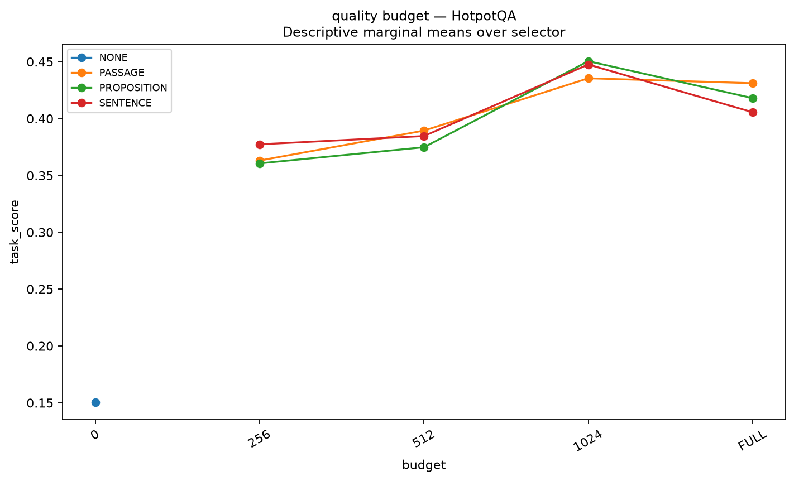

# Week 11 — Part-Wise Analysis

## Week objective

Characterize retrieval, evidence granularity, budget, reader and compressor interactions across three tasks before designing a new allocation method.

# Part 0 — Setup and sampling

**Status: COMPLETED**

## 1. Research question

Which dataset/corpus/interface definitions are actually used?

## 2. Experimental design

| component       | value                                                                      |
|:----------------|:---------------------------------------------------------------------------|
| dataset         | 50 DEV queries each: QASPER, HotpotQA, SciFact;150 total                   |
| retrieval_width | 20                                                                         |
| retrievers      | BM25 / MiniLM / SFR                                                        |
| readers         | Pinned public Qwen3-8B / Mistral7B / Llama3.1-8B                           |
| budgets         | 256/512/1024/FULL as registered                                            |
| seed            | 42                                                                         |
| task_metrics    | QA answer F1/EM; SciFact macro-F1 and accuracy kept separate               |
| Role            | Protocol/context only; outcomes are accepted only from the artifacts below |

## 3. What was implemented / executed

Status records 150 completed / 150 expected executable rows; synthetic=False; pending=[]. This receipt is interpreted only for the named phase.

## 4. Result artifacts used

- [results/week11/multigranular/v1/setup/dataset_summary_df.csv](../../week11/multigranular/v1/setup/dataset_summary_df.csv)
- [results/week11/multigranular/v1/setup/status.json](../../week11/multigranular/v1/setup/status.json)
- [results/week11/multigranular/v1/setup/model_registry_df.csv](../../week11/multigranular/v1/setup/model_registry_df.csv)

## 5. Main numerical results

### dataset summary df

| dataset   | split   |   n_queries | candidate_corpus                                      | synthetic   |   available_queries |
|:----------|:--------|------------:|:------------------------------------------------------|:------------|--------------------:|
| HotpotQA  | dev     |          50 | provided ten distractor paragraphs                    | False       |                7405 |
| QASPER    | dev     |          50 | complete matching scientific paper                    | False       |                 231 |
| SciFact   | dev     |          50 | all corpus abstracts; never only cited/gold documents | False       |                 300 |

Source: [results/week11/multigranular/v1/setup/dataset_summary_df.csv](../../week11/multigranular/v1/setup/dataset_summary_df.csv).

### model registry df

| model       | id                                                  | revision                                 | status             |   smoke_model_loaded | tokenizer                              | dtype   |   quantization |   max_context |   max_new_tokens | decoding   |       seed |   peak_vram_measured |
|:------------|:----------------------------------------------------|:-----------------------------------------|:-------------------|---------------------:|:---------------------------------------|:--------|---------------:|--------------:|-----------------:|:-----------|-----------:|---------------------:|
| Mistral     | mistralai/Mistral-7B-Instruct-v0.2                  | 63a8b081895390a26e140280378bc85ec8bce07a | CACHED_SNAPSHOT    |             0.000000 | mistralai/Mistral-7B-Instruct-v0.2     | float16 |            nan |   8192.000000 |       128.000000 | greedy     |  42.000000 |                  nan |
| MiniLM      | sentence-transformers/all-MiniLM-L6-v2              | 1110a243fdf4706b3f48f1d95db1a4f5529b4d41 | CACHED_SNAPSHOT    |             0.000000 | sentence-transformers/all-MiniLM-L6-v2 | float32 |            nan |    nan        |       nan        | nan        |  42.000000 |                  nan |
| SFR         | Salesforce/SFR-Embedding-Mistral                    | 33a60fe7b5e00b9414981280c571e8a4f9f42f1b | CACHED_SNAPSHOT    |             0.000000 | Salesforce/SFR-Embedding-Mistral       | float16 |            nan |    nan        |       nan        | nan        |  42.000000 |                  nan |
| Qwen        | Qwen/Qwen3-8B                                       | b968826d9c46dd6066d109eabc6255188de91218 | CACHED_SNAPSHOT    |             0.000000 | Qwen/Qwen3-8B                          | float16 |            nan |   8192.000000 |       128.000000 | greedy     |  42.000000 |                  nan |
| Llama       | meta-llama/Llama-3.1-8B-Instruct                    | 0e9e39f249a16976918f6564b8830bc894c89659 | CACHED_SNAPSHOT    |             0.000000 | meta-llama/Llama-3.1-8B-Instruct       | float16 |            nan |   8192.000000 |       128.000000 | greedy     |  42.000000 |                  nan |
| LLMLingua-2 | microsoft/llmlingua-2-xlm-roberta-large-meetingbank | nan                                      | PENDING_DEPENDENCY |           nan        | nan                                    | nan     |            nan |    nan        |       nan        | nan        | nan        |                  nan |

Source: [results/week11/multigranular/v1/setup/model_registry_df.csv](../../week11/multigranular/v1/setup/model_registry_df.csv).

## 6. Figures

No saved figure is used for this part; no visualization is fabricated.

## 7. Statistical analysis

Named paired contrasts use10000 cluster bootstrap resamples, seed42; QASPER paper clusters, HotpotQA/SciFact frozen query/claim groups. Most families are exploratory/post-hoc; an interval crossing zero is not evidence of equivalence.

## 8. Interpretation

### Supported

Fifty label-independent hash-sampled DEV queries per dataset are recorded. HotpotQA uses provided distractor contexts; SciFact retrieves all corpus abstracts, not gold-only documents.

### Not established

Point-estimate rankings do not establish statistical superiority. Implementation, qualification and retrospective oracle ceilings are not deployed or held-out quality results. Missing model/split/seed details are not established from available primary artifacts.

### Important caveats

Small50-query/dataset pilot; many exploratory comparisons; QASPER annotation gaps; strict-prefix allocation can leave no whole passage at256. SciFact Mistral/Llama primary labels are dominated by format violations: do not interpret their low scores as pure reasoning failure. SARA specialist changes adaptation/checkpoint/projector/prompt and is a whole-system comparison.

## 9. Part conclusion

- Fifty label-independent hash-sampled DEV queries per dataset are recorded. HotpotQA uses provided distractor contexts; SciFact retrieves all corpus abstracts, not gold-only documents.
- No additional method-selection decision is inferred beyond the recorded protocol/freeze artifacts.

# Part A — Retrieval × granularity

**Status: COMPLETED**

## 1. Research question

How does retrieval unit size affect annotated-evidence recall and tokens?

## 2. Experimental design

| component       | value                                                                      |
|:----------------|:---------------------------------------------------------------------------|
| dataset         | 50 DEV queries each: QASPER, HotpotQA, SciFact;150 total                   |
| retrieval_width | 20                                                                         |
| retrievers      | BM25 / MiniLM / SFR                                                        |
| readers         | Pinned public Qwen3-8B / Mistral7B / Llama3.1-8B                           |
| budgets         | 256/512/1024/FULL as registered                                            |
| seed            | 42                                                                         |
| task_metrics    | QA answer F1/EM; SciFact macro-F1 and accuracy kept separate               |
| Role            | Protocol/context only; outcomes are accepted only from the artifacts below |

## 3. What was implemented / executed

Status records 1350 completed / 1350 expected executable rows; synthetic=False; pending=[]. This receipt is interpreted only for the named phase.

## 4. Result artifacts used

- [results/week11/multigranular/v1/retrieval/retrieval_summary_df.csv](../../week11/multigranular/v1/retrieval/retrieval_summary_df.csv)
- [results/week11/multigranular/v1/retrieval/status.json](../../week11/multigranular/v1/retrieval/status.json)

## 5. Main numerical results

### retrieval summary df

| dataset   | retriever   | passage_representation   | evidence_granularity   |   k |   n_queries |   any_gold_recall |   all_gold_recall |   retrieved_tokens |
|:----------|:------------|:-------------------------|:-----------------------|----:|------------:|------------------:|------------------:|-------------------:|
| HotpotQA  | SFR         | P0                       | PROPOSITION            |   1 |          50 |          0.720000 |          0.000000 |          30.160000 |
| HotpotQA  | SFR         | P0                       | PROPOSITION            |   2 |          50 |          0.820000 |          0.120000 |          64.180000 |
| HotpotQA  | SFR         | P0                       | PROPOSITION            |   4 |          50 |          0.920000 |          0.360000 |         123.360000 |
| HotpotQA  | SFR         | P0                       | PROPOSITION            |   6 |          50 |          0.960000 |          0.520000 |         182.180000 |
| HotpotQA  | SFR         | P0                       | PROPOSITION            |   8 |          50 |          0.980000 |          0.620000 |         244.040000 |
| HotpotQA  | SFR         | P0                       | PROPOSITION            |  10 |          50 |          1.000000 |          0.680000 |         302.300000 |
| HotpotQA  | MiniLM      | P0                       | PASSAGE                |   1 |          50 |          0.860000 |          0.000000 |          92.200000 |
| HotpotQA  | MiniLM      | P0                       | PASSAGE                |   2 |          50 |          0.960000 |          0.360000 |         209.840000 |
| HotpotQA  | MiniLM      | P0                       | PASSAGE                |   4 |          50 |          1.000000 |          0.660000 |         488.960000 |
| HotpotQA  | MiniLM      | P0                       | PASSAGE                |   6 |          50 |          1.000000 |          0.800000 |         761.720000 |
| HotpotQA  | MiniLM      | P0                       | PASSAGE                |   8 |          50 |          1.000000 |          0.860000 |        1046.100000 |
| HotpotQA  | MiniLM      | P0                       | PASSAGE                |  10 |          50 |          1.000000 |          1.000000 |        1351.040000 |
| HotpotQA  | MiniLM      | P0                       | SENTENCE               |   1 |          50 |          0.460000 |          0.000000 |          20.760000 |
| HotpotQA  | MiniLM      | P0                       | SENTENCE               |   2 |          50 |          0.700000 |          0.040000 |          47.380000 |
| HotpotQA  | MiniLM      | P0                       | SENTENCE               |   4 |          50 |          0.860000 |          0.180000 |          95.880000 |
| HotpotQA  | MiniLM      | P0                       | SENTENCE               |   6 |          50 |          0.940000 |          0.260000 |         155.580000 |
| HotpotQA  | MiniLM      | P0                       | SENTENCE               |   8 |          50 |          0.960000 |          0.340000 |         211.840000 |
| HotpotQA  | MiniLM      | P0                       | SENTENCE               |  10 |          50 |          0.980000 |          0.440000 |         266.620000 |
| HotpotQA  | BM25        | P0                       | PROPOSITION            |   1 |          50 |          0.540000 |          0.000000 |          24.320000 |
| HotpotQA  | BM25        | P0                       | PROPOSITION            |   2 |          50 |          0.680000 |          0.060000 |          50.460000 |
| HotpotQA  | BM25        | P0                       | PROPOSITION            |   4 |          50 |          0.820000 |          0.100000 |         112.560000 |
| HotpotQA  | BM25        | P0                       | PROPOSITION            |   6 |          50 |          0.840000 |          0.160000 |         171.240000 |
| HotpotQA  | BM25        | P0                       | PROPOSITION            |   8 |          50 |          0.920000 |          0.200000 |         239.100000 |
| HotpotQA  | BM25        | P0                       | PROPOSITION            |  10 |          50 |          0.940000 |          0.300000 |         301.880000 |
| HotpotQA  | SFR         | P0                       | SENTENCE               |   1 |          50 |          0.840000 |          0.000000 |          34.180000 |
| HotpotQA  | SFR         | P0                       | SENTENCE               |   2 |          50 |          0.900000 |          0.240000 |          69.060000 |
| HotpotQA  | SFR         | P0                       | SENTENCE               |   4 |          50 |          0.940000 |          0.500000 |         134.880000 |
| HotpotQA  | SFR         | P0                       | SENTENCE               |   6 |          50 |          0.960000 |          0.580000 |         199.560000 |
| HotpotQA  | SFR         | P0                       | SENTENCE               |   8 |          50 |          1.000000 |          0.680000 |         261.380000 |
| HotpotQA  | SFR         | P0                       | SENTENCE               |  10 |          50 |          1.000000 |          0.720000 |         319.840000 |
| HotpotQA  | MiniLM      | P0                       | PROPOSITION            |   1 |          50 |          0.420000 |          0.000000 |          20.000000 |
| HotpotQA  | MiniLM      | P0                       | PROPOSITION            |   2 |          50 |          0.660000 |          0.020000 |          45.600000 |
| HotpotQA  | MiniLM      | P0                       | PROPOSITION            |   4 |          50 |          0.800000 |          0.120000 |          90.320000 |
| HotpotQA  | MiniLM      | P0                       | PROPOSITION            |   6 |          50 |          0.860000 |          0.180000 |         144.400000 |
| HotpotQA  | MiniLM      | P0                       | PROPOSITION            |   8 |          50 |          0.880000 |          0.240000 |         197.500000 |
| HotpotQA  | MiniLM      | P0                       | PROPOSITION            |  10 |          50 |          0.900000 |          0.340000 |         249.380000 |
| HotpotQA  | BM25        | P0                       | PASSAGE                |   1 |          50 |          0.840000 |          0.000000 |         111.560000 |
| HotpotQA  | BM25        | P0                       | PASSAGE                |   2 |          50 |          0.920000 |          0.400000 |         241.260000 |
| HotpotQA  | BM25        | P0                       | PASSAGE                |   4 |          50 |          0.980000 |          0.580000 |         539.440000 |
| HotpotQA  | BM25        | P0                       | PASSAGE                |   6 |          50 |          0.980000 |          0.680000 |         812.340000 |
| HotpotQA  | BM25        | P0                       | PASSAGE                |   8 |          50 |          1.000000 |          0.900000 |        1073.900000 |
| HotpotQA  | BM25        | P0                       | PASSAGE                |  10 |          50 |          1.000000 |          1.000000 |        1351.040000 |
| HotpotQA  | SFR         | P0                       | PASSAGE                |   1 |          50 |          0.940000 |          0.000000 |          92.840000 |
| HotpotQA  | SFR         | P0                       | PASSAGE                |   2 |          50 |          1.000000 |          0.660000 |         207.040000 |
| HotpotQA  | SFR         | P0                       | PASSAGE                |   4 |          50 |          1.000000 |          0.880000 |         473.460000 |
| HotpotQA  | SFR         | P0                       | PASSAGE                |   6 |          50 |          1.000000 |          0.940000 |         776.520000 |
| HotpotQA  | SFR         | P0                       | PASSAGE                |   8 |          50 |          1.000000 |          1.000000 |        1048.000000 |
| HotpotQA  | SFR         | P0                       | PASSAGE                |  10 |          50 |          1.000000 |          1.000000 |        1351.040000 |
| HotpotQA  | BM25        | P0                       | SENTENCE               |   1 |          50 |          0.580000 |          0.000000 |          26.780000 |
| HotpotQA  | BM25        | P0                       | SENTENCE               |   2 |          50 |          0.720000 |          0.080000 |          56.480000 |
| HotpotQA  | BM25        | P0                       | SENTENCE               |   4 |          50 |          0.860000 |          0.140000 |         119.900000 |
| HotpotQA  | BM25        | P0                       | SENTENCE               |   6 |          50 |          0.880000 |          0.220000 |         179.360000 |
| HotpotQA  | BM25        | P0                       | SENTENCE               |   8 |          50 |          0.940000 |          0.300000 |         250.740000 |
| HotpotQA  | BM25        | P0                       | SENTENCE               |  10 |          50 |          0.960000 |          0.440000 |         314.720000 |
| QASPER    | SFR         | P0                       | PROPOSITION            |   1 |          50 |          0.020833 |          0.000000 |          31.400000 |
| QASPER    | SFR         | P0                       | PROPOSITION            |   2 |          50 |          0.020833 |          0.000000 |          65.320000 |
| QASPER    | SFR         | P0                       | PROPOSITION            |   4 |          50 |          0.020833 |          0.000000 |         135.240000 |
| QASPER    | SFR         | P0                       | PROPOSITION            |   6 |          50 |          0.041667 |          0.000000 |         205.740000 |
| QASPER    | SFR         | P0                       | PROPOSITION            |   8 |          50 |          0.062500 |          0.000000 |         280.880000 |
| QASPER    | SFR         | P0                       | PROPOSITION            |  10 |          50 |          0.104167 |          0.000000 |         353.460000 |
| QASPER    | MiniLM      | P0                       | PASSAGE                |   1 |          50 |          0.125000 |          0.062500 |         249.360000 |
| QASPER    | MiniLM      | P0                       | PASSAGE                |   2 |          50 |          0.229167 |          0.125000 |         503.400000 |
| QASPER    | MiniLM      | P0                       | PASSAGE                |   4 |          50 |          0.458333 |          0.333333 |        1009.240000 |
| QASPER    | MiniLM      | P0                       | PASSAGE                |   6 |          50 |          0.479167 |          0.416667 |        1474.220000 |
| QASPER    | MiniLM      | P0                       | PASSAGE                |   8 |          50 |          0.583333 |          0.500000 |        1939.520000 |
| QASPER    | MiniLM      | P0                       | PASSAGE                |  10 |          50 |          0.625000 |          0.562500 |        2388.760000 |
| QASPER    | MiniLM      | P0                       | SENTENCE               |   1 |          50 |          0.020833 |          0.000000 |          23.100000 |
| QASPER    | MiniLM      | P0                       | SENTENCE               |   2 |          50 |          0.020833 |          0.000000 |          49.600000 |
| QASPER    | MiniLM      | P0                       | SENTENCE               |   4 |          50 |          0.041667 |          0.000000 |         107.240000 |
| QASPER    | MiniLM      | P0                       | SENTENCE               |   6 |          50 |          0.062500 |          0.000000 |         161.880000 |
| QASPER    | MiniLM      | P0                       | SENTENCE               |   8 |          50 |          0.083333 |          0.020833 |         222.180000 |
| QASPER    | MiniLM      | P0                       | SENTENCE               |  10 |          50 |          0.083333 |          0.020833 |         276.260000 |
| QASPER    | BM25        | P0                       | PROPOSITION            |   1 |          50 |          0.000000 |          0.000000 |          23.300000 |
| QASPER    | BM25        | P0                       | PROPOSITION            |   2 |          50 |          0.000000 |          0.000000 |          51.360000 |
| QASPER    | BM25        | P0                       | PROPOSITION            |   4 |          50 |          0.000000 |          0.000000 |         102.760000 |
| QASPER    | BM25        | P0                       | PROPOSITION            |   6 |          50 |          0.020833 |          0.000000 |         160.760000 |
| QASPER    | BM25        | P0                       | PROPOSITION            |   8 |          50 |          0.020833 |          0.000000 |         220.080000 |
| QASPER    | BM25        | P0                       | PROPOSITION            |  10 |          50 |          0.062500 |          0.020833 |         275.980000 |
| QASPER    | SFR         | P0                       | SENTENCE               |   1 |          50 |          0.020833 |          0.000000 |          31.720000 |
| QASPER    | SFR         | P0                       | SENTENCE               |   2 |          50 |          0.020833 |          0.000000 |          67.780000 |
| QASPER    | SFR         | P0                       | SENTENCE               |   4 |          50 |          0.020833 |          0.000000 |         138.100000 |
| QASPER    | SFR         | P0                       | SENTENCE               |   6 |          50 |          0.062500 |          0.000000 |         216.200000 |
| QASPER    | SFR         | P0                       | SENTENCE               |   8 |          50 |          0.083333 |          0.000000 |         292.400000 |
| QASPER    | SFR         | P0                       | SENTENCE               |  10 |          50 |          0.104167 |          0.000000 |         367.760000 |
| QASPER    | MiniLM      | P0                       | PROPOSITION            |   1 |          50 |          0.020833 |          0.000000 |          22.100000 |
| QASPER    | MiniLM      | P0                       | PROPOSITION            |   2 |          50 |          0.020833 |          0.000000 |          50.040000 |
| QASPER    | MiniLM      | P0                       | PROPOSITION            |   4 |          50 |          0.041667 |          0.000000 |         104.860000 |
| QASPER    | MiniLM      | P0                       | PROPOSITION            |   6 |          50 |          0.062500 |          0.000000 |         156.420000 |
| QASPER    | MiniLM      | P0                       | PROPOSITION            |   8 |          50 |          0.083333 |          0.000000 |         210.400000 |
| QASPER    | MiniLM      | P0                       | PROPOSITION            |  10 |          50 |          0.083333 |          0.000000 |         264.560000 |
| QASPER    | BM25        | P0                       | PASSAGE                |   1 |          50 |          0.125000 |          0.041667 |         253.880000 |
| QASPER    | BM25        | P0                       | PASSAGE                |   2 |          50 |          0.291667 |          0.145833 |         506.800000 |
| QASPER    | BM25        | P0                       | PASSAGE                |   4 |          50 |          0.500000 |          0.312500 |        1006.100000 |
| QASPER    | BM25        | P0                       | PASSAGE                |   6 |          50 |          0.520833 |          0.375000 |        1485.480000 |
| QASPER    | BM25        | P0                       | PASSAGE                |   8 |          50 |          0.625000 |          0.479167 |        1948.720000 |
| QASPER    | BM25        | P0                       | PASSAGE                |  10 |          50 |          0.687500 |          0.562500 |        2399.180000 |
| QASPER    | SFR         | P0                       | PASSAGE                |   1 |          50 |          0.166667 |          0.104167 |         248.780000 |
| QASPER    | SFR         | P0                       | PASSAGE                |   2 |          50 |          0.250000 |          0.166667 |         491.800000 |
| QASPER    | SFR         | P0                       | PASSAGE                |   4 |          50 |          0.375000 |          0.250000 |         990.980000 |
| QASPER    | SFR         | P0                       | PASSAGE                |   6 |          50 |          0.625000 |          0.458333 |        1475.400000 |
| QASPER    | SFR         | P0                       | PASSAGE                |   8 |          50 |          0.687500 |          0.562500 |        1937.360000 |
| QASPER    | SFR         | P0                       | PASSAGE                |  10 |          50 |          0.770833 |          0.645833 |        2387.720000 |
| QASPER    | BM25        | P0                       | SENTENCE               |   1 |          50 |          0.000000 |          0.000000 |          24.620000 |
| QASPER    | BM25        | P0                       | SENTENCE               |   2 |          50 |          0.000000 |          0.000000 |          53.200000 |
| QASPER    | BM25        | P0                       | SENTENCE               |   4 |          50 |          0.000000 |          0.000000 |         107.000000 |
| QASPER    | BM25        | P0                       | SENTENCE               |   6 |          50 |          0.041667 |          0.000000 |         169.900000 |
| QASPER    | BM25        | P0                       | SENTENCE               |   8 |          50 |          0.041667 |          0.000000 |         226.000000 |
| QASPER    | BM25        | P0                       | SENTENCE               |  10 |          50 |          0.062500 |          0.041667 |         284.860000 |
| SciFact   | SFR         | P0                       | PROPOSITION            |   1 |          50 |          0.600000 |          0.320000 |          43.680000 |
| SciFact   | SFR         | P0                       | PROPOSITION            |   2 |          50 |          0.680000 |          0.400000 |          85.360000 |
| SciFact   | SFR         | P0                       | PROPOSITION            |   4 |          50 |          0.880000 |          0.600000 |         167.280000 |
| SciFact   | SFR         | P0                       | PROPOSITION            |   6 |          50 |          0.880000 |          0.680000 |         250.940000 |
| SciFact   | SFR         | P0                       | PROPOSITION            |   8 |          50 |          0.880000 |          0.680000 |         345.920000 |
| SciFact   | SFR         | P0                       | PROPOSITION            |  10 |          50 |          0.880000 |          0.680000 |         430.740000 |
| SciFact   | MiniLM      | P0                       | PASSAGE                |   1 |          50 |          0.600000 |          0.600000 |         325.020000 |
| SciFact   | MiniLM      | P0                       | PASSAGE                |   2 |          50 |          0.720000 |          0.720000 |         635.660000 |
| SciFact   | MiniLM      | P0                       | PASSAGE                |   4 |          50 |          0.840000 |          0.840000 |        1292.760000 |
| SciFact   | MiniLM      | P0                       | PASSAGE                |   6 |          50 |          0.880000 |          0.880000 |        1965.280000 |
| SciFact   | MiniLM      | P0                       | PASSAGE                |   8 |          50 |          0.920000 |          0.920000 |        2605.060000 |
| SciFact   | MiniLM      | P0                       | PASSAGE                |  10 |          50 |          0.920000 |          0.920000 |        3284.220000 |
| SciFact   | MiniLM      | P0                       | SENTENCE               |   1 |          50 |          0.640000 |          0.480000 |          35.920000 |
| SciFact   | MiniLM      | P0                       | SENTENCE               |   2 |          50 |          0.680000 |          0.480000 |          67.240000 |
| SciFact   | MiniLM      | P0                       | SENTENCE               |   4 |          50 |          0.720000 |          0.480000 |         129.180000 |
| SciFact   | MiniLM      | P0                       | SENTENCE               |   6 |          50 |          0.800000 |          0.600000 |         192.460000 |
| SciFact   | MiniLM      | P0                       | SENTENCE               |   8 |          50 |          0.840000 |          0.600000 |         251.860000 |
| SciFact   | MiniLM      | P0                       | SENTENCE               |  10 |          50 |          0.880000 |          0.600000 |         315.300000 |
| SciFact   | BM25        | P0                       | PROPOSITION            |   1 |          50 |          0.280000 |          0.240000 |          30.700000 |
| SciFact   | BM25        | P0                       | PROPOSITION            |   2 |          50 |          0.480000 |          0.360000 |          60.340000 |
| SciFact   | BM25        | P0                       | PROPOSITION            |   4 |          50 |          0.560000 |          0.400000 |         122.740000 |
| SciFact   | BM25        | P0                       | PROPOSITION            |   6 |          50 |          0.600000 |          0.400000 |         180.580000 |
| SciFact   | BM25        | P0                       | PROPOSITION            |   8 |          50 |          0.600000 |          0.440000 |         239.420000 |
| SciFact   | BM25        | P0                       | PROPOSITION            |  10 |          50 |          0.600000 |          0.440000 |         301.640000 |
| SciFact   | SFR         | P0                       | SENTENCE               |   1 |          50 |          0.720000 |          0.400000 |          46.420000 |
| SciFact   | SFR         | P0                       | SENTENCE               |   2 |          50 |          0.800000 |          0.480000 |          88.040000 |
| SciFact   | SFR         | P0                       | SENTENCE               |   4 |          50 |          0.960000 |          0.680000 |         173.600000 |
| SciFact   | SFR         | P0                       | SENTENCE               |   6 |          50 |          0.960000 |          0.760000 |         266.120000 |
| SciFact   | SFR         | P0                       | SENTENCE               |   8 |          50 |          0.960000 |          0.760000 |         367.880000 |
| SciFact   | SFR         | P0                       | SENTENCE               |  10 |          50 |          0.960000 |          0.760000 |         459.520000 |
| SciFact   | MiniLM      | P0                       | PROPOSITION            |   1 |          50 |          0.560000 |          0.400000 |          33.120000 |
| SciFact   | MiniLM      | P0                       | PROPOSITION            |   2 |          50 |          0.600000 |          0.400000 |          64.980000 |
| SciFact   | MiniLM      | P0                       | PROPOSITION            |   4 |          50 |          0.640000 |          0.400000 |         126.680000 |
| SciFact   | MiniLM      | P0                       | PROPOSITION            |   6 |          50 |          0.720000 |          0.520000 |         189.120000 |
| SciFact   | MiniLM      | P0                       | PROPOSITION            |   8 |          50 |          0.760000 |          0.520000 |         247.980000 |
| SciFact   | MiniLM      | P0                       | PROPOSITION            |  10 |          50 |          0.760000 |          0.520000 |         309.060000 |
| SciFact   | BM25        | P0                       | PASSAGE                |   1 |          50 |          0.800000 |          0.800000 |         331.660000 |
| SciFact   | BM25        | P0                       | PASSAGE                |   2 |          50 |          0.880000 |          0.880000 |         676.620000 |
| SciFact   | BM25        | P0                       | PASSAGE                |   4 |          50 |          0.920000 |          0.920000 |        1338.020000 |
| SciFact   | BM25        | P0                       | PASSAGE                |   6 |          50 |          0.960000 |          0.960000 |        1996.540000 |
| SciFact   | BM25        | P0                       | PASSAGE                |   8 |          50 |          0.960000 |          0.960000 |        2692.120000 |
| SciFact   | BM25        | P0                       | PASSAGE                |  10 |          50 |          0.960000 |          0.960000 |        3394.560000 |
| SciFact   | SFR         | P0                       | PASSAGE                |   1 |          50 |          0.800000 |          0.800000 |         327.760000 |
| SciFact   | SFR         | P0                       | PASSAGE                |   2 |          50 |          0.840000 |          0.840000 |         641.640000 |
| SciFact   | SFR         | P0                       | PASSAGE                |   4 |          50 |          0.920000 |          0.920000 |        1289.000000 |
| SciFact   | SFR         | P0                       | PASSAGE                |   6 |          50 |          0.920000 |          0.920000 |        1931.000000 |
| SciFact   | SFR         | P0                       | PASSAGE                |   8 |          50 |          0.960000 |          0.960000 |        2556.140000 |
| SciFact   | SFR         | P0                       | PASSAGE                |  10 |          50 |          1.000000 |          1.000000 |        3208.940000 |
| SciFact   | BM25        | P0                       | SENTENCE               |   1 |          50 |          0.320000 |          0.280000 |          31.780000 |
| SciFact   | BM25        | P0                       | SENTENCE               |   2 |          50 |          0.600000 |          0.440000 |          63.080000 |
| SciFact   | BM25        | P0                       | SENTENCE               |   4 |          50 |          0.680000 |          0.480000 |         128.260000 |
| SciFact   | BM25        | P0                       | SENTENCE               |   6 |          50 |          0.720000 |          0.480000 |         187.220000 |
| SciFact   | BM25        | P0                       | SENTENCE               |   8 |          50 |          0.720000 |          0.520000 |         248.000000 |
| SciFact   | BM25        | P0                       | SENTENCE               |  10 |          50 |          0.720000 |          0.520000 |         310.720000 |

Source: [results/week11/multigranular/v1/retrieval/retrieval_summary_df.csv](../../week11/multigranular/v1/retrieval/retrieval_summary_df.csv).

## 6. Figures

No saved figure is used for this part; no visualization is fabricated.

## 7. Statistical analysis

Named paired contrasts use10000 cluster bootstrap resamples, seed42; QASPER paper clusters, HotpotQA/SciFact frozen query/claim groups. Most families are exploratory/post-hoc; an interval crossing zero is not evidence of equivalence.

## 8. Interpretation

### Supported

Matched passage/sentence/proposition retrieval outputs exist for BM25/MiniLM/SFR. HotpotQA provided contexts create a candidate-corpus ceiling; high recall there is not unrestricted corpus retrieval.

### Not established

Point-estimate rankings do not establish statistical superiority. Implementation, qualification and retrospective oracle ceilings are not deployed or held-out quality results. Missing model/split/seed details are not established from available primary artifacts.

### Important caveats

Small50-query/dataset pilot; many exploratory comparisons; QASPER annotation gaps; strict-prefix allocation can leave no whole passage at256. SciFact Mistral/Llama primary labels are dominated by format violations: do not interpret their low scores as pure reasoning failure. SARA specialist changes adaptation/checkpoint/projector/prompt and is a whole-system comparison.

## 9. Part conclusion

- Matched passage/sentence/proposition retrieval outputs exist for BM25/MiniLM/SFR. HotpotQA provided contexts create a candidate-corpus ceiling; high recall there is not unrestricted corpus retrieval.
- No additional method-selection decision is inferred beyond the recorded protocol/freeze artifacts.

# Part B — Passage representation

**Status: COMPLETED**

## 1. Research question

Do passage construction choices change recall at comparable depths?

## 2. Experimental design

| component       | value                                                                      |
|:----------------|:---------------------------------------------------------------------------|
| dataset         | 50 DEV queries each: QASPER, HotpotQA, SciFact;150 total                   |
| retrieval_width | 20                                                                         |
| retrievers      | BM25 / MiniLM / SFR                                                        |
| readers         | Pinned public Qwen3-8B / Mistral7B / Llama3.1-8B                           |
| budgets         | 256/512/1024/FULL as registered                                            |
| seed            | 42                                                                         |
| task_metrics    | QA answer F1/EM; SciFact macro-F1 and accuracy kept separate               |
| Role            | Protocol/context only; outcomes are accepted only from the artifacts below |

## 3. What was implemented / executed

Status records 600 completed / 600 expected executable rows; synthetic=False; pending=[]. This receipt is interpreted only for the named phase.

## 4. Result artifacts used

- [results/week11/multigranular/v1/passage_representation/passage_representation_summary_df.csv](../../week11/multigranular/v1/passage_representation/passage_representation_summary_df.csv)
- [results/week11/multigranular/v1/passage_representation/status.json](../../week11/multigranular/v1/passage_representation/status.json)

## 5. Main numerical results

### passage representation summary df

| dataset   | retriever   | passage_representation   | evidence_granularity   |   k |   n_queries |   any_gold_recall |   all_gold_recall |   retrieved_tokens |
|:----------|:------------|:-------------------------|:-----------------------|----:|------------:|------------------:|------------------:|-------------------:|
| HotpotQA  | SFR         | P3                       | PASSAGE                |   1 |          50 |          0.940000 |          0.000000 |          95.740000 |
| HotpotQA  | SFR         | P3                       | PASSAGE                |   2 |          50 |          1.000000 |          0.640000 |         228.040000 |
| HotpotQA  | SFR         | P3                       | PASSAGE                |   4 |          50 |          1.000000 |          0.900000 |         516.220000 |
| HotpotQA  | SFR         | P3                       | PASSAGE                |   6 |          50 |          1.000000 |          0.960000 |         813.620000 |
| HotpotQA  | SFR         | P3                       | PASSAGE                |   8 |          50 |          1.000000 |          0.980000 |        1085.980000 |
| HotpotQA  | SFR         | P3                       | PASSAGE                |  10 |          50 |          1.000000 |          1.000000 |        1351.040000 |
| HotpotQA  | SFR         | P0                       | PASSAGE                |   1 |          50 |          0.940000 |          0.000000 |          92.840000 |
| HotpotQA  | SFR         | P0                       | PASSAGE                |   2 |          50 |          1.000000 |          0.660000 |         207.040000 |
| HotpotQA  | SFR         | P0                       | PASSAGE                |   4 |          50 |          1.000000 |          0.880000 |         473.460000 |
| HotpotQA  | SFR         | P0                       | PASSAGE                |   6 |          50 |          1.000000 |          0.940000 |         776.520000 |
| HotpotQA  | SFR         | P0                       | PASSAGE                |   8 |          50 |          1.000000 |          1.000000 |        1048.000000 |
| HotpotQA  | SFR         | P0                       | PASSAGE                |  10 |          50 |          1.000000 |          1.000000 |        1351.040000 |
| HotpotQA  | SFR         | P1                       | PASSAGE                |   1 |          50 |          0.980000 |          0.000000 |          98.120000 |
| HotpotQA  | SFR         | P1                       | PASSAGE                |   2 |          50 |          1.000000 |          0.580000 |         223.640000 |
| HotpotQA  | SFR         | P1                       | PASSAGE                |   4 |          50 |          1.000000 |          0.840000 |         535.000000 |
| HotpotQA  | SFR         | P1                       | PASSAGE                |   6 |          50 |          1.000000 |          0.940000 |         824.460000 |
| HotpotQA  | SFR         | P1                       | PASSAGE                |   8 |          50 |          1.000000 |          0.980000 |        1078.440000 |
| HotpotQA  | SFR         | P1                       | PASSAGE                |  10 |          50 |          1.000000 |          1.000000 |        1351.040000 |
| HotpotQA  | SFR         | P2                       | PASSAGE                |   1 |          50 |          0.960000 |          0.000000 |          91.340000 |
| HotpotQA  | SFR         | P2                       | PASSAGE                |   2 |          50 |          0.980000 |          0.600000 |         218.040000 |
| HotpotQA  | SFR         | P2                       | PASSAGE                |   4 |          50 |          1.000000 |          0.840000 |         503.160000 |
| HotpotQA  | SFR         | P2                       | PASSAGE                |   6 |          50 |          1.000000 |          0.940000 |         776.920000 |
| HotpotQA  | SFR         | P2                       | PASSAGE                |   8 |          50 |          1.000000 |          0.980000 |        1061.340000 |
| HotpotQA  | SFR         | P2                       | PASSAGE                |  10 |          50 |          1.000000 |          1.000000 |        1351.040000 |
| QASPER    | SFR         | P3                       | PASSAGE                |   1 |          50 |          0.187500 |          0.104167 |         255.660000 |
| QASPER    | SFR         | P3                       | PASSAGE                |   2 |          50 |          0.270833 |          0.166667 |         509.360000 |
| QASPER    | SFR         | P3                       | PASSAGE                |   4 |          50 |          0.500000 |          0.354167 |        1009.120000 |
| QASPER    | SFR         | P3                       | PASSAGE                |   6 |          50 |          0.604167 |          0.500000 |        1491.540000 |
| QASPER    | SFR         | P3                       | PASSAGE                |   8 |          50 |          0.708333 |          0.583333 |        1959.660000 |
| QASPER    | SFR         | P3                       | PASSAGE                |  10 |          50 |          0.750000 |          0.645833 |        2408.980000 |
| QASPER    | SFR         | P0                       | PASSAGE                |   1 |          50 |          0.166667 |          0.104167 |         248.780000 |
| QASPER    | SFR         | P0                       | PASSAGE                |   2 |          50 |          0.250000 |          0.166667 |         491.800000 |
| QASPER    | SFR         | P0                       | PASSAGE                |   4 |          50 |          0.375000 |          0.250000 |         990.980000 |
| QASPER    | SFR         | P0                       | PASSAGE                |   6 |          50 |          0.625000 |          0.458333 |        1475.400000 |
| QASPER    | SFR         | P0                       | PASSAGE                |   8 |          50 |          0.687500 |          0.562500 |        1937.360000 |
| QASPER    | SFR         | P0                       | PASSAGE                |  10 |          50 |          0.770833 |          0.645833 |        2387.720000 |
| QASPER    | SFR         | P1                       | PASSAGE                |   1 |          50 |          0.208333 |          0.104167 |         253.860000 |
| QASPER    | SFR         | P1                       | PASSAGE                |   2 |          50 |          0.250000 |          0.145833 |         507.300000 |
| QASPER    | SFR         | P1                       | PASSAGE                |   4 |          50 |          0.437500 |          0.312500 |        1008.600000 |
| QASPER    | SFR         | P1                       | PASSAGE                |   6 |          50 |          0.583333 |          0.500000 |        1490.340000 |
| QASPER    | SFR         | P1                       | PASSAGE                |   8 |          50 |          0.708333 |          0.583333 |        1956.040000 |
| QASPER    | SFR         | P1                       | PASSAGE                |  10 |          50 |          0.770833 |          0.645833 |        2405.800000 |
| QASPER    | SFR         | P2                       | PASSAGE                |   1 |          50 |          0.187500 |          0.104167 |         252.740000 |
| QASPER    | SFR         | P2                       | PASSAGE                |   2 |          50 |          0.250000 |          0.166667 |         505.340000 |
| QASPER    | SFR         | P2                       | PASSAGE                |   4 |          50 |          0.500000 |          0.333333 |        1016.320000 |
| QASPER    | SFR         | P2                       | PASSAGE                |   6 |          50 |          0.583333 |          0.416667 |        1497.860000 |
| QASPER    | SFR         | P2                       | PASSAGE                |   8 |          50 |          0.666667 |          0.541667 |        1965.140000 |
| QASPER    | SFR         | P2                       | PASSAGE                |  10 |          50 |          0.750000 |          0.645833 |        2404.080000 |
| SciFact   | SFR         | P3                       | PASSAGE                |   1 |          50 |          0.880000 |          0.880000 |         331.420000 |
| SciFact   | SFR         | P3                       | PASSAGE                |   2 |          50 |          0.880000 |          0.880000 |         691.240000 |
| SciFact   | SFR         | P3                       | PASSAGE                |   4 |          50 |          0.960000 |          0.960000 |        1433.520000 |
| SciFact   | SFR         | P3                       | PASSAGE                |   6 |          50 |          1.000000 |          1.000000 |        2162.440000 |
| SciFact   | SFR         | P3                       | PASSAGE                |   8 |          50 |          1.000000 |          1.000000 |        2907.540000 |
| SciFact   | SFR         | P3                       | PASSAGE                |  10 |          50 |          1.000000 |          1.000000 |        3645.080000 |
| SciFact   | SFR         | P0                       | PASSAGE                |   1 |          50 |          0.800000 |          0.800000 |         327.760000 |
| SciFact   | SFR         | P0                       | PASSAGE                |   2 |          50 |          0.840000 |          0.840000 |         641.640000 |
| SciFact   | SFR         | P0                       | PASSAGE                |   4 |          50 |          0.920000 |          0.920000 |        1289.000000 |
| SciFact   | SFR         | P0                       | PASSAGE                |   6 |          50 |          0.920000 |          0.920000 |        1931.000000 |
| SciFact   | SFR         | P0                       | PASSAGE                |   8 |          50 |          0.960000 |          0.960000 |        2556.140000 |
| SciFact   | SFR         | P0                       | PASSAGE                |  10 |          50 |          1.000000 |          1.000000 |        3208.940000 |
| SciFact   | SFR         | P1                       | PASSAGE                |   1 |          50 |          0.760000 |          0.760000 |         343.360000 |
| SciFact   | SFR         | P1                       | PASSAGE                |   2 |          50 |          0.840000 |          0.840000 |         718.760000 |
| SciFact   | SFR         | P1                       | PASSAGE                |   4 |          50 |          1.000000 |          1.000000 |        1441.860000 |
| SciFact   | SFR         | P1                       | PASSAGE                |   6 |          50 |          1.000000 |          1.000000 |        2165.460000 |
| SciFact   | SFR         | P1                       | PASSAGE                |   8 |          50 |          1.000000 |          1.000000 |        2887.040000 |
| SciFact   | SFR         | P1                       | PASSAGE                |  10 |          50 |          1.000000 |          1.000000 |        3642.180000 |
| SciFact   | SFR         | P2                       | PASSAGE                |   1 |          50 |          0.840000 |          0.840000 |         357.520000 |
| SciFact   | SFR         | P2                       | PASSAGE                |   2 |          50 |          0.880000 |          0.880000 |         697.360000 |
| SciFact   | SFR         | P2                       | PASSAGE                |   4 |          50 |          0.960000 |          0.960000 |        1433.900000 |
| SciFact   | SFR         | P2                       | PASSAGE                |   6 |          50 |          0.960000 |          0.960000 |        2121.240000 |
| SciFact   | SFR         | P2                       | PASSAGE                |   8 |          50 |          0.960000 |          0.960000 |        2834.540000 |
| SciFact   | SFR         | P2                       | PASSAGE                |  10 |          50 |          1.000000 |          1.000000 |        3567.800000 |

Source: [results/week11/multigranular/v1/passage_representation/passage_representation_summary_df.csv](../../week11/multigranular/v1/passage_representation/passage_representation_summary_df.csv).

## 6. Figures

No saved figure is used for this part; no visualization is fabricated.

## 7. Statistical analysis

Named paired contrasts use10000 cluster bootstrap resamples, seed42; QASPER paper clusters, HotpotQA/SciFact frozen query/claim groups. Most families are exploratory/post-hoc; an interval crossing zero is not evidence of equivalence.

## 8. Interpretation

### Supported

The72-row representation summary reports P variants with per-dataset recall/token counts; no reader-quality outcome is inferred from retrieval alone.

### Not established

Point-estimate rankings do not establish statistical superiority. Implementation, qualification and retrospective oracle ceilings are not deployed or held-out quality results. Missing model/split/seed details are not established from available primary artifacts.

### Important caveats

Small50-query/dataset pilot; many exploratory comparisons; QASPER annotation gaps; strict-prefix allocation can leave no whole passage at256. SciFact Mistral/Llama primary labels are dominated by format violations: do not interpret their low scores as pure reasoning failure. SARA specialist changes adaptation/checkpoint/projector/prompt and is a whole-system comparison.

## 9. Part conclusion

- The72-row representation summary reports P variants with per-dataset recall/token counts; no reader-quality outcome is inferred from retrieval alone.
- No additional method-selection decision is inferred beyond the recorded protocol/freeze artifacts.

# Part C — Granularity × budget

**Status: PARTIALLY EXECUTED**

## 1. Research question

Which fixed evidence granularity works at each budget?

## 2. Experimental design

| component       | value                                                                      |
|:----------------|:---------------------------------------------------------------------------|
| dataset         | 50 DEV queries each: QASPER, HotpotQA, SciFact;150 total                   |
| retrieval_width | 20                                                                         |
| retrievers      | BM25 / MiniLM / SFR                                                        |
| readers         | Pinned public Qwen3-8B / Mistral7B / Llama3.1-8B                           |
| budgets         | 256/512/1024/FULL as registered                                            |
| seed            | 42                                                                         |
| task_metrics    | QA answer F1/EM; SciFact macro-F1 and accuracy kept separate               |
| Role            | Protocol/context only; outcomes are accepted only from the artifacts below |

## 3. What was implemented / executed

Status records 5550 completed / 5550 expected executable rows; synthetic=False; pending=['LLMLingua-2']. This receipt is interpreted only for the named phase.

## 4. Result artifacts used

- [results/week11/multigranular/v1/granularity_budget/c_summary_df.csv](../../week11/multigranular/v1/granularity_budget/c_summary_df.csv)
- [results/week11/multigranular/v1/granularity_budget/status.json](../../week11/multigranular/v1/granularity_budget/status.json)

## 5. Main numerical results

### c summary df

| dataset   | reader   | reader_variant     | retriever   | passage_representation   | evidence_granularity   | selector   | budget   | compressor   | strategy   |   n_queries |   task_primary_quality |   classification_accuracy |   invalid_label_rate |   any_gold_recall |   all_gold_recall |   evidence_tokens |   prompt_tokens |
|:----------|:---------|:-------------------|:------------|:-------------------------|:-----------------------|:-----------|:---------|:-------------|:-----------|------------:|-----------------------:|--------------------------:|---------------------:|------------------:|------------------:|------------------:|----------------:|
| HotpotQA  | Qwen     | PUBLIC_TEXT_READER | SFR         | P0                       | PASSAGE                | semantic   | 512      | C0           | FIXED      |          50 |               0.456280 |                nan        |           nan        |          1.000000 |          0.860000 |        389.100000 |      441.920000 |
| HotpotQA  | Qwen     | PUBLIC_TEXT_READER | SFR         | P0                       | SENTENCE               | hybrid     | FULL     | C0           | FIXED      |          50 |               0.405590 |                nan        |           nan        |          1.000000 |          1.000000 |       1351.020000 |     1403.820000 |
| HotpotQA  | Qwen     | PUBLIC_TEXT_READER | SFR         | P0                       | PASSAGE                | hybrid     | FULL     | C0           | FIXED      |          50 |               0.431145 |                nan        |           nan        |          1.000000 |          1.000000 |       1351.060000 |     1403.860000 |
| HotpotQA  | Qwen     | PUBLIC_TEXT_READER | SFR         | P0                       | PROPOSITION            | lexical    | 512      | C0           | FIXED      |          50 |               0.316340 |                nan        |           nan        |          0.960000 |          0.380000 |        424.380000 |      477.180000 |
| HotpotQA  | Qwen     | PUBLIC_TEXT_READER | SFR         | P0                       | NONE                   | none       | 0        | C0           | FIXED      |          50 |               0.150250 |                nan        |           nan        |          0.000000 |          0.000000 |          0.000000 |       52.800000 |
| HotpotQA  | Qwen     | PUBLIC_TEXT_READER | SFR         | P0                       | PASSAGE                | lexical    | FULL     | C0           | FIXED      |          50 |               0.431145 |                nan        |           nan        |          1.000000 |          1.000000 |       1351.060000 |     1403.860000 |
| HotpotQA  | Qwen     | PUBLIC_TEXT_READER | SFR         | P0                       | SENTENCE               | semantic   | 256      | C0           | FIXED      |          50 |               0.421265 |                nan        |           nan        |          0.980000 |          0.600000 |        201.160000 |      253.960000 |
| HotpotQA  | Qwen     | PUBLIC_TEXT_READER | SFR         | P0                       | PROPOSITION            | semantic   | 512      | C0           | FIXED      |          50 |               0.430585 |                nan        |           nan        |          1.000000 |          0.760000 |        426.660000 |      479.460000 |
| HotpotQA  | Qwen     | PUBLIC_TEXT_READER | SFR         | P0                       | PROPOSITION            | semantic   | 256      | C0           | FIXED      |          50 |               0.407943 |                nan        |           nan        |          0.980000 |          0.540000 |        198.300000 |      251.100000 |
| HotpotQA  | Qwen     | PUBLIC_TEXT_READER | SFR         | P0                       | PASSAGE                | hybrid     | 256      | C0           | FIXED      |          50 |               0.384781 |                nan        |           nan        |          0.980000 |          0.440000 |        157.200000 |      210.020000 |
| HotpotQA  | Qwen     | PUBLIC_TEXT_READER | SFR         | P0                       | PASSAGE                | semantic   | 1024     | C0           | FIXED      |          50 |               0.480272 |                nan        |           nan        |          1.000000 |          1.000000 |        798.360000 |      851.160000 |
| HotpotQA  | Qwen     | PUBLIC_TEXT_READER | SFR         | P0                       | SENTENCE               | hybrid     | 512      | C0           | FIXED      |          50 |               0.396624 |                nan        |           nan        |          1.000000 |          0.800000 |        419.780000 |      472.600000 |
| HotpotQA  | Qwen     | PUBLIC_TEXT_READER | SFR         | P0                       | PROPOSITION            | semantic   | FULL     | C0           | FIXED      |          50 |               0.418010 |                nan        |           nan        |          1.000000 |          1.000000 |       1352.660000 |     1405.460000 |
| HotpotQA  | Qwen     | PUBLIC_TEXT_READER | SFR         | P0                       | PROPOSITION            | hybrid     | 512      | C0           | FIXED      |          50 |               0.377521 |                nan        |           nan        |          1.000000 |          0.640000 |        423.000000 |      475.820000 |
| HotpotQA  | Qwen     | PUBLIC_TEXT_READER | SFR         | P0                       | PROPOSITION            | semantic   | 1024     | C0           | FIXED      |          50 |               0.475548 |                nan        |           nan        |          1.000000 |          0.920000 |        865.040000 |      917.840000 |
| HotpotQA  | Qwen     | PUBLIC_TEXT_READER | SFR         | P0                       | SENTENCE               | lexical    | 1024     | C0           | FIXED      |          50 |               0.399654 |                nan        |           nan        |          1.000000 |          0.860000 |        870.440000 |      923.240000 |
| HotpotQA  | Qwen     | PUBLIC_TEXT_READER | SFR         | P0                       | SENTENCE               | lexical    | 512      | C0           | FIXED      |          50 |               0.337007 |                nan        |           nan        |          0.980000 |          0.540000 |        425.340000 |      478.140000 |
| HotpotQA  | Qwen     | PUBLIC_TEXT_READER | SFR         | P0                       | PASSAGE                | lexical    | 512      | C0           | FIXED      |          50 |               0.324755 |                nan        |           nan        |          0.940000 |          0.460000 |        374.220000 |      427.020000 |
| HotpotQA  | Qwen     | PUBLIC_TEXT_READER | SFR         | P0                       | PASSAGE                | semantic   | 256      | C0           | FIXED      |          50 |               0.337510 |                nan        |           nan        |          0.980000 |          0.460000 |        165.900000 |      218.700000 |
| HotpotQA  | Qwen     | PUBLIC_TEXT_READER | SFR         | P0                       | SENTENCE               | semantic   | FULL     | C0           | FIXED      |          50 |               0.405590 |                nan        |           nan        |          1.000000 |          1.000000 |       1351.020000 |     1403.820000 |
| HotpotQA  | Qwen     | PUBLIC_TEXT_READER | SFR         | P0                       | SENTENCE               | semantic   | 1024     | C0           | FIXED      |          50 |               0.472093 |                nan        |           nan        |          1.000000 |          0.940000 |        866.740000 |      919.540000 |
| HotpotQA  | Qwen     | PUBLIC_TEXT_READER | SFR         | P0                       | PROPOSITION            | hybrid     | 256      | C0           | FIXED      |          50 |               0.357872 |                nan        |           nan        |          0.960000 |          0.420000 |        203.020000 |      255.840000 |
| HotpotQA  | Qwen     | PUBLIC_TEXT_READER | SFR         | P0                       | SENTENCE               | semantic   | 512      | C0           | FIXED      |          50 |               0.420340 |                nan        |           nan        |          1.000000 |          0.800000 |        423.360000 |      476.160000 |
| HotpotQA  | Qwen     | PUBLIC_TEXT_READER | SFR         | P0                       | PROPOSITION            | lexical    | 1024     | C0           | FIXED      |          50 |               0.433383 |                nan        |           nan        |          1.000000 |          0.740000 |        865.480000 |      918.280000 |
| HotpotQA  | Qwen     | PUBLIC_TEXT_READER | SFR         | P0                       | PROPOSITION            | lexical    | FULL     | C0           | FIXED      |          50 |               0.418010 |                nan        |           nan        |          1.000000 |          1.000000 |       1352.660000 |     1405.460000 |
| HotpotQA  | Qwen     | PUBLIC_TEXT_READER | SFR         | P0                       | PASSAGE                | hybrid     | 512      | C0           | FIXED      |          50 |               0.387291 |                nan        |           nan        |          1.000000 |          0.780000 |        378.240000 |      431.060000 |
| HotpotQA  | Qwen     | PUBLIC_TEXT_READER | SFR         | P0                       | SENTENCE               | lexical    | 256      | C0           | FIXED      |          50 |               0.348744 |                nan        |           nan        |          0.920000 |          0.300000 |        200.580000 |      253.420000 |
| HotpotQA  | Qwen     | PUBLIC_TEXT_READER | SFR         | P0                       | PASSAGE                | lexical    | 1024     | C0           | FIXED      |          50 |               0.378796 |                nan        |           nan        |          0.980000 |          0.760000 |        809.560000 |      862.360000 |
| HotpotQA  | Qwen     | PUBLIC_TEXT_READER | SFR         | P0                       | SENTENCE               | lexical    | FULL     | C0           | FIXED      |          50 |               0.405590 |                nan        |           nan        |          1.000000 |          1.000000 |       1351.020000 |     1403.820000 |
| HotpotQA  | Qwen     | PUBLIC_TEXT_READER | SFR         | P0                       | PROPOSITION            | lexical    | 256      | C0           | FIXED      |          50 |               0.316006 |                nan        |           nan        |          0.900000 |          0.240000 |        199.800000 |      252.660000 |
| HotpotQA  | Qwen     | PUBLIC_TEXT_READER | SFR         | P0                       | PROPOSITION            | hybrid     | 1024     | C0           | FIXED      |          50 |               0.442534 |                nan        |           nan        |          1.000000 |          0.880000 |        864.560000 |      917.360000 |
| HotpotQA  | Qwen     | PUBLIC_TEXT_READER | SFR         | P0                       | PASSAGE                | semantic   | FULL     | C0           | FIXED      |          50 |               0.431145 |                nan        |           nan        |          1.000000 |          1.000000 |       1351.060000 |     1403.860000 |
| HotpotQA  | Qwen     | PUBLIC_TEXT_READER | SFR         | P0                       | PASSAGE                | hybrid     | 1024     | C0           | FIXED      |          50 |               0.447304 |                nan        |           nan        |          1.000000 |          0.980000 |        825.180000 |      877.980000 |
| HotpotQA  | Qwen     | PUBLIC_TEXT_READER | SFR         | P0                       | PASSAGE                | lexical    | 256      | C0           | FIXED      |          50 |               0.367020 |                nan        |           nan        |          0.840000 |          0.240000 |        145.900000 |      198.720000 |
| HotpotQA  | Qwen     | PUBLIC_TEXT_READER | SFR         | P0                       | SENTENCE               | hybrid     | 1024     | C0           | FIXED      |          50 |               0.470987 |                nan        |           nan        |          1.000000 |          0.920000 |        865.600000 |      918.400000 |
| HotpotQA  | Qwen     | PUBLIC_TEXT_READER | SFR         | P0                       | PROPOSITION            | hybrid     | FULL     | C0           | FIXED      |          50 |               0.418010 |                nan        |           nan        |          1.000000 |          1.000000 |       1352.660000 |     1405.460000 |
| HotpotQA  | Qwen     | PUBLIC_TEXT_READER | SFR         | P0                       | SENTENCE               | hybrid     | 256      | C0           | FIXED      |          50 |               0.362142 |                nan        |           nan        |          0.980000 |          0.580000 |        205.120000 |      257.920000 |
| QASPER    | Qwen     | PUBLIC_TEXT_READER | SFR         | P0                       | PASSAGE                | semantic   | 512      | C0           | FIXED      |          50 |               0.158710 |                nan        |           nan        |          0.166667 |          0.104167 |        267.100000 |      309.800000 |
| QASPER    | Qwen     | PUBLIC_TEXT_READER | SFR         | P0                       | SENTENCE               | hybrid     | FULL     | C0           | FIXED      |          50 |               0.235650 |                nan        |           nan        |          0.875000 |          0.812500 |       4147.040000 |     4189.200000 |
| QASPER    | Qwen     | PUBLIC_TEXT_READER | SFR         | P0                       | PASSAGE                | hybrid     | FULL     | C0           | FIXED      |          50 |               0.243652 |                nan        |           nan        |          0.875000 |          0.812500 |       4144.280000 |     4186.440000 |
| QASPER    | Qwen     | PUBLIC_TEXT_READER | SFR         | P0                       | PROPOSITION            | lexical    | 512      | C0           | FIXED      |          50 |               0.168587 |                nan        |           nan        |          0.083333 |          0.020833 |        421.040000 |      463.100000 |
| QASPER    | Qwen     | PUBLIC_TEXT_READER | SFR         | P0                       | NONE                   | none       | 0        | C0           | FIXED      |          50 |               0.091228 |                nan        |           nan        |          0.000000 |          0.000000 |          0.000000 |       41.980000 |
| QASPER    | Qwen     | PUBLIC_TEXT_READER | SFR         | P0                       | PASSAGE                | lexical    | FULL     | C0           | FIXED      |          50 |               0.243652 |                nan        |           nan        |          0.875000 |          0.812500 |       4144.280000 |     4186.440000 |
| QASPER    | Qwen     | PUBLIC_TEXT_READER | SFR         | P0                       | SENTENCE               | semantic   | 256      | C0           | FIXED      |          50 |               0.211284 |                nan        |           nan        |          0.041667 |          0.000000 |        201.460000 |      243.500000 |
| QASPER    | Qwen     | PUBLIC_TEXT_READER | SFR         | P0                       | PROPOSITION            | semantic   | 512      | C0           | FIXED      |          50 |               0.189278 |                nan        |           nan        |          0.125000 |          0.020833 |        426.840000 |      468.920000 |
| QASPER    | Qwen     | PUBLIC_TEXT_READER | SFR         | P0                       | PROPOSITION            | semantic   | 256      | C0           | FIXED      |          50 |               0.209378 |                nan        |           nan        |          0.041667 |          0.000000 |        203.400000 |      245.460000 |
| QASPER    | Qwen     | PUBLIC_TEXT_READER | SFR         | P0                       | PASSAGE                | hybrid     | 256      | C0           | FIXED      |          50 |               0.091228 |                nan        |           nan        |          0.000000 |          0.000000 |          0.000000 |       41.980000 |
| QASPER    | Qwen     | PUBLIC_TEXT_READER | SFR         | P0                       | PASSAGE                | semantic   | 1024     | C0           | FIXED      |          50 |               0.199183 |                nan        |           nan        |          0.375000 |          0.229167 |        773.900000 |      816.520000 |
| QASPER    | Qwen     | PUBLIC_TEXT_READER | SFR         | P0                       | SENTENCE               | hybrid     | 512      | C0           | FIXED      |          50 |               0.196996 |                nan        |           nan        |          0.104167 |          0.041667 |        424.560000 |      466.620000 |
| QASPER    | Qwen     | PUBLIC_TEXT_READER | SFR         | P0                       | PROPOSITION            | semantic   | FULL     | C0           | FIXED      |          50 |               0.242887 |                nan        |           nan        |          0.875000 |          0.812500 |       4146.660000 |     4188.820000 |
| QASPER    | Qwen     | PUBLIC_TEXT_READER | SFR         | P0                       | PROPOSITION            | hybrid     | 512      | C0           | FIXED      |          50 |               0.199701 |                nan        |           nan        |          0.104167 |          0.020833 |        424.420000 |      466.460000 |
| QASPER    | Qwen     | PUBLIC_TEXT_READER | SFR         | P0                       | PROPOSITION            | semantic   | 1024     | C0           | FIXED      |          50 |               0.200596 |                nan        |           nan        |          0.145833 |          0.041667 |        870.780000 |      912.860000 |
| QASPER    | Qwen     | PUBLIC_TEXT_READER | SFR         | P0                       | SENTENCE               | lexical    | 1024     | C0           | FIXED      |          50 |               0.195360 |                nan        |           nan        |          0.125000 |          0.062500 |        866.180000 |      908.240000 |
| QASPER    | Qwen     | PUBLIC_TEXT_READER | SFR         | P0                       | SENTENCE               | lexical    | 512      | C0           | FIXED      |          50 |               0.192098 |                nan        |           nan        |          0.083333 |          0.041667 |        424.040000 |      466.100000 |
| QASPER    | Qwen     | PUBLIC_TEXT_READER | SFR         | P0                       | PASSAGE                | lexical    | 512      | C0           | FIXED      |          50 |               0.158010 |                nan        |           nan        |          0.125000 |          0.041667 |        262.400000 |      305.120000 |
| QASPER    | Qwen     | PUBLIC_TEXT_READER | SFR         | P0                       | PASSAGE                | semantic   | 256      | C0           | FIXED      |          50 |               0.096925 |                nan        |           nan        |          0.000000 |          0.000000 |         18.720000 |       60.740000 |
| QASPER    | Qwen     | PUBLIC_TEXT_READER | SFR         | P0                       | SENTENCE               | semantic   | FULL     | C0           | FIXED      |          50 |               0.235650 |                nan        |           nan        |          0.875000 |          0.812500 |       4147.040000 |     4189.200000 |
| QASPER    | Qwen     | PUBLIC_TEXT_READER | SFR         | P0                       | SENTENCE               | semantic   | 1024     | C0           | FIXED      |          50 |               0.204816 |                nan        |           nan        |          0.125000 |          0.020833 |        872.960000 |      915.020000 |
| QASPER    | Qwen     | PUBLIC_TEXT_READER | SFR         | P0                       | PROPOSITION            | hybrid     | 256      | C0           | FIXED      |          50 |               0.195327 |                nan        |           nan        |          0.041667 |          0.000000 |        202.760000 |      244.800000 |
| QASPER    | Qwen     | PUBLIC_TEXT_READER | SFR         | P0                       | SENTENCE               | semantic   | 512      | C0           | FIXED      |          50 |               0.191808 |                nan        |           nan        |          0.125000 |          0.020833 |        427.160000 |      469.240000 |
| QASPER    | Qwen     | PUBLIC_TEXT_READER | SFR         | P0                       | PROPOSITION            | lexical    | 1024     | C0           | FIXED      |          50 |               0.204258 |                nan        |           nan        |          0.125000 |          0.041667 |        863.120000 |      905.180000 |
| QASPER    | Qwen     | PUBLIC_TEXT_READER | SFR         | P0                       | PROPOSITION            | lexical    | FULL     | C0           | FIXED      |          50 |               0.242887 |                nan        |           nan        |          0.875000 |          0.812500 |       4146.660000 |     4188.820000 |
| QASPER    | Qwen     | PUBLIC_TEXT_READER | SFR         | P0                       | PASSAGE                | hybrid     | 512      | C0           | FIXED      |          50 |               0.171876 |                nan        |           nan        |          0.187500 |          0.125000 |        267.660000 |      310.300000 |
| QASPER    | Qwen     | PUBLIC_TEXT_READER | SFR         | P0                       | SENTENCE               | lexical    | 256      | C0           | FIXED      |          50 |               0.152126 |                nan        |           nan        |          0.041667 |          0.020833 |        204.760000 |      246.840000 |
| QASPER    | Qwen     | PUBLIC_TEXT_READER | SFR         | P0                       | PASSAGE                | lexical    | 1024     | C0           | FIXED      |          50 |               0.221855 |                nan        |           nan        |          0.416667 |          0.229167 |        769.600000 |      812.240000 |
| QASPER    | Qwen     | PUBLIC_TEXT_READER | SFR         | P0                       | SENTENCE               | lexical    | FULL     | C0           | FIXED      |          50 |               0.235650 |                nan        |           nan        |          0.875000 |          0.812500 |       4147.040000 |     4189.200000 |
| QASPER    | Qwen     | PUBLIC_TEXT_READER | SFR         | P0                       | PROPOSITION            | lexical    | 256      | C0           | FIXED      |          50 |               0.149739 |                nan        |           nan        |          0.041667 |          0.020833 |        203.380000 |      245.440000 |
| QASPER    | Qwen     | PUBLIC_TEXT_READER | SFR         | P0                       | PROPOSITION            | hybrid     | 1024     | C0           | FIXED      |          50 |               0.202180 |                nan        |           nan        |          0.166667 |          0.083333 |        870.100000 |      912.140000 |
| QASPER    | Qwen     | PUBLIC_TEXT_READER | SFR         | P0                       | PASSAGE                | semantic   | FULL     | C0           | FIXED      |          50 |               0.243652 |                nan        |           nan        |          0.875000 |          0.812500 |       4144.280000 |     4186.440000 |
| QASPER    | Qwen     | PUBLIC_TEXT_READER | SFR         | P0                       | PASSAGE                | hybrid     | 1024     | C0           | FIXED      |          50 |               0.212562 |                nan        |           nan        |          0.395833 |          0.208333 |        769.600000 |      812.160000 |
| QASPER    | Qwen     | PUBLIC_TEXT_READER | SFR         | P0                       | PASSAGE                | lexical    | 256      | C0           | FIXED      |          50 |               0.086783 |                nan        |           nan        |          0.000000 |          0.000000 |          3.400000 |       45.380000 |
| QASPER    | Qwen     | PUBLIC_TEXT_READER | SFR         | P0                       | SENTENCE               | hybrid     | 1024     | C0           | FIXED      |          50 |               0.200471 |                nan        |           nan        |          0.166667 |          0.083333 |        872.980000 |      915.000000 |
| QASPER    | Qwen     | PUBLIC_TEXT_READER | SFR         | P0                       | PROPOSITION            | hybrid     | FULL     | C0           | FIXED      |          50 |               0.242887 |                nan        |           nan        |          0.875000 |          0.812500 |       4146.660000 |     4188.820000 |
| QASPER    | Qwen     | PUBLIC_TEXT_READER | SFR         | P0                       | SENTENCE               | hybrid     | 256      | C0           | FIXED      |          50 |               0.197049 |                nan        |           nan        |          0.041667 |          0.000000 |        200.560000 |      242.600000 |
| SciFact   | Qwen     | PUBLIC_TEXT_READER | SFR         | P0                       | PASSAGE                | semantic   | 512      | C0           | FIXED      |          50 |               0.650292 |                  0.660000 |             0.000000 |          0.600000 |          0.600000 |        237.700000 |      296.000000 |
| SciFact   | Qwen     | PUBLIC_TEXT_READER | SFR         | P0                       | SENTENCE               | hybrid     | FULL     | C0           | FIXED      |          50 |               0.682828 |                  0.680000 |             0.000000 |          1.000000 |          1.000000 |       4943.660000 |     5001.960000 |
| SciFact   | Qwen     | PUBLIC_TEXT_READER | SFR         | P0                       | PASSAGE                | hybrid     | FULL     | C0           | FIXED      |          50 |               0.661836 |                  0.660000 |             0.000000 |          1.000000 |          1.000000 |       4936.440000 |     4994.740000 |
| SciFact   | Qwen     | PUBLIC_TEXT_READER | SFR         | P0                       | PROPOSITION            | lexical    | 512      | C0           | FIXED      |          50 |               0.718344 |                  0.700000 |             0.000000 |          0.720000 |          0.520000 |        395.400000 |      453.720000 |
| SciFact   | Qwen     | PUBLIC_TEXT_READER | SFR         | P0                       | NONE                   | none       | 0        | C0           | FIXED      |          50 |               0.343300 |                  0.360000 |             0.000000 |          0.000000 |          0.000000 |          0.000000 |       58.300000 |
| SciFact   | Qwen     | PUBLIC_TEXT_READER | SFR         | P0                       | PASSAGE                | lexical    | FULL     | C0           | FIXED      |          50 |               0.661836 |                  0.660000 |             0.000000 |          1.000000 |          1.000000 |       4936.440000 |     4994.740000 |
| SciFact   | Qwen     | PUBLIC_TEXT_READER | SFR         | P0                       | SENTENCE               | semantic   | 256      | C0           | FIXED      |          50 |               0.680824 |                  0.680000 |             0.000000 |          0.960000 |          0.720000 |        187.620000 |      245.920000 |
| SciFact   | Qwen     | PUBLIC_TEXT_READER | SFR         | P0                       | PROPOSITION            | semantic   | 512      | C0           | FIXED      |          50 |               0.635587 |                  0.620000 |             0.000000 |          0.880000 |          0.680000 |        392.560000 |      450.900000 |
| SciFact   | Qwen     | PUBLIC_TEXT_READER | SFR         | P0                       | PROPOSITION            | semantic   | 256      | C0           | FIXED      |          50 |               0.664513 |                  0.660000 |             0.000000 |          0.880000 |          0.640000 |        188.540000 |      246.840000 |
| SciFact   | Qwen     | PUBLIC_TEXT_READER | SFR         | P0                       | PASSAGE                | hybrid     | 256      | C0           | FIXED      |          50 |               0.340182 |                  0.360000 |             0.000000 |          0.080000 |          0.080000 |         19.620000 |       77.920000 |
| SciFact   | Qwen     | PUBLIC_TEXT_READER | SFR         | P0                       | PASSAGE                | semantic   | 1024     | C0           | FIXED      |          50 |               0.691643 |                  0.680000 |             0.000000 |          0.880000 |          0.880000 |        667.620000 |      725.940000 |
| SciFact   | Qwen     | PUBLIC_TEXT_READER | SFR         | P0                       | SENTENCE               | hybrid     | 512      | C0           | FIXED      |          50 |               0.728706 |                  0.720000 |             0.000000 |          0.920000 |          0.600000 |        397.100000 |      455.420000 |
| SciFact   | Qwen     | PUBLIC_TEXT_READER | SFR         | P0                       | PROPOSITION            | semantic   | FULL     | C0           | FIXED      |          50 |               0.688050 |                  0.680000 |             0.000000 |          1.000000 |          1.000000 |       4927.640000 |     4985.940000 |
| SciFact   | Qwen     | PUBLIC_TEXT_READER | SFR         | P0                       | PROPOSITION            | hybrid     | 512      | C0           | FIXED      |          50 |               0.718344 |                  0.700000 |             0.000000 |          0.840000 |          0.560000 |        396.000000 |      454.320000 |
| SciFact   | Qwen     | PUBLIC_TEXT_READER | SFR         | P0                       | PROPOSITION            | semantic   | 1024     | C0           | FIXED      |          50 |               0.634384 |                  0.620000 |             0.000000 |          0.920000 |          0.800000 |        819.320000 |      877.620000 |
| SciFact   | Qwen     | PUBLIC_TEXT_READER | SFR         | P0                       | SENTENCE               | lexical    | 1024     | C0           | FIXED      |          50 |               0.688773 |                  0.680000 |             0.000000 |          0.840000 |          0.600000 |        812.440000 |      870.800000 |
| SciFact   | Qwen     | PUBLIC_TEXT_READER | SFR         | P0                       | SENTENCE               | lexical    | 512      | C0           | FIXED      |          50 |               0.700797 |                  0.680000 |             0.000000 |          0.800000 |          0.560000 |        392.820000 |      451.140000 |
| SciFact   | Qwen     | PUBLIC_TEXT_READER | SFR         | P0                       | PASSAGE                | lexical    | 512      | C0           | FIXED      |          50 |               0.591776 |                  0.620000 |             0.000000 |          0.560000 |          0.560000 |        234.140000 |      292.460000 |
| SciFact   | Qwen     | PUBLIC_TEXT_READER | SFR         | P0                       | PASSAGE                | semantic   | 256      | C0           | FIXED      |          50 |               0.355556 |                  0.380000 |             0.000000 |          0.040000 |          0.040000 |         19.360000 |       77.660000 |
| SciFact   | Qwen     | PUBLIC_TEXT_READER | SFR         | P0                       | SENTENCE               | semantic   | FULL     | C0           | FIXED      |          50 |               0.682828 |                  0.680000 |             0.000000 |          1.000000 |          1.000000 |       4943.660000 |     5001.960000 |
| SciFact   | Qwen     | PUBLIC_TEXT_READER | SFR         | P0                       | SENTENCE               | semantic   | 1024     | C0           | FIXED      |          50 |               0.634384 |                  0.620000 |             0.000000 |          0.960000 |          0.840000 |        824.500000 |      882.800000 |
| SciFact   | Qwen     | PUBLIC_TEXT_READER | SFR         | P0                       | PROPOSITION            | hybrid     | 256      | C0           | FIXED      |          50 |               0.718344 |                  0.700000 |             0.000000 |          0.800000 |          0.560000 |        186.620000 |      244.920000 |
| SciFact   | Qwen     | PUBLIC_TEXT_READER | SFR         | P0                       | SENTENCE               | semantic   | 512      | C0           | FIXED      |          50 |               0.701086 |                  0.680000 |             0.000000 |          0.960000 |          0.760000 |        394.620000 |      452.960000 |
| SciFact   | Qwen     | PUBLIC_TEXT_READER | SFR         | P0                       | PROPOSITION            | lexical    | 1024     | C0           | FIXED      |          50 |               0.709479 |                  0.700000 |             0.000000 |          0.760000 |          0.560000 |        810.360000 |      868.720000 |
| SciFact   | Qwen     | PUBLIC_TEXT_READER | SFR         | P0                       | PROPOSITION            | lexical    | FULL     | C0           | FIXED      |          50 |               0.688050 |                  0.680000 |             0.000000 |          1.000000 |          1.000000 |       4927.640000 |     4985.940000 |
| SciFact   | Qwen     | PUBLIC_TEXT_READER | SFR         | P0                       | PASSAGE                | hybrid     | 512      | C0           | FIXED      |          50 |               0.638047 |                  0.660000 |             0.000000 |          0.680000 |          0.680000 |        240.760000 |      299.080000 |
| SciFact   | Qwen     | PUBLIC_TEXT_READER | SFR         | P0                       | SENTENCE               | lexical    | 256      | C0           | FIXED      |          50 |               0.716162 |                  0.700000 |             0.000000 |          0.720000 |          0.560000 |        188.360000 |      246.700000 |
| SciFact   | Qwen     | PUBLIC_TEXT_READER | SFR         | P0                       | PASSAGE                | lexical    | 1024     | C0           | FIXED      |          50 |               0.743311 |                  0.740000 |             0.000000 |          0.880000 |          0.880000 |        652.960000 |      711.260000 |
| SciFact   | Qwen     | PUBLIC_TEXT_READER | SFR         | P0                       | SENTENCE               | lexical    | FULL     | C0           | FIXED      |          50 |               0.682828 |                  0.680000 |             0.000000 |          1.000000 |          1.000000 |       4943.660000 |     5001.960000 |
| SciFact   | Qwen     | PUBLIC_TEXT_READER | SFR         | P0                       | PROPOSITION            | lexical    | 256      | C0           | FIXED      |          50 |               0.716162 |                  0.700000 |             0.000000 |          0.600000 |          0.480000 |        188.080000 |      246.500000 |
| SciFact   | Qwen     | PUBLIC_TEXT_READER | SFR         | P0                       | PROPOSITION            | hybrid     | 1024     | C0           | FIXED      |          50 |               0.685671 |                  0.680000 |             0.000000 |          0.880000 |          0.680000 |        813.880000 |      872.240000 |
| SciFact   | Qwen     | PUBLIC_TEXT_READER | SFR         | P0                       | PASSAGE                | semantic   | FULL     | C0           | FIXED      |          50 |               0.661836 |                  0.660000 |             0.000000 |          1.000000 |          1.000000 |       4936.440000 |     4994.740000 |
| SciFact   | Qwen     | PUBLIC_TEXT_READER | SFR         | P0                       | PASSAGE                | hybrid     | 1024     | C0           | FIXED      |          50 |               0.792468 |                  0.780000 |             0.000000 |          0.960000 |          0.960000 |        630.720000 |      689.020000 |
| SciFact   | Qwen     | PUBLIC_TEXT_READER | SFR         | P0                       | PASSAGE                | lexical    | 256      | C0           | FIXED      |          50 |               0.324400 |                  0.340000 |             0.000000 |          0.080000 |          0.080000 |         13.440000 |       71.740000 |
| SciFact   | Qwen     | PUBLIC_TEXT_READER | SFR         | P0                       | SENTENCE               | hybrid     | 1024     | C0           | FIXED      |          50 |               0.685671 |                  0.680000 |             0.000000 |          0.960000 |          0.760000 |        810.660000 |      869.020000 |
| SciFact   | Qwen     | PUBLIC_TEXT_READER | SFR         | P0                       | PROPOSITION            | hybrid     | FULL     | C0           | FIXED      |          50 |               0.688050 |                  0.680000 |             0.000000 |          1.000000 |          1.000000 |       4927.640000 |     4985.940000 |
| SciFact   | Qwen     | PUBLIC_TEXT_READER | SFR         | P0                       | SENTENCE               | hybrid     | 256      | C0           | FIXED      |          50 |               0.735690 |                  0.720000 |             0.000000 |          0.880000 |          0.600000 |        188.460000 |      246.780000 |

Source: [results/week11/multigranular/v1/granularity_budget/c_summary_df.csv](../../week11/multigranular/v1/granularity_budget/c_summary_df.csv).

## 6. Figures

No saved figure is used for this part; no visualization is fabricated.

## 7. Statistical analysis

Named paired contrasts use10000 cluster bootstrap resamples, seed42; QASPER paper clusters, HotpotQA/SciFact frozen query/claim groups. Most families are exploratory/post-hoc; an interval crossing zero is not evidence of equivalence.

## 8. Interpretation

### Supported

The111 completed executable conditions cover Qwen granularity/selector/budget choices. This does not establish that sentence/proposition evidence is generally superior to passages.

### Not established

Point-estimate rankings do not establish statistical superiority. Implementation, qualification and retrospective oracle ceilings are not deployed or held-out quality results. Missing model/split/seed details are not established from available primary artifacts.

### Important caveats

Small50-query/dataset pilot; many exploratory comparisons; QASPER annotation gaps; strict-prefix allocation can leave no whole passage at256. SciFact Mistral/Llama primary labels are dominated by format violations: do not interpret their low scores as pure reasoning failure. SARA specialist changes adaptation/checkpoint/projector/prompt and is a whole-system comparison. Status explicitly lists pending ['LLMLingua-2']; completion of executable arms is not the full planned condition surface.

## 9. Part conclusion

- The111 completed executable conditions cover Qwen granularity/selector/budget choices. This does not establish that sentence/proposition evidence is generally superior to passages.
- No additional method-selection decision is inferred beyond the recorded protocol/freeze artifacts.

# Part D — Reader × granularity

**Status: PARTIALLY EXECUTED**

## 1. Research question

Does the best granularity change across public readers?

## 2. Experimental design

| component       | value                                                                      |
|:----------------|:---------------------------------------------------------------------------|
| dataset         | 50 DEV queries each: QASPER, HotpotQA, SciFact;150 total                   |
| retrieval_width | 20                                                                         |
| retrievers      | BM25 / MiniLM / SFR                                                        |
| readers         | Pinned public Qwen3-8B / Mistral7B / Llama3.1-8B                           |
| budgets         | 256/512/1024/FULL as registered                                            |
| seed            | 42                                                                         |
| task_metrics    | QA answer F1/EM; SciFact macro-F1 and accuracy kept separate               |
| Role            | Protocol/context only; outcomes are accepted only from the artifacts below |

## 3. What was implemented / executed

Status records 16650 completed / 16650 expected executable rows; synthetic=False; pending=['LLMLingua-2']. This receipt is interpreted only for the named phase.

## 4. Result artifacts used

- [results/week11/multigranular/v1/reader_granularity/audited_summary.csv](../../week11/multigranular/v1/reader_granularity/audited_summary.csv)
- [results/week11/multigranular/v1/reader_granularity/status.json](../../week11/multigranular/v1/reader_granularity/status.json)
- [results/week11/multigranular/v1/reader_granularity/named_reader_granularity_interactions.csv](../../week11/multigranular/v1/reader_granularity/named_reader_granularity_interactions.csv)
- [results/week11/multigranular/v1/reader_granularity/label_compliance_diagnostic_summary.csv](../../week11/multigranular/v1/reader_granularity/label_compliance_diagnostic_summary.csv)

## 5. Main numerical results

### audited summary

| dataset   | reader   | reader_variant     | retriever   | passage_representation   | evidence_granularity   | selector   | budget   | compressor   | strategy   |   n_queries |   task_primary_quality |   classification_accuracy |   invalid_label_rate |   any_gold_recall |   all_gold_recall |   evidence_tokens |   prompt_tokens |
|:----------|:---------|:-------------------|:------------|:-------------------------|:-----------------------|:-----------|:---------|:-------------|:-----------|------------:|-----------------------:|--------------------------:|---------------------:|------------------:|------------------:|------------------:|----------------:|
| HotpotQA  | Qwen     | PUBLIC_TEXT_READER | SFR         | P0                       | PASSAGE                | semantic   | 512      | C0           | FIXED      |          50 |               0.456280 |                nan        |           nan        |          1.000000 |          0.860000 |        389.100000 |      441.920000 |
| HotpotQA  | Mistral  | PUBLIC_TEXT_READER | SFR         | P0                       | PASSAGE                | lexical    | 256      | C0           | FIXED      |          50 |               0.228822 |                nan        |           nan        |          0.840000 |          0.240000 |        163.660000 |      217.560000 |
| HotpotQA  | Llama    | PUBLIC_TEXT_READER | SFR         | P0                       | PASSAGE                | lexical    | 512      | C0           | FIXED      |          50 |               0.353926 |                nan        |           nan        |          0.940000 |          0.460000 |        357.480000 |      432.920000 |
| HotpotQA  | Qwen     | PUBLIC_TEXT_READER | SFR         | P0                       | SENTENCE               | hybrid     | FULL     | C0           | FIXED      |          50 |               0.405590 |                nan        |           nan        |          1.000000 |          1.000000 |       1351.020000 |     1403.820000 |
| HotpotQA  | Qwen     | PUBLIC_TEXT_READER | SFR         | P0                       | PASSAGE                | hybrid     | FULL     | C0           | FIXED      |          50 |               0.431145 |                nan        |           nan        |          1.000000 |          1.000000 |       1351.060000 |     1403.860000 |
| HotpotQA  | Llama    | PUBLIC_TEXT_READER | SFR         | P0                       | PROPOSITION            | hybrid     | 256      | C0           | FIXED      |          50 |               0.321213 |                nan        |           nan        |          0.960000 |          0.420000 |        193.500000 |      268.940000 |
| HotpotQA  | Mistral  | PUBLIC_TEXT_READER | SFR         | P0                       | PROPOSITION            | lexical    | 1024     | C0           | FIXED      |          50 |               0.275703 |                nan        |           nan        |          1.000000 |          0.740000 |       1001.160000 |     1054.920000 |
| HotpotQA  | Mistral  | PUBLIC_TEXT_READER | SFR         | P0                       | PASSAGE                | hybrid     | 1024     | C0           | FIXED      |          50 |               0.317028 |                nan        |           nan        |          1.000000 |          0.980000 |        933.340000 |      987.200000 |
| HotpotQA  | Mistral  | PUBLIC_TEXT_READER | SFR         | P0                       | PROPOSITION            | lexical    | 512      | C0           | FIXED      |          50 |               0.226394 |                nan        |           nan        |          0.960000 |          0.380000 |        489.800000 |      543.360000 |
| HotpotQA  | Qwen     | PUBLIC_TEXT_READER | SFR         | P0                       | PROPOSITION            | lexical    | 512      | C0           | FIXED      |          50 |               0.316340 |                nan        |           nan        |          0.960000 |          0.380000 |        424.380000 |      477.180000 |
| HotpotQA  | Qwen     | PUBLIC_TEXT_READER | SFR         | P0                       | NONE                   | none       | 0        | C0           | FIXED      |          50 |               0.150250 |                nan        |           nan        |          0.000000 |          0.000000 |          0.000000 |       52.800000 |
| HotpotQA  | Qwen     | PUBLIC_TEXT_READER | SFR         | P0                       | PASSAGE                | lexical    | FULL     | C0           | FIXED      |          50 |               0.431145 |                nan        |           nan        |          1.000000 |          1.000000 |       1351.060000 |     1403.860000 |
| HotpotQA  | Qwen     | PUBLIC_TEXT_READER | SFR         | P0                       | SENTENCE               | semantic   | 256      | C0           | FIXED      |          50 |               0.421265 |                nan        |           nan        |          0.980000 |          0.600000 |        201.160000 |      253.960000 |
| HotpotQA  | Llama    | PUBLIC_TEXT_READER | SFR         | P0                       | PROPOSITION            | hybrid     | FULL     | C0           | FIXED      |          50 |               0.443019 |                nan        |           nan        |          1.000000 |          1.000000 |       1295.200000 |     1370.640000 |
| HotpotQA  | Qwen     | PUBLIC_TEXT_READER | SFR         | P0                       | PROPOSITION            | semantic   | 512      | C0           | FIXED      |          50 |               0.430585 |                nan        |           nan        |          1.000000 |          0.760000 |        426.660000 |      479.460000 |
| HotpotQA  | Mistral  | PUBLIC_TEXT_READER | SFR         | P0                       | PROPOSITION            | hybrid     | 512      | C0           | FIXED      |          50 |               0.276733 |                nan        |           nan        |          1.000000 |          0.640000 |        487.840000 |      541.500000 |
| HotpotQA  | Llama    | PUBLIC_TEXT_READER | SFR         | P0                       | NONE                   | none       | 0        | C0           | FIXED      |          50 |               0.094824 |                nan        |           nan        |          0.000000 |          0.000000 |          0.000000 |       75.440000 |
| HotpotQA  | Llama    | PUBLIC_TEXT_READER | SFR         | P0                       | PROPOSITION            | hybrid     | 512      | C0           | FIXED      |          50 |               0.378682 |                nan        |           nan        |          1.000000 |          0.640000 |        404.120000 |      479.580000 |
| HotpotQA  | Qwen     | PUBLIC_TEXT_READER | SFR         | P0                       | PROPOSITION            | semantic   | 256      | C0           | FIXED      |          50 |               0.407943 |                nan        |           nan        |          0.980000 |          0.540000 |        198.300000 |      251.100000 |
| HotpotQA  | Qwen     | PUBLIC_TEXT_READER | SFR         | P0                       | PASSAGE                | hybrid     | 256      | C0           | FIXED      |          50 |               0.384781 |                nan        |           nan        |          0.980000 |          0.440000 |        157.200000 |      210.020000 |
| HotpotQA  | Llama    | PUBLIC_TEXT_READER | SFR         | P0                       | SENTENCE               | lexical    | FULL     | C0           | FIXED      |          50 |               0.426510 |                nan        |           nan        |          1.000000 |          1.000000 |       1293.560000 |     1369.000000 |
| HotpotQA  | Llama    | PUBLIC_TEXT_READER | SFR         | P0                       | SENTENCE               | lexical    | 1024     | C0           | FIXED      |          50 |               0.346009 |                nan        |           nan        |          1.000000 |          0.860000 |        833.860000 |      909.300000 |
| HotpotQA  | Mistral  | PUBLIC_TEXT_READER | SFR         | P0                       | SENTENCE               | semantic   | FULL     | C0           | FIXED      |          50 |               0.313041 |                nan        |           nan        |          1.000000 |          1.000000 |       1568.640000 |     1622.460000 |
| HotpotQA  | Mistral  | PUBLIC_TEXT_READER | SFR         | P0                       | SENTENCE               | hybrid     | 512      | C0           | FIXED      |          50 |               0.275711 |                nan        |           nan        |          1.000000 |          0.800000 |        482.380000 |      536.040000 |
| HotpotQA  | Mistral  | PUBLIC_TEXT_READER | SFR         | P0                       | PROPOSITION            | semantic   | 256      | C0           | FIXED      |          50 |               0.267987 |                nan        |           nan        |          0.980000 |          0.540000 |        228.020000 |      281.660000 |
| HotpotQA  | Mistral  | PUBLIC_TEXT_READER | SFR         | P0                       | PROPOSITION            | lexical    | FULL     | C0           | FIXED      |          50 |               0.320597 |                nan        |           nan        |          1.000000 |          1.000000 |       1577.160000 |     1630.980000 |
| HotpotQA  | Qwen     | PUBLIC_TEXT_READER | SFR         | P0                       | PASSAGE                | semantic   | 1024     | C0           | FIXED      |          50 |               0.480272 |                nan        |           nan        |          1.000000 |          1.000000 |        798.360000 |      851.160000 |
| HotpotQA  | Mistral  | PUBLIC_TEXT_READER | SFR         | P0                       | PASSAGE                | lexical    | 1024     | C0           | FIXED      |          50 |               0.275823 |                nan        |           nan        |          0.980000 |          0.760000 |        916.400000 |      970.240000 |
| HotpotQA  | Qwen     | PUBLIC_TEXT_READER | SFR         | P0                       | SENTENCE               | hybrid     | 512      | C0           | FIXED      |          50 |               0.396624 |                nan        |           nan        |          1.000000 |          0.800000 |        419.780000 |      472.600000 |
| HotpotQA  | Qwen     | PUBLIC_TEXT_READER | SFR         | P0                       | PROPOSITION            | semantic   | FULL     | C0           | FIXED      |          50 |               0.418010 |                nan        |           nan        |          1.000000 |          1.000000 |       1352.660000 |     1405.460000 |
| HotpotQA  | Llama    | PUBLIC_TEXT_READER | SFR         | P0                       | PROPOSITION            | semantic   | FULL     | C0           | FIXED      |          50 |               0.443019 |                nan        |           nan        |          1.000000 |          1.000000 |       1295.200000 |     1370.640000 |
| HotpotQA  | Qwen     | PUBLIC_TEXT_READER | SFR         | P0                       | PROPOSITION            | hybrid     | 512      | C0           | FIXED      |          50 |               0.377521 |                nan        |           nan        |          1.000000 |          0.640000 |        423.000000 |      475.820000 |
| HotpotQA  | Llama    | PUBLIC_TEXT_READER | SFR         | P0                       | PASSAGE                | semantic   | FULL     | C0           | FIXED      |          50 |               0.429692 |                nan        |           nan        |          1.000000 |          1.000000 |       1293.580000 |     1369.020000 |
| HotpotQA  | Llama    | PUBLIC_TEXT_READER | SFR         | P0                       | PROPOSITION            | lexical    | 256      | C0           | FIXED      |          50 |               0.301734 |                nan        |           nan        |          0.900000 |          0.240000 |        191.280000 |      266.760000 |
| HotpotQA  | Mistral  | PUBLIC_TEXT_READER | SFR         | P0                       | PROPOSITION            | semantic   | 512      | C0           | FIXED      |          50 |               0.288681 |                nan        |           nan        |          1.000000 |          0.760000 |        493.260000 |      546.940000 |
| HotpotQA  | Qwen     | PUBLIC_TEXT_READER | SFR         | P0                       | PROPOSITION            | semantic   | 1024     | C0           | FIXED      |          50 |               0.475548 |                nan        |           nan        |          1.000000 |          0.920000 |        865.040000 |      917.840000 |
| HotpotQA  | Qwen     | PUBLIC_TEXT_READER | SFR         | P0                       | SENTENCE               | lexical    | 1024     | C0           | FIXED      |          50 |               0.399654 |                nan        |           nan        |          1.000000 |          0.860000 |        870.440000 |      923.240000 |
| HotpotQA  | Mistral  | PUBLIC_TEXT_READER | SFR         | P0                       | PASSAGE                | lexical    | FULL     | C0           | FIXED      |          50 |               0.320750 |                nan        |           nan        |          1.000000 |          1.000000 |       1527.300000 |     1581.120000 |
| HotpotQA  | Qwen     | PUBLIC_TEXT_READER | SFR         | P0                       | SENTENCE               | lexical    | 512      | C0           | FIXED      |          50 |               0.337007 |                nan        |           nan        |          0.980000 |          0.540000 |        425.340000 |      478.140000 |
| HotpotQA  | Mistral  | PUBLIC_TEXT_READER | SFR         | P0                       | PROPOSITION            | hybrid     | FULL     | C0           | FIXED      |          50 |               0.320597 |                nan        |           nan        |          1.000000 |          1.000000 |       1577.160000 |     1630.980000 |
| HotpotQA  | Llama    | PUBLIC_TEXT_READER | SFR         | P0                       | SENTENCE               | lexical    | 512      | C0           | FIXED      |          50 |               0.319374 |                nan        |           nan        |          0.980000 |          0.540000 |        407.000000 |      482.440000 |
| HotpotQA  | Mistral  | PUBLIC_TEXT_READER | SFR         | P0                       | PASSAGE                | semantic   | 1024     | C0           | FIXED      |          50 |               0.309067 |                nan        |           nan        |          1.000000 |          1.000000 |        903.240000 |      957.060000 |
| HotpotQA  | Llama    | PUBLIC_TEXT_READER | SFR         | P0                       | PROPOSITION            | hybrid     | 1024     | C0           | FIXED      |          50 |               0.340284 |                nan        |           nan        |          1.000000 |          0.880000 |        829.680000 |      905.120000 |
| HotpotQA  | Mistral  | PUBLIC_TEXT_READER | SFR         | P0                       | SENTENCE               | lexical    | FULL     | C0           | FIXED      |          50 |               0.313041 |                nan        |           nan        |          1.000000 |          1.000000 |       1568.640000 |     1622.460000 |
| HotpotQA  | Mistral  | PUBLIC_TEXT_READER | SFR         | P0                       | SENTENCE               | hybrid     | FULL     | C0           | FIXED      |          50 |               0.313041 |                nan        |           nan        |          1.000000 |          1.000000 |       1568.640000 |     1622.460000 |
| HotpotQA  | Llama    | PUBLIC_TEXT_READER | SFR         | P0                       | SENTENCE               | hybrid     | 1024     | C0           | FIXED      |          50 |               0.376278 |                nan        |           nan        |          1.000000 |          0.920000 |        830.140000 |      905.580000 |
| HotpotQA  | Mistral  | PUBLIC_TEXT_READER | SFR         | P0                       | SENTENCE               | semantic   | 256      | C0           | FIXED      |          50 |               0.251836 |                nan        |           nan        |          0.980000 |          0.600000 |        229.500000 |      283.180000 |
| HotpotQA  | Llama    | PUBLIC_TEXT_READER | SFR         | P0                       | PASSAGE                | hybrid     | 512      | C0           | FIXED      |          50 |               0.402096 |                nan        |           nan        |          1.000000 |          0.780000 |        360.740000 |      436.180000 |
| HotpotQA  | Mistral  | PUBLIC_TEXT_READER | SFR         | P0                       | SENTENCE               | hybrid     | 256      | C0           | FIXED      |          50 |               0.244431 |                nan        |           nan        |          0.980000 |          0.580000 |        234.300000 |      287.860000 |
| HotpotQA  | Llama    | PUBLIC_TEXT_READER | SFR         | P0                       | PASSAGE                | lexical    | FULL     | C0           | FIXED      |          50 |               0.429692 |                nan        |           nan        |          1.000000 |          1.000000 |       1293.580000 |     1369.020000 |
| HotpotQA  | Qwen     | PUBLIC_TEXT_READER | SFR         | P0                       | PASSAGE                | lexical    | 512      | C0           | FIXED      |          50 |               0.324755 |                nan        |           nan        |          0.940000 |          0.460000 |        374.220000 |      427.020000 |
| HotpotQA  | Llama    | PUBLIC_TEXT_READER | SFR         | P0                       | SENTENCE               | semantic   | 512      | C0           | FIXED      |          50 |               0.366556 |                nan        |           nan        |          1.000000 |          0.800000 |        403.920000 |      479.360000 |
| HotpotQA  | Llama    | PUBLIC_TEXT_READER | SFR         | P0                       | PROPOSITION            | semantic   | 256      | C0           | FIXED      |          50 |               0.362092 |                nan        |           nan        |          0.980000 |          0.540000 |        188.060000 |      263.500000 |
| HotpotQA  | Mistral  | PUBLIC_TEXT_READER | SFR         | P0                       | PROPOSITION            | semantic   | FULL     | C0           | FIXED      |          50 |               0.320597 |                nan        |           nan        |          1.000000 |          1.000000 |       1577.160000 |     1630.980000 |
| HotpotQA  | Llama    | PUBLIC_TEXT_READER | SFR         | P0                       | PROPOSITION            | semantic   | 1024     | C0           | FIXED      |          50 |               0.354486 |                nan        |           nan        |          1.000000 |          0.920000 |        829.440000 |      904.880000 |
| HotpotQA  | Llama    | PUBLIC_TEXT_READER | SFR         | P0                       | PASSAGE                | semantic   | 1024     | C0           | FIXED      |          50 |               0.424796 |                nan        |           nan        |          1.000000 |          1.000000 |        762.960000 |      838.400000 |
| HotpotQA  | Llama    | PUBLIC_TEXT_READER | SFR         | P0                       | PASSAGE                | hybrid     | FULL     | C0           | FIXED      |          50 |               0.429692 |                nan        |           nan        |          1.000000 |          1.000000 |       1293.580000 |     1369.020000 |
| HotpotQA  | Mistral  | PUBLIC_TEXT_READER | SFR         | P0                       | SENTENCE               | lexical    | 256      | C0           | FIXED      |          50 |               0.218377 |                nan        |           nan        |          0.920000 |          0.300000 |        230.080000 |      283.680000 |
| HotpotQA  | Llama    | PUBLIC_TEXT_READER | SFR         | P0                       | SENTENCE               | lexical    | 256      | C0           | FIXED      |          50 |               0.316225 |                nan        |           nan        |          0.920000 |          0.300000 |        191.780000 |      267.260000 |
| HotpotQA  | Llama    | PUBLIC_TEXT_READER | SFR         | P0                       | SENTENCE               | hybrid     | 512      | C0           | FIXED      |          50 |               0.361677 |                nan        |           nan        |          1.000000 |          0.800000 |        400.260000 |      475.720000 |
| HotpotQA  | Llama    | PUBLIC_TEXT_READER | SFR         | P0                       | PASSAGE                | hybrid     | 256      | C0           | FIXED      |          50 |               0.285376 |                nan        |           nan        |          0.980000 |          0.440000 |        149.220000 |      224.660000 |
| HotpotQA  | Mistral  | PUBLIC_TEXT_READER | SFR         | P0                       | PASSAGE                | hybrid     | 256      | C0           | FIXED      |          50 |               0.243841 |                nan        |           nan        |          0.980000 |          0.440000 |        176.200000 |      230.160000 |
| HotpotQA  | Qwen     | PUBLIC_TEXT_READER | SFR         | P0                       | PASSAGE                | semantic   | 256      | C0           | FIXED      |          50 |               0.337510 |                nan        |           nan        |          0.980000 |          0.460000 |        165.900000 |      218.700000 |
| HotpotQA  | Qwen     | PUBLIC_TEXT_READER | SFR         | P0                       | SENTENCE               | semantic   | FULL     | C0           | FIXED      |          50 |               0.405590 |                nan        |           nan        |          1.000000 |          1.000000 |       1351.020000 |     1403.820000 |
| HotpotQA  | Qwen     | PUBLIC_TEXT_READER | SFR         | P0                       | SENTENCE               | semantic   | 1024     | C0           | FIXED      |          50 |               0.472093 |                nan        |           nan        |          1.000000 |          0.940000 |        866.740000 |      919.540000 |
| HotpotQA  | Llama    | PUBLIC_TEXT_READER | SFR         | P0                       | PASSAGE                | lexical    | 256      | C0           | FIXED      |          50 |               0.280136 |                nan        |           nan        |          0.840000 |          0.240000 |        138.880000 |      214.320000 |
| HotpotQA  | Llama    | PUBLIC_TEXT_READER | SFR         | P0                       | SENTENCE               | hybrid     | FULL     | C0           | FIXED      |          50 |               0.426510 |                nan        |           nan        |          1.000000 |          1.000000 |       1293.560000 |     1369.000000 |
| HotpotQA  | Qwen     | PUBLIC_TEXT_READER | SFR         | P0                       | PROPOSITION            | hybrid     | 256      | C0           | FIXED      |          50 |               0.357872 |                nan        |           nan        |          0.960000 |          0.420000 |        203.020000 |      255.840000 |
| HotpotQA  | Qwen     | PUBLIC_TEXT_READER | SFR         | P0                       | SENTENCE               | semantic   | 512      | C0           | FIXED      |          50 |               0.420340 |                nan        |           nan        |          1.000000 |          0.800000 |        423.360000 |      476.160000 |
| HotpotQA  | Mistral  | PUBLIC_TEXT_READER | SFR         | P0                       | PASSAGE                | semantic   | FULL     | C0           | FIXED      |          50 |               0.320750 |                nan        |           nan        |          1.000000 |          1.000000 |       1527.300000 |     1581.120000 |
| HotpotQA  | Llama    | PUBLIC_TEXT_READER | SFR         | P0                       | PASSAGE                | semantic   | 256      | C0           | FIXED      |          50 |               0.284481 |                nan        |           nan        |          0.980000 |          0.460000 |        157.560000 |      233.000000 |
| HotpotQA  | Mistral  | PUBLIC_TEXT_READER | SFR         | P0                       | PROPOSITION            | semantic   | 1024     | C0           | FIXED      |          50 |               0.311296 |                nan        |           nan        |          1.000000 |          0.920000 |       1004.240000 |     1058.060000 |
| HotpotQA  | Qwen     | PUBLIC_TEXT_READER | SFR         | P0                       | PROPOSITION            | lexical    | 1024     | C0           | FIXED      |          50 |               0.433383 |                nan        |           nan        |          1.000000 |          0.740000 |        865.480000 |      918.280000 |
| HotpotQA  | Qwen     | PUBLIC_TEXT_READER | SFR         | P0                       | PROPOSITION            | lexical    | FULL     | C0           | FIXED      |          50 |               0.418010 |                nan        |           nan        |          1.000000 |          1.000000 |       1352.660000 |     1405.460000 |
| HotpotQA  | Mistral  | PUBLIC_TEXT_READER | SFR         | P0                       | SENTENCE               | hybrid     | 1024     | C0           | FIXED      |          50 |               0.281984 |                nan        |           nan        |          1.000000 |          0.920000 |        997.840000 |     1051.620000 |
| HotpotQA  | Mistral  | PUBLIC_TEXT_READER | SFR         | P0                       | NONE                   | none       | 0        | C0           | FIXED      |          50 |               0.100453 |                nan        |           nan        |          0.000000 |          0.000000 |          0.000000 |       53.360000 |
| HotpotQA  | Mistral  | PUBLIC_TEXT_READER | SFR         | P0                       | SENTENCE               | semantic   | 1024     | C0           | FIXED      |          50 |               0.288463 |                nan        |           nan        |          1.000000 |          0.940000 |       1001.600000 |     1055.440000 |
| HotpotQA  | Qwen     | PUBLIC_TEXT_READER | SFR         | P0                       | PASSAGE                | hybrid     | 512      | C0           | FIXED      |          50 |               0.387291 |                nan        |           nan        |          1.000000 |          0.780000 |        378.240000 |      431.060000 |
| HotpotQA  | Qwen     | PUBLIC_TEXT_READER | SFR         | P0                       | SENTENCE               | lexical    | 256      | C0           | FIXED      |          50 |               0.348744 |                nan        |           nan        |          0.920000 |          0.300000 |        200.580000 |      253.420000 |
| HotpotQA  | Llama    | PUBLIC_TEXT_READER | SFR         | P0                       | PROPOSITION            | semantic   | 512      | C0           | FIXED      |          50 |               0.368876 |                nan        |           nan        |          1.000000 |          0.760000 |        407.420000 |      482.860000 |
| HotpotQA  | Mistral  | PUBLIC_TEXT_READER | SFR         | P0                       | SENTENCE               | lexical    | 512      | C0           | FIXED      |          50 |               0.234832 |                nan        |           nan        |          0.980000 |          0.540000 |        489.400000 |      543.000000 |
| HotpotQA  | Llama    | PUBLIC_TEXT_READER | SFR         | P0                       | PROPOSITION            | lexical    | 1024     | C0           | FIXED      |          50 |               0.354771 |                nan        |           nan        |          1.000000 |          0.740000 |        829.580000 |      905.020000 |
| HotpotQA  | Mistral  | PUBLIC_TEXT_READER | SFR         | P0                       | PROPOSITION            | hybrid     | 1024     | C0           | FIXED      |          50 |               0.285508 |                nan        |           nan        |          1.000000 |          0.880000 |       1000.960000 |     1054.720000 |
| HotpotQA  | Mistral  | PUBLIC_TEXT_READER | SFR         | P0                       | PASSAGE                | hybrid     | 512      | C0           | FIXED      |          50 |               0.303408 |                nan        |           nan        |          1.000000 |          0.780000 |        426.680000 |      480.620000 |
| HotpotQA  | Llama    | PUBLIC_TEXT_READER | SFR         | P0                       | PASSAGE                | semantic   | 512      | C0           | FIXED      |          50 |               0.386535 |                nan        |           nan        |          1.000000 |          0.860000 |        370.380000 |      445.820000 |
| HotpotQA  | Mistral  | PUBLIC_TEXT_READER | SFR         | P0                       | PASSAGE                | semantic   | 256      | C0           | FIXED      |          50 |               0.238869 |                nan        |           nan        |          0.980000 |          0.460000 |        185.200000 |      239.020000 |
| HotpotQA  | Qwen     | PUBLIC_TEXT_READER | SFR         | P0                       | PASSAGE                | lexical    | 1024     | C0           | FIXED      |          50 |               0.378796 |                nan        |           nan        |          0.980000 |          0.760000 |        809.560000 |      862.360000 |
| HotpotQA  | Mistral  | PUBLIC_TEXT_READER | SFR         | P0                       | SENTENCE               | lexical    | 1024     | C0           | FIXED      |          50 |               0.297737 |                nan        |           nan        |          1.000000 |          0.860000 |       1003.620000 |     1057.420000 |
| HotpotQA  | Llama    | PUBLIC_TEXT_READER | SFR         | P0                       | SENTENCE               | semantic   | 1024     | C0           | FIXED      |          50 |               0.335331 |                nan        |           nan        |          1.000000 |          0.940000 |        830.500000 |      905.940000 |
| HotpotQA  | Qwen     | PUBLIC_TEXT_READER | SFR         | P0                       | SENTENCE               | lexical    | FULL     | C0           | FIXED      |          50 |               0.405590 |                nan        |           nan        |          1.000000 |          1.000000 |       1351.020000 |     1403.820000 |
| HotpotQA  | Llama    | PUBLIC_TEXT_READER | SFR         | P0                       | PASSAGE                | lexical    | 1024     | C0           | FIXED      |          50 |               0.335851 |                nan        |           nan        |          0.980000 |          0.760000 |        775.300000 |      850.740000 |
| HotpotQA  | Qwen     | PUBLIC_TEXT_READER | SFR         | P0                       | PROPOSITION            | lexical    | 256      | C0           | FIXED      |          50 |               0.316006 |                nan        |           nan        |          0.900000 |          0.240000 |        199.800000 |      252.660000 |
| HotpotQA  | Qwen     | PUBLIC_TEXT_READER | SFR         | P0                       | PROPOSITION            | hybrid     | 1024     | C0           | FIXED      |          50 |               0.442534 |                nan        |           nan        |          1.000000 |          0.880000 |        864.560000 |      917.360000 |
| HotpotQA  | Llama    | PUBLIC_TEXT_READER | SFR         | P0                       | SENTENCE               | semantic   | FULL     | C0           | FIXED      |          50 |               0.426510 |                nan        |           nan        |          1.000000 |          1.000000 |       1293.560000 |     1369.000000 |
| HotpotQA  | Qwen     | PUBLIC_TEXT_READER | SFR         | P0                       | PASSAGE                | semantic   | FULL     | C0           | FIXED      |          50 |               0.431145 |                nan        |           nan        |          1.000000 |          1.000000 |       1351.060000 |     1403.860000 |
| HotpotQA  | Qwen     | PUBLIC_TEXT_READER | SFR         | P0                       | PASSAGE                | hybrid     | 1024     | C0           | FIXED      |          50 |               0.447304 |                nan        |           nan        |          1.000000 |          0.980000 |        825.180000 |      877.980000 |
| HotpotQA  | Qwen     | PUBLIC_TEXT_READER | SFR         | P0                       | PASSAGE                | lexical    | 256      | C0           | FIXED      |          50 |               0.367020 |                nan        |           nan        |          0.840000 |          0.240000 |        145.900000 |      198.720000 |
| HotpotQA  | Mistral  | PUBLIC_TEXT_READER | SFR         | P0                       | SENTENCE               | semantic   | 512      | C0           | FIXED      |          50 |               0.298207 |                nan        |           nan        |          1.000000 |          0.800000 |        487.260000 |      540.960000 |
| HotpotQA  | Qwen     | PUBLIC_TEXT_READER | SFR         | P0                       | SENTENCE               | hybrid     | 1024     | C0           | FIXED      |          50 |               0.470987 |                nan        |           nan        |          1.000000 |          0.920000 |        865.600000 |      918.400000 |
| HotpotQA  | Llama    | PUBLIC_TEXT_READER | SFR         | P0                       | PROPOSITION            | lexical    | FULL     | C0           | FIXED      |          50 |               0.443019 |                nan        |           nan        |          1.000000 |          1.000000 |       1295.200000 |     1370.640000 |
| HotpotQA  | Qwen     | PUBLIC_TEXT_READER | SFR         | P0                       | PROPOSITION            | hybrid     | FULL     | C0           | FIXED      |          50 |               0.418010 |                nan        |           nan        |          1.000000 |          1.000000 |       1352.660000 |     1405.460000 |
| HotpotQA  | Llama    | PUBLIC_TEXT_READER | SFR         | P0                       | SENTENCE               | semantic   | 256      | C0           | FIXED      |          50 |               0.400342 |                nan        |           nan        |          0.980000 |          0.600000 |        190.340000 |      265.780000 |
| HotpotQA  | Mistral  | PUBLIC_TEXT_READER | SFR         | P0                       | PASSAGE                | semantic   | 512      | C0           | FIXED      |          50 |               0.324281 |                nan        |           nan        |          1.000000 |          0.860000 |        439.180000 |      493.060000 |
| HotpotQA  | Mistral  | PUBLIC_TEXT_READER | SFR         | P0                       | PASSAGE                | hybrid     | FULL     | C0           | FIXED      |          50 |               0.320750 |                nan        |           nan        |          1.000000 |          1.000000 |       1527.300000 |     1581.120000 |
| HotpotQA  | Mistral  | PUBLIC_TEXT_READER | SFR         | P0                       | PASSAGE                | lexical    | 512      | C0           | FIXED      |          50 |               0.228306 |                nan        |           nan        |          0.940000 |          0.460000 |        422.820000 |      476.800000 |
| HotpotQA  | Llama    | PUBLIC_TEXT_READER | SFR         | P0                       | PROPOSITION            | lexical    | 512      | C0           | FIXED      |          50 |               0.313591 |                nan        |           nan        |          0.960000 |          0.380000 |        406.480000 |      481.920000 |
| HotpotQA  | Llama    | PUBLIC_TEXT_READER | SFR         | P0                       | SENTENCE               | hybrid     | 256      | C0           | FIXED      |          50 |               0.344672 |                nan        |           nan        |          0.980000 |          0.580000 |        195.180000 |      270.620000 |
| HotpotQA  | Qwen     | PUBLIC_TEXT_READER | SFR         | P0                       | SENTENCE               | hybrid     | 256      | C0           | FIXED      |          50 |               0.362142 |                nan        |           nan        |          0.980000 |          0.580000 |        205.120000 |      257.920000 |
| HotpotQA  | Mistral  | PUBLIC_TEXT_READER | SFR         | P0                       | PROPOSITION            | hybrid     | 256      | C0           | FIXED      |          50 |               0.248974 |                nan        |           nan        |          0.960000 |          0.420000 |        232.940000 |      286.480000 |
| HotpotQA  | Mistral  | PUBLIC_TEXT_READER | SFR         | P0                       | PROPOSITION            | lexical    | 256      | C0           | FIXED      |          50 |               0.211240 |                nan        |           nan        |          0.900000 |          0.240000 |        230.680000 |      284.240000 |
| HotpotQA  | Llama    | PUBLIC_TEXT_READER | SFR         | P0                       | PASSAGE                | hybrid     | 1024     | C0           | FIXED      |          50 |               0.397767 |                nan        |           nan        |          1.000000 |          0.980000 |        789.980000 |      865.420000 |
| QASPER    | Qwen     | PUBLIC_TEXT_READER | SFR         | P0                       | PASSAGE                | semantic   | 512      | C0           | FIXED      |          50 |               0.158710 |                nan        |           nan        |          0.166667 |          0.104167 |        267.100000 |      309.800000 |
| QASPER    | Mistral  | PUBLIC_TEXT_READER | SFR         | P0                       | PASSAGE                | lexical    | 256      | C0           | FIXED      |          50 |               0.059805 |                nan        |           nan        |          0.000000 |          0.000000 |          4.000000 |       45.640000 |
| QASPER    | Llama    | PUBLIC_TEXT_READER | SFR         | P0                       | PASSAGE                | lexical    | 512      | C0           | FIXED      |          50 |               0.145517 |                nan        |           nan        |          0.125000 |          0.041667 |        258.680000 |      324.360000 |
| QASPER    | Qwen     | PUBLIC_TEXT_READER | SFR         | P0                       | SENTENCE               | hybrid     | FULL     | C0           | FIXED      |          50 |               0.235650 |                nan        |           nan        |          0.875000 |          0.812500 |       4147.040000 |     4189.200000 |
| QASPER    | Qwen     | PUBLIC_TEXT_READER | SFR         | P0                       | PASSAGE                | hybrid     | FULL     | C0           | FIXED      |          50 |               0.243652 |                nan        |           nan        |          0.875000 |          0.812500 |       4144.280000 |     4186.440000 |
| QASPER    | Llama    | PUBLIC_TEXT_READER | SFR         | P0                       | PROPOSITION            | hybrid     | 256      | C0           | FIXED      |          50 |               0.193223 |                nan        |           nan        |          0.041667 |          0.000000 |        200.720000 |      265.720000 |
| QASPER    | Mistral  | PUBLIC_TEXT_READER | SFR         | P0                       | PROPOSITION            | lexical    | 1024     | C0           | FIXED      |          50 |               0.191482 |                nan        |           nan        |          0.125000 |          0.041667 |       1000.640000 |     1042.400000 |
| QASPER    | Mistral  | PUBLIC_TEXT_READER | SFR         | P0                       | PASSAGE                | hybrid     | 1024     | C0           | FIXED      |          50 |               0.198421 |                nan        |           nan        |          0.395833 |          0.208333 |        845.940000 |      887.740000 |
| QASPER    | Mistral  | PUBLIC_TEXT_READER | SFR         | P0                       | PROPOSITION            | lexical    | 512      | C0           | FIXED      |          50 |               0.192500 |                nan        |           nan        |          0.083333 |          0.020833 |        489.100000 |      530.840000 |
| QASPER    | Qwen     | PUBLIC_TEXT_READER | SFR         | P0                       | PROPOSITION            | lexical    | 512      | C0           | FIXED      |          50 |               0.168587 |                nan        |           nan        |          0.083333 |          0.020833 |        421.040000 |      463.100000 |
| QASPER    | Qwen     | PUBLIC_TEXT_READER | SFR         | P0                       | NONE                   | none       | 0        | C0           | FIXED      |          50 |               0.091228 |                nan        |           nan        |          0.000000 |          0.000000 |          0.000000 |       41.980000 |
| QASPER    | Qwen     | PUBLIC_TEXT_READER | SFR         | P0                       | PASSAGE                | lexical    | FULL     | C0           | FIXED      |          50 |               0.243652 |                nan        |           nan        |          0.875000 |          0.812500 |       4144.280000 |     4186.440000 |
| QASPER    | Qwen     | PUBLIC_TEXT_READER | SFR         | P0                       | SENTENCE               | semantic   | 256      | C0           | FIXED      |          50 |               0.211284 |                nan        |           nan        |          0.041667 |          0.000000 |        201.460000 |      243.500000 |
| QASPER    | Llama    | PUBLIC_TEXT_READER | SFR         | P0                       | PROPOSITION            | hybrid     | FULL     | C0           | FIXED      |          50 |               0.287408 |                nan        |           nan        |          0.875000 |          0.812500 |       4078.920000 |     4144.000000 |
| QASPER    | Qwen     | PUBLIC_TEXT_READER | SFR         | P0                       | PROPOSITION            | semantic   | 512      | C0           | FIXED      |          50 |               0.189278 |                nan        |           nan        |          0.125000 |          0.020833 |        426.840000 |      468.920000 |
| QASPER    | Mistral  | PUBLIC_TEXT_READER | SFR         | P0                       | PROPOSITION            | hybrid     | 512      | C0           | FIXED      |          50 |               0.171341 |                nan        |           nan        |          0.104167 |          0.020833 |        491.800000 |      533.500000 |
| QASPER    | Llama    | PUBLIC_TEXT_READER | SFR         | P0                       | NONE                   | none       | 0        | C0           | FIXED      |          50 |               0.071760 |                nan        |           nan        |          0.000000 |          0.000000 |          0.000000 |       64.940000 |
| QASPER    | Llama    | PUBLIC_TEXT_READER | SFR         | P0                       | PROPOSITION            | hybrid     | 512      | C0           | FIXED      |          50 |               0.197401 |                nan        |           nan        |          0.104167 |          0.020833 |        419.640000 |      484.640000 |
| QASPER    | Qwen     | PUBLIC_TEXT_READER | SFR         | P0                       | PROPOSITION            | semantic   | 256      | C0           | FIXED      |          50 |               0.209378 |                nan        |           nan        |          0.041667 |          0.000000 |        203.400000 |      245.460000 |
| QASPER    | Qwen     | PUBLIC_TEXT_READER | SFR         | P0                       | PASSAGE                | hybrid     | 256      | C0           | FIXED      |          50 |               0.091228 |                nan        |           nan        |          0.000000 |          0.000000 |          0.000000 |       41.980000 |
| QASPER    | Llama    | PUBLIC_TEXT_READER | SFR         | P0                       | SENTENCE               | lexical    | FULL     | C0           | FIXED      |          50 |               0.289146 |                nan        |           nan        |          0.875000 |          0.812500 |       4079.320000 |     4144.400000 |
| QASPER    | Llama    | PUBLIC_TEXT_READER | SFR         | P0                       | SENTENCE               | lexical    | 1024     | C0           | FIXED      |          50 |               0.246513 |                nan        |           nan        |          0.125000 |          0.062500 |        854.540000 |      919.560000 |
| QASPER    | Mistral  | PUBLIC_TEXT_READER | SFR         | P0                       | SENTENCE               | semantic   | FULL     | C0           | FIXED      |          50 |               0.194480 |                nan        |           nan        |          0.875000 |          0.812500 |       4812.160000 |     4853.960000 |
| QASPER    | Mistral  | PUBLIC_TEXT_READER | SFR         | P0                       | SENTENCE               | hybrid     | 512      | C0           | FIXED      |          50 |               0.174255 |                nan        |           nan        |          0.104167 |          0.041667 |        491.180000 |      532.860000 |
| QASPER    | Mistral  | PUBLIC_TEXT_READER | SFR         | P0                       | PROPOSITION            | semantic   | 256      | C0           | FIXED      |          50 |               0.170798 |                nan        |           nan        |          0.041667 |          0.000000 |        234.600000 |      276.460000 |
| QASPER    | Mistral  | PUBLIC_TEXT_READER | SFR         | P0                       | PROPOSITION            | lexical    | FULL     | C0           | FIXED      |          50 |               0.183302 |                nan        |           nan        |          0.875000 |          0.812500 |       4820.680000 |     4862.480000 |
| QASPER    | Qwen     | PUBLIC_TEXT_READER | SFR         | P0                       | PASSAGE                | semantic   | 1024     | C0           | FIXED      |          50 |               0.199183 |                nan        |           nan        |          0.375000 |          0.229167 |        773.900000 |      816.520000 |
| QASPER    | Mistral  | PUBLIC_TEXT_READER | SFR         | P0                       | PASSAGE                | lexical    | 1024     | C0           | FIXED      |          50 |               0.192404 |                nan        |           nan        |          0.416667 |          0.229167 |        846.940000 |      888.720000 |
| QASPER    | Qwen     | PUBLIC_TEXT_READER | SFR         | P0                       | SENTENCE               | hybrid     | 512      | C0           | FIXED      |          50 |               0.196996 |                nan        |           nan        |          0.104167 |          0.041667 |        424.560000 |      466.620000 |
| QASPER    | Qwen     | PUBLIC_TEXT_READER | SFR         | P0                       | PROPOSITION            | semantic   | FULL     | C0           | FIXED      |          50 |               0.242887 |                nan        |           nan        |          0.875000 |          0.812500 |       4146.660000 |     4188.820000 |
| QASPER    | Llama    | PUBLIC_TEXT_READER | SFR         | P0                       | PROPOSITION            | semantic   | FULL     | C0           | FIXED      |          50 |               0.287408 |                nan        |           nan        |          0.875000 |          0.812500 |       4078.920000 |     4144.000000 |
| QASPER    | Qwen     | PUBLIC_TEXT_READER | SFR         | P0                       | PROPOSITION            | hybrid     | 512      | C0           | FIXED      |          50 |               0.199701 |                nan        |           nan        |          0.104167 |          0.020833 |        424.420000 |      466.460000 |
| QASPER    | Llama    | PUBLIC_TEXT_READER | SFR         | P0                       | PASSAGE                | semantic   | FULL     | C0           | FIXED      |          50 |               0.278155 |                nan        |           nan        |          0.875000 |          0.812500 |       4076.580000 |     4141.660000 |
| QASPER    | Llama    | PUBLIC_TEXT_READER | SFR         | P0                       | PROPOSITION            | lexical    | 256      | C0           | FIXED      |          50 |               0.122986 |                nan        |           nan        |          0.041667 |          0.020833 |        201.680000 |      266.700000 |
| QASPER    | Mistral  | PUBLIC_TEXT_READER | SFR         | P0                       | PROPOSITION            | semantic   | 512      | C0           | FIXED      |          50 |               0.176373 |                nan        |           nan        |          0.125000 |          0.020833 |        491.960000 |      533.800000 |
| QASPER    | Qwen     | PUBLIC_TEXT_READER | SFR         | P0                       | PROPOSITION            | semantic   | 1024     | C0           | FIXED      |          50 |               0.200596 |                nan        |           nan        |          0.145833 |          0.041667 |        870.780000 |      912.860000 |
| QASPER    | Qwen     | PUBLIC_TEXT_READER | SFR         | P0                       | SENTENCE               | lexical    | 1024     | C0           | FIXED      |          50 |               0.195360 |                nan        |           nan        |          0.125000 |          0.062500 |        866.180000 |      908.240000 |
| QASPER    | Mistral  | PUBLIC_TEXT_READER | SFR         | P0                       | PASSAGE                | lexical    | FULL     | C0           | FIXED      |          50 |               0.180881 |                nan        |           nan        |          0.875000 |          0.812500 |       4553.040000 |     4594.840000 |
| QASPER    | Qwen     | PUBLIC_TEXT_READER | SFR         | P0                       | SENTENCE               | lexical    | 512      | C0           | FIXED      |          50 |               0.192098 |                nan        |           nan        |          0.083333 |          0.041667 |        424.040000 |      466.100000 |
| QASPER    | Mistral  | PUBLIC_TEXT_READER | SFR         | P0                       | PROPOSITION            | hybrid     | FULL     | C0           | FIXED      |          50 |               0.183302 |                nan        |           nan        |          0.875000 |          0.812500 |       4820.680000 |     4862.480000 |
| QASPER    | Llama    | PUBLIC_TEXT_READER | SFR         | P0                       | SENTENCE               | lexical    | 512      | C0           | FIXED      |          50 |               0.193243 |                nan        |           nan        |          0.083333 |          0.041667 |        419.380000 |      484.400000 |
| QASPER    | Mistral  | PUBLIC_TEXT_READER | SFR         | P0                       | PASSAGE                | semantic   | 1024     | C0           | FIXED      |          50 |               0.192379 |                nan        |           nan        |          0.375000 |          0.229167 |        848.440000 |      890.280000 |
| QASPER    | Llama    | PUBLIC_TEXT_READER | SFR         | P0                       | PROPOSITION            | hybrid     | 1024     | C0           | FIXED      |          50 |               0.238638 |                nan        |           nan        |          0.166667 |          0.083333 |        857.120000 |      922.120000 |
| QASPER    | Mistral  | PUBLIC_TEXT_READER | SFR         | P0                       | SENTENCE               | lexical    | FULL     | C0           | FIXED      |          50 |               0.194480 |                nan        |           nan        |          0.875000 |          0.812500 |       4812.160000 |     4853.960000 |
| QASPER    | Mistral  | PUBLIC_TEXT_READER | SFR         | P0                       | SENTENCE               | hybrid     | FULL     | C0           | FIXED      |          50 |               0.194480 |                nan        |           nan        |          0.875000 |          0.812500 |       4812.160000 |     4853.960000 |
| QASPER    | Llama    | PUBLIC_TEXT_READER | SFR         | P0                       | SENTENCE               | hybrid     | 1024     | C0           | FIXED      |          50 |               0.245748 |                nan        |           nan        |          0.166667 |          0.083333 |        859.880000 |      924.860000 |
| QASPER    | Mistral  | PUBLIC_TEXT_READER | SFR         | P0                       | SENTENCE               | semantic   | 256      | C0           | FIXED      |          50 |               0.179511 |                nan        |           nan        |          0.041667 |          0.000000 |        232.080000 |      273.920000 |
| QASPER    | Llama    | PUBLIC_TEXT_READER | SFR         | P0                       | PASSAGE                | hybrid     | 512      | C0           | FIXED      |          50 |               0.151562 |                nan        |           nan        |          0.187500 |          0.125000 |        263.780000 |      329.380000 |
| QASPER    | Mistral  | PUBLIC_TEXT_READER | SFR         | P0                       | SENTENCE               | hybrid     | 256      | C0           | FIXED      |          50 |               0.151635 |                nan        |           nan        |          0.041667 |          0.000000 |        231.960000 |      273.760000 |
| QASPER    | Llama    | PUBLIC_TEXT_READER | SFR         | P0                       | PASSAGE                | lexical    | FULL     | C0           | FIXED      |          50 |               0.278155 |                nan        |           nan        |          0.875000 |          0.812500 |       4076.580000 |     4141.660000 |
| QASPER    | Qwen     | PUBLIC_TEXT_READER | SFR         | P0                       | PASSAGE                | lexical    | 512      | C0           | FIXED      |          50 |               0.158010 |                nan        |           nan        |          0.125000 |          0.041667 |        262.400000 |      305.120000 |
| QASPER    | Llama    | PUBLIC_TEXT_READER | SFR         | P0                       | SENTENCE               | semantic   | 512      | C0           | FIXED      |          50 |               0.196246 |                nan        |           nan        |          0.125000 |          0.020833 |        420.260000 |      485.300000 |
| QASPER    | Llama    | PUBLIC_TEXT_READER | SFR         | P0                       | PROPOSITION            | semantic   | 256      | C0           | FIXED      |          50 |               0.165494 |                nan        |           nan        |          0.041667 |          0.000000 |        200.700000 |      265.720000 |
| QASPER    | Mistral  | PUBLIC_TEXT_READER | SFR         | P0                       | PROPOSITION            | semantic   | FULL     | C0           | FIXED      |          50 |               0.183302 |                nan        |           nan        |          0.875000 |          0.812500 |       4820.680000 |     4862.480000 |
| QASPER    | Llama    | PUBLIC_TEXT_READER | SFR         | P0                       | PROPOSITION            | semantic   | 1024     | C0           | FIXED      |          50 |               0.206456 |                nan        |           nan        |          0.145833 |          0.041667 |        856.400000 |      921.420000 |
| QASPER    | Llama    | PUBLIC_TEXT_READER | SFR         | P0                       | PASSAGE                | semantic   | 1024     | C0           | FIXED      |          50 |               0.198886 |                nan        |           nan        |          0.375000 |          0.229167 |        759.700000 |      825.280000 |
| QASPER    | Llama    | PUBLIC_TEXT_READER | SFR         | P0                       | PASSAGE                | hybrid     | FULL     | C0           | FIXED      |          50 |               0.278155 |                nan        |           nan        |          0.875000 |          0.812500 |       4076.580000 |     4141.660000 |
| QASPER    | Mistral  | PUBLIC_TEXT_READER | SFR         | P0                       | SENTENCE               | lexical    | 256      | C0           | FIXED      |          50 |               0.131516 |                nan        |           nan        |          0.041667 |          0.020833 |        237.260000 |      278.980000 |
| QASPER    | Llama    | PUBLIC_TEXT_READER | SFR         | P0                       | SENTENCE               | lexical    | 256      | C0           | FIXED      |          50 |               0.123232 |                nan        |           nan        |          0.041667 |          0.020833 |        203.060000 |      268.100000 |
| QASPER    | Llama    | PUBLIC_TEXT_READER | SFR         | P0                       | SENTENCE               | hybrid     | 512      | C0           | FIXED      |          50 |               0.207772 |                nan        |           nan        |          0.104167 |          0.041667 |        419.880000 |      484.900000 |
| QASPER    | Llama    | PUBLIC_TEXT_READER | SFR         | P0                       | PASSAGE                | hybrid     | 256      | C0           | FIXED      |          50 |               0.071760 |                nan        |           nan        |          0.000000 |          0.000000 |          0.000000 |       64.940000 |
| QASPER    | Mistral  | PUBLIC_TEXT_READER | SFR         | P0                       | PASSAGE                | hybrid     | 256      | C0           | FIXED      |          50 |               0.059805 |                nan        |           nan        |          0.000000 |          0.000000 |          0.000000 |       41.660000 |
| QASPER    | Qwen     | PUBLIC_TEXT_READER | SFR         | P0                       | PASSAGE                | semantic   | 256      | C0           | FIXED      |          50 |               0.096925 |                nan        |           nan        |          0.000000 |          0.000000 |         18.720000 |       60.740000 |
| QASPER    | Qwen     | PUBLIC_TEXT_READER | SFR         | P0                       | SENTENCE               | semantic   | FULL     | C0           | FIXED      |          50 |               0.235650 |                nan        |           nan        |          0.875000 |          0.812500 |       4147.040000 |     4189.200000 |
| QASPER    | Qwen     | PUBLIC_TEXT_READER | SFR         | P0                       | SENTENCE               | semantic   | 1024     | C0           | FIXED      |          50 |               0.204816 |                nan        |           nan        |          0.125000 |          0.020833 |        872.960000 |      915.020000 |
| QASPER    | Llama    | PUBLIC_TEXT_READER | SFR         | P0                       | PASSAGE                | lexical    | 256      | C0           | FIXED      |          50 |               0.066760 |                nan        |           nan        |          0.000000 |          0.000000 |          3.320000 |       68.260000 |
| QASPER    | Llama    | PUBLIC_TEXT_READER | SFR         | P0                       | SENTENCE               | hybrid     | FULL     | C0           | FIXED      |          50 |               0.289146 |                nan        |           nan        |          0.875000 |          0.812500 |       4079.320000 |     4144.400000 |
| QASPER    | Qwen     | PUBLIC_TEXT_READER | SFR         | P0                       | PROPOSITION            | hybrid     | 256      | C0           | FIXED      |          50 |               0.195327 |                nan        |           nan        |          0.041667 |          0.000000 |        202.760000 |      244.800000 |
| QASPER    | Qwen     | PUBLIC_TEXT_READER | SFR         | P0                       | SENTENCE               | semantic   | 512      | C0           | FIXED      |          50 |               0.191808 |                nan        |           nan        |          0.125000 |          0.020833 |        427.160000 |      469.240000 |
| QASPER    | Mistral  | PUBLIC_TEXT_READER | SFR         | P0                       | PASSAGE                | semantic   | FULL     | C0           | FIXED      |          50 |               0.180881 |                nan        |           nan        |          0.875000 |          0.812500 |       4553.040000 |     4594.840000 |
| QASPER    | Llama    | PUBLIC_TEXT_READER | SFR         | P0                       | PASSAGE                | semantic   | 256      | C0           | FIXED      |          50 |               0.085587 |                nan        |           nan        |          0.000000 |          0.000000 |         18.560000 |       83.540000 |
| QASPER    | Mistral  | PUBLIC_TEXT_READER | SFR         | P0                       | PROPOSITION            | semantic   | 1024     | C0           | FIXED      |          50 |               0.187808 |                nan        |           nan        |          0.145833 |          0.041667 |       1001.100000 |     1042.880000 |
| QASPER    | Qwen     | PUBLIC_TEXT_READER | SFR         | P0                       | PROPOSITION            | lexical    | 1024     | C0           | FIXED      |          50 |               0.204258 |                nan        |           nan        |          0.125000 |          0.041667 |        863.120000 |      905.180000 |
| QASPER    | Qwen     | PUBLIC_TEXT_READER | SFR         | P0                       | PROPOSITION            | lexical    | FULL     | C0           | FIXED      |          50 |               0.242887 |                nan        |           nan        |          0.875000 |          0.812500 |       4146.660000 |     4188.820000 |
| QASPER    | Mistral  | PUBLIC_TEXT_READER | SFR         | P0                       | SENTENCE               | hybrid     | 1024     | C0           | FIXED      |          50 |               0.170431 |                nan        |           nan        |          0.166667 |          0.083333 |       1005.480000 |     1047.220000 |
| QASPER    | Mistral  | PUBLIC_TEXT_READER | SFR         | P0                       | NONE                   | none       | 0        | C0           | FIXED      |          50 |               0.059805 |                nan        |           nan        |          0.000000 |          0.000000 |          0.000000 |       41.660000 |
| QASPER    | Mistral  | PUBLIC_TEXT_READER | SFR         | P0                       | SENTENCE               | semantic   | 1024     | C0           | FIXED      |          50 |               0.181724 |                nan        |           nan        |          0.125000 |          0.020833 |       1002.420000 |     1044.200000 |
| QASPER    | Qwen     | PUBLIC_TEXT_READER | SFR         | P0                       | PASSAGE                | hybrid     | 512      | C0           | FIXED      |          50 |               0.171876 |                nan        |           nan        |          0.187500 |          0.125000 |        267.660000 |      310.300000 |
| QASPER    | Qwen     | PUBLIC_TEXT_READER | SFR         | P0                       | SENTENCE               | lexical    | 256      | C0           | FIXED      |          50 |               0.152126 |                nan        |           nan        |          0.041667 |          0.020833 |        204.760000 |      246.840000 |
| QASPER    | Llama    | PUBLIC_TEXT_READER | SFR         | P0                       | PROPOSITION            | semantic   | 512      | C0           | FIXED      |          50 |               0.193099 |                nan        |           nan        |          0.125000 |          0.020833 |        419.920000 |      484.960000 |
| QASPER    | Mistral  | PUBLIC_TEXT_READER | SFR         | P0                       | SENTENCE               | lexical    | 512      | C0           | FIXED      |          50 |               0.189919 |                nan        |           nan        |          0.083333 |          0.041667 |        491.680000 |      533.420000 |
| QASPER    | Llama    | PUBLIC_TEXT_READER | SFR         | P0                       | PROPOSITION            | lexical    | 1024     | C0           | FIXED      |          50 |               0.224114 |                nan        |           nan        |          0.125000 |          0.041667 |        851.480000 |      916.500000 |
| QASPER    | Mistral  | PUBLIC_TEXT_READER | SFR         | P0                       | PROPOSITION            | hybrid     | 1024     | C0           | FIXED      |          50 |               0.166722 |                nan        |           nan        |          0.166667 |          0.083333 |       1003.940000 |     1045.680000 |
| QASPER    | Mistral  | PUBLIC_TEXT_READER | SFR         | P0                       | PASSAGE                | hybrid     | 512      | C0           | FIXED      |          50 |               0.141074 |                nan        |           nan        |          0.187500 |          0.125000 |        294.120000 |      335.800000 |
| QASPER    | Llama    | PUBLIC_TEXT_READER | SFR         | P0                       | PASSAGE                | semantic   | 512      | C0           | FIXED      |          50 |               0.131191 |                nan        |           nan        |          0.166667 |          0.104167 |        262.660000 |      328.320000 |
| QASPER    | Mistral  | PUBLIC_TEXT_READER | SFR         | P0                       | PASSAGE                | semantic   | 256      | C0           | FIXED      |          50 |               0.064574 |                nan        |           nan        |          0.000000 |          0.000000 |         19.660000 |       61.320000 |
| QASPER    | Qwen     | PUBLIC_TEXT_READER | SFR         | P0                       | PASSAGE                | lexical    | 1024     | C0           | FIXED      |          50 |               0.221855 |                nan        |           nan        |          0.416667 |          0.229167 |        769.600000 |      812.240000 |
| QASPER    | Mistral  | PUBLIC_TEXT_READER | SFR         | P0                       | SENTENCE               | lexical    | 1024     | C0           | FIXED      |          50 |               0.200750 |                nan        |           nan        |          0.125000 |          0.062500 |       1002.280000 |     1044.020000 |
| QASPER    | Llama    | PUBLIC_TEXT_READER | SFR         | P0                       | SENTENCE               | semantic   | 1024     | C0           | FIXED      |          50 |               0.209731 |                nan        |           nan        |          0.125000 |          0.020833 |        858.520000 |      923.540000 |
| QASPER    | Qwen     | PUBLIC_TEXT_READER | SFR         | P0                       | SENTENCE               | lexical    | FULL     | C0           | FIXED      |          50 |               0.235650 |                nan        |           nan        |          0.875000 |          0.812500 |       4147.040000 |     4189.200000 |
| QASPER    | Llama    | PUBLIC_TEXT_READER | SFR         | P0                       | PASSAGE                | lexical    | 1024     | C0           | FIXED      |          50 |               0.185994 |                nan        |           nan        |          0.416667 |          0.229167 |        757.880000 |      823.480000 |
| QASPER    | Qwen     | PUBLIC_TEXT_READER | SFR         | P0                       | PROPOSITION            | lexical    | 256      | C0           | FIXED      |          50 |               0.149739 |                nan        |           nan        |          0.041667 |          0.020833 |        203.380000 |      245.440000 |
| QASPER    | Qwen     | PUBLIC_TEXT_READER | SFR         | P0                       | PROPOSITION            | hybrid     | 1024     | C0           | FIXED      |          50 |               0.202180 |                nan        |           nan        |          0.166667 |          0.083333 |        870.100000 |      912.140000 |
| QASPER    | Llama    | PUBLIC_TEXT_READER | SFR         | P0                       | SENTENCE               | semantic   | FULL     | C0           | FIXED      |          50 |               0.289146 |                nan        |           nan        |          0.875000 |          0.812500 |       4079.320000 |     4144.400000 |
| QASPER    | Qwen     | PUBLIC_TEXT_READER | SFR         | P0                       | PASSAGE                | semantic   | FULL     | C0           | FIXED      |          50 |               0.243652 |                nan        |           nan        |          0.875000 |          0.812500 |       4144.280000 |     4186.440000 |
| QASPER    | Qwen     | PUBLIC_TEXT_READER | SFR         | P0                       | PASSAGE                | hybrid     | 1024     | C0           | FIXED      |          50 |               0.212562 |                nan        |           nan        |          0.395833 |          0.208333 |        769.600000 |      812.160000 |
| QASPER    | Qwen     | PUBLIC_TEXT_READER | SFR         | P0                       | PASSAGE                | lexical    | 256      | C0           | FIXED      |          50 |               0.086783 |                nan        |           nan        |          0.000000 |          0.000000 |          3.400000 |       45.380000 |
| QASPER    | Mistral  | PUBLIC_TEXT_READER | SFR         | P0                       | SENTENCE               | semantic   | 512      | C0           | FIXED      |          50 |               0.186299 |                nan        |           nan        |          0.125000 |          0.020833 |        491.840000 |      533.660000 |
| QASPER    | Qwen     | PUBLIC_TEXT_READER | SFR         | P0                       | SENTENCE               | hybrid     | 1024     | C0           | FIXED      |          50 |               0.200471 |                nan        |           nan        |          0.166667 |          0.083333 |        872.980000 |      915.000000 |
| QASPER    | Llama    | PUBLIC_TEXT_READER | SFR         | P0                       | PROPOSITION            | lexical    | FULL     | C0           | FIXED      |          50 |               0.287408 |                nan        |           nan        |          0.875000 |          0.812500 |       4078.920000 |     4144.000000 |
| QASPER    | Qwen     | PUBLIC_TEXT_READER | SFR         | P0                       | PROPOSITION            | hybrid     | FULL     | C0           | FIXED      |          50 |               0.242887 |                nan        |           nan        |          0.875000 |          0.812500 |       4146.660000 |     4188.820000 |
| QASPER    | Llama    | PUBLIC_TEXT_READER | SFR         | P0                       | SENTENCE               | semantic   | 256      | C0           | FIXED      |          50 |               0.179536 |                nan        |           nan        |          0.041667 |          0.000000 |        198.740000 |      263.740000 |
| QASPER    | Mistral  | PUBLIC_TEXT_READER | SFR         | P0                       | PASSAGE                | semantic   | 512      | C0           | FIXED      |          50 |               0.140820 |                nan        |           nan        |          0.166667 |          0.104167 |        289.480000 |      331.260000 |
| QASPER    | Mistral  | PUBLIC_TEXT_READER | SFR         | P0                       | PASSAGE                | hybrid     | FULL     | C0           | FIXED      |          50 |               0.180881 |                nan        |           nan        |          0.875000 |          0.812500 |       4553.040000 |     4594.840000 |
| QASPER    | Mistral  | PUBLIC_TEXT_READER | SFR         | P0                       | PASSAGE                | lexical    | 512      | C0           | FIXED      |          50 |               0.132969 |                nan        |           nan        |          0.125000 |          0.041667 |        289.080000 |      330.880000 |
| QASPER    | Llama    | PUBLIC_TEXT_READER | SFR         | P0                       | PROPOSITION            | lexical    | 512      | C0           | FIXED      |          50 |               0.198696 |                nan        |           nan        |          0.083333 |          0.020833 |        416.360000 |      481.380000 |
| QASPER    | Llama    | PUBLIC_TEXT_READER | SFR         | P0                       | SENTENCE               | hybrid     | 256      | C0           | FIXED      |          50 |               0.192667 |                nan        |           nan        |          0.041667 |          0.000000 |        198.580000 |      263.580000 |
| QASPER    | Qwen     | PUBLIC_TEXT_READER | SFR         | P0                       | SENTENCE               | hybrid     | 256      | C0           | FIXED      |          50 |               0.197049 |                nan        |           nan        |          0.041667 |          0.000000 |        200.560000 |      242.600000 |
| QASPER    | Mistral  | PUBLIC_TEXT_READER | SFR         | P0                       | PROPOSITION            | hybrid     | 256      | C0           | FIXED      |          50 |               0.146353 |                nan        |           nan        |          0.041667 |          0.000000 |        234.820000 |      276.660000 |
| QASPER    | Mistral  | PUBLIC_TEXT_READER | SFR         | P0                       | PROPOSITION            | lexical    | 256      | C0           | FIXED      |          50 |               0.132724 |                nan        |           nan        |          0.041667 |          0.020833 |        236.540000 |      278.240000 |
| QASPER    | Llama    | PUBLIC_TEXT_READER | SFR         | P0                       | PASSAGE                | hybrid     | 1024     | C0           | FIXED      |          50 |               0.194788 |                nan        |           nan        |          0.395833 |          0.208333 |        757.380000 |      822.900000 |
| SciFact   | Qwen     | PUBLIC_TEXT_READER | SFR         | P0                       | PASSAGE                | semantic   | 512      | C0           | FIXED      |          50 |               0.650292 |                  0.660000 |             0.000000 |          0.600000 |          0.600000 |        237.700000 |      296.000000 |
| SciFact   | Mistral  | PUBLIC_TEXT_READER | SFR         | P0                       | PASSAGE                | lexical    | 256      | C0           | FIXED      |          50 |               0.000000 |                  0.000000 |             1.000000 |          0.080000 |          0.080000 |         16.440000 |       83.220000 |
| SciFact   | Llama    | PUBLIC_TEXT_READER | SFR         | P0                       | PASSAGE                | lexical    | 512      | C0           | FIXED      |          50 |               0.000000 |                  0.000000 |             1.000000 |          0.560000 |          0.560000 |        231.540000 |      312.780000 |
| SciFact   | Qwen     | PUBLIC_TEXT_READER | SFR         | P0                       | SENTENCE               | hybrid     | FULL     | C0           | FIXED      |          50 |               0.682828 |                  0.680000 |             0.000000 |          1.000000 |          1.000000 |       4943.660000 |     5001.960000 |
| SciFact   | Qwen     | PUBLIC_TEXT_READER | SFR         | P0                       | PASSAGE                | hybrid     | FULL     | C0           | FIXED      |          50 |               0.661836 |                  0.660000 |             0.000000 |          1.000000 |          1.000000 |       4936.440000 |     4994.740000 |
| SciFact   | Llama    | PUBLIC_TEXT_READER | SFR         | P0                       | PROPOSITION            | hybrid     | 256      | C0           | FIXED      |          50 |               0.000000 |                  0.000000 |             1.000000 |          0.800000 |          0.560000 |        183.600000 |      264.820000 |
| SciFact   | Mistral  | PUBLIC_TEXT_READER | SFR         | P0                       | PROPOSITION            | lexical    | 1024     | C0           | FIXED      |          50 |               0.000000 |                  0.000000 |             1.000000 |          0.760000 |          0.560000 |        995.920000 |     1062.860000 |
| SciFact   | Mistral  | PUBLIC_TEXT_READER | SFR         | P0                       | PASSAGE                | hybrid     | 1024     | C0           | FIXED      |          50 |               0.000000 |                  0.000000 |             1.000000 |          0.960000 |          0.960000 |        756.480000 |      823.340000 |
| SciFact   | Mistral  | PUBLIC_TEXT_READER | SFR         | P0                       | PROPOSITION            | lexical    | 512      | C0           | FIXED      |          50 |               0.000000 |                  0.000000 |             1.000000 |          0.720000 |          0.520000 |        485.820000 |      552.840000 |
| SciFact   | Qwen     | PUBLIC_TEXT_READER | SFR         | P0                       | PROPOSITION            | lexical    | 512      | C0           | FIXED      |          50 |               0.718344 |                  0.700000 |             0.000000 |          0.720000 |          0.520000 |        395.400000 |      453.720000 |
| SciFact   | Qwen     | PUBLIC_TEXT_READER | SFR         | P0                       | NONE                   | none       | 0        | C0           | FIXED      |          50 |               0.343300 |                  0.360000 |             0.000000 |          0.000000 |          0.000000 |          0.000000 |       58.300000 |
| SciFact   | Qwen     | PUBLIC_TEXT_READER | SFR         | P0                       | PASSAGE                | lexical    | FULL     | C0           | FIXED      |          50 |               0.661836 |                  0.660000 |             0.000000 |          1.000000 |          1.000000 |       4936.440000 |     4994.740000 |
| SciFact   | Qwen     | PUBLIC_TEXT_READER | SFR         | P0                       | SENTENCE               | semantic   | 256      | C0           | FIXED      |          50 |               0.680824 |                  0.680000 |             0.000000 |          0.960000 |          0.720000 |        187.620000 |      245.920000 |
| SciFact   | Llama    | PUBLIC_TEXT_READER | SFR         | P0                       | PROPOSITION            | hybrid     | FULL     | C0           | FIXED      |          50 |               0.037037 |                  0.020000 |             0.960000 |          1.000000 |          1.000000 |       4810.620000 |     4891.840000 |
| SciFact   | Qwen     | PUBLIC_TEXT_READER | SFR         | P0                       | PROPOSITION            | semantic   | 512      | C0           | FIXED      |          50 |               0.635587 |                  0.620000 |             0.000000 |          0.880000 |          0.680000 |        392.560000 |      450.900000 |
| SciFact   | Mistral  | PUBLIC_TEXT_READER | SFR         | P0                       | PROPOSITION            | hybrid     | 512      | C0           | FIXED      |          50 |               0.000000 |                  0.000000 |             1.000000 |          0.840000 |          0.560000 |        484.580000 |      551.540000 |
| SciFact   | Llama    | PUBLIC_TEXT_READER | SFR         | P0                       | NONE                   | none       | 0        | C0           | FIXED      |          50 |               0.000000 |                  0.000000 |             1.000000 |          0.000000 |          0.000000 |          0.000000 |       81.220000 |
| SciFact   | Llama    | PUBLIC_TEXT_READER | SFR         | P0                       | PROPOSITION            | hybrid     | 512      | C0           | FIXED      |          50 |               0.000000 |                  0.000000 |             1.000000 |          0.840000 |          0.560000 |        389.440000 |      470.680000 |
| SciFact   | Qwen     | PUBLIC_TEXT_READER | SFR         | P0                       | PROPOSITION            | semantic   | 256      | C0           | FIXED      |          50 |               0.664513 |                  0.660000 |             0.000000 |          0.880000 |          0.640000 |        188.540000 |      246.840000 |
| SciFact   | Qwen     | PUBLIC_TEXT_READER | SFR         | P0                       | PASSAGE                | hybrid     | 256      | C0           | FIXED      |          50 |               0.340182 |                  0.360000 |             0.000000 |          0.080000 |          0.080000 |         19.620000 |       77.920000 |
| SciFact   | Llama    | PUBLIC_TEXT_READER | SFR         | P0                       | SENTENCE               | lexical    | FULL     | C0           | FIXED      |          50 |               0.037037 |                  0.020000 |             0.960000 |          1.000000 |          1.000000 |       4826.640000 |     4907.860000 |
| SciFact   | Llama    | PUBLIC_TEXT_READER | SFR         | P0                       | SENTENCE               | lexical    | 1024     | C0           | FIXED      |          50 |               0.000000 |                  0.000000 |             1.000000 |          0.840000 |          0.600000 |        798.500000 |      879.780000 |
| SciFact   | Mistral  | PUBLIC_TEXT_READER | SFR         | P0                       | SENTENCE               | semantic   | FULL     | C0           | FIXED      |          50 |               0.000000 |                  0.000000 |             1.000000 |          1.000000 |          1.000000 |       6043.260000 |     6110.220000 |
| SciFact   | Mistral  | PUBLIC_TEXT_READER | SFR         | P0                       | SENTENCE               | hybrid     | 512      | C0           | FIXED      |          50 |               0.000000 |                  0.000000 |             1.000000 |          0.920000 |          0.600000 |        485.460000 |      552.420000 |
| SciFact   | Mistral  | PUBLIC_TEXT_READER | SFR         | P0                       | PROPOSITION            | semantic   | 256      | C0           | FIXED      |          50 |               0.000000 |                  0.000000 |             1.000000 |          0.880000 |          0.640000 |        228.980000 |      295.780000 |
| SciFact   | Mistral  | PUBLIC_TEXT_READER | SFR         | P0                       | PROPOSITION            | lexical    | FULL     | C0           | FIXED      |          50 |               0.000000 |                  0.000000 |             1.000000 |          1.000000 |          1.000000 |       6040.740000 |     6107.700000 |
| SciFact   | Qwen     | PUBLIC_TEXT_READER | SFR         | P0                       | PASSAGE                | semantic   | 1024     | C0           | FIXED      |          50 |               0.691643 |                  0.680000 |             0.000000 |          0.880000 |          0.880000 |        667.620000 |      725.940000 |
| SciFact   | Mistral  | PUBLIC_TEXT_READER | SFR         | P0                       | PASSAGE                | lexical    | 1024     | C0           | FIXED      |          50 |               0.000000 |                  0.000000 |             1.000000 |          0.880000 |          0.880000 |        778.640000 |      845.520000 |
| SciFact   | Qwen     | PUBLIC_TEXT_READER | SFR         | P0                       | SENTENCE               | hybrid     | 512      | C0           | FIXED      |          50 |               0.728706 |                  0.720000 |             0.000000 |          0.920000 |          0.600000 |        397.100000 |      455.420000 |
| SciFact   | Qwen     | PUBLIC_TEXT_READER | SFR         | P0                       | PROPOSITION            | semantic   | FULL     | C0           | FIXED      |          50 |               0.688050 |                  0.680000 |             0.000000 |          1.000000 |          1.000000 |       4927.640000 |     4985.940000 |
| SciFact   | Llama    | PUBLIC_TEXT_READER | SFR         | P0                       | PROPOSITION            | semantic   | FULL     | C0           | FIXED      |          50 |               0.037037 |                  0.020000 |             0.960000 |          1.000000 |          1.000000 |       4810.620000 |     4891.840000 |
| SciFact   | Qwen     | PUBLIC_TEXT_READER | SFR         | P0                       | PROPOSITION            | hybrid     | 512      | C0           | FIXED      |          50 |               0.718344 |                  0.700000 |             0.000000 |          0.840000 |          0.560000 |        396.000000 |      454.320000 |
| SciFact   | Llama    | PUBLIC_TEXT_READER | SFR         | P0                       | PASSAGE                | semantic   | FULL     | C0           | FIXED      |          50 |               0.066667 |                  0.040000 |             0.920000 |          1.000000 |          1.000000 |       4819.100000 |     4900.320000 |
| SciFact   | Llama    | PUBLIC_TEXT_READER | SFR         | P0                       | PROPOSITION            | lexical    | 256      | C0           | FIXED      |          50 |               0.000000 |                  0.000000 |             1.000000 |          0.600000 |          0.480000 |        185.380000 |      266.720000 |
| SciFact   | Mistral  | PUBLIC_TEXT_READER | SFR         | P0                       | PROPOSITION            | semantic   | 512      | C0           | FIXED      |          50 |               0.000000 |                  0.000000 |             1.000000 |          0.880000 |          0.680000 |        476.440000 |      543.400000 |
| SciFact   | Qwen     | PUBLIC_TEXT_READER | SFR         | P0                       | PROPOSITION            | semantic   | 1024     | C0           | FIXED      |          50 |               0.634384 |                  0.620000 |             0.000000 |          0.920000 |          0.800000 |        819.320000 |      877.620000 |
| SciFact   | Qwen     | PUBLIC_TEXT_READER | SFR         | P0                       | SENTENCE               | lexical    | 1024     | C0           | FIXED      |          50 |               0.688773 |                  0.680000 |             0.000000 |          0.840000 |          0.600000 |        812.440000 |      870.800000 |
| SciFact   | Mistral  | PUBLIC_TEXT_READER | SFR         | P0                       | PASSAGE                | lexical    | FULL     | C0           | FIXED      |          50 |               0.000000 |                  0.000000 |             1.000000 |          1.000000 |          1.000000 |       5917.040000 |     5984.000000 |
| SciFact   | Qwen     | PUBLIC_TEXT_READER | SFR         | P0                       | SENTENCE               | lexical    | 512      | C0           | FIXED      |          50 |               0.700797 |                  0.680000 |             0.000000 |          0.800000 |          0.560000 |        392.820000 |      451.140000 |
| SciFact   | Mistral  | PUBLIC_TEXT_READER | SFR         | P0                       | PROPOSITION            | hybrid     | FULL     | C0           | FIXED      |          50 |               0.000000 |                  0.000000 |             1.000000 |          1.000000 |          1.000000 |       6040.740000 |     6107.700000 |
| SciFact   | Llama    | PUBLIC_TEXT_READER | SFR         | P0                       | SENTENCE               | lexical    | 512      | C0           | FIXED      |          50 |               0.000000 |                  0.000000 |             1.000000 |          0.800000 |          0.560000 |        386.540000 |      467.780000 |
| SciFact   | Mistral  | PUBLIC_TEXT_READER | SFR         | P0                       | PASSAGE                | semantic   | 1024     | C0           | FIXED      |          50 |               0.000000 |                  0.000000 |             1.000000 |          0.880000 |          0.880000 |        800.320000 |      867.260000 |
| SciFact   | Llama    | PUBLIC_TEXT_READER | SFR         | P0                       | PROPOSITION            | hybrid     | 1024     | C0           | FIXED      |          50 |               0.000000 |                  0.000000 |             1.000000 |          0.880000 |          0.680000 |        799.940000 |      881.220000 |
| SciFact   | Mistral  | PUBLIC_TEXT_READER | SFR         | P0                       | SENTENCE               | lexical    | FULL     | C0           | FIXED      |          50 |               0.000000 |                  0.000000 |             1.000000 |          1.000000 |          1.000000 |       6043.260000 |     6110.220000 |
| SciFact   | Mistral  | PUBLIC_TEXT_READER | SFR         | P0                       | SENTENCE               | hybrid     | FULL     | C0           | FIXED      |          50 |               0.000000 |                  0.000000 |             1.000000 |          1.000000 |          1.000000 |       6043.260000 |     6110.220000 |
| SciFact   | Llama    | PUBLIC_TEXT_READER | SFR         | P0                       | SENTENCE               | hybrid     | 1024     | C0           | FIXED      |          50 |               0.000000 |                  0.000000 |             1.000000 |          0.960000 |          0.760000 |        795.580000 |      876.860000 |
| SciFact   | Mistral  | PUBLIC_TEXT_READER | SFR         | P0                       | SENTENCE               | semantic   | 256      | C0           | FIXED      |          50 |               0.000000 |                  0.000000 |             1.000000 |          0.960000 |          0.720000 |        227.120000 |      293.900000 |
| SciFact   | Llama    | PUBLIC_TEXT_READER | SFR         | P0                       | PASSAGE                | hybrid     | 512      | C0           | FIXED      |          50 |               0.000000 |                  0.000000 |             1.000000 |          0.680000 |          0.680000 |        237.400000 |      318.640000 |
| SciFact   | Mistral  | PUBLIC_TEXT_READER | SFR         | P0                       | SENTENCE               | hybrid     | 256      | C0           | FIXED      |          50 |               0.000000 |                  0.000000 |             1.000000 |          0.880000 |          0.600000 |        230.440000 |      297.340000 |
| SciFact   | Llama    | PUBLIC_TEXT_READER | SFR         | P0                       | PASSAGE                | lexical    | FULL     | C0           | FIXED      |          50 |               0.066667 |                  0.040000 |             0.920000 |          1.000000 |          1.000000 |       4819.100000 |     4900.320000 |
| SciFact   | Qwen     | PUBLIC_TEXT_READER | SFR         | P0                       | PASSAGE                | lexical    | 512      | C0           | FIXED      |          50 |               0.591776 |                  0.620000 |             0.000000 |          0.560000 |          0.560000 |        234.140000 |      292.460000 |
| SciFact   | Llama    | PUBLIC_TEXT_READER | SFR         | P0                       | SENTENCE               | semantic   | 512      | C0           | FIXED      |          50 |               0.000000 |                  0.000000 |             1.000000 |          0.960000 |          0.760000 |        386.780000 |      468.040000 |
| SciFact   | Llama    | PUBLIC_TEXT_READER | SFR         | P0                       | PROPOSITION            | semantic   | 256      | C0           | FIXED      |          50 |               0.000000 |                  0.000000 |             1.000000 |          0.880000 |          0.640000 |        185.500000 |      266.720000 |
| SciFact   | Mistral  | PUBLIC_TEXT_READER | SFR         | P0                       | PROPOSITION            | semantic   | FULL     | C0           | FIXED      |          50 |               0.000000 |                  0.000000 |             1.000000 |          1.000000 |          1.000000 |       6040.740000 |     6107.700000 |
| SciFact   | Llama    | PUBLIC_TEXT_READER | SFR         | P0                       | PROPOSITION            | semantic   | 1024     | C0           | FIXED      |          50 |               0.000000 |                  0.000000 |             1.000000 |          0.920000 |          0.800000 |        801.880000 |      883.100000 |
| SciFact   | Llama    | PUBLIC_TEXT_READER | SFR         | P0                       | PASSAGE                | semantic   | 1024     | C0           | FIXED      |          50 |               0.000000 |                  0.000000 |             1.000000 |          0.880000 |          0.880000 |        653.920000 |      735.160000 |
| SciFact   | Llama    | PUBLIC_TEXT_READER | SFR         | P0                       | PASSAGE                | hybrid     | FULL     | C0           | FIXED      |          50 |               0.066667 |                  0.040000 |             0.920000 |          1.000000 |          1.000000 |       4819.100000 |     4900.320000 |
| SciFact   | Mistral  | PUBLIC_TEXT_READER | SFR         | P0                       | SENTENCE               | lexical    | 256      | C0           | FIXED      |          50 |               0.000000 |                  0.000000 |             1.000000 |          0.720000 |          0.560000 |        231.020000 |      298.040000 |
| SciFact   | Llama    | PUBLIC_TEXT_READER | SFR         | P0                       | SENTENCE               | lexical    | 256      | C0           | FIXED      |          50 |               0.000000 |                  0.000000 |             1.000000 |          0.720000 |          0.560000 |        185.720000 |      266.980000 |
| SciFact   | Llama    | PUBLIC_TEXT_READER | SFR         | P0                       | SENTENCE               | hybrid     | 512      | C0           | FIXED      |          50 |               0.000000 |                  0.000000 |             1.000000 |          0.920000 |          0.600000 |        390.240000 |      471.480000 |
| SciFact   | Llama    | PUBLIC_TEXT_READER | SFR         | P0                       | PASSAGE                | hybrid     | 256      | C0           | FIXED      |          50 |               0.000000 |                  0.000000 |             1.000000 |          0.080000 |          0.080000 |         19.500000 |      100.720000 |
| SciFact   | Mistral  | PUBLIC_TEXT_READER | SFR         | P0                       | PASSAGE                | hybrid     | 256      | C0           | FIXED      |          50 |               0.000000 |                  0.000000 |             1.000000 |          0.080000 |          0.080000 |         23.700000 |       90.480000 |
| SciFact   | Qwen     | PUBLIC_TEXT_READER | SFR         | P0                       | PASSAGE                | semantic   | 256      | C0           | FIXED      |          50 |               0.355556 |                  0.380000 |             0.000000 |          0.040000 |          0.040000 |         19.360000 |       77.660000 |
| SciFact   | Qwen     | PUBLIC_TEXT_READER | SFR         | P0                       | SENTENCE               | semantic   | FULL     | C0           | FIXED      |          50 |               0.682828 |                  0.680000 |             0.000000 |          1.000000 |          1.000000 |       4943.660000 |     5001.960000 |
| SciFact   | Qwen     | PUBLIC_TEXT_READER | SFR         | P0                       | SENTENCE               | semantic   | 1024     | C0           | FIXED      |          50 |               0.634384 |                  0.620000 |             0.000000 |          0.960000 |          0.840000 |        824.500000 |      882.800000 |
| SciFact   | Llama    | PUBLIC_TEXT_READER | SFR         | P0                       | PASSAGE                | lexical    | 256      | C0           | FIXED      |          50 |               0.000000 |                  0.000000 |             1.000000 |          0.080000 |          0.080000 |         13.340000 |       94.560000 |
| SciFact   | Llama    | PUBLIC_TEXT_READER | SFR         | P0                       | SENTENCE               | hybrid     | FULL     | C0           | FIXED      |          50 |               0.037037 |                  0.020000 |             0.960000 |          1.000000 |          1.000000 |       4826.640000 |     4907.860000 |
| SciFact   | Qwen     | PUBLIC_TEXT_READER | SFR         | P0                       | PROPOSITION            | hybrid     | 256      | C0           | FIXED      |          50 |               0.718344 |                  0.700000 |             0.000000 |          0.800000 |          0.560000 |        186.620000 |      244.920000 |
| SciFact   | Qwen     | PUBLIC_TEXT_READER | SFR         | P0                       | SENTENCE               | semantic   | 512      | C0           | FIXED      |          50 |               0.701086 |                  0.680000 |             0.000000 |          0.960000 |          0.760000 |        394.620000 |      452.960000 |
| SciFact   | Mistral  | PUBLIC_TEXT_READER | SFR         | P0                       | PASSAGE                | semantic   | FULL     | C0           | FIXED      |          50 |               0.000000 |                  0.000000 |             1.000000 |          1.000000 |          1.000000 |       5917.040000 |     5984.000000 |
| SciFact   | Llama    | PUBLIC_TEXT_READER | SFR         | P0                       | PASSAGE                | semantic   | 256      | C0           | FIXED      |          50 |               0.000000 |                  0.000000 |             1.000000 |          0.040000 |          0.040000 |         19.140000 |      100.360000 |
| SciFact   | Mistral  | PUBLIC_TEXT_READER | SFR         | P0                       | PROPOSITION            | semantic   | 1024     | C0           | FIXED      |          50 |               0.000000 |                  0.000000 |             1.000000 |          0.920000 |          0.800000 |        997.500000 |     1064.580000 |
| SciFact   | Qwen     | PUBLIC_TEXT_READER | SFR         | P0                       | PROPOSITION            | lexical    | 1024     | C0           | FIXED      |          50 |               0.709479 |                  0.700000 |             0.000000 |          0.760000 |          0.560000 |        810.360000 |      868.720000 |
| SciFact   | Qwen     | PUBLIC_TEXT_READER | SFR         | P0                       | PROPOSITION            | lexical    | FULL     | C0           | FIXED      |          50 |               0.688050 |                  0.680000 |             0.000000 |          1.000000 |          1.000000 |       4927.640000 |     4985.940000 |
| SciFact   | Mistral  | PUBLIC_TEXT_READER | SFR         | P0                       | SENTENCE               | hybrid     | 1024     | C0           | FIXED      |          50 |               0.000000 |                  0.000000 |             1.000000 |          0.960000 |          0.760000 |        991.240000 |     1058.300000 |
| SciFact   | Mistral  | PUBLIC_TEXT_READER | SFR         | P0                       | NONE                   | none       | 0        | C0           | FIXED      |          50 |               0.000000 |                  0.000000 |             1.000000 |          0.000000 |          0.000000 |          0.000000 |       66.780000 |
| SciFact   | Mistral  | PUBLIC_TEXT_READER | SFR         | P0                       | SENTENCE               | semantic   | 1024     | C0           | FIXED      |          50 |               0.000000 |                  0.000000 |             1.000000 |          0.960000 |          0.840000 |       1000.180000 |     1067.300000 |
| SciFact   | Qwen     | PUBLIC_TEXT_READER | SFR         | P0                       | PASSAGE                | hybrid     | 512      | C0           | FIXED      |          50 |               0.638047 |                  0.660000 |             0.000000 |          0.680000 |          0.680000 |        240.760000 |      299.080000 |
| SciFact   | Qwen     | PUBLIC_TEXT_READER | SFR         | P0                       | SENTENCE               | lexical    | 256      | C0           | FIXED      |          50 |               0.716162 |                  0.700000 |             0.000000 |          0.720000 |          0.560000 |        188.360000 |      246.700000 |
| SciFact   | Llama    | PUBLIC_TEXT_READER | SFR         | P0                       | PROPOSITION            | semantic   | 512      | C0           | FIXED      |          50 |               0.000000 |                  0.000000 |             1.000000 |          0.880000 |          0.680000 |        385.040000 |      466.300000 |
| SciFact   | Mistral  | PUBLIC_TEXT_READER | SFR         | P0                       | SENTENCE               | lexical    | 512      | C0           | FIXED      |          50 |               0.000000 |                  0.000000 |             1.000000 |          0.800000 |          0.560000 |        481.980000 |      548.960000 |
| SciFact   | Llama    | PUBLIC_TEXT_READER | SFR         | P0                       | PROPOSITION            | lexical    | 1024     | C0           | FIXED      |          50 |               0.000000 |                  0.000000 |             1.000000 |          0.760000 |          0.560000 |        796.900000 |      878.180000 |
| SciFact   | Mistral  | PUBLIC_TEXT_READER | SFR         | P0                       | PROPOSITION            | hybrid     | 1024     | C0           | FIXED      |          50 |               0.000000 |                  0.000000 |             1.000000 |          0.880000 |          0.680000 |        998.120000 |     1065.160000 |
| SciFact   | Mistral  | PUBLIC_TEXT_READER | SFR         | P0                       | PASSAGE                | hybrid     | 512      | C0           | FIXED      |          50 |               0.000000 |                  0.000000 |             1.000000 |          0.680000 |          0.680000 |        289.020000 |      355.860000 |
| SciFact   | Llama    | PUBLIC_TEXT_READER | SFR         | P0                       | PASSAGE                | semantic   | 512      | C0           | FIXED      |          50 |               0.000000 |                  0.000000 |             1.000000 |          0.600000 |          0.600000 |        234.680000 |      315.900000 |
| SciFact   | Mistral  | PUBLIC_TEXT_READER | SFR         | P0                       | PASSAGE                | semantic   | 256      | C0           | FIXED      |          50 |               0.000000 |                  0.000000 |             1.000000 |          0.040000 |          0.040000 |         23.440000 |       90.200000 |
| SciFact   | Qwen     | PUBLIC_TEXT_READER | SFR         | P0                       | PASSAGE                | lexical    | 1024     | C0           | FIXED      |          50 |               0.743311 |                  0.740000 |             0.000000 |          0.880000 |          0.880000 |        652.960000 |      711.260000 |
| SciFact   | Mistral  | PUBLIC_TEXT_READER | SFR         | P0                       | SENTENCE               | lexical    | 1024     | C0           | FIXED      |          50 |               0.000000 |                  0.000000 |             1.000000 |          0.840000 |          0.600000 |        996.720000 |     1063.680000 |
| SciFact   | Llama    | PUBLIC_TEXT_READER | SFR         | P0                       | SENTENCE               | semantic   | 1024     | C0           | FIXED      |          50 |               0.000000 |                  0.000000 |             1.000000 |          0.960000 |          0.840000 |        805.480000 |      886.700000 |
| SciFact   | Qwen     | PUBLIC_TEXT_READER | SFR         | P0                       | SENTENCE               | lexical    | FULL     | C0           | FIXED      |          50 |               0.682828 |                  0.680000 |             0.000000 |          1.000000 |          1.000000 |       4943.660000 |     5001.960000 |
| SciFact   | Llama    | PUBLIC_TEXT_READER | SFR         | P0                       | PASSAGE                | lexical    | 1024     | C0           | FIXED      |          50 |               0.000000 |                  0.000000 |             1.000000 |          0.880000 |          0.880000 |        637.940000 |      719.160000 |
| SciFact   | Qwen     | PUBLIC_TEXT_READER | SFR         | P0                       | PROPOSITION            | lexical    | 256      | C0           | FIXED      |          50 |               0.716162 |                  0.700000 |             0.000000 |          0.600000 |          0.480000 |        188.080000 |      246.500000 |
| SciFact   | Qwen     | PUBLIC_TEXT_READER | SFR         | P0                       | PROPOSITION            | hybrid     | 1024     | C0           | FIXED      |          50 |               0.685671 |                  0.680000 |             0.000000 |          0.880000 |          0.680000 |        813.880000 |      872.240000 |
| SciFact   | Llama    | PUBLIC_TEXT_READER | SFR         | P0                       | SENTENCE               | semantic   | FULL     | C0           | FIXED      |          50 |               0.037037 |                  0.020000 |             0.960000 |          1.000000 |          1.000000 |       4826.640000 |     4907.860000 |
| SciFact   | Qwen     | PUBLIC_TEXT_READER | SFR         | P0                       | PASSAGE                | semantic   | FULL     | C0           | FIXED      |          50 |               0.661836 |                  0.660000 |             0.000000 |          1.000000 |          1.000000 |       4936.440000 |     4994.740000 |
| SciFact   | Qwen     | PUBLIC_TEXT_READER | SFR         | P0                       | PASSAGE                | hybrid     | 1024     | C0           | FIXED      |          50 |               0.792468 |                  0.780000 |             0.000000 |          0.960000 |          0.960000 |        630.720000 |      689.020000 |
| SciFact   | Qwen     | PUBLIC_TEXT_READER | SFR         | P0                       | PASSAGE                | lexical    | 256      | C0           | FIXED      |          50 |               0.324400 |                  0.340000 |             0.000000 |          0.080000 |          0.080000 |         13.440000 |       71.740000 |
| SciFact   | Mistral  | PUBLIC_TEXT_READER | SFR         | P0                       | SENTENCE               | semantic   | 512      | C0           | FIXED      |          50 |               0.000000 |                  0.000000 |             1.000000 |          0.960000 |          0.760000 |        478.300000 |      545.240000 |
| SciFact   | Qwen     | PUBLIC_TEXT_READER | SFR         | P0                       | SENTENCE               | hybrid     | 1024     | C0           | FIXED      |          50 |               0.685671 |                  0.680000 |             0.000000 |          0.960000 |          0.760000 |        810.660000 |      869.020000 |
| SciFact   | Llama    | PUBLIC_TEXT_READER | SFR         | P0                       | PROPOSITION            | lexical    | FULL     | C0           | FIXED      |          50 |               0.037037 |                  0.020000 |             0.960000 |          1.000000 |          1.000000 |       4810.620000 |     4891.840000 |
| SciFact   | Qwen     | PUBLIC_TEXT_READER | SFR         | P0                       | PROPOSITION            | hybrid     | FULL     | C0           | FIXED      |          50 |               0.688050 |                  0.680000 |             0.000000 |          1.000000 |          1.000000 |       4927.640000 |     4985.940000 |
| SciFact   | Llama    | PUBLIC_TEXT_READER | SFR         | P0                       | SENTENCE               | semantic   | 256      | C0           | FIXED      |          50 |               0.000000 |                  0.000000 |             1.000000 |          0.960000 |          0.720000 |        184.520000 |      265.740000 |
| SciFact   | Mistral  | PUBLIC_TEXT_READER | SFR         | P0                       | PASSAGE                | semantic   | 512      | C0           | FIXED      |          50 |               0.000000 |                  0.000000 |             1.000000 |          0.600000 |          0.600000 |        285.200000 |      351.980000 |
| SciFact   | Mistral  | PUBLIC_TEXT_READER | SFR         | P0                       | PASSAGE                | hybrid     | FULL     | C0           | FIXED      |          50 |               0.000000 |                  0.000000 |             1.000000 |          1.000000 |          1.000000 |       5917.040000 |     5984.000000 |
| SciFact   | Mistral  | PUBLIC_TEXT_READER | SFR         | P0                       | PASSAGE                | lexical    | 512      | C0           | FIXED      |          50 |               0.000000 |                  0.000000 |             1.000000 |          0.560000 |          0.560000 |        280.180000 |      346.960000 |
| SciFact   | Llama    | PUBLIC_TEXT_READER | SFR         | P0                       | PROPOSITION            | lexical    | 512      | C0           | FIXED      |          50 |               0.000000 |                  0.000000 |             1.000000 |          0.720000 |          0.520000 |        389.320000 |      470.560000 |
| SciFact   | Llama    | PUBLIC_TEXT_READER | SFR         | P0                       | SENTENCE               | hybrid     | 256      | C0           | FIXED      |          50 |               0.000000 |                  0.000000 |             1.000000 |          0.880000 |          0.600000 |        185.400000 |      266.640000 |
| SciFact   | Qwen     | PUBLIC_TEXT_READER | SFR         | P0                       | SENTENCE               | hybrid     | 256      | C0           | FIXED      |          50 |               0.735690 |                  0.720000 |             0.000000 |          0.880000 |          0.600000 |        188.460000 |      246.780000 |
| SciFact   | Mistral  | PUBLIC_TEXT_READER | SFR         | P0                       | PROPOSITION            | hybrid     | 256      | C0           | FIXED      |          50 |               0.000000 |                  0.000000 |             0.980000 |          0.800000 |          0.560000 |        228.600000 |      295.500000 |
| SciFact   | Mistral  | PUBLIC_TEXT_READER | SFR         | P0                       | PROPOSITION            | lexical    | 256      | C0           | FIXED      |          50 |               0.000000 |                  0.000000 |             1.000000 |          0.600000 |          0.480000 |        231.020000 |      298.040000 |
| SciFact   | Llama    | PUBLIC_TEXT_READER | SFR         | P0                       | PASSAGE                | hybrid     | 1024     | C0           | FIXED      |          50 |               0.000000 |                  0.000000 |             1.000000 |          0.960000 |          0.960000 |        618.480000 |      699.700000 |

Source: [results/week11/multigranular/v1/reader_granularity/audited_summary.csv](../../week11/multigranular/v1/reader_granularity/audited_summary.csv).

### named reader granularity interactions

| dataset   | reader   | reference   | budget   | contrast                                            | family                         |     point |    ci_low |   ci_high |   resamples |   seed | cluster           |
|:----------|:---------|:------------|:---------|:----------------------------------------------------|:-------------------------------|----------:|----------:|----------:|------------:|-------:|:------------------|
| HotpotQA  | Mistral  | Qwen        | 1024     | (sentence-passage)_reader - (sentence-passage)_Qwen | additional_posthoc_exploratory | -0.012425 | -0.081771 |  0.053866 |       10000 |     42 | query_or_claim_id |
| HotpotQA  | Mistral  | Qwen        | FULL     | (sentence-passage)_reader - (sentence-passage)_Qwen | additional_posthoc_exploratory |  0.017846 | -0.017028 |  0.061327 |       10000 |     42 | query_or_claim_id |
| HotpotQA  | Llama    | Qwen        | 1024     | (sentence-passage)_reader - (sentence-passage)_Qwen | additional_posthoc_exploratory | -0.081286 | -0.172899 |  0.004410 |       10000 |     42 | query_or_claim_id |
| HotpotQA  | Llama    | Qwen        | FULL     | (sentence-passage)_reader - (sentence-passage)_Qwen | additional_posthoc_exploratory |  0.022373 | -0.024150 |  0.073229 |       10000 |     42 | query_or_claim_id |
| QASPER    | Mistral  | Qwen        | 1024     | (sentence-passage)_reader - (sentence-passage)_Qwen | additional_posthoc_exploratory | -0.016288 | -0.058948 |  0.024116 |       10000 |     42 | paper_id          |
| QASPER    | Mistral  | Qwen        | FULL     | (sentence-passage)_reader - (sentence-passage)_Qwen | additional_posthoc_exploratory |  0.021602 | -0.006623 |  0.049087 |       10000 |     42 | paper_id          |
| QASPER    | Llama    | Qwen        | 1024     | (sentence-passage)_reader - (sentence-passage)_Qwen | additional_posthoc_exploratory |  0.005213 | -0.057551 |  0.058055 |       10000 |     42 | paper_id          |
| QASPER    | Llama    | Qwen        | FULL     | (sentence-passage)_reader - (sentence-passage)_Qwen | additional_posthoc_exploratory |  0.018994 | -0.004856 |  0.043399 |       10000 |     42 | paper_id          |

Source: [results/week11/multigranular/v1/reader_granularity/named_reader_granularity_interactions.csv](../../week11/multigranular/v1/reader_granularity/named_reader_granularity_interactions.csv).

### label compliance diagnostic summary

| dataset   | reader   | action_id            | evidence_granularity   | selector   | budget   | compressor   |   n_queries |   strict_accuracy |   strict_format_rate |   leading_label_rate |   leading_label_diagnostic_accuracy |   cap_hit_rate |
|:----------|:---------|:---------------------|:-----------------------|:-----------|:---------|:-------------|------------:|------------------:|---------------------:|---------------------:|------------------------------------:|---------------:|
| SciFact   | Llama    | 02a6f3329796db882b78 | PASSAGE                | lexical    | 512      | C0           |          50 |          0.000000 |             0.000000 |             0.880000 |                            0.460000 |       0.140000 |
| SciFact   | Llama    | 0858fdb4f596b5d5397a | PROPOSITION            | hybrid     | 256      | C0           |          50 |          0.000000 |             0.000000 |             1.000000 |                            0.480000 |       0.140000 |
| SciFact   | Llama    | 12dd48b33d6d3fb8d217 | PROPOSITION            | hybrid     | FULL     | C0           |          50 |          0.020000 |             0.040000 |             1.000000 |                            0.400000 |       0.580000 |
| SciFact   | Llama    | 1cc630dda0b5989c8310 | NONE                   | none       | 0        | C0           |          50 |          0.000000 |             0.000000 |             0.300000 |                            0.100000 |       0.540000 |
| SciFact   | Llama    | 1f9927c5b19b040e9fa8 | PROPOSITION            | hybrid     | 512      | C0           |          50 |          0.000000 |             0.000000 |             1.000000 |                            0.460000 |       0.180000 |
| SciFact   | Llama    | 2554cee82fe23d813c59 | SENTENCE               | lexical    | FULL     | C0           |          50 |          0.020000 |             0.040000 |             1.000000 |                            0.420000 |       0.500000 |
| SciFact   | Llama    | 2a1b91b1e87fc54aa7d0 | SENTENCE               | lexical    | 1024     | C0           |          50 |          0.000000 |             0.000000 |             1.000000 |                            0.460000 |       0.440000 |
| SciFact   | Llama    | 4f92bbc7cd98dee5bf6b | PROPOSITION            | semantic   | FULL     | C0           |          50 |          0.020000 |             0.040000 |             1.000000 |                            0.400000 |       0.580000 |
| SciFact   | Llama    | 56b4550963a50e30655b | PASSAGE                | semantic   | FULL     | C0           |          50 |          0.040000 |             0.080000 |             1.000000 |                            0.400000 |       0.640000 |
| SciFact   | Llama    | 57e7e243ac7aaa306295 | PROPOSITION            | lexical    | 256      | C0           |          50 |          0.000000 |             0.000000 |             0.980000 |                            0.480000 |       0.200000 |
| SciFact   | Llama    | 697b94f7392a98f74b3c | SENTENCE               | lexical    | 512      | C0           |          50 |          0.000000 |             0.000000 |             1.000000 |                            0.480000 |       0.240000 |
| SciFact   | Llama    | 6d0ba532daf1b3b5ca05 | PROPOSITION            | hybrid     | 1024     | C0           |          50 |          0.000000 |             0.000000 |             1.000000 |                            0.440000 |       0.460000 |
| SciFact   | Llama    | 7098e72911902e3f9115 | SENTENCE               | hybrid     | 1024     | C0           |          50 |          0.000000 |             0.000000 |             1.000000 |                            0.440000 |       0.460000 |
| SciFact   | Llama    | 78634de8588ae152db19 | PASSAGE                | hybrid     | 512      | C0           |          50 |          0.000000 |             0.000000 |             0.900000 |                            0.460000 |       0.100000 |
| SciFact   | Llama    | 7f388298df9a4613bad0 | PASSAGE                | lexical    | FULL     | C0           |          50 |          0.040000 |             0.080000 |             1.000000 |                            0.400000 |       0.640000 |
| SciFact   | Llama    | 84571deeb3664a5fc65f | SENTENCE               | semantic   | 512      | C0           |          50 |          0.000000 |             0.000000 |             1.000000 |                            0.460000 |       0.200000 |
| SciFact   | Llama    | 86e1f8539491453d1354 | PROPOSITION            | semantic   | 256      | C0           |          50 |          0.000000 |             0.000000 |             1.000000 |                            0.440000 |       0.080000 |
| SciFact   | Llama    | 8ce66cc445755d0bad85 | PROPOSITION            | semantic   | 1024     | C0           |          50 |          0.000000 |             0.000000 |             1.000000 |                            0.440000 |       0.460000 |
| SciFact   | Llama    | 8e8a328f1d1a45382f5e | PASSAGE                | semantic   | 1024     | C0           |          50 |          0.000000 |             0.000000 |             1.000000 |                            0.420000 |       0.260000 |
| SciFact   | Llama    | 8eada87d55e307ff246c | PASSAGE                | hybrid     | FULL     | C0           |          50 |          0.040000 |             0.080000 |             1.000000 |                            0.400000 |       0.640000 |
| SciFact   | Llama    | 958e06aa0f8302cd769b | SENTENCE               | lexical    | 256      | C0           |          50 |          0.000000 |             0.000000 |             1.000000 |                            0.500000 |       0.160000 |
| SciFact   | Llama    | 95b40ca78ad701568e58 | SENTENCE               | hybrid     | 512      | C0           |          50 |          0.000000 |             0.000000 |             1.000000 |                            0.460000 |       0.180000 |
| SciFact   | Llama    | 97b63644eda906106fc8 | PASSAGE                | hybrid     | 256      | C0           |          50 |          0.000000 |             0.000000 |             0.360000 |                            0.120000 |       0.460000 |
| SciFact   | Llama    | a26b1b6d56ceb9e76334 | PASSAGE                | lexical    | 256      | C0           |          50 |          0.000000 |             0.000000 |             0.340000 |                            0.100000 |       0.480000 |
| SciFact   | Llama    | a773f5f374219c224889 | SENTENCE               | hybrid     | FULL     | C0           |          50 |          0.020000 |             0.040000 |             1.000000 |                            0.420000 |       0.500000 |
| SciFact   | Llama    | b366276410f825bc2b4d | PASSAGE                | semantic   | 256      | C0           |          50 |          0.000000 |             0.000000 |             0.380000 |                            0.120000 |       0.460000 |
| SciFact   | Llama    | cea18f69beb7719793b3 | PROPOSITION            | semantic   | 512      | C0           |          50 |          0.000000 |             0.000000 |             1.000000 |                            0.460000 |       0.240000 |
| SciFact   | Llama    | d3c7304cb49a0f1f34a6 | PROPOSITION            | lexical    | 1024     | C0           |          50 |          0.000000 |             0.000000 |             1.000000 |                            0.460000 |       0.480000 |
| SciFact   | Llama    | d9f7ff099e2030620464 | PASSAGE                | semantic   | 512      | C0           |          50 |          0.000000 |             0.000000 |             0.860000 |                            0.440000 |       0.180000 |
| SciFact   | Llama    | e46b69a6446c7f445637 | SENTENCE               | semantic   | 1024     | C0           |          50 |          0.000000 |             0.000000 |             1.000000 |                            0.420000 |       0.460000 |
| SciFact   | Llama    | e5938e6a24ea33132acd | PASSAGE                | lexical    | 1024     | C0           |          50 |          0.000000 |             0.000000 |             1.000000 |                            0.540000 |       0.200000 |
| SciFact   | Llama    | ecac4fd779477c47eb5a | SENTENCE               | semantic   | FULL     | C0           |          50 |          0.020000 |             0.040000 |             1.000000 |                            0.420000 |       0.500000 |
| SciFact   | Llama    | f260fec8992e45fb5d1d | PROPOSITION            | lexical    | FULL     | C0           |          50 |          0.020000 |             0.040000 |             1.000000 |                            0.400000 |       0.580000 |
| SciFact   | Llama    | f704e4545f2ae799bb6b | SENTENCE               | semantic   | 256      | C0           |          50 |          0.000000 |             0.000000 |             1.000000 |                            0.440000 |       0.100000 |
| SciFact   | Llama    | fb2d6be9dfec66c7297e | PROPOSITION            | lexical    | 512      | C0           |          50 |          0.000000 |             0.000000 |             1.000000 |                            0.480000 |       0.220000 |
| SciFact   | Llama    | fb51e4a85b4962aa22d3 | SENTENCE               | hybrid     | 256      | C0           |          50 |          0.000000 |             0.000000 |             1.000000 |                            0.460000 |       0.120000 |
| SciFact   | Llama    | ff2ab9790228e5e2e167 | PASSAGE                | hybrid     | 1024     | C0           |          50 |          0.000000 |             0.000000 |             1.000000 |                            0.440000 |       0.180000 |
| SciFact   | Mistral  | 0201e568dc562f50954e | PASSAGE                | lexical    | 256      | C0           |          50 |          0.000000 |             0.000000 |             0.920000 |                            0.440000 |       0.120000 |
| SciFact   | Mistral  | 09598bd0e74f32c39bbf | PROPOSITION            | lexical    | 1024     | C0           |          50 |          0.000000 |             0.000000 |             1.000000 |                            0.660000 |       0.060000 |
| SciFact   | Mistral  | 0bdd39537c7717355481 | PASSAGE                | hybrid     | 1024     | C0           |          50 |          0.000000 |             0.000000 |             1.000000 |                            0.800000 |       0.080000 |
| SciFact   | Mistral  | 0c545289071eceff9178 | PROPOSITION            | lexical    | 512      | C0           |          50 |          0.000000 |             0.000000 |             1.000000 |                            0.700000 |       0.040000 |
| SciFact   | Mistral  | 1c049e7da8a175b448b2 | PROPOSITION            | hybrid     | 512      | C0           |          50 |          0.000000 |             0.000000 |             1.000000 |                            0.660000 |       0.060000 |
| SciFact   | Mistral  | 2cb91ef2c22bd8215831 | SENTENCE               | semantic   | FULL     | C0           |          50 |          0.000000 |             0.000000 |             1.000000 |                            0.480000 |       0.360000 |
| SciFact   | Mistral  | 2fd42f340b332209e4bb | SENTENCE               | hybrid     | 512      | C0           |          50 |          0.000000 |             0.000000 |             1.000000 |                            0.660000 |       0.100000 |
| SciFact   | Mistral  | 33a478c1c12fff67323c | PROPOSITION            | semantic   | 256      | C0           |          50 |          0.000000 |             0.000000 |             1.000000 |                            0.720000 |       0.000000 |
| SciFact   | Mistral  | 3946039cd607389b277d | PROPOSITION            | lexical    | FULL     | C0           |          50 |          0.000000 |             0.000000 |             1.000000 |                            0.520000 |       0.340000 |
| SciFact   | Mistral  | 3f847bb8194ec35316b5 | PASSAGE                | lexical    | 1024     | C0           |          50 |          0.000000 |             0.000000 |             1.000000 |                            0.780000 |       0.060000 |
| SciFact   | Mistral  | 5c7d76ae663a2b4a9108 | PROPOSITION            | semantic   | 512      | C0           |          50 |          0.000000 |             0.000000 |             1.000000 |                            0.640000 |       0.080000 |
| SciFact   | Mistral  | 67ddcd2753f54b2da1d9 | PASSAGE                | lexical    | FULL     | C0           |          50 |          0.000000 |             0.000000 |             1.000000 |                            0.520000 |       0.320000 |
| SciFact   | Mistral  | 6892eed3cccd835422e6 | PROPOSITION            | hybrid     | FULL     | C0           |          50 |          0.000000 |             0.000000 |             1.000000 |                            0.520000 |       0.340000 |
| SciFact   | Mistral  | 6a1e86c7a6280b2663bf | PASSAGE                | semantic   | 1024     | C0           |          50 |          0.000000 |             0.000000 |             0.980000 |                            0.680000 |       0.040000 |
| SciFact   | Mistral  | 6d4d6555f5f5d0422368 | SENTENCE               | lexical    | FULL     | C0           |          50 |          0.000000 |             0.000000 |             1.000000 |                            0.480000 |       0.360000 |
| SciFact   | Mistral  | 6dc3db2131bf0b3f14d8 | SENTENCE               | hybrid     | FULL     | C0           |          50 |          0.000000 |             0.000000 |             1.000000 |                            0.480000 |       0.360000 |
| SciFact   | Mistral  | 773055b342cbf6449de0 | SENTENCE               | semantic   | 256      | C0           |          50 |          0.000000 |             0.000000 |             1.000000 |                            0.700000 |       0.000000 |
| SciFact   | Mistral  | 7c3f1049874a24344228 | SENTENCE               | hybrid     | 256      | C0           |          50 |          0.000000 |             0.000000 |             1.000000 |                            0.740000 |       0.020000 |
| SciFact   | Mistral  | 8734468248bfef5ee2a7 | PROPOSITION            | semantic   | FULL     | C0           |          50 |          0.000000 |             0.000000 |             1.000000 |                            0.520000 |       0.340000 |
| SciFact   | Mistral  | 8f00bff0bd93a9b2f545 | SENTENCE               | lexical    | 256      | C0           |          50 |          0.000000 |             0.000000 |             1.000000 |                            0.720000 |       0.040000 |
| SciFact   | Mistral  | 98d6f95f625e2409af4b | PASSAGE                | hybrid     | 256      | C0           |          50 |          0.000000 |             0.000000 |             0.920000 |                            0.420000 |       0.120000 |
| SciFact   | Mistral  | af85c0b679a679bfd7de | PASSAGE                | semantic   | FULL     | C0           |          50 |          0.000000 |             0.000000 |             1.000000 |                            0.520000 |       0.320000 |
| SciFact   | Mistral  | b3a538342b52a3efe531 | PROPOSITION            | semantic   | 1024     | C0           |          50 |          0.000000 |             0.000000 |             1.000000 |                            0.580000 |       0.160000 |
| SciFact   | Mistral  | be710b319cf481cd8982 | SENTENCE               | hybrid     | 1024     | C0           |          50 |          0.000000 |             0.000000 |             1.000000 |                            0.640000 |       0.140000 |
| SciFact   | Mistral  | bfea60ce35fc73d946c5 | NONE                   | none       | 0        | C0           |          50 |          0.000000 |             0.000000 |             0.920000 |                            0.440000 |       0.160000 |
| SciFact   | Mistral  | c44f99ec8e41927085d1 | SENTENCE               | semantic   | 1024     | C0           |          50 |          0.000000 |             0.000000 |             1.000000 |                            0.620000 |       0.160000 |
| SciFact   | Mistral  | cee8f609063a0ed83363 | SENTENCE               | lexical    | 512      | C0           |          50 |          0.000000 |             0.000000 |             1.000000 |                            0.700000 |       0.060000 |
| SciFact   | Mistral  | d7c8bfba7b8854f511f2 | PROPOSITION            | hybrid     | 1024     | C0           |          50 |          0.000000 |             0.000000 |             1.000000 |                            0.620000 |       0.100000 |
| SciFact   | Mistral  | d81ed580a32d730543a0 | PASSAGE                | hybrid     | 512      | C0           |          50 |          0.000000 |             0.000000 |             0.980000 |                            0.680000 |       0.080000 |
| SciFact   | Mistral  | dc4edfc8277c2420e23e | PASSAGE                | semantic   | 256      | C0           |          50 |          0.000000 |             0.000000 |             0.920000 |                            0.400000 |       0.140000 |
| SciFact   | Mistral  | e177fe617c51719a0d13 | SENTENCE               | lexical    | 1024     | C0           |          50 |          0.000000 |             0.000000 |             1.000000 |                            0.660000 |       0.100000 |
| SciFact   | Mistral  | ef60a00131da95cb0a02 | SENTENCE               | semantic   | 512      | C0           |          50 |          0.000000 |             0.000000 |             1.000000 |                            0.600000 |       0.100000 |
| SciFact   | Mistral  | f70536eca71d35e6b7a0 | PASSAGE                | semantic   | 512      | C0           |          50 |          0.000000 |             0.000000 |             0.980000 |                            0.640000 |       0.100000 |
| SciFact   | Mistral  | f8131e362673e14f9860 | PASSAGE                | hybrid     | FULL     | C0           |          50 |          0.000000 |             0.000000 |             1.000000 |                            0.520000 |       0.320000 |
| SciFact   | Mistral  | f9a175253bfc9efd45e2 | PASSAGE                | lexical    | 512      | C0           |          50 |          0.000000 |             0.000000 |             0.980000 |                            0.640000 |       0.060000 |
| SciFact   | Mistral  | fd486c7895e98ef48570 | PROPOSITION            | hybrid     | 256      | C0           |          50 |          0.000000 |             0.020000 |             1.000000 |                            0.700000 |       0.020000 |
| SciFact   | Mistral  | fdb7bc5fb44b42fa0b16 | PROPOSITION            | lexical    | 256      | C0           |          50 |          0.000000 |             0.000000 |             1.000000 |                            0.680000 |       0.020000 |
| SciFact   | Qwen     | 015e3dba7459d9196744 | PASSAGE                | semantic   | 512      | C0           |          50 |          0.660000 |             1.000000 |             1.000000 |                            0.660000 |       0.000000 |
| SciFact   | Qwen     | 04f870cd6b3587989548 | SENTENCE               | hybrid     | FULL     | C0           |          50 |          0.680000 |             1.000000 |             1.000000 |                            0.680000 |       0.000000 |
| SciFact   | Qwen     | 05b2cedae417707e4aeb | PASSAGE                | hybrid     | FULL     | C0           |          50 |          0.660000 |             1.000000 |             1.000000 |                            0.660000 |       0.000000 |
| SciFact   | Qwen     | 0d19846e7b3ff6023d1a | PROPOSITION            | lexical    | 512      | C0           |          50 |          0.700000 |             1.000000 |             1.000000 |                            0.700000 |       0.000000 |
| SciFact   | Qwen     | 0e8bebd7162b7ff88ee7 | NONE                   | none       | 0        | C0           |          50 |          0.360000 |             1.000000 |             1.000000 |                            0.360000 |       0.000000 |
| SciFact   | Qwen     | 0eac66b05d539b0a2522 | PASSAGE                | lexical    | FULL     | C0           |          50 |          0.660000 |             1.000000 |             1.000000 |                            0.660000 |       0.000000 |
| SciFact   | Qwen     | 12bb8307375436eba99c | SENTENCE               | semantic   | 256      | C0           |          50 |          0.680000 |             1.000000 |             1.000000 |                            0.680000 |       0.000000 |
| SciFact   | Qwen     | 12ff30be690223e91dec | PROPOSITION            | semantic   | 512      | C0           |          50 |          0.620000 |             1.000000 |             1.000000 |                            0.620000 |       0.000000 |
| SciFact   | Qwen     | 20898211fb3dea90f80d | PROPOSITION            | semantic   | 256      | C0           |          50 |          0.660000 |             1.000000 |             1.000000 |                            0.660000 |       0.000000 |
| SciFact   | Qwen     | 2277eb14c2313ec6540d | PASSAGE                | hybrid     | 256      | C0           |          50 |          0.360000 |             1.000000 |             1.000000 |                            0.360000 |       0.000000 |
| SciFact   | Qwen     | 39d891f9fed0db18d8c2 | PASSAGE                | semantic   | 1024     | C0           |          50 |          0.680000 |             1.000000 |             1.000000 |                            0.680000 |       0.000000 |
| SciFact   | Qwen     | 441bdc5a44a819f3bb98 | SENTENCE               | hybrid     | 512      | C0           |          50 |          0.720000 |             1.000000 |             1.000000 |                            0.720000 |       0.000000 |
| SciFact   | Qwen     | 4d36a4f6bd46aeac5220 | PROPOSITION            | semantic   | FULL     | C0           |          50 |          0.680000 |             1.000000 |             1.000000 |                            0.680000 |       0.000000 |
| SciFact   | Qwen     | 53df35f86d2fa005240f | PROPOSITION            | hybrid     | 512      | C0           |          50 |          0.700000 |             1.000000 |             1.000000 |                            0.700000 |       0.000000 |
| SciFact   | Qwen     | 5ef43643d916e4c17721 | PROPOSITION            | semantic   | 1024     | C0           |          50 |          0.620000 |             1.000000 |             1.000000 |                            0.620000 |       0.000000 |
| SciFact   | Qwen     | 6752f9c3481ef981cbb3 | SENTENCE               | lexical    | 1024     | C0           |          50 |          0.680000 |             1.000000 |             1.000000 |                            0.680000 |       0.000000 |
| SciFact   | Qwen     | 6870f97e460e3077262d | SENTENCE               | lexical    | 512      | C0           |          50 |          0.680000 |             1.000000 |             1.000000 |                            0.680000 |       0.000000 |
| SciFact   | Qwen     | 807101b43eef06cbd082 | PASSAGE                | lexical    | 512      | C0           |          50 |          0.620000 |             1.000000 |             1.000000 |                            0.620000 |       0.000000 |
| SciFact   | Qwen     | 9fa7fa1136c2cdf1a4b9 | PASSAGE                | semantic   | 256      | C0           |          50 |          0.380000 |             1.000000 |             1.000000 |                            0.380000 |       0.000000 |
| SciFact   | Qwen     | a035f8e138e304936e4b | SENTENCE               | semantic   | FULL     | C0           |          50 |          0.680000 |             1.000000 |             1.000000 |                            0.680000 |       0.000000 |
| SciFact   | Qwen     | a0788207676a3dd94c29 | SENTENCE               | semantic   | 1024     | C0           |          50 |          0.620000 |             1.000000 |             1.000000 |                            0.620000 |       0.000000 |
| SciFact   | Qwen     | a85c2f69b156cd2085fb | PROPOSITION            | hybrid     | 256      | C0           |          50 |          0.700000 |             1.000000 |             1.000000 |                            0.700000 |       0.000000 |
| SciFact   | Qwen     | ae55497fa1819eecab94 | SENTENCE               | semantic   | 512      | C0           |          50 |          0.680000 |             1.000000 |             1.000000 |                            0.680000 |       0.000000 |
| SciFact   | Qwen     | b79d9df5283669b1a68d | PROPOSITION            | lexical    | 1024     | C0           |          50 |          0.700000 |             1.000000 |             1.000000 |                            0.700000 |       0.000000 |
| SciFact   | Qwen     | bdb90cff853717e33478 | PROPOSITION            | lexical    | FULL     | C0           |          50 |          0.680000 |             1.000000 |             1.000000 |                            0.680000 |       0.000000 |
| SciFact   | Qwen     | caa9c0c57c84b0e90de3 | PASSAGE                | hybrid     | 512      | C0           |          50 |          0.660000 |             1.000000 |             1.000000 |                            0.660000 |       0.000000 |
| SciFact   | Qwen     | cb4c17dc90489f58930b | SENTENCE               | lexical    | 256      | C0           |          50 |          0.700000 |             1.000000 |             1.000000 |                            0.700000 |       0.000000 |
| SciFact   | Qwen     | dd5b51775dd96903590f | PASSAGE                | lexical    | 1024     | C0           |          50 |          0.740000 |             1.000000 |             1.000000 |                            0.740000 |       0.000000 |
| SciFact   | Qwen     | e556e03bdfbeb83c06b2 | SENTENCE               | lexical    | FULL     | C0           |          50 |          0.680000 |             1.000000 |             1.000000 |                            0.680000 |       0.000000 |
| SciFact   | Qwen     | e637d35f0b2a5c51c43c | PROPOSITION            | lexical    | 256      | C0           |          50 |          0.700000 |             1.000000 |             1.000000 |                            0.700000 |       0.000000 |
| SciFact   | Qwen     | e67a4c857e668948a2ba | PROPOSITION            | hybrid     | 1024     | C0           |          50 |          0.680000 |             1.000000 |             1.000000 |                            0.680000 |       0.000000 |
| SciFact   | Qwen     | ecbe1962e8a80f2318cc | PASSAGE                | semantic   | FULL     | C0           |          50 |          0.660000 |             1.000000 |             1.000000 |                            0.660000 |       0.000000 |
| SciFact   | Qwen     | ee2068a1bcf2d92d6dd1 | PASSAGE                | hybrid     | 1024     | C0           |          50 |          0.780000 |             1.000000 |             1.000000 |                            0.780000 |       0.000000 |
| SciFact   | Qwen     | ef402b22e19b9420a7f8 | PASSAGE                | lexical    | 256      | C0           |          50 |          0.340000 |             1.000000 |             1.000000 |                            0.340000 |       0.000000 |
| SciFact   | Qwen     | f05aa7c91569db983b63 | SENTENCE               | hybrid     | 1024     | C0           |          50 |          0.680000 |             1.000000 |             1.000000 |                            0.680000 |       0.000000 |
| SciFact   | Qwen     | f2b07ec8b838cdeda189 | PROPOSITION            | hybrid     | FULL     | C0           |          50 |          0.680000 |             1.000000 |             1.000000 |                            0.680000 |       0.000000 |
| SciFact   | Qwen     | fc9352ab57c0ab40eb3b | SENTENCE               | hybrid     | 256      | C0           |          50 |          0.720000 |             1.000000 |             1.000000 |                            0.720000 |       0.000000 |

Source: [results/week11/multigranular/v1/reader_granularity/label_compliance_diagnostic_summary.csv](../../week11/multigranular/v1/reader_granularity/label_compliance_diagnostic_summary.csv).

## 6. Figures

No saved figure is used for this part; no visualization is fabricated.

## 7. Statistical analysis

Named paired contrasts use10000 cluster bootstrap resamples, seed42; QASPER paper clusters, HotpotQA/SciFact frozen query/claim groups. Most families are exploratory/post-hoc; an interval crossing zero is not evidence of equivalence.

## 8. Interpretation

### Supported

There are333 executed conditions, but matched additional reader×granularity intervals all cross zero. Reader interactions are suggestive, not generally established.

### Not established

Point-estimate rankings do not establish statistical superiority. Implementation, qualification and retrospective oracle ceilings are not deployed or held-out quality results. Missing model/split/seed details are not established from available primary artifacts.

### Important caveats

Small50-query/dataset pilot; many exploratory comparisons; QASPER annotation gaps; strict-prefix allocation can leave no whole passage at256. SciFact Mistral/Llama primary labels are dominated by format violations: do not interpret their low scores as pure reasoning failure. SARA specialist changes adaptation/checkpoint/projector/prompt and is a whole-system comparison. Status explicitly lists pending ['LLMLingua-2']; completion of executable arms is not the full planned condition surface.

## 9. Part conclusion

- There are333 executed conditions, but matched additional reader×granularity intervals all cross zero. Reader interactions are suggestive, not generally established.
- No additional method-selection decision is inferred beyond the recorded protocol/freeze artifacts.

# Part E — Compressor × reader

**Status: PARTIALLY EXECUTED**

## 1. Research question

Do different evidence compression mechanisms improve quality under a matched budget?

## 2. Experimental design

| component       | value                                                                      |
|:----------------|:---------------------------------------------------------------------------|
| dataset         | 50 DEV queries each: QASPER, HotpotQA, SciFact;150 total                   |
| retrieval_width | 20                                                                         |
| retrievers      | BM25 / MiniLM / SFR                                                        |
| readers         | Pinned public Qwen3-8B / Mistral7B / Llama3.1-8B                           |
| budgets         | 256/512/1024/FULL as registered                                            |
| seed            | 42                                                                         |
| task_metrics    | QA answer F1/EM; SciFact macro-F1 and accuracy kept separate               |
| Role            | Protocol/context only; outcomes are accepted only from the artifacts below |

## 3. What was implemented / executed

Status records 4150 completed / 4150 expected executable rows; synthetic=False; pending=['LLMLingua-2']. This receipt is interpreted only for the named phase.

## 4. Result artifacts used

- [results/week11/multigranular/v1/compressor_reader/audited_summary.csv](../../week11/multigranular/v1/compressor_reader/audited_summary.csv)
- [results/week11/multigranular/v1/compressor_reader/status.json](../../week11/multigranular/v1/compressor_reader/status.json)
- [configs/week11/week11_compressors.yaml](../../../configs/week11/week11_compressors.yaml)
- [results/week11/multigranular/v1/compressor_reader/condition_status_df.csv](../../week11/multigranular/v1/compressor_reader/condition_status_df.csv)

## 5. Main numerical results

### audited summary

| dataset   | reader   | reader_variant               | retriever   | passage_representation   | evidence_granularity   | selector   | budget   | compressor   | strategy   |   n_queries |   task_primary_quality |   classification_accuracy |   invalid_label_rate |   any_gold_recall |   all_gold_recall |   evidence_tokens |   prompt_tokens |
|:----------|:---------|:-----------------------------|:------------|:-------------------------|:-----------------------|:-----------|:---------|:-------------|:-----------|------------:|-----------------------:|--------------------------:|---------------------:|------------------:|------------------:|------------------:|----------------:|
| HotpotQA  | Qwen     | PUBLIC_TEXT_READER           | SFR         | P0                       | NONE                   | none       | 0        | C0           | FIXED      |          50 |               0.150250 |                nan        |           nan        |          0.000000 |          0.000000 |          0.000000 |       52.800000 |
| HotpotQA  | Llama    | PUBLIC_TEXT_READER           | SFR         | P0                       | PASSAGE                | semantic   | 1024     | C0           | FIXED      |          50 |               0.424796 |                nan        |           nan        |          1.000000 |          1.000000 |        762.960000 |      838.400000 |
| HotpotQA  | Qwen     | PUBLIC_TEXT_READER           | SFR         | P0                       | PASSAGE                | semantic   | 256      | C0           | FIXED      |          50 |               0.337510 |                nan        |           nan        |          0.980000 |          0.460000 |        165.900000 |      218.700000 |
| HotpotQA  | Mistral  | PUBLIC_TEXT_READER           | SFR         | P0                       | NONE                   | none       | 0        | C0           | FIXED      |          50 |               0.100453 |                nan        |           nan        |          0.000000 |          0.000000 |          0.000000 |       53.360000 |
| HotpotQA  | Mistral  | PUBLIC_TEXT_READER           | SFR         | P0                       | PASSAGE                | semantic   | 1024     | C0           | FIXED      |          50 |               0.309067 |                nan        |           nan        |          1.000000 |          1.000000 |        903.240000 |      957.060000 |
| HotpotQA  | Qwen     | PUBLIC_TEXT_READER           | SFR         | P0                       | SENTENCE               | semantic   | 512      | C2           | FIXED      |          50 |               0.425640 |                nan        |           nan        |          1.000000 |          0.680000 |        260.040000 |      312.840000 |
| HotpotQA  | Mistral  | PUBLIC_TEXT_READER           | SFR         | P0                       | PASSAGE                | semantic   | 512      | C0           | FIXED      |          50 |               0.324281 |                nan        |           nan        |          1.000000 |          0.860000 |        439.180000 |      493.060000 |
| HotpotQA  | Llama    | PUBLIC_TEXT_READER           | SFR         | P0                       | NONE                   | none       | 0        | C0           | FIXED      |          50 |               0.094824 |                nan        |           nan        |          0.000000 |          0.000000 |          0.000000 |       75.440000 |
| HotpotQA  | Llama    | PUBLIC_TEXT_READER           | SFR         | P0                       | SENTENCE               | semantic   | 1024     | C2           | FIXED      |          50 |               0.354328 |                nan        |           nan        |          1.000000 |          0.680000 |        248.920000 |      324.360000 |
| HotpotQA  | Qwen     | PUBLIC_TEXT_READER           | SFR         | P0                       | PASSAGE                | semantic   | FULL     | C0           | FIXED      |          50 |               0.431145 |                nan        |           nan        |          1.000000 |          1.000000 |       1351.060000 |     1403.860000 |
| HotpotQA  | Mistral  | PUBLIC_TEXT_READER           | SFR         | P0                       | SENTENCE               | semantic   | FULL     | C2           | FIXED      |          50 |               0.254890 |                nan        |           nan        |          1.000000 |          0.680000 |        300.020000 |      353.600000 |
| HotpotQA  | Llama    | PUBLIC_TEXT_READER           | SFR         | P0                       | PASSAGE                | semantic   | 256      | C0           | FIXED      |          50 |               0.284481 |                nan        |           nan        |          0.980000 |          0.460000 |        157.560000 |      233.000000 |
| HotpotQA  | Mistral  | PUBLIC_TEXT_READER           | SFR         | P0                       | SENTENCE               | semantic   | 1024     | C2           | FIXED      |          50 |               0.254890 |                nan        |           nan        |          1.000000 |          0.680000 |        300.020000 |      353.600000 |
| HotpotQA  | Qwen     | PUBLIC_TEXT_READER           | SFR         | P0                       | PASSAGE                | semantic   | 512      | C0           | FIXED      |          50 |               0.456280 |                nan        |           nan        |          1.000000 |          0.860000 |        389.100000 |      441.920000 |
| HotpotQA  | Llama    | PUBLIC_TEXT_READER           | SFR         | P0                       | PASSAGE                | semantic   | FULL     | C0           | FIXED      |          50 |               0.429692 |                nan        |           nan        |          1.000000 |          1.000000 |       1293.580000 |     1369.020000 |
| HotpotQA  | Mistral  | PUBLIC_TEXT_READER           | SFR         | P0                       | SENTENCE               | semantic   | 512      | C2           | FIXED      |          50 |               0.255692 |                nan        |           nan        |          1.000000 |          0.680000 |        297.580000 |      351.160000 |
| HotpotQA  | Qwen     | PUBLIC_TEXT_READER           | SFR         | P0                       | SENTENCE               | semantic   | 1024     | C2           | FIXED      |          50 |               0.420640 |                nan        |           nan        |          1.000000 |          0.680000 |        262.260000 |      315.060000 |
| HotpotQA  | Llama    | PUBLIC_TEXT_READER           | SFR         | P0                       | SENTENCE               | semantic   | FULL     | C2           | FIXED      |          50 |               0.354328 |                nan        |           nan        |          1.000000 |          0.680000 |        248.920000 |      324.360000 |
| HotpotQA  | Mistral  | PUBLIC_TEXT_READER           | SFR         | P0                       | PASSAGE                | semantic   | FULL     | C0           | FIXED      |          50 |               0.320750 |                nan        |           nan        |          1.000000 |          1.000000 |       1527.300000 |     1581.120000 |
| HotpotQA  | Mistral  | PUBLIC_TEXT_READER           | SFR         | P0                       | SENTENCE               | semantic   | 256      | C2           | FIXED      |          50 |               0.254523 |                nan        |           nan        |          0.980000 |          0.600000 |        222.480000 |      276.100000 |
| HotpotQA  | Mistral  | PUBLIC_TEXT_READER           | SFR         | P0                       | PASSAGE                | semantic   | 256      | C0           | FIXED      |          50 |               0.238869 |                nan        |           nan        |          0.980000 |          0.460000 |        185.200000 |      239.020000 |
| HotpotQA  | Qwen     | PUBLIC_TEXT_READER           | SFR         | P0                       | SENTENCE               | semantic   | FULL     | C2           | FIXED      |          50 |               0.420640 |                nan        |           nan        |          1.000000 |          0.680000 |        262.260000 |      315.060000 |
| HotpotQA  | Qwen     | PUBLIC_TEXT_READER           | SFR         | P0                       | SENTENCE               | semantic   | 256      | C2           | FIXED      |          50 |               0.437931 |                nan        |           nan        |          0.980000 |          0.600000 |        194.920000 |      247.720000 |
| HotpotQA  | Qwen     | PUBLIC_TEXT_READER           | SFR         | P0                       | PASSAGE                | semantic   | 1024     | C0           | FIXED      |          50 |               0.480272 |                nan        |           nan        |          1.000000 |          1.000000 |        798.360000 |      851.160000 |
| HotpotQA  | Llama    | PUBLIC_TEXT_READER           | SFR         | P0                       | PASSAGE                | semantic   | 512      | C0           | FIXED      |          50 |               0.386535 |                nan        |           nan        |          1.000000 |          0.860000 |        370.380000 |      445.820000 |
| HotpotQA  | Llama    | PUBLIC_TEXT_READER           | SFR         | P0                       | SENTENCE               | semantic   | 512      | C2           | FIXED      |          50 |               0.354328 |                nan        |           nan        |          1.000000 |          0.680000 |        246.920000 |      322.360000 |
| HotpotQA  | Llama    | PUBLIC_TEXT_READER           | SFR         | P0                       | SENTENCE               | semantic   | 256      | C2           | FIXED      |          50 |               0.388219 |                nan        |           nan        |          0.980000 |          0.600000 |        184.620000 |      260.060000 |
| QASPER    | Qwen     | PUBLIC_TEXT_READER           | SFR         | P0                       | NONE                   | none       | 0        | C0           | FIXED      |          50 |               0.091228 |                nan        |           nan        |          0.000000 |          0.000000 |          0.000000 |       41.980000 |
| QASPER    | Llama    | PUBLIC_TEXT_READER           | SFR         | P0                       | PASSAGE                | semantic   | 1024     | C0           | FIXED      |          50 |               0.198886 |                nan        |           nan        |          0.375000 |          0.229167 |        759.700000 |      825.280000 |
| QASPER    | Qwen     | PUBLIC_TEXT_READER           | SFR         | P0                       | PASSAGE                | semantic   | 256      | C0           | FIXED      |          50 |               0.096925 |                nan        |           nan        |          0.000000 |          0.000000 |         18.720000 |       60.740000 |
| QASPER    | Mistral  | PUBLIC_TEXT_READER           | SFR         | P0                       | NONE                   | none       | 0        | C0           | FIXED      |          50 |               0.059805 |                nan        |           nan        |          0.000000 |          0.000000 |          0.000000 |       41.660000 |
| QASPER    | Mistral  | PUBLIC_TEXT_READER           | SFR         | P0                       | PASSAGE                | semantic   | 1024     | C0           | FIXED      |          50 |               0.192379 |                nan        |           nan        |          0.375000 |          0.229167 |        848.440000 |      890.280000 |
| QASPER    | Mistral  | MISTRAL_ONLY_LATENT_BASELINE | SFR         | P0                       | PASSAGE                | semantic   | FULL     | C3           | FIXED      |          50 |               0.403749 |                nan        |           nan        |        nan        |        nan        |       1090.340000 |     1215.140000 |
| QASPER    | Qwen     | PUBLIC_TEXT_READER           | SFR         | P0                       | SENTENCE               | semantic   | 512      | C2           | FIXED      |          50 |               0.195583 |                nan        |           nan        |          0.104167 |          0.000000 |        287.260000 |      329.320000 |
| QASPER    | Mistral  | MISTRAL_ONLY_LATENT_BASELINE | SFR         | P0                       | NONE                   | none       | 0        | C3           | FIXED      |          50 |               0.190914 |                nan        |           nan        |          0.000000 |          0.000000 |          0.000000 |       70.660000 |
| QASPER    | Mistral  | PUBLIC_TEXT_READER           | SFR         | P0                       | PASSAGE                | semantic   | 512      | C0           | FIXED      |          50 |               0.140820 |                nan        |           nan        |          0.166667 |          0.104167 |        289.480000 |      331.260000 |
| QASPER    | Llama    | PUBLIC_TEXT_READER           | SFR         | P0                       | NONE                   | none       | 0        | C0           | FIXED      |          50 |               0.071760 |                nan        |           nan        |          0.000000 |          0.000000 |          0.000000 |       64.940000 |
| QASPER    | Llama    | PUBLIC_TEXT_READER           | SFR         | P0                       | SENTENCE               | semantic   | 1024     | C2           | FIXED      |          50 |               0.177285 |                nan        |           nan        |          0.104167 |          0.000000 |        287.780000 |      352.800000 |
| QASPER    | Qwen     | PUBLIC_TEXT_READER           | SFR         | P0                       | PASSAGE                | semantic   | FULL     | C0           | FIXED      |          50 |               0.218722 |                nan        |           nan        |          0.770833 |          0.645833 |       2394.940000 |     2437.380000 |
| QASPER    | Mistral  | PUBLIC_TEXT_READER           | SFR         | P0                       | SENTENCE               | semantic   | FULL     | C2           | FIXED      |          50 |               0.179171 |                nan        |           nan        |          0.104167 |          0.000000 |        334.740000 |      376.580000 |
| QASPER    | Llama    | PUBLIC_TEXT_READER           | SFR         | P0                       | PASSAGE                | semantic   | 256      | C0           | FIXED      |          50 |               0.085587 |                nan        |           nan        |          0.000000 |          0.000000 |         18.560000 |       83.540000 |
| QASPER    | Mistral  | PUBLIC_TEXT_READER           | SFR         | P0                       | SENTENCE               | semantic   | 1024     | C2           | FIXED      |          50 |               0.179171 |                nan        |           nan        |          0.104167 |          0.000000 |        334.740000 |      376.580000 |
| QASPER    | Qwen     | PUBLIC_TEXT_READER           | SFR         | P0                       | PASSAGE                | semantic   | 512      | C0           | FIXED      |          50 |               0.158710 |                nan        |           nan        |          0.166667 |          0.104167 |        267.100000 |      309.800000 |
| QASPER    | Llama    | PUBLIC_TEXT_READER           | SFR         | P0                       | PASSAGE                | semantic   | FULL     | C0           | FIXED      |          50 |               0.262209 |                nan        |           nan        |          0.770833 |          0.645833 |       2351.320000 |     2416.720000 |
| QASPER    | Mistral  | PUBLIC_TEXT_READER           | SFR         | P0                       | SENTENCE               | semantic   | 512      | C2           | FIXED      |          50 |               0.178653 |                nan        |           nan        |          0.104167 |          0.000000 |        329.300000 |      371.140000 |
| QASPER    | Qwen     | PUBLIC_TEXT_READER           | SFR         | P0                       | SENTENCE               | semantic   | 1024     | C2           | FIXED      |          50 |               0.195984 |                nan        |           nan        |          0.104167 |          0.000000 |        292.020000 |      334.080000 |
| QASPER    | Llama    | PUBLIC_TEXT_READER           | SFR         | P0                       | SENTENCE               | semantic   | FULL     | C2           | FIXED      |          50 |               0.177285 |                nan        |           nan        |          0.104167 |          0.000000 |        287.780000 |      352.800000 |
| QASPER    | Mistral  | PUBLIC_TEXT_READER           | SFR         | P0                       | PASSAGE                | semantic   | FULL     | C0           | FIXED      |          50 |               0.187197 |                nan        |           nan        |          0.770833 |          0.645833 |       2632.440000 |     2674.240000 |
| QASPER    | Mistral  | PUBLIC_TEXT_READER           | SFR         | P0                       | SENTENCE               | semantic   | 256      | C2           | FIXED      |          50 |               0.185692 |                nan        |           nan        |          0.041667 |          0.000000 |        228.600000 |      270.440000 |
| QASPER    | Mistral  | PUBLIC_TEXT_READER           | SFR         | P0                       | PASSAGE                | semantic   | 256      | C0           | FIXED      |          50 |               0.064574 |                nan        |           nan        |          0.000000 |          0.000000 |         19.660000 |       61.320000 |
| QASPER    | Qwen     | PUBLIC_TEXT_READER           | SFR         | P0                       | SENTENCE               | semantic   | FULL     | C2           | FIXED      |          50 |               0.195984 |                nan        |           nan        |          0.104167 |          0.000000 |        292.020000 |      334.080000 |
| QASPER    | Qwen     | PUBLIC_TEXT_READER           | SFR         | P0                       | SENTENCE               | semantic   | 256      | C2           | FIXED      |          50 |               0.206276 |                nan        |           nan        |          0.041667 |          0.000000 |        198.700000 |      240.740000 |
| QASPER    | Qwen     | PUBLIC_TEXT_READER           | SFR         | P0                       | PASSAGE                | semantic   | 1024     | C0           | FIXED      |          50 |               0.199183 |                nan        |           nan        |          0.375000 |          0.229167 |        773.900000 |      816.520000 |
| QASPER    | Llama    | PUBLIC_TEXT_READER           | SFR         | P0                       | PASSAGE                | semantic   | 512      | C0           | FIXED      |          50 |               0.131191 |                nan        |           nan        |          0.166667 |          0.104167 |        262.660000 |      328.320000 |
| QASPER    | Llama    | PUBLIC_TEXT_READER           | SFR         | P0                       | SENTENCE               | semantic   | 512      | C2           | FIXED      |          50 |               0.182285 |                nan        |           nan        |          0.104167 |          0.000000 |        283.120000 |      348.140000 |
| QASPER    | Llama    | PUBLIC_TEXT_READER           | SFR         | P0                       | SENTENCE               | semantic   | 256      | C2           | FIXED      |          50 |               0.184874 |                nan        |           nan        |          0.041667 |          0.000000 |        195.920000 |      260.920000 |
| SciFact   | Qwen     | PUBLIC_TEXT_READER           | SFR         | P0                       | NONE                   | none       | 0        | C0           | FIXED      |          50 |               0.343300 |                  0.360000 |             0.000000 |          0.000000 |          0.000000 |          0.000000 |       58.300000 |
| SciFact   | Llama    | PUBLIC_TEXT_READER           | SFR         | P0                       | PASSAGE                | semantic   | 1024     | C0           | FIXED      |          50 |               0.000000 |                  0.000000 |             1.000000 |          0.880000 |          0.880000 |        653.920000 |      735.160000 |
| SciFact   | Qwen     | PUBLIC_TEXT_READER           | SFR         | P0                       | PASSAGE                | semantic   | 256      | C0           | FIXED      |          50 |               0.355556 |                  0.380000 |             0.000000 |          0.040000 |          0.040000 |         19.360000 |       77.660000 |
| SciFact   | Mistral  | PUBLIC_TEXT_READER           | SFR         | P0                       | NONE                   | none       | 0        | C0           | FIXED      |          50 |               0.000000 |                  0.000000 |             1.000000 |          0.000000 |          0.000000 |          0.000000 |       66.780000 |
| SciFact   | Mistral  | PUBLIC_TEXT_READER           | SFR         | P0                       | PASSAGE                | semantic   | 1024     | C0           | FIXED      |          50 |               0.000000 |                  0.000000 |             1.000000 |          0.880000 |          0.880000 |        800.320000 |      867.260000 |
| SciFact   | Qwen     | PUBLIC_TEXT_READER           | SFR         | P0                       | SENTENCE               | semantic   | 512      | C2           | FIXED      |          50 |               0.692430 |                  0.680000 |             0.000000 |          0.960000 |          0.760000 |        342.240000 |      400.580000 |
| SciFact   | Mistral  | PUBLIC_TEXT_READER           | SFR         | P0                       | PASSAGE                | semantic   | 512      | C0           | FIXED      |          50 |               0.000000 |                  0.000000 |             1.000000 |          0.600000 |          0.600000 |        285.200000 |      351.980000 |
| SciFact   | Llama    | PUBLIC_TEXT_READER           | SFR         | P0                       | NONE                   | none       | 0        | C0           | FIXED      |          50 |               0.000000 |                  0.000000 |             1.000000 |          0.000000 |          0.000000 |          0.000000 |       81.220000 |
| SciFact   | Llama    | PUBLIC_TEXT_READER           | SFR         | P0                       | SENTENCE               | semantic   | 1024     | C2           | FIXED      |          50 |               0.000000 |                  0.000000 |             1.000000 |          0.960000 |          0.800000 |        349.340000 |      430.600000 |
| SciFact   | Qwen     | PUBLIC_TEXT_READER           | SFR         | P0                       | PASSAGE                | semantic   | FULL     | C0           | FIXED      |          50 |               0.666917 |                  0.640000 |             0.000000 |          1.000000 |          1.000000 |       3199.000000 |     3257.300000 |
| SciFact   | Mistral  | PUBLIC_TEXT_READER           | SFR         | P0                       | SENTENCE               | semantic   | FULL     | C2           | FIXED      |          50 |               0.000000 |                  0.000000 |             1.000000 |          0.960000 |          0.800000 |        431.820000 |      498.780000 |
| SciFact   | Llama    | PUBLIC_TEXT_READER           | SFR         | P0                       | PASSAGE                | semantic   | 256      | C0           | FIXED      |          50 |               0.000000 |                  0.000000 |             1.000000 |          0.040000 |          0.040000 |         19.140000 |      100.360000 |
| SciFact   | Mistral  | PUBLIC_TEXT_READER           | SFR         | P0                       | SENTENCE               | semantic   | 1024     | C2           | FIXED      |          50 |               0.000000 |                  0.000000 |             1.000000 |          0.960000 |          0.800000 |        431.820000 |      498.780000 |
| SciFact   | Qwen     | PUBLIC_TEXT_READER           | SFR         | P0                       | PASSAGE                | semantic   | 512      | C0           | FIXED      |          50 |               0.650292 |                  0.660000 |             0.000000 |          0.600000 |          0.600000 |        237.700000 |      296.000000 |
| SciFact   | Llama    | PUBLIC_TEXT_READER           | SFR         | P0                       | PASSAGE                | semantic   | FULL     | C0           | FIXED      |          50 |               0.000000 |                  0.000000 |             1.000000 |          1.000000 |          1.000000 |       3117.260000 |     3198.480000 |
| SciFact   | Mistral  | PUBLIC_TEXT_READER           | SFR         | P0                       | SENTENCE               | semantic   | 512      | C2           | FIXED      |          50 |               0.000000 |                  0.000000 |             1.000000 |          0.960000 |          0.760000 |        414.880000 |      481.840000 |
| SciFact   | Qwen     | PUBLIC_TEXT_READER           | SFR         | P0                       | SENTENCE               | semantic   | 1024     | C2           | FIXED      |          50 |               0.692430 |                  0.680000 |             0.000000 |          0.960000 |          0.800000 |        357.100000 |      415.440000 |
| SciFact   | Llama    | PUBLIC_TEXT_READER           | SFR         | P0                       | SENTENCE               | semantic   | FULL     | C2           | FIXED      |          50 |               0.000000 |                  0.000000 |             1.000000 |          0.960000 |          0.800000 |        349.340000 |      430.600000 |
| SciFact   | Mistral  | PUBLIC_TEXT_READER           | SFR         | P0                       | PASSAGE                | semantic   | FULL     | C0           | FIXED      |          50 |               0.000000 |                  0.000000 |             1.000000 |          1.000000 |          1.000000 |       3832.180000 |     3899.100000 |
| SciFact   | Mistral  | PUBLIC_TEXT_READER           | SFR         | P0                       | SENTENCE               | semantic   | 256      | C2           | FIXED      |          50 |               0.000000 |                  0.000000 |             1.000000 |          0.960000 |          0.720000 |        226.640000 |      293.440000 |
| SciFact   | Mistral  | PUBLIC_TEXT_READER           | SFR         | P0                       | PASSAGE                | semantic   | 256      | C0           | FIXED      |          50 |               0.000000 |                  0.000000 |             1.000000 |          0.040000 |          0.040000 |         23.440000 |       90.200000 |
| SciFact   | Qwen     | PUBLIC_TEXT_READER           | SFR         | P0                       | SENTENCE               | semantic   | FULL     | C2           | FIXED      |          50 |               0.692430 |                  0.680000 |             0.000000 |          0.960000 |          0.800000 |        357.100000 |      415.440000 |
| SciFact   | Qwen     | PUBLIC_TEXT_READER           | SFR         | P0                       | SENTENCE               | semantic   | 256      | C2           | FIXED      |          50 |               0.702640 |                  0.700000 |             0.000000 |          0.960000 |          0.720000 |        186.960000 |      245.260000 |
| SciFact   | Qwen     | PUBLIC_TEXT_READER           | SFR         | P0                       | PASSAGE                | semantic   | 1024     | C0           | FIXED      |          50 |               0.691643 |                  0.680000 |             0.000000 |          0.880000 |          0.880000 |        667.620000 |      725.940000 |
| SciFact   | Llama    | PUBLIC_TEXT_READER           | SFR         | P0                       | PASSAGE                | semantic   | 512      | C0           | FIXED      |          50 |               0.000000 |                  0.000000 |             1.000000 |          0.600000 |          0.600000 |        234.680000 |      315.900000 |
| SciFact   | Llama    | PUBLIC_TEXT_READER           | SFR         | P0                       | SENTENCE               | semantic   | 512      | C2           | FIXED      |          50 |               0.000000 |                  0.000000 |             1.000000 |          0.960000 |          0.760000 |        335.580000 |      416.840000 |
| SciFact   | Llama    | PUBLIC_TEXT_READER           | SFR         | P0                       | SENTENCE               | semantic   | 256      | C2           | FIXED      |          50 |               0.000000 |                  0.000000 |             1.000000 |          0.960000 |          0.720000 |        183.780000 |      265.000000 |

Source: [results/week11/multigranular/v1/compressor_reader/audited_summary.csv](../../week11/multigranular/v1/compressor_reader/audited_summary.csv).

### condition status df

| dataset   | action_id            | reader   | granularity   | compressor   | status     | reason      |
|:----------|:---------------------|:---------|:--------------|:-------------|:-----------|:------------|
| QASPER    | 44e401eeab48a0c4bcb3 | Mistral  | NONE          | C0           | EXECUTABLE | nan         |
| QASPER    | b4f75e721e90dbb239db | Mistral  | PASSAGE       | C0           | EXECUTABLE | nan         |
| QASPER    | 642251784cef20d8cbf0 | Mistral  | PASSAGE       | C0           | EXECUTABLE | nan         |
| QASPER    | 46c9eec30ae8d7fc6e33 | Mistral  | PASSAGE       | C0           | EXECUTABLE | nan         |
| QASPER    | b25ba8af53973cc179f0 | Mistral  | PASSAGE       | C0           | EXECUTABLE | nan         |
| QASPER    | 9369d7cd9d8b53d9e176 | Mistral  | TOKEN         | C1           | PENDING    | LLMLingua-2 |
| QASPER    | 2024056f3cc177f0d403 | Mistral  | TOKEN         | C1           | PENDING    | LLMLingua-2 |
| QASPER    | 33610a9a9cea82728a17 | Mistral  | TOKEN         | C1           | PENDING    | LLMLingua-2 |
| QASPER    | 196e3e26ada862d1521a | Mistral  | TOKEN         | C1           | PENDING    | LLMLingua-2 |
| QASPER    | b276cd7bae341c426412 | Mistral  | SENTENCE      | C2           | EXECUTABLE | nan         |
| QASPER    | a69728887f07e1133fa5 | Mistral  | SENTENCE      | C2           | EXECUTABLE | nan         |
| QASPER    | 8f4cfef66be1182e8bc8 | Mistral  | SENTENCE      | C2           | EXECUTABLE | nan         |
| QASPER    | 88fa04e2bba3665564d6 | Mistral  | SENTENCE      | C2           | EXECUTABLE | nan         |
| QASPER    | 0c72f8e9023a1e73f775 | Qwen     | NONE          | C0           | EXECUTABLE | nan         |
| QASPER    | 4043cb2bb162608c9705 | Qwen     | PASSAGE       | C0           | EXECUTABLE | nan         |
| QASPER    | 9166ab9da1ecb39d539b | Qwen     | PASSAGE       | C0           | EXECUTABLE | nan         |
| QASPER    | c55c2cc46b508361dd08 | Qwen     | PASSAGE       | C0           | EXECUTABLE | nan         |
| QASPER    | 86f6d0ff5e0e2c5ccfb8 | Qwen     | PASSAGE       | C0           | EXECUTABLE | nan         |
| QASPER    | 8241e6ee6386ee27b3e7 | Qwen     | TOKEN         | C1           | PENDING    | LLMLingua-2 |
| QASPER    | 87de58b791e440c885a7 | Qwen     | TOKEN         | C1           | PENDING    | LLMLingua-2 |
| QASPER    | e4578b18188efc3c443e | Qwen     | TOKEN         | C1           | PENDING    | LLMLingua-2 |
| QASPER    | a7856f6dcdcbd8c608a7 | Qwen     | TOKEN         | C1           | PENDING    | LLMLingua-2 |
| QASPER    | c0e284f6ff1027450ac4 | Qwen     | SENTENCE      | C2           | EXECUTABLE | nan         |
| QASPER    | 5224d9230045c6bfc305 | Qwen     | SENTENCE      | C2           | EXECUTABLE | nan         |
| QASPER    | ae874a989b8c57264be3 | Qwen     | SENTENCE      | C2           | EXECUTABLE | nan         |
| QASPER    | b8c645f32688d98645d1 | Qwen     | SENTENCE      | C2           | EXECUTABLE | nan         |
| QASPER    | 752b8164fdeac6db93be | Llama    | NONE          | C0           | EXECUTABLE | nan         |
| QASPER    | 898eaba4b77f96c2090d | Llama    | PASSAGE       | C0           | EXECUTABLE | nan         |
| QASPER    | da53b8dc3f3ebf165d43 | Llama    | PASSAGE       | C0           | EXECUTABLE | nan         |
| QASPER    | 1deae2b35b247dee530e | Llama    | PASSAGE       | C0           | EXECUTABLE | nan         |
| QASPER    | 9198edbcf4344ac67bd5 | Llama    | PASSAGE       | C0           | EXECUTABLE | nan         |
| QASPER    | 7bc0c485ee6edcda38a9 | Llama    | TOKEN         | C1           | PENDING    | LLMLingua-2 |
| QASPER    | 2280b61bbefafd20850d | Llama    | TOKEN         | C1           | PENDING    | LLMLingua-2 |
| QASPER    | 3118481f1839d0a9f553 | Llama    | TOKEN         | C1           | PENDING    | LLMLingua-2 |
| QASPER    | d4255fb157a11d610e7d | Llama    | TOKEN         | C1           | PENDING    | LLMLingua-2 |
| QASPER    | f682171aac01d7038bfa | Llama    | SENTENCE      | C2           | EXECUTABLE | nan         |
| QASPER    | da8399ce3620653e1092 | Llama    | SENTENCE      | C2           | EXECUTABLE | nan         |
| QASPER    | 7ca786528ae81d064555 | Llama    | SENTENCE      | C2           | EXECUTABLE | nan         |
| QASPER    | aecb54b081b08e1566b9 | Llama    | SENTENCE      | C2           | EXECUTABLE | nan         |
| QASPER    | 4c4a8a869121679a3aa9 | Mistral  | PASSAGE       | C3           | EXECUTABLE | nan         |
| QASPER    | 528d908873801bbbf5b2 | Mistral  | NONE          | C3           | EXECUTABLE | nan         |
| HotpotQA  | 44e401eeab48a0c4bcb3 | Mistral  | NONE          | C0           | EXECUTABLE | nan         |
| HotpotQA  | b4f75e721e90dbb239db | Mistral  | PASSAGE       | C0           | EXECUTABLE | nan         |
| HotpotQA  | 642251784cef20d8cbf0 | Mistral  | PASSAGE       | C0           | EXECUTABLE | nan         |
| HotpotQA  | 46c9eec30ae8d7fc6e33 | Mistral  | PASSAGE       | C0           | EXECUTABLE | nan         |
| HotpotQA  | b25ba8af53973cc179f0 | Mistral  | PASSAGE       | C0           | EXECUTABLE | nan         |
| HotpotQA  | 9369d7cd9d8b53d9e176 | Mistral  | TOKEN         | C1           | PENDING    | LLMLingua-2 |
| HotpotQA  | 2024056f3cc177f0d403 | Mistral  | TOKEN         | C1           | PENDING    | LLMLingua-2 |
| HotpotQA  | 33610a9a9cea82728a17 | Mistral  | TOKEN         | C1           | PENDING    | LLMLingua-2 |
| HotpotQA  | 196e3e26ada862d1521a | Mistral  | TOKEN         | C1           | PENDING    | LLMLingua-2 |
| HotpotQA  | b276cd7bae341c426412 | Mistral  | SENTENCE      | C2           | EXECUTABLE | nan         |
| HotpotQA  | a69728887f07e1133fa5 | Mistral  | SENTENCE      | C2           | EXECUTABLE | nan         |
| HotpotQA  | 8f4cfef66be1182e8bc8 | Mistral  | SENTENCE      | C2           | EXECUTABLE | nan         |
| HotpotQA  | 88fa04e2bba3665564d6 | Mistral  | SENTENCE      | C2           | EXECUTABLE | nan         |
| HotpotQA  | 0c72f8e9023a1e73f775 | Qwen     | NONE          | C0           | EXECUTABLE | nan         |
| HotpotQA  | 4043cb2bb162608c9705 | Qwen     | PASSAGE       | C0           | EXECUTABLE | nan         |
| HotpotQA  | 9166ab9da1ecb39d539b | Qwen     | PASSAGE       | C0           | EXECUTABLE | nan         |
| HotpotQA  | c55c2cc46b508361dd08 | Qwen     | PASSAGE       | C0           | EXECUTABLE | nan         |
| HotpotQA  | 86f6d0ff5e0e2c5ccfb8 | Qwen     | PASSAGE       | C0           | EXECUTABLE | nan         |
| HotpotQA  | 8241e6ee6386ee27b3e7 | Qwen     | TOKEN         | C1           | PENDING    | LLMLingua-2 |
| HotpotQA  | 87de58b791e440c885a7 | Qwen     | TOKEN         | C1           | PENDING    | LLMLingua-2 |
| HotpotQA  | e4578b18188efc3c443e | Qwen     | TOKEN         | C1           | PENDING    | LLMLingua-2 |
| HotpotQA  | a7856f6dcdcbd8c608a7 | Qwen     | TOKEN         | C1           | PENDING    | LLMLingua-2 |
| HotpotQA  | c0e284f6ff1027450ac4 | Qwen     | SENTENCE      | C2           | EXECUTABLE | nan         |
| HotpotQA  | 5224d9230045c6bfc305 | Qwen     | SENTENCE      | C2           | EXECUTABLE | nan         |
| HotpotQA  | ae874a989b8c57264be3 | Qwen     | SENTENCE      | C2           | EXECUTABLE | nan         |
| HotpotQA  | b8c645f32688d98645d1 | Qwen     | SENTENCE      | C2           | EXECUTABLE | nan         |
| HotpotQA  | 752b8164fdeac6db93be | Llama    | NONE          | C0           | EXECUTABLE | nan         |
| HotpotQA  | 898eaba4b77f96c2090d | Llama    | PASSAGE       | C0           | EXECUTABLE | nan         |
| HotpotQA  | da53b8dc3f3ebf165d43 | Llama    | PASSAGE       | C0           | EXECUTABLE | nan         |
| HotpotQA  | 1deae2b35b247dee530e | Llama    | PASSAGE       | C0           | EXECUTABLE | nan         |
| HotpotQA  | 9198edbcf4344ac67bd5 | Llama    | PASSAGE       | C0           | EXECUTABLE | nan         |
| HotpotQA  | 7bc0c485ee6edcda38a9 | Llama    | TOKEN         | C1           | PENDING    | LLMLingua-2 |
| HotpotQA  | 2280b61bbefafd20850d | Llama    | TOKEN         | C1           | PENDING    | LLMLingua-2 |
| HotpotQA  | 3118481f1839d0a9f553 | Llama    | TOKEN         | C1           | PENDING    | LLMLingua-2 |
| HotpotQA  | d4255fb157a11d610e7d | Llama    | TOKEN         | C1           | PENDING    | LLMLingua-2 |
| HotpotQA  | f682171aac01d7038bfa | Llama    | SENTENCE      | C2           | EXECUTABLE | nan         |
| HotpotQA  | da8399ce3620653e1092 | Llama    | SENTENCE      | C2           | EXECUTABLE | nan         |
| HotpotQA  | 7ca786528ae81d064555 | Llama    | SENTENCE      | C2           | EXECUTABLE | nan         |
| HotpotQA  | aecb54b081b08e1566b9 | Llama    | SENTENCE      | C2           | EXECUTABLE | nan         |
| SciFact   | 44e401eeab48a0c4bcb3 | Mistral  | NONE          | C0           | EXECUTABLE | nan         |
| SciFact   | b4f75e721e90dbb239db | Mistral  | PASSAGE       | C0           | EXECUTABLE | nan         |
| SciFact   | 642251784cef20d8cbf0 | Mistral  | PASSAGE       | C0           | EXECUTABLE | nan         |
| SciFact   | 46c9eec30ae8d7fc6e33 | Mistral  | PASSAGE       | C0           | EXECUTABLE | nan         |
| SciFact   | b25ba8af53973cc179f0 | Mistral  | PASSAGE       | C0           | EXECUTABLE | nan         |
| SciFact   | 9369d7cd9d8b53d9e176 | Mistral  | TOKEN         | C1           | PENDING    | LLMLingua-2 |
| SciFact   | 2024056f3cc177f0d403 | Mistral  | TOKEN         | C1           | PENDING    | LLMLingua-2 |
| SciFact   | 33610a9a9cea82728a17 | Mistral  | TOKEN         | C1           | PENDING    | LLMLingua-2 |
| SciFact   | 196e3e26ada862d1521a | Mistral  | TOKEN         | C1           | PENDING    | LLMLingua-2 |
| SciFact   | b276cd7bae341c426412 | Mistral  | SENTENCE      | C2           | EXECUTABLE | nan         |
| SciFact   | a69728887f07e1133fa5 | Mistral  | SENTENCE      | C2           | EXECUTABLE | nan         |
| SciFact   | 8f4cfef66be1182e8bc8 | Mistral  | SENTENCE      | C2           | EXECUTABLE | nan         |
| SciFact   | 88fa04e2bba3665564d6 | Mistral  | SENTENCE      | C2           | EXECUTABLE | nan         |
| SciFact   | 0c72f8e9023a1e73f775 | Qwen     | NONE          | C0           | EXECUTABLE | nan         |
| SciFact   | 4043cb2bb162608c9705 | Qwen     | PASSAGE       | C0           | EXECUTABLE | nan         |
| SciFact   | 9166ab9da1ecb39d539b | Qwen     | PASSAGE       | C0           | EXECUTABLE | nan         |
| SciFact   | c55c2cc46b508361dd08 | Qwen     | PASSAGE       | C0           | EXECUTABLE | nan         |
| SciFact   | 86f6d0ff5e0e2c5ccfb8 | Qwen     | PASSAGE       | C0           | EXECUTABLE | nan         |
| SciFact   | 8241e6ee6386ee27b3e7 | Qwen     | TOKEN         | C1           | PENDING    | LLMLingua-2 |
| SciFact   | 87de58b791e440c885a7 | Qwen     | TOKEN         | C1           | PENDING    | LLMLingua-2 |
| SciFact   | e4578b18188efc3c443e | Qwen     | TOKEN         | C1           | PENDING    | LLMLingua-2 |
| SciFact   | a7856f6dcdcbd8c608a7 | Qwen     | TOKEN         | C1           | PENDING    | LLMLingua-2 |
| SciFact   | c0e284f6ff1027450ac4 | Qwen     | SENTENCE      | C2           | EXECUTABLE | nan         |
| SciFact   | 5224d9230045c6bfc305 | Qwen     | SENTENCE      | C2           | EXECUTABLE | nan         |
| SciFact   | ae874a989b8c57264be3 | Qwen     | SENTENCE      | C2           | EXECUTABLE | nan         |
| SciFact   | b8c645f32688d98645d1 | Qwen     | SENTENCE      | C2           | EXECUTABLE | nan         |
| SciFact   | 752b8164fdeac6db93be | Llama    | NONE          | C0           | EXECUTABLE | nan         |
| SciFact   | 898eaba4b77f96c2090d | Llama    | PASSAGE       | C0           | EXECUTABLE | nan         |
| SciFact   | da53b8dc3f3ebf165d43 | Llama    | PASSAGE       | C0           | EXECUTABLE | nan         |
| SciFact   | 1deae2b35b247dee530e | Llama    | PASSAGE       | C0           | EXECUTABLE | nan         |
| SciFact   | 9198edbcf4344ac67bd5 | Llama    | PASSAGE       | C0           | EXECUTABLE | nan         |
| SciFact   | 7bc0c485ee6edcda38a9 | Llama    | TOKEN         | C1           | PENDING    | LLMLingua-2 |
| SciFact   | 2280b61bbefafd20850d | Llama    | TOKEN         | C1           | PENDING    | LLMLingua-2 |
| SciFact   | 3118481f1839d0a9f553 | Llama    | TOKEN         | C1           | PENDING    | LLMLingua-2 |
| SciFact   | d4255fb157a11d610e7d | Llama    | TOKEN         | C1           | PENDING    | LLMLingua-2 |
| SciFact   | f682171aac01d7038bfa | Llama    | SENTENCE      | C2           | EXECUTABLE | nan         |
| SciFact   | da8399ce3620653e1092 | Llama    | SENTENCE      | C2           | EXECUTABLE | nan         |
| SciFact   | 7ca786528ae81d064555 | Llama    | SENTENCE      | C2           | EXECUTABLE | nan         |
| SciFact   | aecb54b081b08e1566b9 | Llama    | SENTENCE      | C2           | EXECUTABLE | nan         |

Source: [results/week11/multigranular/v1/compressor_reader/condition_status_df.csv](../../week11/multigranular/v1/compressor_reader/condition_status_df.csv).

## 6. Figures

No saved figure is used for this part; no visualization is fabricated.

## 7. Statistical analysis

Named paired contrasts use10000 cluster bootstrap resamples, seed42; QASPER paper clusters, HotpotQA/SciFact frozen query/claim groups. Most families are exploratory/post-hoc; an interval crossing zero is not evidence of equivalence.

## 8. Interpretation

### Supported

Executed83-condition compressor summary exists. C2 is query-ranked top8 exact sentences; saturation and strict-prefix whole-passage fit failures confound broad compression-quality claims. LLMLingua2 remains pending.

### Not established

Point-estimate rankings do not establish statistical superiority. Implementation, qualification and retrospective oracle ceilings are not deployed or held-out quality results. Missing model/split/seed details are not established from available primary artifacts.

### Important caveats

Small50-query/dataset pilot; many exploratory comparisons; QASPER annotation gaps; strict-prefix allocation can leave no whole passage at256. SciFact Mistral/Llama primary labels are dominated by format violations: do not interpret their low scores as pure reasoning failure. SARA specialist changes adaptation/checkpoint/projector/prompt and is a whole-system comparison. Status explicitly lists pending ['LLMLingua-2']; completion of executable arms is not the full planned condition surface.

## 9. Part conclusion

- Executed83-condition compressor summary exists. C2 is query-ranked top8 exact sentences; saturation and strict-prefix whole-passage fit failures confound broad compression-quality claims. LLMLingua2 remains pending.
- No additional method-selection decision is inferred beyond the recorded protocol/freeze artifacts.

# Part F — Retriever robustness

**Status: COMPLETED**

## 1. Research question

Are granularity/selection findings robust to the retriever?

## 2. Experimental design

| component       | value                                                                      |
|:----------------|:---------------------------------------------------------------------------|
| dataset         | 50 DEV queries each: QASPER, HotpotQA, SciFact;150 total                   |
| retrieval_width | 20                                                                         |
| retrievers      | BM25 / MiniLM / SFR                                                        |
| readers         | Pinned public Qwen3-8B / Mistral7B / Llama3.1-8B                           |
| budgets         | 256/512/1024/FULL as registered                                            |
| seed            | 42                                                                         |
| task_metrics    | QA answer F1/EM; SciFact macro-F1 and accuracy kept separate               |
| Role            | Protocol/context only; outcomes are accepted only from the artifacts below |

## 3. What was implemented / executed

Status records 2400 completed / 2400 expected executable rows; synthetic=False; pending=[]. This receipt is interpreted only for the named phase.

## 4. Result artifacts used

- [results/week11/multigranular/v1/retriever_robustness/audited_summary.csv](../../week11/multigranular/v1/retriever_robustness/audited_summary.csv)
- [results/week11/multigranular/v1/retriever_robustness/status.json](../../week11/multigranular/v1/retriever_robustness/status.json)

## 5. Main numerical results

### audited summary

| dataset   | reader   | reader_variant     | retriever   | passage_representation   | evidence_granularity   | selector   | budget   | compressor   | strategy   |   n_queries |   task_primary_quality |   classification_accuracy |   invalid_label_rate |   any_gold_recall |   all_gold_recall |   evidence_tokens |   prompt_tokens |
|:----------|:---------|:-------------------|:------------|:-------------------------|:-----------------------|:-----------|:---------|:-------------|:-----------|------------:|-----------------------:|--------------------------:|---------------------:|------------------:|------------------:|------------------:|----------------:|
| HotpotQA  | Qwen     | PUBLIC_TEXT_READER | BM25        | P0                       | SENTENCE               | hybrid     | 256      | C0           | FIXED      |          50 |               0.362142 |                nan        |           nan        |          0.980000 |          0.580000 |        205.120000 |      257.920000 |
| HotpotQA  | Qwen     | PUBLIC_TEXT_READER | BM25        | P0                       | PASSAGE                | semantic   | FULL     | C0           | FIXED      |          50 |               0.431145 |                nan        |           nan        |          1.000000 |          1.000000 |       1351.060000 |     1403.860000 |
| HotpotQA  | Qwen     | PUBLIC_TEXT_READER | SFR         | P0                       | NONE                   | none       | 0        | C0           | FIXED      |          50 |               0.150250 |                nan        |           nan        |          0.000000 |          0.000000 |          0.000000 |       52.800000 |
| HotpotQA  | Qwen     | PUBLIC_TEXT_READER | MiniLM      | P0                       | SENTENCE               | hybrid     | 256      | C0           | FIXED      |          50 |               0.362142 |                nan        |           nan        |          0.980000 |          0.580000 |        205.120000 |      257.920000 |
| HotpotQA  | Qwen     | PUBLIC_TEXT_READER | MiniLM      | P0                       | PROPOSITION            | semantic   | 1024     | C0           | FIXED      |          50 |               0.475548 |                nan        |           nan        |          1.000000 |          0.920000 |        865.040000 |      917.840000 |
| HotpotQA  | Qwen     | PUBLIC_TEXT_READER | SFR         | P0                       | PASSAGE                | semantic   | 1024     | C0           | FIXED      |          50 |               0.480272 |                nan        |           nan        |          1.000000 |          1.000000 |        798.360000 |      851.160000 |
| HotpotQA  | Qwen     | PUBLIC_TEXT_READER | MiniLM      | P0                       | PASSAGE                | semantic   | FULL     | C0           | FIXED      |          50 |               0.431145 |                nan        |           nan        |          1.000000 |          1.000000 |       1351.060000 |     1403.860000 |
| HotpotQA  | Qwen     | PUBLIC_TEXT_READER | SFR         | P0                       | PROPOSITION            | semantic   | 1024     | C0           | FIXED      |          50 |               0.475548 |                nan        |           nan        |          1.000000 |          0.920000 |        865.040000 |      917.840000 |
| HotpotQA  | Qwen     | PUBLIC_TEXT_READER | BM25        | P0                       | SENTENCE               | semantic   | 1024     | C0           | FIXED      |          50 |               0.472093 |                nan        |           nan        |          1.000000 |          0.940000 |        866.740000 |      919.540000 |
| HotpotQA  | Qwen     | PUBLIC_TEXT_READER | MiniLM      | P0                       | PASSAGE                | semantic   | 1024     | C0           | FIXED      |          50 |               0.480272 |                nan        |           nan        |          1.000000 |          1.000000 |        798.360000 |      851.160000 |
| HotpotQA  | Qwen     | PUBLIC_TEXT_READER | BM25        | P0                       | PASSAGE                | semantic   | 1024     | C0           | FIXED      |          50 |               0.480272 |                nan        |           nan        |          1.000000 |          1.000000 |        798.360000 |      851.160000 |
| HotpotQA  | Qwen     | PUBLIC_TEXT_READER | SFR         | P0                       | SENTENCE               | semantic   | 1024     | C0           | FIXED      |          50 |               0.472093 |                nan        |           nan        |          1.000000 |          0.940000 |        866.740000 |      919.540000 |
| HotpotQA  | Qwen     | PUBLIC_TEXT_READER | MiniLM      | P0                       | SENTENCE               | semantic   | 1024     | C0           | FIXED      |          50 |               0.472093 |                nan        |           nan        |          1.000000 |          0.940000 |        866.740000 |      919.540000 |
| HotpotQA  | Qwen     | PUBLIC_TEXT_READER | BM25        | P0                       | PROPOSITION            | semantic   | 1024     | C0           | FIXED      |          50 |               0.475548 |                nan        |           nan        |          1.000000 |          0.920000 |        865.040000 |      917.840000 |
| HotpotQA  | Qwen     | PUBLIC_TEXT_READER | SFR         | P0                       | PASSAGE                | semantic   | FULL     | C0           | FIXED      |          50 |               0.431145 |                nan        |           nan        |          1.000000 |          1.000000 |       1351.060000 |     1403.860000 |
| HotpotQA  | Qwen     | PUBLIC_TEXT_READER | SFR         | P0                       | SENTENCE               | hybrid     | 256      | C0           | FIXED      |          50 |               0.362142 |                nan        |           nan        |          0.980000 |          0.580000 |        205.120000 |      257.920000 |
| QASPER    | Qwen     | PUBLIC_TEXT_READER | BM25        | P0                       | SENTENCE               | hybrid     | 256      | C0           | FIXED      |          50 |               0.192792 |                nan        |           nan        |          0.041667 |          0.000000 |        200.020000 |      242.060000 |
| QASPER    | Qwen     | PUBLIC_TEXT_READER | BM25        | P0                       | PASSAGE                | semantic   | FULL     | C0           | FIXED      |          50 |               0.249211 |                nan        |           nan        |          0.895833 |          0.812500 |       4144.320000 |     4186.440000 |
| QASPER    | Qwen     | PUBLIC_TEXT_READER | SFR         | P0                       | NONE                   | none       | 0        | C0           | FIXED      |          50 |               0.091228 |                nan        |           nan        |          0.000000 |          0.000000 |          0.000000 |       41.980000 |
| QASPER    | Qwen     | PUBLIC_TEXT_READER | MiniLM      | P0                       | SENTENCE               | hybrid     | 256      | C0           | FIXED      |          50 |               0.192379 |                nan        |           nan        |          0.041667 |          0.000000 |        200.360000 |      242.400000 |
| QASPER    | Qwen     | PUBLIC_TEXT_READER | MiniLM      | P0                       | PROPOSITION            | semantic   | 1024     | C0           | FIXED      |          50 |               0.203683 |                nan        |           nan        |          0.145833 |          0.041667 |        872.640000 |      914.720000 |
| QASPER    | Qwen     | PUBLIC_TEXT_READER | SFR         | P0                       | PASSAGE                | semantic   | 1024     | C0           | FIXED      |          50 |               0.199183 |                nan        |           nan        |          0.375000 |          0.229167 |        773.900000 |      816.520000 |
| QASPER    | Qwen     | PUBLIC_TEXT_READER | MiniLM      | P0                       | PASSAGE                | semantic   | FULL     | C0           | FIXED      |          50 |               0.241667 |                nan        |           nan        |          0.875000 |          0.812500 |       4135.880000 |     4178.020000 |
| QASPER    | Qwen     | PUBLIC_TEXT_READER | SFR         | P0                       | PROPOSITION            | semantic   | 1024     | C0           | FIXED      |          50 |               0.200596 |                nan        |           nan        |          0.145833 |          0.041667 |        870.780000 |      912.860000 |
| QASPER    | Qwen     | PUBLIC_TEXT_READER | BM25        | P0                       | SENTENCE               | semantic   | 1024     | C0           | FIXED      |          50 |               0.202240 |                nan        |           nan        |          0.145833 |          0.041667 |        871.420000 |      913.480000 |
| QASPER    | Qwen     | PUBLIC_TEXT_READER | MiniLM      | P0                       | PASSAGE                | semantic   | 1024     | C0           | FIXED      |          50 |               0.197917 |                nan        |           nan        |          0.375000 |          0.229167 |        772.960000 |      815.600000 |
| QASPER    | Qwen     | PUBLIC_TEXT_READER | BM25        | P0                       | PASSAGE                | semantic   | 1024     | C0           | FIXED      |          50 |               0.201220 |                nan        |           nan        |          0.375000 |          0.229167 |        771.700000 |      814.320000 |
| QASPER    | Qwen     | PUBLIC_TEXT_READER | SFR         | P0                       | SENTENCE               | semantic   | 1024     | C0           | FIXED      |          50 |               0.204816 |                nan        |           nan        |          0.125000 |          0.020833 |        872.960000 |      915.020000 |
| QASPER    | Qwen     | PUBLIC_TEXT_READER | MiniLM      | P0                       | SENTENCE               | semantic   | 1024     | C0           | FIXED      |          50 |               0.204941 |                nan        |           nan        |          0.125000 |          0.020833 |        870.920000 |      912.980000 |
| QASPER    | Qwen     | PUBLIC_TEXT_READER | BM25        | P0                       | PROPOSITION            | semantic   | 1024     | C0           | FIXED      |          50 |               0.200371 |                nan        |           nan        |          0.166667 |          0.062500 |        872.920000 |      914.980000 |
| QASPER    | Qwen     | PUBLIC_TEXT_READER | SFR         | P0                       | PASSAGE                | semantic   | FULL     | C0           | FIXED      |          50 |               0.243652 |                nan        |           nan        |          0.875000 |          0.812500 |       4144.280000 |     4186.440000 |
| QASPER    | Qwen     | PUBLIC_TEXT_READER | SFR         | P0                       | SENTENCE               | hybrid     | 256      | C0           | FIXED      |          50 |               0.197049 |                nan        |           nan        |          0.041667 |          0.000000 |        200.560000 |      242.600000 |
| SciFact   | Qwen     | PUBLIC_TEXT_READER | BM25        | P0                       | SENTENCE               | hybrid     | 256      | C0           | FIXED      |          50 |               0.752904 |                  0.740000 |             0.000000 |          0.760000 |          0.560000 |        188.280000 |      246.580000 |
| SciFact   | Qwen     | PUBLIC_TEXT_READER | BM25        | P0                       | PASSAGE                | semantic   | FULL     | C0           | FIXED      |          50 |               0.637316 |                  0.640000 |             0.000000 |          0.960000 |          0.960000 |       4868.960000 |     4927.260000 |
| SciFact   | Qwen     | PUBLIC_TEXT_READER | SFR         | P0                       | NONE                   | none       | 0        | C0           | FIXED      |          50 |               0.343300 |                  0.360000 |             0.000000 |          0.000000 |          0.000000 |          0.000000 |       58.300000 |
| SciFact   | Qwen     | PUBLIC_TEXT_READER | MiniLM      | P0                       | SENTENCE               | hybrid     | 256      | C0           | FIXED      |          50 |               0.644258 |                  0.640000 |             0.000000 |          0.840000 |          0.560000 |        186.680000 |      244.980000 |
| SciFact   | Qwen     | PUBLIC_TEXT_READER | MiniLM      | P0                       | PROPOSITION            | semantic   | 1024     | C0           | FIXED      |          50 |               0.639698 |                  0.620000 |             0.000000 |          0.920000 |          0.800000 |        816.700000 |      875.000000 |
| SciFact   | Qwen     | PUBLIC_TEXT_READER | SFR         | P0                       | PASSAGE                | semantic   | 1024     | C0           | FIXED      |          50 |               0.691643 |                  0.680000 |             0.000000 |          0.880000 |          0.880000 |        667.620000 |      725.940000 |
| SciFact   | Qwen     | PUBLIC_TEXT_READER | MiniLM      | P0                       | PASSAGE                | semantic   | FULL     | C0           | FIXED      |          50 |               0.723338 |                  0.700000 |             0.000000 |          0.960000 |          0.960000 |       4954.120000 |     5012.460000 |
| SciFact   | Qwen     | PUBLIC_TEXT_READER | SFR         | P0                       | PROPOSITION            | semantic   | 1024     | C0           | FIXED      |          50 |               0.634384 |                  0.620000 |             0.000000 |          0.920000 |          0.800000 |        819.320000 |      877.620000 |
| SciFact   | Qwen     | PUBLIC_TEXT_READER | BM25        | P0                       | SENTENCE               | semantic   | 1024     | C0           | FIXED      |          50 |               0.664646 |                  0.660000 |             0.000000 |          0.920000 |          0.920000 |        815.220000 |      873.540000 |
| SciFact   | Qwen     | PUBLIC_TEXT_READER | MiniLM      | P0                       | PASSAGE                | semantic   | 1024     | C0           | FIXED      |          50 |               0.709479 |                  0.700000 |             0.000000 |          0.880000 |          0.880000 |        657.200000 |      715.520000 |
| SciFact   | Qwen     | PUBLIC_TEXT_READER | BM25        | P0                       | PASSAGE                | semantic   | 1024     | C0           | FIXED      |          50 |               0.765311 |                  0.760000 |             0.000000 |          0.840000 |          0.840000 |        655.000000 |      713.320000 |
| SciFact   | Qwen     | PUBLIC_TEXT_READER | SFR         | P0                       | SENTENCE               | semantic   | 1024     | C0           | FIXED      |          50 |               0.634384 |                  0.620000 |             0.000000 |          0.960000 |          0.840000 |        824.500000 |      882.800000 |
| SciFact   | Qwen     | PUBLIC_TEXT_READER | MiniLM      | P0                       | SENTENCE               | semantic   | 1024     | C0           | FIXED      |          50 |               0.658530 |                  0.640000 |             0.000000 |          0.920000 |          0.840000 |        817.740000 |      876.040000 |
| SciFact   | Qwen     | PUBLIC_TEXT_READER | BM25        | P0                       | PROPOSITION            | semantic   | 1024     | C0           | FIXED      |          50 |               0.664646 |                  0.660000 |             0.000000 |          0.920000 |          0.880000 |        808.320000 |      866.640000 |
| SciFact   | Qwen     | PUBLIC_TEXT_READER | SFR         | P0                       | PASSAGE                | semantic   | FULL     | C0           | FIXED      |          50 |               0.661836 |                  0.660000 |             0.000000 |          1.000000 |          1.000000 |       4936.440000 |     4994.740000 |
| SciFact   | Qwen     | PUBLIC_TEXT_READER | SFR         | P0                       | SENTENCE               | hybrid     | 256      | C0           | FIXED      |          50 |               0.735690 |                  0.720000 |             0.000000 |          0.880000 |          0.600000 |        188.460000 |      246.780000 |

Source: [results/week11/multigranular/v1/retriever_robustness/audited_summary.csv](../../week11/multigranular/v1/retriever_robustness/audited_summary.csv).

## 6. Figures

No saved figure is used for this part; no visualization is fabricated.

## 7. Statistical analysis

Named paired contrasts use10000 cluster bootstrap resamples, seed42; QASPER paper clusters, HotpotQA/SciFact frozen query/claim groups. Most families are exploratory/post-hoc; an interval crossing zero is not evidence of equivalence.

## 8. Interpretation

### Supported

The48-condition robustness surface is executable-complete. SFR is a strong primary choice, but BM25 remains competitive in some cells; no universal retriever superiority is established.

### Not established

Point-estimate rankings do not establish statistical superiority. Implementation, qualification and retrospective oracle ceilings are not deployed or held-out quality results. Missing model/split/seed details are not established from available primary artifacts.

### Important caveats

Small50-query/dataset pilot; many exploratory comparisons; QASPER annotation gaps; strict-prefix allocation can leave no whole passage at256. SciFact Mistral/Llama primary labels are dominated by format violations: do not interpret their low scores as pure reasoning failure. SARA specialist changes adaptation/checkpoint/projector/prompt and is a whole-system comparison.

## 9. Part conclusion

- The48-condition robustness surface is executable-complete. SFR is a strong primary choice, but BM25 remains competitive in some cells; no universal retriever superiority is established.
- No additional method-selection decision is inferred beyond the recorded protocol/freeze artifacts.

# Part G — Hierarchical fidelity

**Status: PARTIALLY EXECUTED**

## 1. Research question

Does fixed hierarchical composition improve on strong single-granularity controls?

## 2. Experimental design

| component       | value                                                                      |
|:----------------|:---------------------------------------------------------------------------|
| dataset         | 50 DEV queries each: QASPER, HotpotQA, SciFact;150 total                   |
| retrieval_width | 20                                                                         |
| retrievers      | BM25 / MiniLM / SFR                                                        |
| readers         | Pinned public Qwen3-8B / Mistral7B / Llama3.1-8B                           |
| budgets         | 256/512/1024/FULL as registered                                            |
| seed            | 42                                                                         |
| task_metrics    | QA answer F1/EM; SciFact macro-F1 and accuracy kept separate               |
| Role            | Protocol/context only; outcomes are accepted only from the artifacts below |

## 3. What was implemented / executed

Status records 3150 completed / 3150 expected executable rows; synthetic=False; pending=['LLMLingua-2']. This receipt is interpreted only for the named phase.

## 4. Result artifacts used

- [results/week11/multigranular/v1/hierarchical/audited_summary.csv](../../week11/multigranular/v1/hierarchical/audited_summary.csv)
- [results/week11/multigranular/v1/hierarchical/status.json](../../week11/multigranular/v1/hierarchical/status.json)
- [results/week11/multigranular/v1/hierarchical/condition_status_df.csv](../../week11/multigranular/v1/hierarchical/condition_status_df.csv)

## 5. Main numerical results

### audited summary

| dataset   | reader   | reader_variant     | retriever   | passage_representation   | evidence_granularity   | selector   | budget   | compressor   | strategy   |   n_queries |   task_primary_quality |   classification_accuracy |   invalid_label_rate |   any_gold_recall |   all_gold_recall |   evidence_tokens |   prompt_tokens |
|:----------|:---------|:-------------------|:------------|:-------------------------|:-----------------------|:-----------|:---------|:-------------|:-----------|------------:|-----------------------:|--------------------------:|---------------------:|------------------:|------------------:|------------------:|----------------:|
| HotpotQA  | Qwen     | PUBLIC_TEXT_READER | SFR         | P0                       | HIERARCHICAL           | semantic   | 1024     | C0           | H3         |          50 |               0.487169 |                nan        |           nan        |          1.000000 |          1.000000 |        864.260000 |      917.060000 |
| HotpotQA  | Qwen     | PUBLIC_TEXT_READER | SFR         | P0                       | HIERARCHICAL           | semantic   | 256      | C0           | H3         |          50 |               0.437379 |                nan        |           nan        |          1.000000 |          0.600000 |        201.720000 |      254.520000 |
| HotpotQA  | Qwen     | PUBLIC_TEXT_READER | SFR         | P0                       | NONE                   | none       | 0        | C0           | FIXED      |          50 |               0.150250 |                nan        |           nan        |          0.000000 |          0.000000 |          0.000000 |       52.800000 |
| HotpotQA  | Qwen     | PUBLIC_TEXT_READER | SFR         | P0                       | HIERARCHICAL           | semantic   | 512      | C0           | H2         |          50 |               0.404341 |                nan        |           nan        |          1.000000 |          0.800000 |        427.860000 |      480.660000 |
| HotpotQA  | Qwen     | PUBLIC_TEXT_READER | SFR         | P0                       | HIERARCHICAL           | semantic   | FULL     | C0           | H2         |          50 |               0.419882 |                nan        |           nan        |          1.000000 |          1.000000 |       1352.580000 |     1405.380000 |
| HotpotQA  | Qwen     | PUBLIC_TEXT_READER | SFR         | P0                       | HIERARCHICAL           | semantic   | 256      | C0           | H0         |          50 |               0.337510 |                nan        |           nan        |          0.980000 |          0.460000 |        165.900000 |      218.700000 |
| HotpotQA  | Qwen     | PUBLIC_TEXT_READER | SFR         | P0                       | HIERARCHICAL           | semantic   | 256      | C0           | H2         |          50 |               0.387303 |                nan        |           nan        |          0.960000 |          0.560000 |        205.260000 |      258.060000 |
| HotpotQA  | Qwen     | PUBLIC_TEXT_READER | SFR         | P0                       | HIERARCHICAL           | semantic   | 512      | C0           | H1         |          50 |               0.414020 |                nan        |           nan        |          1.000000 |          0.820000 |        427.580000 |      480.380000 |
| HotpotQA  | Qwen     | PUBLIC_TEXT_READER | SFR         | P0                       | HIERARCHICAL           | semantic   | 1024     | C0           | H0         |          50 |               0.480272 |                nan        |           nan        |          1.000000 |          1.000000 |        798.360000 |      851.160000 |
| HotpotQA  | Qwen     | PUBLIC_TEXT_READER | SFR         | P0                       | HIERARCHICAL           | semantic   | 256      | C0           | H1         |          50 |               0.380352 |                nan        |           nan        |          0.960000 |          0.600000 |        205.460000 |      258.260000 |
| HotpotQA  | Qwen     | PUBLIC_TEXT_READER | SFR         | P0                       | HIERARCHICAL           | semantic   | 1024     | C0           | H2         |          50 |               0.475304 |                nan        |           nan        |          1.000000 |          0.960000 |        868.060000 |      920.860000 |
| HotpotQA  | Qwen     | PUBLIC_TEXT_READER | SFR         | P0                       | HIERARCHICAL           | semantic   | 1024     | C0           | H5         |          50 |               0.391268 |                nan        |           nan        |          0.960000 |          0.720000 |        842.880000 |      895.720000 |
| HotpotQA  | Qwen     | PUBLIC_TEXT_READER | SFR         | P0                       | HIERARCHICAL           | semantic   | 512      | C0           | H5         |          50 |               0.346082 |                nan        |           nan        |          0.820000 |          0.280000 |        406.420000 |      459.320000 |
| HotpotQA  | Qwen     | PUBLIC_TEXT_READER | SFR         | P0                       | HIERARCHICAL           | semantic   | FULL     | C0           | H5         |          50 |               0.405590 |                nan        |           nan        |          1.000000 |          1.000000 |       1350.500000 |     1403.300000 |
| HotpotQA  | Qwen     | PUBLIC_TEXT_READER | SFR         | P0                       | HIERARCHICAL           | semantic   | 512      | C0           | H0         |          50 |               0.456280 |                nan        |           nan        |          1.000000 |          0.860000 |        389.100000 |      441.920000 |
| HotpotQA  | Qwen     | PUBLIC_TEXT_READER | SFR         | P0                       | HIERARCHICAL           | semantic   | FULL     | C0           | H3         |          50 |               0.410590 |                nan        |           nan        |          1.000000 |          1.000000 |       1352.260000 |     1405.060000 |
| HotpotQA  | Qwen     | PUBLIC_TEXT_READER | SFR         | P0                       | HIERARCHICAL           | semantic   | FULL     | C0           | H1         |          50 |               0.403771 |                nan        |           nan        |          1.000000 |          1.000000 |       1351.020000 |     1403.820000 |
| HotpotQA  | Qwen     | PUBLIC_TEXT_READER | SFR         | P0                       | HIERARCHICAL           | semantic   | FULL     | C0           | H0         |          50 |               0.431145 |                nan        |           nan        |          1.000000 |          1.000000 |       1351.060000 |     1403.860000 |
| HotpotQA  | Qwen     | PUBLIC_TEXT_READER | SFR         | P0                       | HIERARCHICAL           | semantic   | 512      | C0           | H3         |          50 |               0.442910 |                nan        |           nan        |          1.000000 |          0.860000 |        426.060000 |      478.880000 |
| HotpotQA  | Qwen     | PUBLIC_TEXT_READER | SFR         | P0                       | HIERARCHICAL           | semantic   | 256      | C0           | H5         |          50 |               0.287253 |                nan        |           nan        |          0.640000 |          0.060000 |        193.240000 |      246.460000 |
| HotpotQA  | Qwen     | PUBLIC_TEXT_READER | SFR         | P0                       | HIERARCHICAL           | semantic   | 1024     | C0           | H1         |          50 |               0.479379 |                nan        |           nan        |          1.000000 |          0.960000 |        867.640000 |      920.440000 |
| QASPER    | Qwen     | PUBLIC_TEXT_READER | SFR         | P0                       | HIERARCHICAL           | semantic   | 1024     | C0           | H3         |          50 |               0.182107 |                nan        |           nan        |          0.416667 |          0.250000 |        864.500000 |      906.780000 |
| QASPER    | Qwen     | PUBLIC_TEXT_READER | SFR         | P0                       | HIERARCHICAL           | semantic   | 256      | C0           | H3         |          50 |               0.182305 |                nan        |           nan        |          0.062500 |          0.000000 |        204.260000 |      246.320000 |
| QASPER    | Qwen     | PUBLIC_TEXT_READER | SFR         | P0                       | NONE                   | none       | 0        | C0           | FIXED      |          50 |               0.091228 |                nan        |           nan        |          0.000000 |          0.000000 |          0.000000 |       41.980000 |
| QASPER    | Qwen     | PUBLIC_TEXT_READER | SFR         | P0                       | HIERARCHICAL           | semantic   | 512      | C0           | H2         |          50 |               0.183501 |                nan        |           nan        |          0.187500 |          0.104167 |        438.600000 |      480.740000 |
| QASPER    | Qwen     | PUBLIC_TEXT_READER | SFR         | P0                       | HIERARCHICAL           | semantic   | FULL     | C0           | H2         |          50 |               0.245822 |                nan        |           nan        |          0.875000 |          0.812500 |       4146.420000 |     4188.580000 |
| QASPER    | Qwen     | PUBLIC_TEXT_READER | SFR         | P0                       | HIERARCHICAL           | semantic   | 256      | C0           | H0         |          50 |               0.096925 |                nan        |           nan        |          0.000000 |          0.000000 |         18.720000 |       60.740000 |
| QASPER    | Qwen     | PUBLIC_TEXT_READER | SFR         | P0                       | HIERARCHICAL           | semantic   | 256      | C0           | H2         |          50 |               0.103456 |                nan        |           nan        |          0.000000 |          0.000000 |         23.440000 |       65.460000 |
| QASPER    | Qwen     | PUBLIC_TEXT_READER | SFR         | P0                       | HIERARCHICAL           | semantic   | 512      | C0           | H1         |          50 |               0.196084 |                nan        |           nan        |          0.187500 |          0.104167 |        435.920000 |      478.040000 |
| QASPER    | Qwen     | PUBLIC_TEXT_READER | SFR         | P0                       | HIERARCHICAL           | semantic   | 1024     | C0           | H0         |          50 |               0.199183 |                nan        |           nan        |          0.375000 |          0.229167 |        773.900000 |      816.520000 |
| QASPER    | Qwen     | PUBLIC_TEXT_READER | SFR         | P0                       | HIERARCHICAL           | semantic   | 256      | C0           | H1         |          50 |               0.103456 |                nan        |           nan        |          0.000000 |          0.000000 |         23.440000 |       65.460000 |
| QASPER    | Qwen     | PUBLIC_TEXT_READER | SFR         | P0                       | HIERARCHICAL           | semantic   | 1024     | C0           | H2         |          50 |               0.193604 |                nan        |           nan        |          0.270833 |          0.145833 |        881.620000 |      923.720000 |
| QASPER    | Qwen     | PUBLIC_TEXT_READER | SFR         | P0                       | HIERARCHICAL           | semantic   | 1024     | C0           | H5         |          50 |               0.188630 |                nan        |           nan        |          0.083333 |          0.041667 |        822.040000 |      864.220000 |
| QASPER    | Qwen     | PUBLIC_TEXT_READER | SFR         | P0                       | HIERARCHICAL           | semantic   | 512      | C0           | H5         |          50 |               0.131073 |                nan        |           nan        |          0.020833 |          0.000000 |        397.340000 |      439.580000 |
| QASPER    | Qwen     | PUBLIC_TEXT_READER | SFR         | P0                       | HIERARCHICAL           | semantic   | FULL     | C0           | H5         |          50 |               0.242887 |                nan        |           nan        |          0.875000 |          0.812500 |       4146.660000 |     4188.820000 |
| QASPER    | Qwen     | PUBLIC_TEXT_READER | SFR         | P0                       | HIERARCHICAL           | semantic   | 512      | C0           | H0         |          50 |               0.158710 |                nan        |           nan        |          0.166667 |          0.104167 |        267.100000 |      309.800000 |
| QASPER    | Qwen     | PUBLIC_TEXT_READER | SFR         | P0                       | HIERARCHICAL           | semantic   | FULL     | C0           | H3         |          50 |               0.242887 |                nan        |           nan        |          0.875000 |          0.812500 |       4146.800000 |     4188.960000 |
| QASPER    | Qwen     | PUBLIC_TEXT_READER | SFR         | P0                       | HIERARCHICAL           | semantic   | FULL     | C0           | H1         |          50 |               0.243726 |                nan        |           nan        |          0.875000 |          0.812500 |       4146.780000 |     4188.940000 |
| QASPER    | Qwen     | PUBLIC_TEXT_READER | SFR         | P0                       | HIERARCHICAL           | semantic   | FULL     | C0           | H0         |          50 |               0.243652 |                nan        |           nan        |          0.875000 |          0.812500 |       4144.280000 |     4186.440000 |
| QASPER    | Qwen     | PUBLIC_TEXT_READER | SFR         | P0                       | HIERARCHICAL           | semantic   | 512      | C0           | H3         |          50 |               0.169549 |                nan        |           nan        |          0.166667 |          0.062500 |        426.340000 |      468.520000 |
| QASPER    | Qwen     | PUBLIC_TEXT_READER | SFR         | P0                       | HIERARCHICAL           | semantic   | 256      | C0           | H5         |          50 |               0.118661 |                nan        |           nan        |          0.000000 |          0.000000 |        190.320000 |      232.700000 |
| QASPER    | Qwen     | PUBLIC_TEXT_READER | SFR         | P0                       | HIERARCHICAL           | semantic   | 1024     | C0           | H1         |          50 |               0.195769 |                nan        |           nan        |          0.270833 |          0.145833 |        884.000000 |      926.080000 |
| SciFact   | Qwen     | PUBLIC_TEXT_READER | SFR         | P0                       | HIERARCHICAL           | semantic   | 1024     | C0           | H3         |          50 |               0.673693 |                  0.660000 |             0.000000 |          0.880000 |          0.880000 |        814.300000 |      872.640000 |
| SciFact   | Qwen     | PUBLIC_TEXT_READER | SFR         | P0                       | HIERARCHICAL           | semantic   | 256      | C0           | H3         |          50 |               0.703554 |                  0.700000 |             0.000000 |          0.880000 |          0.640000 |        182.840000 |      241.200000 |
| SciFact   | Qwen     | PUBLIC_TEXT_READER | SFR         | P0                       | NONE                   | none       | 0        | C0           | FIXED      |          50 |               0.343300 |                  0.360000 |             0.000000 |          0.000000 |          0.000000 |          0.000000 |       58.300000 |
| SciFact   | Qwen     | PUBLIC_TEXT_READER | SFR         | P0                       | HIERARCHICAL           | semantic   | 512      | C0           | H2         |          50 |               0.611111 |                  0.600000 |             0.000000 |          0.760000 |          0.680000 |        316.340000 |      374.640000 |
| SciFact   | Qwen     | PUBLIC_TEXT_READER | SFR         | P0                       | HIERARCHICAL           | semantic   | FULL     | C0           | H2         |          50 |               0.693245 |                  0.680000 |             0.000000 |          1.000000 |          1.000000 |       4928.660000 |     4986.960000 |
| SciFact   | Qwen     | PUBLIC_TEXT_READER | SFR         | P0                       | HIERARCHICAL           | semantic   | 256      | C0           | H0         |          50 |               0.355556 |                  0.380000 |             0.000000 |          0.040000 |          0.040000 |         19.360000 |       77.660000 |
| SciFact   | Qwen     | PUBLIC_TEXT_READER | SFR         | P0                       | HIERARCHICAL           | semantic   | 256      | C0           | H2         |          50 |               0.355556 |                  0.380000 |             0.000000 |          0.040000 |          0.040000 |         23.200000 |       81.500000 |
| SciFact   | Qwen     | PUBLIC_TEXT_READER | SFR         | P0                       | HIERARCHICAL           | semantic   | 512      | C0           | H1         |          50 |               0.629154 |                  0.620000 |             0.000000 |          0.760000 |          0.680000 |        316.480000 |      374.780000 |
| SciFact   | Qwen     | PUBLIC_TEXT_READER | SFR         | P0                       | HIERARCHICAL           | semantic   | 1024     | C0           | H0         |          50 |               0.691643 |                  0.680000 |             0.000000 |          0.880000 |          0.880000 |        667.620000 |      725.940000 |
| SciFact   | Qwen     | PUBLIC_TEXT_READER | SFR         | P0                       | HIERARCHICAL           | semantic   | 256      | C0           | H1         |          50 |               0.355556 |                  0.380000 |             0.000000 |          0.040000 |          0.040000 |         23.200000 |       81.500000 |
| SciFact   | Qwen     | PUBLIC_TEXT_READER | SFR         | P0                       | HIERARCHICAL           | semantic   | 1024     | C0           | H2         |          50 |               0.590000 |                  0.580000 |             0.000000 |          0.960000 |          0.880000 |        820.860000 |      879.160000 |
| SciFact   | Qwen     | PUBLIC_TEXT_READER | SFR         | P0                       | HIERARCHICAL           | semantic   | 1024     | C0           | H5         |          50 |               0.462046 |                  0.460000 |             0.000000 |          0.200000 |          0.080000 |        779.080000 |      837.400000 |
| SciFact   | Qwen     | PUBLIC_TEXT_READER | SFR         | P0                       | HIERARCHICAL           | semantic   | 512      | C0           | H5         |          50 |               0.428956 |                  0.460000 |             0.000000 |          0.000000 |          0.000000 |        377.380000 |      435.740000 |
| SciFact   | Qwen     | PUBLIC_TEXT_READER | SFR         | P0                       | HIERARCHICAL           | semantic   | FULL     | C0           | H5         |          50 |               0.709812 |                  0.700000 |             0.000000 |          1.000000 |          1.000000 |       4929.840000 |     4988.140000 |
| SciFact   | Qwen     | PUBLIC_TEXT_READER | SFR         | P0                       | HIERARCHICAL           | semantic   | 512      | C0           | H0         |          50 |               0.650292 |                  0.660000 |             0.000000 |          0.600000 |          0.600000 |        237.700000 |      296.000000 |
| SciFact   | Qwen     | PUBLIC_TEXT_READER | SFR         | P0                       | HIERARCHICAL           | semantic   | FULL     | C0           | H3         |          50 |               0.670996 |                  0.660000 |             0.000000 |          1.000000 |          1.000000 |       4931.520000 |     4989.820000 |
| SciFact   | Qwen     | PUBLIC_TEXT_READER | SFR         | P0                       | HIERARCHICAL           | semantic   | FULL     | C0           | H1         |          50 |               0.666604 |                  0.660000 |             0.000000 |          1.000000 |          1.000000 |       4942.700000 |     5001.000000 |
| SciFact   | Qwen     | PUBLIC_TEXT_READER | SFR         | P0                       | HIERARCHICAL           | semantic   | FULL     | C0           | H0         |          50 |               0.661836 |                  0.660000 |             0.000000 |          1.000000 |          1.000000 |       4936.440000 |     4994.740000 |
| SciFact   | Qwen     | PUBLIC_TEXT_READER | SFR         | P0                       | HIERARCHICAL           | semantic   | 512      | C0           | H3         |          50 |               0.706439 |                  0.700000 |             0.000000 |          0.880000 |          0.720000 |        400.940000 |      459.280000 |
| SciFact   | Qwen     | PUBLIC_TEXT_READER | SFR         | P0                       | HIERARCHICAL           | semantic   | 256      | C0           | H5         |          50 |               0.333333 |                  0.400000 |             0.000000 |          0.000000 |          0.000000 |        183.460000 |      241.840000 |
| SciFact   | Qwen     | PUBLIC_TEXT_READER | SFR         | P0                       | HIERARCHICAL           | semantic   | 1024     | C0           | H1         |          50 |               0.625714 |                  0.620000 |             0.000000 |          0.960000 |          0.880000 |        819.280000 |      877.580000 |

Source: [results/week11/multigranular/v1/hierarchical/audited_summary.csv](../../week11/multigranular/v1/hierarchical/audited_summary.csv).

### condition status df

| dataset   | action_id            | reader   | granularity   | compressor   | status     | reason      |
|:----------|:---------------------|:---------|:--------------|:-------------|:-----------|:------------|
| QASPER    | 0e8bebd7162b7ff88ee7 | Qwen     | NONE          | C0           | EXECUTABLE | nan         |
| QASPER    | 239378f6325cdec057d8 | Qwen     | HIERARCHICAL  | C0           | EXECUTABLE | nan         |
| QASPER    | b6d6a4f1235acd4d9740 | Qwen     | HIERARCHICAL  | C0           | EXECUTABLE | nan         |
| QASPER    | 2e32573f3f1d3e7e54b2 | Qwen     | HIERARCHICAL  | C0           | EXECUTABLE | nan         |
| QASPER    | dfcceaf3326c2064d54a | Qwen     | HIERARCHICAL  | C0           | EXECUTABLE | nan         |
| QASPER    | 34f50f4577a44f718d6d | Qwen     | HIERARCHICAL  | C0           | EXECUTABLE | nan         |
| QASPER    | 2afd2c9a0f027158a914 | Qwen     | HIERARCHICAL  | C0           | EXECUTABLE | nan         |
| QASPER    | f6dab22d36c36e287281 | Qwen     | HIERARCHICAL  | C0           | EXECUTABLE | nan         |
| QASPER    | db57ce79a22a0411beef | Qwen     | HIERARCHICAL  | C0           | EXECUTABLE | nan         |
| QASPER    | 2558b4cef17ee32423c9 | Qwen     | HIERARCHICAL  | C0           | EXECUTABLE | nan         |
| QASPER    | 1a6eb129284d5b2236bc | Qwen     | HIERARCHICAL  | C0           | EXECUTABLE | nan         |
| QASPER    | 5ff87da8d015f3790b49 | Qwen     | HIERARCHICAL  | C0           | EXECUTABLE | nan         |
| QASPER    | 217a31e1b7342ff3de03 | Qwen     | HIERARCHICAL  | C0           | EXECUTABLE | nan         |
| QASPER    | 0c5b120e284f0e5299dc | Qwen     | HIERARCHICAL  | C0           | EXECUTABLE | nan         |
| QASPER    | e4359fe1fbdcd0789ca0 | Qwen     | HIERARCHICAL  | C0           | EXECUTABLE | nan         |
| QASPER    | 0962fbdcf76305eedb48 | Qwen     | HIERARCHICAL  | C0           | EXECUTABLE | nan         |
| QASPER    | db48058d424931e66763 | Qwen     | HIERARCHICAL  | C0           | EXECUTABLE | nan         |
| QASPER    | 1ea5ce0b9f8ca63ddd84 | Qwen     | HIERARCHICAL  | C0           | PENDING    | LLMLingua-2 |
| QASPER    | 7583316dbb313448a3d6 | Qwen     | HIERARCHICAL  | C0           | PENDING    | LLMLingua-2 |
| QASPER    | e475a80ede751341c24c | Qwen     | HIERARCHICAL  | C0           | PENDING    | LLMLingua-2 |
| QASPER    | 7cb2398d38b547f03ec3 | Qwen     | HIERARCHICAL  | C0           | PENDING    | LLMLingua-2 |
| QASPER    | ea42cfe81c7188941a89 | Qwen     | HIERARCHICAL  | C0           | EXECUTABLE | nan         |
| QASPER    | 6dfd0093cded4005430e | Qwen     | HIERARCHICAL  | C0           | EXECUTABLE | nan         |
| QASPER    | 687776d5eb83efde75dc | Qwen     | HIERARCHICAL  | C0           | EXECUTABLE | nan         |
| QASPER    | 7e58a4ce3a31ab304596 | Qwen     | HIERARCHICAL  | C0           | EXECUTABLE | nan         |
| HotpotQA  | 0e8bebd7162b7ff88ee7 | Qwen     | NONE          | C0           | EXECUTABLE | nan         |
| HotpotQA  | 239378f6325cdec057d8 | Qwen     | HIERARCHICAL  | C0           | EXECUTABLE | nan         |
| HotpotQA  | b6d6a4f1235acd4d9740 | Qwen     | HIERARCHICAL  | C0           | EXECUTABLE | nan         |
| HotpotQA  | 2e32573f3f1d3e7e54b2 | Qwen     | HIERARCHICAL  | C0           | EXECUTABLE | nan         |
| HotpotQA  | dfcceaf3326c2064d54a | Qwen     | HIERARCHICAL  | C0           | EXECUTABLE | nan         |
| HotpotQA  | 34f50f4577a44f718d6d | Qwen     | HIERARCHICAL  | C0           | EXECUTABLE | nan         |
| HotpotQA  | 2afd2c9a0f027158a914 | Qwen     | HIERARCHICAL  | C0           | EXECUTABLE | nan         |
| HotpotQA  | f6dab22d36c36e287281 | Qwen     | HIERARCHICAL  | C0           | EXECUTABLE | nan         |
| HotpotQA  | db57ce79a22a0411beef | Qwen     | HIERARCHICAL  | C0           | EXECUTABLE | nan         |
| HotpotQA  | 2558b4cef17ee32423c9 | Qwen     | HIERARCHICAL  | C0           | EXECUTABLE | nan         |
| HotpotQA  | 1a6eb129284d5b2236bc | Qwen     | HIERARCHICAL  | C0           | EXECUTABLE | nan         |
| HotpotQA  | 5ff87da8d015f3790b49 | Qwen     | HIERARCHICAL  | C0           | EXECUTABLE | nan         |
| HotpotQA  | 217a31e1b7342ff3de03 | Qwen     | HIERARCHICAL  | C0           | EXECUTABLE | nan         |
| HotpotQA  | 0c5b120e284f0e5299dc | Qwen     | HIERARCHICAL  | C0           | EXECUTABLE | nan         |
| HotpotQA  | e4359fe1fbdcd0789ca0 | Qwen     | HIERARCHICAL  | C0           | EXECUTABLE | nan         |
| HotpotQA  | 0962fbdcf76305eedb48 | Qwen     | HIERARCHICAL  | C0           | EXECUTABLE | nan         |
| HotpotQA  | db48058d424931e66763 | Qwen     | HIERARCHICAL  | C0           | EXECUTABLE | nan         |
| HotpotQA  | 1ea5ce0b9f8ca63ddd84 | Qwen     | HIERARCHICAL  | C0           | PENDING    | LLMLingua-2 |
| HotpotQA  | 7583316dbb313448a3d6 | Qwen     | HIERARCHICAL  | C0           | PENDING    | LLMLingua-2 |
| HotpotQA  | e475a80ede751341c24c | Qwen     | HIERARCHICAL  | C0           | PENDING    | LLMLingua-2 |
| HotpotQA  | 7cb2398d38b547f03ec3 | Qwen     | HIERARCHICAL  | C0           | PENDING    | LLMLingua-2 |
| HotpotQA  | ea42cfe81c7188941a89 | Qwen     | HIERARCHICAL  | C0           | EXECUTABLE | nan         |
| HotpotQA  | 6dfd0093cded4005430e | Qwen     | HIERARCHICAL  | C0           | EXECUTABLE | nan         |
| HotpotQA  | 687776d5eb83efde75dc | Qwen     | HIERARCHICAL  | C0           | EXECUTABLE | nan         |
| HotpotQA  | 7e58a4ce3a31ab304596 | Qwen     | HIERARCHICAL  | C0           | EXECUTABLE | nan         |
| SciFact   | 0e8bebd7162b7ff88ee7 | Qwen     | NONE          | C0           | EXECUTABLE | nan         |
| SciFact   | 239378f6325cdec057d8 | Qwen     | HIERARCHICAL  | C0           | EXECUTABLE | nan         |
| SciFact   | b6d6a4f1235acd4d9740 | Qwen     | HIERARCHICAL  | C0           | EXECUTABLE | nan         |
| SciFact   | 2e32573f3f1d3e7e54b2 | Qwen     | HIERARCHICAL  | C0           | EXECUTABLE | nan         |
| SciFact   | dfcceaf3326c2064d54a | Qwen     | HIERARCHICAL  | C0           | EXECUTABLE | nan         |
| SciFact   | 34f50f4577a44f718d6d | Qwen     | HIERARCHICAL  | C0           | EXECUTABLE | nan         |
| SciFact   | 2afd2c9a0f027158a914 | Qwen     | HIERARCHICAL  | C0           | EXECUTABLE | nan         |
| SciFact   | f6dab22d36c36e287281 | Qwen     | HIERARCHICAL  | C0           | EXECUTABLE | nan         |
| SciFact   | db57ce79a22a0411beef | Qwen     | HIERARCHICAL  | C0           | EXECUTABLE | nan         |
| SciFact   | 2558b4cef17ee32423c9 | Qwen     | HIERARCHICAL  | C0           | EXECUTABLE | nan         |
| SciFact   | 1a6eb129284d5b2236bc | Qwen     | HIERARCHICAL  | C0           | EXECUTABLE | nan         |
| SciFact   | 5ff87da8d015f3790b49 | Qwen     | HIERARCHICAL  | C0           | EXECUTABLE | nan         |
| SciFact   | 217a31e1b7342ff3de03 | Qwen     | HIERARCHICAL  | C0           | EXECUTABLE | nan         |
| SciFact   | 0c5b120e284f0e5299dc | Qwen     | HIERARCHICAL  | C0           | EXECUTABLE | nan         |
| SciFact   | e4359fe1fbdcd0789ca0 | Qwen     | HIERARCHICAL  | C0           | EXECUTABLE | nan         |
| SciFact   | 0962fbdcf76305eedb48 | Qwen     | HIERARCHICAL  | C0           | EXECUTABLE | nan         |
| SciFact   | db48058d424931e66763 | Qwen     | HIERARCHICAL  | C0           | EXECUTABLE | nan         |
| SciFact   | 1ea5ce0b9f8ca63ddd84 | Qwen     | HIERARCHICAL  | C0           | PENDING    | LLMLingua-2 |
| SciFact   | 7583316dbb313448a3d6 | Qwen     | HIERARCHICAL  | C0           | PENDING    | LLMLingua-2 |
| SciFact   | e475a80ede751341c24c | Qwen     | HIERARCHICAL  | C0           | PENDING    | LLMLingua-2 |
| SciFact   | 7cb2398d38b547f03ec3 | Qwen     | HIERARCHICAL  | C0           | PENDING    | LLMLingua-2 |
| SciFact   | ea42cfe81c7188941a89 | Qwen     | HIERARCHICAL  | C0           | EXECUTABLE | nan         |
| SciFact   | 6dfd0093cded4005430e | Qwen     | HIERARCHICAL  | C0           | EXECUTABLE | nan         |
| SciFact   | 687776d5eb83efde75dc | Qwen     | HIERARCHICAL  | C0           | EXECUTABLE | nan         |
| SciFact   | 7e58a4ce3a31ab304596 | Qwen     | HIERARCHICAL  | C0           | EXECUTABLE | nan         |

Source: [results/week11/multigranular/v1/hierarchical/condition_status_df.csv](../../week11/multigranular/v1/hierarchical/condition_status_df.csv).

## 6. Figures

No saved figure is used for this part; no visualization is fabricated.

## 7. Statistical analysis

Named paired contrasts use10000 cluster bootstrap resamples, seed42; QASPER paper clusters, HotpotQA/SciFact frozen query/claim groups. Most families are exploratory/post-hoc; an interval crossing zero is not evidence of equivalence.

## 8. Interpretation

### Supported

H3 can improve over coarse raw context at256, but no robust universal advantage over a strong sentence baseline is established; the63 executable conditions retain all H variants.

### Not established

Point-estimate rankings do not establish statistical superiority. Implementation, qualification and retrospective oracle ceilings are not deployed or held-out quality results. Missing model/split/seed details are not established from available primary artifacts.

### Important caveats

Small50-query/dataset pilot; many exploratory comparisons; QASPER annotation gaps; strict-prefix allocation can leave no whole passage at256. SciFact Mistral/Llama primary labels are dominated by format violations: do not interpret their low scores as pure reasoning failure. SARA specialist changes adaptation/checkpoint/projector/prompt and is a whole-system comparison. Status explicitly lists pending ['LLMLingua-2']; completion of executable arms is not the full planned condition surface.

## 9. Part conclusion

- H3 can improve over coarse raw context at256, but no robust universal advantage over a strong sentence baseline is established; the63 executable conditions retain all H variants.
- No additional method-selection decision is inferred beyond the recorded protocol/freeze artifacts.

# Part H — Oracle and interaction diagnostics

**Status: COMPLETED**

## 1. Research question

Is there retrospective action headroom, and which matched interactions are supported?

## 2. Experimental design

| component       | value                                                                      |
|:----------------|:---------------------------------------------------------------------------|
| dataset         | 50 DEV queries each: QASPER, HotpotQA, SciFact;150 total                   |
| retrieval_width | 20                                                                         |
| retrievers      | BM25 / MiniLM / SFR                                                        |
| readers         | Pinned public Qwen3-8B / Mistral7B / Llama3.1-8B                           |
| budgets         | 256/512/1024/FULL as registered                                            |
| seed            | 42                                                                         |
| task_metrics    | QA answer F1/EM; SciFact macro-F1 and accuracy kept separate               |
| Role            | Protocol/context only; outcomes are accepted only from the artifacts below |

## 3. What was implemented / executed

Status records 31900 completed / 31900 expected executable rows; synthetic=False; pending=[]. This receipt is interpreted only for the named phase.

## 4. Result artifacts used

- [results/week11/multigranular/v1/oracle/paired_interaction_contrasts_df.csv](../../week11/multigranular/v1/oracle/paired_interaction_contrasts_df.csv)
- [results/week11/multigranular/v1/oracle/status.json](../../week11/multigranular/v1/oracle/status.json)
- [results/week11/multigranular/v1/oracle/oracle_summary_df.csv](../../week11/multigranular/v1/oracle/oracle_summary_df.csv)

## 5. Main numerical results

### paired interaction contrasts df

| name                               | dataset   | family      |     point |    ci_low |   ci_high |   resamples |   seed | cluster           |
|:-----------------------------------|:----------|:------------|----------:|----------:|----------:|------------:|-------:|:------------------|
| QASPER_reader_by_granularity_512   | QASPER    | exploratory | -0.012382 | -0.049047 |  0.026008 |       10000 |     42 | paper_id          |
| QASPER_granularity_by_budget       | QASPER    | exploratory | -0.108726 | -0.171182 | -0.048261 |       10000 |     42 | paper_id          |
| QASPER_compressor_by_budget        | QASPER    | exploratory | -0.112550 | -0.168389 | -0.056251 |       10000 |     42 | paper_id          |
| QASPER_retriever_by_granularity    | QASPER    | exploratory |  0.004613 | -0.000114 |  0.011691 |       10000 |     42 | paper_id          |
| HotpotQA_reader_by_granularity_512 | HotpotQA  | exploratory | -0.009865 | -0.078200 |  0.062618 |       10000 |     42 | query_or_claim_id |
| HotpotQA_granularity_by_budget     | HotpotQA  | exploratory | -0.091934 | -0.214655 |  0.024745 |       10000 |     42 | query_or_claim_id |
| HotpotQA_compressor_by_budget      | HotpotQA  | exploratory | -0.160053 | -0.272444 | -0.056200 |       10000 |     42 | query_or_claim_id |
| HotpotQA_retriever_by_granularity  | HotpotQA  | exploratory |  0.000000 |  0.000000 |  0.000000 |       10000 |     42 | query_or_claim_id |
| SciFact_reader_by_granularity_512  | SciFact   | exploratory |  0.020000 | -0.120000 |  0.160000 |       10000 |     42 | query_or_claim_id |
| SciFact_granularity_by_budget      | SciFact   | exploratory | -0.360000 | -0.560000 | -0.140000 |       10000 |     42 | query_or_claim_id |
| SciFact_compressor_by_budget       | SciFact   | exploratory | -0.320000 | -0.520000 | -0.120000 |       10000 |     42 | query_or_claim_id |
| SciFact_retriever_by_granularity   | SciFact   | exploratory |  0.040000 | -0.060000 |  0.140000 |       10000 |     42 | query_or_claim_id |

Source: [results/week11/multigranular/v1/oracle/paired_interaction_contrasts_df.csv](../../week11/multigranular/v1/oracle/paired_interaction_contrasts_df.csv).

### oracle summary df

| dataset   | reader                  | best_fixed           |   best_fixed_score |   exact_oracle |   epsilon_oracle |   oracle_headroom |   epsilon |
|:----------|:------------------------|:---------------------|-------------------:|---------------:|-----------------:|------------------:|----------:|
| HotpotQA  | ALL_READERS             | 0962fbdcf76305eedb48 |           0.487169 |       0.716332 |         0.716332 |          0.229163 |  0.010000 |
| HotpotQA  | Llama                   | 12dd48b33d6d3fb8d217 |           0.443019 |       0.587990 |         0.587990 |          0.144972 |  0.010000 |
| HotpotQA  | Mistral                 | 642251784cef20d8cbf0 |           0.324281 |       0.436404 |         0.436257 |          0.112123 |  0.010000 |
| HotpotQA  | Qwen                    | 0962fbdcf76305eedb48 |           0.487169 |       0.612285 |         0.612285 |          0.125116 |  0.010000 |
| QASPER    | ALL_READERS             | 4c4a8a869121679a3aa9 |           0.403749 |       0.623349 |         0.623055 |          0.219601 |  0.010000 |
| QASPER    | Llama                   | 2554cee82fe23d813c59 |           0.289146 |       0.410300 |         0.410146 |          0.121154 |  0.010000 |
| QASPER    | Mistral                 | e177fe617c51719a0d13 |           0.200750 |       0.364319 |         0.364234 |          0.163570 |  0.010000 |
| QASPER    | Mistral/SARA-specialist | 4c4a8a869121679a3aa9 |           0.403749 |       0.427414 |         0.427414 |          0.023665 |  0.010000 |
| QASPER    | Qwen                    | 0dc37be7e1b23dacb4e6 |           0.249211 |       0.373358 |         0.373223 |          0.124146 |  0.010000 |
| SciFact   | ALL_READERS             | ee2068a1bcf2d92d6dd1 |           0.780000 |       0.960000 |         0.960000 |          0.180000 |  0.000000 |
| SciFact   | Llama                   | 56b4550963a50e30655b |           0.040000 |       0.040000 |         0.040000 |          0.000000 |  0.000000 |
| SciFact   | Mistral                 | 0201e568dc562f50954e |           0.000000 |       0.000000 |         0.000000 |          0.000000 |  0.000000 |
| SciFact   | Qwen                    | ee2068a1bcf2d92d6dd1 |           0.780000 |       0.960000 |         0.960000 |          0.180000 |  0.000000 |

Source: [results/week11/multigranular/v1/oracle/oracle_summary_df.csv](../../week11/multigranular/v1/oracle/oracle_summary_df.csv).

## 6. Figures

No saved figure is used for this part; no visualization is fabricated.

## 7. Statistical analysis

Named paired contrasts use10000 cluster bootstrap resamples, seed42; QASPER paper clusters, HotpotQA/SciFact frozen query/claim groups. Most families are exploratory/post-hoc; an interval crossing zero is not evidence of equivalence.

## 8. Interpretation

### Supported

Paired interaction tables are exploratory. Reader×granularity512 intervals cross zero on all three datasets; some budget-related interactions are positive/negative with nonzero intervals. Do not infer a universal reader interaction.

### Not established

Point-estimate rankings do not establish statistical superiority. Implementation, qualification and retrospective oracle ceilings are not deployed or held-out quality results. Missing model/split/seed details are not established from available primary artifacts.

### Important caveats

Small50-query/dataset pilot; many exploratory comparisons; QASPER annotation gaps; strict-prefix allocation can leave no whole passage at256. SciFact Mistral/Llama primary labels are dominated by format violations: do not interpret their low scores as pure reasoning failure. SARA specialist changes adaptation/checkpoint/projector/prompt and is a whole-system comparison. SciFact scalar task_score interaction contrasts concern per-claim correctness unless macro-resampling is explicitly named; do not relabel accuracy deltas as macro-F1.

## 9. Part conclusion

- Paired interaction tables are exploratory. Reader×granularity512 intervals cross zero on all three datasets; some budget-related interactions are positive/negative with nonzero intervals. Do not infer a universal reader interaction.
- No additional method-selection decision is inferred beyond the recorded protocol/freeze artifacts.

# Part I — Integrated primary-output closeout

**Status: COMPLETED**

## 1. Research question

Which patterns survive method, task, budget and interface audit?

## 2. Experimental design

| component       | value                                                                      |
|:----------------|:---------------------------------------------------------------------------|
| dataset         | 50 DEV queries each: QASPER, HotpotQA, SciFact;150 total                   |
| retrieval_width | 20                                                                         |
| retrievers      | BM25 / MiniLM / SFR                                                        |
| readers         | Pinned public Qwen3-8B / Mistral7B / Llama3.1-8B                           |
| budgets         | 256/512/1024/FULL as registered                                            |
| seed            | 42                                                                         |
| task_metrics    | QA answer F1/EM; SciFact macro-F1 and accuracy kept separate               |
| Role            | Protocol/context only; outcomes are accepted only from the artifacts below |

## 3. What was implemented / executed

Status records 31900 completed / 31900 expected executable rows; synthetic=False; pending=[]. This receipt is interpreted only for the named phase.

## 4. Result artifacts used

- [results/week11/multigranular/v1/final_report/master_summary_df.csv](../../week11/multigranular/v1/final_report/master_summary_df.csv)
- [results/week11/multigranular/v1/final_report/status.json](../../week11/multigranular/v1/final_report/status.json)
- [results/week11/multigranular/v1/final_report/portable_reader_summary_df.csv](../../week11/multigranular/v1/final_report/portable_reader_summary_df.csv)

## 5. Main numerical results

### portable reader summary df

| dataset   | reader   | reader_variant     | retriever   | passage_representation   | evidence_granularity   | selector   | budget   | compressor   | strategy   |   n_queries |   task_primary_quality |   classification_accuracy |   invalid_label_rate |   any_gold_recall |   all_gold_recall |   evidence_tokens |   prompt_tokens |
|:----------|:---------|:-------------------|:------------|:-------------------------|:-----------------------|:-----------|:---------|:-------------|:-----------|------------:|-----------------------:|--------------------------:|---------------------:|------------------:|------------------:|------------------:|----------------:|
| HotpotQA  | Qwen     | PUBLIC_TEXT_READER | SFR         | P0                       | PASSAGE                | semantic   | 512      | C0           | FIXED      |          50 |               0.456280 |                nan        |           nan        |          1.000000 |          0.860000 |        389.100000 |      441.920000 |
| HotpotQA  | Mistral  | PUBLIC_TEXT_READER | SFR         | P0                       | PASSAGE                | lexical    | 256      | C0           | FIXED      |          50 |               0.228822 |                nan        |           nan        |          0.840000 |          0.240000 |        163.660000 |      217.560000 |
| HotpotQA  | Llama    | PUBLIC_TEXT_READER | SFR         | P0                       | PASSAGE                | lexical    | 512      | C0           | FIXED      |          50 |               0.353926 |                nan        |           nan        |          0.940000 |          0.460000 |        357.480000 |      432.920000 |
| HotpotQA  | Qwen     | PUBLIC_TEXT_READER | SFR         | P0                       | SENTENCE               | hybrid     | FULL     | C0           | FIXED      |          50 |               0.405590 |                nan        |           nan        |          1.000000 |          1.000000 |       1351.020000 |     1403.820000 |
| HotpotQA  | Qwen     | PUBLIC_TEXT_READER | SFR         | P0                       | PASSAGE                | hybrid     | FULL     | C0           | FIXED      |          50 |               0.431145 |                nan        |           nan        |          1.000000 |          1.000000 |       1351.060000 |     1403.860000 |
| HotpotQA  | Llama    | PUBLIC_TEXT_READER | SFR         | P0                       | PROPOSITION            | hybrid     | 256      | C0           | FIXED      |          50 |               0.321213 |                nan        |           nan        |          0.960000 |          0.420000 |        193.500000 |      268.940000 |
| HotpotQA  | Mistral  | PUBLIC_TEXT_READER | SFR         | P0                       | PROPOSITION            | lexical    | 1024     | C0           | FIXED      |          50 |               0.275703 |                nan        |           nan        |          1.000000 |          0.740000 |       1001.160000 |     1054.920000 |
| HotpotQA  | Qwen     | PUBLIC_TEXT_READER | SFR         | P0                       | HIERARCHICAL           | semantic   | 1024     | C0           | H3         |          50 |               0.487169 |                nan        |           nan        |          1.000000 |          1.000000 |        864.260000 |      917.060000 |
| HotpotQA  | Qwen     | PUBLIC_TEXT_READER | BM25        | P0                       | SENTENCE               | hybrid     | 256      | C0           | FIXED      |          50 |               0.362142 |                nan        |           nan        |          0.980000 |          0.580000 |        205.120000 |      257.920000 |
| HotpotQA  | Mistral  | PUBLIC_TEXT_READER | SFR         | P0                       | PASSAGE                | hybrid     | 1024     | C0           | FIXED      |          50 |               0.317028 |                nan        |           nan        |          1.000000 |          0.980000 |        933.340000 |      987.200000 |
| HotpotQA  | Mistral  | PUBLIC_TEXT_READER | SFR         | P0                       | PROPOSITION            | lexical    | 512      | C0           | FIXED      |          50 |               0.226394 |                nan        |           nan        |          0.960000 |          0.380000 |        489.800000 |      543.360000 |
| HotpotQA  | Qwen     | PUBLIC_TEXT_READER | SFR         | P0                       | HIERARCHICAL           | semantic   | 256      | C0           | H3         |          50 |               0.437379 |                nan        |           nan        |          1.000000 |          0.600000 |        201.720000 |      254.520000 |
| HotpotQA  | Qwen     | PUBLIC_TEXT_READER | SFR         | P0                       | NONE                   | none       | 0        | C0           | FIXED      |          50 |               0.150250 |                nan        |           nan        |          0.000000 |          0.000000 |          0.000000 |       52.800000 |
| HotpotQA  | Qwen     | PUBLIC_TEXT_READER | SFR         | P0                       | PROPOSITION            | lexical    | 512      | C0           | FIXED      |          50 |               0.316340 |                nan        |           nan        |          0.960000 |          0.380000 |        424.380000 |      477.180000 |
| HotpotQA  | Qwen     | PUBLIC_TEXT_READER | BM25        | P0                       | PASSAGE                | semantic   | FULL     | C0           | FIXED      |          50 |               0.431145 |                nan        |           nan        |          1.000000 |          1.000000 |       1351.060000 |     1403.860000 |
| HotpotQA  | Qwen     | PUBLIC_TEXT_READER | SFR         | P0                       | NONE                   | none       | 0        | C0           | FIXED      |          50 |               0.150250 |                nan        |           nan        |          0.000000 |          0.000000 |          0.000000 |       52.800000 |
| HotpotQA  | Qwen     | PUBLIC_TEXT_READER | SFR         | P0                       | PASSAGE                | lexical    | FULL     | C0           | FIXED      |          50 |               0.431145 |                nan        |           nan        |          1.000000 |          1.000000 |       1351.060000 |     1403.860000 |
| HotpotQA  | Qwen     | PUBLIC_TEXT_READER | SFR         | P0                       | SENTENCE               | semantic   | 256      | C0           | FIXED      |          50 |               0.421265 |                nan        |           nan        |          0.980000 |          0.600000 |        201.160000 |      253.960000 |
| HotpotQA  | Llama    | PUBLIC_TEXT_READER | SFR         | P0                       | PROPOSITION            | hybrid     | FULL     | C0           | FIXED      |          50 |               0.443019 |                nan        |           nan        |          1.000000 |          1.000000 |       1295.200000 |     1370.640000 |
| HotpotQA  | Qwen     | PUBLIC_TEXT_READER | SFR         | P0                       | PROPOSITION            | semantic   | 512      | C0           | FIXED      |          50 |               0.430585 |                nan        |           nan        |          1.000000 |          0.760000 |        426.660000 |      479.460000 |
| HotpotQA  | Qwen     | PUBLIC_TEXT_READER | SFR         | P0                       | HIERARCHICAL           | semantic   | 512      | C0           | H2         |          50 |               0.404341 |                nan        |           nan        |          1.000000 |          0.800000 |        427.860000 |      480.660000 |
| HotpotQA  | Mistral  | PUBLIC_TEXT_READER | SFR         | P0                       | PROPOSITION            | hybrid     | 512      | C0           | FIXED      |          50 |               0.276733 |                nan        |           nan        |          1.000000 |          0.640000 |        487.840000 |      541.500000 |
| HotpotQA  | Llama    | PUBLIC_TEXT_READER | SFR         | P0                       | NONE                   | none       | 0        | C0           | FIXED      |          50 |               0.094824 |                nan        |           nan        |          0.000000 |          0.000000 |          0.000000 |       75.440000 |
| HotpotQA  | Llama    | PUBLIC_TEXT_READER | SFR         | P0                       | PASSAGE                | semantic   | 1024     | C0           | FIXED      |          50 |               0.424796 |                nan        |           nan        |          1.000000 |          1.000000 |        762.960000 |      838.400000 |
| HotpotQA  | Qwen     | PUBLIC_TEXT_READER | MiniLM      | P0                       | SENTENCE               | hybrid     | 256      | C0           | FIXED      |          50 |               0.362142 |                nan        |           nan        |          0.980000 |          0.580000 |        205.120000 |      257.920000 |
| HotpotQA  | Llama    | PUBLIC_TEXT_READER | SFR         | P0                       | PROPOSITION            | hybrid     | 512      | C0           | FIXED      |          50 |               0.378682 |                nan        |           nan        |          1.000000 |          0.640000 |        404.120000 |      479.580000 |
| HotpotQA  | Qwen     | PUBLIC_TEXT_READER | SFR         | P0                       | PROPOSITION            | semantic   | 256      | C0           | FIXED      |          50 |               0.407943 |                nan        |           nan        |          0.980000 |          0.540000 |        198.300000 |      251.100000 |
| HotpotQA  | Qwen     | PUBLIC_TEXT_READER | SFR         | P0                       | HIERARCHICAL           | semantic   | FULL     | C0           | H2         |          50 |               0.419882 |                nan        |           nan        |          1.000000 |          1.000000 |       1352.580000 |     1405.380000 |
| HotpotQA  | Qwen     | PUBLIC_TEXT_READER | MiniLM      | P0                       | PROPOSITION            | semantic   | 1024     | C0           | FIXED      |          50 |               0.475548 |                nan        |           nan        |          1.000000 |          0.920000 |        865.040000 |      917.840000 |
| HotpotQA  | Qwen     | PUBLIC_TEXT_READER | SFR         | P0                       | PASSAGE                | hybrid     | 256      | C0           | FIXED      |          50 |               0.384781 |                nan        |           nan        |          0.980000 |          0.440000 |        157.200000 |      210.020000 |
| HotpotQA  | Qwen     | PUBLIC_TEXT_READER | SFR         | P0                       | HIERARCHICAL           | semantic   | 256      | C0           | H0         |          50 |               0.337510 |                nan        |           nan        |          0.980000 |          0.460000 |        165.900000 |      218.700000 |
| HotpotQA  | Llama    | PUBLIC_TEXT_READER | SFR         | P0                       | SENTENCE               | lexical    | FULL     | C0           | FIXED      |          50 |               0.426510 |                nan        |           nan        |          1.000000 |          1.000000 |       1293.560000 |     1369.000000 |
| HotpotQA  | Qwen     | PUBLIC_TEXT_READER | SFR         | P0                       | HIERARCHICAL           | semantic   | 256      | C0           | H2         |          50 |               0.387303 |                nan        |           nan        |          0.960000 |          0.560000 |        205.260000 |      258.060000 |
| HotpotQA  | Llama    | PUBLIC_TEXT_READER | SFR         | P0                       | SENTENCE               | lexical    | 1024     | C0           | FIXED      |          50 |               0.346009 |                nan        |           nan        |          1.000000 |          0.860000 |        833.860000 |      909.300000 |
| HotpotQA  | Qwen     | PUBLIC_TEXT_READER | SFR         | P0                       | HIERARCHICAL           | semantic   | 512      | C0           | H1         |          50 |               0.414020 |                nan        |           nan        |          1.000000 |          0.820000 |        427.580000 |      480.380000 |
| HotpotQA  | Mistral  | PUBLIC_TEXT_READER | SFR         | P0                       | SENTENCE               | semantic   | FULL     | C0           | FIXED      |          50 |               0.313041 |                nan        |           nan        |          1.000000 |          1.000000 |       1568.640000 |     1622.460000 |
| HotpotQA  | Qwen     | PUBLIC_TEXT_READER | SFR         | P0                       | HIERARCHICAL           | semantic   | 1024     | C0           | H0         |          50 |               0.480272 |                nan        |           nan        |          1.000000 |          1.000000 |        798.360000 |      851.160000 |
| HotpotQA  | Mistral  | PUBLIC_TEXT_READER | SFR         | P0                       | SENTENCE               | hybrid     | 512      | C0           | FIXED      |          50 |               0.275711 |                nan        |           nan        |          1.000000 |          0.800000 |        482.380000 |      536.040000 |
| HotpotQA  | Mistral  | PUBLIC_TEXT_READER | SFR         | P0                       | PROPOSITION            | semantic   | 256      | C0           | FIXED      |          50 |               0.267987 |                nan        |           nan        |          0.980000 |          0.540000 |        228.020000 |      281.660000 |
| HotpotQA  | Qwen     | PUBLIC_TEXT_READER | SFR         | P0                       | HIERARCHICAL           | semantic   | 256      | C0           | H1         |          50 |               0.380352 |                nan        |           nan        |          0.960000 |          0.600000 |        205.460000 |      258.260000 |
| HotpotQA  | Mistral  | PUBLIC_TEXT_READER | SFR         | P0                       | PROPOSITION            | lexical    | FULL     | C0           | FIXED      |          50 |               0.320597 |                nan        |           nan        |          1.000000 |          1.000000 |       1577.160000 |     1630.980000 |
| HotpotQA  | Qwen     | PUBLIC_TEXT_READER | SFR         | P0                       | PASSAGE                | semantic   | 1024     | C0           | FIXED      |          50 |               0.480272 |                nan        |           nan        |          1.000000 |          1.000000 |        798.360000 |      851.160000 |
| HotpotQA  | Mistral  | PUBLIC_TEXT_READER | SFR         | P0                       | PASSAGE                | lexical    | 1024     | C0           | FIXED      |          50 |               0.275823 |                nan        |           nan        |          0.980000 |          0.760000 |        916.400000 |      970.240000 |
| HotpotQA  | Qwen     | PUBLIC_TEXT_READER | SFR         | P0                       | PASSAGE                | semantic   | 256      | C0           | FIXED      |          50 |               0.337510 |                nan        |           nan        |          0.980000 |          0.460000 |        165.900000 |      218.700000 |
| HotpotQA  | Qwen     | PUBLIC_TEXT_READER | MiniLM      | P0                       | PASSAGE                | semantic   | FULL     | C0           | FIXED      |          50 |               0.431145 |                nan        |           nan        |          1.000000 |          1.000000 |       1351.060000 |     1403.860000 |
| HotpotQA  | Qwen     | PUBLIC_TEXT_READER | SFR         | P0                       | SENTENCE               | hybrid     | 512      | C0           | FIXED      |          50 |               0.396624 |                nan        |           nan        |          1.000000 |          0.800000 |        419.780000 |      472.600000 |
| HotpotQA  | Mistral  | PUBLIC_TEXT_READER | SFR         | P0                       | NONE                   | none       | 0        | C0           | FIXED      |          50 |               0.100453 |                nan        |           nan        |          0.000000 |          0.000000 |          0.000000 |       53.360000 |
| HotpotQA  | Mistral  | PUBLIC_TEXT_READER | SFR         | P0                       | PASSAGE                | semantic   | 1024     | C0           | FIXED      |          50 |               0.309067 |                nan        |           nan        |          1.000000 |          1.000000 |        903.240000 |      957.060000 |
| HotpotQA  | Qwen     | PUBLIC_TEXT_READER | SFR         | P0                       | PROPOSITION            | semantic   | FULL     | C0           | FIXED      |          50 |               0.418010 |                nan        |           nan        |          1.000000 |          1.000000 |       1352.660000 |     1405.460000 |
| HotpotQA  | Llama    | PUBLIC_TEXT_READER | SFR         | P0                       | PROPOSITION            | semantic   | FULL     | C0           | FIXED      |          50 |               0.443019 |                nan        |           nan        |          1.000000 |          1.000000 |       1295.200000 |     1370.640000 |
| HotpotQA  | Qwen     | PUBLIC_TEXT_READER | SFR         | P0                       | SENTENCE               | semantic   | 512      | C2           | FIXED      |          50 |               0.425640 |                nan        |           nan        |          1.000000 |          0.680000 |        260.040000 |      312.840000 |
| HotpotQA  | Qwen     | PUBLIC_TEXT_READER | SFR         | P0                       | PROPOSITION            | hybrid     | 512      | C0           | FIXED      |          50 |               0.377521 |                nan        |           nan        |          1.000000 |          0.640000 |        423.000000 |      475.820000 |
| HotpotQA  | Llama    | PUBLIC_TEXT_READER | SFR         | P0                       | PASSAGE                | semantic   | FULL     | C0           | FIXED      |          50 |               0.429692 |                nan        |           nan        |          1.000000 |          1.000000 |       1293.580000 |     1369.020000 |
| HotpotQA  | Llama    | PUBLIC_TEXT_READER | SFR         | P0                       | PROPOSITION            | lexical    | 256      | C0           | FIXED      |          50 |               0.301734 |                nan        |           nan        |          0.900000 |          0.240000 |        191.280000 |      266.760000 |
| HotpotQA  | Mistral  | PUBLIC_TEXT_READER | SFR         | P0                       | PROPOSITION            | semantic   | 512      | C0           | FIXED      |          50 |               0.288681 |                nan        |           nan        |          1.000000 |          0.760000 |        493.260000 |      546.940000 |
| HotpotQA  | Qwen     | PUBLIC_TEXT_READER | SFR         | P0                       | PROPOSITION            | semantic   | 1024     | C0           | FIXED      |          50 |               0.475548 |                nan        |           nan        |          1.000000 |          0.920000 |        865.040000 |      917.840000 |
| HotpotQA  | Qwen     | PUBLIC_TEXT_READER | SFR         | P0                       | HIERARCHICAL           | semantic   | 1024     | C0           | H2         |          50 |               0.475304 |                nan        |           nan        |          1.000000 |          0.960000 |        868.060000 |      920.860000 |
| HotpotQA  | Mistral  | PUBLIC_TEXT_READER | SFR         | P0                       | PASSAGE                | semantic   | 512      | C0           | FIXED      |          50 |               0.324281 |                nan        |           nan        |          1.000000 |          0.860000 |        439.180000 |      493.060000 |
| HotpotQA  | Qwen     | PUBLIC_TEXT_READER | SFR         | P0                       | SENTENCE               | lexical    | 1024     | C0           | FIXED      |          50 |               0.399654 |                nan        |           nan        |          1.000000 |          0.860000 |        870.440000 |      923.240000 |
| HotpotQA  | Mistral  | PUBLIC_TEXT_READER | SFR         | P0                       | PASSAGE                | lexical    | FULL     | C0           | FIXED      |          50 |               0.320750 |                nan        |           nan        |          1.000000 |          1.000000 |       1527.300000 |     1581.120000 |
| HotpotQA  | Qwen     | PUBLIC_TEXT_READER | SFR         | P0                       | SENTENCE               | lexical    | 512      | C0           | FIXED      |          50 |               0.337007 |                nan        |           nan        |          0.980000 |          0.540000 |        425.340000 |      478.140000 |
| HotpotQA  | Qwen     | PUBLIC_TEXT_READER | SFR         | P0                       | HIERARCHICAL           | semantic   | 1024     | C0           | H5         |          50 |               0.391268 |                nan        |           nan        |          0.960000 |          0.720000 |        842.880000 |      895.720000 |
| HotpotQA  | Mistral  | PUBLIC_TEXT_READER | SFR         | P0                       | PROPOSITION            | hybrid     | FULL     | C0           | FIXED      |          50 |               0.320597 |                nan        |           nan        |          1.000000 |          1.000000 |       1577.160000 |     1630.980000 |
| HotpotQA  | Llama    | PUBLIC_TEXT_READER | SFR         | P0                       | SENTENCE               | lexical    | 512      | C0           | FIXED      |          50 |               0.319374 |                nan        |           nan        |          0.980000 |          0.540000 |        407.000000 |      482.440000 |
| HotpotQA  | Mistral  | PUBLIC_TEXT_READER | SFR         | P0                       | PASSAGE                | semantic   | 1024     | C0           | FIXED      |          50 |               0.309067 |                nan        |           nan        |          1.000000 |          1.000000 |        903.240000 |      957.060000 |
| HotpotQA  | Llama    | PUBLIC_TEXT_READER | SFR         | P0                       | PROPOSITION            | hybrid     | 1024     | C0           | FIXED      |          50 |               0.340284 |                nan        |           nan        |          1.000000 |          0.880000 |        829.680000 |      905.120000 |
| HotpotQA  | Mistral  | PUBLIC_TEXT_READER | SFR         | P0                       | SENTENCE               | lexical    | FULL     | C0           | FIXED      |          50 |               0.313041 |                nan        |           nan        |          1.000000 |          1.000000 |       1568.640000 |     1622.460000 |
| HotpotQA  | Mistral  | PUBLIC_TEXT_READER | SFR         | P0                       | SENTENCE               | hybrid     | FULL     | C0           | FIXED      |          50 |               0.313041 |                nan        |           nan        |          1.000000 |          1.000000 |       1568.640000 |     1622.460000 |
| HotpotQA  | Qwen     | PUBLIC_TEXT_READER | SFR         | P0                       | HIERARCHICAL           | semantic   | 512      | C0           | H5         |          50 |               0.346082 |                nan        |           nan        |          0.820000 |          0.280000 |        406.420000 |      459.320000 |
| HotpotQA  | Llama    | PUBLIC_TEXT_READER | SFR         | P0                       | SENTENCE               | hybrid     | 1024     | C0           | FIXED      |          50 |               0.376278 |                nan        |           nan        |          1.000000 |          0.920000 |        830.140000 |      905.580000 |
| HotpotQA  | Llama    | PUBLIC_TEXT_READER | SFR         | P0                       | NONE                   | none       | 0        | C0           | FIXED      |          50 |               0.094824 |                nan        |           nan        |          0.000000 |          0.000000 |          0.000000 |       75.440000 |
| HotpotQA  | Mistral  | PUBLIC_TEXT_READER | SFR         | P0                       | SENTENCE               | semantic   | 256      | C0           | FIXED      |          50 |               0.251836 |                nan        |           nan        |          0.980000 |          0.600000 |        229.500000 |      283.180000 |
| HotpotQA  | Llama    | PUBLIC_TEXT_READER | SFR         | P0                       | PASSAGE                | hybrid     | 512      | C0           | FIXED      |          50 |               0.402096 |                nan        |           nan        |          1.000000 |          0.780000 |        360.740000 |      436.180000 |
| HotpotQA  | Qwen     | PUBLIC_TEXT_READER | BM25        | P0                       | SENTENCE               | semantic   | 1024     | C0           | FIXED      |          50 |               0.472093 |                nan        |           nan        |          1.000000 |          0.940000 |        866.740000 |      919.540000 |
| HotpotQA  | Mistral  | PUBLIC_TEXT_READER | SFR         | P0                       | SENTENCE               | hybrid     | 256      | C0           | FIXED      |          50 |               0.244431 |                nan        |           nan        |          0.980000 |          0.580000 |        234.300000 |      287.860000 |
| HotpotQA  | Llama    | PUBLIC_TEXT_READER | SFR         | P0                       | SENTENCE               | semantic   | 1024     | C2           | FIXED      |          50 |               0.354328 |                nan        |           nan        |          1.000000 |          0.680000 |        248.920000 |      324.360000 |
| HotpotQA  | Qwen     | PUBLIC_TEXT_READER | SFR         | P0                       | HIERARCHICAL           | semantic   | FULL     | C0           | H5         |          50 |               0.405590 |                nan        |           nan        |          1.000000 |          1.000000 |       1350.500000 |     1403.300000 |
| HotpotQA  | Llama    | PUBLIC_TEXT_READER | SFR         | P0                       | PASSAGE                | lexical    | FULL     | C0           | FIXED      |          50 |               0.429692 |                nan        |           nan        |          1.000000 |          1.000000 |       1293.580000 |     1369.020000 |
| HotpotQA  | Qwen     | PUBLIC_TEXT_READER | SFR         | P0                       | PASSAGE                | lexical    | 512      | C0           | FIXED      |          50 |               0.324755 |                nan        |           nan        |          0.940000 |          0.460000 |        374.220000 |      427.020000 |
| HotpotQA  | Qwen     | PUBLIC_TEXT_READER | MiniLM      | P0                       | PASSAGE                | semantic   | 1024     | C0           | FIXED      |          50 |               0.480272 |                nan        |           nan        |          1.000000 |          1.000000 |        798.360000 |      851.160000 |
| HotpotQA  | Llama    | PUBLIC_TEXT_READER | SFR         | P0                       | SENTENCE               | semantic   | 512      | C0           | FIXED      |          50 |               0.366556 |                nan        |           nan        |          1.000000 |          0.800000 |        403.920000 |      479.360000 |
| HotpotQA  | Qwen     | PUBLIC_TEXT_READER | BM25        | P0                       | PASSAGE                | semantic   | 1024     | C0           | FIXED      |          50 |               0.480272 |                nan        |           nan        |          1.000000 |          1.000000 |        798.360000 |      851.160000 |
| HotpotQA  | Llama    | PUBLIC_TEXT_READER | SFR         | P0                       | PROPOSITION            | semantic   | 256      | C0           | FIXED      |          50 |               0.362092 |                nan        |           nan        |          0.980000 |          0.540000 |        188.060000 |      263.500000 |
| HotpotQA  | Qwen     | PUBLIC_TEXT_READER | SFR         | P0                       | PASSAGE                | semantic   | FULL     | C0           | FIXED      |          50 |               0.431145 |                nan        |           nan        |          1.000000 |          1.000000 |       1351.060000 |     1403.860000 |
| HotpotQA  | Mistral  | PUBLIC_TEXT_READER | SFR         | P0                       | PROPOSITION            | semantic   | FULL     | C0           | FIXED      |          50 |               0.320597 |                nan        |           nan        |          1.000000 |          1.000000 |       1577.160000 |     1630.980000 |
| HotpotQA  | Mistral  | PUBLIC_TEXT_READER | SFR         | P0                       | SENTENCE               | semantic   | FULL     | C2           | FIXED      |          50 |               0.254890 |                nan        |           nan        |          1.000000 |          0.680000 |        300.020000 |      353.600000 |
| HotpotQA  | Llama    | PUBLIC_TEXT_READER | SFR         | P0                       | PASSAGE                | semantic   | 256      | C0           | FIXED      |          50 |               0.284481 |                nan        |           nan        |          0.980000 |          0.460000 |        157.560000 |      233.000000 |
| HotpotQA  | Llama    | PUBLIC_TEXT_READER | SFR         | P0                       | PROPOSITION            | semantic   | 1024     | C0           | FIXED      |          50 |               0.354486 |                nan        |           nan        |          1.000000 |          0.920000 |        829.440000 |      904.880000 |
| HotpotQA  | Llama    | PUBLIC_TEXT_READER | SFR         | P0                       | PASSAGE                | semantic   | 1024     | C0           | FIXED      |          50 |               0.424796 |                nan        |           nan        |          1.000000 |          1.000000 |        762.960000 |      838.400000 |
| HotpotQA  | Llama    | PUBLIC_TEXT_READER | SFR         | P0                       | PASSAGE                | hybrid     | FULL     | C0           | FIXED      |          50 |               0.429692 |                nan        |           nan        |          1.000000 |          1.000000 |       1293.580000 |     1369.020000 |
| HotpotQA  | Mistral  | PUBLIC_TEXT_READER | SFR         | P0                       | SENTENCE               | lexical    | 256      | C0           | FIXED      |          50 |               0.218377 |                nan        |           nan        |          0.920000 |          0.300000 |        230.080000 |      283.680000 |
| HotpotQA  | Mistral  | PUBLIC_TEXT_READER | SFR         | P0                       | SENTENCE               | semantic   | 1024     | C2           | FIXED      |          50 |               0.254890 |                nan        |           nan        |          1.000000 |          0.680000 |        300.020000 |      353.600000 |
| HotpotQA  | Qwen     | PUBLIC_TEXT_READER | SFR         | P0                       | PASSAGE                | semantic   | 512      | C0           | FIXED      |          50 |               0.456280 |                nan        |           nan        |          1.000000 |          0.860000 |        389.100000 |      441.920000 |
| HotpotQA  | Llama    | PUBLIC_TEXT_READER | SFR         | P0                       | PASSAGE                | semantic   | FULL     | C0           | FIXED      |          50 |               0.429692 |                nan        |           nan        |          1.000000 |          1.000000 |       1293.580000 |     1369.020000 |
| HotpotQA  | Llama    | PUBLIC_TEXT_READER | SFR         | P0                       | SENTENCE               | lexical    | 256      | C0           | FIXED      |          50 |               0.316225 |                nan        |           nan        |          0.920000 |          0.300000 |        191.780000 |      267.260000 |
| HotpotQA  | Llama    | PUBLIC_TEXT_READER | SFR         | P0                       | SENTENCE               | hybrid     | 512      | C0           | FIXED      |          50 |               0.361677 |                nan        |           nan        |          1.000000 |          0.800000 |        400.260000 |      475.720000 |
| HotpotQA  | Llama    | PUBLIC_TEXT_READER | SFR         | P0                       | PASSAGE                | hybrid     | 256      | C0           | FIXED      |          50 |               0.285376 |                nan        |           nan        |          0.980000 |          0.440000 |        149.220000 |      224.660000 |
| HotpotQA  | Mistral  | PUBLIC_TEXT_READER | SFR         | P0                       | PASSAGE                | hybrid     | 256      | C0           | FIXED      |          50 |               0.243841 |                nan        |           nan        |          0.980000 |          0.440000 |        176.200000 |      230.160000 |
| HotpotQA  | Qwen     | PUBLIC_TEXT_READER | SFR         | P0                       | PASSAGE                | semantic   | 256      | C0           | FIXED      |          50 |               0.337510 |                nan        |           nan        |          0.980000 |          0.460000 |        165.900000 |      218.700000 |
| HotpotQA  | Qwen     | PUBLIC_TEXT_READER | SFR         | P0                       | SENTENCE               | semantic   | FULL     | C0           | FIXED      |          50 |               0.405590 |                nan        |           nan        |          1.000000 |          1.000000 |       1351.020000 |     1403.820000 |
| HotpotQA  | Qwen     | PUBLIC_TEXT_READER | SFR         | P0                       | SENTENCE               | semantic   | 1024     | C0           | FIXED      |          50 |               0.472093 |                nan        |           nan        |          1.000000 |          0.940000 |        866.740000 |      919.540000 |
| HotpotQA  | Llama    | PUBLIC_TEXT_READER | SFR         | P0                       | PASSAGE                | lexical    | 256      | C0           | FIXED      |          50 |               0.280136 |                nan        |           nan        |          0.840000 |          0.240000 |        138.880000 |      214.320000 |
| HotpotQA  | Mistral  | PUBLIC_TEXT_READER | SFR         | P0                       | SENTENCE               | semantic   | 512      | C2           | FIXED      |          50 |               0.255692 |                nan        |           nan        |          1.000000 |          0.680000 |        297.580000 |      351.160000 |
| HotpotQA  | Llama    | PUBLIC_TEXT_READER | SFR         | P0                       | SENTENCE               | hybrid     | FULL     | C0           | FIXED      |          50 |               0.426510 |                nan        |           nan        |          1.000000 |          1.000000 |       1293.560000 |     1369.000000 |
| HotpotQA  | Qwen     | PUBLIC_TEXT_READER | SFR         | P0                       | PROPOSITION            | hybrid     | 256      | C0           | FIXED      |          50 |               0.357872 |                nan        |           nan        |          0.960000 |          0.420000 |        203.020000 |      255.840000 |
| HotpotQA  | Qwen     | PUBLIC_TEXT_READER | SFR         | P0                       | SENTENCE               | semantic   | 512      | C0           | FIXED      |          50 |               0.420340 |                nan        |           nan        |          1.000000 |          0.800000 |        423.360000 |      476.160000 |
| HotpotQA  | Qwen     | PUBLIC_TEXT_READER | SFR         | P0                       | SENTENCE               | semantic   | 1024     | C2           | FIXED      |          50 |               0.420640 |                nan        |           nan        |          1.000000 |          0.680000 |        262.260000 |      315.060000 |
| HotpotQA  | Llama    | PUBLIC_TEXT_READER | SFR         | P0                       | SENTENCE               | semantic   | FULL     | C2           | FIXED      |          50 |               0.354328 |                nan        |           nan        |          1.000000 |          0.680000 |        248.920000 |      324.360000 |
| HotpotQA  | Mistral  | PUBLIC_TEXT_READER | SFR         | P0                       | PASSAGE                | semantic   | FULL     | C0           | FIXED      |          50 |               0.320750 |                nan        |           nan        |          1.000000 |          1.000000 |       1527.300000 |     1581.120000 |
| HotpotQA  | Mistral  | PUBLIC_TEXT_READER | SFR         | P0                       | PASSAGE                | semantic   | FULL     | C0           | FIXED      |          50 |               0.320750 |                nan        |           nan        |          1.000000 |          1.000000 |       1527.300000 |     1581.120000 |
| HotpotQA  | Mistral  | PUBLIC_TEXT_READER | SFR         | P0                       | SENTENCE               | semantic   | 256      | C2           | FIXED      |          50 |               0.254523 |                nan        |           nan        |          0.980000 |          0.600000 |        222.480000 |      276.100000 |
| HotpotQA  | Llama    | PUBLIC_TEXT_READER | SFR         | P0                       | PASSAGE                | semantic   | 256      | C0           | FIXED      |          50 |               0.284481 |                nan        |           nan        |          0.980000 |          0.460000 |        157.560000 |      233.000000 |
| HotpotQA  | Mistral  | PUBLIC_TEXT_READER | SFR         | P0                       | PROPOSITION            | semantic   | 1024     | C0           | FIXED      |          50 |               0.311296 |                nan        |           nan        |          1.000000 |          0.920000 |       1004.240000 |     1058.060000 |
| HotpotQA  | Mistral  | PUBLIC_TEXT_READER | SFR         | P0                       | PASSAGE                | semantic   | 256      | C0           | FIXED      |          50 |               0.238869 |                nan        |           nan        |          0.980000 |          0.460000 |        185.200000 |      239.020000 |
| HotpotQA  | Qwen     | PUBLIC_TEXT_READER | SFR         | P0                       | HIERARCHICAL           | semantic   | 512      | C0           | H0         |          50 |               0.456280 |                nan        |           nan        |          1.000000 |          0.860000 |        389.100000 |      441.920000 |
| HotpotQA  | Qwen     | PUBLIC_TEXT_READER | SFR         | P0                       | PROPOSITION            | lexical    | 1024     | C0           | FIXED      |          50 |               0.433383 |                nan        |           nan        |          1.000000 |          0.740000 |        865.480000 |      918.280000 |
| HotpotQA  | Qwen     | PUBLIC_TEXT_READER | SFR         | P0                       | SENTENCE               | semantic   | FULL     | C2           | FIXED      |          50 |               0.420640 |                nan        |           nan        |          1.000000 |          0.680000 |        262.260000 |      315.060000 |
| HotpotQA  | Qwen     | PUBLIC_TEXT_READER | SFR         | P0                       | PROPOSITION            | lexical    | FULL     | C0           | FIXED      |          50 |               0.418010 |                nan        |           nan        |          1.000000 |          1.000000 |       1352.660000 |     1405.460000 |
| HotpotQA  | Mistral  | PUBLIC_TEXT_READER | SFR         | P0                       | SENTENCE               | hybrid     | 1024     | C0           | FIXED      |          50 |               0.281984 |                nan        |           nan        |          1.000000 |          0.920000 |        997.840000 |     1051.620000 |
| HotpotQA  | Mistral  | PUBLIC_TEXT_READER | SFR         | P0                       | NONE                   | none       | 0        | C0           | FIXED      |          50 |               0.100453 |                nan        |           nan        |          0.000000 |          0.000000 |          0.000000 |       53.360000 |
| HotpotQA  | Qwen     | PUBLIC_TEXT_READER | MiniLM      | P0                       | SENTENCE               | semantic   | 1024     | C0           | FIXED      |          50 |               0.472093 |                nan        |           nan        |          1.000000 |          0.940000 |        866.740000 |      919.540000 |
| HotpotQA  | Qwen     | PUBLIC_TEXT_READER | SFR         | P0                       | SENTENCE               | semantic   | 256      | C2           | FIXED      |          50 |               0.437931 |                nan        |           nan        |          0.980000 |          0.600000 |        194.920000 |      247.720000 |
| HotpotQA  | Qwen     | PUBLIC_TEXT_READER | BM25        | P0                       | PROPOSITION            | semantic   | 1024     | C0           | FIXED      |          50 |               0.475548 |                nan        |           nan        |          1.000000 |          0.920000 |        865.040000 |      917.840000 |
| HotpotQA  | Mistral  | PUBLIC_TEXT_READER | SFR         | P0                       | SENTENCE               | semantic   | 1024     | C0           | FIXED      |          50 |               0.288463 |                nan        |           nan        |          1.000000 |          0.940000 |       1001.600000 |     1055.440000 |
| HotpotQA  | Qwen     | PUBLIC_TEXT_READER | SFR         | P0                       | PASSAGE                | semantic   | 1024     | C0           | FIXED      |          50 |               0.480272 |                nan        |           nan        |          1.000000 |          1.000000 |        798.360000 |      851.160000 |
| HotpotQA  | Qwen     | PUBLIC_TEXT_READER | SFR         | P0                       | PASSAGE                | hybrid     | 512      | C0           | FIXED      |          50 |               0.387291 |                nan        |           nan        |          1.000000 |          0.780000 |        378.240000 |      431.060000 |
| HotpotQA  | Qwen     | PUBLIC_TEXT_READER | SFR         | P0                       | SENTENCE               | lexical    | 256      | C0           | FIXED      |          50 |               0.348744 |                nan        |           nan        |          0.920000 |          0.300000 |        200.580000 |      253.420000 |
| HotpotQA  | Llama    | PUBLIC_TEXT_READER | SFR         | P0                       | PROPOSITION            | semantic   | 512      | C0           | FIXED      |          50 |               0.368876 |                nan        |           nan        |          1.000000 |          0.760000 |        407.420000 |      482.860000 |
| HotpotQA  | Mistral  | PUBLIC_TEXT_READER | SFR         | P0                       | SENTENCE               | lexical    | 512      | C0           | FIXED      |          50 |               0.234832 |                nan        |           nan        |          0.980000 |          0.540000 |        489.400000 |      543.000000 |
| HotpotQA  | Llama    | PUBLIC_TEXT_READER | SFR         | P0                       | PROPOSITION            | lexical    | 1024     | C0           | FIXED      |          50 |               0.354771 |                nan        |           nan        |          1.000000 |          0.740000 |        829.580000 |      905.020000 |
| HotpotQA  | Mistral  | PUBLIC_TEXT_READER | SFR         | P0                       | PROPOSITION            | hybrid     | 1024     | C0           | FIXED      |          50 |               0.285508 |                nan        |           nan        |          1.000000 |          0.880000 |       1000.960000 |     1054.720000 |
| HotpotQA  | Mistral  | PUBLIC_TEXT_READER | SFR         | P0                       | PASSAGE                | hybrid     | 512      | C0           | FIXED      |          50 |               0.303408 |                nan        |           nan        |          1.000000 |          0.780000 |        426.680000 |      480.620000 |
| HotpotQA  | Llama    | PUBLIC_TEXT_READER | SFR         | P0                       | PASSAGE                | semantic   | 512      | C0           | FIXED      |          50 |               0.386535 |                nan        |           nan        |          1.000000 |          0.860000 |        370.380000 |      445.820000 |
| HotpotQA  | Llama    | PUBLIC_TEXT_READER | SFR         | P0                       | PASSAGE                | semantic   | 512      | C0           | FIXED      |          50 |               0.386535 |                nan        |           nan        |          1.000000 |          0.860000 |        370.380000 |      445.820000 |
| HotpotQA  | Llama    | PUBLIC_TEXT_READER | SFR         | P0                       | SENTENCE               | semantic   | 512      | C2           | FIXED      |          50 |               0.354328 |                nan        |           nan        |          1.000000 |          0.680000 |        246.920000 |      322.360000 |
| HotpotQA  | Qwen     | PUBLIC_TEXT_READER | SFR         | P0                       | HIERARCHICAL           | semantic   | FULL     | C0           | H3         |          50 |               0.410590 |                nan        |           nan        |          1.000000 |          1.000000 |       1352.260000 |     1405.060000 |
| HotpotQA  | Qwen     | PUBLIC_TEXT_READER | SFR         | P0                       | HIERARCHICAL           | semantic   | FULL     | C0           | H1         |          50 |               0.403771 |                nan        |           nan        |          1.000000 |          1.000000 |       1351.020000 |     1403.820000 |
| HotpotQA  | Mistral  | PUBLIC_TEXT_READER | SFR         | P0                       | PASSAGE                | semantic   | 256      | C0           | FIXED      |          50 |               0.238869 |                nan        |           nan        |          0.980000 |          0.460000 |        185.200000 |      239.020000 |
| HotpotQA  | Qwen     | PUBLIC_TEXT_READER | SFR         | P0                       | PASSAGE                | lexical    | 1024     | C0           | FIXED      |          50 |               0.378796 |                nan        |           nan        |          0.980000 |          0.760000 |        809.560000 |      862.360000 |
| HotpotQA  | Qwen     | PUBLIC_TEXT_READER | SFR         | P0                       | HIERARCHICAL           | semantic   | FULL     | C0           | H0         |          50 |               0.431145 |                nan        |           nan        |          1.000000 |          1.000000 |       1351.060000 |     1403.860000 |
| HotpotQA  | Mistral  | PUBLIC_TEXT_READER | SFR         | P0                       | SENTENCE               | lexical    | 1024     | C0           | FIXED      |          50 |               0.297737 |                nan        |           nan        |          1.000000 |          0.860000 |       1003.620000 |     1057.420000 |
| HotpotQA  | Qwen     | PUBLIC_TEXT_READER | SFR         | P0                       | HIERARCHICAL           | semantic   | 512      | C0           | H3         |          50 |               0.442910 |                nan        |           nan        |          1.000000 |          0.860000 |        426.060000 |      478.880000 |
| HotpotQA  | Llama    | PUBLIC_TEXT_READER | SFR         | P0                       | SENTENCE               | semantic   | 1024     | C0           | FIXED      |          50 |               0.335331 |                nan        |           nan        |          1.000000 |          0.940000 |        830.500000 |      905.940000 |
| HotpotQA  | Qwen     | PUBLIC_TEXT_READER | SFR         | P0                       | SENTENCE               | lexical    | FULL     | C0           | FIXED      |          50 |               0.405590 |                nan        |           nan        |          1.000000 |          1.000000 |       1351.020000 |     1403.820000 |
| HotpotQA  | Llama    | PUBLIC_TEXT_READER | SFR         | P0                       | PASSAGE                | lexical    | 1024     | C0           | FIXED      |          50 |               0.335851 |                nan        |           nan        |          0.980000 |          0.760000 |        775.300000 |      850.740000 |
| HotpotQA  | Qwen     | PUBLIC_TEXT_READER | SFR         | P0                       | PROPOSITION            | lexical    | 256      | C0           | FIXED      |          50 |               0.316006 |                nan        |           nan        |          0.900000 |          0.240000 |        199.800000 |      252.660000 |
| HotpotQA  | Qwen     | PUBLIC_TEXT_READER | SFR         | P0                       | PROPOSITION            | hybrid     | 1024     | C0           | FIXED      |          50 |               0.442534 |                nan        |           nan        |          1.000000 |          0.880000 |        864.560000 |      917.360000 |
| HotpotQA  | Qwen     | PUBLIC_TEXT_READER | SFR         | P0                       | HIERARCHICAL           | semantic   | 256      | C0           | H5         |          50 |               0.287253 |                nan        |           nan        |          0.640000 |          0.060000 |        193.240000 |      246.460000 |
| HotpotQA  | Llama    | PUBLIC_TEXT_READER | SFR         | P0                       | SENTENCE               | semantic   | FULL     | C0           | FIXED      |          50 |               0.426510 |                nan        |           nan        |          1.000000 |          1.000000 |       1293.560000 |     1369.000000 |
| HotpotQA  | Qwen     | PUBLIC_TEXT_READER | SFR         | P0                       | PASSAGE                | semantic   | FULL     | C0           | FIXED      |          50 |               0.431145 |                nan        |           nan        |          1.000000 |          1.000000 |       1351.060000 |     1403.860000 |
| HotpotQA  | Qwen     | PUBLIC_TEXT_READER | SFR         | P0                       | PASSAGE                | hybrid     | 1024     | C0           | FIXED      |          50 |               0.447304 |                nan        |           nan        |          1.000000 |          0.980000 |        825.180000 |      877.980000 |
| HotpotQA  | Qwen     | PUBLIC_TEXT_READER | SFR         | P0                       | PASSAGE                | lexical    | 256      | C0           | FIXED      |          50 |               0.367020 |                nan        |           nan        |          0.840000 |          0.240000 |        145.900000 |      198.720000 |
| HotpotQA  | Mistral  | PUBLIC_TEXT_READER | SFR         | P0                       | SENTENCE               | semantic   | 512      | C0           | FIXED      |          50 |               0.298207 |                nan        |           nan        |          1.000000 |          0.800000 |        487.260000 |      540.960000 |
| HotpotQA  | Qwen     | PUBLIC_TEXT_READER | SFR         | P0                       | SENTENCE               | hybrid     | 1024     | C0           | FIXED      |          50 |               0.470987 |                nan        |           nan        |          1.000000 |          0.920000 |        865.600000 |      918.400000 |
| HotpotQA  | Llama    | PUBLIC_TEXT_READER | SFR         | P0                       | PROPOSITION            | lexical    | FULL     | C0           | FIXED      |          50 |               0.443019 |                nan        |           nan        |          1.000000 |          1.000000 |       1295.200000 |     1370.640000 |
| HotpotQA  | Qwen     | PUBLIC_TEXT_READER | SFR         | P0                       | PROPOSITION            | hybrid     | FULL     | C0           | FIXED      |          50 |               0.418010 |                nan        |           nan        |          1.000000 |          1.000000 |       1352.660000 |     1405.460000 |
| HotpotQA  | Llama    | PUBLIC_TEXT_READER | SFR         | P0                       | SENTENCE               | semantic   | 256      | C2           | FIXED      |          50 |               0.388219 |                nan        |           nan        |          0.980000 |          0.600000 |        184.620000 |      260.060000 |
| HotpotQA  | Qwen     | PUBLIC_TEXT_READER | SFR         | P0                       | HIERARCHICAL           | semantic   | 1024     | C0           | H1         |          50 |               0.479379 |                nan        |           nan        |          1.000000 |          0.960000 |        867.640000 |      920.440000 |
| HotpotQA  | Llama    | PUBLIC_TEXT_READER | SFR         | P0                       | SENTENCE               | semantic   | 256      | C0           | FIXED      |          50 |               0.400342 |                nan        |           nan        |          0.980000 |          0.600000 |        190.340000 |      265.780000 |
| HotpotQA  | Mistral  | PUBLIC_TEXT_READER | SFR         | P0                       | PASSAGE                | semantic   | 512      | C0           | FIXED      |          50 |               0.324281 |                nan        |           nan        |          1.000000 |          0.860000 |        439.180000 |      493.060000 |
| HotpotQA  | Mistral  | PUBLIC_TEXT_READER | SFR         | P0                       | PASSAGE                | hybrid     | FULL     | C0           | FIXED      |          50 |               0.320750 |                nan        |           nan        |          1.000000 |          1.000000 |       1527.300000 |     1581.120000 |
| HotpotQA  | Mistral  | PUBLIC_TEXT_READER | SFR         | P0                       | PASSAGE                | lexical    | 512      | C0           | FIXED      |          50 |               0.228306 |                nan        |           nan        |          0.940000 |          0.460000 |        422.820000 |      476.800000 |
| HotpotQA  | Llama    | PUBLIC_TEXT_READER | SFR         | P0                       | PROPOSITION            | lexical    | 512      | C0           | FIXED      |          50 |               0.313591 |                nan        |           nan        |          0.960000 |          0.380000 |        406.480000 |      481.920000 |
| HotpotQA  | Llama    | PUBLIC_TEXT_READER | SFR         | P0                       | SENTENCE               | hybrid     | 256      | C0           | FIXED      |          50 |               0.344672 |                nan        |           nan        |          0.980000 |          0.580000 |        195.180000 |      270.620000 |
| HotpotQA  | Qwen     | PUBLIC_TEXT_READER | SFR         | P0                       | SENTENCE               | hybrid     | 256      | C0           | FIXED      |          50 |               0.362142 |                nan        |           nan        |          0.980000 |          0.580000 |        205.120000 |      257.920000 |
| HotpotQA  | Mistral  | PUBLIC_TEXT_READER | SFR         | P0                       | PROPOSITION            | hybrid     | 256      | C0           | FIXED      |          50 |               0.248974 |                nan        |           nan        |          0.960000 |          0.420000 |        232.940000 |      286.480000 |
| HotpotQA  | Mistral  | PUBLIC_TEXT_READER | SFR         | P0                       | PROPOSITION            | lexical    | 256      | C0           | FIXED      |          50 |               0.211240 |                nan        |           nan        |          0.900000 |          0.240000 |        230.680000 |      284.240000 |
| HotpotQA  | Llama    | PUBLIC_TEXT_READER | SFR         | P0                       | PASSAGE                | hybrid     | 1024     | C0           | FIXED      |          50 |               0.397767 |                nan        |           nan        |          1.000000 |          0.980000 |        789.980000 |      865.420000 |
| QASPER    | Qwen     | PUBLIC_TEXT_READER | SFR         | P0                       | PASSAGE                | semantic   | 512      | C0           | FIXED      |          50 |               0.158710 |                nan        |           nan        |          0.166667 |          0.104167 |        267.100000 |      309.800000 |
| QASPER    | Mistral  | PUBLIC_TEXT_READER | SFR         | P0                       | PASSAGE                | lexical    | 256      | C0           | FIXED      |          50 |               0.059805 |                nan        |           nan        |          0.000000 |          0.000000 |          4.000000 |       45.640000 |
| QASPER    | Llama    | PUBLIC_TEXT_READER | SFR         | P0                       | PASSAGE                | lexical    | 512      | C0           | FIXED      |          50 |               0.145517 |                nan        |           nan        |          0.125000 |          0.041667 |        258.680000 |      324.360000 |
| QASPER    | Qwen     | PUBLIC_TEXT_READER | SFR         | P0                       | SENTENCE               | hybrid     | FULL     | C0           | FIXED      |          50 |               0.235650 |                nan        |           nan        |          0.875000 |          0.812500 |       4147.040000 |     4189.200000 |
| QASPER    | Qwen     | PUBLIC_TEXT_READER | SFR         | P0                       | PASSAGE                | hybrid     | FULL     | C0           | FIXED      |          50 |               0.243652 |                nan        |           nan        |          0.875000 |          0.812500 |       4144.280000 |     4186.440000 |
| QASPER    | Llama    | PUBLIC_TEXT_READER | SFR         | P0                       | PROPOSITION            | hybrid     | 256      | C0           | FIXED      |          50 |               0.193223 |                nan        |           nan        |          0.041667 |          0.000000 |        200.720000 |      265.720000 |
| QASPER    | Mistral  | PUBLIC_TEXT_READER | SFR         | P0                       | PROPOSITION            | lexical    | 1024     | C0           | FIXED      |          50 |               0.191482 |                nan        |           nan        |          0.125000 |          0.041667 |       1000.640000 |     1042.400000 |
| QASPER    | Qwen     | PUBLIC_TEXT_READER | SFR         | P0                       | HIERARCHICAL           | semantic   | 1024     | C0           | H3         |          50 |               0.182107 |                nan        |           nan        |          0.416667 |          0.250000 |        864.500000 |      906.780000 |
| QASPER    | Qwen     | PUBLIC_TEXT_READER | BM25        | P0                       | SENTENCE               | hybrid     | 256      | C0           | FIXED      |          50 |               0.192792 |                nan        |           nan        |          0.041667 |          0.000000 |        200.020000 |      242.060000 |
| QASPER    | Mistral  | PUBLIC_TEXT_READER | SFR         | P0                       | PASSAGE                | hybrid     | 1024     | C0           | FIXED      |          50 |               0.198421 |                nan        |           nan        |          0.395833 |          0.208333 |        845.940000 |      887.740000 |
| QASPER    | Mistral  | PUBLIC_TEXT_READER | SFR         | P0                       | PROPOSITION            | lexical    | 512      | C0           | FIXED      |          50 |               0.192500 |                nan        |           nan        |          0.083333 |          0.020833 |        489.100000 |      530.840000 |
| QASPER    | Qwen     | PUBLIC_TEXT_READER | SFR         | P0                       | HIERARCHICAL           | semantic   | 256      | C0           | H3         |          50 |               0.182305 |                nan        |           nan        |          0.062500 |          0.000000 |        204.260000 |      246.320000 |
| QASPER    | Qwen     | PUBLIC_TEXT_READER | SFR         | P0                       | NONE                   | none       | 0        | C0           | FIXED      |          50 |               0.091228 |                nan        |           nan        |          0.000000 |          0.000000 |          0.000000 |       41.980000 |
| QASPER    | Qwen     | PUBLIC_TEXT_READER | SFR         | P0                       | PROPOSITION            | lexical    | 512      | C0           | FIXED      |          50 |               0.168587 |                nan        |           nan        |          0.083333 |          0.020833 |        421.040000 |      463.100000 |
| QASPER    | Qwen     | PUBLIC_TEXT_READER | BM25        | P0                       | PASSAGE                | semantic   | FULL     | C0           | FIXED      |          50 |               0.249211 |                nan        |           nan        |          0.895833 |          0.812500 |       4144.320000 |     4186.440000 |
| QASPER    | Qwen     | PUBLIC_TEXT_READER | SFR         | P0                       | NONE                   | none       | 0        | C0           | FIXED      |          50 |               0.091228 |                nan        |           nan        |          0.000000 |          0.000000 |          0.000000 |       41.980000 |
| QASPER    | Qwen     | PUBLIC_TEXT_READER | SFR         | P0                       | PASSAGE                | lexical    | FULL     | C0           | FIXED      |          50 |               0.243652 |                nan        |           nan        |          0.875000 |          0.812500 |       4144.280000 |     4186.440000 |
| QASPER    | Qwen     | PUBLIC_TEXT_READER | SFR         | P0                       | SENTENCE               | semantic   | 256      | C0           | FIXED      |          50 |               0.211284 |                nan        |           nan        |          0.041667 |          0.000000 |        201.460000 |      243.500000 |
| QASPER    | Llama    | PUBLIC_TEXT_READER | SFR         | P0                       | PROPOSITION            | hybrid     | FULL     | C0           | FIXED      |          50 |               0.287408 |                nan        |           nan        |          0.875000 |          0.812500 |       4078.920000 |     4144.000000 |
| QASPER    | Qwen     | PUBLIC_TEXT_READER | SFR         | P0                       | PROPOSITION            | semantic   | 512      | C0           | FIXED      |          50 |               0.189278 |                nan        |           nan        |          0.125000 |          0.020833 |        426.840000 |      468.920000 |
| QASPER    | Qwen     | PUBLIC_TEXT_READER | SFR         | P0                       | HIERARCHICAL           | semantic   | 512      | C0           | H2         |          50 |               0.183501 |                nan        |           nan        |          0.187500 |          0.104167 |        438.600000 |      480.740000 |
| QASPER    | Mistral  | PUBLIC_TEXT_READER | SFR         | P0                       | PROPOSITION            | hybrid     | 512      | C0           | FIXED      |          50 |               0.171341 |                nan        |           nan        |          0.104167 |          0.020833 |        491.800000 |      533.500000 |
| QASPER    | Llama    | PUBLIC_TEXT_READER | SFR         | P0                       | NONE                   | none       | 0        | C0           | FIXED      |          50 |               0.071760 |                nan        |           nan        |          0.000000 |          0.000000 |          0.000000 |       64.940000 |
| QASPER    | Llama    | PUBLIC_TEXT_READER | SFR         | P0                       | PASSAGE                | semantic   | 1024     | C0           | FIXED      |          50 |               0.198886 |                nan        |           nan        |          0.375000 |          0.229167 |        759.700000 |      825.280000 |
| QASPER    | Qwen     | PUBLIC_TEXT_READER | MiniLM      | P0                       | SENTENCE               | hybrid     | 256      | C0           | FIXED      |          50 |               0.192379 |                nan        |           nan        |          0.041667 |          0.000000 |        200.360000 |      242.400000 |
| QASPER    | Llama    | PUBLIC_TEXT_READER | SFR         | P0                       | PROPOSITION            | hybrid     | 512      | C0           | FIXED      |          50 |               0.197401 |                nan        |           nan        |          0.104167 |          0.020833 |        419.640000 |      484.640000 |
| QASPER    | Qwen     | PUBLIC_TEXT_READER | SFR         | P0                       | PROPOSITION            | semantic   | 256      | C0           | FIXED      |          50 |               0.209378 |                nan        |           nan        |          0.041667 |          0.000000 |        203.400000 |      245.460000 |
| QASPER    | Qwen     | PUBLIC_TEXT_READER | SFR         | P0                       | HIERARCHICAL           | semantic   | FULL     | C0           | H2         |          50 |               0.245822 |                nan        |           nan        |          0.875000 |          0.812500 |       4146.420000 |     4188.580000 |
| QASPER    | Qwen     | PUBLIC_TEXT_READER | MiniLM      | P0                       | PROPOSITION            | semantic   | 1024     | C0           | FIXED      |          50 |               0.203683 |                nan        |           nan        |          0.145833 |          0.041667 |        872.640000 |      914.720000 |
| QASPER    | Qwen     | PUBLIC_TEXT_READER | SFR         | P0                       | PASSAGE                | hybrid     | 256      | C0           | FIXED      |          50 |               0.091228 |                nan        |           nan        |          0.000000 |          0.000000 |          0.000000 |       41.980000 |
| QASPER    | Qwen     | PUBLIC_TEXT_READER | SFR         | P0                       | HIERARCHICAL           | semantic   | 256      | C0           | H0         |          50 |               0.096925 |                nan        |           nan        |          0.000000 |          0.000000 |         18.720000 |       60.740000 |
| QASPER    | Llama    | PUBLIC_TEXT_READER | SFR         | P0                       | SENTENCE               | lexical    | FULL     | C0           | FIXED      |          50 |               0.289146 |                nan        |           nan        |          0.875000 |          0.812500 |       4079.320000 |     4144.400000 |
| QASPER    | Qwen     | PUBLIC_TEXT_READER | SFR         | P0                       | HIERARCHICAL           | semantic   | 256      | C0           | H2         |          50 |               0.103456 |                nan        |           nan        |          0.000000 |          0.000000 |         23.440000 |       65.460000 |
| QASPER    | Llama    | PUBLIC_TEXT_READER | SFR         | P0                       | SENTENCE               | lexical    | 1024     | C0           | FIXED      |          50 |               0.246513 |                nan        |           nan        |          0.125000 |          0.062500 |        854.540000 |      919.560000 |
| QASPER    | Qwen     | PUBLIC_TEXT_READER | SFR         | P0                       | HIERARCHICAL           | semantic   | 512      | C0           | H1         |          50 |               0.196084 |                nan        |           nan        |          0.187500 |          0.104167 |        435.920000 |      478.040000 |
| QASPER    | Mistral  | PUBLIC_TEXT_READER | SFR         | P0                       | SENTENCE               | semantic   | FULL     | C0           | FIXED      |          50 |               0.194480 |                nan        |           nan        |          0.875000 |          0.812500 |       4812.160000 |     4853.960000 |
| QASPER    | Qwen     | PUBLIC_TEXT_READER | SFR         | P0                       | HIERARCHICAL           | semantic   | 1024     | C0           | H0         |          50 |               0.199183 |                nan        |           nan        |          0.375000 |          0.229167 |        773.900000 |      816.520000 |
| QASPER    | Mistral  | PUBLIC_TEXT_READER | SFR         | P0                       | SENTENCE               | hybrid     | 512      | C0           | FIXED      |          50 |               0.174255 |                nan        |           nan        |          0.104167 |          0.041667 |        491.180000 |      532.860000 |
| QASPER    | Mistral  | PUBLIC_TEXT_READER | SFR         | P0                       | PROPOSITION            | semantic   | 256      | C0           | FIXED      |          50 |               0.170798 |                nan        |           nan        |          0.041667 |          0.000000 |        234.600000 |      276.460000 |
| QASPER    | Qwen     | PUBLIC_TEXT_READER | SFR         | P0                       | HIERARCHICAL           | semantic   | 256      | C0           | H1         |          50 |               0.103456 |                nan        |           nan        |          0.000000 |          0.000000 |         23.440000 |       65.460000 |
| QASPER    | Mistral  | PUBLIC_TEXT_READER | SFR         | P0                       | PROPOSITION            | lexical    | FULL     | C0           | FIXED      |          50 |               0.183302 |                nan        |           nan        |          0.875000 |          0.812500 |       4820.680000 |     4862.480000 |
| QASPER    | Qwen     | PUBLIC_TEXT_READER | SFR         | P0                       | PASSAGE                | semantic   | 1024     | C0           | FIXED      |          50 |               0.199183 |                nan        |           nan        |          0.375000 |          0.229167 |        773.900000 |      816.520000 |
| QASPER    | Mistral  | PUBLIC_TEXT_READER | SFR         | P0                       | PASSAGE                | lexical    | 1024     | C0           | FIXED      |          50 |               0.192404 |                nan        |           nan        |          0.416667 |          0.229167 |        846.940000 |      888.720000 |
| QASPER    | Qwen     | PUBLIC_TEXT_READER | SFR         | P0                       | PASSAGE                | semantic   | 256      | C0           | FIXED      |          50 |               0.096925 |                nan        |           nan        |          0.000000 |          0.000000 |         18.720000 |       60.740000 |
| QASPER    | Qwen     | PUBLIC_TEXT_READER | MiniLM      | P0                       | PASSAGE                | semantic   | FULL     | C0           | FIXED      |          50 |               0.241667 |                nan        |           nan        |          0.875000 |          0.812500 |       4135.880000 |     4178.020000 |
| QASPER    | Qwen     | PUBLIC_TEXT_READER | SFR         | P0                       | SENTENCE               | hybrid     | 512      | C0           | FIXED      |          50 |               0.196996 |                nan        |           nan        |          0.104167 |          0.041667 |        424.560000 |      466.620000 |
| QASPER    | Mistral  | PUBLIC_TEXT_READER | SFR         | P0                       | NONE                   | none       | 0        | C0           | FIXED      |          50 |               0.059805 |                nan        |           nan        |          0.000000 |          0.000000 |          0.000000 |       41.660000 |
| QASPER    | Mistral  | PUBLIC_TEXT_READER | SFR         | P0                       | PASSAGE                | semantic   | 1024     | C0           | FIXED      |          50 |               0.192379 |                nan        |           nan        |          0.375000 |          0.229167 |        848.440000 |      890.280000 |
| QASPER    | Qwen     | PUBLIC_TEXT_READER | SFR         | P0                       | PROPOSITION            | semantic   | FULL     | C0           | FIXED      |          50 |               0.242887 |                nan        |           nan        |          0.875000 |          0.812500 |       4146.660000 |     4188.820000 |
| QASPER    | Llama    | PUBLIC_TEXT_READER | SFR         | P0                       | PROPOSITION            | semantic   | FULL     | C0           | FIXED      |          50 |               0.287408 |                nan        |           nan        |          0.875000 |          0.812500 |       4078.920000 |     4144.000000 |
| QASPER    | Qwen     | PUBLIC_TEXT_READER | SFR         | P0                       | SENTENCE               | semantic   | 512      | C2           | FIXED      |          50 |               0.195583 |                nan        |           nan        |          0.104167 |          0.000000 |        287.260000 |      329.320000 |
| QASPER    | Qwen     | PUBLIC_TEXT_READER | SFR         | P0                       | PROPOSITION            | hybrid     | 512      | C0           | FIXED      |          50 |               0.199701 |                nan        |           nan        |          0.104167 |          0.020833 |        424.420000 |      466.460000 |
| QASPER    | Llama    | PUBLIC_TEXT_READER | SFR         | P0                       | PASSAGE                | semantic   | FULL     | C0           | FIXED      |          50 |               0.278155 |                nan        |           nan        |          0.875000 |          0.812500 |       4076.580000 |     4141.660000 |
| QASPER    | Llama    | PUBLIC_TEXT_READER | SFR         | P0                       | PROPOSITION            | lexical    | 256      | C0           | FIXED      |          50 |               0.122986 |                nan        |           nan        |          0.041667 |          0.020833 |        201.680000 |      266.700000 |
| QASPER    | Mistral  | PUBLIC_TEXT_READER | SFR         | P0                       | PROPOSITION            | semantic   | 512      | C0           | FIXED      |          50 |               0.176373 |                nan        |           nan        |          0.125000 |          0.020833 |        491.960000 |      533.800000 |
| QASPER    | Qwen     | PUBLIC_TEXT_READER | SFR         | P0                       | PROPOSITION            | semantic   | 1024     | C0           | FIXED      |          50 |               0.200596 |                nan        |           nan        |          0.145833 |          0.041667 |        870.780000 |      912.860000 |
| QASPER    | Qwen     | PUBLIC_TEXT_READER | SFR         | P0                       | HIERARCHICAL           | semantic   | 1024     | C0           | H2         |          50 |               0.193604 |                nan        |           nan        |          0.270833 |          0.145833 |        881.620000 |      923.720000 |
| QASPER    | Mistral  | PUBLIC_TEXT_READER | SFR         | P0                       | PASSAGE                | semantic   | 512      | C0           | FIXED      |          50 |               0.140820 |                nan        |           nan        |          0.166667 |          0.104167 |        289.480000 |      331.260000 |
| QASPER    | Qwen     | PUBLIC_TEXT_READER | SFR         | P0                       | SENTENCE               | lexical    | 1024     | C0           | FIXED      |          50 |               0.195360 |                nan        |           nan        |          0.125000 |          0.062500 |        866.180000 |      908.240000 |
| QASPER    | Mistral  | PUBLIC_TEXT_READER | SFR         | P0                       | PASSAGE                | lexical    | FULL     | C0           | FIXED      |          50 |               0.180881 |                nan        |           nan        |          0.875000 |          0.812500 |       4553.040000 |     4594.840000 |
| QASPER    | Qwen     | PUBLIC_TEXT_READER | SFR         | P0                       | SENTENCE               | lexical    | 512      | C0           | FIXED      |          50 |               0.192098 |                nan        |           nan        |          0.083333 |          0.041667 |        424.040000 |      466.100000 |
| QASPER    | Qwen     | PUBLIC_TEXT_READER | SFR         | P0                       | HIERARCHICAL           | semantic   | 1024     | C0           | H5         |          50 |               0.188630 |                nan        |           nan        |          0.083333 |          0.041667 |        822.040000 |      864.220000 |
| QASPER    | Mistral  | PUBLIC_TEXT_READER | SFR         | P0                       | PROPOSITION            | hybrid     | FULL     | C0           | FIXED      |          50 |               0.183302 |                nan        |           nan        |          0.875000 |          0.812500 |       4820.680000 |     4862.480000 |
| QASPER    | Llama    | PUBLIC_TEXT_READER | SFR         | P0                       | SENTENCE               | lexical    | 512      | C0           | FIXED      |          50 |               0.193243 |                nan        |           nan        |          0.083333 |          0.041667 |        419.380000 |      484.400000 |
| QASPER    | Mistral  | PUBLIC_TEXT_READER | SFR         | P0                       | PASSAGE                | semantic   | 1024     | C0           | FIXED      |          50 |               0.192379 |                nan        |           nan        |          0.375000 |          0.229167 |        848.440000 |      890.280000 |
| QASPER    | Llama    | PUBLIC_TEXT_READER | SFR         | P0                       | PROPOSITION            | hybrid     | 1024     | C0           | FIXED      |          50 |               0.238638 |                nan        |           nan        |          0.166667 |          0.083333 |        857.120000 |      922.120000 |
| QASPER    | Mistral  | PUBLIC_TEXT_READER | SFR         | P0                       | SENTENCE               | lexical    | FULL     | C0           | FIXED      |          50 |               0.194480 |                nan        |           nan        |          0.875000 |          0.812500 |       4812.160000 |     4853.960000 |
| QASPER    | Mistral  | PUBLIC_TEXT_READER | SFR         | P0                       | SENTENCE               | hybrid     | FULL     | C0           | FIXED      |          50 |               0.194480 |                nan        |           nan        |          0.875000 |          0.812500 |       4812.160000 |     4853.960000 |
| QASPER    | Qwen     | PUBLIC_TEXT_READER | SFR         | P0                       | HIERARCHICAL           | semantic   | 512      | C0           | H5         |          50 |               0.131073 |                nan        |           nan        |          0.020833 |          0.000000 |        397.340000 |      439.580000 |
| QASPER    | Llama    | PUBLIC_TEXT_READER | SFR         | P0                       | SENTENCE               | hybrid     | 1024     | C0           | FIXED      |          50 |               0.245748 |                nan        |           nan        |          0.166667 |          0.083333 |        859.880000 |      924.860000 |
| QASPER    | Llama    | PUBLIC_TEXT_READER | SFR         | P0                       | NONE                   | none       | 0        | C0           | FIXED      |          50 |               0.071760 |                nan        |           nan        |          0.000000 |          0.000000 |          0.000000 |       64.940000 |
| QASPER    | Mistral  | PUBLIC_TEXT_READER | SFR         | P0                       | SENTENCE               | semantic   | 256      | C0           | FIXED      |          50 |               0.179511 |                nan        |           nan        |          0.041667 |          0.000000 |        232.080000 |      273.920000 |
| QASPER    | Llama    | PUBLIC_TEXT_READER | SFR         | P0                       | PASSAGE                | hybrid     | 512      | C0           | FIXED      |          50 |               0.151562 |                nan        |           nan        |          0.187500 |          0.125000 |        263.780000 |      329.380000 |
| QASPER    | Qwen     | PUBLIC_TEXT_READER | BM25        | P0                       | SENTENCE               | semantic   | 1024     | C0           | FIXED      |          50 |               0.202240 |                nan        |           nan        |          0.145833 |          0.041667 |        871.420000 |      913.480000 |
| QASPER    | Mistral  | PUBLIC_TEXT_READER | SFR         | P0                       | SENTENCE               | hybrid     | 256      | C0           | FIXED      |          50 |               0.151635 |                nan        |           nan        |          0.041667 |          0.000000 |        231.960000 |      273.760000 |
| QASPER    | Llama    | PUBLIC_TEXT_READER | SFR         | P0                       | SENTENCE               | semantic   | 1024     | C2           | FIXED      |          50 |               0.177285 |                nan        |           nan        |          0.104167 |          0.000000 |        287.780000 |      352.800000 |
| QASPER    | Qwen     | PUBLIC_TEXT_READER | SFR         | P0                       | HIERARCHICAL           | semantic   | FULL     | C0           | H5         |          50 |               0.242887 |                nan        |           nan        |          0.875000 |          0.812500 |       4146.660000 |     4188.820000 |
| QASPER    | Llama    | PUBLIC_TEXT_READER | SFR         | P0                       | PASSAGE                | lexical    | FULL     | C0           | FIXED      |          50 |               0.278155 |                nan        |           nan        |          0.875000 |          0.812500 |       4076.580000 |     4141.660000 |
| QASPER    | Qwen     | PUBLIC_TEXT_READER | SFR         | P0                       | PASSAGE                | lexical    | 512      | C0           | FIXED      |          50 |               0.158010 |                nan        |           nan        |          0.125000 |          0.041667 |        262.400000 |      305.120000 |
| QASPER    | Qwen     | PUBLIC_TEXT_READER | MiniLM      | P0                       | PASSAGE                | semantic   | 1024     | C0           | FIXED      |          50 |               0.197917 |                nan        |           nan        |          0.375000 |          0.229167 |        772.960000 |      815.600000 |
| QASPER    | Llama    | PUBLIC_TEXT_READER | SFR         | P0                       | SENTENCE               | semantic   | 512      | C0           | FIXED      |          50 |               0.196246 |                nan        |           nan        |          0.125000 |          0.020833 |        420.260000 |      485.300000 |
| QASPER    | Qwen     | PUBLIC_TEXT_READER | BM25        | P0                       | PASSAGE                | semantic   | 1024     | C0           | FIXED      |          50 |               0.201220 |                nan        |           nan        |          0.375000 |          0.229167 |        771.700000 |      814.320000 |
| QASPER    | Llama    | PUBLIC_TEXT_READER | SFR         | P0                       | PROPOSITION            | semantic   | 256      | C0           | FIXED      |          50 |               0.165494 |                nan        |           nan        |          0.041667 |          0.000000 |        200.700000 |      265.720000 |
| QASPER    | Qwen     | PUBLIC_TEXT_READER | SFR         | P0                       | PASSAGE                | semantic   | FULL     | C0           | FIXED      |          50 |               0.218722 |                nan        |           nan        |          0.770833 |          0.645833 |       2394.940000 |     2437.380000 |
| QASPER    | Mistral  | PUBLIC_TEXT_READER | SFR         | P0                       | PROPOSITION            | semantic   | FULL     | C0           | FIXED      |          50 |               0.183302 |                nan        |           nan        |          0.875000 |          0.812500 |       4820.680000 |     4862.480000 |
| QASPER    | Mistral  | PUBLIC_TEXT_READER | SFR         | P0                       | SENTENCE               | semantic   | FULL     | C2           | FIXED      |          50 |               0.179171 |                nan        |           nan        |          0.104167 |          0.000000 |        334.740000 |      376.580000 |
| QASPER    | Llama    | PUBLIC_TEXT_READER | SFR         | P0                       | PASSAGE                | semantic   | 256      | C0           | FIXED      |          50 |               0.085587 |                nan        |           nan        |          0.000000 |          0.000000 |         18.560000 |       83.540000 |
| QASPER    | Llama    | PUBLIC_TEXT_READER | SFR         | P0                       | PROPOSITION            | semantic   | 1024     | C0           | FIXED      |          50 |               0.206456 |                nan        |           nan        |          0.145833 |          0.041667 |        856.400000 |      921.420000 |
| QASPER    | Llama    | PUBLIC_TEXT_READER | SFR         | P0                       | PASSAGE                | semantic   | 1024     | C0           | FIXED      |          50 |               0.198886 |                nan        |           nan        |          0.375000 |          0.229167 |        759.700000 |      825.280000 |
| QASPER    | Llama    | PUBLIC_TEXT_READER | SFR         | P0                       | PASSAGE                | hybrid     | FULL     | C0           | FIXED      |          50 |               0.278155 |                nan        |           nan        |          0.875000 |          0.812500 |       4076.580000 |     4141.660000 |
| QASPER    | Mistral  | PUBLIC_TEXT_READER | SFR         | P0                       | SENTENCE               | lexical    | 256      | C0           | FIXED      |          50 |               0.131516 |                nan        |           nan        |          0.041667 |          0.020833 |        237.260000 |      278.980000 |
| QASPER    | Mistral  | PUBLIC_TEXT_READER | SFR         | P0                       | SENTENCE               | semantic   | 1024     | C2           | FIXED      |          50 |               0.179171 |                nan        |           nan        |          0.104167 |          0.000000 |        334.740000 |      376.580000 |
| QASPER    | Qwen     | PUBLIC_TEXT_READER | SFR         | P0                       | PASSAGE                | semantic   | 512      | C0           | FIXED      |          50 |               0.158710 |                nan        |           nan        |          0.166667 |          0.104167 |        267.100000 |      309.800000 |
| QASPER    | Llama    | PUBLIC_TEXT_READER | SFR         | P0                       | PASSAGE                | semantic   | FULL     | C0           | FIXED      |          50 |               0.262209 |                nan        |           nan        |          0.770833 |          0.645833 |       2351.320000 |     2416.720000 |
| QASPER    | Llama    | PUBLIC_TEXT_READER | SFR         | P0                       | SENTENCE               | lexical    | 256      | C0           | FIXED      |          50 |               0.123232 |                nan        |           nan        |          0.041667 |          0.020833 |        203.060000 |      268.100000 |
| QASPER    | Llama    | PUBLIC_TEXT_READER | SFR         | P0                       | SENTENCE               | hybrid     | 512      | C0           | FIXED      |          50 |               0.207772 |                nan        |           nan        |          0.104167 |          0.041667 |        419.880000 |      484.900000 |
| QASPER    | Llama    | PUBLIC_TEXT_READER | SFR         | P0                       | PASSAGE                | hybrid     | 256      | C0           | FIXED      |          50 |               0.071760 |                nan        |           nan        |          0.000000 |          0.000000 |          0.000000 |       64.940000 |
| QASPER    | Mistral  | PUBLIC_TEXT_READER | SFR         | P0                       | PASSAGE                | hybrid     | 256      | C0           | FIXED      |          50 |               0.059805 |                nan        |           nan        |          0.000000 |          0.000000 |          0.000000 |       41.660000 |
| QASPER    | Qwen     | PUBLIC_TEXT_READER | SFR         | P0                       | PASSAGE                | semantic   | 256      | C0           | FIXED      |          50 |               0.096925 |                nan        |           nan        |          0.000000 |          0.000000 |         18.720000 |       60.740000 |
| QASPER    | Qwen     | PUBLIC_TEXT_READER | SFR         | P0                       | SENTENCE               | semantic   | FULL     | C0           | FIXED      |          50 |               0.235650 |                nan        |           nan        |          0.875000 |          0.812500 |       4147.040000 |     4189.200000 |
| QASPER    | Qwen     | PUBLIC_TEXT_READER | SFR         | P0                       | SENTENCE               | semantic   | 1024     | C0           | FIXED      |          50 |               0.204816 |                nan        |           nan        |          0.125000 |          0.020833 |        872.960000 |      915.020000 |
| QASPER    | Llama    | PUBLIC_TEXT_READER | SFR         | P0                       | PASSAGE                | lexical    | 256      | C0           | FIXED      |          50 |               0.066760 |                nan        |           nan        |          0.000000 |          0.000000 |          3.320000 |       68.260000 |
| QASPER    | Mistral  | PUBLIC_TEXT_READER | SFR         | P0                       | SENTENCE               | semantic   | 512      | C2           | FIXED      |          50 |               0.178653 |                nan        |           nan        |          0.104167 |          0.000000 |        329.300000 |      371.140000 |
| QASPER    | Llama    | PUBLIC_TEXT_READER | SFR         | P0                       | SENTENCE               | hybrid     | FULL     | C0           | FIXED      |          50 |               0.289146 |                nan        |           nan        |          0.875000 |          0.812500 |       4079.320000 |     4144.400000 |
| QASPER    | Qwen     | PUBLIC_TEXT_READER | SFR         | P0                       | PROPOSITION            | hybrid     | 256      | C0           | FIXED      |          50 |               0.195327 |                nan        |           nan        |          0.041667 |          0.000000 |        202.760000 |      244.800000 |
| QASPER    | Qwen     | PUBLIC_TEXT_READER | SFR         | P0                       | SENTENCE               | semantic   | 512      | C0           | FIXED      |          50 |               0.191808 |                nan        |           nan        |          0.125000 |          0.020833 |        427.160000 |      469.240000 |
| QASPER    | Qwen     | PUBLIC_TEXT_READER | SFR         | P0                       | SENTENCE               | semantic   | 1024     | C2           | FIXED      |          50 |               0.195984 |                nan        |           nan        |          0.104167 |          0.000000 |        292.020000 |      334.080000 |
| QASPER    | Llama    | PUBLIC_TEXT_READER | SFR         | P0                       | SENTENCE               | semantic   | FULL     | C2           | FIXED      |          50 |               0.177285 |                nan        |           nan        |          0.104167 |          0.000000 |        287.780000 |      352.800000 |
| QASPER    | Mistral  | PUBLIC_TEXT_READER | SFR         | P0                       | PASSAGE                | semantic   | FULL     | C0           | FIXED      |          50 |               0.180881 |                nan        |           nan        |          0.875000 |          0.812500 |       4553.040000 |     4594.840000 |
| QASPER    | Mistral  | PUBLIC_TEXT_READER | SFR         | P0                       | PASSAGE                | semantic   | FULL     | C0           | FIXED      |          50 |               0.187197 |                nan        |           nan        |          0.770833 |          0.645833 |       2632.440000 |     2674.240000 |
| QASPER    | Mistral  | PUBLIC_TEXT_READER | SFR         | P0                       | SENTENCE               | semantic   | 256      | C2           | FIXED      |          50 |               0.185692 |                nan        |           nan        |          0.041667 |          0.000000 |        228.600000 |      270.440000 |
| QASPER    | Llama    | PUBLIC_TEXT_READER | SFR         | P0                       | PASSAGE                | semantic   | 256      | C0           | FIXED      |          50 |               0.085587 |                nan        |           nan        |          0.000000 |          0.000000 |         18.560000 |       83.540000 |
| QASPER    | Mistral  | PUBLIC_TEXT_READER | SFR         | P0                       | PROPOSITION            | semantic   | 1024     | C0           | FIXED      |          50 |               0.187808 |                nan        |           nan        |          0.145833 |          0.041667 |       1001.100000 |     1042.880000 |
| QASPER    | Mistral  | PUBLIC_TEXT_READER | SFR         | P0                       | PASSAGE                | semantic   | 256      | C0           | FIXED      |          50 |               0.064574 |                nan        |           nan        |          0.000000 |          0.000000 |         19.660000 |       61.320000 |
| QASPER    | Qwen     | PUBLIC_TEXT_READER | SFR         | P0                       | HIERARCHICAL           | semantic   | 512      | C0           | H0         |          50 |               0.158710 |                nan        |           nan        |          0.166667 |          0.104167 |        267.100000 |      309.800000 |
| QASPER    | Qwen     | PUBLIC_TEXT_READER | SFR         | P0                       | PROPOSITION            | lexical    | 1024     | C0           | FIXED      |          50 |               0.204258 |                nan        |           nan        |          0.125000 |          0.041667 |        863.120000 |      905.180000 |
| QASPER    | Qwen     | PUBLIC_TEXT_READER | SFR         | P0                       | SENTENCE               | semantic   | FULL     | C2           | FIXED      |          50 |               0.195984 |                nan        |           nan        |          0.104167 |          0.000000 |        292.020000 |      334.080000 |
| QASPER    | Qwen     | PUBLIC_TEXT_READER | SFR         | P0                       | PROPOSITION            | lexical    | FULL     | C0           | FIXED      |          50 |               0.242887 |                nan        |           nan        |          0.875000 |          0.812500 |       4146.660000 |     4188.820000 |
| QASPER    | Mistral  | PUBLIC_TEXT_READER | SFR         | P0                       | SENTENCE               | hybrid     | 1024     | C0           | FIXED      |          50 |               0.170431 |                nan        |           nan        |          0.166667 |          0.083333 |       1005.480000 |     1047.220000 |
| QASPER    | Mistral  | PUBLIC_TEXT_READER | SFR         | P0                       | NONE                   | none       | 0        | C0           | FIXED      |          50 |               0.059805 |                nan        |           nan        |          0.000000 |          0.000000 |          0.000000 |       41.660000 |
| QASPER    | Qwen     | PUBLIC_TEXT_READER | MiniLM      | P0                       | SENTENCE               | semantic   | 1024     | C0           | FIXED      |          50 |               0.204941 |                nan        |           nan        |          0.125000 |          0.020833 |        870.920000 |      912.980000 |
| QASPER    | Qwen     | PUBLIC_TEXT_READER | SFR         | P0                       | SENTENCE               | semantic   | 256      | C2           | FIXED      |          50 |               0.206276 |                nan        |           nan        |          0.041667 |          0.000000 |        198.700000 |      240.740000 |
| QASPER    | Qwen     | PUBLIC_TEXT_READER | BM25        | P0                       | PROPOSITION            | semantic   | 1024     | C0           | FIXED      |          50 |               0.200371 |                nan        |           nan        |          0.166667 |          0.062500 |        872.920000 |      914.980000 |
| QASPER    | Mistral  | PUBLIC_TEXT_READER | SFR         | P0                       | SENTENCE               | semantic   | 1024     | C0           | FIXED      |          50 |               0.181724 |                nan        |           nan        |          0.125000 |          0.020833 |       1002.420000 |     1044.200000 |
| QASPER    | Qwen     | PUBLIC_TEXT_READER | SFR         | P0                       | PASSAGE                | semantic   | 1024     | C0           | FIXED      |          50 |               0.199183 |                nan        |           nan        |          0.375000 |          0.229167 |        773.900000 |      816.520000 |
| QASPER    | Qwen     | PUBLIC_TEXT_READER | SFR         | P0                       | PASSAGE                | hybrid     | 512      | C0           | FIXED      |          50 |               0.171876 |                nan        |           nan        |          0.187500 |          0.125000 |        267.660000 |      310.300000 |
| QASPER    | Qwen     | PUBLIC_TEXT_READER | SFR         | P0                       | SENTENCE               | lexical    | 256      | C0           | FIXED      |          50 |               0.152126 |                nan        |           nan        |          0.041667 |          0.020833 |        204.760000 |      246.840000 |
| QASPER    | Llama    | PUBLIC_TEXT_READER | SFR         | P0                       | PROPOSITION            | semantic   | 512      | C0           | FIXED      |          50 |               0.193099 |                nan        |           nan        |          0.125000 |          0.020833 |        419.920000 |      484.960000 |
| QASPER    | Mistral  | PUBLIC_TEXT_READER | SFR         | P0                       | SENTENCE               | lexical    | 512      | C0           | FIXED      |          50 |               0.189919 |                nan        |           nan        |          0.083333 |          0.041667 |        491.680000 |      533.420000 |
| QASPER    | Llama    | PUBLIC_TEXT_READER | SFR         | P0                       | PROPOSITION            | lexical    | 1024     | C0           | FIXED      |          50 |               0.224114 |                nan        |           nan        |          0.125000 |          0.041667 |        851.480000 |      916.500000 |
| QASPER    | Mistral  | PUBLIC_TEXT_READER | SFR         | P0                       | PROPOSITION            | hybrid     | 1024     | C0           | FIXED      |          50 |               0.166722 |                nan        |           nan        |          0.166667 |          0.083333 |       1003.940000 |     1045.680000 |
| QASPER    | Mistral  | PUBLIC_TEXT_READER | SFR         | P0                       | PASSAGE                | hybrid     | 512      | C0           | FIXED      |          50 |               0.141074 |                nan        |           nan        |          0.187500 |          0.125000 |        294.120000 |      335.800000 |
| QASPER    | Llama    | PUBLIC_TEXT_READER | SFR         | P0                       | PASSAGE                | semantic   | 512      | C0           | FIXED      |          50 |               0.131191 |                nan        |           nan        |          0.166667 |          0.104167 |        262.660000 |      328.320000 |
| QASPER    | Llama    | PUBLIC_TEXT_READER | SFR         | P0                       | PASSAGE                | semantic   | 512      | C0           | FIXED      |          50 |               0.131191 |                nan        |           nan        |          0.166667 |          0.104167 |        262.660000 |      328.320000 |
| QASPER    | Llama    | PUBLIC_TEXT_READER | SFR         | P0                       | SENTENCE               | semantic   | 512      | C2           | FIXED      |          50 |               0.182285 |                nan        |           nan        |          0.104167 |          0.000000 |        283.120000 |      348.140000 |
| QASPER    | Qwen     | PUBLIC_TEXT_READER | SFR         | P0                       | HIERARCHICAL           | semantic   | FULL     | C0           | H3         |          50 |               0.242887 |                nan        |           nan        |          0.875000 |          0.812500 |       4146.800000 |     4188.960000 |
| QASPER    | Qwen     | PUBLIC_TEXT_READER | SFR         | P0                       | HIERARCHICAL           | semantic   | FULL     | C0           | H1         |          50 |               0.243726 |                nan        |           nan        |          0.875000 |          0.812500 |       4146.780000 |     4188.940000 |
| QASPER    | Mistral  | PUBLIC_TEXT_READER | SFR         | P0                       | PASSAGE                | semantic   | 256      | C0           | FIXED      |          50 |               0.064574 |                nan        |           nan        |          0.000000 |          0.000000 |         19.660000 |       61.320000 |
| QASPER    | Qwen     | PUBLIC_TEXT_READER | SFR         | P0                       | PASSAGE                | lexical    | 1024     | C0           | FIXED      |          50 |               0.221855 |                nan        |           nan        |          0.416667 |          0.229167 |        769.600000 |      812.240000 |
| QASPER    | Qwen     | PUBLIC_TEXT_READER | SFR         | P0                       | HIERARCHICAL           | semantic   | FULL     | C0           | H0         |          50 |               0.243652 |                nan        |           nan        |          0.875000 |          0.812500 |       4144.280000 |     4186.440000 |
| QASPER    | Mistral  | PUBLIC_TEXT_READER | SFR         | P0                       | SENTENCE               | lexical    | 1024     | C0           | FIXED      |          50 |               0.200750 |                nan        |           nan        |          0.125000 |          0.062500 |       1002.280000 |     1044.020000 |
| QASPER    | Qwen     | PUBLIC_TEXT_READER | SFR         | P0                       | HIERARCHICAL           | semantic   | 512      | C0           | H3         |          50 |               0.169549 |                nan        |           nan        |          0.166667 |          0.062500 |        426.340000 |      468.520000 |
| QASPER    | Llama    | PUBLIC_TEXT_READER | SFR         | P0                       | SENTENCE               | semantic   | 1024     | C0           | FIXED      |          50 |               0.209731 |                nan        |           nan        |          0.125000 |          0.020833 |        858.520000 |      923.540000 |
| QASPER    | Qwen     | PUBLIC_TEXT_READER | SFR         | P0                       | SENTENCE               | lexical    | FULL     | C0           | FIXED      |          50 |               0.235650 |                nan        |           nan        |          0.875000 |          0.812500 |       4147.040000 |     4189.200000 |
| QASPER    | Llama    | PUBLIC_TEXT_READER | SFR         | P0                       | PASSAGE                | lexical    | 1024     | C0           | FIXED      |          50 |               0.185994 |                nan        |           nan        |          0.416667 |          0.229167 |        757.880000 |      823.480000 |
| QASPER    | Qwen     | PUBLIC_TEXT_READER | SFR         | P0                       | PROPOSITION            | lexical    | 256      | C0           | FIXED      |          50 |               0.149739 |                nan        |           nan        |          0.041667 |          0.020833 |        203.380000 |      245.440000 |
| QASPER    | Qwen     | PUBLIC_TEXT_READER | SFR         | P0                       | PROPOSITION            | hybrid     | 1024     | C0           | FIXED      |          50 |               0.202180 |                nan        |           nan        |          0.166667 |          0.083333 |        870.100000 |      912.140000 |
| QASPER    | Qwen     | PUBLIC_TEXT_READER | SFR         | P0                       | HIERARCHICAL           | semantic   | 256      | C0           | H5         |          50 |               0.118661 |                nan        |           nan        |          0.000000 |          0.000000 |        190.320000 |      232.700000 |
| QASPER    | Llama    | PUBLIC_TEXT_READER | SFR         | P0                       | SENTENCE               | semantic   | FULL     | C0           | FIXED      |          50 |               0.289146 |                nan        |           nan        |          0.875000 |          0.812500 |       4079.320000 |     4144.400000 |
| QASPER    | Qwen     | PUBLIC_TEXT_READER | SFR         | P0                       | PASSAGE                | semantic   | FULL     | C0           | FIXED      |          50 |               0.243652 |                nan        |           nan        |          0.875000 |          0.812500 |       4144.280000 |     4186.440000 |
| QASPER    | Qwen     | PUBLIC_TEXT_READER | SFR         | P0                       | PASSAGE                | hybrid     | 1024     | C0           | FIXED      |          50 |               0.212562 |                nan        |           nan        |          0.395833 |          0.208333 |        769.600000 |      812.160000 |
| QASPER    | Qwen     | PUBLIC_TEXT_READER | SFR         | P0                       | PASSAGE                | lexical    | 256      | C0           | FIXED      |          50 |               0.086783 |                nan        |           nan        |          0.000000 |          0.000000 |          3.400000 |       45.380000 |
| QASPER    | Mistral  | PUBLIC_TEXT_READER | SFR         | P0                       | SENTENCE               | semantic   | 512      | C0           | FIXED      |          50 |               0.186299 |                nan        |           nan        |          0.125000 |          0.020833 |        491.840000 |      533.660000 |
| QASPER    | Qwen     | PUBLIC_TEXT_READER | SFR         | P0                       | SENTENCE               | hybrid     | 1024     | C0           | FIXED      |          50 |               0.200471 |                nan        |           nan        |          0.166667 |          0.083333 |        872.980000 |      915.000000 |
| QASPER    | Llama    | PUBLIC_TEXT_READER | SFR         | P0                       | PROPOSITION            | lexical    | FULL     | C0           | FIXED      |          50 |               0.287408 |                nan        |           nan        |          0.875000 |          0.812500 |       4078.920000 |     4144.000000 |
| QASPER    | Qwen     | PUBLIC_TEXT_READER | SFR         | P0                       | PROPOSITION            | hybrid     | FULL     | C0           | FIXED      |          50 |               0.242887 |                nan        |           nan        |          0.875000 |          0.812500 |       4146.660000 |     4188.820000 |
| QASPER    | Llama    | PUBLIC_TEXT_READER | SFR         | P0                       | SENTENCE               | semantic   | 256      | C2           | FIXED      |          50 |               0.184874 |                nan        |           nan        |          0.041667 |          0.000000 |        195.920000 |      260.920000 |
| QASPER    | Qwen     | PUBLIC_TEXT_READER | SFR         | P0                       | HIERARCHICAL           | semantic   | 1024     | C0           | H1         |          50 |               0.195769 |                nan        |           nan        |          0.270833 |          0.145833 |        884.000000 |      926.080000 |
| QASPER    | Llama    | PUBLIC_TEXT_READER | SFR         | P0                       | SENTENCE               | semantic   | 256      | C0           | FIXED      |          50 |               0.179536 |                nan        |           nan        |          0.041667 |          0.000000 |        198.740000 |      263.740000 |
| QASPER    | Mistral  | PUBLIC_TEXT_READER | SFR         | P0                       | PASSAGE                | semantic   | 512      | C0           | FIXED      |          50 |               0.140820 |                nan        |           nan        |          0.166667 |          0.104167 |        289.480000 |      331.260000 |
| QASPER    | Mistral  | PUBLIC_TEXT_READER | SFR         | P0                       | PASSAGE                | hybrid     | FULL     | C0           | FIXED      |          50 |               0.180881 |                nan        |           nan        |          0.875000 |          0.812500 |       4553.040000 |     4594.840000 |
| QASPER    | Mistral  | PUBLIC_TEXT_READER | SFR         | P0                       | PASSAGE                | lexical    | 512      | C0           | FIXED      |          50 |               0.132969 |                nan        |           nan        |          0.125000 |          0.041667 |        289.080000 |      330.880000 |
| QASPER    | Llama    | PUBLIC_TEXT_READER | SFR         | P0                       | PROPOSITION            | lexical    | 512      | C0           | FIXED      |          50 |               0.198696 |                nan        |           nan        |          0.083333 |          0.020833 |        416.360000 |      481.380000 |
| QASPER    | Llama    | PUBLIC_TEXT_READER | SFR         | P0                       | SENTENCE               | hybrid     | 256      | C0           | FIXED      |          50 |               0.192667 |                nan        |           nan        |          0.041667 |          0.000000 |        198.580000 |      263.580000 |
| QASPER    | Qwen     | PUBLIC_TEXT_READER | SFR         | P0                       | SENTENCE               | hybrid     | 256      | C0           | FIXED      |          50 |               0.197049 |                nan        |           nan        |          0.041667 |          0.000000 |        200.560000 |      242.600000 |
| QASPER    | Mistral  | PUBLIC_TEXT_READER | SFR         | P0                       | PROPOSITION            | hybrid     | 256      | C0           | FIXED      |          50 |               0.146353 |                nan        |           nan        |          0.041667 |          0.000000 |        234.820000 |      276.660000 |
| QASPER    | Mistral  | PUBLIC_TEXT_READER | SFR         | P0                       | PROPOSITION            | lexical    | 256      | C0           | FIXED      |          50 |               0.132724 |                nan        |           nan        |          0.041667 |          0.020833 |        236.540000 |      278.240000 |
| QASPER    | Llama    | PUBLIC_TEXT_READER | SFR         | P0                       | PASSAGE                | hybrid     | 1024     | C0           | FIXED      |          50 |               0.194788 |                nan        |           nan        |          0.395833 |          0.208333 |        757.380000 |      822.900000 |
| SciFact   | Qwen     | PUBLIC_TEXT_READER | SFR         | P0                       | PASSAGE                | semantic   | 512      | C0           | FIXED      |          50 |               0.650292 |                  0.660000 |             0.000000 |          0.600000 |          0.600000 |        237.700000 |      296.000000 |
| SciFact   | Mistral  | PUBLIC_TEXT_READER | SFR         | P0                       | PASSAGE                | lexical    | 256      | C0           | FIXED      |          50 |               0.000000 |                  0.000000 |             1.000000 |          0.080000 |          0.080000 |         16.440000 |       83.220000 |
| SciFact   | Llama    | PUBLIC_TEXT_READER | SFR         | P0                       | PASSAGE                | lexical    | 512      | C0           | FIXED      |          50 |               0.000000 |                  0.000000 |             1.000000 |          0.560000 |          0.560000 |        231.540000 |      312.780000 |
| SciFact   | Qwen     | PUBLIC_TEXT_READER | SFR         | P0                       | SENTENCE               | hybrid     | FULL     | C0           | FIXED      |          50 |               0.682828 |                  0.680000 |             0.000000 |          1.000000 |          1.000000 |       4943.660000 |     5001.960000 |
| SciFact   | Qwen     | PUBLIC_TEXT_READER | SFR         | P0                       | PASSAGE                | hybrid     | FULL     | C0           | FIXED      |          50 |               0.661836 |                  0.660000 |             0.000000 |          1.000000 |          1.000000 |       4936.440000 |     4994.740000 |
| SciFact   | Llama    | PUBLIC_TEXT_READER | SFR         | P0                       | PROPOSITION            | hybrid     | 256      | C0           | FIXED      |          50 |               0.000000 |                  0.000000 |             1.000000 |          0.800000 |          0.560000 |        183.600000 |      264.820000 |
| SciFact   | Mistral  | PUBLIC_TEXT_READER | SFR         | P0                       | PROPOSITION            | lexical    | 1024     | C0           | FIXED      |          50 |               0.000000 |                  0.000000 |             1.000000 |          0.760000 |          0.560000 |        995.920000 |     1062.860000 |
| SciFact   | Qwen     | PUBLIC_TEXT_READER | SFR         | P0                       | HIERARCHICAL           | semantic   | 1024     | C0           | H3         |          50 |               0.673693 |                  0.660000 |             0.000000 |          0.880000 |          0.880000 |        814.300000 |      872.640000 |
| SciFact   | Qwen     | PUBLIC_TEXT_READER | BM25        | P0                       | SENTENCE               | hybrid     | 256      | C0           | FIXED      |          50 |               0.752904 |                  0.740000 |             0.000000 |          0.760000 |          0.560000 |        188.280000 |      246.580000 |
| SciFact   | Mistral  | PUBLIC_TEXT_READER | SFR         | P0                       | PASSAGE                | hybrid     | 1024     | C0           | FIXED      |          50 |               0.000000 |                  0.000000 |             1.000000 |          0.960000 |          0.960000 |        756.480000 |      823.340000 |
| SciFact   | Mistral  | PUBLIC_TEXT_READER | SFR         | P0                       | PROPOSITION            | lexical    | 512      | C0           | FIXED      |          50 |               0.000000 |                  0.000000 |             1.000000 |          0.720000 |          0.520000 |        485.820000 |      552.840000 |
| SciFact   | Qwen     | PUBLIC_TEXT_READER | SFR         | P0                       | HIERARCHICAL           | semantic   | 256      | C0           | H3         |          50 |               0.703554 |                  0.700000 |             0.000000 |          0.880000 |          0.640000 |        182.840000 |      241.200000 |
| SciFact   | Qwen     | PUBLIC_TEXT_READER | SFR         | P0                       | NONE                   | none       | 0        | C0           | FIXED      |          50 |               0.343300 |                  0.360000 |             0.000000 |          0.000000 |          0.000000 |          0.000000 |       58.300000 |
| SciFact   | Qwen     | PUBLIC_TEXT_READER | SFR         | P0                       | PROPOSITION            | lexical    | 512      | C0           | FIXED      |          50 |               0.718344 |                  0.700000 |             0.000000 |          0.720000 |          0.520000 |        395.400000 |      453.720000 |
| SciFact   | Qwen     | PUBLIC_TEXT_READER | BM25        | P0                       | PASSAGE                | semantic   | FULL     | C0           | FIXED      |          50 |               0.637316 |                  0.640000 |             0.000000 |          0.960000 |          0.960000 |       4868.960000 |     4927.260000 |
| SciFact   | Qwen     | PUBLIC_TEXT_READER | SFR         | P0                       | NONE                   | none       | 0        | C0           | FIXED      |          50 |               0.343300 |                  0.360000 |             0.000000 |          0.000000 |          0.000000 |          0.000000 |       58.300000 |
| SciFact   | Qwen     | PUBLIC_TEXT_READER | SFR         | P0                       | PASSAGE                | lexical    | FULL     | C0           | FIXED      |          50 |               0.661836 |                  0.660000 |             0.000000 |          1.000000 |          1.000000 |       4936.440000 |     4994.740000 |
| SciFact   | Qwen     | PUBLIC_TEXT_READER | SFR         | P0                       | SENTENCE               | semantic   | 256      | C0           | FIXED      |          50 |               0.680824 |                  0.680000 |             0.000000 |          0.960000 |          0.720000 |        187.620000 |      245.920000 |
| SciFact   | Llama    | PUBLIC_TEXT_READER | SFR         | P0                       | PROPOSITION            | hybrid     | FULL     | C0           | FIXED      |          50 |               0.037037 |                  0.020000 |             0.960000 |          1.000000 |          1.000000 |       4810.620000 |     4891.840000 |
| SciFact   | Qwen     | PUBLIC_TEXT_READER | SFR         | P0                       | PROPOSITION            | semantic   | 512      | C0           | FIXED      |          50 |               0.635587 |                  0.620000 |             0.000000 |          0.880000 |          0.680000 |        392.560000 |      450.900000 |
| SciFact   | Qwen     | PUBLIC_TEXT_READER | SFR         | P0                       | HIERARCHICAL           | semantic   | 512      | C0           | H2         |          50 |               0.611111 |                  0.600000 |             0.000000 |          0.760000 |          0.680000 |        316.340000 |      374.640000 |
| SciFact   | Mistral  | PUBLIC_TEXT_READER | SFR         | P0                       | PROPOSITION            | hybrid     | 512      | C0           | FIXED      |          50 |               0.000000 |                  0.000000 |             1.000000 |          0.840000 |          0.560000 |        484.580000 |      551.540000 |
| SciFact   | Llama    | PUBLIC_TEXT_READER | SFR         | P0                       | NONE                   | none       | 0        | C0           | FIXED      |          50 |               0.000000 |                  0.000000 |             1.000000 |          0.000000 |          0.000000 |          0.000000 |       81.220000 |
| SciFact   | Llama    | PUBLIC_TEXT_READER | SFR         | P0                       | PASSAGE                | semantic   | 1024     | C0           | FIXED      |          50 |               0.000000 |                  0.000000 |             1.000000 |          0.880000 |          0.880000 |        653.920000 |      735.160000 |
| SciFact   | Qwen     | PUBLIC_TEXT_READER | MiniLM      | P0                       | SENTENCE               | hybrid     | 256      | C0           | FIXED      |          50 |               0.644258 |                  0.640000 |             0.000000 |          0.840000 |          0.560000 |        186.680000 |      244.980000 |
| SciFact   | Llama    | PUBLIC_TEXT_READER | SFR         | P0                       | PROPOSITION            | hybrid     | 512      | C0           | FIXED      |          50 |               0.000000 |                  0.000000 |             1.000000 |          0.840000 |          0.560000 |        389.440000 |      470.680000 |
| SciFact   | Qwen     | PUBLIC_TEXT_READER | SFR         | P0                       | PROPOSITION            | semantic   | 256      | C0           | FIXED      |          50 |               0.664513 |                  0.660000 |             0.000000 |          0.880000 |          0.640000 |        188.540000 |      246.840000 |
| SciFact   | Qwen     | PUBLIC_TEXT_READER | SFR         | P0                       | HIERARCHICAL           | semantic   | FULL     | C0           | H2         |          50 |               0.693245 |                  0.680000 |             0.000000 |          1.000000 |          1.000000 |       4928.660000 |     4986.960000 |
| SciFact   | Qwen     | PUBLIC_TEXT_READER | MiniLM      | P0                       | PROPOSITION            | semantic   | 1024     | C0           | FIXED      |          50 |               0.639698 |                  0.620000 |             0.000000 |          0.920000 |          0.800000 |        816.700000 |      875.000000 |
| SciFact   | Qwen     | PUBLIC_TEXT_READER | SFR         | P0                       | PASSAGE                | hybrid     | 256      | C0           | FIXED      |          50 |               0.340182 |                  0.360000 |             0.000000 |          0.080000 |          0.080000 |         19.620000 |       77.920000 |
| SciFact   | Qwen     | PUBLIC_TEXT_READER | SFR         | P0                       | HIERARCHICAL           | semantic   | 256      | C0           | H0         |          50 |               0.355556 |                  0.380000 |             0.000000 |          0.040000 |          0.040000 |         19.360000 |       77.660000 |
| SciFact   | Llama    | PUBLIC_TEXT_READER | SFR         | P0                       | SENTENCE               | lexical    | FULL     | C0           | FIXED      |          50 |               0.037037 |                  0.020000 |             0.960000 |          1.000000 |          1.000000 |       4826.640000 |     4907.860000 |
| SciFact   | Qwen     | PUBLIC_TEXT_READER | SFR         | P0                       | HIERARCHICAL           | semantic   | 256      | C0           | H2         |          50 |               0.355556 |                  0.380000 |             0.000000 |          0.040000 |          0.040000 |         23.200000 |       81.500000 |
| SciFact   | Llama    | PUBLIC_TEXT_READER | SFR         | P0                       | SENTENCE               | lexical    | 1024     | C0           | FIXED      |          50 |               0.000000 |                  0.000000 |             1.000000 |          0.840000 |          0.600000 |        798.500000 |      879.780000 |
| SciFact   | Qwen     | PUBLIC_TEXT_READER | SFR         | P0                       | HIERARCHICAL           | semantic   | 512      | C0           | H1         |          50 |               0.629154 |                  0.620000 |             0.000000 |          0.760000 |          0.680000 |        316.480000 |      374.780000 |
| SciFact   | Mistral  | PUBLIC_TEXT_READER | SFR         | P0                       | SENTENCE               | semantic   | FULL     | C0           | FIXED      |          50 |               0.000000 |                  0.000000 |             1.000000 |          1.000000 |          1.000000 |       6043.260000 |     6110.220000 |
| SciFact   | Qwen     | PUBLIC_TEXT_READER | SFR         | P0                       | HIERARCHICAL           | semantic   | 1024     | C0           | H0         |          50 |               0.691643 |                  0.680000 |             0.000000 |          0.880000 |          0.880000 |        667.620000 |      725.940000 |
| SciFact   | Mistral  | PUBLIC_TEXT_READER | SFR         | P0                       | SENTENCE               | hybrid     | 512      | C0           | FIXED      |          50 |               0.000000 |                  0.000000 |             1.000000 |          0.920000 |          0.600000 |        485.460000 |      552.420000 |
| SciFact   | Mistral  | PUBLIC_TEXT_READER | SFR         | P0                       | PROPOSITION            | semantic   | 256      | C0           | FIXED      |          50 |               0.000000 |                  0.000000 |             1.000000 |          0.880000 |          0.640000 |        228.980000 |      295.780000 |
| SciFact   | Qwen     | PUBLIC_TEXT_READER | SFR         | P0                       | HIERARCHICAL           | semantic   | 256      | C0           | H1         |          50 |               0.355556 |                  0.380000 |             0.000000 |          0.040000 |          0.040000 |         23.200000 |       81.500000 |
| SciFact   | Mistral  | PUBLIC_TEXT_READER | SFR         | P0                       | PROPOSITION            | lexical    | FULL     | C0           | FIXED      |          50 |               0.000000 |                  0.000000 |             1.000000 |          1.000000 |          1.000000 |       6040.740000 |     6107.700000 |
| SciFact   | Qwen     | PUBLIC_TEXT_READER | SFR         | P0                       | PASSAGE                | semantic   | 1024     | C0           | FIXED      |          50 |               0.691643 |                  0.680000 |             0.000000 |          0.880000 |          0.880000 |        667.620000 |      725.940000 |
| SciFact   | Mistral  | PUBLIC_TEXT_READER | SFR         | P0                       | PASSAGE                | lexical    | 1024     | C0           | FIXED      |          50 |               0.000000 |                  0.000000 |             1.000000 |          0.880000 |          0.880000 |        778.640000 |      845.520000 |
| SciFact   | Qwen     | PUBLIC_TEXT_READER | SFR         | P0                       | PASSAGE                | semantic   | 256      | C0           | FIXED      |          50 |               0.355556 |                  0.380000 |             0.000000 |          0.040000 |          0.040000 |         19.360000 |       77.660000 |
| SciFact   | Qwen     | PUBLIC_TEXT_READER | MiniLM      | P0                       | PASSAGE                | semantic   | FULL     | C0           | FIXED      |          50 |               0.723338 |                  0.700000 |             0.000000 |          0.960000 |          0.960000 |       4954.120000 |     5012.460000 |
| SciFact   | Qwen     | PUBLIC_TEXT_READER | SFR         | P0                       | SENTENCE               | hybrid     | 512      | C0           | FIXED      |          50 |               0.728706 |                  0.720000 |             0.000000 |          0.920000 |          0.600000 |        397.100000 |      455.420000 |
| SciFact   | Mistral  | PUBLIC_TEXT_READER | SFR         | P0                       | NONE                   | none       | 0        | C0           | FIXED      |          50 |               0.000000 |                  0.000000 |             1.000000 |          0.000000 |          0.000000 |          0.000000 |       66.780000 |
| SciFact   | Mistral  | PUBLIC_TEXT_READER | SFR         | P0                       | PASSAGE                | semantic   | 1024     | C0           | FIXED      |          50 |               0.000000 |                  0.000000 |             1.000000 |          0.880000 |          0.880000 |        800.320000 |      867.260000 |
| SciFact   | Qwen     | PUBLIC_TEXT_READER | SFR         | P0                       | PROPOSITION            | semantic   | FULL     | C0           | FIXED      |          50 |               0.688050 |                  0.680000 |             0.000000 |          1.000000 |          1.000000 |       4927.640000 |     4985.940000 |
| SciFact   | Llama    | PUBLIC_TEXT_READER | SFR         | P0                       | PROPOSITION            | semantic   | FULL     | C0           | FIXED      |          50 |               0.037037 |                  0.020000 |             0.960000 |          1.000000 |          1.000000 |       4810.620000 |     4891.840000 |
| SciFact   | Qwen     | PUBLIC_TEXT_READER | SFR         | P0                       | SENTENCE               | semantic   | 512      | C2           | FIXED      |          50 |               0.692430 |                  0.680000 |             0.000000 |          0.960000 |          0.760000 |        342.240000 |      400.580000 |
| SciFact   | Qwen     | PUBLIC_TEXT_READER | SFR         | P0                       | PROPOSITION            | hybrid     | 512      | C0           | FIXED      |          50 |               0.718344 |                  0.700000 |             0.000000 |          0.840000 |          0.560000 |        396.000000 |      454.320000 |
| SciFact   | Llama    | PUBLIC_TEXT_READER | SFR         | P0                       | PASSAGE                | semantic   | FULL     | C0           | FIXED      |          50 |               0.066667 |                  0.040000 |             0.920000 |          1.000000 |          1.000000 |       4819.100000 |     4900.320000 |
| SciFact   | Llama    | PUBLIC_TEXT_READER | SFR         | P0                       | PROPOSITION            | lexical    | 256      | C0           | FIXED      |          50 |               0.000000 |                  0.000000 |             1.000000 |          0.600000 |          0.480000 |        185.380000 |      266.720000 |
| SciFact   | Mistral  | PUBLIC_TEXT_READER | SFR         | P0                       | PROPOSITION            | semantic   | 512      | C0           | FIXED      |          50 |               0.000000 |                  0.000000 |             1.000000 |          0.880000 |          0.680000 |        476.440000 |      543.400000 |
| SciFact   | Qwen     | PUBLIC_TEXT_READER | SFR         | P0                       | PROPOSITION            | semantic   | 1024     | C0           | FIXED      |          50 |               0.634384 |                  0.620000 |             0.000000 |          0.920000 |          0.800000 |        819.320000 |      877.620000 |
| SciFact   | Qwen     | PUBLIC_TEXT_READER | SFR         | P0                       | HIERARCHICAL           | semantic   | 1024     | C0           | H2         |          50 |               0.590000 |                  0.580000 |             0.000000 |          0.960000 |          0.880000 |        820.860000 |      879.160000 |
| SciFact   | Mistral  | PUBLIC_TEXT_READER | SFR         | P0                       | PASSAGE                | semantic   | 512      | C0           | FIXED      |          50 |               0.000000 |                  0.000000 |             1.000000 |          0.600000 |          0.600000 |        285.200000 |      351.980000 |
| SciFact   | Qwen     | PUBLIC_TEXT_READER | SFR         | P0                       | SENTENCE               | lexical    | 1024     | C0           | FIXED      |          50 |               0.688773 |                  0.680000 |             0.000000 |          0.840000 |          0.600000 |        812.440000 |      870.800000 |
| SciFact   | Mistral  | PUBLIC_TEXT_READER | SFR         | P0                       | PASSAGE                | lexical    | FULL     | C0           | FIXED      |          50 |               0.000000 |                  0.000000 |             1.000000 |          1.000000 |          1.000000 |       5917.040000 |     5984.000000 |
| SciFact   | Qwen     | PUBLIC_TEXT_READER | SFR         | P0                       | SENTENCE               | lexical    | 512      | C0           | FIXED      |          50 |               0.700797 |                  0.680000 |             0.000000 |          0.800000 |          0.560000 |        392.820000 |      451.140000 |
| SciFact   | Qwen     | PUBLIC_TEXT_READER | SFR         | P0                       | HIERARCHICAL           | semantic   | 1024     | C0           | H5         |          50 |               0.462046 |                  0.460000 |             0.000000 |          0.200000 |          0.080000 |        779.080000 |      837.400000 |
| SciFact   | Mistral  | PUBLIC_TEXT_READER | SFR         | P0                       | PROPOSITION            | hybrid     | FULL     | C0           | FIXED      |          50 |               0.000000 |                  0.000000 |             1.000000 |          1.000000 |          1.000000 |       6040.740000 |     6107.700000 |
| SciFact   | Llama    | PUBLIC_TEXT_READER | SFR         | P0                       | SENTENCE               | lexical    | 512      | C0           | FIXED      |          50 |               0.000000 |                  0.000000 |             1.000000 |          0.800000 |          0.560000 |        386.540000 |      467.780000 |
| SciFact   | Mistral  | PUBLIC_TEXT_READER | SFR         | P0                       | PASSAGE                | semantic   | 1024     | C0           | FIXED      |          50 |               0.000000 |                  0.000000 |             1.000000 |          0.880000 |          0.880000 |        800.320000 |      867.260000 |
| SciFact   | Llama    | PUBLIC_TEXT_READER | SFR         | P0                       | PROPOSITION            | hybrid     | 1024     | C0           | FIXED      |          50 |               0.000000 |                  0.000000 |             1.000000 |          0.880000 |          0.680000 |        799.940000 |      881.220000 |
| SciFact   | Mistral  | PUBLIC_TEXT_READER | SFR         | P0                       | SENTENCE               | lexical    | FULL     | C0           | FIXED      |          50 |               0.000000 |                  0.000000 |             1.000000 |          1.000000 |          1.000000 |       6043.260000 |     6110.220000 |
| SciFact   | Mistral  | PUBLIC_TEXT_READER | SFR         | P0                       | SENTENCE               | hybrid     | FULL     | C0           | FIXED      |          50 |               0.000000 |                  0.000000 |             1.000000 |          1.000000 |          1.000000 |       6043.260000 |     6110.220000 |
| SciFact   | Qwen     | PUBLIC_TEXT_READER | SFR         | P0                       | HIERARCHICAL           | semantic   | 512      | C0           | H5         |          50 |               0.428956 |                  0.460000 |             0.000000 |          0.000000 |          0.000000 |        377.380000 |      435.740000 |
| SciFact   | Llama    | PUBLIC_TEXT_READER | SFR         | P0                       | SENTENCE               | hybrid     | 1024     | C0           | FIXED      |          50 |               0.000000 |                  0.000000 |             1.000000 |          0.960000 |          0.760000 |        795.580000 |      876.860000 |
| SciFact   | Llama    | PUBLIC_TEXT_READER | SFR         | P0                       | NONE                   | none       | 0        | C0           | FIXED      |          50 |               0.000000 |                  0.000000 |             1.000000 |          0.000000 |          0.000000 |          0.000000 |       81.220000 |
| SciFact   | Mistral  | PUBLIC_TEXT_READER | SFR         | P0                       | SENTENCE               | semantic   | 256      | C0           | FIXED      |          50 |               0.000000 |                  0.000000 |             1.000000 |          0.960000 |          0.720000 |        227.120000 |      293.900000 |
| SciFact   | Llama    | PUBLIC_TEXT_READER | SFR         | P0                       | PASSAGE                | hybrid     | 512      | C0           | FIXED      |          50 |               0.000000 |                  0.000000 |             1.000000 |          0.680000 |          0.680000 |        237.400000 |      318.640000 |
| SciFact   | Qwen     | PUBLIC_TEXT_READER | BM25        | P0                       | SENTENCE               | semantic   | 1024     | C0           | FIXED      |          50 |               0.664646 |                  0.660000 |             0.000000 |          0.920000 |          0.920000 |        815.220000 |      873.540000 |
| SciFact   | Mistral  | PUBLIC_TEXT_READER | SFR         | P0                       | SENTENCE               | hybrid     | 256      | C0           | FIXED      |          50 |               0.000000 |                  0.000000 |             1.000000 |          0.880000 |          0.600000 |        230.440000 |      297.340000 |
| SciFact   | Llama    | PUBLIC_TEXT_READER | SFR         | P0                       | SENTENCE               | semantic   | 1024     | C2           | FIXED      |          50 |               0.000000 |                  0.000000 |             1.000000 |          0.960000 |          0.800000 |        349.340000 |      430.600000 |
| SciFact   | Qwen     | PUBLIC_TEXT_READER | SFR         | P0                       | HIERARCHICAL           | semantic   | FULL     | C0           | H5         |          50 |               0.709812 |                  0.700000 |             0.000000 |          1.000000 |          1.000000 |       4929.840000 |     4988.140000 |
| SciFact   | Llama    | PUBLIC_TEXT_READER | SFR         | P0                       | PASSAGE                | lexical    | FULL     | C0           | FIXED      |          50 |               0.066667 |                  0.040000 |             0.920000 |          1.000000 |          1.000000 |       4819.100000 |     4900.320000 |
| SciFact   | Qwen     | PUBLIC_TEXT_READER | SFR         | P0                       | PASSAGE                | lexical    | 512      | C0           | FIXED      |          50 |               0.591776 |                  0.620000 |             0.000000 |          0.560000 |          0.560000 |        234.140000 |      292.460000 |
| SciFact   | Qwen     | PUBLIC_TEXT_READER | MiniLM      | P0                       | PASSAGE                | semantic   | 1024     | C0           | FIXED      |          50 |               0.709479 |                  0.700000 |             0.000000 |          0.880000 |          0.880000 |        657.200000 |      715.520000 |
| SciFact   | Llama    | PUBLIC_TEXT_READER | SFR         | P0                       | SENTENCE               | semantic   | 512      | C0           | FIXED      |          50 |               0.000000 |                  0.000000 |             1.000000 |          0.960000 |          0.760000 |        386.780000 |      468.040000 |
| SciFact   | Qwen     | PUBLIC_TEXT_READER | BM25        | P0                       | PASSAGE                | semantic   | 1024     | C0           | FIXED      |          50 |               0.765311 |                  0.760000 |             0.000000 |          0.840000 |          0.840000 |        655.000000 |      713.320000 |
| SciFact   | Llama    | PUBLIC_TEXT_READER | SFR         | P0                       | PROPOSITION            | semantic   | 256      | C0           | FIXED      |          50 |               0.000000 |                  0.000000 |             1.000000 |          0.880000 |          0.640000 |        185.500000 |      266.720000 |
| SciFact   | Qwen     | PUBLIC_TEXT_READER | SFR         | P0                       | PASSAGE                | semantic   | FULL     | C0           | FIXED      |          50 |               0.666917 |                  0.640000 |             0.000000 |          1.000000 |          1.000000 |       3199.000000 |     3257.300000 |
| SciFact   | Mistral  | PUBLIC_TEXT_READER | SFR         | P0                       | PROPOSITION            | semantic   | FULL     | C0           | FIXED      |          50 |               0.000000 |                  0.000000 |             1.000000 |          1.000000 |          1.000000 |       6040.740000 |     6107.700000 |
| SciFact   | Mistral  | PUBLIC_TEXT_READER | SFR         | P0                       | SENTENCE               | semantic   | FULL     | C2           | FIXED      |          50 |               0.000000 |                  0.000000 |             1.000000 |          0.960000 |          0.800000 |        431.820000 |      498.780000 |
| SciFact   | Llama    | PUBLIC_TEXT_READER | SFR         | P0                       | PASSAGE                | semantic   | 256      | C0           | FIXED      |          50 |               0.000000 |                  0.000000 |             1.000000 |          0.040000 |          0.040000 |         19.140000 |      100.360000 |
| SciFact   | Llama    | PUBLIC_TEXT_READER | SFR         | P0                       | PROPOSITION            | semantic   | 1024     | C0           | FIXED      |          50 |               0.000000 |                  0.000000 |             1.000000 |          0.920000 |          0.800000 |        801.880000 |      883.100000 |
| SciFact   | Llama    | PUBLIC_TEXT_READER | SFR         | P0                       | PASSAGE                | semantic   | 1024     | C0           | FIXED      |          50 |               0.000000 |                  0.000000 |             1.000000 |          0.880000 |          0.880000 |        653.920000 |      735.160000 |
| SciFact   | Llama    | PUBLIC_TEXT_READER | SFR         | P0                       | PASSAGE                | hybrid     | FULL     | C0           | FIXED      |          50 |               0.066667 |                  0.040000 |             0.920000 |          1.000000 |          1.000000 |       4819.100000 |     4900.320000 |
| SciFact   | Mistral  | PUBLIC_TEXT_READER | SFR         | P0                       | SENTENCE               | lexical    | 256      | C0           | FIXED      |          50 |               0.000000 |                  0.000000 |             1.000000 |          0.720000 |          0.560000 |        231.020000 |      298.040000 |
| SciFact   | Mistral  | PUBLIC_TEXT_READER | SFR         | P0                       | SENTENCE               | semantic   | 1024     | C2           | FIXED      |          50 |               0.000000 |                  0.000000 |             1.000000 |          0.960000 |          0.800000 |        431.820000 |      498.780000 |
| SciFact   | Qwen     | PUBLIC_TEXT_READER | SFR         | P0                       | PASSAGE                | semantic   | 512      | C0           | FIXED      |          50 |               0.650292 |                  0.660000 |             0.000000 |          0.600000 |          0.600000 |        237.700000 |      296.000000 |
| SciFact   | Llama    | PUBLIC_TEXT_READER | SFR         | P0                       | PASSAGE                | semantic   | FULL     | C0           | FIXED      |          50 |               0.000000 |                  0.000000 |             1.000000 |          1.000000 |          1.000000 |       3117.260000 |     3198.480000 |
| SciFact   | Llama    | PUBLIC_TEXT_READER | SFR         | P0                       | SENTENCE               | lexical    | 256      | C0           | FIXED      |          50 |               0.000000 |                  0.000000 |             1.000000 |          0.720000 |          0.560000 |        185.720000 |      266.980000 |
| SciFact   | Llama    | PUBLIC_TEXT_READER | SFR         | P0                       | SENTENCE               | hybrid     | 512      | C0           | FIXED      |          50 |               0.000000 |                  0.000000 |             1.000000 |          0.920000 |          0.600000 |        390.240000 |      471.480000 |
| SciFact   | Llama    | PUBLIC_TEXT_READER | SFR         | P0                       | PASSAGE                | hybrid     | 256      | C0           | FIXED      |          50 |               0.000000 |                  0.000000 |             1.000000 |          0.080000 |          0.080000 |         19.500000 |      100.720000 |
| SciFact   | Mistral  | PUBLIC_TEXT_READER | SFR         | P0                       | PASSAGE                | hybrid     | 256      | C0           | FIXED      |          50 |               0.000000 |                  0.000000 |             1.000000 |          0.080000 |          0.080000 |         23.700000 |       90.480000 |
| SciFact   | Qwen     | PUBLIC_TEXT_READER | SFR         | P0                       | PASSAGE                | semantic   | 256      | C0           | FIXED      |          50 |               0.355556 |                  0.380000 |             0.000000 |          0.040000 |          0.040000 |         19.360000 |       77.660000 |
| SciFact   | Qwen     | PUBLIC_TEXT_READER | SFR         | P0                       | SENTENCE               | semantic   | FULL     | C0           | FIXED      |          50 |               0.682828 |                  0.680000 |             0.000000 |          1.000000 |          1.000000 |       4943.660000 |     5001.960000 |
| SciFact   | Qwen     | PUBLIC_TEXT_READER | SFR         | P0                       | SENTENCE               | semantic   | 1024     | C0           | FIXED      |          50 |               0.634384 |                  0.620000 |             0.000000 |          0.960000 |          0.840000 |        824.500000 |      882.800000 |
| SciFact   | Llama    | PUBLIC_TEXT_READER | SFR         | P0                       | PASSAGE                | lexical    | 256      | C0           | FIXED      |          50 |               0.000000 |                  0.000000 |             1.000000 |          0.080000 |          0.080000 |         13.340000 |       94.560000 |
| SciFact   | Mistral  | PUBLIC_TEXT_READER | SFR         | P0                       | SENTENCE               | semantic   | 512      | C2           | FIXED      |          50 |               0.000000 |                  0.000000 |             1.000000 |          0.960000 |          0.760000 |        414.880000 |      481.840000 |
| SciFact   | Llama    | PUBLIC_TEXT_READER | SFR         | P0                       | SENTENCE               | hybrid     | FULL     | C0           | FIXED      |          50 |               0.037037 |                  0.020000 |             0.960000 |          1.000000 |          1.000000 |       4826.640000 |     4907.860000 |
| SciFact   | Qwen     | PUBLIC_TEXT_READER | SFR         | P0                       | PROPOSITION            | hybrid     | 256      | C0           | FIXED      |          50 |               0.718344 |                  0.700000 |             0.000000 |          0.800000 |          0.560000 |        186.620000 |      244.920000 |
| SciFact   | Qwen     | PUBLIC_TEXT_READER | SFR         | P0                       | SENTENCE               | semantic   | 512      | C0           | FIXED      |          50 |               0.701086 |                  0.680000 |             0.000000 |          0.960000 |          0.760000 |        394.620000 |      452.960000 |
| SciFact   | Qwen     | PUBLIC_TEXT_READER | SFR         | P0                       | SENTENCE               | semantic   | 1024     | C2           | FIXED      |          50 |               0.692430 |                  0.680000 |             0.000000 |          0.960000 |          0.800000 |        357.100000 |      415.440000 |
| SciFact   | Llama    | PUBLIC_TEXT_READER | SFR         | P0                       | SENTENCE               | semantic   | FULL     | C2           | FIXED      |          50 |               0.000000 |                  0.000000 |             1.000000 |          0.960000 |          0.800000 |        349.340000 |      430.600000 |
| SciFact   | Mistral  | PUBLIC_TEXT_READER | SFR         | P0                       | PASSAGE                | semantic   | FULL     | C0           | FIXED      |          50 |               0.000000 |                  0.000000 |             1.000000 |          1.000000 |          1.000000 |       5917.040000 |     5984.000000 |
| SciFact   | Mistral  | PUBLIC_TEXT_READER | SFR         | P0                       | PASSAGE                | semantic   | FULL     | C0           | FIXED      |          50 |               0.000000 |                  0.000000 |             1.000000 |          1.000000 |          1.000000 |       3832.180000 |     3899.100000 |
| SciFact   | Mistral  | PUBLIC_TEXT_READER | SFR         | P0                       | SENTENCE               | semantic   | 256      | C2           | FIXED      |          50 |               0.000000 |                  0.000000 |             1.000000 |          0.960000 |          0.720000 |        226.640000 |      293.440000 |
| SciFact   | Llama    | PUBLIC_TEXT_READER | SFR         | P0                       | PASSAGE                | semantic   | 256      | C0           | FIXED      |          50 |               0.000000 |                  0.000000 |             1.000000 |          0.040000 |          0.040000 |         19.140000 |      100.360000 |
| SciFact   | Mistral  | PUBLIC_TEXT_READER | SFR         | P0                       | PROPOSITION            | semantic   | 1024     | C0           | FIXED      |          50 |               0.000000 |                  0.000000 |             1.000000 |          0.920000 |          0.800000 |        997.500000 |     1064.580000 |
| SciFact   | Mistral  | PUBLIC_TEXT_READER | SFR         | P0                       | PASSAGE                | semantic   | 256      | C0           | FIXED      |          50 |               0.000000 |                  0.000000 |             1.000000 |          0.040000 |          0.040000 |         23.440000 |       90.200000 |
| SciFact   | Qwen     | PUBLIC_TEXT_READER | SFR         | P0                       | HIERARCHICAL           | semantic   | 512      | C0           | H0         |          50 |               0.650292 |                  0.660000 |             0.000000 |          0.600000 |          0.600000 |        237.700000 |      296.000000 |
| SciFact   | Qwen     | PUBLIC_TEXT_READER | SFR         | P0                       | PROPOSITION            | lexical    | 1024     | C0           | FIXED      |          50 |               0.709479 |                  0.700000 |             0.000000 |          0.760000 |          0.560000 |        810.360000 |      868.720000 |
| SciFact   | Qwen     | PUBLIC_TEXT_READER | SFR         | P0                       | SENTENCE               | semantic   | FULL     | C2           | FIXED      |          50 |               0.692430 |                  0.680000 |             0.000000 |          0.960000 |          0.800000 |        357.100000 |      415.440000 |
| SciFact   | Qwen     | PUBLIC_TEXT_READER | SFR         | P0                       | PROPOSITION            | lexical    | FULL     | C0           | FIXED      |          50 |               0.688050 |                  0.680000 |             0.000000 |          1.000000 |          1.000000 |       4927.640000 |     4985.940000 |
| SciFact   | Mistral  | PUBLIC_TEXT_READER | SFR         | P0                       | SENTENCE               | hybrid     | 1024     | C0           | FIXED      |          50 |               0.000000 |                  0.000000 |             1.000000 |          0.960000 |          0.760000 |        991.240000 |     1058.300000 |
| SciFact   | Mistral  | PUBLIC_TEXT_READER | SFR         | P0                       | NONE                   | none       | 0        | C0           | FIXED      |          50 |               0.000000 |                  0.000000 |             1.000000 |          0.000000 |          0.000000 |          0.000000 |       66.780000 |
| SciFact   | Qwen     | PUBLIC_TEXT_READER | MiniLM      | P0                       | SENTENCE               | semantic   | 1024     | C0           | FIXED      |          50 |               0.658530 |                  0.640000 |             0.000000 |          0.920000 |          0.840000 |        817.740000 |      876.040000 |
| SciFact   | Qwen     | PUBLIC_TEXT_READER | SFR         | P0                       | SENTENCE               | semantic   | 256      | C2           | FIXED      |          50 |               0.702640 |                  0.700000 |             0.000000 |          0.960000 |          0.720000 |        186.960000 |      245.260000 |
| SciFact   | Qwen     | PUBLIC_TEXT_READER | BM25        | P0                       | PROPOSITION            | semantic   | 1024     | C0           | FIXED      |          50 |               0.664646 |                  0.660000 |             0.000000 |          0.920000 |          0.880000 |        808.320000 |      866.640000 |
| SciFact   | Mistral  | PUBLIC_TEXT_READER | SFR         | P0                       | SENTENCE               | semantic   | 1024     | C0           | FIXED      |          50 |               0.000000 |                  0.000000 |             1.000000 |          0.960000 |          0.840000 |       1000.180000 |     1067.300000 |
| SciFact   | Qwen     | PUBLIC_TEXT_READER | SFR         | P0                       | PASSAGE                | semantic   | 1024     | C0           | FIXED      |          50 |               0.691643 |                  0.680000 |             0.000000 |          0.880000 |          0.880000 |        667.620000 |      725.940000 |
| SciFact   | Qwen     | PUBLIC_TEXT_READER | SFR         | P0                       | PASSAGE                | hybrid     | 512      | C0           | FIXED      |          50 |               0.638047 |                  0.660000 |             0.000000 |          0.680000 |          0.680000 |        240.760000 |      299.080000 |
| SciFact   | Qwen     | PUBLIC_TEXT_READER | SFR         | P0                       | SENTENCE               | lexical    | 256      | C0           | FIXED      |          50 |               0.716162 |                  0.700000 |             0.000000 |          0.720000 |          0.560000 |        188.360000 |      246.700000 |
| SciFact   | Llama    | PUBLIC_TEXT_READER | SFR         | P0                       | PROPOSITION            | semantic   | 512      | C0           | FIXED      |          50 |               0.000000 |                  0.000000 |             1.000000 |          0.880000 |          0.680000 |        385.040000 |      466.300000 |
| SciFact   | Mistral  | PUBLIC_TEXT_READER | SFR         | P0                       | SENTENCE               | lexical    | 512      | C0           | FIXED      |          50 |               0.000000 |                  0.000000 |             1.000000 |          0.800000 |          0.560000 |        481.980000 |      548.960000 |
| SciFact   | Llama    | PUBLIC_TEXT_READER | SFR         | P0                       | PROPOSITION            | lexical    | 1024     | C0           | FIXED      |          50 |               0.000000 |                  0.000000 |             1.000000 |          0.760000 |          0.560000 |        796.900000 |      878.180000 |
| SciFact   | Mistral  | PUBLIC_TEXT_READER | SFR         | P0                       | PROPOSITION            | hybrid     | 1024     | C0           | FIXED      |          50 |               0.000000 |                  0.000000 |             1.000000 |          0.880000 |          0.680000 |        998.120000 |     1065.160000 |
| SciFact   | Mistral  | PUBLIC_TEXT_READER | SFR         | P0                       | PASSAGE                | hybrid     | 512      | C0           | FIXED      |          50 |               0.000000 |                  0.000000 |             1.000000 |          0.680000 |          0.680000 |        289.020000 |      355.860000 |
| SciFact   | Llama    | PUBLIC_TEXT_READER | SFR         | P0                       | PASSAGE                | semantic   | 512      | C0           | FIXED      |          50 |               0.000000 |                  0.000000 |             1.000000 |          0.600000 |          0.600000 |        234.680000 |      315.900000 |
| SciFact   | Llama    | PUBLIC_TEXT_READER | SFR         | P0                       | PASSAGE                | semantic   | 512      | C0           | FIXED      |          50 |               0.000000 |                  0.000000 |             1.000000 |          0.600000 |          0.600000 |        234.680000 |      315.900000 |
| SciFact   | Llama    | PUBLIC_TEXT_READER | SFR         | P0                       | SENTENCE               | semantic   | 512      | C2           | FIXED      |          50 |               0.000000 |                  0.000000 |             1.000000 |          0.960000 |          0.760000 |        335.580000 |      416.840000 |
| SciFact   | Qwen     | PUBLIC_TEXT_READER | SFR         | P0                       | HIERARCHICAL           | semantic   | FULL     | C0           | H3         |          50 |               0.670996 |                  0.660000 |             0.000000 |          1.000000 |          1.000000 |       4931.520000 |     4989.820000 |
| SciFact   | Qwen     | PUBLIC_TEXT_READER | SFR         | P0                       | HIERARCHICAL           | semantic   | FULL     | C0           | H1         |          50 |               0.666604 |                  0.660000 |             0.000000 |          1.000000 |          1.000000 |       4942.700000 |     5001.000000 |
| SciFact   | Mistral  | PUBLIC_TEXT_READER | SFR         | P0                       | PASSAGE                | semantic   | 256      | C0           | FIXED      |          50 |               0.000000 |                  0.000000 |             1.000000 |          0.040000 |          0.040000 |         23.440000 |       90.200000 |
| SciFact   | Qwen     | PUBLIC_TEXT_READER | SFR         | P0                       | PASSAGE                | lexical    | 1024     | C0           | FIXED      |          50 |               0.743311 |                  0.740000 |             0.000000 |          0.880000 |          0.880000 |        652.960000 |      711.260000 |
| SciFact   | Qwen     | PUBLIC_TEXT_READER | SFR         | P0                       | HIERARCHICAL           | semantic   | FULL     | C0           | H0         |          50 |               0.661836 |                  0.660000 |             0.000000 |          1.000000 |          1.000000 |       4936.440000 |     4994.740000 |
| SciFact   | Mistral  | PUBLIC_TEXT_READER | SFR         | P0                       | SENTENCE               | lexical    | 1024     | C0           | FIXED      |          50 |               0.000000 |                  0.000000 |             1.000000 |          0.840000 |          0.600000 |        996.720000 |     1063.680000 |
| SciFact   | Qwen     | PUBLIC_TEXT_READER | SFR         | P0                       | HIERARCHICAL           | semantic   | 512      | C0           | H3         |          50 |               0.706439 |                  0.700000 |             0.000000 |          0.880000 |          0.720000 |        400.940000 |      459.280000 |
| SciFact   | Llama    | PUBLIC_TEXT_READER | SFR         | P0                       | SENTENCE               | semantic   | 1024     | C0           | FIXED      |          50 |               0.000000 |                  0.000000 |             1.000000 |          0.960000 |          0.840000 |        805.480000 |      886.700000 |
| SciFact   | Qwen     | PUBLIC_TEXT_READER | SFR         | P0                       | SENTENCE               | lexical    | FULL     | C0           | FIXED      |          50 |               0.682828 |                  0.680000 |             0.000000 |          1.000000 |          1.000000 |       4943.660000 |     5001.960000 |
| SciFact   | Llama    | PUBLIC_TEXT_READER | SFR         | P0                       | PASSAGE                | lexical    | 1024     | C0           | FIXED      |          50 |               0.000000 |                  0.000000 |             1.000000 |          0.880000 |          0.880000 |        637.940000 |      719.160000 |
| SciFact   | Qwen     | PUBLIC_TEXT_READER | SFR         | P0                       | PROPOSITION            | lexical    | 256      | C0           | FIXED      |          50 |               0.716162 |                  0.700000 |             0.000000 |          0.600000 |          0.480000 |        188.080000 |      246.500000 |
| SciFact   | Qwen     | PUBLIC_TEXT_READER | SFR         | P0                       | PROPOSITION            | hybrid     | 1024     | C0           | FIXED      |          50 |               0.685671 |                  0.680000 |             0.000000 |          0.880000 |          0.680000 |        813.880000 |      872.240000 |
| SciFact   | Qwen     | PUBLIC_TEXT_READER | SFR         | P0                       | HIERARCHICAL           | semantic   | 256      | C0           | H5         |          50 |               0.333333 |                  0.400000 |             0.000000 |          0.000000 |          0.000000 |        183.460000 |      241.840000 |
| SciFact   | Llama    | PUBLIC_TEXT_READER | SFR         | P0                       | SENTENCE               | semantic   | FULL     | C0           | FIXED      |          50 |               0.037037 |                  0.020000 |             0.960000 |          1.000000 |          1.000000 |       4826.640000 |     4907.860000 |
| SciFact   | Qwen     | PUBLIC_TEXT_READER | SFR         | P0                       | PASSAGE                | semantic   | FULL     | C0           | FIXED      |          50 |               0.661836 |                  0.660000 |             0.000000 |          1.000000 |          1.000000 |       4936.440000 |     4994.740000 |
| SciFact   | Qwen     | PUBLIC_TEXT_READER | SFR         | P0                       | PASSAGE                | hybrid     | 1024     | C0           | FIXED      |          50 |               0.792468 |                  0.780000 |             0.000000 |          0.960000 |          0.960000 |        630.720000 |      689.020000 |
| SciFact   | Qwen     | PUBLIC_TEXT_READER | SFR         | P0                       | PASSAGE                | lexical    | 256      | C0           | FIXED      |          50 |               0.324400 |                  0.340000 |             0.000000 |          0.080000 |          0.080000 |         13.440000 |       71.740000 |
| SciFact   | Mistral  | PUBLIC_TEXT_READER | SFR         | P0                       | SENTENCE               | semantic   | 512      | C0           | FIXED      |          50 |               0.000000 |                  0.000000 |             1.000000 |          0.960000 |          0.760000 |        478.300000 |      545.240000 |
| SciFact   | Qwen     | PUBLIC_TEXT_READER | SFR         | P0                       | SENTENCE               | hybrid     | 1024     | C0           | FIXED      |          50 |               0.685671 |                  0.680000 |             0.000000 |          0.960000 |          0.760000 |        810.660000 |      869.020000 |
| SciFact   | Llama    | PUBLIC_TEXT_READER | SFR         | P0                       | PROPOSITION            | lexical    | FULL     | C0           | FIXED      |          50 |               0.037037 |                  0.020000 |             0.960000 |          1.000000 |          1.000000 |       4810.620000 |     4891.840000 |
| SciFact   | Qwen     | PUBLIC_TEXT_READER | SFR         | P0                       | PROPOSITION            | hybrid     | FULL     | C0           | FIXED      |          50 |               0.688050 |                  0.680000 |             0.000000 |          1.000000 |          1.000000 |       4927.640000 |     4985.940000 |
| SciFact   | Llama    | PUBLIC_TEXT_READER | SFR         | P0                       | SENTENCE               | semantic   | 256      | C2           | FIXED      |          50 |               0.000000 |                  0.000000 |             1.000000 |          0.960000 |          0.720000 |        183.780000 |      265.000000 |
| SciFact   | Qwen     | PUBLIC_TEXT_READER | SFR         | P0                       | HIERARCHICAL           | semantic   | 1024     | C0           | H1         |          50 |               0.625714 |                  0.620000 |             0.000000 |          0.960000 |          0.880000 |        819.280000 |      877.580000 |
| SciFact   | Llama    | PUBLIC_TEXT_READER | SFR         | P0                       | SENTENCE               | semantic   | 256      | C0           | FIXED      |          50 |               0.000000 |                  0.000000 |             1.000000 |          0.960000 |          0.720000 |        184.520000 |      265.740000 |
| SciFact   | Mistral  | PUBLIC_TEXT_READER | SFR         | P0                       | PASSAGE                | semantic   | 512      | C0           | FIXED      |          50 |               0.000000 |                  0.000000 |             1.000000 |          0.600000 |          0.600000 |        285.200000 |      351.980000 |
| SciFact   | Mistral  | PUBLIC_TEXT_READER | SFR         | P0                       | PASSAGE                | hybrid     | FULL     | C0           | FIXED      |          50 |               0.000000 |                  0.000000 |             1.000000 |          1.000000 |          1.000000 |       5917.040000 |     5984.000000 |
| SciFact   | Mistral  | PUBLIC_TEXT_READER | SFR         | P0                       | PASSAGE                | lexical    | 512      | C0           | FIXED      |          50 |               0.000000 |                  0.000000 |             1.000000 |          0.560000 |          0.560000 |        280.180000 |      346.960000 |
| SciFact   | Llama    | PUBLIC_TEXT_READER | SFR         | P0                       | PROPOSITION            | lexical    | 512      | C0           | FIXED      |          50 |               0.000000 |                  0.000000 |             1.000000 |          0.720000 |          0.520000 |        389.320000 |      470.560000 |
| SciFact   | Llama    | PUBLIC_TEXT_READER | SFR         | P0                       | SENTENCE               | hybrid     | 256      | C0           | FIXED      |          50 |               0.000000 |                  0.000000 |             1.000000 |          0.880000 |          0.600000 |        185.400000 |      266.640000 |
| SciFact   | Qwen     | PUBLIC_TEXT_READER | SFR         | P0                       | SENTENCE               | hybrid     | 256      | C0           | FIXED      |          50 |               0.735690 |                  0.720000 |             0.000000 |          0.880000 |          0.600000 |        188.460000 |      246.780000 |
| SciFact   | Mistral  | PUBLIC_TEXT_READER | SFR         | P0                       | PROPOSITION            | hybrid     | 256      | C0           | FIXED      |          50 |               0.000000 |                  0.000000 |             0.980000 |          0.800000 |          0.560000 |        228.600000 |      295.500000 |
| SciFact   | Mistral  | PUBLIC_TEXT_READER | SFR         | P0                       | PROPOSITION            | lexical    | 256      | C0           | FIXED      |          50 |               0.000000 |                  0.000000 |             1.000000 |          0.600000 |          0.480000 |        231.020000 |      298.040000 |
| SciFact   | Llama    | PUBLIC_TEXT_READER | SFR         | P0                       | PASSAGE                | hybrid     | 1024     | C0           | FIXED      |          50 |               0.000000 |                  0.000000 |             1.000000 |          0.960000 |          0.960000 |        618.480000 |      699.700000 |

Source: [results/week11/multigranular/v1/final_report/portable_reader_summary_df.csv](../../week11/multigranular/v1/final_report/portable_reader_summary_df.csv).

## 6. Figures

No saved figure is used for this part; no visualization is fabricated.

## 7. Statistical analysis

Named paired contrasts use10000 cluster bootstrap resamples, seed42; QASPER paper clusters, HotpotQA/SciFact frozen query/claim groups. Most families are exploratory/post-hoc; an interval crossing zero is not evidence of equivalence.

## 8. Interpretation

### Supported

The506-condition combined table summarizes existing outputs rather than506 independent new experiments. QA and SciFact metrics remain separate; no pooled cross-task score is computed.

### Not established

Point-estimate rankings do not establish statistical superiority. Implementation, qualification and retrospective oracle ceilings are not deployed or held-out quality results. Missing model/split/seed details are not established from available primary artifacts.

### Important caveats

Small50-query/dataset pilot; many exploratory comparisons; QASPER annotation gaps; strict-prefix allocation can leave no whole passage at256. SciFact Mistral/Llama primary labels are dominated by format violations: do not interpret their low scores as pure reasoning failure. SARA specialist changes adaptation/checkpoint/projector/prompt and is a whole-system comparison.

## 9. Part conclusion

- The506-condition combined table summarizes existing outputs rather than506 independent new experiments. QA and SciFact metrics remain separate; no pooled cross-task score is computed.
- No additional method-selection decision is inferred beyond the recorded protocol/freeze artifacts.

# Week 11 — Integrated Analysis

## What changed during this week?

Characterize retrieval, evidence granularity, budget, reader and compressor interactions across three tasks before designing a new allocation method. The parts above retain the distinction between executed outputs, implementation-only work, exploratory diagnostics and retrospective choices.

## Main supported findings

| Finding                                                                                                                                                                                                                                  | Evidence                                                                                                                                                                 | Strength                                     |
|:-----------------------------------------------------------------------------------------------------------------------------------------------------------------------------------------------------------------------------------------|:-------------------------------------------------------------------------------------------------------------------------------------------------------------------------|:---------------------------------------------|
| Fifty label-independent hash-sampled DEV queries per dataset are recorded. HotpotQA uses provided distractor contexts; SciFact retrieves all corpus abstracts, not gold-only documents.                                                  | Part 0; results/week11/multigranular/v1/setup/dataset_summary_df.csv; results/week11/multigranular/v1/setup/status.json                                                  | descriptive; see stated inferential evidence |
| Matched passage/sentence/proposition retrieval outputs exist for BM25/MiniLM/SFR. HotpotQA provided contexts create a candidate-corpus ceiling; high recall there is not unrestricted corpus retrieval.                                  | Part A; results/week11/multigranular/v1/retrieval/retrieval_summary_df.csv; results/week11/multigranular/v1/retrieval/status.json                                        | descriptive; see stated inferential evidence |
| The72-row representation summary reports P variants with per-dataset recall/token counts; no reader-quality outcome is inferred from retrieval alone.                                                                                    | Part B; results/week11/multigranular/v1/passage_representation/passage_representation_summary_df.csv; results/week11/multigranular/v1/passage_representation/status.json | descriptive; see stated inferential evidence |
| The111 completed executable conditions cover Qwen granularity/selector/budget choices. This does not establish that sentence/proposition evidence is generally superior to passages.                                                     | Part C; results/week11/multigranular/v1/granularity_budget/c_summary_df.csv; results/week11/multigranular/v1/granularity_budget/status.json                              | PARTIALLY EXECUTED                           |
| There are333 executed conditions, but matched additional reader×granularity intervals all cross zero. Reader interactions are suggestive, not generally established.                                                                     | Part D; results/week11/multigranular/v1/reader_granularity/audited_summary.csv; results/week11/multigranular/v1/reader_granularity/status.json                           | PARTIALLY EXECUTED                           |
| Executed83-condition compressor summary exists. C2 is query-ranked top8 exact sentences; saturation and strict-prefix whole-passage fit failures confound broad compression-quality claims. LLMLingua2 remains pending.                  | Part E; results/week11/multigranular/v1/compressor_reader/audited_summary.csv; results/week11/multigranular/v1/compressor_reader/status.json                             | PARTIALLY EXECUTED                           |
| The48-condition robustness surface is executable-complete. SFR is a strong primary choice, but BM25 remains competitive in some cells; no universal retriever superiority is established.                                                | Part F; results/week11/multigranular/v1/retriever_robustness/audited_summary.csv; results/week11/multigranular/v1/retriever_robustness/status.json                       | descriptive; see stated inferential evidence |
| H3 can improve over coarse raw context at256, but no robust universal advantage over a strong sentence baseline is established; the63 executable conditions retain all H variants.                                                       | Part G; results/week11/multigranular/v1/hierarchical/audited_summary.csv; results/week11/multigranular/v1/hierarchical/status.json                                       | PARTIALLY EXECUTED                           |
| Paired interaction tables are exploratory. Reader×granularity512 intervals cross zero on all three datasets; some budget-related interactions are positive/negative with nonzero intervals. Do not infer a universal reader interaction. | Part H; results/week11/multigranular/v1/oracle/paired_interaction_contrasts_df.csv; results/week11/multigranular/v1/oracle/status.json                                   | descriptive; see stated inferential evidence |
| The506-condition combined table summarizes existing outputs rather than506 independent new experiments. QA and SciFact metrics remain separate; no pooled cross-task score is computed.                                                  | Part I; results/week11/multigranular/v1/final_report/master_summary_df.csv; results/week11/multigranular/v1/final_report/status.json                                     | descriptive; see stated inferential evidence |

## Negative / null findings

No universal fine-granularity winner, hierarchical winner or reader×granularity interaction. LLMLingua is unqualified/pending in this week, not a completed benchmark.

## What remained unresolved?

Only50 queries per dataset; strict-prefix allocator confound, reader output compliance, multiple exploratory comparisons, top8 C2 saturation and whole-system specialist comparisons.

## What logically motivated the next week?

Week12 frozen protocol expands validation, tests query-conditioned budgeted granularity fusion and single-granularity ablations, then freezes before reserved confirmation.

## Offline reproducibility / source conflicts

- Setup confirms50 queries/dataset; source statuses distinguish executable-complete from LLMLingua-pending full surfaces.
- Named reader×granularity contrast CIs are checked separately from unpaired best-cell rankings.
- Audited task-specific columns are used; SciFact macro-F1 is not averaged with QA F1.

Executed notebook coverage (zero-based cell indices):

| artifact                                                |   executed_output_cells | cell_indices                 |
|:--------------------------------------------------------|------------------------:|:-----------------------------|
| notebooks/week11/week11_E_compressor_reader.ipynb       |                       9 | 2,4,6,8,10,12,14,16,18       |
| notebooks/week11/week11_G_hierarchical_fidelity.ipynb   |                       0 |                              |
| notebooks/week11/week11_B_passage_representation.ipynb  |                       9 | 2,4,6,8,10,12,14,16,18       |
| notebooks/week11/week11_D_reader_granularity.ipynb      |                       2 | 2,4                          |
| notebooks/week11/week11_H_oracle_and_interactions.ipynb |                       0 |                              |
| notebooks/week11/week11_F_retriever_robustness.ipynb    |                       0 |                              |
| notebooks/week11/week11_0_setup_and_data.ipynb          |                      10 | 2,4,6,8,10,12,14,16,18,20    |
| notebooks/week11/week11_C_granularity_budget.ipynb      |                      11 | 2,4,6,8,10,12,14,16,18,20,22 |
| notebooks/week11/week11_I_final_report.ipynb            |                       0 |                              |
| notebooks/week11/week11_A_retrieval_granularity.ipynb   |                       9 | 2,4,6,8,10,12,14,16,18       |
| notebooks/week11/week11_MASTER.ipynb                    |                       0 |                              |

## Additional primary visualizations

X-axis is evidence budget; y-axis HotpotQA task score (answer F1). It shows granularity/selector-dependent budget behavior on50 pilot queries, not full-corpus retrieval or universal superiority.

Source: [results/week11/multigranular/v1/granularity_budget/figures/HotpotQA_task_score_quality_budget.png](../../week11/multigranular/v1/granularity_budget/figures/HotpotQA_task_score_quality_budget.png).

# Primary Sources Used

- [configs/week11/week11_base.yaml](../../../configs/week11/week11_base.yaml)
- [configs/week11/week11_compressors.yaml](../../../configs/week11/week11_compressors.yaml)
- [configs/week11/week11_datasets.yaml](../../../configs/week11/week11_datasets.yaml)
- [configs/week11/week11_granularity.yaml](../../../configs/week11/week11_granularity.yaml)
- [configs/week11/week11_readers.yaml](../../../configs/week11/week11_readers.yaml)
- [configs/week11/week11_retrievers.yaml](../../../configs/week11/week11_retrievers.yaml)
- [configs/week11/week11_runs.yaml](../../../configs/week11/week11_runs.yaml)
- [notebooks/week11/week11_0_setup_and_data.ipynb](../../../notebooks/week11/week11_0_setup_and_data.ipynb)
- [notebooks/week11/week11_A_retrieval_granularity.ipynb](../../../notebooks/week11/week11_A_retrieval_granularity.ipynb)
- [notebooks/week11/week11_B_passage_representation.ipynb](../../../notebooks/week11/week11_B_passage_representation.ipynb)
- [notebooks/week11/week11_C_granularity_budget.ipynb](../../../notebooks/week11/week11_C_granularity_budget.ipynb)
- [notebooks/week11/week11_D_reader_granularity.ipynb](../../../notebooks/week11/week11_D_reader_granularity.ipynb)
- [notebooks/week11/week11_E_compressor_reader.ipynb](../../../notebooks/week11/week11_E_compressor_reader.ipynb)
- [notebooks/week11/week11_F_retriever_robustness.ipynb](../../../notebooks/week11/week11_F_retriever_robustness.ipynb)
- [notebooks/week11/week11_G_hierarchical_fidelity.ipynb](../../../notebooks/week11/week11_G_hierarchical_fidelity.ipynb)
- [notebooks/week11/week11_H_oracle_and_interactions.ipynb](../../../notebooks/week11/week11_H_oracle_and_interactions.ipynb)
- [notebooks/week11/week11_I_final_report.ipynb](../../../notebooks/week11/week11_I_final_report.ipynb)
- [notebooks/week11/week11_MASTER.ipynb](../../../notebooks/week11/week11_MASTER.ipynb)
- [results/week11/multigranular/v1/compressor_reader/audited_summary.csv](../../week11/multigranular/v1/compressor_reader/audited_summary.csv)
- [results/week11/multigranular/v1/compressor_reader/condition_status_df.csv](../../week11/multigranular/v1/compressor_reader/condition_status_df.csv)
- [results/week11/multigranular/v1/compressor_reader/status.json](../../week11/multigranular/v1/compressor_reader/status.json)
- [results/week11/multigranular/v1/final_report/master_summary_df.csv](../../week11/multigranular/v1/final_report/master_summary_df.csv)
- [results/week11/multigranular/v1/final_report/portable_reader_summary_df.csv](../../week11/multigranular/v1/final_report/portable_reader_summary_df.csv)
- [results/week11/multigranular/v1/final_report/status.json](../../week11/multigranular/v1/final_report/status.json)
- [results/week11/multigranular/v1/granularity_budget/c_summary_df.csv](../../week11/multigranular/v1/granularity_budget/c_summary_df.csv)
- [results/week11/multigranular/v1/granularity_budget/status.json](../../week11/multigranular/v1/granularity_budget/status.json)
- [results/week11/multigranular/v1/hierarchical/audited_summary.csv](../../week11/multigranular/v1/hierarchical/audited_summary.csv)
- [results/week11/multigranular/v1/hierarchical/condition_status_df.csv](../../week11/multigranular/v1/hierarchical/condition_status_df.csv)
- [results/week11/multigranular/v1/hierarchical/status.json](../../week11/multigranular/v1/hierarchical/status.json)
- [results/week11/multigranular/v1/oracle/oracle_summary_df.csv](../../week11/multigranular/v1/oracle/oracle_summary_df.csv)
- [results/week11/multigranular/v1/oracle/paired_interaction_contrasts_df.csv](../../week11/multigranular/v1/oracle/paired_interaction_contrasts_df.csv)
- [results/week11/multigranular/v1/oracle/status.json](../../week11/multigranular/v1/oracle/status.json)
- [results/week11/multigranular/v1/passage_representation/passage_representation_summary_df.csv](../../week11/multigranular/v1/passage_representation/passage_representation_summary_df.csv)
- [results/week11/multigranular/v1/passage_representation/status.json](../../week11/multigranular/v1/passage_representation/status.json)
- [results/week11/multigranular/v1/reader_granularity/audited_summary.csv](../../week11/multigranular/v1/reader_granularity/audited_summary.csv)
- [results/week11/multigranular/v1/reader_granularity/label_compliance_diagnostic_summary.csv](../../week11/multigranular/v1/reader_granularity/label_compliance_diagnostic_summary.csv)
- [results/week11/multigranular/v1/reader_granularity/named_reader_granularity_interactions.csv](../../week11/multigranular/v1/reader_granularity/named_reader_granularity_interactions.csv)
- [results/week11/multigranular/v1/reader_granularity/status.json](../../week11/multigranular/v1/reader_granularity/status.json)
- [results/week11/multigranular/v1/retrieval/retrieval_summary_df.csv](../../week11/multigranular/v1/retrieval/retrieval_summary_df.csv)
- [results/week11/multigranular/v1/retrieval/status.json](../../week11/multigranular/v1/retrieval/status.json)
- [results/week11/multigranular/v1/retriever_robustness/audited_summary.csv](../../week11/multigranular/v1/retriever_robustness/audited_summary.csv)
- [results/week11/multigranular/v1/retriever_robustness/status.json](../../week11/multigranular/v1/retriever_robustness/status.json)
- [results/week11/multigranular/v1/setup/dataset_summary_df.csv](../../week11/multigranular/v1/setup/dataset_summary_df.csv)
- [results/week11/multigranular/v1/setup/model_registry_df.csv](../../week11/multigranular/v1/setup/model_registry_df.csv)
- [results/week11/multigranular/v1/setup/status.json](../../week11/multigranular/v1/setup/status.json)

- [results/week11/multigranular/v1/granularity_budget/figures/HotpotQA_task_score_quality_budget.png](../../week11/multigranular/v1/granularity_budget/figures/HotpotQA_task_score_quality_budget.png)

# Existing Markdown Used as Evidence

NONE
