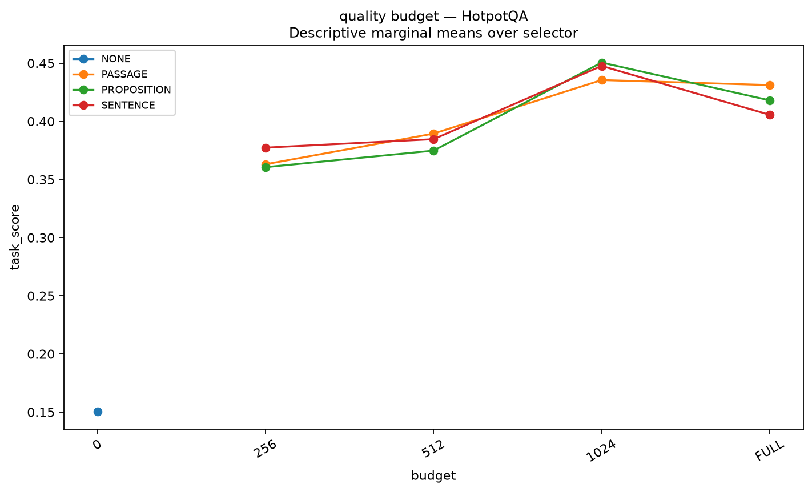

# Week 11 — Summary Analysis

## Objective

Characterize retrieval, evidence granularity, budget, reader and compressor interactions across three tasks before designing a new allocation method.

## Experiments performed

| Part   | Question                                                                              | Status             | Main_result                                                                                                                                                                                                                              |
|:-------|:--------------------------------------------------------------------------------------|:-------------------|:-----------------------------------------------------------------------------------------------------------------------------------------------------------------------------------------------------------------------------------------|
| 0      | Which dataset/corpus/interface definitions are actually used?                         | COMPLETED          | Fifty label-independent hash-sampled DEV queries per dataset are recorded. HotpotQA uses provided distractor contexts; SciFact retrieves all corpus abstracts, not gold-only documents.                                                  |
| A      | How does retrieval unit size affect annotated-evidence recall and tokens?             | COMPLETED          | Matched passage/sentence/proposition retrieval outputs exist for BM25/MiniLM/SFR. HotpotQA provided contexts create a candidate-corpus ceiling; high recall there is not unrestricted corpus retrieval.                                  |
| B      | Do passage construction choices change recall at comparable depths?                   | COMPLETED          | The72-row representation summary reports P variants with per-dataset recall/token counts; no reader-quality outcome is inferred from retrieval alone.                                                                                    |
| C      | Which fixed evidence granularity works at each budget?                                | PARTIALLY EXECUTED | The111 completed executable conditions cover Qwen granularity/selector/budget choices. This does not establish that sentence/proposition evidence is generally superior to passages.                                                     |
| D      | Does the best granularity change across public readers?                               | PARTIALLY EXECUTED | There are333 executed conditions, but matched additional reader×granularity intervals all cross zero. Reader interactions are suggestive, not generally established.                                                                     |
| E      | Do different evidence compression mechanisms improve quality under a matched budget?  | PARTIALLY EXECUTED | Executed83-condition compressor summary exists. C2 is query-ranked top8 exact sentences; saturation and strict-prefix whole-passage fit failures confound broad compression-quality claims. LLMLingua2 remains pending.                  |
| F      | Are granularity/selection findings robust to the retriever?                           | COMPLETED          | The48-condition robustness surface is executable-complete. SFR is a strong primary choice, but BM25 remains competitive in some cells; no universal retriever superiority is established.                                                |
| G      | Does fixed hierarchical composition improve on strong single-granularity controls?    | PARTIALLY EXECUTED | H3 can improve over coarse raw context at256, but no robust universal advantage over a strong sentence baseline is established; the63 executable conditions retain all H variants.                                                       |
| H      | Is there retrospective action headroom, and which matched interactions are supported? | COMPLETED          | Paired interaction tables are exploratory. Reader×granularity512 intervals cross zero on all three datasets; some budget-related interactions are positive/negative with nonzero intervals. Do not infer a universal reader interaction. |
| I      | Which patterns survive method, task, budget and interface audit?                      | COMPLETED          | The506-condition combined table summarizes existing outputs rather than506 independent new experiments. QA and SciFact metrics remain separate; no pooled cross-task score is computed.                                                  |

## Key results

### dataset summary df

| dataset   | split   |   n_queries | candidate_corpus                                      | synthetic   |   available_queries |
|:----------|:--------|------------:|:------------------------------------------------------|:------------|--------------------:|
| HotpotQA  | dev     |          50 | provided ten distractor paragraphs                    | False       |                7405 |
| QASPER    | dev     |          50 | complete matching scientific paper                    | False       |                 231 |
| SciFact   | dev     |          50 | all corpus abstracts; never only cited/gold documents | False       |                 300 |

Source: [results/week11/multigranular/v1/setup/dataset_summary_df.csv](../../week11/multigranular/v1/setup/dataset_summary_df.csv).

### model registry df

| model       | id                                                  | revision                                 | status             |   smoke_model_loaded | tokenizer                              | dtype   |   quantization |   max_context |   max_new_tokens | decoding   |       seed |   peak_vram_measured |
|:------------|:----------------------------------------------------|:-----------------------------------------|:-------------------|---------------------:|:---------------------------------------|:--------|---------------:|--------------:|-----------------:|:-----------|-----------:|---------------------:|
| Mistral     | mistralai/Mistral-7B-Instruct-v0.2                  | 63a8b081895390a26e140280378bc85ec8bce07a | CACHED_SNAPSHOT    |             0.000000 | mistralai/Mistral-7B-Instruct-v0.2     | float16 |            nan |   8192.000000 |       128.000000 | greedy     |  42.000000 |                  nan |
| MiniLM      | sentence-transformers/all-MiniLM-L6-v2              | 1110a243fdf4706b3f48f1d95db1a4f5529b4d41 | CACHED_SNAPSHOT    |             0.000000 | sentence-transformers/all-MiniLM-L6-v2 | float32 |            nan |    nan        |       nan        | nan        |  42.000000 |                  nan |
| SFR         | Salesforce/SFR-Embedding-Mistral                    | 33a60fe7b5e00b9414981280c571e8a4f9f42f1b | CACHED_SNAPSHOT    |             0.000000 | Salesforce/SFR-Embedding-Mistral       | float16 |            nan |    nan        |       nan        | nan        |  42.000000 |                  nan |
| Qwen        | Qwen/Qwen3-8B                                       | b968826d9c46dd6066d109eabc6255188de91218 | CACHED_SNAPSHOT    |             0.000000 | Qwen/Qwen3-8B                          | float16 |            nan |   8192.000000 |       128.000000 | greedy     |  42.000000 |                  nan |
| Llama       | meta-llama/Llama-3.1-8B-Instruct                    | 0e9e39f249a16976918f6564b8830bc894c89659 | CACHED_SNAPSHOT    |             0.000000 | meta-llama/Llama-3.1-8B-Instruct       | float16 |            nan |   8192.000000 |       128.000000 | greedy     |  42.000000 |                  nan |
| LLMLingua-2 | microsoft/llmlingua-2-xlm-roberta-large-meetingbank | nan                                      | PENDING_DEPENDENCY |           nan        | nan                                    | nan     |            nan |    nan        |       nan        | nan        | nan        |                  nan |

Source: [results/week11/multigranular/v1/setup/model_registry_df.csv](../../week11/multigranular/v1/setup/model_registry_df.csv).

### retrieval summary df

| dataset   | retriever   | passage_representation   | evidence_granularity   |   k |   n_queries |   any_gold_recall |   all_gold_recall |   retrieved_tokens |
|:----------|:------------|:-------------------------|:-----------------------|----:|------------:|------------------:|------------------:|-------------------:|
| HotpotQA  | SFR         | P0                       | PROPOSITION            |   1 |          50 |          0.720000 |          0.000000 |          30.160000 |
| HotpotQA  | SFR         | P0                       | PROPOSITION            |   2 |          50 |          0.820000 |          0.120000 |          64.180000 |
| HotpotQA  | SFR         | P0                       | PROPOSITION            |   4 |          50 |          0.920000 |          0.360000 |         123.360000 |
| HotpotQA  | SFR         | P0                       | PROPOSITION            |   6 |          50 |          0.960000 |          0.520000 |         182.180000 |
| HotpotQA  | SFR         | P0                       | PROPOSITION            |   8 |          50 |          0.980000 |          0.620000 |         244.040000 |
| HotpotQA  | SFR         | P0                       | PROPOSITION            |  10 |          50 |          1.000000 |          0.680000 |         302.300000 |
| HotpotQA  | MiniLM      | P0                       | PASSAGE                |   1 |          50 |          0.860000 |          0.000000 |          92.200000 |
| HotpotQA  | MiniLM      | P0                       | PASSAGE                |   2 |          50 |          0.960000 |          0.360000 |         209.840000 |
| HotpotQA  | MiniLM      | P0                       | PASSAGE                |   4 |          50 |          1.000000 |          0.660000 |         488.960000 |
| HotpotQA  | MiniLM      | P0                       | PASSAGE                |   6 |          50 |          1.000000 |          0.800000 |         761.720000 |
| HotpotQA  | MiniLM      | P0                       | PASSAGE                |   8 |          50 |          1.000000 |          0.860000 |        1046.100000 |
| HotpotQA  | MiniLM      | P0                       | PASSAGE                |  10 |          50 |          1.000000 |          1.000000 |        1351.040000 |

Source: [results/week11/multigranular/v1/retrieval/retrieval_summary_df.csv](../../week11/multigranular/v1/retrieval/retrieval_summary_df.csv). First 12 of 162 rows shown; detailed report and source preserve the full comparison.

### passage representation summary df

| dataset   | retriever   | passage_representation   | evidence_granularity   |   k |   n_queries |   any_gold_recall |   all_gold_recall |   retrieved_tokens |
|:----------|:------------|:-------------------------|:-----------------------|----:|------------:|------------------:|------------------:|-------------------:|
| HotpotQA  | SFR         | P3                       | PASSAGE                |   1 |          50 |          0.940000 |          0.000000 |          95.740000 |
| HotpotQA  | SFR         | P3                       | PASSAGE                |   2 |          50 |          1.000000 |          0.640000 |         228.040000 |
| HotpotQA  | SFR         | P3                       | PASSAGE                |   4 |          50 |          1.000000 |          0.900000 |         516.220000 |
| HotpotQA  | SFR         | P3                       | PASSAGE                |   6 |          50 |          1.000000 |          0.960000 |         813.620000 |
| HotpotQA  | SFR         | P3                       | PASSAGE                |   8 |          50 |          1.000000 |          0.980000 |        1085.980000 |
| HotpotQA  | SFR         | P3                       | PASSAGE                |  10 |          50 |          1.000000 |          1.000000 |        1351.040000 |
| HotpotQA  | SFR         | P0                       | PASSAGE                |   1 |          50 |          0.940000 |          0.000000 |          92.840000 |
| HotpotQA  | SFR         | P0                       | PASSAGE                |   2 |          50 |          1.000000 |          0.660000 |         207.040000 |
| HotpotQA  | SFR         | P0                       | PASSAGE                |   4 |          50 |          1.000000 |          0.880000 |         473.460000 |
| HotpotQA  | SFR         | P0                       | PASSAGE                |   6 |          50 |          1.000000 |          0.940000 |         776.520000 |
| HotpotQA  | SFR         | P0                       | PASSAGE                |   8 |          50 |          1.000000 |          1.000000 |        1048.000000 |
| HotpotQA  | SFR         | P0                       | PASSAGE                |  10 |          50 |          1.000000 |          1.000000 |        1351.040000 |

Source: [results/week11/multigranular/v1/passage_representation/passage_representation_summary_df.csv](../../week11/multigranular/v1/passage_representation/passage_representation_summary_df.csv). First 12 of 72 rows shown; detailed report and source preserve the full comparison.

### c summary df

| dataset   | reader   | reader_variant     | retriever   | passage_representation   | evidence_granularity   | selector   | budget   | compressor   | strategy   |   n_queries |   task_primary_quality |   classification_accuracy |   invalid_label_rate |   any_gold_recall |   all_gold_recall |   evidence_tokens |   prompt_tokens |
|:----------|:---------|:-------------------|:------------|:-------------------------|:-----------------------|:-----------|:---------|:-------------|:-----------|------------:|-----------------------:|--------------------------:|---------------------:|------------------:|------------------:|------------------:|----------------:|
| HotpotQA  | Qwen     | PUBLIC_TEXT_READER | SFR         | P0                       | PASSAGE                | semantic   | 512      | C0           | FIXED      |          50 |               0.456280 |                       nan |                  nan |          1.000000 |          0.860000 |        389.100000 |      441.920000 |
| HotpotQA  | Qwen     | PUBLIC_TEXT_READER | SFR         | P0                       | SENTENCE               | hybrid     | FULL     | C0           | FIXED      |          50 |               0.405590 |                       nan |                  nan |          1.000000 |          1.000000 |       1351.020000 |     1403.820000 |
| HotpotQA  | Qwen     | PUBLIC_TEXT_READER | SFR         | P0                       | PASSAGE                | hybrid     | FULL     | C0           | FIXED      |          50 |               0.431145 |                       nan |                  nan |          1.000000 |          1.000000 |       1351.060000 |     1403.860000 |
| HotpotQA  | Qwen     | PUBLIC_TEXT_READER | SFR         | P0                       | PROPOSITION            | lexical    | 512      | C0           | FIXED      |          50 |               0.316340 |                       nan |                  nan |          0.960000 |          0.380000 |        424.380000 |      477.180000 |
| HotpotQA  | Qwen     | PUBLIC_TEXT_READER | SFR         | P0                       | NONE                   | none       | 0        | C0           | FIXED      |          50 |               0.150250 |                       nan |                  nan |          0.000000 |          0.000000 |          0.000000 |       52.800000 |
| HotpotQA  | Qwen     | PUBLIC_TEXT_READER | SFR         | P0                       | PASSAGE                | lexical    | FULL     | C0           | FIXED      |          50 |               0.431145 |                       nan |                  nan |          1.000000 |          1.000000 |       1351.060000 |     1403.860000 |
| HotpotQA  | Qwen     | PUBLIC_TEXT_READER | SFR         | P0                       | SENTENCE               | semantic   | 256      | C0           | FIXED      |          50 |               0.421265 |                       nan |                  nan |          0.980000 |          0.600000 |        201.160000 |      253.960000 |
| HotpotQA  | Qwen     | PUBLIC_TEXT_READER | SFR         | P0                       | PROPOSITION            | semantic   | 512      | C0           | FIXED      |          50 |               0.430585 |                       nan |                  nan |          1.000000 |          0.760000 |        426.660000 |      479.460000 |
| HotpotQA  | Qwen     | PUBLIC_TEXT_READER | SFR         | P0                       | PROPOSITION            | semantic   | 256      | C0           | FIXED      |          50 |               0.407943 |                       nan |                  nan |          0.980000 |          0.540000 |        198.300000 |      251.100000 |
| HotpotQA  | Qwen     | PUBLIC_TEXT_READER | SFR         | P0                       | PASSAGE                | hybrid     | 256      | C0           | FIXED      |          50 |               0.384781 |                       nan |                  nan |          0.980000 |          0.440000 |        157.200000 |      210.020000 |
| HotpotQA  | Qwen     | PUBLIC_TEXT_READER | SFR         | P0                       | PASSAGE                | semantic   | 1024     | C0           | FIXED      |          50 |               0.480272 |                       nan |                  nan |          1.000000 |          1.000000 |        798.360000 |      851.160000 |
| HotpotQA  | Qwen     | PUBLIC_TEXT_READER | SFR         | P0                       | SENTENCE               | hybrid     | 512      | C0           | FIXED      |          50 |               0.396624 |                       nan |                  nan |          1.000000 |          0.800000 |        419.780000 |      472.600000 |

Source: [results/week11/multigranular/v1/granularity_budget/c_summary_df.csv](../../week11/multigranular/v1/granularity_budget/c_summary_df.csv). First 12 of 111 rows shown; detailed report and source preserve the full comparison.

### audited summary

| dataset   | reader   | reader_variant     | retriever   | passage_representation   | evidence_granularity   | selector   | budget   | compressor   | strategy   |   n_queries |   task_primary_quality |   classification_accuracy |   invalid_label_rate |   any_gold_recall |   all_gold_recall |   evidence_tokens |   prompt_tokens |
|:----------|:---------|:-------------------|:------------|:-------------------------|:-----------------------|:-----------|:---------|:-------------|:-----------|------------:|-----------------------:|--------------------------:|---------------------:|------------------:|------------------:|------------------:|----------------:|
| HotpotQA  | Qwen     | PUBLIC_TEXT_READER | SFR         | P0                       | PASSAGE                | semantic   | 512      | C0           | FIXED      |          50 |               0.456280 |                       nan |                  nan |          1.000000 |          0.860000 |        389.100000 |      441.920000 |
| HotpotQA  | Mistral  | PUBLIC_TEXT_READER | SFR         | P0                       | PASSAGE                | lexical    | 256      | C0           | FIXED      |          50 |               0.228822 |                       nan |                  nan |          0.840000 |          0.240000 |        163.660000 |      217.560000 |
| HotpotQA  | Llama    | PUBLIC_TEXT_READER | SFR         | P0                       | PASSAGE                | lexical    | 512      | C0           | FIXED      |          50 |               0.353926 |                       nan |                  nan |          0.940000 |          0.460000 |        357.480000 |      432.920000 |
| HotpotQA  | Qwen     | PUBLIC_TEXT_READER | SFR         | P0                       | SENTENCE               | hybrid     | FULL     | C0           | FIXED      |          50 |               0.405590 |                       nan |                  nan |          1.000000 |          1.000000 |       1351.020000 |     1403.820000 |
| HotpotQA  | Qwen     | PUBLIC_TEXT_READER | SFR         | P0                       | PASSAGE                | hybrid     | FULL     | C0           | FIXED      |          50 |               0.431145 |                       nan |                  nan |          1.000000 |          1.000000 |       1351.060000 |     1403.860000 |
| HotpotQA  | Llama    | PUBLIC_TEXT_READER | SFR         | P0                       | PROPOSITION            | hybrid     | 256      | C0           | FIXED      |          50 |               0.321213 |                       nan |                  nan |          0.960000 |          0.420000 |        193.500000 |      268.940000 |
| HotpotQA  | Mistral  | PUBLIC_TEXT_READER | SFR         | P0                       | PROPOSITION            | lexical    | 1024     | C0           | FIXED      |          50 |               0.275703 |                       nan |                  nan |          1.000000 |          0.740000 |       1001.160000 |     1054.920000 |
| HotpotQA  | Mistral  | PUBLIC_TEXT_READER | SFR         | P0                       | PASSAGE                | hybrid     | 1024     | C0           | FIXED      |          50 |               0.317028 |                       nan |                  nan |          1.000000 |          0.980000 |        933.340000 |      987.200000 |
| HotpotQA  | Mistral  | PUBLIC_TEXT_READER | SFR         | P0                       | PROPOSITION            | lexical    | 512      | C0           | FIXED      |          50 |               0.226394 |                       nan |                  nan |          0.960000 |          0.380000 |        489.800000 |      543.360000 |
| HotpotQA  | Qwen     | PUBLIC_TEXT_READER | SFR         | P0                       | PROPOSITION            | lexical    | 512      | C0           | FIXED      |          50 |               0.316340 |                       nan |                  nan |          0.960000 |          0.380000 |        424.380000 |      477.180000 |
| HotpotQA  | Qwen     | PUBLIC_TEXT_READER | SFR         | P0                       | NONE                   | none       | 0        | C0           | FIXED      |          50 |               0.150250 |                       nan |                  nan |          0.000000 |          0.000000 |          0.000000 |       52.800000 |
| HotpotQA  | Qwen     | PUBLIC_TEXT_READER | SFR         | P0                       | PASSAGE                | lexical    | FULL     | C0           | FIXED      |          50 |               0.431145 |                       nan |                  nan |          1.000000 |          1.000000 |       1351.060000 |     1403.860000 |

Source: [results/week11/multigranular/v1/reader_granularity/audited_summary.csv](../../week11/multigranular/v1/reader_granularity/audited_summary.csv). First 12 of 333 rows shown; detailed report and source preserve the full comparison.

### named reader granularity interactions

| dataset   | reader   | reference   | budget   | contrast                                            | family                         |     point |    ci_low |   ci_high |   resamples |   seed | cluster           |
|:----------|:---------|:------------|:---------|:----------------------------------------------------|:-------------------------------|----------:|----------:|----------:|------------:|-------:|:------------------|
| HotpotQA  | Mistral  | Qwen        | 1024     | (sentence-passage)_reader - (sentence-passage)_Qwen | additional_posthoc_exploratory | -0.012425 | -0.081771 |  0.053866 |       10000 |     42 | query_or_claim_id |
| HotpotQA  | Mistral  | Qwen        | FULL     | (sentence-passage)_reader - (sentence-passage)_Qwen | additional_posthoc_exploratory |  0.017846 | -0.017028 |  0.061327 |       10000 |     42 | query_or_claim_id |
| HotpotQA  | Llama    | Qwen        | 1024     | (sentence-passage)_reader - (sentence-passage)_Qwen | additional_posthoc_exploratory | -0.081286 | -0.172899 |  0.004410 |       10000 |     42 | query_or_claim_id |
| HotpotQA  | Llama    | Qwen        | FULL     | (sentence-passage)_reader - (sentence-passage)_Qwen | additional_posthoc_exploratory |  0.022373 | -0.024150 |  0.073229 |       10000 |     42 | query_or_claim_id |
| QASPER    | Mistral  | Qwen        | 1024     | (sentence-passage)_reader - (sentence-passage)_Qwen | additional_posthoc_exploratory | -0.016288 | -0.058948 |  0.024116 |       10000 |     42 | paper_id          |
| QASPER    | Mistral  | Qwen        | FULL     | (sentence-passage)_reader - (sentence-passage)_Qwen | additional_posthoc_exploratory |  0.021602 | -0.006623 |  0.049087 |       10000 |     42 | paper_id          |
| QASPER    | Llama    | Qwen        | 1024     | (sentence-passage)_reader - (sentence-passage)_Qwen | additional_posthoc_exploratory |  0.005213 | -0.057551 |  0.058055 |       10000 |     42 | paper_id          |
| QASPER    | Llama    | Qwen        | FULL     | (sentence-passage)_reader - (sentence-passage)_Qwen | additional_posthoc_exploratory |  0.018994 | -0.004856 |  0.043399 |       10000 |     42 | paper_id          |

Source: [results/week11/multigranular/v1/reader_granularity/named_reader_granularity_interactions.csv](../../week11/multigranular/v1/reader_granularity/named_reader_granularity_interactions.csv).

### label compliance diagnostic summary

| dataset   | reader   | action_id            | evidence_granularity   | selector   | budget   | compressor   |   n_queries |   strict_accuracy |   strict_format_rate |   leading_label_rate |   leading_label_diagnostic_accuracy |   cap_hit_rate |
|:----------|:---------|:---------------------|:-----------------------|:-----------|:---------|:-------------|------------:|------------------:|---------------------:|---------------------:|------------------------------------:|---------------:|
| SciFact   | Llama    | 02a6f3329796db882b78 | PASSAGE                | lexical    | 512      | C0           |          50 |          0.000000 |             0.000000 |             0.880000 |                            0.460000 |       0.140000 |
| SciFact   | Llama    | 0858fdb4f596b5d5397a | PROPOSITION            | hybrid     | 256      | C0           |          50 |          0.000000 |             0.000000 |             1.000000 |                            0.480000 |       0.140000 |
| SciFact   | Llama    | 12dd48b33d6d3fb8d217 | PROPOSITION            | hybrid     | FULL     | C0           |          50 |          0.020000 |             0.040000 |             1.000000 |                            0.400000 |       0.580000 |
| SciFact   | Llama    | 1cc630dda0b5989c8310 | NONE                   | none       | 0        | C0           |          50 |          0.000000 |             0.000000 |             0.300000 |                            0.100000 |       0.540000 |
| SciFact   | Llama    | 1f9927c5b19b040e9fa8 | PROPOSITION            | hybrid     | 512      | C0           |          50 |          0.000000 |             0.000000 |             1.000000 |                            0.460000 |       0.180000 |
| SciFact   | Llama    | 2554cee82fe23d813c59 | SENTENCE               | lexical    | FULL     | C0           |          50 |          0.020000 |             0.040000 |             1.000000 |                            0.420000 |       0.500000 |
| SciFact   | Llama    | 2a1b91b1e87fc54aa7d0 | SENTENCE               | lexical    | 1024     | C0           |          50 |          0.000000 |             0.000000 |             1.000000 |                            0.460000 |       0.440000 |
| SciFact   | Llama    | 4f92bbc7cd98dee5bf6b | PROPOSITION            | semantic   | FULL     | C0           |          50 |          0.020000 |             0.040000 |             1.000000 |                            0.400000 |       0.580000 |
| SciFact   | Llama    | 56b4550963a50e30655b | PASSAGE                | semantic   | FULL     | C0           |          50 |          0.040000 |             0.080000 |             1.000000 |                            0.400000 |       0.640000 |
| SciFact   | Llama    | 57e7e243ac7aaa306295 | PROPOSITION            | lexical    | 256      | C0           |          50 |          0.000000 |             0.000000 |             0.980000 |                            0.480000 |       0.200000 |
| SciFact   | Llama    | 697b94f7392a98f74b3c | SENTENCE               | lexical    | 512      | C0           |          50 |          0.000000 |             0.000000 |             1.000000 |                            0.480000 |       0.240000 |
| SciFact   | Llama    | 6d0ba532daf1b3b5ca05 | PROPOSITION            | hybrid     | 1024     | C0           |          50 |          0.000000 |             0.000000 |             1.000000 |                            0.440000 |       0.460000 |

Source: [results/week11/multigranular/v1/reader_granularity/label_compliance_diagnostic_summary.csv](../../week11/multigranular/v1/reader_granularity/label_compliance_diagnostic_summary.csv). First 12 of 111 rows shown; detailed report and source preserve the full comparison.

### audited summary

| dataset   | reader   | reader_variant     | retriever   | passage_representation   | evidence_granularity   | selector   | budget   | compressor   | strategy   |   n_queries |   task_primary_quality |   classification_accuracy |   invalid_label_rate |   any_gold_recall |   all_gold_recall |   evidence_tokens |   prompt_tokens |
|:----------|:---------|:-------------------|:------------|:-------------------------|:-----------------------|:-----------|:---------|:-------------|:-----------|------------:|-----------------------:|--------------------------:|---------------------:|------------------:|------------------:|------------------:|----------------:|
| HotpotQA  | Qwen     | PUBLIC_TEXT_READER | SFR         | P0                       | NONE                   | none       | 0        | C0           | FIXED      |          50 |               0.150250 |                       nan |                  nan |          0.000000 |          0.000000 |          0.000000 |       52.800000 |
| HotpotQA  | Llama    | PUBLIC_TEXT_READER | SFR         | P0                       | PASSAGE                | semantic   | 1024     | C0           | FIXED      |          50 |               0.424796 |                       nan |                  nan |          1.000000 |          1.000000 |        762.960000 |      838.400000 |
| HotpotQA  | Qwen     | PUBLIC_TEXT_READER | SFR         | P0                       | PASSAGE                | semantic   | 256      | C0           | FIXED      |          50 |               0.337510 |                       nan |                  nan |          0.980000 |          0.460000 |        165.900000 |      218.700000 |
| HotpotQA  | Mistral  | PUBLIC_TEXT_READER | SFR         | P0                       | NONE                   | none       | 0        | C0           | FIXED      |          50 |               0.100453 |                       nan |                  nan |          0.000000 |          0.000000 |          0.000000 |       53.360000 |
| HotpotQA  | Mistral  | PUBLIC_TEXT_READER | SFR         | P0                       | PASSAGE                | semantic   | 1024     | C0           | FIXED      |          50 |               0.309067 |                       nan |                  nan |          1.000000 |          1.000000 |        903.240000 |      957.060000 |
| HotpotQA  | Qwen     | PUBLIC_TEXT_READER | SFR         | P0                       | SENTENCE               | semantic   | 512      | C2           | FIXED      |          50 |               0.425640 |                       nan |                  nan |          1.000000 |          0.680000 |        260.040000 |      312.840000 |
| HotpotQA  | Mistral  | PUBLIC_TEXT_READER | SFR         | P0                       | PASSAGE                | semantic   | 512      | C0           | FIXED      |          50 |               0.324281 |                       nan |                  nan |          1.000000 |          0.860000 |        439.180000 |      493.060000 |
| HotpotQA  | Llama    | PUBLIC_TEXT_READER | SFR         | P0                       | NONE                   | none       | 0        | C0           | FIXED      |          50 |               0.094824 |                       nan |                  nan |          0.000000 |          0.000000 |          0.000000 |       75.440000 |
| HotpotQA  | Llama    | PUBLIC_TEXT_READER | SFR         | P0                       | SENTENCE               | semantic   | 1024     | C2           | FIXED      |          50 |               0.354328 |                       nan |                  nan |          1.000000 |          0.680000 |        248.920000 |      324.360000 |
| HotpotQA  | Qwen     | PUBLIC_TEXT_READER | SFR         | P0                       | PASSAGE                | semantic   | FULL     | C0           | FIXED      |          50 |               0.431145 |                       nan |                  nan |          1.000000 |          1.000000 |       1351.060000 |     1403.860000 |
| HotpotQA  | Mistral  | PUBLIC_TEXT_READER | SFR         | P0                       | SENTENCE               | semantic   | FULL     | C2           | FIXED      |          50 |               0.254890 |                       nan |                  nan |          1.000000 |          0.680000 |        300.020000 |      353.600000 |
| HotpotQA  | Llama    | PUBLIC_TEXT_READER | SFR         | P0                       | PASSAGE                | semantic   | 256      | C0           | FIXED      |          50 |               0.284481 |                       nan |                  nan |          0.980000 |          0.460000 |        157.560000 |      233.000000 |

Source: [results/week11/multigranular/v1/compressor_reader/audited_summary.csv](../../week11/multigranular/v1/compressor_reader/audited_summary.csv). First 12 of 83 rows shown; detailed report and source preserve the full comparison.

### condition status df

| dataset   | action_id            | reader   | granularity   | compressor   | status     | reason      |
|:----------|:---------------------|:---------|:--------------|:-------------|:-----------|:------------|
| QASPER    | 44e401eeab48a0c4bcb3 | Mistral  | NONE          | C0           | EXECUTABLE | nan         |
| QASPER    | b4f75e721e90dbb239db | Mistral  | PASSAGE       | C0           | EXECUTABLE | nan         |
| QASPER    | 642251784cef20d8cbf0 | Mistral  | PASSAGE       | C0           | EXECUTABLE | nan         |
| QASPER    | 46c9eec30ae8d7fc6e33 | Mistral  | PASSAGE       | C0           | EXECUTABLE | nan         |
| QASPER    | b25ba8af53973cc179f0 | Mistral  | PASSAGE       | C0           | EXECUTABLE | nan         |
| QASPER    | 9369d7cd9d8b53d9e176 | Mistral  | TOKEN         | C1           | PENDING    | LLMLingua-2 |
| QASPER    | 2024056f3cc177f0d403 | Mistral  | TOKEN         | C1           | PENDING    | LLMLingua-2 |
| QASPER    | 33610a9a9cea82728a17 | Mistral  | TOKEN         | C1           | PENDING    | LLMLingua-2 |
| QASPER    | 196e3e26ada862d1521a | Mistral  | TOKEN         | C1           | PENDING    | LLMLingua-2 |
| QASPER    | b276cd7bae341c426412 | Mistral  | SENTENCE      | C2           | EXECUTABLE | nan         |
| QASPER    | a69728887f07e1133fa5 | Mistral  | SENTENCE      | C2           | EXECUTABLE | nan         |
| QASPER    | 8f4cfef66be1182e8bc8 | Mistral  | SENTENCE      | C2           | EXECUTABLE | nan         |

Source: [results/week11/multigranular/v1/compressor_reader/condition_status_df.csv](../../week11/multigranular/v1/compressor_reader/condition_status_df.csv). First 12 of 119 rows shown; detailed report and source preserve the full comparison.

## Main scientific conclusions

- Fifty label-independent hash-sampled DEV queries per dataset are recorded. HotpotQA uses provided distractor contexts; SciFact retrieves all corpus abstracts, not gold-only documents. Source: [results/week11/multigranular/v1/setup/dataset_summary_df.csv](../../week11/multigranular/v1/setup/dataset_summary_df.csv), [results/week11/multigranular/v1/setup/status.json](../../week11/multigranular/v1/setup/status.json)
- Matched passage/sentence/proposition retrieval outputs exist for BM25/MiniLM/SFR. HotpotQA provided contexts create a candidate-corpus ceiling; high recall there is not unrestricted corpus retrieval. Source: [results/week11/multigranular/v1/retrieval/retrieval_summary_df.csv](../../week11/multigranular/v1/retrieval/retrieval_summary_df.csv), [results/week11/multigranular/v1/retrieval/status.json](../../week11/multigranular/v1/retrieval/status.json)
- The72-row representation summary reports P variants with per-dataset recall/token counts; no reader-quality outcome is inferred from retrieval alone. Source: [results/week11/multigranular/v1/passage_representation/passage_representation_summary_df.csv](../../week11/multigranular/v1/passage_representation/passage_representation_summary_df.csv), [results/week11/multigranular/v1/passage_representation/status.json](../../week11/multigranular/v1/passage_representation/status.json)
- The111 completed executable conditions cover Qwen granularity/selector/budget choices. This does not establish that sentence/proposition evidence is generally superior to passages. Source: [results/week11/multigranular/v1/granularity_budget/c_summary_df.csv](../../week11/multigranular/v1/granularity_budget/c_summary_df.csv), [results/week11/multigranular/v1/granularity_budget/status.json](../../week11/multigranular/v1/granularity_budget/status.json)
- There are333 executed conditions, but matched additional reader×granularity intervals all cross zero. Reader interactions are suggestive, not generally established. Source: [results/week11/multigranular/v1/reader_granularity/audited_summary.csv](../../week11/multigranular/v1/reader_granularity/audited_summary.csv), [results/week11/multigranular/v1/reader_granularity/status.json](../../week11/multigranular/v1/reader_granularity/status.json)
- Executed83-condition compressor summary exists. C2 is query-ranked top8 exact sentences; saturation and strict-prefix whole-passage fit failures confound broad compression-quality claims. LLMLingua2 remains pending. Source: [results/week11/multigranular/v1/compressor_reader/audited_summary.csv](../../week11/multigranular/v1/compressor_reader/audited_summary.csv), [results/week11/multigranular/v1/compressor_reader/status.json](../../week11/multigranular/v1/compressor_reader/status.json)
- The48-condition robustness surface is executable-complete. SFR is a strong primary choice, but BM25 remains competitive in some cells; no universal retriever superiority is established. Source: [results/week11/multigranular/v1/retriever_robustness/audited_summary.csv](../../week11/multigranular/v1/retriever_robustness/audited_summary.csv), [results/week11/multigranular/v1/retriever_robustness/status.json](../../week11/multigranular/v1/retriever_robustness/status.json)
- H3 can improve over coarse raw context at256, but no robust universal advantage over a strong sentence baseline is established; the63 executable conditions retain all H variants. Source: [results/week11/multigranular/v1/hierarchical/audited_summary.csv](../../week11/multigranular/v1/hierarchical/audited_summary.csv), [results/week11/multigranular/v1/hierarchical/status.json](../../week11/multigranular/v1/hierarchical/status.json)
- Paired interaction tables are exploratory. Reader×granularity512 intervals cross zero on all three datasets; some budget-related interactions are positive/negative with nonzero intervals. Do not infer a universal reader interaction. Source: [results/week11/multigranular/v1/oracle/paired_interaction_contrasts_df.csv](../../week11/multigranular/v1/oracle/paired_interaction_contrasts_df.csv), [results/week11/multigranular/v1/oracle/status.json](../../week11/multigranular/v1/oracle/status.json)
- The506-condition combined table summarizes existing outputs rather than506 independent new experiments. QA and SciFact metrics remain separate; no pooled cross-task score is computed. Source: [results/week11/multigranular/v1/final_report/master_summary_df.csv](../../week11/multigranular/v1/final_report/master_summary_df.csv), [results/week11/multigranular/v1/final_report/status.json](../../week11/multigranular/v1/final_report/status.json)

## What did NOT work?

No universal fine-granularity winner, hierarchical winner or reader×granularity interaction. LLMLingua is unqualified/pending in this week, not a completed benchmark.

## Limitations

Only50 queries per dataset; strict-prefix allocator confound, reader output compliance, multiple exploratory comparisons, top8 C2 saturation and whole-system specialist comparisons.

## Decision after this week

The observed task/budget dependence motivates controlled budgeted fusion; any final promotion remains unestablished at this pilot stage.

## One-paragraph week takeaway

Fifty label-independent hash-sampled DEV queries per dataset are recorded. HotpotQA uses provided distractor contexts; SciFact retrieves all corpus abstracts, not gold-only documents. Matched passage/sentence/proposition retrieval outputs exist for BM25/MiniLM/SFR. HotpotQA provided contexts create a candidate-corpus ceiling; high recall there is not unrestricted corpus retrieval. The72-row representation summary reports P variants with per-dataset recall/token counts; no reader-quality outcome is inferred from retrieval alone. The111 completed executable conditions cover Qwen granularity/selector/budget choices. This does not establish that sentence/proposition evidence is generally superior to passages. There are333 executed conditions, but matched additional reader×granularity intervals all cross zero. Reader interactions are suggestive, not generally established. Executed83-condition compressor summary exists. C2 is query-ranked top8 exact sentences; saturation and strict-prefix whole-passage fit failures confound broad compression-quality claims. LLMLingua2 remains pending. The48-condition robustness surface is executable-complete. SFR is a strong primary choice, but BM25 remains competitive in some cells; no universal retriever superiority is established. H3 can improve over coarse raw context at256, but no robust universal advantage over a strong sentence baseline is established; the63 executable conditions retain all H variants. Paired interaction tables are exploratory. Reader×granularity512 intervals cross zero on all three datasets; some budget-related interactions are positive/negative with nonzero intervals. Do not infer a universal reader interaction. The506-condition combined table summarizes existing outputs rather than506 independent new experiments. QA and SciFact metrics remain separate; no pooled cross-task score is computed.

## Additional primary visualizations

X-axis is evidence budget; y-axis HotpotQA task score (answer F1). It shows granularity/selector-dependent budget behavior on50 pilot queries, not full-corpus retrieval or universal superiority.

Source: [results/week11/multigranular/v1/granularity_budget/figures/HotpotQA_task_score_quality_budget.png](../../week11/multigranular/v1/granularity_budget/figures/HotpotQA_task_score_quality_budget.png).

# Primary Sources Used

- [configs/week11/week11_base.yaml](../../../configs/week11/week11_base.yaml)
- [configs/week11/week11_compressors.yaml](../../../configs/week11/week11_compressors.yaml)
- [configs/week11/week11_datasets.yaml](../../../configs/week11/week11_datasets.yaml)
- [configs/week11/week11_granularity.yaml](../../../configs/week11/week11_granularity.yaml)
- [configs/week11/week11_readers.yaml](../../../configs/week11/week11_readers.yaml)
- [configs/week11/week11_retrievers.yaml](../../../configs/week11/week11_retrievers.yaml)
- [configs/week11/week11_runs.yaml](../../../configs/week11/week11_runs.yaml)
- [notebooks/week11/week11_0_setup_and_data.ipynb](../../../notebooks/week11/week11_0_setup_and_data.ipynb)
- [notebooks/week11/week11_A_retrieval_granularity.ipynb](../../../notebooks/week11/week11_A_retrieval_granularity.ipynb)
- [notebooks/week11/week11_B_passage_representation.ipynb](../../../notebooks/week11/week11_B_passage_representation.ipynb)
- [notebooks/week11/week11_C_granularity_budget.ipynb](../../../notebooks/week11/week11_C_granularity_budget.ipynb)
- [notebooks/week11/week11_D_reader_granularity.ipynb](../../../notebooks/week11/week11_D_reader_granularity.ipynb)
- [notebooks/week11/week11_E_compressor_reader.ipynb](../../../notebooks/week11/week11_E_compressor_reader.ipynb)
- [notebooks/week11/week11_F_retriever_robustness.ipynb](../../../notebooks/week11/week11_F_retriever_robustness.ipynb)
- [notebooks/week11/week11_G_hierarchical_fidelity.ipynb](../../../notebooks/week11/week11_G_hierarchical_fidelity.ipynb)
- [notebooks/week11/week11_H_oracle_and_interactions.ipynb](../../../notebooks/week11/week11_H_oracle_and_interactions.ipynb)
- [notebooks/week11/week11_I_final_report.ipynb](../../../notebooks/week11/week11_I_final_report.ipynb)
- [notebooks/week11/week11_MASTER.ipynb](../../../notebooks/week11/week11_MASTER.ipynb)
- [results/week11/multigranular/v1/compressor_reader/audited_summary.csv](../../week11/multigranular/v1/compressor_reader/audited_summary.csv)
- [results/week11/multigranular/v1/compressor_reader/condition_status_df.csv](../../week11/multigranular/v1/compressor_reader/condition_status_df.csv)
- [results/week11/multigranular/v1/compressor_reader/status.json](../../week11/multigranular/v1/compressor_reader/status.json)
- [results/week11/multigranular/v1/final_report/master_summary_df.csv](../../week11/multigranular/v1/final_report/master_summary_df.csv)
- [results/week11/multigranular/v1/final_report/portable_reader_summary_df.csv](../../week11/multigranular/v1/final_report/portable_reader_summary_df.csv)
- [results/week11/multigranular/v1/final_report/status.json](../../week11/multigranular/v1/final_report/status.json)
- [results/week11/multigranular/v1/granularity_budget/c_summary_df.csv](../../week11/multigranular/v1/granularity_budget/c_summary_df.csv)
- [results/week11/multigranular/v1/granularity_budget/status.json](../../week11/multigranular/v1/granularity_budget/status.json)
- [results/week11/multigranular/v1/hierarchical/audited_summary.csv](../../week11/multigranular/v1/hierarchical/audited_summary.csv)
- [results/week11/multigranular/v1/hierarchical/condition_status_df.csv](../../week11/multigranular/v1/hierarchical/condition_status_df.csv)
- [results/week11/multigranular/v1/hierarchical/status.json](../../week11/multigranular/v1/hierarchical/status.json)
- [results/week11/multigranular/v1/oracle/oracle_summary_df.csv](../../week11/multigranular/v1/oracle/oracle_summary_df.csv)
- [results/week11/multigranular/v1/oracle/paired_interaction_contrasts_df.csv](../../week11/multigranular/v1/oracle/paired_interaction_contrasts_df.csv)
- [results/week11/multigranular/v1/oracle/status.json](../../week11/multigranular/v1/oracle/status.json)
- [results/week11/multigranular/v1/passage_representation/passage_representation_summary_df.csv](../../week11/multigranular/v1/passage_representation/passage_representation_summary_df.csv)
- [results/week11/multigranular/v1/passage_representation/status.json](../../week11/multigranular/v1/passage_representation/status.json)
- [results/week11/multigranular/v1/reader_granularity/audited_summary.csv](../../week11/multigranular/v1/reader_granularity/audited_summary.csv)
- [results/week11/multigranular/v1/reader_granularity/label_compliance_diagnostic_summary.csv](../../week11/multigranular/v1/reader_granularity/label_compliance_diagnostic_summary.csv)
- [results/week11/multigranular/v1/reader_granularity/named_reader_granularity_interactions.csv](../../week11/multigranular/v1/reader_granularity/named_reader_granularity_interactions.csv)
- [results/week11/multigranular/v1/reader_granularity/status.json](../../week11/multigranular/v1/reader_granularity/status.json)
- [results/week11/multigranular/v1/retrieval/retrieval_summary_df.csv](../../week11/multigranular/v1/retrieval/retrieval_summary_df.csv)
- [results/week11/multigranular/v1/retrieval/status.json](../../week11/multigranular/v1/retrieval/status.json)
- [results/week11/multigranular/v1/retriever_robustness/audited_summary.csv](../../week11/multigranular/v1/retriever_robustness/audited_summary.csv)
- [results/week11/multigranular/v1/retriever_robustness/status.json](../../week11/multigranular/v1/retriever_robustness/status.json)
- [results/week11/multigranular/v1/setup/dataset_summary_df.csv](../../week11/multigranular/v1/setup/dataset_summary_df.csv)
- [results/week11/multigranular/v1/setup/model_registry_df.csv](../../week11/multigranular/v1/setup/model_registry_df.csv)
- [results/week11/multigranular/v1/setup/status.json](../../week11/multigranular/v1/setup/status.json)

- [results/week11/multigranular/v1/granularity_budget/figures/HotpotQA_task_score_quality_budget.png](../../week11/multigranular/v1/granularity_budget/figures/HotpotQA_task_score_quality_budget.png)

# Existing Markdown Used as Evidence

NONE
