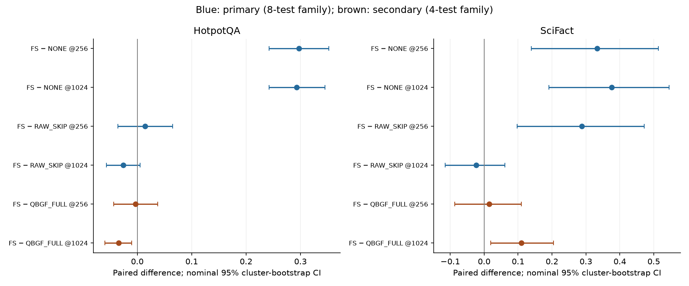
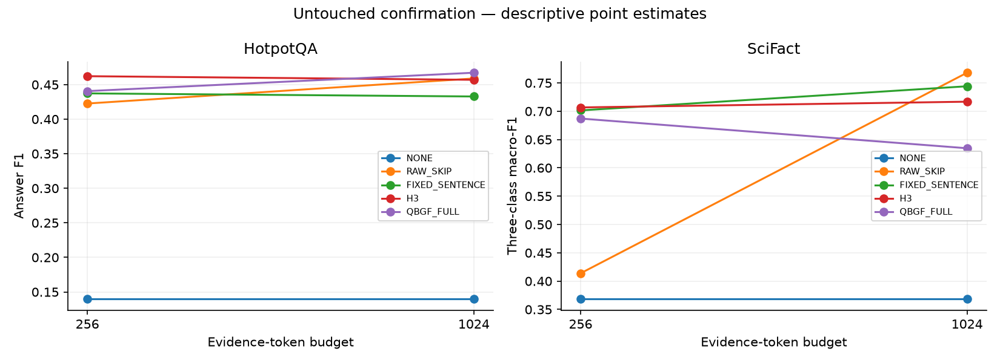

# Week 12 — Part-Wise Analysis

## Week objective

Validate query-conditioned budgeted granularity fusion under frozen TRAIN/VAL splits, test its mechanisms, freeze a final fallback, then separate post-hoc attribution from reserved confirmation.

# Part 0 — Protocol and split audit

**Status: COMPLETED**

## 1. Research question

Can TRAIN, reused VAL and reserved confirmation roles be frozen without QASPER TEST reuse?

## 2. Experimental design

| component   | value                                                                      |
|:------------|:---------------------------------------------------------------------------|
| protocol    | W12-QBGF-v3; existing frozen splits unchanged                              |
| reader      | Qwen/Qwen3-8B BASE_FP16; no retained LoRA                                  |
| retriever   | SFR top10                                                                  |
| budgets     | [256, 1024]                                                                |
| seed        | 42                                                                         |
| metrics     | QASPER/HotpotQA answer F1; SciFact three-class macro-F1                    |
| Role        | Protocol/context only; outcomes are accepted only from the artifacts below |

## 3. What was implemented / executed

Completed machine-readable output is present for the named conditions; coverage is limited to the recorded rows and checks below.

## 4. Result artifacts used

- [results/week12/W13_FINAL_METHOD_FREEZE.json](../../week12/W13_FINAL_METHOD_FREEZE.json)
- [results/week12/qbgf/v3/protocol/training_execution_patch.json](../../week12/qbgf/v3/protocol/training_execution_patch.json)
- [results/week12/qbgf/v3/analysis/summary.csv](../../week12/qbgf/v3/analysis/summary.csv)

## 5. Main numerical results

### Recorded validation counts

| dataset   |   n_queries |
|:----------|------------:|
| HotpotQA  |        7155 |
| QASPER    |        1005 |
| SciFact   |         177 |

Source: [results/week12/qbgf/v3/analysis/summary.csv](../../week12/qbgf/v3/analysis/summary.csv).

### Frozen confirmation membership counts

| dataset   |   confirmation_queries |
|:----------|-----------------------:|
| HotpotQA  |                    200 |
| QASPER    |                      0 |
| SciFact   |                     50 |

Source: [results/week12/W13_FINAL_METHOD_FREEZE.json](../../week12/W13_FINAL_METHOD_FREEZE.json).

## 6. Figures

No saved figure is used for this part; no visualization is fabricated.

## 7. Statistical analysis

No formal inferential test was found for this comparison.

## 8. Interpretation

### Supported

VAL counts are QASPER1005, HotpotQA7155 and SciFact177. Frozen confirmation is HotpotQA200, SciFact50, QASPER0. Historical QASPER TEST stays closed.

### Not established

Point-estimate rankings do not establish statistical superiority. Implementation, qualification and retrospective oracle ceilings are not deployed or held-out quality results. Missing model/split/seed details are not established from available primary artifacts.

### Important caveats

VAL was used for extensive method selection; it is not untouched generalization evidence. Metadata untouched flags are time-specific and superseded by completed M access.

## 9. Part conclusion

- VAL counts are QASPER1005, HotpotQA7155 and SciFact177. Frozen confirmation is HotpotQA200, SciFact50, QASPER0. Historical QASPER TEST stays closed.
- No additional method-selection decision is inferred beyond the recorded protocol/freeze artifacts.

# Part A — QBGF algorithm

**Status: SMOKE-TESTED**

## 1. Research question

Can query-conditioned budgeted mixed-granularity optimization be implemented with exact-source evidence?

## 2. Experimental design

| component   | value                                                                      |
|:------------|:---------------------------------------------------------------------------|
| protocol    | W12-QBGF-v3; existing frozen splits unchanged                              |
| reader      | Qwen/Qwen3-8B BASE_FP16; no retained LoRA                                  |
| retriever   | SFR top10                                                                  |
| budgets     | [256, 1024]                                                                |
| seed        | 42                                                                         |
| metrics     | QASPER/HotpotQA answer F1; SciFact three-class macro-F1                    |
| Role        | Protocol/context only; outcomes are accepted only from the artifacts below |

## 3. What was implemented / executed

The status is based on the available artifacts, not notebook existence alone. No completed result artifact was found.

## 4. Result artifacts used

- [notebooks/week12/week12_A_qbgf_algorithm.ipynb](../../../notebooks/week12/week12_A_qbgf_algorithm.ipynb)
- [src/week12/algorithm.py](../../../src/week12/algorithm.py)

## 5. Main numerical results

No completed result artifact was found.

## 6. Figures

No saved figure is used for this part; no visualization is fabricated.

## 7. Statistical analysis

No formal inferential test was found for this comparison.

## 8. Interpretation

### Supported

Algorithm implementation supports exact-source sentences/passages, query-conditioned weights/mass and a hard additive token budget. Quality evidence belongs in C/D, not implementation tests.

### Not established

Point-estimate rankings do not establish statistical superiority. Implementation, qualification and retrospective oracle ceilings are not deployed or held-out quality results. Missing model/split/seed details are not established from available primary artifacts.

### Important caveats

Source support is mechanical matching, not semantic faithfulness or answer correctness.

## 9. Part conclusion

- Algorithm implementation supports exact-source sentences/passages, query-conditioned weights/mass and a hard additive token budget. Quality evidence belongs in C/D, not implementation tests.
- No additional method-selection decision is inferred beyond the recorded protocol/freeze artifacts.

# Part B — Baseline qualification

**Status: SMOKE-TESTED**

## 1. Research question

Which controls are qualified before validation and what can qualification establish?

## 2. Experimental design

| component   | value                                                                      |
|:------------|:---------------------------------------------------------------------------|
| protocol    | W12-QBGF-v3; existing frozen splits unchanged                              |
| reader      | Qwen/Qwen3-8B BASE_FP16; no retained LoRA                                  |
| retriever   | SFR top10                                                                  |
| budgets     | [256, 1024]                                                                |
| seed        | 42                                                                         |
| metrics     | QASPER/HotpotQA answer F1; SciFact three-class macro-F1                    |
| Role        | Protocol/context only; outcomes are accepted only from the artifacts below |

## 3. What was implemented / executed

The status is based on the available artifacts, not notebook existence alone. Available outputs must be interpreted under the status shown.

## 4. Result artifacts used

- [results/week12/qbgf/v3/qualification/baselines.json](../../week12/qbgf/v3/qualification/baselines.json)
- [results/week12/qbgf/v3/protocol/llmlingua_qualification_lock.json](../../week12/qbgf/v3/protocol/llmlingua_qualification_lock.json)

## 5. Main numerical results

### Qualification numeric fields; not benchmark scores

| field                                             |       value |
|:--------------------------------------------------|------------:|
| frozen_science_config_unchanged                   |    1.000000 |
| reason                                            |             |
| synthetic_budget_checks[0].budget                 |  256.000000 |
| synthetic_budget_checks[0].compressed_qwen_tokens |  250.000000 |
| synthetic_budget_checks[0].raw_qwen_tokens        | 2041.000000 |
| synthetic_budget_checks[0].retry_factor           |    0.800000 |
| synthetic_budget_checks[0].seconds                |    6.121564 |
| synthetic_budget_checks[1].budget                 | 1024.000000 |
| synthetic_budget_checks[1].compressed_qwen_tokens |  875.000000 |
| synthetic_budget_checks[1].raw_qwen_tokens        | 2041.000000 |
| synthetic_budget_checks[1].retry_factor           |    0.800000 |
| synthetic_budget_checks[1].seconds                |    6.137273 |

Source: [results/week12/qbgf/v3/protocol/llmlingua_qualification_lock.json](../../week12/qbgf/v3/protocol/llmlingua_qualification_lock.json).

## 6. Figures

No saved figure is used for this part; no visualization is fabricated.

## 7. Statistical analysis

No formal inferential test was found for this comparison.

## 8. Interpretation

### Supported

The qualified optional LLMLingua2 checkpoint is microsoft/llmlingua-2-bert-base-multilingual-cased-meetingbank @5f0c82792b7ea14c6484e015b6a072009496b7f2, not the XLM-R-large checkpoint. Qualification does not establish quality.

### Not established

Point-estimate rankings do not establish statistical superiority. Implementation, qualification and retrospective oracle ceilings are not deployed or held-out quality results. Missing model/split/seed details are not established from available primary artifacts.

### Important caveats

An older qualification/llmlingua.json records missing dependency for another checkpoint. Keep checkpoint identities and stages distinct.

## 9. Part conclusion

- The qualified optional LLMLingua2 checkpoint is microsoft/llmlingua-2-bert-base-multilingual-cased-meetingbank @5f0c82792b7ea14c6484e015b6a072009496b7f2, not the XLM-R-large checkpoint. Qualification does not establish quality.
- No additional method-selection decision is inferred beyond the recorded protocol/freeze artifacts.

# Part C — Main validation surface

**Status: COMPLETED**

## 1. Research question

Does QBGF improve over strong matched fixed evidence policies?

## 2. Experimental design

| component   | value                                                                      |
|:------------|:---------------------------------------------------------------------------|
| protocol    | W12-QBGF-v3; existing frozen splits unchanged                              |
| reader      | Qwen/Qwen3-8B BASE_FP16; no retained LoRA                                  |
| retriever   | SFR top10                                                                  |
| budgets     | [256, 1024]                                                                |
| seed        | 42                                                                         |
| metrics     | QASPER/HotpotQA answer F1; SciFact three-class macro-F1                    |
| Role        | Protocol/context only; outcomes are accepted only from the artifacts below |

## 3. What was implemented / executed

Completed machine-readable output is present for the named conditions; coverage is limited to the recorded rows and checks below.

## 4. Result artifacts used

- [results/week12/qbgf/v3/analysis/summary.csv](../../week12/qbgf/v3/analysis/summary.csv)
- [results/week12/qbgf/v3/validation/C/status.json](../../week12/qbgf/v3/validation/C/status.json)
- [results/week12/qbgf/v3/analysis/primary_comparisons.csv](../../week12/qbgf/v3/analysis/primary_comparisons.csv)

## 5. Main numerical results

### Main matched VAL outcomes

| dataset   | method         |   budget | reader    |   n_queries |   quality | metric   |   prompt_tokens |   evidence_tokens |     HELP |     HURT |   invalid_outputs |
|:----------|:---------------|---------:|:----------|------------:|----------:|:---------|----------------:|------------------:|---------:|---------:|------------------:|
| HotpotQA  | C2             |      256 | BASE_FP16 |        7155 |  0.411927 | f1       |      274.616492 |        220.700489 | 0.505521 | 0.094060 |                 0 |
| HotpotQA  | FIXED_SENTENCE |     1024 | BASE_FP16 |        7155 |  0.423310 | f1       |     1055.249057 |       1001.333054 | 0.590217 | 0.089727 |                 0 |
| HotpotQA  | FIXED_SENTENCE |      256 | BASE_FP16 |        7155 |  0.408247 | f1       |      308.606569 |        254.690566 | 0.516841 | 0.094200 |                 0 |
| HotpotQA  | H3             |     1024 | BASE_FP16 |        7155 |  0.436421 | f1       |     1041.308875 |        987.392872 | 0.588959 | 0.089727 |                 0 |
| HotpotQA  | H3             |      256 | BASE_FP16 |        7155 |  0.425311 | f1       |      291.398602 |        237.482600 | 0.525227 | 0.092662 |                 0 |
| HotpotQA  | NONE           |     1024 | BASE_FP16 |        7155 |  0.165324 | f1       |       53.916003 |          0.000000 | 0.000000 | 0.000000 |                 0 |
| HotpotQA  | NONE           |      256 | BASE_FP16 |        7155 |  0.165324 | f1       |       53.916003 |          0.000000 | 0.000000 | 0.000000 |                 0 |
| HotpotQA  | QBGF_FULL      |     1024 | BASE_FP16 |        7155 |  0.432344 | f1       |     1047.078127 |        993.162124 | 0.594549 | 0.087072 |                 0 |
| HotpotQA  | QBGF_FULL      |      256 | BASE_FP16 |        7155 |  0.412068 | f1       |      304.758211 |        250.842208 | 0.518658 | 0.096017 |                 0 |
| HotpotQA  | RAW_SKIP       |     1024 | BASE_FP16 |        7155 |  0.452133 | f1       |     1005.667365 |        951.751363 | 0.592453 | 0.082600 |                 0 |
| HotpotQA  | RAW_SKIP       |      256 | BASE_FP16 |        7155 |  0.406974 | f1       |      278.060936 |        224.144934 | 0.496436 | 0.099511 |                 0 |
| QASPER    | C2             |      256 | BASE_FP16 |        1005 |  0.258118 | f1       |      270.380100 |        227.702488 | 0.544279 | 0.103483 |                 0 |
| QASPER    | FIXED_SENTENCE |     1024 | BASE_FP16 |        1005 |  0.298788 | f1       |     1065.683582 |       1023.005970 | 0.627861 | 0.068657 |                 0 |
| QASPER    | FIXED_SENTENCE |      256 | BASE_FP16 |        1005 |  0.263430 | f1       |      297.893532 |        255.215920 | 0.551244 | 0.100498 |                 0 |
| QASPER    | H3             |     1024 | BASE_FP16 |        1005 |  0.299487 | f1       |     1046.281592 |       1003.603980 | 0.613930 | 0.081592 |                 0 |
| QASPER    | H3             |      256 | BASE_FP16 |        1005 |  0.254363 | f1       |      277.719403 |        235.041791 | 0.549254 | 0.098507 |                 0 |
| QASPER    | NONE           |     1024 | BASE_FP16 |        1005 |  0.082157 | f1       |       42.677612 |          0.000000 | 0.000000 | 0.000000 |                 0 |
| QASPER    | NONE           |      256 | BASE_FP16 |        1005 |  0.082157 | f1       |       42.677612 |          0.000000 | 0.000000 | 0.000000 |                 0 |
| QASPER    | QBGF_FULL      |     1024 | BASE_FP16 |        1005 |  0.295055 | f1       |     1063.146269 |       1020.468657 | 0.615920 | 0.070647 |                 0 |
| QASPER    | QBGF_FULL      |      256 | BASE_FP16 |        1005 |  0.235515 | f1       |      295.353234 |        252.675622 | 0.519403 | 0.107463 |                 0 |
| QASPER    | RAW_SKIP       |     1024 | BASE_FP16 |        1005 |  0.287957 | f1       |      955.235821 |        912.558209 | 0.594030 | 0.094527 |                 0 |
| QASPER    | RAW_SKIP       |      256 | BASE_FP16 |        1005 |  0.169283 | f1       |      267.397015 |        224.719403 | 0.404975 | 0.148259 |                 0 |
| SciFact   | C2             |      256 | BASE_FP16 |         177 |  0.710248 | macro_f1 |      294.790960 |        229.853107 | 0.401130 | 0.124294 |                 0 |
| SciFact   | FIXED_SENTENCE |     1024 | BASE_FP16 |         177 |  0.670398 | macro_f1 |     1085.983051 |       1021.045198 | 0.395480 | 0.141243 |                 0 |
| SciFact   | FIXED_SENTENCE |      256 | BASE_FP16 |         177 |  0.700062 | macro_f1 |      318.248588 |        253.310734 | 0.389831 | 0.124294 |                 0 |
| SciFact   | H3             |     1024 | BASE_FP16 |         177 |  0.685904 | macro_f1 |     1065.406780 |       1000.468927 | 0.395480 | 0.129944 |                 0 |
| SciFact   | H3             |      256 | BASE_FP16 |         177 |  0.685627 | macro_f1 |      295.632768 |        230.694915 | 0.384181 | 0.129944 |                 0 |
| SciFact   | NONE           |     1024 | BASE_FP16 |         177 |  0.420662 | macro_f1 |       64.937853 |          0.000000 | 0.000000 | 0.000000 |                 0 |
| SciFact   | NONE           |      256 | BASE_FP16 |         177 |  0.420662 | macro_f1 |       64.937853 |          0.000000 | 0.000000 | 0.000000 |                 0 |
| SciFact   | QBGF_FULL      |     1024 | BASE_FP16 |         177 |  0.660413 | macro_f1 |     1083.322034 |       1018.384181 | 0.367232 | 0.124294 |                 0 |
| SciFact   | QBGF_FULL      |      256 | BASE_FP16 |         177 |  0.674969 | macro_f1 |      315.542373 |        250.604520 | 0.344633 | 0.107345 |                 0 |
| SciFact   | RAW_SKIP       |     1024 | BASE_FP16 |         177 |  0.698979 | macro_f1 |      998.937853 |        934.000000 | 0.406780 | 0.135593 |                 0 |
| SciFact   | RAW_SKIP       |      256 | BASE_FP16 |         177 |  0.456378 | macro_f1 |      251.073446 |        186.135593 | 0.175141 | 0.163842 |                 0 |

Source: [results/week12/qbgf/v3/analysis/summary.csv](../../week12/qbgf/v3/analysis/summary.csv).

### Matched paired contrasts; joint family where recorded

| dataset   |   budget | left      | right          | metric   | status   |     point |    ci_low |   ci_high |   joint_holm_adjusted_p |
|:----------|---------:|:----------|:---------------|:---------|:---------|----------:|----------:|----------:|------------------------:|
| QASPER    |      256 | QBGF_FULL | RAW_SKIP       | f1       | COMPLETE |  0.066233 |  0.048862 |  0.083949 |                0.005099 |
| QASPER    |      256 | QBGF_FULL | FIXED_SENTENCE | f1       | COMPLETE | -0.027915 | -0.040996 | -0.014908 |                0.005099 |
| QASPER    |      256 | QBGF_FULL | H3             | f1       | COMPLETE | -0.018847 | -0.032123 | -0.005551 |                0.163184 |
| QASPER    |     1024 | QBGF_FULL | RAW_SKIP       | f1       | COMPLETE |  0.007098 | -0.003304 |  0.017170 |                1.000000 |
| QASPER    |     1024 | QBGF_FULL | FIXED_SENTENCE | f1       | COMPLETE | -0.003734 | -0.012490 |  0.005008 |                1.000000 |
| QASPER    |     1024 | QBGF_FULL | H3             | f1       | COMPLETE | -0.004432 | -0.012973 |  0.003865 |                1.000000 |
| HotpotQA  |      256 | QBGF_FULL | RAW_SKIP       | f1       | COMPLETE |  0.005094 | -0.002327 |  0.012384 |                1.000000 |
| HotpotQA  |      256 | QBGF_FULL | FIXED_SENTENCE | f1       | COMPLETE |  0.003821 | -0.003511 |  0.011013 |                1.000000 |
| HotpotQA  |      256 | QBGF_FULL | H3             | f1       | COMPLETE | -0.013243 | -0.020821 | -0.005900 |                0.034997 |
| HotpotQA  |     1024 | QBGF_FULL | RAW_SKIP       | f1       | COMPLETE | -0.019789 | -0.024994 | -0.014683 |                0.005099 |
| HotpotQA  |     1024 | QBGF_FULL | FIXED_SENTENCE | f1       | COMPLETE |  0.009033 |  0.004544 |  0.013509 |                0.022198 |
| HotpotQA  |     1024 | QBGF_FULL | H3             | f1       | COMPLETE | -0.004077 | -0.008862 |  0.000724 |                1.000000 |
| SciFact   |      256 | QBGF_FULL | RAW_SKIP       | macro_f1 | COMPLETE |  0.218591 |  0.141282 |  0.300298 |                0.005099 |
| SciFact   |      256 | QBGF_FULL | FIXED_SENTENCE | macro_f1 | COMPLETE | -0.025094 | -0.087757 |  0.036542 |                1.000000 |
| SciFact   |      256 | QBGF_FULL | H3             | macro_f1 | COMPLETE | -0.010658 | -0.075762 |  0.053887 |                1.000000 |
| SciFact   |     1024 | QBGF_FULL | RAW_SKIP       | macro_f1 | COMPLETE | -0.038566 | -0.121233 |  0.043969 |                1.000000 |
| SciFact   |     1024 | QBGF_FULL | FIXED_SENTENCE | macro_f1 | COMPLETE | -0.009985 | -0.071143 |  0.050456 |                1.000000 |
| SciFact   |     1024 | QBGF_FULL | H3             | macro_f1 | COMPLETE | -0.025491 | -0.095637 |  0.045687 |                1.000000 |

Source: [results/week12/qbgf/v3/analysis/primary_comparisons.csv](../../week12/qbgf/v3/analysis/primary_comparisons.csv).

## 6. Figures

No saved figure is used for this part; no visualization is fabricated.

## 7. Statistical analysis

10000 paired cluster bootstrap / cluster label-swap resamples, seed42. Original registry39 plus12 fusion diagnostics are reported with recorded joint family51 adjustment; missing/skipped controls remain pending, not zero.

## 8. Interpretation

### Supported

QBGF lacks a robust universal VAL advantage. At256 QASPER QBGF0.235515 trails FIXED_SENTENCE0.263430; HotpotQA0.412068 slightly exceeds0.408247; SciFact0.674969 trails0.700062. At1024 passages are competitive or stronger in multiple tasks.

### Not established

Point-estimate rankings do not establish statistical superiority. Implementation, qualification and retrospective oracle ceilings are not deployed or held-out quality results. Missing model/split/seed details are not established from available primary artifacts.

### Important caveats

RAW_SKIP is budget-matched whole-passage RAG, not unrestricted RAG. Shared rows across C/D are deduplicated; conditions are not independent new replications.

## 9. Part conclusion

- QBGF lacks a robust universal VAL advantage. At256 QASPER QBGF0.235515 trails FIXED_SENTENCE0.263430; HotpotQA0.412068 slightly exceeds0.408247; SciFact0.674969 trails0.700062. At1024 passages are competitive or stronger in multiple tasks.
- No additional method-selection decision is inferred beyond the recorded protocol/freeze artifacts.

# Part C-EXT — Baseline extension

**Status: COMPLETED**

## 1. Research question

How do BM25 and SFR passage controls compare on the same frozen VAL cohorts/budgets?

## 2. Experimental design

| component   | value                                                                      |
|:------------|:---------------------------------------------------------------------------|
| protocol    | W12-QBGF-v3; existing frozen splits unchanged                              |
| reader      | Qwen/Qwen3-8B BASE_FP16; no retained LoRA                                  |
| retriever   | SFR top10                                                                  |
| budgets     | [256, 1024]                                                                |
| seed        | 42                                                                         |
| metrics     | QASPER/HotpotQA answer F1; SciFact three-class macro-F1                    |
| Role        | Protocol/context only; outcomes are accepted only from the artifacts below |

## 3. What was implemented / executed

Completed machine-readable output is present for the named conditions; coverage is limited to the recorded rows and checks below.

## 4. Result artifacts used

- [results/week12/qbgf/v3/c_extension/v1/analysis/merged_validation_summary.csv](../../week12/qbgf/v3/c_extension/v1/analysis/merged_validation_summary.csv)
- [results/week12/qbgf/v3/c_extension/v1/status.json](../../week12/qbgf/v3/c_extension/v1/status.json)

## 5. Main numerical results

### Matched Qwen passage-RAG controls

| dataset   | method         |   budget | reader    |   n_queries |   quality |   prompt_tokens |   evidence_tokens | scope               |
|:----------|:---------------|---------:|:----------|------------:|----------:|----------------:|------------------:|:--------------------|
| HotpotQA  | BM25_PLAIN_RAG |     1024 | BASE_FP16 |        7155 |  0.435345 |     1013.819706 |        959.903704 | matched Qwen/budget |
| HotpotQA  | BM25_PLAIN_RAG |      256 | BASE_FP16 |        7155 |  0.379553 |      279.466806 |        225.550804 | matched Qwen/budget |
| HotpotQA  | SFR_PLAIN_RAG  |     1024 | BASE_FP16 |        7155 |  0.452133 |     1005.667365 |        951.751363 | matched Qwen/budget |
| HotpotQA  | SFR_PLAIN_RAG  |      256 | BASE_FP16 |        7155 |  0.406974 |      278.060936 |        224.144934 | matched Qwen/budget |
| QASPER    | BM25_PLAIN_RAG |     1024 | BASE_FP16 |        1005 |  0.255928 |      950.866667 |        908.189055 | matched Qwen/budget |
| QASPER    | BM25_PLAIN_RAG |      256 | BASE_FP16 |        1005 |  0.153388 |      280.466667 |        237.789055 | matched Qwen/budget |
| QASPER    | SFR_PLAIN_RAG  |     1024 | BASE_FP16 |        1005 |  0.287957 |      955.235821 |        912.558209 | matched Qwen/budget |
| QASPER    | SFR_PLAIN_RAG  |      256 | BASE_FP16 |        1005 |  0.169283 |      267.397015 |        224.719403 | matched Qwen/budget |
| SciFact   | BM25_PLAIN_RAG |     1024 | BASE_FP16 |         177 |  0.710716 |     1003.779661 |        938.841808 | matched Qwen/budget |
| SciFact   | BM25_PLAIN_RAG |      256 | BASE_FP16 |         177 |  0.437511 |      248.971751 |        184.033898 | matched Qwen/budget |
| SciFact   | SFR_PLAIN_RAG  |     1024 | BASE_FP16 |         177 |  0.698979 |      998.937853 |        934.000000 | matched Qwen/budget |
| SciFact   | SFR_PLAIN_RAG  |      256 | BASE_FP16 |         177 |  0.456378 |      251.073446 |        186.135593 | matched Qwen/budget |

Source: [results/week12/qbgf/v3/c_extension/v1/analysis/merged_validation_summary.csv](../../week12/qbgf/v3/c_extension/v1/analysis/merged_validation_summary.csv).

## 6. Figures

No saved figure is used for this part; no visualization is fabricated.

## 7. Statistical analysis

No formal inferential test was found for this comparison.

## 8. Interpretation

### Supported

The extension has33348 completed logical rows. At1024 HotpotQA SFR RAW_SKIP0.452133 exceeds BM250.435345; SciFact BM250.710716 exceeds SFR0.698979. No universal SFR claim follows.

### Not established

Point-estimate rankings do not establish statistical superiority. Implementation, qualification and retrospective oracle ceilings are not deployed or held-out quality results. Missing model/split/seed details are not established from available primary artifacts.

### Important caveats

BM25_PLAIN_RAG / SFR_PLAIN_RAG are internal aliases for BM25/SFR budget-matched RAW_SKIP. Canonical BM25-SARA k5/n10, qualified dense SARA and historical SFR-SARA k6 are separate whole-system/specialist references; no absent specialist score is invented.

## 9. Part conclusion

- The extension has33348 completed logical rows. At1024 HotpotQA SFR RAW_SKIP0.452133 exceeds BM250.435345; SciFact BM250.710716 exceeds SFR0.698979. No universal SFR claim follows.
- No additional method-selection decision is inferred beyond the recorded protocol/freeze artifacts.

# Part D — Query conditioning and fusion ablations

**Status: COMPLETED**

## 1. Research question

Does query conditioning matter, and is mixed granularity necessary beyond sentence/passages-only allocation?

## 2. Experimental design

| component   | value                                                                      |
|:------------|:---------------------------------------------------------------------------|
| protocol    | W12-QBGF-v3; existing frozen splits unchanged                              |
| reader      | Qwen/Qwen3-8B BASE_FP16; no retained LoRA                                  |
| retriever   | SFR top10                                                                  |
| budgets     | [256, 1024]                                                                |
| seed        | 42                                                                         |
| metrics     | QASPER/HotpotQA answer F1; SciFact three-class macro-F1                    |
| Role        | Protocol/context only; outcomes are accepted only from the artifacts below |

## 3. What was implemented / executed

Completed machine-readable output is present for the named conditions; coverage is limited to the recorded rows and checks below.

## 4. Result artifacts used

- [results/week12/qbgf/v3/analysis/summary.csv](../../week12/qbgf/v3/analysis/summary.csv)
- [results/week12/qbgf/v3/analysis/fusion_diagnostic_comparisons.csv](../../week12/qbgf/v3/analysis/fusion_diagnostic_comparisons.csv)
- [results/week12/qbgf/v3/validation/D/status.json](../../week12/qbgf/v3/validation/D/status.json)

## 5. Main numerical results

### Full CORE D ablations

| dataset   | method             |   budget | reader    |   n_queries |   quality | metric   |   prompt_tokens |   evidence_tokens |     HELP |     HURT |   invalid_outputs |
|:----------|:-------------------|---------:|:----------|------------:|----------:|:---------|----------------:|------------------:|---------:|---------:|------------------:|
| HotpotQA  | QBGF_FULL          |     1024 | BASE_FP16 |        7155 |  0.432344 | f1       |     1047.078127 |        993.162124 | 0.594549 | 0.087072 |                 0 |
| HotpotQA  | QBGF_FULL          |      256 | BASE_FP16 |        7155 |  0.412068 | f1       |      304.758211 |        250.842208 | 0.518658 | 0.096017 |                 0 |
| HotpotQA  | QBGF_NO_QUERY      |     1024 | BASE_FP16 |        7155 |  0.412252 | f1       |     1044.255625 |        990.339623 | 0.574563 | 0.096995 |                 0 |
| HotpotQA  | QBGF_NO_QUERY      |      256 | BASE_FP16 |        7155 |  0.308593 | f1       |      304.902166 |        250.986164 | 0.394969 | 0.137386 |                 0 |
| HotpotQA  | QBGF_PASSAGE_ONLY  |     1024 | BASE_FP16 |        7155 |  0.452507 | f1       |     1010.822642 |        956.906639 | 0.594829 | 0.083019 |                 0 |
| HotpotQA  | QBGF_PASSAGE_ONLY  |      256 | BASE_FP16 |        7155 |  0.393509 | f1       |      282.667226 |        228.751223 | 0.483578 | 0.106499 |                 0 |
| HotpotQA  | QBGF_SENTENCE_ONLY |     1024 | BASE_FP16 |        7155 |  0.432295 | f1       |     1046.459119 |        992.543117 | 0.594270 | 0.087072 |                 0 |
| HotpotQA  | QBGF_SENTENCE_ONLY |      256 | BASE_FP16 |        7155 |  0.412189 | f1       |      304.756674 |        250.840671 | 0.518658 | 0.096017 |                 0 |
| QASPER    | QBGF_FULL          |     1024 | BASE_FP16 |        1005 |  0.295055 | f1       |     1063.146269 |       1020.468657 | 0.615920 | 0.070647 |                 0 |
| QASPER    | QBGF_FULL          |      256 | BASE_FP16 |        1005 |  0.235515 | f1       |      295.353234 |        252.675622 | 0.519403 | 0.107463 |                 0 |
| QASPER    | QBGF_NO_QUERY      |     1024 | BASE_FP16 |        1005 |  0.228373 | f1       |     1062.479602 |       1019.801990 | 0.525373 | 0.113433 |                 0 |
| QASPER    | QBGF_NO_QUERY      |      256 | BASE_FP16 |        1005 |  0.147303 | f1       |      295.238806 |        252.561194 | 0.364179 | 0.164179 |                 0 |
| QASPER    | QBGF_PASSAGE_ONLY  |     1024 | BASE_FP16 |        1005 |  0.289581 | f1       |      978.730348 |        936.052736 | 0.598010 | 0.093532 |                 0 |
| QASPER    | QBGF_PASSAGE_ONLY  |      256 | BASE_FP16 |        1005 |  0.169283 | f1       |      267.397015 |        224.719403 | 0.404975 | 0.148259 |                 0 |
| QASPER    | QBGF_SENTENCE_ONLY |     1024 | BASE_FP16 |        1005 |  0.297740 | f1       |     1062.516418 |       1019.838806 | 0.619900 | 0.075622 |                 0 |
| QASPER    | QBGF_SENTENCE_ONLY |      256 | BASE_FP16 |        1005 |  0.235584 | f1       |      295.277612 |        252.600000 | 0.518408 | 0.107463 |                 0 |
| SciFact   | QBGF_FULL          |     1024 | BASE_FP16 |         177 |  0.660413 | macro_f1 |     1083.322034 |       1018.384181 | 0.367232 | 0.124294 |                 0 |
| SciFact   | QBGF_FULL          |      256 | BASE_FP16 |         177 |  0.674969 | macro_f1 |      315.542373 |        250.604520 | 0.344633 | 0.107345 |                 0 |
| SciFact   | QBGF_NO_QUERY      |     1024 | BASE_FP16 |         177 |  0.542628 | macro_f1 |     1085.169492 |       1020.231638 | 0.248588 | 0.152542 |                 0 |
| SciFact   | QBGF_NO_QUERY      |      256 | BASE_FP16 |         177 |  0.487967 | macro_f1 |      317.757062 |        252.819209 | 0.141243 | 0.101695 |                 0 |
| SciFact   | QBGF_PASSAGE_ONLY  |     1024 | BASE_FP16 |         177 |  0.603107 | macro_f1 |     1031.389831 |        966.451977 | 0.316384 | 0.141243 |                 0 |
| SciFact   | QBGF_PASSAGE_ONLY  |      256 | BASE_FP16 |         177 |  0.457775 | macro_f1 |      251.870056 |        186.932203 | 0.175141 | 0.163842 |                 0 |
| SciFact   | QBGF_SENTENCE_ONLY |     1024 | BASE_FP16 |         177 |  0.684693 | macro_f1 |     1082.666667 |       1017.728814 | 0.384181 | 0.118644 |                 0 |
| SciFact   | QBGF_SENTENCE_ONLY |      256 | BASE_FP16 |         177 |  0.674969 | macro_f1 |      315.542373 |        250.604520 | 0.344633 | 0.107345 |                 0 |

Source: [results/week12/qbgf/v3/analysis/summary.csv](../../week12/qbgf/v3/analysis/summary.csv).

### Mixed versus single-granularity diagnostics

| dataset   |   budget | left      | right              |     point |    ci_low |   ci_high |   joint_holm_adjusted_p |
|:----------|---------:|:----------|:-------------------|----------:|----------:|----------:|------------------------:|
| QASPER    |      256 | QBGF_FULL | QBGF_SENTENCE_ONLY | -0.000069 | -0.000581 |  0.000367 |                1.000000 |
| QASPER    |      256 | QBGF_FULL | QBGF_PASSAGE_ONLY  |  0.066233 |  0.048862 |  0.083949 |                0.005099 |
| QASPER    |     1024 | QBGF_FULL | QBGF_SENTENCE_ONLY | -0.002685 | -0.010267 |  0.004915 |                1.000000 |
| QASPER    |     1024 | QBGF_FULL | QBGF_PASSAGE_ONLY  |  0.005474 | -0.005031 |  0.015607 |                1.000000 |
| HotpotQA  |      256 | QBGF_FULL | QBGF_SENTENCE_ONLY | -0.000121 | -0.000363 |  0.000000 |                1.000000 |
| HotpotQA  |      256 | QBGF_FULL | QBGF_PASSAGE_ONLY  |  0.018559 |  0.011475 |  0.025506 |                0.005099 |
| HotpotQA  |     1024 | QBGF_FULL | QBGF_SENTENCE_ONLY |  0.000049 | -0.001157 |  0.001270 |                1.000000 |
| HotpotQA  |     1024 | QBGF_FULL | QBGF_PASSAGE_ONLY  | -0.020163 | -0.025042 | -0.015425 |                0.005099 |
| SciFact   |      256 | QBGF_FULL | QBGF_SENTENCE_ONLY |  0.000000 |  0.000000 |  0.000000 |                1.000000 |
| SciFact   |      256 | QBGF_FULL | QBGF_PASSAGE_ONLY  |  0.217194 |  0.139681 |  0.298944 |                0.005099 |
| SciFact   |     1024 | QBGF_FULL | QBGF_SENTENCE_ONLY | -0.024280 | -0.051337 | -0.004812 |                1.000000 |
| SciFact   |     1024 | QBGF_FULL | QBGF_PASSAGE_ONLY  |  0.057305 | -0.009679 |  0.127139 |                1.000000 |

Source: [results/week12/qbgf/v3/analysis/fusion_diagnostic_comparisons.csv](../../week12/qbgf/v3/analysis/fusion_diagnostic_comparisons.csv).

## 6. Figures

No saved figure is used for this part; no visualization is fabricated.

## 7. Statistical analysis

No formal inferential test was found for this comparison.

## 8. Interpretation

### Supported

QBGF_FULL exceeds NO_QUERY in all six VAL cells by point estimate; e.g. HotpotQA2560.412068 vs0.308593. Sentence-only nearly duplicates FULL at256, so query conditioning evidence does not establish necessity of fusion.

### Not established

Point-estimate rankings do not establish statistical superiority. Implementation, qualification and retrospective oracle ceilings are not deployed or held-out quality results. Missing model/split/seed details are not established from available primary artifacts.

### Important caveats

NO_QUERY still receives query-dependent SFR retrieval: this isolates allocation/fidelity conditioning, not all query information in the pipeline. This mechanistic claim is VAL-only; NO_QUERY is excluded from confirmation.

## 9. Part conclusion

- QBGF_FULL exceeds NO_QUERY in all six VAL cells by point estimate; e.g. HotpotQA2560.412068 vs0.308593. Sentence-only nearly duplicates FULL at256, so query conditioning evidence does not establish necessity of fusion.
- No additional method-selection decision is inferred beyond the recorded protocol/freeze artifacts.

# Part E — LLMLingua quality evaluation

**Status: SKIPPED**

## 1. Research question

Does the external token compressor improve matched quality/cost?

## 2. Experimental design

| component   | value                                                                      |
|:------------|:---------------------------------------------------------------------------|
| protocol    | W12-QBGF-v3; existing frozen splits unchanged                              |
| reader      | Qwen/Qwen3-8B BASE_FP16; no retained LoRA                                  |
| retriever   | SFR top10                                                                  |
| budgets     | [256, 1024]                                                                |
| seed        | 42                                                                         |
| metrics     | QASPER/HotpotQA answer F1; SciFact three-class macro-F1                    |
| Role        | Protocol/context only; outcomes are accepted only from the artifacts below |

## 3. What was implemented / executed

The status is based on the available artifacts, not notebook existence alone. No completed result artifact was found.

## 4. Result artifacts used

- [results/week12/qbgf/v3/protocol/optional_phase_decisions.json](../../week12/qbgf/v3/protocol/optional_phase_decisions.json)
- [results/week12/qbgf/v3/protocol/llmlingua_qualification_lock.json](../../week12/qbgf/v3/protocol/llmlingua_qualification_lock.json)

## 5. Main numerical results

No completed result artifact was found.

## 6. Figures

No saved figure is used for this part; no visualization is fabricated.

## 7. Statistical analysis

No formal inferential test was found for this comparison.

## 8. Interpretation

### Supported

Optional-phase decisions explicitly mark E NOT_RUN_BY_USER_DECISION. A qualified checkpoint exists, but no full LLMLingua quality outcome is established.

### Not established

Point-estimate rankings do not establish statistical superiority. Implementation, qualification and retrospective oracle ceilings are not deployed or held-out quality results. Missing model/split/seed details are not established from available primary artifacts.

### Important caveats

Qualification/synthetic budget checks are not benchmark results.

## 9. Part conclusion

- Optional-phase decisions explicitly mark E NOT_RUN_BY_USER_DECISION. A qualified checkpoint exists, but no full LLMLingua quality outcome is established.
- No additional method-selection decision is inferred beyond the recorded protocol/freeze artifacts.

# Part F — LoRA training

**Status: SKIPPED**

## 1. Research question

Does trained evidence-utilization adaptation improve the reader?

## 2. Experimental design

| component   | value                                                                      |
|:------------|:---------------------------------------------------------------------------|
| protocol    | W12-QBGF-v3; existing frozen splits unchanged                              |
| reader      | Qwen/Qwen3-8B BASE_FP16; no retained LoRA                                  |
| retriever   | SFR top10                                                                  |
| budgets     | [256, 1024]                                                                |
| seed        | 42                                                                         |
| metrics     | QASPER/HotpotQA answer F1; SciFact three-class macro-F1                    |
| Role        | Protocol/context only; outcomes are accepted only from the artifacts below |

## 3. What was implemented / executed

The status is based on the available artifacts, not notebook existence alone. No completed result artifact was found.

## 4. Result artifacts used

- [results/week12/qbgf/v3/protocol/optional_phase_decisions.json](../../week12/qbgf/v3/protocol/optional_phase_decisions.json)
- [results/week12/qbgf/v3/protocol/training_execution_patch.json](../../week12/qbgf/v3/protocol/training_execution_patch.json)

## 5. Main numerical results

No completed result artifact was found.

## 6. Figures

No saved figure is used for this part; no visualization is fabricated.

## 7. Statistical analysis

No formal inferential test was found for this comparison.

## 8. Interpretation

### Supported

Full F training was skipped by explicit recorded decision. Scheduler/coverage implementation and tiny training qualification are not completed final LoRA training.

### Not established

Point-estimate rankings do not establish statistical superiority. Implementation, qualification and retrospective oracle ceilings are not deployed or held-out quality results. Missing model/split/seed details are not established from available primary artifacts.

### Important caveats

Do not report training-example coverage or optimizer contributions as actually consumed in an unrun final training job.

## 9. Part conclusion

- Full F training was skipped by explicit recorded decision. Scheduler/coverage implementation and tiny training qualification are not completed final LoRA training.
- No additional method-selection decision is inferred beyond the recorded protocol/freeze artifacts.

# Part G — LoRA validation

**Status: SKIPPED**

## 1. Research question

Does a trained adapter improve the same frozen evidence?

## 2. Experimental design

| component   | value                                                                      |
|:------------|:---------------------------------------------------------------------------|
| protocol    | W12-QBGF-v3; existing frozen splits unchanged                              |
| reader      | Qwen/Qwen3-8B BASE_FP16; no retained LoRA                                  |
| retriever   | SFR top10                                                                  |
| budgets     | [256, 1024]                                                                |
| seed        | 42                                                                         |
| metrics     | QASPER/HotpotQA answer F1; SciFact three-class macro-F1                    |
| Role        | Protocol/context only; outcomes are accepted only from the artifacts below |

## 3. What was implemented / executed

The status is based on the available artifacts, not notebook existence alone. No completed result artifact was found.

## 4. Result artifacts used

- [results/week12/qbgf/v3/protocol/optional_phase_decisions.json](../../week12/qbgf/v3/protocol/optional_phase_decisions.json)

## 5. Main numerical results

No completed result artifact was found.

## 6. Figures

No saved figure is used for this part; no visualization is fabricated.

## 7. Statistical analysis

No formal inferential test was found for this comparison.

## 8. Interpretation

### Supported

Full G LoRA evaluation was not run; missing adapter results remain unestablished rather than assigned zero.

### Not established

Point-estimate rankings do not establish statistical superiority. Implementation, qualification and retrospective oracle ceilings are not deployed or held-out quality results. Missing model/split/seed details are not established from available primary artifacts.

### Important caveats

No LoRA superiority or interaction claim is available.

## 9. Part conclusion

- Full G LoRA evaluation was not run; missing adapter results remain unestablished rather than assigned zero.
- No additional method-selection decision is inferred beyond the recorded protocol/freeze artifacts.

# Part H — Validation review / integrated analysis

**Status: COMPLETED**

## 1. Research question

Is QBGF sufficiently robust to promote as a universal final policy?

## 2. Experimental design

| component   | value                                                                      |
|:------------|:---------------------------------------------------------------------------|
| protocol    | W12-QBGF-v3; existing frozen splits unchanged                              |
| reader      | Qwen/Qwen3-8B BASE_FP16; no retained LoRA                                  |
| retriever   | SFR top10                                                                  |
| budgets     | [256, 1024]                                                                |
| seed        | 42                                                                         |
| metrics     | QASPER/HotpotQA answer F1; SciFact three-class macro-F1                    |
| Role        | Protocol/context only; outcomes are accepted only from the artifacts below |

## 3. What was implemented / executed

Completed machine-readable output is present for the named conditions; coverage is limited to the recorded rows and checks below.

## 4. Result artifacts used

- [results/week12/qbgf/v3/analysis/summary.csv](../../week12/qbgf/v3/analysis/summary.csv)
- [results/week12/qbgf/v3/analysis/primary_comparisons.csv](../../week12/qbgf/v3/analysis/primary_comparisons.csv)
- [results/week12/qbgf/v3/analysis/fusion_diagnostic_comparisons.csv](../../week12/qbgf/v3/analysis/fusion_diagnostic_comparisons.csv)
- [results/week12/W13_FINAL_METHOD_FREEZE.json](../../week12/W13_FINAL_METHOD_FREEZE.json)
- [results/weekly_reports/week_12/OfflineValidationRecomputation.csv](OfflineValidationRecomputation.csv)

## 5. Main numerical results

### Offline raw-result recomputation audit

| dataset   | method             |   budget | reader    |    n |   recomputed_quality |   stored_quality |   difference |   recomputed_prompt_tokens |
|:----------|:-------------------|---------:|:----------|-----:|---------------------:|-----------------:|-------------:|---------------------------:|
| HotpotQA  | NONE               |      256 | BASE_FP16 | 7155 |             0.165324 |         0.165324 |    -0.000000 |                  53.916003 |
| HotpotQA  | C2                 |      256 | BASE_FP16 | 7155 |             0.411927 |         0.411927 |    -0.000000 |                 274.616492 |
| SciFact   | RAW_SKIP           |      256 | BASE_FP16 |  177 |             0.456378 |         0.456378 |     0.000000 |                 251.073446 |
| HotpotQA  | NONE               |     1024 | BASE_FP16 | 7155 |             0.165324 |         0.165324 |    -0.000000 |                  53.916003 |
| HotpotQA  | RAW_SKIP           |     1024 | BASE_FP16 | 7155 |             0.452133 |         0.452133 |    -0.000000 |                1005.667365 |
| HotpotQA  | H3                 |     1024 | BASE_FP16 | 7155 |             0.436421 |         0.436421 |    -0.000000 |                1041.308875 |
| QASPER    | NONE               |     1024 | BASE_FP16 | 1005 |             0.082157 |         0.082157 |     0.000000 |                  42.677612 |
| HotpotQA  | H3                 |      256 | BASE_FP16 | 7155 |             0.425311 |         0.425311 |    -0.000000 |                 291.398602 |
| QASPER    | RAW_SKIP           |     1024 | BASE_FP16 | 1005 |             0.287957 |         0.287957 |     0.000000 |                 955.235821 |
| HotpotQA  | QBGF_FULL          |     1024 | BASE_FP16 | 7155 |             0.432344 |         0.432344 |    -0.000000 |                1047.078127 |
| HotpotQA  | QBGF_FULL          |      256 | BASE_FP16 | 7155 |             0.412068 |         0.412068 |    -0.000000 |                 304.758211 |
| QASPER    | FIXED_SENTENCE     |      256 | BASE_FP16 | 1005 |             0.263430 |         0.263430 |     0.000000 |                 297.893532 |
| HotpotQA  | FIXED_SENTENCE     |      256 | BASE_FP16 | 7155 |             0.408247 |         0.408247 |    -0.000000 |                 308.606569 |
| HotpotQA  | FIXED_SENTENCE     |     1024 | BASE_FP16 | 7155 |             0.423310 |         0.423310 |    -0.000000 |                1055.249057 |
| HotpotQA  | RAW_SKIP           |      256 | BASE_FP16 | 7155 |             0.406974 |         0.406974 |    -0.000000 |                 278.060936 |
| QASPER    | QBGF_FULL          |      256 | BASE_FP16 | 1005 |             0.235515 |         0.235515 |     0.000000 |                 295.353234 |
| QASPER    | NONE               |      256 | BASE_FP16 | 1005 |             0.082157 |         0.082157 |     0.000000 |                  42.677612 |
| SciFact   | FIXED_SENTENCE     |     1024 | BASE_FP16 |  177 |             0.670398 |         0.670398 |     0.000000 |                1085.983051 |
| SciFact   | H3                 |     1024 | BASE_FP16 |  177 |             0.685904 |         0.685904 |     0.000000 |                1065.406780 |
| QASPER    | FIXED_SENTENCE     |     1024 | BASE_FP16 | 1005 |             0.298788 |         0.298788 |     0.000000 |                1065.683582 |
| QASPER    | QBGF_FULL          |     1024 | BASE_FP16 | 1005 |             0.295055 |         0.295055 |     0.000000 |                1063.146269 |
| QASPER    | H3                 |     1024 | BASE_FP16 | 1005 |             0.299487 |         0.299487 |     0.000000 |                1046.281592 |
| QASPER    | H3                 |      256 | BASE_FP16 | 1005 |             0.254363 |         0.254363 |     0.000000 |                 277.719403 |
| SciFact   | QBGF_FULL          |      256 | BASE_FP16 |  177 |             0.674969 |         0.674969 |     0.000000 |                 315.542373 |
| QASPER    | RAW_SKIP           |      256 | BASE_FP16 | 1005 |             0.169283 |         0.169283 |     0.000000 |                 267.397015 |
| SciFact   | RAW_SKIP           |     1024 | BASE_FP16 |  177 |             0.698979 |         0.698979 |     0.000000 |                 998.937853 |
| QASPER    | C2                 |      256 | BASE_FP16 | 1005 |             0.258118 |         0.258118 |     0.000000 |                 270.380100 |
| SciFact   | QBGF_FULL          |     1024 | BASE_FP16 |  177 |             0.660413 |         0.660413 |     0.000000 |                1083.322034 |
| SciFact   | H3                 |      256 | BASE_FP16 |  177 |             0.685627 |         0.685627 |     0.000000 |                 295.632768 |
| SciFact   | NONE               |     1024 | BASE_FP16 |  177 |             0.420662 |         0.420662 |     0.000000 |                  64.937853 |
| SciFact   | FIXED_SENTENCE     |      256 | BASE_FP16 |  177 |             0.700062 |         0.700062 |     0.000000 |                 318.248588 |
| SciFact   | NONE               |      256 | BASE_FP16 |  177 |             0.420662 |         0.420662 |     0.000000 |                  64.937853 |
| SciFact   | C2                 |      256 | BASE_FP16 |  177 |             0.710248 |         0.710248 |     0.000000 |                 294.790960 |
| QASPER    | QBGF_PASSAGE_ONLY  |     1024 | BASE_FP16 | 1005 |             0.289581 |         0.289581 |     0.000000 |                 978.730348 |
| HotpotQA  | QBGF_NO_QUERY      |      256 | BASE_FP16 | 7155 |             0.308593 |         0.308593 |    -0.000000 |                 304.902166 |
| HotpotQA  | QBGF_PASSAGE_ONLY  |      256 | BASE_FP16 | 7155 |             0.393509 |         0.393509 |    -0.000000 |                 282.667226 |
| QASPER    | QBGF_PASSAGE_ONLY  |      256 | BASE_FP16 | 1005 |             0.169283 |         0.169283 |     0.000000 |                 267.397015 |
| HotpotQA  | QBGF_SENTENCE_ONLY |     1024 | BASE_FP16 | 7155 |             0.432295 |         0.432295 |    -0.000000 |                1046.459119 |
| HotpotQA  | QBGF_NO_QUERY      |     1024 | BASE_FP16 | 7155 |             0.412252 |         0.412252 |    -0.000000 |                1044.255625 |
| HotpotQA  | QBGF_SENTENCE_ONLY |      256 | BASE_FP16 | 7155 |             0.412189 |         0.412189 |    -0.000000 |                 304.756674 |
| HotpotQA  | QBGF_PASSAGE_ONLY  |     1024 | BASE_FP16 | 7155 |             0.452507 |         0.452507 |    -0.000000 |                1010.822642 |
| QASPER    | QBGF_SENTENCE_ONLY |      256 | BASE_FP16 | 1005 |             0.235584 |         0.235584 |     0.000000 |                 295.277612 |
| QASPER    | QBGF_NO_QUERY      |     1024 | BASE_FP16 | 1005 |             0.228373 |         0.228373 |     0.000000 |                1062.479602 |
| QASPER    | QBGF_SENTENCE_ONLY |     1024 | BASE_FP16 | 1005 |             0.297740 |         0.297740 |     0.000000 |                1062.516418 |
| SciFact   | QBGF_NO_QUERY      |      256 | BASE_FP16 |  177 |             0.487967 |         0.487967 |     0.000000 |                 317.757062 |
| SciFact   | QBGF_PASSAGE_ONLY  |     1024 | BASE_FP16 |  177 |             0.603107 |         0.603107 |     0.000000 |                1031.389831 |
| SciFact   | QBGF_NO_QUERY      |     1024 | BASE_FP16 |  177 |             0.542628 |         0.542628 |     0.000000 |                1085.169492 |
| SciFact   | QBGF_PASSAGE_ONLY  |      256 | BASE_FP16 |  177 |             0.457775 |         0.457775 |     0.000000 |                 251.870056 |
| SciFact   | QBGF_SENTENCE_ONLY |      256 | BASE_FP16 |  177 |             0.674969 |         0.674969 |     0.000000 |                 315.542373 |
| QASPER    | QBGF_NO_QUERY      |      256 | BASE_FP16 | 1005 |             0.147303 |         0.147303 |     0.000000 |                 295.238806 |
| SciFact   | QBGF_SENTENCE_ONLY |     1024 | BASE_FP16 |  177 |             0.684693 |         0.684693 |     0.000000 |                1082.666667 |

Source: [results/weekly_reports/week_12/OfflineValidationRecomputation.csv](OfflineValidationRecomputation.csv).

## 6. Figures

No saved figure is used for this part; no visualization is fabricated.

## 7. Statistical analysis

No formal inferential test was found for this comparison.

## 8. Interpretation

### Supported

All51 aggregate validation conditions reproduce from141729 unique C/D rows after16674 matching duplicates are removed. The Part-I freeze retains FIXED_SENTENCE without LoRA; QBGF universal promotion was not established.

### Not established

Point-estimate rankings do not establish statistical superiority. Implementation, qualification and retrospective oracle ceilings are not deployed or held-out quality results. Missing model/split/seed details are not established from available primary artifacts.

### Important caveats

A retained robust fallback is not the maximum point score in every cell. No E/F/G evidence may be inferred from H readiness.

## 9. Part conclusion

- All51 aggregate validation conditions reproduce from141729 unique C/D rows after16674 matching duplicates are removed. The Part-I freeze retains FIXED_SENTENCE without LoRA; QBGF universal promotion was not established.
- No additional method-selection decision is inferred beyond the recorded protocol/freeze artifacts.

# Part I — Frozen final decision

**Status: COMPLETED**

## 1. Research question

Were method, reader, budgets and confirmation membership frozen before outcomes?

## 2. Experimental design

| component   | value                                                                      |
|:------------|:---------------------------------------------------------------------------|
| protocol    | W12-QBGF-v3; existing frozen splits unchanged                              |
| reader      | Qwen/Qwen3-8B BASE_FP16; no retained LoRA                                  |
| retriever   | SFR top10                                                                  |
| budgets     | [256, 1024]                                                                |
| seed        | 42                                                                         |
| metrics     | QASPER/HotpotQA answer F1; SciFact three-class macro-F1                    |
| Role        | Protocol/context only; outcomes are accepted only from the artifacts below |

## 3. What was implemented / executed

Completed machine-readable output is present for the named conditions; coverage is limited to the recorded rows and checks below.

## 4. Result artifacts used

- [results/week12/W13_FINAL_METHOD_FREEZE.json](../../week12/W13_FINAL_METHOD_FREEZE.json)
- [results/week12/qbgf/v3/W13_FINAL_METHOD_FREEZE.json](../../week12/qbgf/v3/W13_FINAL_METHOD_FREEZE.json)

## 5. Main numerical results

### Exact frozen confirmation registry

| method         | reader    | budgets   |
|:---------------|:----------|:----------|
| NONE           | BASE_FP16 | 256/1024  |
| RAW_SKIP       | BASE_FP16 | 256/1024  |
| FIXED_SENTENCE | BASE_FP16 | 256/1024  |
| H3             | BASE_FP16 | 256/1024  |
| QBGF_FULL      | BASE_FP16 | 256/1024  |

Source: [results/week12/W13_FINAL_METHOD_FREEZE.json](../../week12/W13_FINAL_METHOD_FREEZE.json).

## 6. Figures

No saved figure is used for this part; no visualization is fabricated.

## 7. Statistical analysis

No formal inferential test was found for this comparison.

## 8. Interpretation

### Supported

Both byte-identical Part-I freezes have SHA d0188a3582d6aead0a3a31f9f15bad9b51a88a6b475b05ac79ae38e58f05366b. FIXED_SENTENCE, no LoRA, five methods and fixed confirmation IDs were frozen.

### Not established

Point-estimate rankings do not establish statistical superiority. Implementation, qualification and retrospective oracle ceilings are not deployed or held-out quality results. Missing model/split/seed details are not established from available primary artifacts.

### Important caveats

The historical filename W13_FINAL_METHOD_FREEZE does not make executed Part M a new Week13 experiment.

## 9. Part conclusion

- Both byte-identical Part-I freezes have SHA d0188a3582d6aead0a3a31f9f15bad9b51a88a6b475b05ac79ae38e58f05366b. FIXED_SENTENCE, no LoRA, five methods and fixed confirmation IDs were frozen.
- No additional method-selection decision is inferred beyond the recorded protocol/freeze artifacts.

# Part J — Attribution setup

**Status: COMPLETED**

## 1. Research question

Can post-hoc input ablation use a frozen VAL subset without changing the final system?

## 2. Experimental design

| component   | value                                                                      |
|:------------|:---------------------------------------------------------------------------|
| protocol    | W12-QBGF-v3; existing frozen splits unchanged                              |
| reader      | Qwen/Qwen3-8B BASE_FP16; no retained LoRA                                  |
| retriever   | SFR top10                                                                  |
| budgets     | [256, 1024]                                                                |
| seed        | 42                                                                         |
| metrics     | QASPER/HotpotQA answer F1; SciFact three-class macro-F1                    |
| queries     | 50 per dataset;150 VAL queries                                             |
| cells       | 600                                                                        |
| Role        | Protocol/context only; outcomes are accepted only from the artifacts below |

## 3. What was implemented / executed

Completed machine-readable output is present for the named conditions; coverage is limited to the recorded rows and checks below.

## 4. Result artifacts used

- [results/week12/attribution/ATTRIBUTION_QUERY_FREEZE.json](../../week12/attribution/ATTRIBUTION_QUERY_FREEZE.json)
- [results/week12/attribution/v1/cost_plan.json](../../week12/attribution/v1/cost_plan.json)

## 5. Main numerical results

### Attribution planned cost metadata

| field                                             |        value |
|:--------------------------------------------------|-------------:|
| causal_ONLY_top3_unknown_until_LOO                |     1.000000 |
| cells                                             |   600.000000 |
| estimated_additional_disk_GiB_upper               |     0.268601 |
| known_LOO_and_relevance_ONLY_unique               | 10505.000000 |
| known_action_cache_reuse_percent                  |     0.514041 |
| known_actions_already_cached                      |    54.000000 |
| minimum_free_disk_GiB                             |     2.000000 |
| no_evidence_reference_cache_reuse_percent         |   100.000000 |
| optional_replacement                              |     0.000000 |
| optional_third_method                             |     0.000000 |
| original_reference_answers                        |   600.000000 |
| original_reference_cache_reuse_percent            |   100.000000 |
| perturbation_call_upper_bound_before_global_dedup | 16534.000000 |
| queries                                           |   150.000000 |
| remaining_call_upper_bound                        | 16534.000000 |
| units                                             |  9607.000000 |

Source: [results/week12/attribution/v1/cost_plan.json](../../week12/attribution/v1/cost_plan.json).

## 6. Figures

No saved figure is used for this part; no visualization is fabricated.

## 7. Statistical analysis

No formal inferential test was found for this comparison.

## 8. Interpretation

### Supported

A separate150-query/600-cell VAL attribution freeze exists. It compares QBGF and a VAL-selected comparator at both budgets, not fresh confirmation.

### Not established

Point-estimate rankings do not establish statistical superiority. Implementation, qualification and retrospective oracle ceilings are not deployed or held-out quality results. Missing model/split/seed details are not established from available primary artifacts.

### Important caveats

Post-hoc comparator selection and reused VAL limit generalization claims.

## 9. Part conclusion

- A separate150-query/600-cell VAL attribution freeze exists. It compares QBGF and a VAL-selected comparator at both budgets, not fresh confirmation.
- No additional method-selection decision is inferred beyond the recorded protocol/freeze artifacts.

# Part K — Causal input ablation

**Status: COMPLETED**

## 1. Research question

Which selected units change task score when removed or exposed alone?

## 2. Experimental design

| component   | value                                                                      |
|:------------|:---------------------------------------------------------------------------|
| protocol    | W12-QBGF-v3; existing frozen splits unchanged                              |
| reader      | Qwen/Qwen3-8B BASE_FP16; no retained LoRA                                  |
| retriever   | SFR top10                                                                  |
| budgets     | [256, 1024]                                                                |
| seed        | 42                                                                         |
| metrics     | QASPER/HotpotQA answer F1; SciFact three-class macro-F1                    |
| queries     | 150                                                                        |
| cells       | 600                                                                        |
| Role        | Protocol/context only; outcomes are accepted only from the artifacts below |

## 3. What was implemented / executed

Completed machine-readable output is present for the named conditions; coverage is limited to the recorded rows and checks below.

## 4. Result artifacts used

- [results/week12/attribution/v1/status.json](../../week12/attribution/v1/status.json)
- [results/week12/attribution/v1/analysis/unit_importance.csv](../../week12/attribution/v1/analysis/unit_importance.csv)
- [results/week12/attribution/v1/analysis/CLOSEOUT_AUDIT.json](../../week12/attribution/v1/analysis/CLOSEOUT_AUDIT.json)
- [results/week12/attribution/v1/analysis/unit_summary.csv](../../week12/attribution/v1/analysis/unit_summary.csv)
- [results/week12/attribution/v1/analysis/system_quality.csv](../../week12/attribution/v1/analysis/system_quality.csv)

## 5. Main numerical results

### unit summary

| dataset   |   budget | method            |   n_queries |   n_units |   mean_importance |   median_importance |   helpful |   neutral |   harmful |   mean_query_harmful |     top1 |   top1_tie_aware |     top3 |   top_relevance_negative |   top_relevance_zero |   within_query_rho |   within_query_valid |   exact_answer_flip |   correctness_flip |
|:----------|---------:|:------------------|------------:|----------:|------------------:|--------------------:|----------:|----------:|----------:|---------------------:|---------:|-----------------:|---------:|-------------------------:|---------------------:|-------------------:|---------------------:|--------------------:|-------------------:|
| HotpotQA  |      256 | H3                |          50 |       451 |          0.026659 |            0.000000 |  0.097561 |  0.853659 |  0.048780 |             0.050845 | 0.120000 |         0.600000 | 0.373333 |                 0.080000 |             0.820000 |          -0.015780 |                   32 |            0.268293 |           0.079823 |
| HotpotQA  |      256 | QBGF_FULL         |          50 |       587 |          0.007786 |            0.000000 |  0.088586 |  0.839864 |  0.071550 |             0.070172 | 0.160000 |         0.640000 | 0.280000 |                 0.100000 |             0.660000 |           0.091010 |                   31 |            0.282794 |           0.069847 |
| HotpotQA  |     1024 | QBGF_FULL         |          50 |      1914 |          0.004924 |            0.000000 |  0.050157 |  0.880878 |  0.068966 |             0.068345 | 0.060000 |         0.560000 | 0.120000 |                 0.120000 |             0.720000 |           0.105920 |                   37 |            0.192268 |           0.025601 |
| HotpotQA  |     1024 | QBGF_PASSAGE_ONLY |          50 |       395 |          0.050549 |            0.000000 |  0.131646 |  0.820253 |  0.048101 |             0.047143 | 0.240000 |         0.700000 | 0.453333 |                 0.060000 |             0.560000 |           0.265397 |                   35 |            0.301266 |           0.068354 |
| QASPER    |      256 | FIXED_SENTENCE    |          50 |       467 |          0.014623 |            0.000000 |  0.156317 |  0.764454 |  0.079229 |             0.081342 | 0.220000 |         0.600000 | 0.346667 |                 0.140000 |             0.660000 |           0.154813 |                   30 |            0.404711 |           0.002141 |
| QASPER    |      256 | QBGF_FULL         |          50 |       511 |          0.017406 |            0.000000 |  0.170254 |  0.694716 |  0.135029 |             0.124977 | 0.300000 |         0.600000 | 0.446667 |                 0.280000 |             0.480000 |           0.144183 |                   32 |            0.481409 |           0.003914 |
| QASPER    |     1024 | H3                |          50 |      1824 |          0.000568 |            0.000000 |  0.069627 |  0.870066 |  0.060307 |             0.060853 | 0.160000 |         0.560000 | 0.233333 |                 0.100000 |             0.720000 |           0.069541 |                   32 |            0.240680 |           0.000548 |
| QASPER    |     1024 | QBGF_FULL         |          50 |      1225 |          0.002085 |            0.000000 |  0.079184 |  0.817959 |  0.102857 |             0.090947 | 0.160000 |         0.560000 | 0.253333 |                 0.140000 |             0.660000 |           0.079713 |                   32 |            0.331429 |           0.004082 |
| SciFact   |      256 | C2                |          50 |       267 |          0.007491 |            0.000000 |  0.071161 |  0.865169 |  0.063670 |             0.062333 | 0.180000 |         0.780000 | 0.593333 |                 0.080000 |             0.800000 |           0.024034 |                   22 |            0.138577 |           0.134831 |
| SciFact   |      256 | QBGF_FULL         |          50 |       425 |         -0.021176 |            0.000000 |  0.028235 |  0.922353 |  0.049412 |             0.044968 | 0.200000 |         0.880000 | 0.393333 |                 0.040000 |             0.860000 |           0.131812 |                   16 |            0.082353 |           0.077647 |
| SciFact   |     1024 | BM25_PLAIN_RAG    |          50 |       156 |          0.096154 |            0.000000 |  0.134615 |  0.826923 |  0.038462 |             0.038333 | 0.440000 |         0.840000 | 0.900000 |                 0.080000 |             0.620000 |           0.281316 |                   23 |            0.192308 |           0.173077 |
| SciFact   |     1024 | QBGF_FULL         |          50 |      1385 |         -0.000722 |            0.000000 |  0.005054 |  0.989170 |  0.005776 |             0.005307 | 0.160000 |         0.920000 | 0.160000 |                 0.040000 |             0.880000 |           0.090958 |                   11 |            0.021661 |           0.010830 |

Source: [results/week12/attribution/v1/analysis/unit_summary.csv](../../week12/attribution/v1/analysis/unit_summary.csv).

### system quality

| dataset   |   budget | method            |   n_queries |   quality |   accuracy |
|:----------|---------:|:------------------|------------:|----------:|-----------:|
| HotpotQA  |      256 | H3                |          50 |  0.387697 | nan        |
| HotpotQA  |      256 | QBGF_FULL         |          50 |  0.404225 | nan        |
| HotpotQA  |     1024 | QBGF_FULL         |          50 |  0.402047 | nan        |
| HotpotQA  |     1024 | QBGF_PASSAGE_ONLY |          50 |  0.451415 | nan        |
| QASPER    |      256 | FIXED_SENTENCE    |          50 |  0.266794 | nan        |
| QASPER    |      256 | QBGF_FULL         |          50 |  0.264119 | nan        |
| QASPER    |     1024 | H3                |          50 |  0.281196 | nan        |
| QASPER    |     1024 | QBGF_FULL         |          50 |  0.296416 | nan        |
| SciFact   |      256 | C2                |          50 |  0.601190 |   0.620000 |
| SciFact   |      256 | QBGF_FULL         |          50 |  0.530994 |   0.540000 |
| SciFact   |     1024 | BM25_PLAIN_RAG    |          50 |  0.712121 |   0.740000 |
| SciFact   |     1024 | QBGF_FULL         |          50 |  0.588105 |   0.640000 |

Source: [results/week12/attribution/v1/analysis/system_quality.csv](../../week12/attribution/v1/analysis/system_quality.csv).

## 6. Figures

No saved figure is used for this part; no visualization is fabricated.

## 7. Statistical analysis

No formal inferential test was found for this comparison.

## 8. Interpretation

### Supported

All600 cells completed, with16032 perturbation rows,9607 LOO units and13410 recorded physical calls. Across units687 are helpful,8311 neutral and609 harmful under the signed task-score criterion.

### Not established

Point-estimate rankings do not establish statistical superiority. Implementation, qualification and retrospective oracle ceilings are not deployed or held-out quality results. Missing model/split/seed details are not established from available primary artifacts.

### Important caveats

Zero LOO effect does not prove ignored evidence; redundancy/interactions and metric insensitivity remain possible. A sentence and a passage are different-size interventions; importance is not additive causal credit.

## 9. Part conclusion

- All600 cells completed, with16032 perturbation rows,9607 LOO units and13410 recorded physical calls. Across units687 are helpful,8311 neutral and609 harmful under the signed task-score criterion.
- No additional method-selection decision is inferred beyond the recorded protocol/freeze artifacts.

# Part L — Attribution analysis

**Status: COMPLETED**

## 1. Research question

Does relevance predict utility, and do oracle-ranked subsets reveal redundancy?

## 2. Experimental design

| component   | value                                                                      |
|:------------|:---------------------------------------------------------------------------|
| protocol    | W12-QBGF-v3; existing frozen splits unchanged                              |
| reader      | Qwen/Qwen3-8B BASE_FP16; no retained LoRA                                  |
| retriever   | SFR top10                                                                  |
| budgets     | [256, 1024]                                                                |
| seed        | 42                                                                         |
| metrics     | QASPER/HotpotQA answer F1; SciFact three-class macro-F1                    |
| Role        | Protocol/context only; outcomes are accepted only from the artifacts below |

## 3. What was implemented / executed

Completed machine-readable output is present for the named conditions; coverage is limited to the recorded rows and checks below.

## 4. Result artifacts used

- [results/week12/attribution/v1/analysis/relevance_utility.csv](../../week12/attribution/v1/analysis/relevance_utility.csv)
- [results/week12/attribution/v1/analysis/paired_harmful_effects.csv](../../week12/attribution/v1/analysis/paired_harmful_effects.csv)
- [results/week12/attribution/v1/analysis/curve_summary.csv](../../week12/attribution/v1/analysis/curve_summary.csv)
- [results/week12/attribution/v1/analysis/finite_retention_summary.csv](../../week12/attribution/v1/analysis/finite_retention_summary.csv)

## 5. Main numerical results

### relevance utility

| dataset   |   budget | method            |       rho |    ci_low |   ci_high |   pearson_secondary |   valid_bootstrap |   n_units |   n_clusters |   reason |
|:----------|---------:|:------------------|----------:|----------:|----------:|--------------------:|------------------:|----------:|-------------:|---------:|
| HotpotQA  |      256 | H3                |  0.023016 | -0.064932 |  0.109274 |            0.015805 |             10000 |       451 |           50 |      nan |
| HotpotQA  |      256 | QBGF_FULL         |  0.068114 | -0.015664 |  0.148245 |            0.025706 |             10000 |       587 |           50 |      nan |
| HotpotQA  |     1024 | QBGF_FULL         |  0.010000 | -0.089176 |  0.119896 |            0.035762 |             10000 |      1914 |           50 |      nan |
| HotpotQA  |     1024 | QBGF_PASSAGE_ONLY |  0.221220 |  0.138216 |  0.303377 |            0.205209 |             10000 |       395 |           50 |      nan |
| QASPER    |      256 | FIXED_SENTENCE    |  0.126160 | -0.021608 |  0.266764 |            0.050025 |             10000 |       467 |           50 |      nan |
| QASPER    |      256 | QBGF_FULL         |  0.104150 | -0.054446 |  0.246300 |            0.077742 |             10000 |       511 |           50 |      nan |
| QASPER    |     1024 | H3                | -0.027767 | -0.133377 |  0.081273 |            0.075036 |             10000 |      1824 |           50 |      nan |
| QASPER    |     1024 | QBGF_FULL         | -0.034423 | -0.125624 |  0.057194 |            0.034624 |             10000 |      1225 |           50 |      nan |
| SciFact   |      256 | C2                |  0.038219 | -0.129371 |  0.204550 |            0.054169 |             10000 |       267 |           50 |      nan |
| SciFact   |      256 | QBGF_FULL         |  0.134372 |  0.009403 |  0.244331 |            0.148799 |             10000 |       425 |           50 |      nan |
| SciFact   |     1024 | BM25_PLAIN_RAG    |  0.168433 | -0.013400 |  0.338062 |            0.263932 |             10000 |       156 |           50 |      nan |
| SciFact   |     1024 | QBGF_FULL         |  0.044106 | -0.028456 |  0.112701 |            0.063750 |             10000 |      1385 |           50 |      nan |

Source: [results/week12/attribution/v1/analysis/relevance_utility.csv](../../week12/attribution/v1/analysis/relevance_utility.csv).

### paired harmful effects

| dataset   |   budget | contrast                                                 |      mean |    ci_low |   ci_high |   n |
|:----------|---------:|:---------------------------------------------------------|----------:|----------:|----------:|----:|
| HotpotQA  |      256 | QBGF - comparator harmful unit fraction (query weighted) |  0.019327 | -0.017290 |  0.059550 |  50 |
| HotpotQA  |     1024 | QBGF - comparator harmful unit fraction (query weighted) |  0.021202 | -0.025015 |  0.076183 |  50 |
| QASPER    |      256 | QBGF - comparator harmful unit fraction (query weighted) |  0.043635 | -0.018040 |  0.113949 |  50 |
| QASPER    |     1024 | QBGF - comparator harmful unit fraction (query weighted) |  0.030094 | -0.032109 |  0.093112 |  50 |
| SciFact   |      256 | QBGF - comparator harmful unit fraction (query weighted) | -0.017365 | -0.076314 |  0.040501 |  50 |
| SciFact   |     1024 | QBGF - comparator harmful unit fraction (query weighted) | -0.033027 | -0.069873 | -0.003404 |  50 |

Source: [results/week12/attribution/v1/analysis/paired_harmful_effects.csv](../../week12/attribution/v1/analysis/paired_harmful_effects.csv).

### finite retention summary

| dataset   |   budget | method            |   top_m |   eligible_queries |   available_queries |     mean |    ci_low |   ci_high |   n |
|:----------|---------:|:------------------|--------:|-------------------:|--------------------:|---------:|----------:|----------:|----:|
| HotpotQA  |      256 | H3                |       1 |                 24 |                  50 | 1.086271 |  0.572917 |  1.665865 |  24 |
| HotpotQA  |      256 | H3                |       2 |                 24 |                  50 | 1.006048 |  0.659706 |  1.432523 |  24 |
| HotpotQA  |      256 | H3                |       4 |                 24 |                  50 | 1.342196 |  1.024338 |  1.772755 |  24 |
| HotpotQA  |      256 | QBGF_FULL         |       1 |                 24 |                  50 | 1.044949 |  0.463805 |  1.735094 |  24 |
| HotpotQA  |      256 | QBGF_FULL         |       2 |                 24 |                  50 | 1.004861 |  0.618750 |  1.454861 |  24 |
| HotpotQA  |      256 | QBGF_FULL         |       4 |                 24 |                  50 | 1.116613 |  0.679113 |  1.694582 |  24 |
| HotpotQA  |     1024 | QBGF_FULL         |       1 |                 28 |                  50 | 0.825573 |  0.370238 |  1.385640 |  28 |
| HotpotQA  |     1024 | QBGF_FULL         |       2 |                 28 |                  50 | 1.167286 |  0.561225 |  1.927566 |  28 |
| HotpotQA  |     1024 | QBGF_FULL         |       4 |                 28 |                  50 | 1.547637 |  0.856632 |  2.343628 |  28 |
| HotpotQA  |     1024 | QBGF_PASSAGE_ONLY |       1 |                 28 |                  50 | 0.838789 |  0.450694 |  1.283449 |  28 |
| HotpotQA  |     1024 | QBGF_PASSAGE_ONLY |       2 |                 28 |                  50 | 1.049639 |  0.685366 |  1.466886 |  28 |
| HotpotQA  |     1024 | QBGF_PASSAGE_ONLY |       4 |                 28 |                  50 | 1.172766 |  0.850848 |  1.562446 |  28 |
| QASPER    |      256 | FIXED_SENTENCE    |       1 |                 27 |                  50 | 0.900741 |  0.687117 |  1.149670 |  27 |
| QASPER    |      256 | FIXED_SENTENCE    |       2 |                 27 |                  50 | 1.090584 |  0.911280 |  1.279172 |  27 |
| QASPER    |      256 | FIXED_SENTENCE    |       4 |                 27 |                  50 | 1.087035 |  0.982893 |  1.193363 |  27 |
| QASPER    |      256 | QBGF_FULL         |       1 |                 28 |                  50 | 0.780297 |  0.625792 |  0.921073 |  28 |
| QASPER    |      256 | QBGF_FULL         |       2 |                 28 |                  50 | 0.347674 | -1.003357 |  1.132965 |  28 |
| QASPER    |      256 | QBGF_FULL         |       4 |                 28 |                  50 | 1.038529 |  0.888197 |  1.191338 |  28 |
| QASPER    |     1024 | H3                |       1 |                 29 |                  50 | 0.711043 |  0.450276 |  0.972562 |  29 |
| QASPER    |     1024 | H3                |       2 |                 29 |                  50 | 0.860067 |  0.615152 |  1.104562 |  29 |
| QASPER    |     1024 | H3                |       4 |                 29 |                  50 | 0.908233 |  0.704076 |  1.114113 |  29 |
| QASPER    |     1024 | QBGF_FULL         |       1 |                 34 |                  50 | 0.790898 |  0.463934 |  1.226854 |  34 |
| QASPER    |     1024 | QBGF_FULL         |       2 |                 34 |                  50 | 1.004395 |  0.690507 |  1.352484 |  34 |
| QASPER    |     1024 | QBGF_FULL         |       4 |                 34 |                  50 | 1.104358 |  0.763487 |  1.492940 |  34 |
| SciFact   |      256 | C2                |       1 |                 19 |                  50 | 0.631579 |  0.421053 |  0.842105 |  19 |
| SciFact   |      256 | C2                |       2 |                 19 |                  50 | 0.894737 |  0.736842 |  1.000000 |  19 |
| SciFact   |      256 | C2                |       4 |                 16 |                  44 | 0.937500 |  0.812500 |  1.000000 |  16 |
| SciFact   |      256 | QBGF_FULL         |       1 |                 12 |                  50 | 0.750000 |  0.500000 |  1.000000 |  12 |
| SciFact   |      256 | QBGF_FULL         |       2 |                 12 |                  50 | 0.833333 |  0.583333 |  1.000000 |  12 |
| SciFact   |      256 | QBGF_FULL         |       4 |                 12 |                  50 | 1.000000 |  1.000000 |  1.000000 |  12 |
| SciFact   |     1024 | BM25_PLAIN_RAG    |       1 |                 21 |                  50 | 0.904762 |  0.761905 |  1.000000 |  21 |
| SciFact   |     1024 | BM25_PLAIN_RAG    |       2 |                 20 |                  49 | 1.000000 |  1.000000 |  1.000000 |  20 |
| SciFact   |     1024 | BM25_PLAIN_RAG    |       4 |                  6 |                  18 | 1.000000 |  1.000000 |  1.000000 |   6 |
| SciFact   |     1024 | QBGF_FULL         |       1 |                 18 |                  50 | 0.388889 |  0.166667 |  0.611111 |  18 |
| SciFact   |     1024 | QBGF_FULL         |       2 |                 18 |                  50 | 0.666667 |  0.444444 |  0.888889 |  18 |
| SciFact   |     1024 | QBGF_FULL         |       4 |                 18 |                  50 | 0.666667 |  0.444444 |  0.888889 |  18 |

Source: [results/week12/attribution/v1/analysis/finite_retention_summary.csv](../../week12/attribution/v1/analysis/finite_retention_summary.csv).

## 6. Figures

No saved figure is used for this part; no visualization is fabricated.

## 7. Statistical analysis

10000 exploratory paper/query/document-cluster bootstrap resamples, seed42. Causal top-m subsets are selected using observed LOO outcomes on the same queries: retrospective diagnostic ceilings, not deployable selection.

## 8. Interpretation

### Supported

Ten of12 relevance/importance CIs include zero. Corrected finite retention has only6–34 eligible queries per curve; original curve_summary propagates NaN for undefined ratios. Original outputs remain preserved.

### Not established

Point-estimate rankings do not establish statistical superiority. Implementation, qualification and retrospective oracle ceilings are not deployed or held-out quality results. Missing model/split/seed details are not established from available primary artifacts.

### Important caveats

Input sensitivity does not establish internal model reasoning. SciFact per-query importance uses correctness, not per-query macro-F1. Lower harmful-unit fraction can coexist with lower system quality.

## 9. Part conclusion

- Ten of12 relevance/importance CIs include zero. Corrected finite retention has only6–34 eligible queries per curve; original curve_summary propagates NaN for undefined ratios. Original outputs remain preserved.
- No additional method-selection decision is inferred beyond the recorded protocol/freeze artifacts.

# Part M — Untouched reserved confirmation

**Status: COMPLETED**

## 1. Research question

Do the frozen policy and validation conclusions generalize to the reserved cohort?

## 2. Experimental design

| component    | value                                                                      |
|:-------------|:---------------------------------------------------------------------------|
| protocol     | W12-QBGF-v3; existing frozen splits unchanged                              |
| reader       | Qwen/Qwen3-8B BASE_FP16; no retained LoRA                                  |
| retriever    | SFR top10                                                                  |
| budgets      | [256, 1024]                                                                |
| seed         | 42                                                                         |
| metrics      | QASPER/HotpotQA answer F1; SciFact three-class macro-F1                    |
| confirmation | HotpotQA200/200 groups; SciFact50/43 groups; QASPER0                       |
| logical_rows | 2500                                                                       |
| Role         | Protocol/context only; outcomes are accepted only from the artifacts below |

## 3. What was implemented / executed

Completed machine-readable output is present for the named conditions; coverage is limited to the recorded rows and checks below.

## 4. Result artifacts used

- [results/week12/final_confirmation/v1/summary.csv](../../week12/final_confirmation/v1/summary.csv)
- [results/week12/final_confirmation/v1/contrasts.csv](../../week12/final_confirmation/v1/contrasts.csv)
- [results/week12/final_confirmation/v1/complete.json](../../week12/final_confirmation/v1/complete.json)
- [results/week12/final_confirmation/v1/FINAL_CLOSEOUT_AUDIT.json](../../week12/final_confirmation/v1/FINAL_CLOSEOUT_AUDIT.json)
- [results/week12/final_confirmation/v1/validation_comparison.csv](../../week12/final_confirmation/v1/validation_comparison.csv)
- [results/week12/final_confirmation/v1/figures/paired_contrasts.png](../../week12/final_confirmation/v1/figures/paired_contrasts.png)
- [results/week12/final_confirmation/v1/figures/quality_by_budget.png](../../week12/final_confirmation/v1/figures/quality_by_budget.png)

## 5. Main numerical results

### summary

| dataset   |   budget | method         |   n_queries |   n_groups | primary_metric   |   quality | secondary_metric   |   secondary |   evidence_tokens |   prompt_tokens |   generated_tokens |   budget_utilization |   empty_evidence_count |   output_compliance |   invalid_format_count |   invalid_format_rate |   answer_generation_seconds |   conceptual_lm_calls |
|:----------|---------:|:---------------|------------:|-----------:|:-----------------|----------:|:-------------------|------------:|------------------:|----------------:|-------------------:|---------------------:|-----------------------:|--------------------:|-----------------------:|----------------------:|----------------------------:|----------------------:|
| HotpotQA  |      256 | NONE           |         200 |        200 | answer_F1        |  0.139915 | EM                 |    0.030000 |          0.000000 |       54.130000 |          15.575000 |             0.000000 |                    200 |          nan        |             nan        |            nan        |                    0.544868 |                     1 |
| HotpotQA  |      256 | RAW_SKIP       |         200 |        200 | answer_F1        |  0.422667 | EM                 |    0.230000 |        224.460000 |      278.590000 |          13.065000 |             0.876797 |                      0 |          nan        |             nan        |            nan        |                    0.519474 |                     1 |
| HotpotQA  |      256 | FIXED_SENTENCE |         200 |        200 | answer_F1        |  0.437333 | EM                 |    0.220000 |        254.755000 |      308.885000 |          13.660000 |             0.995137 |                      0 |          nan        |             nan        |            nan        |                    0.546939 |                     1 |
| HotpotQA  |      256 | H3             |         200 |        200 | answer_F1        |  0.462229 | EM                 |    0.255000 |        235.540000 |      289.670000 |          12.885000 |             0.920078 |                      0 |          nan        |             nan        |            nan        |                    0.517180 |                     1 |
| HotpotQA  |      256 | QBGF_FULL      |         200 |        200 | answer_F1        |  0.440625 | EM                 |    0.215000 |        251.380000 |      305.510000 |          13.790000 |             0.981953 |                      0 |          nan        |             nan        |            nan        |                    0.551187 |                     1 |
| HotpotQA  |     1024 | NONE           |         200 |        200 | answer_F1        |  0.139915 | EM                 |    0.030000 |          0.000000 |       54.130000 |          15.575000 |             0.000000 |                    200 |          nan        |             nan        |            nan        |                    0.544868 |                     1 |
| HotpotQA  |     1024 | RAW_SKIP       |         200 |        200 | answer_F1        |  0.458917 | EM                 |    0.225000 |        960.670000 |     1014.800000 |          14.615000 |             0.938154 |                      0 |          nan        |             nan        |            nan        |                    0.769892 |                     1 |
| HotpotQA  |     1024 | FIXED_SENTENCE |         200 |        200 | answer_F1        |  0.432860 | EM                 |    0.185000 |       1010.620000 |     1064.750000 |          14.845000 |             0.986934 |                      0 |          nan        |             nan        |            nan        |                    0.780817 |                     1 |
| HotpotQA  |     1024 | H3             |         200 |        200 | answer_F1        |  0.456997 | EM                 |    0.225000 |        996.005000 |     1050.135000 |          14.020000 |             0.972661 |                      0 |          nan        |             nan        |            nan        |                    0.749913 |                     1 |
| HotpotQA  |     1024 | QBGF_FULL      |         200 |        200 | answer_F1        |  0.467244 | EM                 |    0.230000 |       1001.925000 |     1056.055000 |          14.430000 |             0.978442 |                      0 |          nan        |             nan        |            nan        |                    0.765377 |                     1 |
| SciFact   |      256 | NONE           |          50 |         43 | macro_F1         |  0.368612 | accuracy           |    0.400000 |          0.000000 |       65.960000 |           4.200000 |             0.000000 |                     50 |            1.000000 |               0.000000 |              0.000000 |                    0.154381 |                     1 |
| SciFact   |      256 | RAW_SKIP       |          50 |         43 | macro_F1         |  0.413803 | accuracy           |    0.440000 |        203.420000 |      269.380000 |           4.320000 |             0.794609 |                      3 |            1.000000 |               0.000000 |              0.000000 |                    0.210831 |                     1 |
| SciFact   |      256 | FIXED_SENTENCE |          50 |         43 | macro_F1         |  0.701420 | accuracy           |    0.720000 |        254.300000 |      320.260000 |           3.440000 |             0.993359 |                      0 |            1.000000 |               0.000000 |              0.000000 |                    0.185248 |                     1 |
| SciFact   |      256 | H3             |          50 |         43 | macro_F1         |  0.706667 | accuracy           |    0.720000 |        233.640000 |      299.600000 |           3.560000 |             0.912656 |                      0 |            1.000000 |               0.000000 |              0.000000 |                    0.188466 |                     1 |
| SciFact   |      256 | QBGF_FULL      |          50 |         43 | macro_F1         |  0.687037 | accuracy           |    0.680000 |        251.560000 |      317.520000 |           3.800000 |             0.982656 |                      0 |            1.000000 |               0.000000 |              0.000000 |                    0.198699 |                     1 |
| SciFact   |     1024 | NONE           |          50 |         43 | macro_F1         |  0.368612 | accuracy           |    0.400000 |          0.000000 |       65.960000 |           4.200000 |             0.000000 |                     50 |            1.000000 |               0.000000 |              0.000000 |                    0.154381 |                     1 |
| SciFact   |     1024 | RAW_SKIP       |          50 |         43 | macro_F1         |  0.767959 | accuracy           |    0.780000 |        930.720000 |      996.680000 |           3.440000 |             0.908906 |                      0 |            1.000000 |               0.000000 |              0.000000 |                    0.350825 |                     1 |
| SciFact   |     1024 | FIXED_SENTENCE |          50 |         43 | macro_F1         |  0.744048 | accuracy           |    0.760000 |       1020.960000 |     1086.920000 |           3.320000 |             0.997031 |                      0 |            1.000000 |               0.000000 |              0.000000 |                    0.356058 |                     1 |
| SciFact   |     1024 | H3             |          50 |         43 | macro_F1         |  0.716822 | accuracy           |    0.740000 |        998.300000 |     1064.260000 |           3.320000 |             0.974902 |                      0 |            1.000000 |               0.000000 |              0.000000 |                    0.353908 |                     1 |
| SciFact   |     1024 | QBGF_FULL      |          50 |         43 | macro_F1         |  0.634615 | accuracy           |    0.660000 |       1018.700000 |     1084.660000 |           3.400000 |             0.994824 |                      0 |            1.000000 |               0.000000 |              0.000000 |                    0.358844 |                     1 |

Source: [results/week12/final_confirmation/v1/summary.csv](../../week12/final_confirmation/v1/summary.csv).

### contrasts

| id                                     | dataset   |   budget | left           | right     | metric   | family    |     point |    ci_low |   ci_high |    raw_p |   resamples |   seed |   n_queries |   n_clusters | test                                                                          |   holm_p |   family_size |
|:---------------------------------------|:----------|---------:|:---------------|:----------|:---------|:----------|----------:|----------:|----------:|---------:|------------:|-------:|------------:|-------------:|:------------------------------------------------------------------------------|---------:|--------------:|
| HotpotQA:256:FIXED_SENTENCE-NONE       | HotpotQA  |      256 | FIXED_SENTENCE | NONE      | f1       | primary   |  0.297417 |  0.242421 |  0.352422 | 0.000100 |       10000 |     42 |         200 |          200 | two-sided paired cluster label-swap randomization; exchangeability under null | 0.000800 |             8 |
| HotpotQA:1024:FIXED_SENTENCE-NONE      | HotpotQA  |     1024 | FIXED_SENTENCE | NONE      | f1       | primary   |  0.292945 |  0.242142 |  0.345230 | 0.000100 |       10000 |     42 |         200 |          200 | two-sided paired cluster label-swap randomization; exchangeability under null | 0.000800 |             8 |
| HotpotQA:256:FIXED_SENTENCE-RAW_SKIP   | HotpotQA  |      256 | FIXED_SENTENCE | RAW_SKIP  | f1       | primary   |  0.014665 | -0.035671 |  0.065005 | 0.563644 |       10000 |     42 |         200 |          200 | two-sided paired cluster label-swap randomization; exchangeability under null | 1.000000 |             8 |
| HotpotQA:1024:FIXED_SENTENCE-RAW_SKIP  | HotpotQA  |     1024 | FIXED_SENTENCE | RAW_SKIP  | f1       | primary   | -0.026057 | -0.056891 |  0.004897 | 0.094791 |       10000 |     42 |         200 |          200 | two-sided paired cluster label-swap randomization; exchangeability under null | 0.284372 |             8 |
| HotpotQA:256:FIXED_SENTENCE-QBGF_FULL  | HotpotQA  |      256 | FIXED_SENTENCE | QBGF_FULL | f1       | secondary | -0.003293 | -0.043690 |  0.037329 | 0.871613 |       10000 |     42 |         200 |          200 | two-sided paired cluster label-swap randomization; exchangeability under null | 1.000000 |             4 |
| HotpotQA:1024:FIXED_SENTENCE-QBGF_FULL | HotpotQA  |     1024 | FIXED_SENTENCE | QBGF_FULL | f1       | secondary | -0.034384 | -0.059710 | -0.010043 | 0.007899 |       10000 |     42 |         200 |          200 | two-sided paired cluster label-swap randomization; exchangeability under null | 0.031597 |             4 |
| SciFact:256:FIXED_SENTENCE-NONE        | SciFact   |      256 | FIXED_SENTENCE | NONE      | macro_f1 | primary   |  0.332808 |  0.138637 |  0.514209 | 0.002200 |       10000 |     42 |          50 |           43 | two-sided paired cluster label-swap randomization; exchangeability under null | 0.012599 |             8 |
| SciFact:1024:FIXED_SENTENCE-NONE       | SciFact   |     1024 | FIXED_SENTENCE | NONE      | macro_f1 | primary   |  0.375436 |  0.190775 |  0.545490 | 0.002100 |       10000 |     42 |          50 |           43 | two-sided paired cluster label-swap randomization; exchangeability under null | 0.012599 |             8 |
| SciFact:256:FIXED_SENTENCE-RAW_SKIP    | SciFact   |      256 | FIXED_SENTENCE | RAW_SKIP  | macro_f1 | primary   |  0.287617 |  0.097089 |  0.472057 | 0.008899 |       10000 |     42 |          50 |           43 | two-sided paired cluster label-swap randomization; exchangeability under null | 0.035596 |             8 |
| SciFact:1024:FIXED_SENTENCE-RAW_SKIP   | SciFact   |     1024 | FIXED_SENTENCE | RAW_SKIP  | macro_f1 | primary   | -0.023911 | -0.115391 |  0.061520 | 0.627637 |       10000 |     42 |          50 |           43 | two-sided paired cluster label-swap randomization; exchangeability under null | 1.000000 |             8 |
| SciFact:256:FIXED_SENTENCE-QBGF_FULL   | SciFact   |      256 | FIXED_SENTENCE | QBGF_FULL | macro_f1 | secondary |  0.014383 | -0.086263 |  0.109890 | 0.751525 |       10000 |     42 |          50 |           43 | two-sided paired cluster label-swap randomization; exchangeability under null | 1.000000 |             4 |
| SciFact:1024:FIXED_SENTENCE-QBGF_FULL  | SciFact   |     1024 | FIXED_SENTENCE | QBGF_FULL | macro_f1 | secondary |  0.109432 |  0.019507 |  0.204423 | 0.042696 |       10000 |     42 |          50 |           43 | two-sided paired cluster label-swap randomization; exchangeability under null | 0.128087 |             4 |

Source: [results/week12/final_confirmation/v1/contrasts.csv](../../week12/final_confirmation/v1/contrasts.csv).

### validation comparison

| dataset   | method         |   budget |      VAL |   confirmation |    change | inference                                            |   VAL_NONE_contrast |   CONF_NONE_contrast |   VAL_RAW_SKIP_contrast |   CONF_RAW_SKIP_contrast |   VAL_QBGF_FULL_contrast |   CONF_QBGF_FULL_contrast |
|:----------|:---------------|---------:|---------:|---------------:|----------:|:-----------------------------------------------------|--------------------:|---------------------:|------------------------:|-------------------------:|-------------------------:|--------------------------:|
| HotpotQA  | NONE           |      256 | 0.165324 |       0.139915 | -0.025409 | Unpaired descriptive sample shift; not a paired test |          nan        |           nan        |              nan        |               nan        |               nan        |                nan        |
| HotpotQA  | RAW_SKIP       |      256 | 0.406974 |       0.422667 |  0.015693 | Unpaired descriptive sample shift; not a paired test |          nan        |           nan        |              nan        |               nan        |               nan        |                nan        |
| HotpotQA  | FIXED_SENTENCE |      256 | 0.408247 |       0.437333 |  0.029086 | Unpaired descriptive sample shift; not a paired test |            0.242923 |             0.297417 |                0.001273 |                 0.014665 |                -0.003821 |                 -0.003293 |
| HotpotQA  | H3             |      256 | 0.425311 |       0.462229 |  0.036918 | Unpaired descriptive sample shift; not a paired test |          nan        |           nan        |              nan        |               nan        |               nan        |                nan        |
| HotpotQA  | QBGF_FULL      |      256 | 0.412068 |       0.440625 |  0.028557 | Unpaired descriptive sample shift; not a paired test |          nan        |           nan        |              nan        |               nan        |               nan        |                nan        |
| HotpotQA  | NONE           |     1024 | 0.165324 |       0.139915 | -0.025409 | Unpaired descriptive sample shift; not a paired test |          nan        |           nan        |              nan        |               nan        |               nan        |                nan        |
| HotpotQA  | RAW_SKIP       |     1024 | 0.452133 |       0.458917 |  0.006785 | Unpaired descriptive sample shift; not a paired test |          nan        |           nan        |              nan        |               nan        |               nan        |                nan        |
| HotpotQA  | FIXED_SENTENCE |     1024 | 0.423310 |       0.432860 |  0.009550 | Unpaired descriptive sample shift; not a paired test |            0.257986 |             0.292945 |               -0.028822 |                -0.026057 |                -0.009033 |                 -0.034384 |
| HotpotQA  | H3             |     1024 | 0.436421 |       0.456997 |  0.020576 | Unpaired descriptive sample shift; not a paired test |          nan        |           nan        |              nan        |               nan        |               nan        |                nan        |
| HotpotQA  | QBGF_FULL      |     1024 | 0.432344 |       0.467244 |  0.034900 | Unpaired descriptive sample shift; not a paired test |          nan        |           nan        |              nan        |               nan        |               nan        |                nan        |
| SciFact   | NONE           |      256 | 0.420662 |       0.368612 | -0.052050 | Unpaired descriptive sample shift; not a paired test |          nan        |           nan        |              nan        |               nan        |               nan        |                nan        |
| SciFact   | RAW_SKIP       |      256 | 0.456378 |       0.413803 | -0.042575 | Unpaired descriptive sample shift; not a paired test |          nan        |           nan        |              nan        |               nan        |               nan        |                nan        |
| SciFact   | FIXED_SENTENCE |      256 | 0.700062 |       0.701420 |  0.001357 | Unpaired descriptive sample shift; not a paired test |            0.279400 |             0.332808 |                0.243685 |                 0.287617 |                 0.025094 |                  0.014383 |
| SciFact   | H3             |      256 | 0.685627 |       0.706667 |  0.021040 | Unpaired descriptive sample shift; not a paired test |          nan        |           nan        |              nan        |               nan        |               nan        |                nan        |
| SciFact   | QBGF_FULL      |      256 | 0.674969 |       0.687037 |  0.012068 | Unpaired descriptive sample shift; not a paired test |          nan        |           nan        |              nan        |               nan        |               nan        |                nan        |
| SciFact   | NONE           |     1024 | 0.420662 |       0.368612 | -0.052050 | Unpaired descriptive sample shift; not a paired test |          nan        |           nan        |              nan        |               nan        |               nan        |                nan        |
| SciFact   | RAW_SKIP       |     1024 | 0.698979 |       0.767959 |  0.068980 | Unpaired descriptive sample shift; not a paired test |          nan        |           nan        |              nan        |               nan        |               nan        |                nan        |
| SciFact   | FIXED_SENTENCE |     1024 | 0.670398 |       0.744048 |  0.073650 | Unpaired descriptive sample shift; not a paired test |            0.249736 |             0.375436 |               -0.028581 |                -0.023911 |                 0.009985 |                  0.109432 |
| SciFact   | H3             |     1024 | 0.685904 |       0.716822 |  0.030918 | Unpaired descriptive sample shift; not a paired test |          nan        |           nan        |              nan        |               nan        |               nan        |                nan        |
| SciFact   | QBGF_FULL      |     1024 | 0.660413 |       0.634615 | -0.025797 | Unpaired descriptive sample shift; not a paired test |          nan        |           nan        |              nan        |               nan        |               nan        |                nan        |

Source: [results/week12/final_confirmation/v1/validation_comparison.csv](../../week12/final_confirmation/v1/validation_comparison.csv).

## 6. Figures

X-axis is paired FIXED_SENTENCE-minus-control quality difference; y-axis names registered dataset/budget contrasts. Bars are nominal95% frozen-cluster CIs; Holm-adjusted test decisions may differ from nominal interval exclusion.

X-axis is evidence budget; y-axis task-specific F1/macro-F1 in separate panels. Points show task/budget-dependent ranking, not a pooled score or proof of every pairwise superiority.

## 7. Statistical analysis

10000 paired frozen-group bootstrap resamples, seed42; nominal95% intervals. Eight primary / four secondary label-swap tests have separate Holm families. SciFact macro-F1 is recomputed in resamples. VAL-to-confirmation score shifts are descriptive and unpaired.

## 8. Interpretation

### Supported

All2500 rows complete,2213 distinct cached generations. FIXED_SENTENCE exceeds NONE in all four cells after primary-family correction. SciFact256 sentence-minus-RAW_SKIP is+0.28762 [0.09709,0.47206]; at1024 passage point estimates are higher but paired intervals cross zero. QBGF wins HotpotQA1024 by0.03438 with secondary Holm p0.03160; no universal winner.

### Not established

Point-estimate rankings do not establish statistical superiority. Implementation, qualification and retrospective oracle ceilings are not deployed or held-out quality results. Missing model/split/seed details are not established from available primary artifacts.

### Important caveats

Only250 queries in two datasets; no fresh QASPER confirmation, no NO_QUERY/LoRA/LLMLingua test. This cohort is no longer a fresh holdout and must not be used for further tuning.

## 9. Part conclusion

- All2500 rows complete,2213 distinct cached generations. FIXED_SENTENCE exceeds NONE in all four cells after primary-family correction. SciFact256 sentence-minus-RAW_SKIP is+0.28762 [0.09709,0.47206]; at1024 passage point estimates are higher but paired intervals cross zero. QBGF wins HotpotQA1024 by0.03438 with secondary Holm p0.03160; no universal winner.
- No additional method-selection decision is inferred beyond the recorded protocol/freeze artifacts.

# Week 12 — Integrated Analysis

## What changed during this week?

Validate query-conditioned budgeted granularity fusion under frozen TRAIN/VAL splits, test its mechanisms, freeze a final fallback, then separate post-hoc attribution from reserved confirmation. The parts above retain the distinction between executed outputs, implementation-only work, exploratory diagnostics and retrospective choices.

## Main supported findings

| Finding                                                                                                                                                                                                                                                                                                                                                                | Evidence                                                                                                                                    | Strength                                     |
|:-----------------------------------------------------------------------------------------------------------------------------------------------------------------------------------------------------------------------------------------------------------------------------------------------------------------------------------------------------------------------|:--------------------------------------------------------------------------------------------------------------------------------------------|:---------------------------------------------|
| VAL counts are QASPER1005, HotpotQA7155 and SciFact177. Frozen confirmation is HotpotQA200, SciFact50, QASPER0. Historical QASPER TEST stays closed.                                                                                                                                                                                                                   | Part 0; results/week12/W13_FINAL_METHOD_FREEZE.json; results/week12/qbgf/v3/protocol/training_execution_patch.json                          | descriptive; see stated inferential evidence |
| Algorithm implementation supports exact-source sentences/passages, query-conditioned weights/mass and a hard additive token budget. Quality evidence belongs in C/D, not implementation tests.                                                                                                                                                                         | Part A; notebooks/week12/week12_A_qbgf_algorithm.ipynb; src/week12/algorithm.py                                                             | SMOKE-TESTED                                 |
| The qualified optional LLMLingua2 checkpoint is microsoft/llmlingua-2-bert-base-multilingual-cased-meetingbank @5f0c82792b7ea14c6484e015b6a072009496b7f2, not the XLM-R-large checkpoint. Qualification does not establish quality.                                                                                                                                    | Part B; results/week12/qbgf/v3/qualification/baselines.json; results/week12/qbgf/v3/protocol/llmlingua_qualification_lock.json              | SMOKE-TESTED                                 |
| QBGF lacks a robust universal VAL advantage. At256 QASPER QBGF0.235515 trails FIXED_SENTENCE0.263430; HotpotQA0.412068 slightly exceeds0.408247; SciFact0.674969 trails0.700062. At1024 passages are competitive or stronger in multiple tasks.                                                                                                                        | Part C; results/week12/qbgf/v3/analysis/summary.csv; results/week12/qbgf/v3/validation/C/status.json                                        | descriptive; see stated inferential evidence |
| The extension has33348 completed logical rows. At1024 HotpotQA SFR RAW_SKIP0.452133 exceeds BM250.435345; SciFact BM250.710716 exceeds SFR0.698979. No universal SFR claim follows.                                                                                                                                                                                    | Part C-EXT; results/week12/qbgf/v3/c_extension/v1/analysis/merged_validation_summary.csv; results/week12/qbgf/v3/c_extension/v1/status.json | descriptive; see stated inferential evidence |
| QBGF_FULL exceeds NO_QUERY in all six VAL cells by point estimate; e.g. HotpotQA2560.412068 vs0.308593. Sentence-only nearly duplicates FULL at256, so query conditioning evidence does not establish necessity of fusion.                                                                                                                                             | Part D; results/week12/qbgf/v3/analysis/summary.csv; results/week12/qbgf/v3/analysis/fusion_diagnostic_comparisons.csv                      | descriptive; see stated inferential evidence |
| Optional-phase decisions explicitly mark E NOT_RUN_BY_USER_DECISION. A qualified checkpoint exists, but no full LLMLingua quality outcome is established.                                                                                                                                                                                                              | Part E; results/week12/qbgf/v3/protocol/optional_phase_decisions.json; results/week12/qbgf/v3/protocol/llmlingua_qualification_lock.json    | SKIPPED                                      |
| Full F training was skipped by explicit recorded decision. Scheduler/coverage implementation and tiny training qualification are not completed final LoRA training.                                                                                                                                                                                                    | Part F; results/week12/qbgf/v3/protocol/optional_phase_decisions.json; results/week12/qbgf/v3/protocol/training_execution_patch.json        | SKIPPED                                      |
| Full G LoRA evaluation was not run; missing adapter results remain unestablished rather than assigned zero.                                                                                                                                                                                                                                                            | Part G; results/week12/qbgf/v3/protocol/optional_phase_decisions.json                                                                       | SKIPPED                                      |
| All51 aggregate validation conditions reproduce from141729 unique C/D rows after16674 matching duplicates are removed. The Part-I freeze retains FIXED_SENTENCE without LoRA; QBGF universal promotion was not established.                                                                                                                                            | Part H; results/week12/qbgf/v3/analysis/summary.csv; results/week12/qbgf/v3/analysis/primary_comparisons.csv                                | descriptive; see stated inferential evidence |
| Both byte-identical Part-I freezes have SHA d0188a3582d6aead0a3a31f9f15bad9b51a88a6b475b05ac79ae38e58f05366b. FIXED_SENTENCE, no LoRA, five methods and fixed confirmation IDs were frozen.                                                                                                                                                                            | Part I; results/week12/W13_FINAL_METHOD_FREEZE.json; results/week12/qbgf/v3/W13_FINAL_METHOD_FREEZE.json                                    | descriptive; see stated inferential evidence |
| A separate150-query/600-cell VAL attribution freeze exists. It compares QBGF and a VAL-selected comparator at both budgets, not fresh confirmation.                                                                                                                                                                                                                    | Part J; results/week12/attribution/ATTRIBUTION_QUERY_FREEZE.json; results/week12/attribution/v1/cost_plan.json                              | descriptive; see stated inferential evidence |
| All600 cells completed, with16032 perturbation rows,9607 LOO units and13410 recorded physical calls. Across units687 are helpful,8311 neutral and609 harmful under the signed task-score criterion.                                                                                                                                                                    | Part K; results/week12/attribution/v1/status.json; results/week12/attribution/v1/analysis/unit_importance.csv                               | descriptive; see stated inferential evidence |
| Ten of12 relevance/importance CIs include zero. Corrected finite retention has only6–34 eligible queries per curve; original curve_summary propagates NaN for undefined ratios. Original outputs remain preserved.                                                                                                                                                     | Part L; results/week12/attribution/v1/analysis/relevance_utility.csv; results/week12/attribution/v1/analysis/paired_harmful_effects.csv     | descriptive; see stated inferential evidence |
| All2500 rows complete,2213 distinct cached generations. FIXED_SENTENCE exceeds NONE in all four cells after primary-family correction. SciFact256 sentence-minus-RAW_SKIP is+0.28762 [0.09709,0.47206]; at1024 passage point estimates are higher but paired intervals cross zero. QBGF wins HotpotQA1024 by0.03438 with secondary Holm p0.03160; no universal winner. | Part M; results/week12/final_confirmation/v1/summary.csv; results/week12/final_confirmation/v1/contrasts.csv                                | descriptive; see stated inferential evidence |

## Negative / null findings

Fusion is not shown necessary beyond sentence-only at tight budgets; skipped LLMLingua/LoRA outcomes remain missing; numerous paired differences are uncertain.

## What remained unresolved?

VAL reused for model selection; post-hoc attribution;250-query two-task confirmation with43 SciFact groups and no fresh QASPER; no universal method, latency or internal-reasoning claim.

## What logically motivated the next week?

No additional development week is implied. Historical Week13 wrapper naming is retained as an implementation alias only; Part M is the final completed confirmation.

## Offline reproducibility / source conflicts

- Offline aggregation reads91707 C and66696 D rows, removes16674 agreeing overlaps, and reproduces all51 conditions from141729 unique rows.
- M exact2500-row cohort/grid and checksums verified; all20 system/dataset/budget quality means independently recomputed.
- Attribution unit counts and categories independently recounted.
- E/F/G skipped; LLMLingua qualification is the smaller official mBERT checkpoint, not an evaluated XLM-R-large quality arm.
- Confirmation is consumed and cannot guide further tuning.

Executed notebook coverage (zero-based cell indices):

| artifact                                                 |   executed_output_cells | cell_indices   |
|:---------------------------------------------------------|------------------------:|:---------------|
| notebooks/week12/week12_L_attribution_analysis.ipynb     |                       2 | 2,3            |
| notebooks/week12/week12_F_lora_training.ipynb            |                       0 |                |
| notebooks/week12/week12_C_EXT_baseline_extension.ipynb   |                       3 | 2,3,4          |
| notebooks/week12/week12_I_week13_freeze.ipynb            |                       2 | 2,4            |
| notebooks/week12/week12_C_validation_surface.ipynb       |                       2 | 2,4            |
| notebooks/week12/week12_H_validation_analysis.ipynb      |                       2 | 2,4            |
| notebooks/week12/week12_D_qbgf_ablations.ipynb           |                       2 | 2,4            |
| notebooks/week12/week12_0_protocol_and_split_audit.ipynb |                       2 | 2,4            |
| notebooks/week12/week12_E_llmlingua2.ipynb               |                       0 |                |
| notebooks/week12/week12_K_causal_evidence_ablation.ipynb |                       1 | 2              |
| notebooks/week12/week12_G_lora_validation.ipynb          |                       0 |                |
| notebooks/week12/week12_J_attribution_setup.ipynb        |                       0 |                |
| notebooks/week12/week12_A_qbgf_algorithm.ipynb           |                       2 | 2,4            |
| notebooks/week12/week12_M_final_confirmation.ipynb       |                       2 | 3,7            |
| notebooks/week12/week12_B_baseline_qualification.ipynb   |                       2 | 2,4            |

# Primary Sources Used

- [configs/week12/protocol.yaml](../../../configs/week12/protocol.yaml)
- [notebooks/week12/week12_0_protocol_and_split_audit.ipynb](../../../notebooks/week12/week12_0_protocol_and_split_audit.ipynb)
- [notebooks/week12/week12_A_qbgf_algorithm.ipynb](../../../notebooks/week12/week12_A_qbgf_algorithm.ipynb)
- [notebooks/week12/week12_B_baseline_qualification.ipynb](../../../notebooks/week12/week12_B_baseline_qualification.ipynb)
- [notebooks/week12/week12_C_EXT_baseline_extension.ipynb](../../../notebooks/week12/week12_C_EXT_baseline_extension.ipynb)
- [notebooks/week12/week12_C_validation_surface.ipynb](../../../notebooks/week12/week12_C_validation_surface.ipynb)
- [notebooks/week12/week12_D_qbgf_ablations.ipynb](../../../notebooks/week12/week12_D_qbgf_ablations.ipynb)
- [notebooks/week12/week12_E_llmlingua2.ipynb](../../../notebooks/week12/week12_E_llmlingua2.ipynb)
- [notebooks/week12/week12_F_lora_training.ipynb](../../../notebooks/week12/week12_F_lora_training.ipynb)
- [notebooks/week12/week12_G_lora_validation.ipynb](../../../notebooks/week12/week12_G_lora_validation.ipynb)
- [notebooks/week12/week12_H_validation_analysis.ipynb](../../../notebooks/week12/week12_H_validation_analysis.ipynb)
- [notebooks/week12/week12_I_week13_freeze.ipynb](../../../notebooks/week12/week12_I_week13_freeze.ipynb)
- [notebooks/week12/week12_J_attribution_setup.ipynb](../../../notebooks/week12/week12_J_attribution_setup.ipynb)
- [notebooks/week12/week12_K_causal_evidence_ablation.ipynb](../../../notebooks/week12/week12_K_causal_evidence_ablation.ipynb)
- [notebooks/week12/week12_L_attribution_analysis.ipynb](../../../notebooks/week12/week12_L_attribution_analysis.ipynb)
- [notebooks/week12/week12_M_final_confirmation.ipynb](../../../notebooks/week12/week12_M_final_confirmation.ipynb)
- [results/week12/W13_FINAL_METHOD_FREEZE.json](../../week12/W13_FINAL_METHOD_FREEZE.json)
- [results/week12/attribution/ATTRIBUTION_QUERY_FREEZE.json](../../week12/attribution/ATTRIBUTION_QUERY_FREEZE.json)
- [results/week12/attribution/v1/analysis/CLOSEOUT_AUDIT.json](../../week12/attribution/v1/analysis/CLOSEOUT_AUDIT.json)
- [results/week12/attribution/v1/analysis/curve_summary.csv](../../week12/attribution/v1/analysis/curve_summary.csv)
- [results/week12/attribution/v1/analysis/finite_retention_summary.csv](../../week12/attribution/v1/analysis/finite_retention_summary.csv)
- [results/week12/attribution/v1/analysis/paired_harmful_effects.csv](../../week12/attribution/v1/analysis/paired_harmful_effects.csv)
- [results/week12/attribution/v1/analysis/relevance_utility.csv](../../week12/attribution/v1/analysis/relevance_utility.csv)
- [results/week12/attribution/v1/analysis/system_quality.csv](../../week12/attribution/v1/analysis/system_quality.csv)
- [results/week12/attribution/v1/analysis/unit_importance.csv](../../week12/attribution/v1/analysis/unit_importance.csv)
- [results/week12/attribution/v1/analysis/unit_summary.csv](../../week12/attribution/v1/analysis/unit_summary.csv)
- [results/week12/attribution/v1/cost_plan.json](../../week12/attribution/v1/cost_plan.json)
- [results/week12/attribution/v1/status.json](../../week12/attribution/v1/status.json)
- [results/week12/final_confirmation/v1/FINAL_CLOSEOUT_AUDIT.json](../../week12/final_confirmation/v1/FINAL_CLOSEOUT_AUDIT.json)
- [results/week12/final_confirmation/v1/complete.json](../../week12/final_confirmation/v1/complete.json)
- [results/week12/final_confirmation/v1/contrasts.csv](../../week12/final_confirmation/v1/contrasts.csv)
- [results/week12/final_confirmation/v1/figures/paired_contrasts.png](../../week12/final_confirmation/v1/figures/paired_contrasts.png)
- [results/week12/final_confirmation/v1/figures/quality_by_budget.png](../../week12/final_confirmation/v1/figures/quality_by_budget.png)
- [results/week12/final_confirmation/v1/summary.csv](../../week12/final_confirmation/v1/summary.csv)
- [results/week12/final_confirmation/v1/validation_comparison.csv](../../week12/final_confirmation/v1/validation_comparison.csv)
- [results/week12/qbgf/v3/W13_FINAL_METHOD_FREEZE.json](../../week12/qbgf/v3/W13_FINAL_METHOD_FREEZE.json)
- [results/week12/qbgf/v3/analysis/fusion_diagnostic_comparisons.csv](../../week12/qbgf/v3/analysis/fusion_diagnostic_comparisons.csv)
- [results/week12/qbgf/v3/analysis/primary_comparisons.csv](../../week12/qbgf/v3/analysis/primary_comparisons.csv)
- [results/week12/qbgf/v3/analysis/summary.csv](../../week12/qbgf/v3/analysis/summary.csv)
- [results/week12/qbgf/v3/c_extension/v1/analysis/merged_validation_summary.csv](../../week12/qbgf/v3/c_extension/v1/analysis/merged_validation_summary.csv)
- [results/week12/qbgf/v3/c_extension/v1/status.json](../../week12/qbgf/v3/c_extension/v1/status.json)
- [results/week12/qbgf/v3/protocol/llmlingua_qualification_lock.json](../../week12/qbgf/v3/protocol/llmlingua_qualification_lock.json)
- [results/week12/qbgf/v3/protocol/optional_phase_decisions.json](../../week12/qbgf/v3/protocol/optional_phase_decisions.json)
- [results/week12/qbgf/v3/protocol/training_execution_patch.json](../../week12/qbgf/v3/protocol/training_execution_patch.json)
- [results/week12/qbgf/v3/qualification/baselines.json](../../week12/qbgf/v3/qualification/baselines.json)
- [results/week12/qbgf/v3/validation/C/status.json](../../week12/qbgf/v3/validation/C/status.json)
- [results/week12/qbgf/v3/validation/D/status.json](../../week12/qbgf/v3/validation/D/status.json)
- [results/weekly_reports/week_12/OfflineValidationRecomputation.csv](OfflineValidationRecomputation.csv)
- [results/weekly_reports/week_12/OfflineValidationRecomputation.json](OfflineValidationRecomputation.json)
- [src/week12/algorithm.py](../../../src/week12/algorithm.py)

# Existing Markdown Used as Evidence

NONE
